# Coral — Engineering Feature Decomposition and Implementation Roadmap

| | |
|---|---|
| Status | Draft for sign-off (recommendations marked; decisions owned in section J) |
| Repository | `github.com/omnigent-ai/omnigent` at commit `2a9cbe2c2` on `main` (Omnigent 0.22.0.dev0, fork base for Coral). Code paths are relative to the repository root at that commit. |
| Date | 2026-11-12 (code facts verified at HEAD `2a9cbe2c2`) |
| Source artifacts | `coral-design.md` (Draft 4), `CORAL_WORKFLOW_ENGINE_DEEP_DIVE.md`, `coral_UI_DESIGN_LANGUAGE.md` (copies beside this file in this folder) |
| Scope | 108 features · 21 contracts · 8 workstreams · 4 milestones plus post-M4 |
| Workpapers | The other files in this folder (see `README.md`): the machine-readable master feature list, the decisions log (RES ids), the investigation reports (gap analysis, current state and the ten specialist reports cited by short name: prod, arch, adv, sess, tools, pers, harn, ws, web, test) and the decomposition critiques. Bare file names such as `gap_analysis.md`, `current_state.md` or `product.md` refer to these workpapers. |

**How to read ids.** `G-xx` capability gap (section E) · `S-xx` upstream seam (strategy in D.8; ledger S1-S89 in `investigation/gap_analysis.md` part (b); master v3 additions in D.8 and `master_feature_list.json`) · `K-xx` contract (sections D, G) · `IM-x` integration milestone (sections H, I) · `TLD-xx` tech-lead working decision and `OQ-xx` open question (section J) · `D-xx` artifact discrepancy and `X-xx` resolved specialist disagreement (section B) · `R-xx` replace/remove item (section E) · `PC-xx` product capability and journeys (a)–(m) from the product analysis · `D§`, `DD§`, `UI§` sections of the three source artifacts · feature ids `AREA-NN` (section F) · critique issue ids `ARC-`, `ADV-`, `SEN-`, `PRO-`, `DEL-` (Staff Architect, Adversarial Reviewer, Staff Engineer, Staff Product, Delivery; appendix V) · `RES-nnn` harmonization decision (decisions log in the workpapers; residual items in J.6). Weeks are counted from the start of PH0.

## Contents

- A. Executive Summary
- B. Source Artifact Review
- C. Current-State Architecture
- D. Target-State Architecture
- E. Gap Analysis
- F. Feature Roadmap
- G. Dependency Graph
- H. Parallel Execution Plan
- I. Critical Path and Milestones
- J. Risks, Open Questions and Decisions
- K. Final Feature Assignment Matrix
- Appendix V. Specialist Validation Record

## A. Executive Summary

This is the Coral implementation roadmap against Omnigent HEAD `2a9cbe2c2` (0.22.0.dev0), dated 2026-11-12 (master v3). Weeks count from the start of PH0 (week 0). All tech-lead decisions (TLD-01..TLD-21) remain recommendations until SPK-01 or SPK-05 records their sign-off.

### A.1 What Coral is, and the architectural bet

Coral is a stateful agentic workflow platform, shipped as a new `coral/` package inside a fork of Omnigent. A workflow is a graph with four kinds of element (D§1, D§5):

- steps, each with a goal, an agent roster, a handoff and a "done when" check;
- labelled arrows with loop limits;
- human gates;
- an orchestrator that chooses arrows but does no work itself.

Runs survive restarts and show evidence and spend. Each promise carries a label (Enforced, Verified, Requested or Judgment) matching what the harness and host can guarantee.

The architecture makes four bets (§D):

- **Pure reducer.** `transition` and `reconcile` do no I/O. Effects carry an `effect_key`, `fold(log) == state` holds, and invariants I1-I8 run as property tests (K2, K3).
- **Durable queue.** A Coral-owned, leased, at-least-once queue runs effects through registered executors (K5, K21). Session ids are `uuid5(effect_key)`, so a redelivered effect cannot create a second session.
- **`coral.omni` is the only coupling.** A three-tier import lint applies:
  - the pure tier imports no Omnigent code;
  - only `coral.omni` imports `omnigent.*`;
  - `coral.db` uses an allowlist.

  The K4 facade's conformance suite runs on FakeOmni and on every upstream merge. Each party reaches the engine one way:
  - agents call six `coral_*` tools (K6);
  - Omnigent sends durable facts;
  - users go through `/v1/coral/*` (K7, K8).
- **Seams are one-line registry calls.** Each upstream edit is one line in a hot file that calls a registry in a low-churn file (exceptions: S37, about seven anchored points in `InboxPage.tsx` plus one `useSidebarData` line, and S52, four `builder.py` sites). Each is ledgered with an anchor and a line budget that `coral-fork-guard` checks (K16). Of 102 ledger entries (master v3 adds S57b, S84b, S87b, S89b and S90), 93 are planned with one owner each. Six Modify seams go upstream first.

The bet answers churn: upstream landed 1,522 commits between 2026-10-09 and 2026-11-08 (`git log --since=2026-10-09 --until=2026-11-08`), 51-84 of them in each of its eleven busiest non-test code files (§B.1, §D.3).

### A.2 Shape of the roadmap

| Item | Count |
|---|---|
| Features | 108 in 17 areas; S 11, M 72, L 25 |
| Phases | PH0 (decisions, contracts, spikes) to PH6 (post-M4) |
| Workstreams | 8: ENGINE 3, PLATFORM 3, INTEGRATION 4, HARNESS 2, WORKSPACE 2, WEB 3, BRAND 1, OPS 2 |
| Staffing | 20 engineers, plus the tech lead and PM |
| Contracts | 21 (K1-K21); 13 frozen at IM-0 (week 3), plus K13's v1 text |
| Integration milestones | IM-0 contract freeze, then IM-1..IM-8 |
| Coverage | Every gap G-01..G-90 is owned; every seam has one owner or is marked not planned |

A checker script proves coverage, phase order and an acyclic graph. It does not prove semantic completeness (§V.1).

### A.3 Milestones

Levelled weeks fit every feature within 20 engineers. Planned weeks add a 15% buffer and are the dates to promise (§I.1).

| Milestone | Features | Levelled | Planned | What it proves |
|---|---|---|---|---|
| M1 Foundational Coral | 25 | 9.5 | 11 | One config key enables Coral, and the contracts are frozen. Reducer, validator and Simulate work through the API and CLI. Migrations pass on every DB lane. Two real upstream merges have landed. No agent runs yet. |
| M2 Stateful workflow (MVP) | 41 | 13.5 | 16 | The "Implement with review loop" template runs on a local repo with claude-sdk on an API key. Handoffs are checked against evidence, and the sandbox keeps reviewers read-only. Restarts create no duplicate sessions. Each gate gets one Inbox card. Pause, resume, cancel and retry work. Three internal users finish it unaided. |
| M3 Agent profiles | 12 | 21 | 24.5 | Profiles are revisioned, and labels are computed per harness mode and host sandbox. V9 rejects Required rules a mode cannot enforce. claude-native steps run under fail-closed hooks. Plan-limit pauses resume on their own. |
| M4 Production-ready | 23 | 26.5 | 30.5 | Host op channel and L2 fingerprints. Repeat, parallel steps and multi-writer merges. Canvas, take-over, run budgets, restart-from-node and webhooks. Release drill, security closure and desktop builds. |
| post-M4 | 7 | 31 | 36 | No exit; open questions gate each feature. |

Integration milestones: IM-0 week 3; IM-1 week 7; IM-2 (walking skeleton), IM-3 (headless MVP) and IM-4 (UI on a live backend) week 11.5; IM-5 and IM-6 week 20; IM-7 week 22.5; IM-8 week 25.5.

### A.4 Critical path and levers

What holds each date (§I.2, §I.10):

- **M1:** two co-critical chains, ENG-01 > ENG-04 > ENG-05 > ENG-07 and FND-01 > FND-03 > DUR-01 > DUR-02. ENG-04 needs two engineers.
- **M2:** FND-01 > FND-03 > DUR-01 > DUR-04 > SES-05 > OPS-07, with four more chains converging at week 11.5. 23 features have zero float in the §I.10 re-run; on the §H.1 tracks, SES-03 > SES-09 > SES-05 has zero float as well. Each week FND-04 (test infrastructure) slips costs M2 two weeks.
- **M3:** the phase gate. HRN-03 waits for M2 although its inputs land at week 11; HRN-07 and OPS-08 follow.
- **M4:** WS-WEB capacity on the canvas chain WEB-08 > WEB-09 > OPS-09.

Levers:

- **Staffing shortfalls.**
  - two engine engineers instead of three cost M1 2.5 weeks and M2 2 weeks;
  - PLATFORM at two costs M2 4 weeks;
  - WORKSPACE at one costs M4 7 weeks;
  - HARNESS at one costs M3 4 weeks.
- **Early moves.** Pair on SPK-02 in week 1, ship K5 and K21 as DUR-01's first PR, and merge the SES-05 skeleton slices by week 9.5.
- **Window changes (need sign-off).** Starting HRN-03 at week 11 and WEB-08 at M2 gives M3 at 19 and M4 at 24.5.
- **M2 cut list.** In rank order: TLS-05, WEB-11, WEB-05, OPS-03, the EVD-03 parsers, the WEB-01 Simulate button. Cuts absorb slips, but only if they are decided at the week-3 and week-7 reviews.

The ADR-05 topology fallback adds 3-4 weeks to SES-03. M2 effect, CPM: +1.5 to +2 weeks; levelled with current staffing: up to +3 to +4 weeks one-for-one; with cut rank 1 applied: about +1.5 to +2 (§I.10, RES-197). So the 2.5-week M2 buffer covers one soak rerun plus a three-week fallback in the CPM re-run, and with the current tracks only if TLS-05 is cut.

### A.5 Where the artifacts and the code disagree

The sources have three problems (§B.1):

- Draft 4 of the design postdates the draft the deep dive audited, yet repeats claims that are false at HEAD;
- the requirements file it cites does not exist;
- the UI document describes a prototype that is not in the repo.

The code is the authority on what exists at HEAD. The three artifacts remain the source of truth for product intent, user experience and promises. Every departure is a Rec: row in B.3 that stays a recommendation until its named owner signs it, and §B.4 lists the 42 corrections for a Draft 5. The most consequential:

| Source claim | Fact at HEAD | Resolution |
|---|---|---|
| A fail-closed router enforces rosters (D§4.2, §6, §7.4, §16, §18) | It is advisory and fails open (`omnigent/runner/subagent_routing.py:1-8`) | Separate sessions, `step_roster` DENY, bundle guardrails |
| `PersistentTaskScheduler` delivers signals at least once (D§4.1, §7.6) | It is off by default and delivers at most once (`omnigent/server/feature_flags.py:97-104`) | A Coral-owned leased queue (DUR-04) |
| A completion hook marks turn end (D§4.1) | Every idle edge records "succeeded" (`omnigent/server/routes/_sessions/helpers.py:5158-5159`) | Persisted turn facts and a per-mode rule (SES-08, ENG-11) |
| Push approvals; budgets pause the run (D§4.1, §5.5, §10, §13) | No push code exists, and `cost_budget` works per session | Inbox at M2, webhook at M4; `paused(budget)` backstop at M2, run budgets at M4 |
| Gates, read-only reviewers and Codex are Enforced (D§5.1, §6, §9) | Native agents can read the bridge bearer, `read_only_os` leaves the shell open, and headless Codex runs with approvals off | Labels per mode and host sandbox; only claude-sdk can be Enforced at M2 |
| Five deep-dive mechanisms: `call_id` idempotency, child relaunch, fork refresh, `extra_routers`, merging from tags (DD§4.1-4.2, §7.2, §8.1, §8.6, §8.9, §17) | None holds at HEAD; for example, only root sessions relaunch (`omnigent/server/app.py:4273`) | `(run, operation_id)` dedup, engine relaunch (SES-06), slot-restart refresh, `server_plugins` key, merges from `nightly^1` |

Writing the specs also exposed gaps in the plan itself (§I.4, §I.5, §V.10):

- EVD-01 consumed K13 before it froze. K13's v1 text now freezes at IM-0 (week 3) from SPK-04's draft (RES-135).
- The OPS-06 security review ran before the surfaces it covers exist. OPS-06 now adds a second pass at IM-3 and sign-offs near weeks 13.5 and 18 (RES-170).
- The spike 4 fallback still has no cost estimate (RES-195).
- Spec reviewer notes are resolved in master v3; residual items are in J.6.

### A.6 Decisions needing sign-off

Unanswered SPK-01 records become `defaulted` at the end of week 1. After IM-0, contract changes need producer and consumer leads (§J.2).

| Decision | Default | Owner | Deadline |
|---|---|---|---|
| Staffing: 20 engineers, three on ENGINE | §H.1 | Leadership | Before week 0 |
| Contract semantics: OQ-3, 4, 12, 13, 19 | §J.3.1 | PM, TL | Day 3, week 1 |
| Session topology (TLD-02, ADR-05) | Turnless anchor, own-runner children | TL, INTEGRATION lead | Day 4, week 1 |
| TLD-01..TLD-21 | Accept with conditions (J.2 decisions log, items 33-41) | TL, PM | Day 5, week 1 |
| Isolated dev DB (OQ-53) | Shared DB | Human maintainer only | Week 1 |
| M2 audience, metrics, label visuals (OQ-26, OQ-24) | Three internal users; Clay mapping | PM, design | Week 4 |
| Credentialed bench budget (OQ-51) | None | Ops | Week 9.5 |
| Early HRN-03 and WEB-08 starts | Not adopted | TL | Before week 11 |
| Subscription terms (OQ-28) | API key only | Legal, PM | Week 13.5 |
| Codex terms (OQ-29); retention (OQ-25) | Codex dark; keep runs until purged | Legal, PM (records: SPK-05) | OQ-25 default week 4; both signed by week 13.5 |

### A.7 Top risks

From the 29-row register (§J.4):

1. **M2 is wide (RK-26).** If IM-2 lands after week 12.5, cut TLS-05 and WEB-11. A cut WEB-11 must still land by week 15.5, or M4 slips (RES-196).
2. **Upstream churn (RK-02, RK-19).** Two-weekly merges from PH1, each gated by K4 conformance. Modify seams still need upstream maintainers.
3. **Topology (RK-03, RK-04).** A failed SPK-02 probe adds 3-4 weeks to SES-03. M2 effect, CPM: +1.5 to +2 weeks; levelled with current staffing: up to +3 to +4 weeks one-for-one, because SES-03 > SES-09 > SES-05 has zero float on the §H.1 tracks; with cut rank 1 applied: about +1.5 to +2 (RES-197).
4. **Vendor terms (RK-01).** Without an answer, claude-native ships on API key only, and Codex stays dark.
5. **Labels over-claim (RK-07).** A label not traced to a tested mechanism is downgraded, and the release is blocked.
6. **Edits after an accepted handoff (RK-18).** Mitigated by a fenced closing state.
7. **Test lane differs from the shipped harness (RK-28).** If spike 4 fails, only the credentialed nightly proves claude-sdk.
8. **Staffing below 20 (RK-25).** The estimates also lack velocity data.

Validation limits: only v1 had the five-perspective critique (v3 had two adversarial challenge passes), nothing was run, and no counsel, vendor or user reviewed the plan (§V.10).

### A.8 What starts in week 1

Week 1 is the schedule span 0-1 (§H.3).

- **SPK-01** records the TLDs and runs the threat-model checkpoint.
- **SPK-02** pairs two engineers on the topology probes, with ADR-05 due on day 4.
- **SPK-03** runs spike 4 on days 1-2 to choose the Tier B harness.
- **SPK-04** decides spike 8 and drafts K13.
- **FND-01** creates the package and the import lint.
- **OPS-01** seeds `seams.yaml` and runs the fork guard in warn-only mode.
- **BRD-01** starts the skin.

From the end of week 1 to IM-0 (schedule week 3):

- ENG-01, SES-01 and API-01 build the contract packs.
- FND-02, FND-03, FND-05, HRN-01, SES-02, TLS-01, GTE-05, WSP-05 and SPK-05 start after week 1, and OPS-02 after week 2.
- SPK-01, FND-01, ENG-01, SPK-02 and SES-01 cannot slip.

### A.9 How to use this document

| § | Content |
|---|---|
| A | This summary |
| B | Source artifacts: reliability, conflicts D1-D37, Draft 5 corrections |
| C | Omnigent at HEAD: what Coral reuses and what blocks it |
| D | Target architecture, contracts, seam strategy, key decisions |
| E | Gap analysis, G-01..G-90 |
| F | Feature specifications |
| G | Dependency graphs |
| H | Tracks, per-phase plans, coordination points |
| I | Critical path, exit criteria, cut list, sensitivity |
| J | Findings, sign-offs, open questions, risks, residual items (J.6) |
| K | Feature assignment matrix |
| V | Validation record and its limits |

Reading paths:

- **Leadership:** A, then I.2, I.10, J.2, J.4 and V.10.
- **Workstream leads:** A, then H.1, your phases in H, H.11, your milestone in I, D.7 and D.8, then K.
- **Feature owners:** start from your spec in F. Then read the contracts it touches (D.7), its graph neighbours (G), its track (H) and its code (C). F.0 holds the standard definition of done.
- **Reviewers:** B and J.1 for claims checked against code, then C, D.10, J.2 and V.

## B. Source Artifact Review

This section covers three things:

- what the roadmap was built from;
- how far each source can be trusted at HEAD `2a9cbe2c2`;
- where the sources disagree with each other or with the code, and how the design text should change.

**Conventions.**

- **Precedence.** The code is the authority on what exists at HEAD. The three artifacts remain the source of truth for product intent, user experience and promises. Every departure is a Rec: row in B.3 that stays a recommendation until its named owner signs it, and B.4 lists the 42 corrections for a Draft 5.
- **Line references.** `design:NN` is a line of `coral-design.md`. `DD:NNN` is a line of `CORAL_WORKFLOW_ENGINE_DEEP_DIVE.md`. `UI:NNN` is a line of `coral_UI_DESIGN_LANGUAGE.md`.
- **Code paths** are relative to the repository root at HEAD.
- **Rec:** marks a recommendation. It is not a decision until the named owner signs it off in SPK-01 (week 1) or SPK-05 (weeks 2-4).
- **TLD-nn** are tech-lead working decisions. They are recommendations awaiting sign-off (J.2 decisions log, items 33-41).
- **Decision owners** use the OQ tags: **Prod**, **Legal**, **Arch** (tech lead) and **Ops**. Added here: **Design** (brand and visuals), **Security** (the OPS-06 reviewer), **maintainer** (a human repo maintainer, needed for `CLAUDE.md` exceptions) and **Doc** (a Draft 5 text fix that needs no decision).

### B.1 Artifact inventory

| Artifact | Version and date | Purpose | How this roadmap uses it | Reliability notes (stale at HEAD) |
|---|---|---|---|---|
| `coral-design.md` | Draft 4, dated 2026-11-09; 452 lines | Architecture of the Coral engine on the fork: terms, decisions, building blocks, promises, execution, rules, order of work | The source of truth for product intent and promises. User-facing promises and node kinds trace to D§. The roadmap recommends PH0-PH6 and M1-M4 in place of its eight-phase order (D§18); B.2 maps each phase. | Newer than the Draft 3 that the deep dive audited (D1). Six claims are false at HEAD (D1.1-D1.6); four are misleading or partial (D1.8-D1.11). The §16 patch list names 5 changes; the ledger has 102 entries (S1-S90 with suffixed rows; 93 planned). Cites an absent requirements file (design:5). design:107 repeats a stale claim from `designs/CUJ-ANALYSIS.md:507`. |
| `CORAL_WORKFLOW_ENGINE_DEEP_DIVE.md` | Audits **Draft 3** (393 lines, "dated November 9"), yet is itself dated 2026-11-08; code at `2a9cbe2c2`; 1,661 lines | Fact checks F1-F50, seams S1-S40, semantics, rules V1-V13, evidence, capability matrix, terms, fork strategy | The source of code facts, all re-verified at HEAD. Seams keep their S1-S40 ids. The DD§5.3, §9, §10 and §16 positions are adopted. | Its F-rows hold: about 120 spot-checks found no wrong load-bearing fact. 15 positions are wrong or incomplete at HEAD (`current_state.md` §11.2 rows X1-X15, which are not the X-1..X-33 below). It restates Draft 3's 80% threshold (DD:126). Its churn table misses the hottest files (DD:1345). Its `[D§19]` is Draft 4 §20 (DD:1421). |
| `coral_UI_DESIGN_LANGUAGE.md` | Undated and unversioned (file modified 2026-11-11); 413 lines | Visible frontend only: brand, palette, type, logos, desk chrome; "firm vs loose" (UI§8) | Firm items (UI§8.1) are design law for BRD-01 and BRD-02, and UI§11 is their acceptance list. Loose items (UI§8.2-8.4) are inputs only. | Describes a "concerto" prototype that is not in this repo: its routes, files and tokens are absent. The `--font-heading` repoint would turn every card and dialog title serif. Several baseline facts are wrong (D3.6). Its taxonomy is "prototype guesses" (UI:313). No spec for the inbox kind or the promise labels. |
| `coral-requirements.md` | Absent; referenced at design:5 | Intended product requirements | Not usable. `product.md` §1, §7 and §9 are the proposed baseline. SPK-01 records minimum NFRs (OQ-1); SPK-05 records metrics and the M2 audience (OQ-26). | No personas, success metrics, non-goals, NFRs or support matrix. Acceptance criteria trace only to D§, DD§ and `product.md`. |
| Referenced-but-absent upstream docs (D33) | `designs/SESSION_GIT_WORKTREE.md` and `designs/SESSION_WORKSPACE_SELECTION.md`, absent at HEAD | Upstream intent for worktree frames and workspace selection | Not usable. Code is the spec, pinned by K13 conformance tests (WSP-01), SPK-04 probes and K20 (WSP-02). | Cited at `omnigent/host/frames.py:573, 696, 750`, `omnigent/host/connect.py:2878, 4566` and `omnigent/host/git_worktree.py:6`. Upstream can change these frames without any doc diff. Present upstream docs are used as secondary sources, e.g. `designs/REUSABLE_USER_AGENTS.md:112`. |
| Omnigent repository | HEAD `2a9cbe2c2`, 0.22.0.dev0 (`pyproject.toml:8`), committed 2026-11-08 | The fork base, and the authority for code facts | Every code fact cites `path:line` at HEAD. Seam anchors live in these files. Repo `CLAUDE.md` rules constrain the plan: framework-owned instructions, no lifecycle metadata on `AgentSpec`, the shared dev DB, no browser checks. | 1,522 commits between 2026-10-09 and 2026-11-08 (`git log --since=2026-10-09 --until=2026-11-08`); HEAD was committed on 2026-11-08. Counts move with the window: DD:1340 has 1,498 for the same dates, and the rolling 30 days to 2026-11-12 give about 1,400-1,410 (J.1.3). Git reads bare dates at the current time of day; D.3 gives the pinned form that reproduces these counts. Hot files in the same window include `claude_native/bridge.py` 84, `_sessions/orchestration.py` 77, `server/app.py` 64, `host/connect.py` 62. Line references drift 1-6 lines between specialists. Release and nightly tags are not ancestors of HEAD; `nightly^1` (`ee7a319f7`) is. `coral/` and `web/src/workflows/` do not exist yet. |

### B.2 What each artifact specifies that the roadmap adopts

**`coral-design.md`.** The roadmap adopts the product model: steps with goals, rosters, handoffs and "done when"; labelled arrows with limits; human gates; and an orchestrator that decides but does no work (D§1, D§5). It also adopts the Draft 4 join and merge fixes (D§5.2-5.3, into K1 and ENG-02), "last change from the workspace" (D§6.1, into K11), engine tools that reject illegal calls with a reason, auto-advance, the watchdog and the rejected-call pause (D§7.2-7.3). Further adopted: a separate migration environment (D§7.6), version pinning (D§7.7), Simulate with saved cases (D§8), per-mode validation (D§9) and a standalone package behind a small interface (D§16, FND-01, K4). The promise table (D§6) is adopted with the B.4 corrections.

The roadmap recommends PH0-PH6 and M1-M4 in place of the D§18 order of work (B.4 item 41). Each design phase lands as follows (master v3 milestones):

| D§18 phase | Roadmap features (milestone) |
|---|---|
| 1. Engine core and Simulate | ENG-01..05, ENG-07 (Simulate), DUR-01, DUR-02 (M1); DUR-03 run store and GTE-01 gate surfacing (M2) |
| 2. Agent steps | SES-03, SES-04, TLS-01, TLS-02, TLS-03, ENG-06, DUR-04, DUR-05 (M2). The fail-closed router is removed (R-3). claude-sdk comes first; claude-native follows in HRN-03 (M3). |
| 3. Evidence | EVD-01 (M1); EVD-02, EVD-03 (M2); EVD-04, WSP-02 L2 fingerprints and WSP-03 merges (M4) |
| 4. Rules and capabilities | RUL-01, RUL-02 for claude-sdk (M2); HRN-08, RUL-03, RUL-06 (M3); reactions in ENG-09 and session refresh in SES-07 (M4) |
| 5. Canvas | Read-only diagram WEB-01, live view WEB-04 and YAML editor WEB-11 (M2); canvas editing WEB-08, WEB-09 (M4). The live view now comes first (D19). |
| 6. Structure | ENG-08, ENG-09, TLS-04, SES-10 (M4) |
| 7. Codex, budgets and amendments | HRN-05, HRN-06, HRN-09, RUL-05, ENG-10 (M4) |
| 8. Suggestions | EXT-01 (post-M4) |

**`CORAL_WORKFLOW_ENGINE_DEEP_DIVE.md`.** The roadmap adopts the pure reducer with keyed effects (DD§6), scope keys everywhere (DD§5.3, TLD-21), V1-V13 with V11 reduced to block structure (X-25), evidence hardening (DD§9), the corrected capability matrix and fail-closed rules (DD§10), and durable gate rows instead of policy ASK (DD§11). It also adopts the vendor-terms analysis behind API-key-first `claude-sdk` (DD§16), the fork practices (DD§17) and the S1-S40 seam ids. Its wrong positions give way to `current_state.md` §11.2 (D28).

**`coral_UI_DESIGN_LANGUAGE.md`.** The roadmap adopts the Coral name and the Clay Score palette in light and dark, shipped as `omni` slot data (UI§2, X-21), and status and chart remaps scoped to the default palette (UI§2.4). It adds Newsreader as a new `--font-display` token (UI§3.2, R-15). It also adopts the mark and serif wordmark (UI§4), `CoralPageHeader` with its accent rail (UI§5.2, §6), and the keep-unchanged list (UI§9), with UI§11 as the acceptance checklist. Prototype paths, routes and the node taxonomy are not adopted.

**`coral-requirements.md` (absent).** Nothing can be adopted. `product.md` stands in with personas (§1), the missing requirements (§7) and the "smallest lovable Coral" release sequence (§9). SPK-01 and SPK-05 turn these into signed records.

**Absent upstream docs (D33).** Nothing can be adopted. The roadmap treats the `omnigent/host/` code as the specification for worktree and workspace frames. Contract tests pin the behaviour Coral relies on: `create_worktree`, S72 `head_commit` detection and fs-request confinement.

**Omnigent repository.** The roadmap reuses these parts:

- sessions with labels and caller-supplied ids;
- request-free creation (`fire.py`);
- the MCP chokepoint with TOOL_CALL policy;
- elicitations, Inbox and `/approve`;
- host worktree and file-read frames;
- per-session usage;
- `HarnessCapabilities` and the bench;
- the SPA with React Flow and Monaco.

Repo `CLAUDE.md` shapes two choices: `params.coral` instead of a new `AgentSpec` field (X-4), and `FrameworkInstructions` at the `prompt.py` boundary (TLS-01).

### B.3 Conflicts and discrepancies

Each row states both sides, then gives a recommendation.

| ID | Discrepancy | Sources | Recommended resolution | Decision owner | Owning features |
|---|---|---|---|---|---|
| D1 | Draft 4 postdates the audited Draft 3 and still states claims that are false at HEAD. All ten specialists confirm this. | design:3 vs DD:5; `current_state.md` §11.3 | Rec: issue Draft 5 with the B.4 corrections. | Doc, Arch | None in master v3 (a Doc task); SPK-01 signs the decisions it records |
| D1.1 | **Design:** a fail-closed sub-agent router enforces rosters. **Code:** the router only picks a model, and it is advisory: it fails open. | design:82, 104, 205, 270, 392, 415 vs `omnigent/runner/subagent_routing.py:1-8` | Rec: separate sessions plus `step_roster` DENY, `spawn: false` and `tools.agents: []`; S14 and S16 for native modes (R-3). | Arch | RUL-01, PRF-01, SES-03, RUL-04 |
| D1.2 | **Design:** `PersistentTaskScheduler` runs timers and signals. **Code:** it is at-most-once and flag-off by default. | design:87, 106, 284 vs `omnigent/server/feature_flags.py:54, 97-104` | Rec: a Coral-owned at-least-once queue (R-4). | Arch | DUR-04, DUR-01, ENG-06 |
| D1.3 | **Design:** web push, and approvals "on the phone". **Code:** no push channel exists anywhere; approvals render only in the foreground. | design:83, 182, 363 vs a grep of `omnigent/`, `web/` and the shells | Rec: in-app Inbox plus an "app must be open" notice at M2; webhook at M4; push after M4 (R-6, TLD-09). | Prod (OQ-6, OQ-23) | GTE-02, GTE-06, GTE-03, GTE-04 |
| D1.4 | **Design:** a budget limit "pauses the run and asks" through `cost_budget`. **Code:** the policy works per session, by ASK and DENY; nothing pauses a run. | design:346 vs `omnigent/policies/builtins/cost.py:500-512` | Rec: a per-session backstop with `paused(budget)` at M2; run budgets at M4 (R-5). | Prod (OQ-15) | RUL-01, RUL-05, API-02 |
| D1.5 | **Design:** `sys_cancel_task` does nothing, so cancel uses interrupt. **Code:** the runner intercepts `sys_cancel_task`, and interrupt only ends a turn. | design:107 vs `omnigent/runner/tool_dispatch.py:401-408` | Rec: interrupt, then stop, then `omnigent.closed` (R-13). | Arch | ENG-06, SES-04 |
| D1.6 | **Design:** the network is only on or off. **Code:** an `egress_rules` allowlist exists on bwrap and seatbelt, with a scope that differs by mode. | design:108 vs `omnigent/inner/datamodel.py:753-765` | Rec: a mode-aware egress template, labelled per host backend (R-12). | Arch | RUL-03, HRN-03, RUL-02 |
| D1.7 | **Draft 4:** 70%, below auto-compaction. **DD:** 80%, restating Draft 3. `product.md` calls 80% stale; the consolidation finds no live conflict. Both note that a fixed value is not mode-aware and is undefined when the window is unknown. | design:276 vs DD:126, 925 | Rec: a per-mode `refresh_threshold_bp=7000` below native compaction; refresh off when the window is unknown. | Arch | SES-07, HRN-01, HRN-08 |
| D1.8 | **Design:** the completion hook marks turn end. **Code:** every idle edge counts as "succeeded", including stops and archives. | design:86 vs `omnigent/server/routes/_sessions/helpers.py:5158-5159` | Rec: S1 observers, durable TurnFacts and a per-mode turn-end rule. | Arch | SES-02, SES-08, ENG-11 |
| D1.9 | **Design:** codex "Gate tool calls: Yes". **Code:** headless Codex runs under `approvalPolicy: "never"`; its calls are only observed. | design:336 vs `omnigent/inner/codex_executor.py:2774-2834` | Rec: unenforceable until S20. | Arch | HRN-08, HRN-06, RUL-06 |
| D1.10 | **Design:** every mode reads context use. **Code:** tokens are reported, but the context window is not. | design:334 vs `omnigent/inner/executor.py:704-705` | Rec: a K9 window-source field; spike 13 for Codex. | Arch | HRN-01, HRN-08, HRN-05 |
| D1.11 | **Design:** API keys are first-class "because Omnigent already supports them". **Code:** support is partial: bundles keep `${VAR}` literal, CLI installs bake secrets, and bindings reject conflicting auth. | design:402 vs [sp:harn] | Rec: provider references only, one account pinned per run, and the S13/S63 guard. | Arch, Legal (OQ-28) | HRN-02, PRF-01 |
| D1.12 | Draft 4 adopted DD's derived joins, merge rules, separate migration env, API keys and a decision log. Confirmed; the log is a doc section only. | design:11-18 | Rec: keep all; no build item for the log. | Doc | ENG-02, FND-03, DUR-01 |
| D1.13 | **§16:** the patch list has 5 items, but the seam ledger has 102 entries, 93 of them planned. **§18:** phase 2 still contains the router. | design:390-395, 415 | Rec: point §16 at `.coral/seams.yaml`; drop the router. | Doc, Arch | OPS-01, SPK-01 |
| D2 | **Design:** requirements live in `coral-requirements.md`. **Repo:** the file is absent. | design:5 | Rec: `product.md` §1, §7 and §9 as the baseline; NFRs, metrics and audience signed off. | Prod (OQ-1, OQ-26) | SPK-01, SPK-05 |
| D3.1 | **UI doc:** `/schemas` and `/profiles`. **Design:** `/workflows`. **Code:** neither exists. | UI:220-221 vs design:356; `web/src/App.tsx` | Rec: `/workflows`, `/workflows/runs/:runId` and `/profiles`; labels provisional. | Prod (OQ-27) | BRD-02 |
| D3.2 | **UI doc:** nodes are Phase, Gate, Note, Orchestrator. **Design:** Start, End, Work step, Orchestrator node, Human gate and Group, plus hidden Wait and Sub-workflow. | UI:313, 338-346 vs D§5.2 | Rec: the design taxonomy; Note becomes layout-only; keep the colours. | Prod, Design | ENG-01, WEB-01 |
| D3.3 | **UI doc:** profiles may live in localStorage. **Design:** a profile is agent YAML plus rules. | UI:336 vs D§5.4 | Rec: server agent rows plus `params.coral`, with pinned revisions. | Arch (OQ-37) | PRF-02, WEB-07 |
| D3.4 | **UI doc:** `components/concerto/*` and `--concerto-*` tokens. **Repo:** absent. | UI:41-48, 377-382 | Rec: `web/src/brand/` and `web/src/workflows/`, with `--coral-*` tokens (R-16). | Design | BRD-01, BRD-02 |
| D3.5 | **UI doc:** repoint `--font-heading`. **Code:** card and dialog titles use that token. | UI:145 vs `web/src/components/ui/card.tsx:41`; `dialog.tsx:146` | Rec: add `--font-display` instead (R-15, X-20). | Design | BRD-01 |
| D3.6 | UI-doc facts that differ from code: the hero is "What should we build?"; the Inbox header is `font-normal`; the dock icon needs `Assets.car`; the `:root` remap recolours every palette; operator branding cannot give the look and enables "Powered by Omnigent". | UI:14, 203, 239 vs `web/src/lib/branding.ts:5`; `web/src/pages/InboxPage.tsx:874`; `web/src/index.css:185` | Rec: use the code values; scope the remap; ship `Assets.car`; Powered-by per counsel (R-2). | Design, Legal (OQ-30) | BRD-01, BRD-02, BRD-03 |
| D3.7 | **UI doc:** an Agent Profiles desk. **Code:** Settings → Custom agents already exists. | UI§8.3 vs `web/src/shell/settingsNav.tsx:141` | Rec: a lens over custom agents. | Prod | WEB-07 |
| D3.8 | **UI doc:** no visual spec for the inbox kind or the labels. **Product:** proposes one. | UI§8 vs `product.md` §1.4 | Rec: decide the visuals before PH2. | Design, Prod (OQ-24) | SPK-05, GTE-02, WEB-13 |
| D4.1 | **DD:** EGM needs a persistent step and input scoping. **Draft 4:** has neither. | DD:1277 vs D§5.1 | Rec: reserve the keys in K1 now; build after M4. | Prod | ENG-01, EXT-02 |
| D4.2 | **Design:** EGM "maps directly onto Coral's orchestrator". **Design:** "the orchestrator does not do the work". | design:382 vs design:27 | Rec: the elephant is a persistent step agent. | Prod, Arch | EXT-02 |
| D4.3 | **Need:** EGM input scoping. **Code:** session-read tools are registered for every agent, so scoping can be bypassed. Persona attribution is also missing. | `omnigent/tools/manager.py:402-415` | Rec: RUL-01's `deny_session_reads` DENY, which EXT-02 binds per member after M4, plus `files.materialize`, not S65; attribution via counsel. | Arch, Legal (OQ-30) | EXT-02, RUL-01, OPS-05 |
| D4.4 | **EGM:** a persistent slot. **DD:** fresh context, refresh, restart and keys per iteration. Persistent slots lack an `iteration_path`. | DD§15.3 vs DD§5.3 | Rec: an explicit rebinding rule. | Arch | EXT-02, ENG-01 |
| D5 | **Design:** at-least-once signals. **Design:** an at-most-once scheduler underneath. | design:286 vs design:284 | Rec: Coral's own queue. | Arch | DUR-01, DUR-04 |
| D6 | **Design:** a box that mixes a join and a loop is an error. **DD:** back-arrows never count toward join arity. | design:151 vs DD:456 | Rec: adopt the DD rule. | Prod, Arch (OQ-19) | ENG-03, ENG-05, SPK-01 |
| D7 | **Design:** "agents change code: off" keeps reviewers read-only. **Code:** `read_only_os` leaves the shell. | design:133 vs `omnigent/policies/builtins/orchestration.py:645-660` | Rec: claude-sdk `write_paths: []`, Enforced only on FS-sandboxed hosts (X-28). | Arch | PRF-01, RUL-02, RUL-06 |
| D8 | **Design:** "done when" runs on the merged result. **Gap:** no evidence source exists after a merge. | design:168 | Rec: mandatory post-merge Coral-run checks. | Prod, Arch (OQ-10) | WSP-03, EVD-04 |
| D9 | **Design:** the orchestrator "writes the combined list". **Design:** the tool table has no such contract. | design:164 vs design:252-258 | Rec: `items` on `coral_choose_arrow`, and the collection in decision requests. | Arch | ENG-04, TLS-03 |
| D10 | **Design:** the orchestrator assigns an agent to resolve a conflict. **Code:** no tool does this, and a session's workspace is immutable. | design:169 vs `omnigent/entities/conversation.py:202-212` | Rec: `coral_assign_task`, working in the agent's own worktree. | Arch | TLS-04, WSP-03 |
| D11 | **Design:** each agent gets "its own branch of the run's worktree". **Git:** one worktree per branch. | design:166 | Rec: one worktree per writer; a single writer per region until M4. | Arch (OQ-40) | WSP-03, WSP-01 |
| D12 | **Design:** the engine fingerprints after each command. **Code:** the server has no filesystem. | design:226 vs `omnigent/server/schemas.py:1743-1745` | Rec: runner L1 at M2; host L2 (S40) at M4. | Arch | EVD-01, EVD-02, SPK-04, WSP-02 |
| D13 | **Design:** commands are detected from repo config. **DD:** commands are pinned in the workflow and run in a Coral checkout. | design:237 vs DD:982 | Rec: snapshot into the version; Coral checkout; integrity diff (X-32). | Arch (OQ-38) | EVD-03, EVD-04 |
| D14 | **Design:** three labels plus "not promised". **DD:** four labels, adding Judgment. | design:201-215 vs DD:118 | Rec: four labels. | Prod (OQ-24) | RUL-02, WEB-13, WEB-06 |
| D15 | **Design:** labelled arrows leave only decisions and gates. **Design:** single-agent steps can lead into them too. | design:144 vs design:159 | Rec: V4 (DD§5.5) allows all three. | Doc | ENG-01, ENG-03 |
| D16 | **Design:** "subscription or API keys, both supported", with headless by default. **DD:** vendor terms, which Draft 4's own §17 also flags. | design:63, 339, 401 vs DD:1292 | Rec: claude-sdk on API key or provider; claude-native at M3; a vendor answer by the end of PH2 (R-22, TLD-07). | Legal (OQ-28), Prod (OQ-35) | HRN-02, HRN-03, HRN-04, SPK-05 |
| D17 | **Design:** Required rules are "Enforced, or the workflow is invalid". **Code:** native hooks fail to ASK; headless Codex is observed only. | design:206 vs `omnigent/harnesses/claude_native/hook.py:1238-1242` | Rec: V9 marks native modes unenforceable until S14 or S15, and headless Codex until S20. | Arch | RUL-06, RUL-04, HRN-05, HRN-06 |
| D18 | **Design:** sharing is built on session sharing. **Code:** edit-shared senders are refused. | design:364 vs `omnigent/server/session_orchestration.py:61-69` | Rec: engine-managed grants, after M4. | Prod | EXT-04 |
| D19 | **Design:** the canvas comes in phase 5. **UI doc:** the graph is a primary surface. The design order leaves runs invisible until then. | design:418 vs UI§5.1 | Rec: read-only diagram and run view at M2; editing at M4 (TLD-14). | Prod | WEB-01, WEB-04, WEB-08 |
| D20 | **Design:** only the orchestrator asks the user. **Code:** steps can prompt anyway (ASK, `AskUserQuestion`, native prompts). | design:258 vs `omnigent/inner/claude_sdk_executor.py:2571-2586` | Rec: deny vendor ask tools; show "Step waiting on you". | Prod (OQ-13) | PRF-01, GTE-02, TLS-05 |
| D21 | **Design:** the cost estimate is in money. **DD:** USD is a client-side estimate and does not apply to plan billing. | D§10 vs DD§12 | Rec: "spend so far (estimate)"; tokens when a model is unpriced or the user is on a plan. | Prod (OQ-15, OQ-16) | API-02, RUL-05, WEB-13 |
| D22 | **Design:** a workflow is a repo file. **Design:** individuals-first, with a library. The host has no write op. | design:356 vs D§3, D§11; `omnigent/server/routes/_host_filesystem.py:59-139` (read only) | Rec: DB drafts and versions; repo import at M2; export after M4 (TLD-06). | Arch, Prod (OQ-33) | DUR-02, WSP-01, EXT-03 |
| D23 | **Design:** profiles "follow" reusable agents. **Upstream:** a reinstall updates running sessions. | D§5.4 vs `designs/REUSABLE_USER_AGENTS.md:112` | Rec: pin revisions by digest. | Arch (OQ-37) | PRF-02, PRF-01 |
| D24 | **Design:** the branch lives "locally or in a sandbox". **Code:** sandboxes reject git options. | design:352 vs `omnigent/server/schemas.py:2011-2013` | Rec: local only through M4. | Prod (OQ-5) | WSP-01, WSP-04 |
| D25 | **Design:** gates are never skipped, as Enforced. **Code:** native agents can read the bridge bearer and post approvals, and sandboxes sleep at gates. | design:204 vs `omnigent/runner/native/orchestration.py:9290, 9833`; `managed_host_keepalive.py` | Rec: a gate-integrity label per mode, Enforced only on claude-sdk; a security review; S70. | Prod, Security | RUL-02, GTE-01, OPS-06, SPK-05, WSP-04 |
| D26 | **Design:** restart in a new session from the incoming handoff. **Gap:** no workspace rule, and the old turn (held 72 h) is not fenced. | design:298 vs DD:1196 | Rec: no restart during the hold; fence and stop, salvage and reset, then brief. | Arch | SES-06, WSP-06, ENG-04 |
| D27 | **DD§8.2:** children by default. **DD§8.9:** fork-based refresh. **Code:** the fork refuses sub-agents. | DD:803, 926 vs `routes_core.py:5013-5017` | Rec: slot-restart refresh; the topology spike decides (TLD-02). | Arch (OQ-32) | SPK-02, SES-03, SES-07 |
| D28 | **DD positions wrong at HEAD:** `call_id` keys; per-decision schemas; label-lookup idempotency; guardrail leakage; "host cannot read files"; S4 and S32; tag merges; churn; retries; the `CompressedText` cap; `tests/coral` lanes. | DD:743, 883; `current_state.md` §11.2 | Rec: adopt the corrections, each in its feature. | Arch | TLS-01, TLS-02, TLS-03, SES-02, SES-03, FND-02, FND-04, DUR-01, DUR-03, OPS-02, WSP-01 |
| D29 | **DD:** S26 reserves the `coral.` prefix. **Code:** native `/clear` copies labels into a new session, so the reserved prefix would break it. | DD:321 vs `omnigent/native/_native_supersession.py:24-51` | Rec: drift detection now; prefixes later with a `/clear` policy (X-29). | Arch (OQ-46) | SES-09, HRN-07, EXT-04 |
| D30 | **Repo `CLAUDE.md`:** use the shared `~/.omnigent/chat.db`. **Coral needs:** schema iteration and coexistence ("newer DB" lockout). | `CLAUDE.md` vs `omnigent/db/utils.py:745-765` | Rec: a `coral/CLAUDE.md` exception; `~/.coral` dirs; tables with their owners. | Ops, maintainer (OQ-53) | OPS-03, SPK-01, FND-03 |
| D31 | **DD:** the `/workflows/runs/:runId/c/:conversationId` route. **Code:** that route shape switches AppShell into chat mode. | DD:1221 vs `web/src/shell/AppShell.tsx:321-325` | Rec: `?agent=&node=` query params (R-17). | Arch | BRD-02, WEB-05 |
| D32 | **DD:** phase-1 gates use the Coral API only. **Product:** MVP gates appear in the Inbox. | DD:1397 vs `product.md` §9.1 | Rec: S5 and S6 in PH1; Inbox gates at M2. | Prod | GTE-05, GTE-01, GTE-02 |
| D33 | **Code:** cites upstream docs. **Repo:** the docs are absent. | `frames.py:573, 696`; `connect.py:2878` | Rec: code as the spec, with contract tests. | Arch | SPK-04, WSP-01, WSP-02 |
| D34 | **Docstring:** unpriced usage DENYs. **Code:** it ASKs. | `cost.py:36-41` vs `:505-508` | Rec: follow the code; skip unpriced models. | Arch | RUL-01 |
| D35 | Loop limits: DD§5.3.3(a) counts traversals; D§5.6 and M2 journey step 4 count passes | DD§5.3.3(a) vs D§5.6, M2 journey | Rec: loop limits count passes (adopted in master v3; signed through OQ-19, day 3 of week 1). | Prod, Arch (OQ-19) | ENG-01, ENG-05, ENG-07, SPK-01 |
| D36 | Gates as alerts: eng_tools §5.2 treats gates as separate from alerts; master K19 lists gate and question kinds | eng_tools §5.2 vs master K19 | Rec: gates and questions are K19 alert kinds (adopted in master v3). | Arch | SES-01, GTE-06 |
| D37 | **DD§14.1, §14.3:** `/workflows` routes, and status-tinted `SubagentsGraphView` nodes in the run view. **UI doc:** a "State Schema" desk at `/schemas` (UI§5.1), and status colours repointed to Clay (UI§2.4). | DD:1218, 1241 vs UI:220, 94-102 | Rec: `/workflows` (D3.1); the Clay status remap is scoped to the default palette (B.2), so run-view tints follow the active palette. | Design, Prod (OQ-27) | BRD-01, BRD-02, WEB-01, WEB-04 |

### B.4 Corrections for Draft 5 of the design

Each item gives the Draft 4 line and claim (item 42 cites the UI doc), then the replacement text after the arrow.

1. design:5, requirements "are in `coral-requirements.md`" (D2) → "Requirements are not yet written. The roadmap's proposed baseline applies until OQ-1 is signed."
2. design:55, sub-agents "allowed where Coral can verify them" (C-23) → "Steps run as separate sessions. In-session sub-agents are native-only and come after v1."
3. design:63, "subscription … or API keys. Both are supported" (D16, R-22) → "claude-sdk runs on an Anthropic API key or a provider. Subscription users run claude-native steps."
4. design:82, the sub-agent router hook limits sub-agents (D1.1, R-3) → "Rosters are held by separate sessions, a `step_roster` deny and `spawn: false`. The router only picks a model."
5. design:83 and design:182, "web push, mobile apps" (D1.3, R-6) → "Approvals arrive as elicitations, in the Inbox and through `/approve` while an app is open. No push channel exists."
6. design:86, "the scheduled-run completion hook" marks turn end (D1.8) → "Turn end comes from status-edge observers plus durable transcript evidence, per mode."
7. design:87, design:106 and design:284, `PersistentTaskScheduler` for timers and the queue (D1.2, R-4) → "Coral owns a leased, at-least-once queue for signals, timers and effects."
8. design:92, "Feature switches: Feature flags" (R-21) → "Coral is enabled through `GET /v1/coral/info` with a sub-feature map, not an upstream flag (pending OQ-36)."
9. design:104, "a fail-closed mode" for the router (D1.1) → "Native policy hooks fail closed for run-owned sessions (S14) and carry sub-agent identity (S16)."
10. design:107, "`sys_cancel_task` does nothing … Cancellation uses interrupt" (D1.5, R-13) → "Cancel means interrupt, then stop, then `omnigent.closed`. The runner intercepts `sys_cancel_task`."
11. design:108, "network fully on or off only" (D1.6, R-12) → "Sandboxes support an `egress_rules` allowlist. Website limits are mode-aware rules, labelled per host."
12. design:133, "off … keeps reviewers … read-only" (D7, R-23) → "Read-only is Enforced only on claude-sdk with `write_paths: []` on an FS-sandboxed host."
13. design:144, labelled arrows only from orchestrator nodes and gates (D15) → "Labelled arrows leave orchestrator nodes, human gates and single-agent steps."
14. design:151, "a box where both cases mix … is shown as an error" (D6) → "Back-arrows never count toward join arity. A parallel join without a matching split is an error."
15. design:164, the orchestrator "writes the combined list" (D9) → "The orchestrator writes lists with `items` on `coral_choose_arrow`. Decision requests carry the handoff collection."
16. design:166, "its own branch of the run's worktree" (D11) → "Each code-writing agent gets its own worktree and branch."
17. design:168, done-when "evaluated on the merged result" (D8) → "After a merge, Coral-run checks on the merged result are mandatory."
18. design:169, the orchestrator "assigns one of the step's agents" (D10) → "The orchestrator re-tasks one agent with `coral_assign_task`. The agent resolves the conflict in its own worktree."
19. design:201-215, three labels plus "not promised" (D14) → "There are four labels: Enforced, Verified, Requested and Judgment."
20. design:204-206, the gates and Required rules are always Enforced (D25, D17) → "Gates are Enforced only on claude-sdk. Required rules hold only where V9 passes for the mode."
21. design:226, "the engine records a fingerprint" (D12) → "The runner (L1) and the host (L2) compute fingerprints. The server never does."
22. design:237, commands "detected once and confirmed" (D13, X-32) → "Confirmed commands are snapshotted into the version and run in a Coral checkout."
23. design:252-258, the five-tool table (R-11, D10) → "There are six `coral_`-prefixed tools, including `coral_assign_task`. They take a generic label and dedup on (run, operation_id)."
24. design:258, `ask_user` is orchestrator-only (D20) → Add: "Vendor ask tools are denied in run sessions. Step prompts show as 'Step waiting on you'."
25. design:270, "enforced through the sub-agent router in fail-closed mode" (D1.1) → "Steps are own-runner children of a turnless run session, pending SPK-02."
26. design:276, "the default is 70%" (D1.7, R-8) → "The threshold is 7000 basis points per mode. Refresh is off when the window is unknown, and refresh is a slot restart."
27. design:298, a lost step "restarts in a new session from its incoming handoff" (D26) → "Restart fences and stops the old session, salvages and resets the worktree, then briefs a new session."
28. design:334, "Read context use: Yes" (D1.10) → "Tokens yes. Executors do not report the context window."
29. design:336, codex "Gate tool calls: Yes" (D1.9) → "Headless codex: No until S20. Native modes: only with fail-closed hooks."
30. design:339, "headless modes by default" (X-13) → "MVP steps use claude-sdk only. Other modes arrive at M3-M4."
31. design:346, "reuses Omnigent's `cost_budget`" (D1.4, R-5) → "Run budgets are an engine feature. `cost_budget` is only a per-session backstop. Budgets are never Enforced."
32. design:352, "locally or in a sandbox" (D24) → "Run worktrees are local through M4."
33. design:356, "a YAML file in `.coral/workflows/`" (D22) → "Workflows are library drafts and versions. Repos can be imported now and exported later (pending OQ-33)."
34. design:363, "on the phone" (D1.3) → "Approvals work while the app is open. A webhook connector delivers them outside the app."
35. design:364, "built on Omnigent's session sharing" (D18) → "Run sharing uses engine-managed grants."
36. design:382, EGM "maps directly onto Coral's orchestrator" (D4.2) → "The elephant is a persistent step agent, not the orchestrator."
37. design:389, "its own folder under `web/src/`" (C-19) → "The canvas and run view live in `web/src/workflows/`. The brand lives in `web/src/brand/`."
38. design:390-395, the five-item patch list (D1.13) → "Upstream edits are ledgered in `.coral/seams.yaml` as one-line registry calls."
39. design:396, "merge upstream from tagged releases" (R-14) → "We merge from `nightly^1` every two weeks. Release tags are not ancestors of `main`."
40. design:402, API keys work "because Omnigent already supports them" (D1.11) → "API keys work through provider references behind a credential guard."
41. design:415 and design:418, the router in phase 2 and the canvas in phase 5 (D1.13, D19) → "Remove the router. Ship the diagram and run view at M2. Use PH0-PH6."
42. UI§10 (UI:381), the `CoralPageHeader` path under `web/src/components/concerto/` (D3.4) → "`CoralPageHeader` lives at `web/src/brand/CoralPageHeader.tsx` (BRD-02)."

### B.5 Cross-specialist disagreements resolved

Status values:

- **Resolved:** the specialists agree, on a fact verified at HEAD or on a master v3 design. A design choice still needs sign-off through the TLD, OQ or J.2 decisions log item it rests on (J.2), like any Rec.
- **Recommended:** adopted, but waits on the TLD, OQ or spike named in the row.
- **Unresolved:** a human or external answer is needed.

| X | Topic | Resolution | Status | Feature ids |
|---|---|---|---|---|
| X-1 | Session topology | A turnless anchor with own-runner children and S51 (TLD-02). Fallback: a top-level family with S35, at +3-4 weeks on SES-03 (M2 effect, CPM: +1.5 to +2 weeks; levelled with current staffing: up to +3 to +4 weeks one-for-one; with cut rank 1 applied: about +1.5 to +2). | Recommended; SPK-02 decides (OQ-32) | SPK-02, SES-03, SES-06, SES-09 |
| X-2 | Workflow source of truth | The server can read host files. DB drafts and versions; repo import (TLD-06). | Fact resolved; design recommended (OQ-33) | DUR-02, WSP-01, EXT-03 |
| X-3 | Queue design | At-least-once, keyed, leased, delete on apply; layout chosen in K5. | Resolved (OQ-34 in K5) | DUR-01, DUR-04, SES-08 |
| X-4 | Engine-tool opt-in | `params.coral`, with no parser diff (TLD-04). | Resolved | TLS-01, SES-01, PRF-01 |
| X-5 | Tool-call idempotency | (run, operation_id) plus slot state. | Resolved | TLS-01, TLS-02 |
| X-6 | Idempotent session create | A derived `conversation_id`. | Resolved | SES-03 |
| X-7 | Enablement flag | Coral-owned `/v1/coral/info` (TLD-03). | Recommended (OQ-36) | FND-02, BRD-02 |
| X-8 | Engine dispatch path | In-process `_post_event_impl` (S41, S42). | Recommended (OQ-41, OQ-47) | SES-02, SES-04 |
| X-9 | Refresh mechanism | Slot restart; not in the MVP. | Resolved | SES-07 |
| X-10 | Bundle granularity | Per-step rows, plus S54. | Recommended (OQ-48) | PRF-01 |
| X-11 | Orchestrator restrictions | Bundle guardrails plus a handler check. | Resolved | TLS-03, PRF-01, RUL-01 |
| X-12 | Profile metadata | A revisions table, metadata in `params.coral`, edits by reinstall. | Recommended (OQ-37) | PRF-02, WEB-07 |
| X-13 | v1 harness modes | claude-sdk at M2; claude-native at M3 (TLD-07). | Unresolved: Legal, Prod (OQ-28, OQ-35) | HRN-02, HRN-03, SPK-05, OPS-08 |
| X-14 | Gate publish target | The anchor, with stable ids and re-publish. | Recommended; follows X-1 | GTE-01, SES-03 |
| X-15 | Handoff sync vs async | A synchronous bounded scan, asynchronous checks, and a lease. | Resolved | TLS-02, EVD-02, EVD-04 |
| X-16 | Orchestrator schemas | A generic `label`. | Resolved | TLS-03 |
| X-17 | Fingerprint channel | Runner path at M2; S40 later; S71 first. | Resolved by phase | EVD-02, WSP-05, WSP-06, WSP-02 |
| X-18 | Server reads host files | Yes: request-free, confined, up to 10 MiB. | Resolved | WSP-01, EVD-03 |
| X-19 | Merge base | `nightly^1`; real merges every two weeks. | Base resolved; cadence recommended (OQ-50) | OPS-02, OPS-05 |
| X-20 | Heading font | `--font-display`. | Resolved | BRD-01 |
| X-21 | Palette | Change the `omni` slot's data (TLD-16). | Resolved | BRD-01 |
| X-22 | API namespace | `/v1/coral/*`. | Recommended (OQ-45) | API-01, FND-02 |
| X-23 | Profiles route | `/profiles`. | Resolved (label OQ-27) | BRD-02, WEB-07 |
| X-24 | Schema size | Tables land with their owners (decision 8). | Resolved | DUR-01 and owners |
| X-25 | Exhaustive Simulate | Block structure plus scripted Simulate. | Recommended | ENG-03, ENG-07, WEB-12 |
| X-26 | MVP showcase | Review loop at M2; PR review at M4 (TLD-01). | Recommended (OQ-2) | ENG-07, SES-10 |
| X-27 | `ask_user` in v1 | Keep, non-blocking; M2 cut candidate 1. | Recommended | TLS-05 |
| X-28 | Read-only reviewers | claude-sdk `write_paths: []` only. | Resolved | PRF-01, RUL-02, RUL-06 |
| X-29 | Session protection | Drift detection now; guards with teams. | Resolved by phase (OQ-46) | SES-09, HRN-07, EXT-04 |
| X-30 | Inbox read state | Server-side ack. | Resolved | GTE-06, GTE-02 |
| X-31 | Dev database | A `coral/CLAUDE.md` exception. | Unresolved: maintainer (OQ-53) | OPS-03, SPK-01 |
| X-32 | Checks command source | Snapshot; Coral checkout; integrity diff. | Resolved | EVD-03, EVD-04 |
| X-33 | Revision digests in the version hash | eng_harness §8.4 step 4 (revision digests in the version hash) vs master decision 9: resolved for decision 9. Digests stay authoring-only. | Resolved | PRF-02 |

## C. Current-State Architecture (Omnigent at 2a9cbe2c2)

This section describes Omnigent 0.22.0.dev0 at HEAD `2a9cbe2c2` (committed 2026-11-08) as Coral finds it. It condenses the phase 1-3 investigation (`current_state.md`, `architect.md` §1 and the `eng_*.md` files). It does not repeat the gap table (section E) or the dependency graph (section G).

**Evidence markers.** **[V]** means the `path:line` was re-opened at HEAD while this section was written (2026-11-11). Unmarked refs were verified at HEAD by a phase 1-3 specialist. **UNVERIFIED** means no one confirmed it from code.

**Path abbreviations.**

| Short form | Full path |
|---|---|
| `orchestration.py`, `helpers.py`, `common.py` | `omnigent/server/routes/_sessions/` |
| `routes_core.py`, `routes_events.py`, `routes_agent.py`, `routes_elicitations.py` | `omnigent/server/routes/sessions/` |
| `app.py` | `omnigent/server/app.py` (`runner/app.py` is `omnigent/runner/app.py`) |
| `connect.py`, `frames.py`, `git_worktree.py` | `omnigent/host/` |
| `builder.py`, `engine.py` | `omnigent/runtime/policies/` |

### C.0 Spot-check results

More than 40 refs were re-opened at HEAD for this section. All load-bearing claims hold. A final review on 2026-11-12 re-opened more than 60 refs again and added the RES-011 and RES-050 rows below. These refs needed a correction or a refinement:

| Ref as cited in phase 1-3 files | At HEAD | Correction |
|---|---|---|
| `subagent_block_notifier.py:50-55, 290-300` | `omnigent/runtime/subagent_block_notifier.py:55` (`_BLOCK_WAKE_ESCALATION_DELAY_S = 120.0`); sleep at `:289` | Full path is `omnigent/runtime/`. Line 50 is a 0.5 s retry backoff. |
| `_dispatch_session_event_to_runner` at `orchestration.py:8164-8184` | Facade wrapper at `:8062`; `_dispatch_session_event_to_runner_impl` at `:8164` | Cite both lines. The public name is a facade wrapper. |
| `sys_cancel_task` at `tool_dispatch.py:398-408` | `_TASK_LIFECYCLE_TOOLS` at `omnigent/runner/tool_dispatch.py:401-408`; handler at `:9106` | Lines 398-399 hold `_ADVISE_MODELS_TOOLS`. |
| "every idle edge records scheduled-run succeeded" (`helpers.py:5158-5159`) | `scheduled_run_outcome == "failed"` is checked first (`helpers.py:5151-5157`); only the orphan reconcile passes it (`:5284-5289`) | Refinement: every idle edge except the lazy orphan reconcile records "succeeded". Stops and archives still do. |
| `RUNNER_DISCONNECT_GRACE_S` 90 s at `orchestration.py:8620` | `= float(RUNNER_LIVENESS_TTL_S)`; the 90 is at `omnigent/stores/conversation_store/__init__.py:360` | The value is inherited, not literal. |
| MCP endpoint at `routes_agent.py:436` | Decorator `:436`, path `:437`, `include_in_schema=False` at `:439` | New fact: the MCP proxy is hidden from `openapi.json`. |
| `HOST_OFFLINE_HOLD_S` at `orchestration.py:8636-8641`; `_attach_cost_budget` at `fire.py:1695-1790` | `orchestration.py:8639`; `omnigent/server/scheduled/fire.py:1714` | Line drift only. |
| Native `/clear` body at `_native_supersession.py:24-51` | Holds: `clear_replacement_create_body` at `omnigent/native/_native_supersession.py:24-51` | No line correction. Body is `agent_id`, `labels`, `title`, plus `project_id` with `workspace: None, git: None` when a project is set. |
| Archive "publishes idle with `persist_live_status=False`" (`routes_core.py:4098-4108`) | `_spawn_archive_stop` (`routes_core.py:4102`) defers `_archive_stop` (`orchestration.py:948`), which calls `_stop_host_runner_intentionally` (`:831`); idle is published at `:944` | Same effect after the undo grace. The scheduled hook ignores `persist_live_status`. |
| `ConversationAlreadyExistsError` at `sqlalchemy_store.py:1145-1156` | Raised at `omnigent/stores/conversation_store/sqlalchemy_store.py:1300-1313`; `:1145` is the docstring | Line correction (RES-050). |
| `get_artifact_store` at `runtime/__init__.py:96-106` | `omnigent/runtime/__init__.py:120-130` | Line drift only (RES-050). |
| Monaco worker at `monacoSetup.ts:12-17` | Worker at `web/src/shell/monacoSetup.ts:52-57`; the "language services are left unused" comment at `:9-12` | Line correction (RES-050). |
| Shared-runner child test at `test_session_host_launch.py:725-742` | `_inline_child_session` at `tests/server/integration/test_session_host_launch.py:4725` | Line correction (RES-050). |
| `_decode_fs_request` refuses an empty `session_id` (eng_workspace) | `omnigent/host/frames.py:3175-3190` uses `_required_str` (`:3542-3553`), which checks only the type | An empty `session_id` passes (RES-050). |
| Host frame tasks are cancelled on disconnect (eng_workspace) | `_quiesce_frame_tasks` (`omnigent/host/connect.py:5776`) runs only at host shutdown (`:5165`) | Frame tasks are not cancelled on disconnect (RES-050). |
| iOS Info.plist lacks `CFBundleDisplayName` (eng_web) | Both `web/ios/Omnigent/Info-Debug.plist` and `Info-Release.plist` map it to `$(APP_DISPLAY_NAME)` at lines 7-8 | The display name is already a build setting (RES-050). |
| `fs_request`/`fs_write` dispatch at `connect.py:6027-6034`; native bearer at `runner/native/orchestration.py:9290, 9832` | Dispatch through the reply send is `:6027-6035`; the bearer reaches the hook config at `:9290, 9833` | Line corrections (RES-011). |

---

### C.1 Process topology

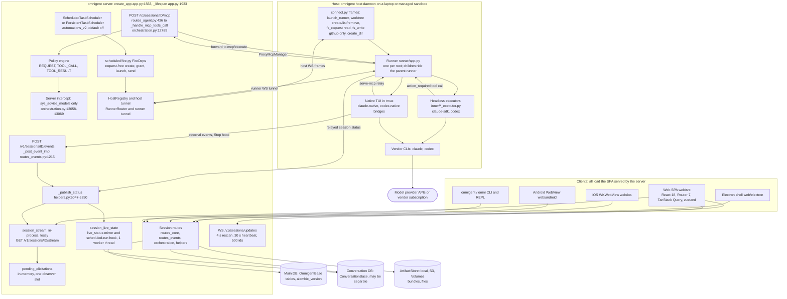

Notes:

- `extra_routers` mount at `app.py:5308-5311` [V]; the SPA mounts last at `/` (`app.py:5313-5323`). All shells load the server's SPA (`web/electron/README.md:98-112`; `web/ios/README.md:1-5`).
- The two databases can be separate (`omnigent/db/db_models.py:93-114` [V]; `omnigent/cli.py:4888`), so a session create and a Coral write never share a transaction.
- Managed sandboxes run the same host daemon (`omnigent/server/managed_hosts.py:1-30`).
- Coral attaches at five points, each a one-line call in a hot file (H.10): server plugin (S32), status-edge observer (S1), MCP handler registry (S10), elicitation observers and verdict handlers (S5, S6), host workspace-op channel (S40).

---

### C.2 Subsystem map

Churn is commits between 2026-10-09 and 2026-11-08 (`git log --since=2026-10-09 --until=2026-11-08 -- <file>`); upstream landed 1,522 commits between 2026-10-09 and 2026-11-08 (`git log --since=2026-10-09 --until=2026-11-08`) in all. Relevance: **Reuse** as is, **Extend** (add a seam without changing behaviour), **Modify** (change upstream behaviour), **Replace** (supersede an Omnigent mechanism or a Draft 4 plan).

| Subsystem | Key paths (churn) | Responsibility | Coral relevance |
|---|---|---|---|
| App composition, lifespan | `app.py` (5,525 lines; 64); `omnigent/cli.py` (14,959; 37) | Builds stores, routers, scheduler, reapers, observers (`create_app` `app.py:1563-1611` [V]). No lifespan or worker hook. | **Extend**: S32 plugin seam carrying routers, lifespan hooks and policy modules (FND-02, K17). |
| Session routes, orchestration | `orchestration.py` (14,185; 77); `helpers.py` (12,742; 52); `routes_core.py` (42); `routes_events.py` (41); `routes_agent.py` (4) | Create, fork, events, elicitations, runner launch and relaunch, MCP proxy | **Extend**: one-line seams S41, S42, S10; logic in `coral.omni` (SES-02-04, TLS-01). |
| Status edges, live state | `helpers.py:5047-5250`; `omnigent/server/session_live_state.py` (500; 3) | Status cache, `live_status` mirror, scheduled-run completion | **Modify**: S1 observer registry with `origin` at four sites, S43 `turn_outcome` (SES-02, K18); S1b `origin` at all 18 sites (OPS-05, upstream only). |
| Live stream | `omnigent/runtime/session_stream.py` (618; 6) | Lossy in-process SSE [V `:9`]; queue cap 1,024 [V `:54`] | **Reuse** for UI only. Never a source of truth. |
| Runner | `runner/app.py` (9,387; 62); `omnigent/runner/tool_dispatch.py` (9,478; 24); `omnigent/runner/native/orchestration.py` (11,493; 57) | Harness subprocesses, tool dispatch, native relay, local timers | **Extend**: S8 engine-tool forwarding, S43 (TLS-01, SES-02). |
| Native bridges | `omnigent/harnesses/claude_native/{bridge.py, forwarder.py, hook.py}` (84 / 25 / 9); `omnigent/harnesses/codex_native/{forwarder.py, app_server.py}` (28 / 34); `omnigent/native/native_policy_hook.py` (1) | TUIs, hooks, transcript forwarders, `/clear` rotation | **Modify**: S14 fail-closed (RUL-04), S2 (HRN-05), S45 (HRN-07). Post-M2. |
| Headless executors | `omnigent/inner/executor.py`; `claude_sdk_executor.py` (4,027; 21); `codex_executor.py` (5,263; 11) | claude-sdk and codex event models | **Reuse** claude-sdk as the M2 mode. **Extend** S13/S63 (HRN-02), S20 (HRN-06). |
| Tool surface | `omnigent/tools/manager.py:159-193`; `omnigent/tools/builtins/advise_models.py` | Builtin registration at construction; schema-only tool precedent | **Extend**: S7 schema-only engine tools opted in by `params.coral`, S50 provider (TLS-01). |
| Policies | `engine.py`; `builder.py` (1,919; 6); `omnigent/policies/registry.py`; `omnigent/policies/builtins/*`; `omnigent/server/routes/session_policies.py` (0) | Build, evaluate, CRUD, builtin handlers | **Reuse** engine and builtins. **Extend**: S52 required-policy provider (RUL-01). |
| Elicitations, approvals | `orchestration.py:470-640, 2400-2559, 2654`; `omnigent/runtime/pending_elicitations.py` (420; 1); `routes_elicitations.py` | Park, publish, resolve, pending index | **Modify**: S5, S6a, S6b (GTE-05). Durable gate rows are Coral's (GTE-01). |
| Scheduler, fire | `omnigent/server/scheduled/fire.py` (2,801; 24); `dispatch_scheduler.py` (1,053; 16); `run_reconciler.py` | Recurring tasks; request-free session orchestration | **Reuse** patterns. **Replace** Draft 4's queue-on-`PersistentTaskScheduler` plan (DUR-04). |
| Persistence | `db_models.py` (1,772; 12); `omnigent/db/utils.py` (1,562; 1); `omnigent/db/migrations/env.py` (97; 0); `omnigent/stores/*` | SQLAlchemy stores, one Alembic chain, five backends | **Reuse** helpers. **Extend** S30, S31; third base and own Alembic env (FND-03, DUR-01). |
| Agents, bundles, profiles | `omnigent/spec/parser.py` (4,149); `spec/types.py` (1,667); `omnigent/server/bundles.py`; `routes/builtin_agents.py` (7); `server/seeded_agents.py` | Spec parsing, bundles, reusable user agents, seeding | **Reuse** rows and bundles. **Extend** S54, S66 (PRF-01, PRF-02). |
| Hosts, worktrees, host FS | `connect.py` (6,387; 62); `frames.py` (25); `git_worktree.py` (795; 2); `omnigent/server/routes/_host_worktree.py`; `_host_filesystem.py`; `managed_hosts.py` (4,870; 17) | Host WS, launch frames, git worktrees, FS read | **Reuse** worktree ops, FS read. **Modify** S71 (bug fix), S72 and S40, the host op channel (WSP-05, WSP-01, WSP-02). |
| Feature flags | `omnigent/server/feature_flags.py` (265; 19) | Closed `Feature` enum (`:23-42`); unknown names fail startup (`:222-265`) | **Replace** for Coral gating: Coral-owned `/v1/coral/info` (X-7; J.2 decisions log item 24). |
| Capabilities, bench | `omnigent/harness_capabilities.py` (184; 0); `omnigent/harness_plugins.py:356-614`; `tests/harness_bench/*` | Per-mode declarations and 12 probes | **Extend**: S22 fields, S23 probes (HRN-01, HRN-08; K9). |
| Web shell | `web/src/App.tsx` (272; 6); `shell/AppShell.tsx` (3,202; 42); `shell/Sidebar.tsx` (7,772; 51); `shell/NewChatDialog.tsx` (52); `store/chatStore.ts` (43) | Routes, shell, sidebar, chat store | **Extend**: S34 route fragment, S80 nav (BRD-02). |
| Web live data | `web/src/hooks/SessionUpdatesProvider.tsx:258-298`; `lib/sse.ts`; `store/streamSlots.ts` | Session-updates watch set, per-session SSE, stream slots | **Reuse** for session panes; runs get their own stream (K8; API-01, WEB-04). |
| Inbox, approvals UI | `web/src/pages/InboxPage.tsx` (13); `components/blocks/ApprovalCard.tsx` (14); `hooks/useIdleNotifications.ts` | Four inbox kinds; approval cards; page-scoped notifications | **Reuse** cards. **Extend**: S36, S37 workflow inbox kind (GTE-02). |
| Theme, brand | `web/src/lib/themePalette.ts`; `index.css` (2,983; 27); `lib/branding.ts` (0); `components/BrandLogo.tsx` | Palettes, tokens, operator branding | **Modify**: brand skin (BRD-01; X-20, X-21). |
| Native shells | `web/electron/{package.json, src/main.js}`; `web/ios/*`; `web/android/*` | Desktop and mobile wrappers | **Modify** identity, updater, deep links (BRD-03, OPS-03). |
| Tests, CI | `tests/conftest.py`; `tests/server/conftest.py`; `tests/e2e/*`; `.github/workflows/ci.yml`; `.github/scripts/ci/python-matrix.json` | Lanes, fixtures, mock LLM, bench | **Reuse** the tiers. **Extend** S31, S39 (FND-04, FND-05). |

**Placement rule.** A seam in a hot file is a one-line call; the logic lives in a low-churn registry module (`session_live_state.py`, `pending_elicitations.py`, `harness_capabilities.py`) or in `coral/` (DD§17; H.10).

---

### C.3 Core execution paths

Seven paths, each as numbered steps with its Coral consequence. Subsections C.3.1-C.3.7 follow.

### C.3.1 Session creation

**HTTP path.** It cannot be reused without a FastAPI `Request`.

1. `POST /v1/sessions` reaches `_create_session_from_existing_agent(..., request: Request, ...)` [V `orchestration.py:11631`]. It reads `request.app.state` and headers, for example `prepare_create_inference(request, …)` (`:12025-12032`).
2. Validation helpers are request-free (`omnigent/server/routes/_session_create_validation.py:97, 153, 337`; `_session_harness_readiness.py:23`).
3. A child (`parent_session_id` set):
   - inherits `parent.runner_id` after an owner check (`orchestration.py:12034-12052`);
   - gets `kind="sub_agent"` [V `orchestration.py:12331`];
   - must use the parent's host (`omnigent/server/schemas.py:1594-1600`) and inherits its sandbox profile (`schemas.py:1540-1541`).
   - Without `host_id`, its `workspace` is stored unvalidated (`orchestration.py:12072-12082`).
4. A child bundle upload mints a content-addressed agent row per session (`orchestration.py:12617-12735`; `bundles.py:324-377`).
5. The row is written by `conversation_store.create_conversation(...)`. It accepts a caller-chosen `conversation_id` [V `conversation_store/__init__.py:542-554`] and raises `ConversationAlreadyExistsError` on reuse [V `sqlalchemy_store.py:1300-1313`].
6. The route sends the runner session-init envelope and grants the owner. It launches a runner only if `runner_id is None` (`routes_core.py:1395`), then announces (`routes_core.py:1257-1440`).
7. Host launch: `resolve_host_launch`, then `_launch_runner_on_host` mints a binding token, writes `runner_id` and sends `host.launch_runner` (`helpers.py:6416-6486`). `_wait_for_runner_client` waits for the tunnel (`helpers.py:5964-6000`).
8. The first message goes through `POST /events` to `_post_event_impl` [V `routes_events.py:1215`]:
   - refuses closed sessions [V `is_session_closed` at `:1693`];
   - runs REQUEST-phase input policy [V `:1706`, `:1777`];
   - calls `_forward_event_to_runner` [V `orchestration.py:7235`]. It persists under the client `stable_id` and still forwards an exact retry ("A persisted retry may still need forwarding", [V `:7300`]).

**Request-free precedent (`fire.py`).**

1. `FireDeps` [V `fire.py:216`] is built in `_lifespan` [V `app.py:2093`].
2. Enter the ambient scopes in this order [V `fire.py:567, 583-584`]: `workspace_scope` (`db_models.py:146-157`), `account_authority_scope` (`omnigent/db/account_authority.py:79-90`), `host_owner_scope` (`omnigent/server/host_registry.py:66-73`). A missing scope is a silent no-op at workspace 0 (`session_live_state.py:123-145`).
3. Create the worktree inside `_create_session_resources` [V `fire.py:1597`]. Roll back with `_remove_session_worktree_best_effort` (`fire.py:1673-1691`).
4. Create the row, `_grant_owner` [V `fire.py:1793`], and attach policies before the first input (`_attach_cost_budget` [V `fire.py:1714`], deterministic `policy_id`).
5. Launch with `_launch_runner_on_host` and `_wait_for_runner_client` (`fire.py:2025-2076`).
6. Send with `_dispatch_session_event_to_runner` [V wrapper `orchestration.py:8062`, impl `:8164`]. It skips the closed refusal, the REQUEST input policy and the sub-agent runner heal.
7. On recovery, read the transcript before resending: `_transcript_evidence` and `_delivered_run_outcome` [V `fire.py:2550, 2564`].

**Coral consequences.**

- SES-03 builds a request-free `create_session` in `coral.omni` on this pattern, using a derived `conversation_id` as the idempotency key (X-6, K10).
- Engine sends go through `_post_event_impl` with an engine context (S41, S42; X-8; SES-02). Today it accepts only `_RunnerEventContext` and `StartupInputContext` [V `routes_events.py:1019, 1652`]. The handle is registered only when `startup_inputs` exists [V `app.py:3815-3819`].
- `created_by` cannot tell the engine from a user (`omnigent/entities/conversation.py:894-903`).

### C.3.2 Tool call: model, runner, MCP, policy, handler

1. The model emits a tool call.
   - Headless: the scaffold emits a `function_call` item with `status: "action_required"` [V `omnigent/runtime/harnesses/_scaffold.py:585`; block `:548-614`].
   - Native: the serve-mcp relay calls `call_tool(name, args)` (`runner/app.py:5392-5400`).
2. The runner chooses local or server dispatch with `should_dispatch_locally` [V `tool_dispatch.py:950`].
   - Local sets: `_ALL_LOCAL_TOOLS` [V `:888`] and `_NATIVE_RELAY_BUILTIN_TOOLS` [V `:488`].
   - `sys_cancel_task` is runner-local [V `:401-408`; handler `:9106`]. Draft 4's "does nothing" is stale (D1.5).
3. For server tools, `ProxyMcpManager` mints `mcpop_<uuid4>` per call [V `omnigent/runner/proxy_mcp_manager.py:341`] and posts to `/v1/sessions/{id}/mcp`.
4. The endpoint [V `routes_agent.py:436-439`, hidden from the schema] checks `LEVEL_EDIT` (`:482-485`). It calls `_handle_mcp_tools_call` [V `orchestration.py:12789`], which parses and length-checks the operation id [V `:12851-12856`].
5. Policy: a fresh engine per call (`orchestration.py:10425-10437`). Build order is session, agent spec guardrails, admin defaults, then `_REQUIRED_APPROVAL_SPECS` (`builder.py:613-654, 76-104`). DENY short-circuits, ASK becomes an MRTR elicitation, and ALLOW may transform arguments (`engine.py:243-433`).
6. Intercept: only `sys_advise_models` is handled server-side, after policy [V `orchestration.py:13058-13069`]. It skips the TOOL_RESULT phase.
7. Every other tool is forwarded to the runner's `/v1/sessions/{id}/mcp/execute` (`omnigent/runner/mcp_routes.py:111-140, 321-349`). The result passes TOOL_RESULT policy and returns.
8. The runner posts `tool_result` to the harness (`tool_dispatch.py:7450-7460`).

**Facts that shape engine tools.**

- **Timeout.** `MCP_PROXY_CALL_TIMEOUT_S` is 7,260 s [V `tool_dispatch.py:208, 229`].
- **Caller identity.** The session id comes from the URL, and any `LEVEL_EDIT` credential can call `/mcp`. The runner-proof precedent is `require_orchestration_source` [V `omnigent/server/session_orchestration.py:80`].
- **Idempotency.** The server sees the operation id, not the harness `call_id`. A model retry after a timeout is a new call (X-5).
- **Fixed surface.** Tool schemas are cached per conversation [V `runner/app.py:5910-5935`]. Headless Codex restarts its app session when the tool signature changes (`codex_executor.py:5225-5246`). So schemas cannot be generated per decision (X-16).
- **Per-mode exposure.**
  - claude-sdk: an in-process MCP server; names are `mcp__omnigent__<name>`, possibly deferred behind `ToolSearch` (`claude_sdk_executor.py:2570-2585`).
  - Codex: `dynamicTools` (`codex_executor.py:3826-3847`).
  - Native modes: a static relay allowlist (`runner/native/orchestration.py:8807-8871, 9819-9846`).
- **Coral consequence.** TLS-01 adds a handler registry beside the intercept (S10), schema-only engine tools (S7, S50; X-4) and runner forwarding (S8). Idempotency comes from slot and decision state (K6).

### C.3.3 Status edge, `_publish_status` and observers

1. Edges come from three sources:
   - the runner's `session.status`, relayed at `orchestration.py:9583`;
   - native `external_session_status` [V `routes_events.py:2689-2711`];
   - 16 other server-originated sites: stops, denies, failures (`eng_sessions.md` §4.2: 18 sites in 4 files).
2. `_publish_status` [V `helpers.py:5047`] first drops an idle that lacks `turn_completed` while the cache says `failed` [V `:5117-5126`].
3. It reads `previous_status` from the per-replica cache and writes the new one [V `:5127-5128`]. On change it calls `_publish_child_status_to_parent` [V `:5130-5131`; def `:4931`].
4. PR refresh `notify_turn_end` runs only for idle after running or waiting, with persistence on [V `:5132-5135`].
5. `persist_live_status` is best-effort [V `:5139-5140`]. All writes share one `ThreadPoolExecutor(max_workers=1)` [V `session_live_state.py:148`].
6. Scheduled-run hook [V `:5151-5159`]:
   - `scheduled_run_outcome == "failed"` records failed; only the orphan reconcile sets it [V `:5284-5289`].
   - Otherwise **every idle records "succeeded"**, including stops, archives, policy denies, forward failures and transcript lulls.
   - `failed` records failed.
7. The response-id cache is updated, then `session.status` goes out on the live stream (`:5203-5250`).

**Bypasses.**

- **B1** `_publish_runner_recovered_status_impl` [V `orchestration.py:4087`; body `:4131-4152`]. The relay also reaches it when a turn the server had written off completes (`:9560-9582`). That is a real turn end the hook never sees.
- **B2** The runner status probe [V `_run_runner_status_probe` `orchestration.py:13666`; cache write and `persist_live_status` at `:13706-13708`, with no `_publish_status` call]. It is a sample, not an edge.

`turn_completed` and `response_id` exist only on the edge, never on the row.

**Turn end per mode.**

| Mode | Edge | Completed vs interrupted | `turn_completed` |
|---|---|---|---|
| claude-sdk | Runner `_publish_turn_status`, relayed | No: both give `idle` (`runner/app.py:4277-4323`) | never |
| codex | Same runner path | No | never |
| claude-native | Stop hook sends `external_session_status` (`claude_native/forwarder.py:4712-4722`) | Interrupt fires no Stop hook | Stop idle only |
| codex-native | `turn/completed` (`codex_native/forwarder.py:8273-8395`) | Partly (`external_session_interrupted`) | never (S2) |

Native executors' `TurnComplete` is a delivery receipt, not a completion (`omnigent/inner/claude_native_executor.py:553`). The only durable truth is `conversations.live_status` plus transcript items. The scheduler's rule is idle **and** the newest non-bookkeeping item is an assistant reply (`fire.py:2540-2577`).

**Coral consequences.**

- SES-02 lands S1 (observer list in `session_live_state.py`, plus B1 and B2 notifies), `origin` at the four sites the rule needs, and S43 `turn_outcome` (J.2 decisions log item 16; K18). S1b, `origin` at all 18 sites, is OPS-05's upstream-only PR.
- ENG-11 holds the pure turn-end rule. SES-08 wires per-mode facts.
- Observers must enqueue cheaply, because `_publish_status` runs synchronously on the event loop.

### C.3.4 Elicitation and approval

1. There are four producers:
   - **(a)** A policy ASK at TOOL_CALL becomes an MRTR elicitation.
   - **(b)** `_publish_and_wait_for_harness_elicitation` [V `orchestration.py:472`] needs a `Request`. It parks an in-process Future (`_elicitation_registry.py:21-28`) and returns `None` on timeout.
   - **(c)** The `mcp_elicitation` event branch publishes `elicit_<hex>` without parking and mirrors it to ancestors [V `routes_events.py:2222`; block `:2222-2257`].
   - **(d)** The native ask gate `_hold_native_ask_gate_impl` [V `orchestration.py:2654`].
2. `session_stream.publish` calls `record_publish`, which updates the in-memory pending index (`session_stream.py:354-398`; `pending_elicitations.py:1-59`). Counts are persisted for other replicas (`session_live_state.py:312-338`).
3. **One** observer slot: `set_elicitation_observer` replaces any previous observer [V `pending_elicitations.py:68-87`]. It is wired to `SubagentBlockNotifier` through `configure_subagent_block_notifier` [V `app.py:1995`], with no exception isolation (`:183-198`).
4. A child's approval left unanswered for 120 s wakes the **parent agent** [V `omnigent/runtime/subagent_block_notifier.py:55, 289`].
5. Resolution goes through `POST /events` `approval` (`routes_events.py:2208-2221`) or `POST …/elicitations/{eid}/resolve` [V `routes_elicitations.py:74`; `ELICITATION_RESOLVE_LEVEL = LEVEL_EDIT` `:60`]. Both reach `_resolve_elicitation(session_id, data, …)` [V `orchestration.py:2400`]. **Neither passes the resolving user.**
6. UI: `/approve/:sessionId/:elicitationId` sits outside the shell [V `web/src/App.tsx:180`] and reads the in-memory index (`routes_elicitations.py:143-207`). `ElicitationSchemaForm` renders enum, boolean, number and text fields. Inbox approvals come from `pending_elicitation_count`.
7. A policy ASK times out to DENY (`omnigent/runtime/policies/approval.py:142-146`). The default `ask_timeout` is 86,400 s (`spec/types.py:40`).

**Coral consequences.**

- GTE-05 lands S5 (observer list with isolation), S6a (request-free publish with stable ids) and S6b (verdict handlers plus resolver identity).
- GTE-01 owns durable gate rows and re-publishes them at startup.
- S51 exempts engine children from the parent wake.
- Never build a gate on policy ASK.

### C.3.5 Scheduler and fire

1. `_lifespan` builds `FireDeps` [V `app.py:2093`].
2. With `automations_v2` off (the default; [V `feature_flags.py:97-104`], `review_by_release="0.20.0"`, overdue), it builds `ScheduledTaskScheduler` [V `app.py:2120`]. Otherwise it builds `PersistentTaskScheduler` with a `ClaimedRunExecutor` [V `app.py:2124-2132`].
3. The persistent scheduler polls every 30 s (`scheduled/config.py:14`). It claims with lock-and-recheck (`scheduled_task_store/sqlalchemy_store.py:1304-1544`), holds a `StartupLease` (`dispatch_scheduler.py:152-347`) and shards by host ownership (`:374-375, 924-941`).
4. Fire enters the ambient scopes, runs the unattended preflight (`fire.py:958-997`), then creates, grants, attaches policies, launches and sends (C.3.1).
5. Completion is event-driven through `persist_scheduled_run_completion` [V `session_live_state.py:251`], conditional on `status=running`. "There is deliberately NO startup sweep and NO periodic poll" [V `run_reconciler.py:30-33`].
6. Recovery "never sends the prompt again" (`scheduled/README.md:147`), so delivery is at-most-once. The store protocol is typed on `ScheduledTask` (`dispatch.py:8-138`), and Cloudflare D1 is refused (`sqlalchemy_store.py:1186-1194`).

**Coral consequences.**

- Coral copies the patterns, not the scheduler. DUR-04 owns the queue (K5, K21), and DUR-05 owns reconcile and resync. This replaces D§7.6 (D1.2, D5).
- EXT-05 later adds an Automations "Run workflow" trigger.

### C.3.6 Runner loss, host offline and relaunch

1. **Tunnel drop.** `_mark_disconnected_runner_failed` [V `app.py:4049`] fails the session after `RUNNER_DISCONNECT_GRACE_S` (90 s) [V `orchestration.py:8620`]. Grace timers live in memory (`app.py:4036-4041`), so a server restart forgets them.
2. **User host offline mid-turn.** The session is held up to 72 h [V `orchestration.py:8639`] with no edge while held. The old turn may resume when the laptop wakes.
3. **Host returns.** `_relaunch_held_sessions` [V `app.py:4259`] relaunches roots only [V `:4273`]. "Only the user's next message starts new work" [V `:4262-4263`].
4. **Children.** `restore_active_children` [V `omnigent/server/child_session_recovery.py:112`] rebinds interrupted descendants to the parent's recovered runner without replay. It skips children with their own `host_id` [V `:165`]. On reconnect such a child counts as independent [V `app.py:4594-4598`].
5. **Stop.** Owner-only. It stops the host runner only if the session owns it [V `_owns_host_runner` `helpers.py:6260`]. A stop is non-sticky: the next message relaunches (`routes_events.py:1279-1286`). The sticky refusal needs `omnigent.closed=true` [V `omnigent/util/session_lifecycle.py:7-8`].
6. **Interrupt.** A headless interrupt discards the vendor session (`claude_sdk_executor.py:2291-2321`; `codex_executor.py:5045-5076`). A claude-native interrupt is an unconfirmed Escape with a 20 s grace (`runner/native/interrupt.py:329-334, 416-424`).
7. **Reapers** are deployment-wide and skip in-flight work: SDK process manager 1 h (`process_manager.py:1591-1603`), runner watchdog 1 h with `has_active_work` (`runner/app.py:1616-1669`), native pane reaper (`pane_reaper.py:85-87, 140-157`). Managed keep-warm counts runner pongs only. `retry_session` wakes a sleeping sandbox [V `routes_events.py:1287`; commit `f726587bb`].

**Coral consequences.**

- SES-06 owns the restart ladder: fence and stop, new generation, reconnect, salvage and reset, then brief (J.2 decisions log item 12).
- Never restart during the 72 h hold (D26).
- The engine relaunches own-runner children itself (item 33, TLD-02).
- DUR-05 polls `runner_last_seen` for liveness. Root stop takes every runner-sharing child with it, which is why the anchor variant gives steps their own runners (item 14).

### C.3.7 Native `/clear`, fork and supersession

1. **claude-native `/clear`.**
   - `_rotate_session_on_clear` [V `omnigent/harnesses/claude_native/hook.py:419`] calls `_create_clear_replacement_session` [V `:542`].
   - That reads the old session and posts `POST /v1/sessions` with the body from `clear_replacement_create_body` [V `omnigent/native/_native_supersession.py:24-51`]: `agent_id`, **all labels**, title and project. There is no `parent_session_id` and no session policies.
   - It then rebinds the runner, transfers the terminal and re-keys the old bridge id.
2. The old session receives idle, a notice and `external_session_superseded` (`_native_supersession.py:99-199`; `routes_events.py:2469-2478`). These go to `_publish_session_superseded` [V `helpers.py:5732`].
3. **codex-native** rotates on `thread/started` (`codex_native/forwarder.py:2901-3030`).
4. **claude-sdk `/clear`.** `clear_session_into_fresh_session` (`routes_core.py:5263-5296`) calls the `_continue_session_in_fork` closure (`routes_core.py:4969-5296`).
   - It needs a `Request` and `LEVEL_OWNER` [V `:5009-5012`].
   - It refuses `kind == "sub_agent"` [V `:5013-5017`], side chats and running turns.
5. `_fork_session` (`routes_core.py:4280-4700`) copies labels minus a drop set (`:4527-4544`) and creates a top-level session.
6. `SupersessionReason = Literal["clear"]` [V `schemas.py:4209`].

**Coral consequences.**

- HRN-07 follows native rotation through S45.
- Refresh is a slot restart, not a fork (X-9; SES-07). S25 shrinks to the `"refresh"` literal.
- Reserving a `coral.` label prefix would make rotation fail with 400 (D29, X-29). A rotated run session is a top-level session that carries `coral.*` labels.

---

### C.4 Policies and capabilities

**Policy engine.**

- DENY short-circuits, ASK accumulates, exceptions fail closed (`engine.py:243-433, 1111-1116`). Session policies are cached 30 s per replica.
- **Inheritance.** Root **session** policies are prepended for every child [V `builder.py:756-768`]. Child spec guardrails are appended only for `sub_agent_name` children of the root bundle (`builder.py:482-516, 728-751`). An engine-created child with its own agent row does **not** inherit the orchestrator's spec guardrails (X-11; DD§9.3 item 6 is wrong).
- **Labels.** Policy `set_labels` has no reserved-prefix check (`engine.py:521-547`). Seeds are refused by `_reject_server_reserved_label_seed` (`helpers.py:10884-10940`). The precedent for a server-owned prefix is `sandbox_profile:` (`omnigent/stores/sandbox_profile_store.py:16-26`).
- **CRUD.** Session-policy CRUD needs `LEVEL_EDIT`, allowlists python handlers and has no name protection (`session_policies.py:158-437`).
- **Useful builtins:**
  - `cel_policy`, `blast_radius`, `spawn_bounds`, `worktree_guard`, `subagent_cost_budget`;
  - `read_only_os`, which denies write and edit only; "shell commands are left untouched" [V `omnigent/policies/builtins/orchestration.py:645-660`] (X-28, D7);
  - `cost_budget`, which ASKs at soft thresholds, DENYs at the cap and **ASKs on unpriced usage** [V `omnigent/policies/builtins/cost.py:505-508`] (D34). It never pauses (D1.4).
- **Spend helpers.** Tree spend `load_session_usage*` (`builder.py:1263-1375, 1437-1494`) prefers `policy_cost_usd`.

**Capabilities and per-mode behaviour.** Declared in `harness_plugins.py:358-386, 591-614`. `steering`, `live_queue`, `images` and `compaction` default to `None` [V `harness_capabilities.py:155-158`].

| | claude-sdk | codex | claude-native | codex-native |
|---|---|---|---|---|
| Integration | sdk-in-process | cli-subprocess | native-tui | native-tui |
| Base tools | `Skill`, `ToolSearch`, optional `AskUserQuestion` [V `claude_sdk_executor.py:2571-2586`] | Codex's own shell and `apply_patch` | Full vendor toolset | Full vendor toolset |
| Pre-call gating of workspace tools | All (only `sys_os_*`) | Omnigent tools only; shell observed after the fact (`codex_executor.py:2774-2834, 3829`) | Hook catch-all | Hook catch-all unless disabled |
| Gate failure mode | DENY (`omnigent/runner/policy_proxy.py:72-111`) | DENY for Omnigent tools | **ASK** [V `claude_native/hook.py:1238-1242`]; early returns fail open (`:1208-1222`) | ASK |
| Sandbox | CLI outside the network sandbox (`claude_sdk_executor.py:1601-1607`) | read-only **silently upgraded** to workspace-write when tools exist [V `codex_executor.py:5245-5247`] | TUI inherits `os_env.sandbox` and `egress_rules` | TUI inherits; app-server wrap UNVERIFIED |
| Unattended stance | `permission_mode` default `auto` [V `omnigent/inner/claude_sdk_harness.py:135`] | `approvalPolicy: "never"` | `--permission-mode` from config | `--dangerously-bypass-approvals-and-sandbox` default for children [V `helpers.py:10631-10660`] |
| Usage-limit signal | none | `account/rateLimits/updated` ignored [V `codex_executor.py:4569-4576`] | StopFailure category | `codexErrorInfo` |

- **Router.** "The gate is **advisory**" [V `omnigent/runner/subagent_routing.py:1-8`]. Draft 4's "fail-closed router" is false (D1.1).
- **Egress.** `egress_rules` is a default-deny L7 allowlist (`omnigent/inner/datamodel.py:753-765`) (D1.6).
- **Bridge credential.** claude-native writes a user bearer into the bridge-dir hook config [V `runner/native/orchestration.py:9290, 9833`], so a same-user native agent could post approvals (D25).
- **Catalog.** `GET /v1/harnesses` drops the native rows (`harness_plugins.py:941-953`). The bench has 12 probes and none for steering, resume or compaction.
- **Coral consequence.** Only claude-sdk can earn Enforced labels at M2 (RUL-02). Native modes need S14 (RUL-04), and headless codex needs S20 (HRN-06).

---

### C.5 Agents, bundles and profiles

- **Dialects.** There are two: single-file compat (tech debt, `omnigent/spec/__init__.py:241-251`) and bundle `config.yaml` with `spec_version` (`parser.py:200-367`).
- **Unknown keys.** The parser silently drops unknown top-level keys (`parser.py:339-367`). `params` passes through verbatim [V `parser.py:290`], so `params.coral` needs no parser change (X-4; K12).
- **Harness selection.** Only through `executor.config.harness`, marked "TECH DEBT ... do NOT extend" (`spec/types.py:544-556`).
- **OS tools.** `os_env` gates them: no `os_env`, no `sys_os_*` [V `tools/manager.py:632-634`]. The session-read tools are registered for every agent (`manager.py:402-470`), so input scoping is breakable today (D4.3).
- **Agent rows** (`db_models.py:196-245`) carry `kind` (server=1, user=2), `bundle_location`, `version` and `created_by`.
- **API.**
  - `POST /v1/agents` installs; a reinstall updates the row in place.
  - `PATCH /v1/agents/{id}` takes an ETag. `AgentConfigPatch` has `extra="forbid"` [V `schemas.py:200-203`], so it cannot edit `params`.
  - Uploads bind content-addressed rows (`bundles.py:324-377`). These rows are `kind=user` and appear in `GET /v1/agents?scope=user` (`agent_store/sqlalchemy_store.py:523-545`), which pollutes the picker (S54).
- **Drift.** Each turn carries `agent_revision`, and the runner rebuilds on change (`runner/app.py:8410-8449`). Running sessions follow edits (`designs/REUSABLE_USER_AGENTS.md:112`). Drift vectors are PATCH, reinstall, `PUT /v1/sessions/{id}/agent`, session MCP edits and forced delete. Profiles therefore need pinned revisions (PRF-02; D23).
- **Secrets.** Uploaded bundles are not `${VAR}`-expanded (`bundles.py:110-117`). CLI installs bake resolved secrets into the blob (`cli.py:6614-6644`) (D1.11).
- **claude-sdk auth.** With no provider and no key, the CLI uses its own subscription login (`omnigent/runtime/workflow.py:1123-1260`). The executor strips `ANTHROPIC_API_KEY` (`claude_sdk_executor.py:2091-2118`). This drives S13 and the credential guard (HRN-02; OQ-28).
- **Seeding.** `OMNIGENT_SEEDED_AGENTS` filters built-ins (`seeded_agents.py:18-49`). `OMNIGENT_BUILTIN_AGENT_DIRS` adds more, with server-side `${VAR}` expansion (`app.py:1135-1205`).
- **Web.** Settings → Custom agents (`lib/agentsApi.ts`, `SettingsCustomAgentsSection.tsx`), default on. The UI doc's Profiles desk duplicates it (D3.7).

---

### C.6 Hosts, worktrees and workspace access

| Capability | At HEAD | Evidence |
|---|---|---|
| Worktree create, list, remove | Git with argv lists, validated refs, a 3,600 s budget and rollback, under `<parent>/<repo>-worktrees/<dir>`. **No merge, commit, reset, fetch or push.** The result has no HEAD commit. | `git_worktree.py:69-101, 419-448, 493-708` |
| Server proxies | `create_worktree_on_host` [V `_host_worktree.py:190`], `remove_…` `:260`, `list_…` `:309`; capability token `CAP_WORKTREE_CREATE_BUDGET` | `frames.py:90-109` |
| Session git options | Create and bind modes. Managed sessions reject `git` (D24). | `schemas.py:1455-1514, 2011-2013` |
| Host file **read** without a session | `read_workspace_from_host` [V `_host_filesystem.py:60`] sends `host.fs_request`. It reads a file of at most 10 MiB, confined to the workspace root, with a 20 s timeout (X-18). | `connect.py:3793` [V]; `frames.py:1148-1175` |
| Host file **write** | `fs_write` serves `github_*` ops only | `connect.py:4392-4557` |
| HTTP host FS | Lists directories and creates them only | `omnigent/server/routes/hosts.py:1561-1745` |
| Session shell | `POST /v1/sessions/{sid}/resources/environments/{env}/shell`: owner-only, no policy gate, needs runner and `os_env` | `routes_resources.py:3257-3297` |
| Changed files | `GET …/environments/{env}/changes` (git status porcelain) | `omnigent/runner/resource_routes.py:1230-1245` |
| Orphan reaper race | Worktree handlers pause the reaper [V `connect.py:4580`]. **`fs_request` and `fs_write` use a plain `asyncio.to_thread`** [V `connect.py:6027-6035`], so an exit status can be stolen. | WSP-05 (S71) |
| Observation points | `pr_observer` is called from `sys_os_shell`, headless completions, the native PostToolUse relay and managed MCP | `tool_dispatch.py:7297-7307`; `bridge.py:8233-8250` |
| Per-worktree setup | None | grep |
| Delete with `delete_branch` | Removes the worktree **and** branch of any session with `git_branch`, `workspace` and `host_id` | `routes_events.py:4166-4189` |
| Sandboxed commits in linked worktrees | UNVERIFIED (the git common dir sits outside the write roots) | SPK-04 |

**Coral consequences.**

- WSP-01 binds repos and the run worktree with S72 (`head_commit`). EVD-04 later amends S72 with a detached mode.
- WSP-06 does commit, salvage and reset through the session shell at M2.
- WSP-02 adds the sessionless host op channel (S40, K20) for fingerprints. The server has no FS (D12).

---

### C.7 Persistence

- **Bases.** `OmnigentBase` and `ConversationBase` [V `db_models.py:93, 104`]. After every upgrade Omnigent runs `create_all` for both [V `omnigent/db/utils.py:611-618`], and CockroachDB bootstrap does the same (`omnigent/db/cockroachdb.py:289-300`). `CoralBase` must be a third base.
- **Migrations.**
  - One Alembic chain: 121 revisions [V], head `f1c7a9e2b406` [V], one merge revision.
  - Single-head enforced (`utils.py:695-742`).
  - `env.py` has no `include_name` filter (`:51-56, 85-89`), hence S30.
- **CockroachDB ordering.** It refuses to bootstrap a non-empty DB or resume with unexpected tables (`cockroachdb.py:139-145, 168-178`). Coral's schema step must run after Omnigent reaches head (FND-03).
- **Conventions.**
  - `workspace_id` leads every PK. Existing tables use `server_default="0"` [V `db_models.py:1109`], which `docs/DATABASE_BEST_PRACTICES.md` forbids for new tables.
  - `Uuid16`, SmallInteger enums with CHECKs, no FKs, hard deletes.
  - Values up to 16,383 bytes. `CompressedText` is uncapped unless `max_stored_bytes` is set (`compression.py:127-145`).
  - Schema changes ship in standalone PRs.
- **Transactions.**
  - `make_managed_session_maker(immediate=True)` issues `BEGIN IMMEDIATE` on SQLite [V `utils.py:901`]. SQLite runs WAL with `busy_timeout=20000`.
  - CockroachDB is forced to READ COMMITTED.
  - `run_write_transaction` [V `utils.py:1032`] retries only CockroachDB 40001 and MySQL 1213, not version conflicts.
  - Named sessions: `make_named_managed_session_maker` [V `utils.py:982`] (CLAUDE.md rule).
- **Labels.** PK `(workspace_id, conversation_id, key)` with **no value index** [V `db_models.py:1102-1118`]. A label reverse lookup is a scan, so idempotency uses derived ids (X-6).
- **Artifact store.** The ABC has `put`, `get`, `delete` and `exists`, with **no list** [V `omnigent/stores/artifact_store/__init__.py:37-71`]. Bundles live at `{agent_id}/{sha256}`.
- **Backends.** SQLite (default), Postgres (incl. Lakebase), CockroachDB 23.2.28+, MySQL 8 and Cloudflare D1 (partial; the scheduler refuses it).
- **No durable-execution library.** DBOS appears only in `scripts/dump_openapi.py:48-51`.
- **Account lifecycle.** `_revoke_durable_authority` and `_carry_registration_work` list Omnigent tables explicitly (`accounts_store.py:75-185`). Coral rows are not covered (DUR-06).

---

### C.8 Frontend structure

- **Stack.** React 18, React Router 7.18.4, TanStack Query 5, zustand 5, zod 4, Tailwind 4 with shadcn. `@xyflow/react` ^12.11.1. Monaco ^0.55 without a YAML language service [V `shell/monacoSetup.ts:9-12`; worker `:52-57`]. No direct `yaml` dependency and no layout library. pnpm `minimumReleaseAge` is 7 days. Builds into `omnigent/server/static/web-ui`.
- **Routes** [V `App.tsx:165-256`]:
  - `/`, `/c/:conversationId`, `/grid/:gridId`, `/inbox`, `/canvas` (flag), `/tasks*`, `/usage`, `/settings/*`, `/extensions/:extensionId/*`, `/members`, `/policies`;
  - `/approve/:sessionId/:elicitationId` outside the shell.
  - There is no `/workflows`, `/schemas` or `/profiles` (D3.1). The SPA fallback 404s paths with a file extension (`app.py:5348-5362`).
- **AppShell.** It reads `useParams().conversationId` [V `AppShell.tsx:321`], so a nested `:conversationId` route flips it into chat mode (D31). It mounts `useIdleNotifications` [V `:668`].
- **Sidebar.**
  - The brand row shows `app_name` or the wordmark, with no mark (`Sidebar.tsx:1252-1278`).
  - `useActiveNavItem` treats unknown routes as "New session" [V `Sidebar.tsx:593-606`] (S34).
- **Branding.** `DEFAULT_APP_NAME = "Omnigent"` and `DEFAULT_HEADING = "What should we build?"` [V `branding.ts:4-5`]. Operator branding cannot use SVG and turns on "Powered by Omnigent" (D3.6).
- **Theme.** The `omni` palette is labelled "Omnigent" [V `themePalette.ts:216-218`]. Status tokens in `index.css` apply to every palette. `--font-heading` [V `index.css:45`] is already used by `CardTitle` [V `components/ui/card.tsx:41`] and `DialogTitle` [V `dialog.tsx:146`], hence a new `--font-display` (X-20).
- **Live data.**
  - The WS watch set covers sidebar, open and mounted child ids, capped at 500 [V `common.py:725-731`].
  - Per-session SSE ignores `id:` lines (`lib/sse.ts`).
  - Stream slots: 3 on HTTP/1.1, 30 on HTTP/2 (`conversationRegistry.ts:64-84`).
  - `GET /v1/sessions` returns top-level rows by default (`routes_core.py:2096`).
- **Inbox.** A closed union `approval | comment | unread | automation` [V `InboxPage.tsx:189-193`]. Automation read state lives in localStorage. There is no push code anywhere (`browserNotifications.ts:8-10`) (D1.3).
- **Reusable components.** `SubagentTabPane` (`shell/SubagentTab.tsx:40-77`), `ApprovalCard`, `SubagentsGraphView` nodes, `useChildSessions`, `SessionStateBadge`, and the `CreateScheduledTaskDialog` host, repo and worktree pickers.
- **API client.** Hand-written `lib/*Api.ts` modules with lint-enforced `authenticatedFetch`. There are no generated types.
- **Shells.**
  - Electron identity [V `web/electron/package.json:3, 42, 58`]: `productName "Omnigent"`, `appId ai.omnigent.desktop`, updater `https://omnigent.ai/_desktop/updates/`.
  - Deep links accept only `/c/<id>` (`deepLink.js:20-45`).
  - Mobile notifications are foreground-local.
- **Test constraints.** `@xyflow/react` OOMs in jsdom, so graph logic must be xyflow-free. `index.css.test.ts` pins tokens. Branding E2E pins the brand (`tests/e2e_ui/branding/test_branding.py:116-124`).

---

### C.9 Testing infrastructure

- **Lanes.**
  - Unit matrix: 18 groups. `misc` catches new top-level dirs but ignores `tests/stores` and `tests/db` [V `python-matrix.json:73-77`].
  - DB lanes (Postgres 16, CockroachDB 23.2.28, MySQL 8) run only `tests/stores tests/db` (`ci.yml:231-375`). Coral DB tests must live in `tests/stores/coral/` (DD§4.2 is wrong).
  - E2E lane installs `claude`, `codex` and `pi` (`.github/actions/e2e-run/action.yml:101-128`).
  - `web-tests.yml` runs vitest. `lint.yml` runs pre-commit.
- **Fixtures.** `db_uri` gives a SQLite file per test. External backends truncate every table except `alembic_version` [V `tests/conftest.py:736`], so `coral_alembic_version` would be wiped (S31).
- **Deterministic agent tiers.**

  | Tier | What | Evidence |
  |---|---|---|
  | A | In-process `ControllableMockClient` + `CapturingRunnerClient` | `tests/server/conftest.py:183-303`; `tests/server/helpers.py:1031-1076` |
  | B | Process mock LLM (Responses, Messages, Chat Completions; keyed queues, gates) | `mock_llm_server.py` |
  | C | Resilience lab: real Claude Code or Codex TUIs against the mock, with server restart mid-turn | `tests/e2e/resilience/lab/*` |
  | D | Narrow fakes: runner harness, ACP fake, Codex app-server fakes | — |

- **Gaps.**
  - No deterministic claude-sdk fake. Whether it honours a mock `ANTHROPIC_BASE_URL` is UNVERIFIED (SPK-03).
  - pyrefly, isort and coverage cover `omnigent` only (`pyrefly.toml:1-5`) (FND-05).
- **OpenAPI.** `scripts/dump_openapi.py` builds `create_app(...)` with no `extra_routers` [V `:338-356`]. Coral routes never reach `openapi.json`, which itself had 69 commits between 2026-10-09 and 2026-11-08 (API-01 owns a separate Coral spec).
- **Feature-map test.** `tests/dev/test_verify_omnigent_feature_map.py:110-174` fails CI on unmapped bench probes, UI test areas or CLI commands.
- **Time fakes.** `FakeClock`, `FakeScheduleSeam` and `FakeTimer` (`tests/server/scheduled/test_scheduler.py:44-90`).

---

### C.10 Fork-operations facts

- **Tag topology** [V `git merge-base --is-ancestor`]:
  - `v0.20.0`, `v0.21.0` and `v0.22.0.dev20261108` are **not** ancestors of HEAD.
  - The nightly's first parent `ee7a319f7` **is** an ancestor.
  - Merge from `nightly^1` (X-19; OPS-02), not from tags (D§16 is wrong).
- **Pace.** 1,522 commits between 2026-10-09 and 2026-11-08 (`git log --since=2026-10-09 --until=2026-11-08`), with weekly minors. Upstream squash-merges, so history is linear.
- **Hot files** (non-test code files; commits in the window above):

  | File | Commits |
  |---|---|
  | `claude_native/bridge.py` | 84 |
  | `_sessions/orchestration.py` | 77 |
  | `openapi.json` | 69 |
  | `server/app.py` | 64 |
  | `host/connect.py`, `runner/app.py` | 62 each |
  | `runner/native/orchestration.py` | 57 |
  | `pages/ChatPage.tsx` | 54 |
  | `_sessions/helpers.py`, `NewChatDialog.tsx` | 52 each |
  | `Sidebar.tsx` | 51 |

  DD§17 lists only `helpers.py` and `AppShell.tsx`.
- **Inherited workflows.**
  - About 118 workflow files: 36 are repo-gated and inert in the fork, and about 14 non-gated ones use secrets.
  - 40 `uses:` lines pin upstream composite actions by SHA.
- **Coexistence hazards** (OPS-03; D30, OQ-53):
  - `update_check.py:66, 1622, 1843` would offer a Coral install upstream Omnigent.
  - `~/.omnigent` is shared, and 24 files hardcode it.
  - The "database newer than this build" lockout (`utils.py:745-765`).
  - Electron CLI detection needs the binary to be named `omnigent` or `omni` (`omnigent_cli.js:277, 614`).
- **Absent files** [V `ls`]:
  - `coral-requirements.md` (D2);
  - `coral/`, `web/src/workflows/` and `web/src/components/concerto/` (D3.4);
  - the upstream `designs/SESSION_GIT_WORKTREE.md` and `designs/SESSION_WORKSPACE_SELECTION.md`, which code cites (D33).

---

### C.11 What Coral reuses as is vs what blocks Coral today

**Reused as is** (no upstream change):

| Primitive | Evidence |
|---|---|
| Caller-chosen `conversation_id` with a duplicate error (idempotent session create) | [V `conversation_store/__init__.py:554`; `sqlalchemy_store.py:1300-1313`] |
| Request-free orchestration patterns: ambient scopes, preflight, grant, launch, transcript-evidence recovery | `fire.py:567-586, 958-997, 1793, 2550-2577` |
| `StartupLease` and lock-and-recheck claims as queue templates | `dispatch_scheduler.py:152-347`; `scheduled_task_store/sqlalchemy_store.py:1304-1544` |
| A single MCP chokepoint with TOOL_CALL policy before any handler | `orchestration.py:12789-13069` |
| Policy builtins: `cel_policy`, `blast_radius`, `spawn_bounds`, `worktree_guard`, `egress_rules` | `omnigent/policies/builtins/*`; `datamodel.py:753-765` |
| claude-sdk's narrow base tools (only `sys_os_*` touch the workspace) | [V `claude_sdk_executor.py:2571-2586`] |
| Worktree create, list and remove, and host file read | [V `_host_worktree.py:190-309`; `_host_filesystem.py:60`] |
| Per-session usage and tree spend helpers | `builder.py:1263-1375` |
| Approval UI (`ApprovalCard`, `ElicitationSchemaForm`, `/approve` route) | [V `App.tsx:180`] |
| Session-updates socket, child-session queries, full-session panes | `SessionUpdatesProvider.tsx:258-298`; `SubagentTab.tsx:40-77` |
| `@xyflow/react` and Monaco already in the bundle | `web/package.json:67, 76` |
| Test tiers A-C, `FakeClock`, the harness bench | C.9 |

**Top 15 constraints that block Coral today.**

| # | Constraint | Evidence | Closed by |
|---|---|---|---|
| 1 | No turn-end truth. Every non-orphan idle records "succeeded". Headless modes cannot tell completed from interrupted. Two bypasses. | [V `helpers.py:5158-5159`]; `runner/app.py:4277-4323`; [V `orchestration.py:4087`] | SES-02 (S1, S43), ENG-11, SES-08 |
| 2 | No durable signal, timer or effect queue. `PersistentTaskScheduler` is at-most-once and flag-off. | [V `feature_flags.py:97-104`]; `scheduled/README.md:147` | DUR-04, DUR-05 (D1.2, D5) |
| 3 | Session create needs a FastAPI `Request`, and direct dispatch skips the closed refusal and input policy | [V `orchestration.py:11631`]; [V `routes_events.py:1693, 1706`] | SES-03, SES-02 (S41, S42; X-8) |
| 4 | `_post_event_impl` accepts no engine context, and its handle is dropped without managed sandboxes | [V `routes_events.py:1019, 1652`; `app.py:3815-3819`] | SES-02 (S41, S42) |
| 5 | One hard-coded server intercept. The caller is any `LEVEL_EDIT` credential. The idempotency id is a per-call uuid4. | [V `orchestration.py:13058-13069`; `proxy_mcp_manager.py:341`] | TLS-01 (S10, S7, S8; X-5) |
| 6 | Tool surface fixed per conversation | [V `runner/app.py:5910-5935`] | TLS-01 generic schemas (X-16) |
| 7 | Gates are not durable: in-memory index, one observer slot, no resolver identity, policy ASK times out to DENY | [V `pending_elicitations.py:68-87`; `routes_elicitations.py:60`]; `approval.py:142-146` | GTE-05 (S5, S6a, S6b), GTE-01 |
| 8 | Enforcement exists only in claude-sdk: native fails to ASK, codex shell ungated, `read_only_os` leaves shell, router advisory | [V `claude_native/hook.py:1238-1242`; `codex_executor.py:5245-5247`; `builtins/orchestration.py:645-660`; `subagent_routing.py:1-8`] | RUL-01, RUL-02, RUL-04, HRN-06 (D17, X-28) |
| 9 | Child sessions wake the parent after 120 s, share the root's runner and stop with it | [V `subagent_block_notifier.py:55`; `helpers.py:6260`] | SES-03 anchor variant (item 14; X-1), S51 |
| 10 | Host return relaunches roots only, without replay. Grace timers are in memory. 72 h silent hold. | [V `app.py:4273`; `orchestration.py:8639`]; `app.py:4036-4041` | SES-06, DUR-05 (D26) |
| 11 | Native `/clear` rotates to a top-level session with all labels and no policies. The fork refuses sub-agents. | [V `_native_supersession.py:24-51`; `routes_core.py:5013-5017`] | HRN-07 (S45), SES-07 (X-9, X-29) |
| 12 | Persistence: two bases, `create_all` on both, one Alembic chain, CockroachDB ordering, truncation spares only `alembic_version`, no label value index | [V `utils.py:611-618`; `db_models.py:1102-1118`; `tests/conftest.py:736`] | FND-03 (S30, S31), DUR-01 |
| 13 | No plugin mount or lifespan hook. The CLI omits `extra_routers`. OpenAPI omits them. The flag enum is closed. | [V `cli.py:5118-5147`; `dump_openapi.py:356`]; `feature_flags.py:222-265` | FND-02 (S32; X-7), API-01 |
| 14 | No host write or git commit, merge, reset op, and `fs_request` races the orphan reaper | `git_worktree.py:493-708`; [V `connect.py:6027-6035`] | WSP-05 (S71), WSP-06, WSP-02 (S40), WSP-07 |
| 15 | No push channel. The inbox is a closed union of four kinds. The brand, palette and Electron identity are Omnigent's. | `browserNotifications.ts:8-10`; [V `InboxPage.tsx:189-193`; `branding.ts:4-5`; `electron/package.json:58`] | GTE-02, GTE-03, GTE-04; BRD-01, BRD-03 (D1.3) |

Agent revision drift (C.5) and fork-operations hazards (C.10) are the next two constraints. PRF-02, OPS-02 and OPS-03 own them.

## D. Target-State Architecture

This section describes Coral at M4 (planned week 30.5) on the fork at `2a9cbe2c2` (0.22.0.dev0), naming the feature that builds each part. Sources are `architect.md` §2-§5, DD§4-§8, the contract catalog (D.7), the decisions log (J.2), the hot-file landing order (H.10) and the migration train (D.6). None of `coral/`, `web/src/workflows/`, `web/src/brand/`, `tests/coral/` or `docs/coral/` exists at HEAD (checked with `ls`), so every Coral path below is new. Decision records are in section J. Every TLD still needs sign-off.

### D.1 Component view

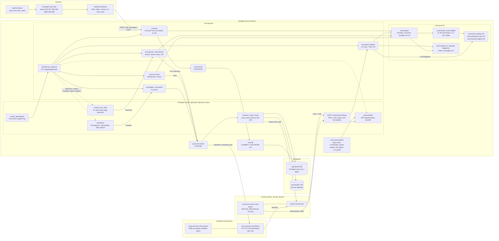

Solid arrows are calls or data. Dotted arrows are one-time K17 registrations. Seam ids name the upstream edit behind each Omnigent box (§D.8).

Five paths cross the boundary, each with one entry (arch §2.3, DD§4.1):

1. **Engine to Omnigent: only `coral.omni` (K4).** K21 executors create sessions, attach policies, brief, interrupt, stop, publish gates and run workspace ops. Effects carry an `effect_key`, and session ids are `uuid5(effect_key)` (K10).
2. **Agents to the engine: only six tools (K6, TLD-20):** `coral_submit_handoff`, `coral_choose_arrow`, `coral_assign_agents`, `coral_assign_task`, `coral_message_agent`, `coral_ask_user`. Calls go runner → `/v1/sessions/{id}/mcp` → TOOL_CALL policy → S10 registry beside the `sys_advise_models` intercept (`orchestration.py:13058-13069`) → handler → one CAS transaction (TLS-01..05).
3. **Omnigent to the engine: only durable facts.** The S1 registry in `omnigent/server/session_live_state.py` replaces the hard-wired scheduled hook (`helpers.py:5151-5199`). SES-08 persists TurnFacts as unapplied `coral_signals` rows plus the slot edge columns `last_edge_status`, `last_turn_outcome` and `last_edge_at` (K5), ENG-11's `reconcile` reads them, and DUR-05's resync catches lost edges.
4. **Users to the engine: `/v1/coral/*` and the run stream (K7, K8, API-02).** Answers given in Inbox or `/approve` return through S6b (GTE-05, GTE-01).
5. **Engine to host: K13.** The session shell (WSP-06) serves until WSP-07's swap (IM-6, week 20), then the K20 host channel (WSP-02), with the shell kept as the version-skew fallback. Under the op-host rule, write ops run only in the slot's writable session at a detected turn end.

### D.2 Package layout

Tier tags follow §D.3: `[a]` pure, `[b]` omni, `[c]` db, `[app]`, `[root]`.

```text
coral/                     in the Omnigent wheel via include coral* (S29, FND-01)
  cli.py, version.py       [root] coral CLI (FND-01); [app] distribution identity (OPS-03)
  identity.py              [a] K10 labels and derived ids (SES-01)
  server_plugin.py         [root] K17 PluginRegistration (FND-02)
  model/, validate/        [a] K1 IR, compiler, hash; V1-V13, labels (ENG-01..03, RUL-02, RUL-06)
  engine/                  [a] reducer, machines, reconcile, turn_end, classify, simulate, repeat (ENG-01..11); budget (RUL-05)
  runview/                 [a] K8 RunView and patch types (API-01, co-signed by ENG-01)
  evidence/                [a] ir, evaluate, fingerprint, match, messages (EVD-01); [app] fakes (EVD-01), capture, detect (EVD-02, EVD-03)
  rules/                   [a] catalog, including catalog/ir.py (K15); [app] compile (RUL-03)
  workspace/               [a] ops = K13; [app] fake, session_shell, host_backend, merge (WSP-01..07)
  templates/               package data: MVP loop, single-agent, PR review (ENG-07, HRN-03, SES-10)
  profiles/                [app] seeds, revisions (PRF-01, PRF-02)
  harness/                 [a] registry: K9 types, CapabilityMatrix, EnforceabilityInputs (HRN-01)
  db/                      [c] CoralBase, migrate, models, migrations (FND-03, DUR-01)
  stores/                  [app] K5 protocols and stores (DUR-01..03, table owners)
  queue/, workers/         [app] K21 registry, drainer, worker lease, timers (DUR-01, DUR-04)
  reconcile/, signals/     [app] startup pass, resync (DUR-05); TurnFacts, nudges (SES-08)
  recovery/, slots/        [app] ladder, relaunch, drift (SES-06, SES-09); close, refresh, take-over (SES-04, SES-07)
  tools/, orchestrator/    [app] K6 schemas, handlers (SES-01, TLS-02..05); decisions (TLS-03)
  questions/               [app] ask_user answers (TLS-05)
  gates/, alerts/, notify/ [app] gates (GTE-01); [a] K19 alert types, [app] feed (GTE-06); webhook, push (GTE-03, GTE-04)
  checks/, structure/      [app] Coral-run checks (EVD-04); repeat and parallel (SES-10)
  budgets/, retention/     [app] spend, estimate (RUL-05; reducer code in engine/budget.py); purge (DUR-06)
  suggestions/, sharing/   [app] post-M4 (EXT-01, EXT-03, EXT-04)
  api/                     [app] routers, OpenAPI dump and drift check (API-01, API-02, DUR-02, FND-02)
  fork/                    [app] seam guard, licences (OPS-01, OPS-02)
  omni/                    [b] sole omnigent.* importer apart from tier c's allowlist:
                           protocols, FakeOmni, _upstream.py, process_map (SES-01, SES-03, FND-02)
    server/                plugin, access, sessions, dispatch, observers, scopes, usage, preflight, bundles, gates;
                           profiles (PRF-02); worktrees, host_caps, host_read (WSP-01)
    policies/              roster, orchestrator, engine_tools, input_scope, run_guard, cost_backstop, provider (RUL-01);
                           hygiene (PRF-01)
    harness/               capabilities, the sole K9 upstream reader (HRN-01); hook_preflight (RUL-04)
    rules/                 dry_run (RUL-03)
    runner/                tool_provider S50, observer S68, native adapters, codex_headless
                           (TLS-01, EVD-02, HRN-03, HRN-05, HRN-06)
    host/                  S40b op registry, sandbox report; ops incl. merge, checkpoint, exec
                           (WSP-01, WSP-02, WSP-03, WSP-04, WSP-07, EVD-04)

web/src/workflows/         routes.tsx coralRoutes(prefix, withPageView) fragment (BRD-02)
  gate/, nav/              CoralGate and useCoralInfo; Coral nav and palette actions (BRD-02)
  api/generated/           K7 TS types, MSW fixtures (API-01)
  schema/                  generated K1 JSON Schema (ENG-02)
  model/, layout/, canvas/ IR graph model, dagre worker, sole @xyflow/react importer (WEB-01, WEB-08..10)
  simulate/                preset Simulate (WEB-01); scenario editor (WEB-12)
  desk/, library/, editor/ desk and library (WEB-02); YAML with CST saves (WEB-11)
  templates/, start/       gallery, start dialog, preflight (WEB-03)
  stream/, runs/           K8 client; run view, list, outcome, agents, restart (WEB-04, WEB-13, WEB-05, ENG-10)
  guarantees/, rules/      guarantees panel, chips, rule authoring (WEB-13, WEB-06)
  inbox/, profiles/        WorkflowInboxCard (GTE-02); Profiles desk (WEB-07)
  CoralRuntimeProvider.tsx, notifications/   S85 mount and run notifications (GTE-02)
  session/                 CoralRunChip, coral label helpers (WEB-05, GTE-02)
  shared/                  RosterChip and harness label, reused by WEB-03, WEB-05 and GTE-02 (WEB-04)
  automations/             'Run workflow' automation dialog behind S84b (EXT-05, post-M4)
  outline/, settings/      accessible outline (WEB-09); notification, model, retention settings
web/src/brand/             coral.css, marks, hero, CoralPageHeader.tsx (BRD-01, BRD-02; UI§2, UI§4, UI§6)

tests/coral/               unit, property, fuzz; omni/conformance, omni/contract (FND-04, SES-01, SES-03)
tests/stores/coral/        DB lanes, queue, commit-boundary faults (FND-04, DUR-01..05)
tests/e2e/coral/           Tier B skeleton and journeys (SES-05, OPS-07..09)
tests/browser_ui/workflows/  CI-only browser lane on mocked backend contracts (F.0 DoD item 7)
tests/e2e_ui/workflows/    CI-only browser lane on a real server, IM-4 (OPS-07)
docs/coral/                contracts/ K1-K21, decisions/ ADRs, acceptance/ M2-M4, threat model, security review
fork files                 .coral/seams.yaml, .coral/upstream.yaml, .coral/licences.yaml, MODIFICATIONS.md, NOTICE,
                           dev/lint/lint_coral_import_boundary.py, .github/workflows/coral-*.yml
```

Path notes: BRD-02 owns the page header at `web/src/brand/CoralPageHeader.tsx`, not UI§10's `web/src/components/concerto/`. Master v3 uses `dev/lint/lint_coral_import_boundary.py` (the `lint_<name>.py` convention, `dev/lint/custom_lint.py:18-19`). The `omni/policies/` files hold the guards `step_roster`, `orchestrator_guard` and `engine_tool_guard` (RUL-01). Two earlier path collisions are settled: SES-01's `coral/tools/schemas.py` is one module that holds every K6 schema (TLS-02..05 put only handlers in `coral/tools/handlers/<tool>.py`), and `coral/omni/harness/` is a package holding HRN-01's `capabilities.py` and RUL-04's `hook_preflight.py`.

### D.3 Three-tier import boundary and enforcement

The engine should depend on Omnigent through a small interface (D§16, D§7.1). Upstream landed 1,522 commits between 2026-10-09 and 2026-11-08 (`git log --since=2026-10-09 --until=2026-11-08`; DD§17, §C.2). In that window the busiest non-test code files were `claude_native/bridge.py` (84 commits), `_sessions/orchestration.py` (77), `openapi.json` (69), `server/app.py` (64), `host/connect.py` and `runner/app.py` (62 each), `runner/native/orchestration.py` (57), `ChatPage.tsx` (54), `_sessions/helpers.py` and `NewChatDialog.tsx` (52 each) and `Sidebar.tsx` (51) (§C.10). Git reads bare dates at the current time of day, so a re-run can differ by a few dozen commits in total and a few per file; `--since="2026-10-09 17:00 +0000" --until="2026-11-08 17:00 +0000"` reproduces these figures. With one importer, a merge breaks one package and its contract tests, not the engine (DD§4.2).

| Tier | Modules | May import | Owner |
|---|---|---|---|
| a, pure | `coral.model`, `.validate`, `.engine`, `.evidence.{ir,evaluate,fingerprint,match,messages}`, `.rules.catalog` (incl. the K15 IR in `catalog/ir.py`), `.workspace.ops`, `.harness.registry` (K9), `coral.identity` (K10), `.runview.types` (K8), `.alerts.types` (K19) | stdlib, pydantic, pyyaml, other tier-a modules | FND-01 |
| b, omni | `coral.omni.**` | anything; Omnigent privates only via `_upstream.py`, except tier c's allowlist; `.runner`, `.host` never import `omnigent.server` | FND-01, SES-01 |
| c, db | `coral.db.**` | tier a plus named `omnigent.db` helpers on an allowlist, pinned by signature tests; the only privates outside `_upstream.py`, used only in `migrate.py` | FND-01 (rule), FND-03 (entries) |
| app | everything else | tier a, `coral.db`, `coral.omni.protocols` | FND-01 |
| root | composition roots `coral/cli.py`, `coral/server_plugin.py` | exempt from the app-tier rule; `server_plugin.py` imports `coral.omni.server.plugin` | FND-01, FND-02 |

Enforcement:

- **Lint.** `lint_coral_import_boundary.py`, built on `dev/lint/_framework.py`, AST-scans `coral/`. It covers relative imports, `TYPE_CHECKING` blocks and literal `import_module` calls, and prints `path:line`, tier, target and a hint.
- **Proof.** `tests/coral/test_import_boundary.py` fails a pure module that imports `coral.omni` or `omnigent`, and fails a non-omni module that imports `omnigent`. A built wheel must run `coral --help` (FND-01). FND-05 adds lint, pyrefly, coverage and pre-commit roots (S39, S39b-e), CODEOWNERS and a `coral` CI group.
- **Upstream drift.** K4 conformance runs over FakeOmni and the real facade, and runs as L3 in every upstream merge once SES-03 lands (TLD-17, OPS-02). Signature snapshots of the `_upstream.py` names fail first on a rename.
- **Reverse direction.** `omnigent/` reaches `coral` only through the `server_plugins` key and the runner and host entry points (K17). Each upstream edit is a ledgered seam with a `CORAL(Sx)` anchor and a line budget, checked by `coral-fork-guard` (OPS-01, K16).
- **Web.** The shell reaches `web/src/workflows/` through registry spreads at seams S34, S37 and S85, and through two direct one-line entries: S86 (`ChatHeader.tsx` renders WEB-05's `CoralRunChip` from `session/`) and S84b (`TasksPage.tsx` opens EXT-05's Run-workflow dialog from `automations/`). Only `canvas/` imports `@xyflow/react`. There is no web import lint; the fork guard's allowed-roots rule covers this.
- **Named exceptions (FND-01).** The two composition roots, `coral/cli.py` and `coral/server_plugin.py`, are exempt from the app-tier rule, and `coral.identity` (K10) is tier a. K8 and K19 also place their types in tier a (`coral/runview/types.py`, `coral/alerts/types.py`), so engine code imports them without I/O. K9's `coral.harness.registry` is tier a because the tier-a `coral.validate.labels` takes a `CapabilityMatrix`, and EVD-01's fingerprint, match and messages modules are tier a because the evaluator imports them. RUL-05's reducer-facing budget code lives in `coral/engine/budget.py`. FND-01's tier table lists all of these.

### D.4 Runtime flows

#### Start a run

1. The start dialog (WEB-03) collects request, host, repo, base, version pin, estimate, activation cap (V12) and cost cap. HRN-02's preflight checks harnesses (V10), auth, host and `coral_runner` token, FS sandbox, validity and estimate, and names a fix for each failure.
2. `POST /v1/coral/runs` carries a `start_key`. The run id is derived from it, so a replay returns the same run (ENG-06's rule, enforced by DUR-03; API-02).
3. The reducer applies `StartRun` (ENG-04). DUR-03 commits state, patched log entries, effects and receipts in one transaction under the `coral_runs.version` CAS (`run_write_transaction`, `omnigent/db/utils.py:1032`).
4. DUR-04's drainer leases each effect inside workspace, account-authority and host-owner scopes. K21 executors:
   - create or adopt `coral/r-<run12>/base` and record its start commit (WSP-01);
   - materialize the hidden, digest-pinned `coral__` agent (PRF-01, S54);
   - create the never-briefed anchor in 'Coral runs' with an owner grant (SES-03);
   - create step children with their own `host_id` and `omnigent.parent_wake: off` (S51), with leaf policies attached before input (RUL-01).
5. A slot reaches `session_created` before its brief (DD§6.2). The orchestrator is created at the first decision (TLS-03).
6. The run view gets a RunView snapshot, then seq-numbered patched entries, and resumes with `Last-Event-ID` (K8, WEB-04).

#### Step: brief, handoff and close

1. SES-04 briefs through `_post_event_impl` (`routes_events.py:1215`, S41/S42) with a `stable_id`, after `ensure_runner_connected` (`orchestration.py:5120`). Send is not idempotent, so SES-04 reads before any resend.
2. Every tool call passes TOOL_CALL policy (guardrails, `step_roster`, `engine_tool_guard`, S52's paused-run DENY; RUL-01). `coral_submit_handoff` reaches TLS-02 through S50, S7, S8 and S10. TLS-02 checks schema, `(run, operation_id)` dedup, `session_generation` and slot state, then takes a per-slot evaluating lease. A concurrent submit gets `evaluation_in_progress`, which is never counted.
3. A rejection lists the missing items. `evidence.missing` uses an attempt. Other rejections count toward a pause after three in a row (ENG-06).
4. On accept, SES-04's `close_slot` waits for the turn end (interrupting after a bound), commits with trailers and `diff_stat` (WSP-06), reads pending input, stops the session and sets `omnigent.closed`. WEB-05 disables the composer meanwhile. A turn that starts after accept sets `post_close_activity` and pauses the run as `paused(drift)`.
5. When all slots close, the activation hands on an ordered collection (D9), then auto-advances or opens a decision or gate (ENG-04, ENG-05).
6. A turn that ends without a handoff becomes a TurnFact (SES-08) for ENG-11's per-mode rule. Only engine-started turns are nudged (DD§6.4).

#### Orchestrator decision

1. A decision node opens a request with the legal labels and the handoff collection (ENG-04). SES-03 creates the orchestrator if needed (PRF-01 seed: claude-sdk, no `os_env`), and SES-04 sends the request (TLS-03).
2. The orchestrator calls `coral_choose_arrow` with a label, a non-empty reason and, when the target repeats over a multi-agent collection, `items` (D9). The server validates the label (R-11). `orchestrator_guard` and a handler check confine the tool to decisions (TLD-05, X-11).
3. An illegal label returns `tool.illegal` with `allowed_values`, and is not counted if the user's chat caused it. A legal label routes the arrow. ENG-05 counts back-arrows per `iteration_path` and takes `at_limit` at the cap.
4. The ENG-06 watchdog re-checks state, reminds once, then raises a K19 alert (GTE-06). Its proposed 30 min default must be at least 3× the resync interval (OQ-14, DUR-05).
5. A restarted orchestrator is re-briefed with the pending request, a run summary and prior decisions (TLS-03).
6. `coral_ask_user` (TLS-05) does not block. It writes a question and a `coral_question_` elicitation, and the answer returns as a `[Coral answer]` message.

#### Human gate

1. A gate node opens a visit with a token from `(scope, visit_no)` and emits `publish_gate` (ENG-04).
2. GTE-01 writes the gate row, then publishes a request-free elicitation `coral_gate_<visit_id>` on the anchor (S6a, GTE-05). Its gate-context block lets ApprovalCard, Inbox and `/approve` render it unchanged.
3. GTE-06 stores a K19 alert. Only GTE-02's WorkflowInboxCard renders `coral_gate_` and `coral_question_` ids (TLD-09). The user answers in Inbox, `/approve` or the run view via `POST /v1/coral/runs/{id}/gates/{gate}:answer {visit_token, outcome, note}` (API-02).
4. The S6b handler in `_resolve_elicitation` (`orchestration.py:2400`) passes the resolver identity. GTE-01 accepts only the run owner and returns a typed `not_permitted` (HTTP 403, K7) to anyone else.
5. `AnswerGate` must match the token, the open visit and an authored label. A duplicate gets its receipt. A stale answer gets the reducer's `gate.stale`, which GTE-01 returns as 409 `stale_visit` everywhere (K7, master v3). The visit resolves by CAS, its alert auto-resolves, and a loop revisit supersedes it.
6. Reminders never resolve a gate (OQ-5). Webhooks arrive at M4 (GTE-03). Until then the UI says the app must be open (R-6).

#### Server restart recovery

1. FND-02's lifespan refuses host sharding, runs `ensure_coral_schema` after Omnigent head (FND-03), seeds agents and registers the S1, S5, S6b, S10, S52 and S56 slots. It raises if a filled slot's seam is missing.
2. DUR-04 takes the DB worker lease (the `StartupLease` pattern, `dispatch_scheduler.py:156`), so one replica runs workers (TLD-08). DUR-05 resets expired effect leases under the same key.
3. GTE-01 re-publishes open gates with the same ids, because the elicitation index is in memory only (`pending_elicitations.py:1-10, 60`).
4. Per run, DUR-05 gathers facts through K4: status, `runner_last_seen`, `pending_elicitation_count`, items after the watermark, unapplied signals and leases. It calls ENG-11's `reconcile(graph, state, facts, now)` and commits the inputs.
5. An unreadable `state_version` or `log_version` gives `paused(engine_upgrade)`. Revoked authority gives `paused(authority_revoked)`, written as system.
6. Through the K21 obligations (derived ids, read-before-resend, deterministic policy ids, stable elicitation ids), a crash at any commit boundary duplicates nothing (OPS-07 E2E-2).
7. SES-06 relaunches own-runner children. Omnigent relaunches only roots (`app.py:4273`) and skips `host_id` children (`child_session_recovery.py:165`).
8. Resync runs every 60 s (`coral.resync_seconds`). A waiting run with no elicitation raises an alert.

#### Runner loss and restart ladder

1. Detection: an SES-08 failed turn classed `infra.transient` with cause `infra.runner_lost`, or a stale `runner_last_seen` from which ENG-11's reconcile (run by DUR-05) emits a `RunnerLost` input.
2. SES-06 classifies the loss as one of:
   - a dead turn;
   - a hold (mid-turn, stale runner or host offline), with `hold_seen_at` persisted;
   - a stale runner on a live host, which gets `wake`.
3. During a hold (up to 72 h) the run is `paused(infra)`. Nothing restarts, and Resume is refused.
4. After the hold, K21 effects keyed `(slot, N+1, step)` run in order:
   1. fence: CAS-bump `session_generation`, stop the old session, supersede its binding, set `omnigent.closed`;
   2. create generation N+1, unbriefed (SES-03);
   3. bounded `wake`;
   4. salvage to `refs/coral/salvage/*`, then `reset --hard <start_commit>` and `clean -fd` via the new shell (WSP-06, K13);
   5. brief, naming the salvage ref (SES-04).
5. Old-generation submits are rejected and not counted (TLS-02, I5). Infra restarts never use attempts (DD§6.7). A failed wake gives `restart_failed`. No reset runs without a salvage ref.

#### Evidence evaluation

1. `done_when` (K1) compiles to K11 (EVD-01). EVD-03 detects commands in `package.json`, `pyproject.toml`, `justfile` and `Makefile`. The user confirms them (WEB-03), and the version snapshots them (X-32).
2. In claude-sdk steps, each shell completion fans out at the top of `observe_tool_completion` (`omnigent/runner/pr_observer.py:540`, S68). A probe capped at 5 s records `{op_key, command, exit_code, timed_out, l1_after}` (EVD-02).
3. The observation rides the `/mcp/execute` response (S69(a)). The server stores it and advances the watermark in one transaction before the agent sees the result (TLD-10).
4. At submit, TLS-02 waits within the spike-7 bound for the watermark to cover the prior item, or else returns `evaluation_in_progress`. It takes the submit L1 fingerprint through K13. EVD-01 returns pass or missing items, such as "No test run after the last change to `api/users.ts`".
5. RUL-02 labels done-when `Verified (L1)`. A host without an FS sandbox is never labelled `Enforced` (TLD-11).
6. Later: claude-native hints via S69(b) (HRN-03, M3). At M4, L2 over K20 (WSP-02) and detached-checkout checks (EVD-04), with identical verdicts across the backend swap (WSP-07, IM-6). S71 guards host-path exit codes from the reaper (`connect.py:1417-1424`, WSP-05), and EVD-02 tests the runner path.

### D.5 State machines summary

The machines are pure tables in `coral/engine/machines/` (`run`, `activation`, `slot`, `attempt`, `decision`, `gate`; ENG-04). The signal row is queue state in `coral_signals` (DUR-04), not an engine machine. An unknown (state, input) pair returns a rejection with `allowed_values` and never raises. Every input, effect, timer and log entry carries `ScopeKey(run, node, item_path, iteration_path)` (TLD-21).

| Entity | States | Rules | Built by |
|---|---|---|---|
| Run | `running` ⇄ `paused(reason)`, then `completed`, `failed`, `cancelled` | Pause reasons form a closed set, each with a resume condition: user, failure_path, infra, plan_limit, auth, budget, rejected_calls, liveness, drift, authority_revoked, engine_upgrade. A terminal run emits nothing (I8) | ENG-04, ENG-06 |
| Activation (node × scope key) | `waiting_join`, `ready`, `starting`, `running`, `evaluating`, `closed(outcome)`; `restarting`, `merge_conflict(files, resolver_slot)` | Join arrivals are unique per (activation, arrow, scope). Back-arrows are exempt from arity (D6). `merge_conflict` admits `coral_assign_task` (TLS-04) | ENG-04, ENG-05, ENG-08, SES-06, WSP-03 |
| Slot | `pending`, `session_created`, `briefed`, `working`, `evaluating`, `closing`, `closed`; `refreshing`, `taken_over(by)` (per slot, `coral_agent_slots.taken_over_by`) | `taken_over` stops nudges, reminders, refresh and auto-advance. Created before the brief. `session_generation` fences restarts. Completes only with no pending input. A closed slot rejects submits (I5) | ENG-04, SES-04, SES-06, SES-07 |
| Attempt | `1..N` (default 3) | Only `evidence.missing` uses one. Exhausted attempts lead to the failure path or `paused(failure_path)` | ENG-04, ENG-05 |
| Decision request | `requested`, `reminded`, `escalated`, `decided` | Lists the legal labels. One reminder, then an alert | ENG-04, ENG-06, TLS-03 |
| Gate visit | `open`, then `resolved(label, by, note)` or `superseded` | One token per visit. Stale answers are refused. Reminders never resolve | ENG-04, GTE-01 |
| Signal | `pending`, `claimed(lease)`, then `applied` (deleted) or `ignored` | Hints only. Dedup survives refresh (DD§6.3). An expired lease returns the signal to `pending`. Timers fire inside the run CAS | DUR-04, SES-08 |

ENG-01 ships I1-I8 as checks, and ENG-04 fuzzes them. They are: fold equals state (I1), idempotence (I2), loop limits (I3), no orphan activations (I4), closed-slot rejection (I5), unique effect keys (I6), level-triggered convergence (I7, ENG-11) and no effects after a terminal state (I8).

### D.6 Data model overview

Rules (K5, DUR-01, DD§7.1):

- **Operational DB only.** No joins or shared transactions with conversation tables, which may live in a separate DB.
- **Own Alembic env.** `CoralBase` (not `OmnigentBase`, which gets `create_all`) has its own env and `coral_alembic_version`. It migrates after Omnigent head and never calls `create_all` (FND-03). Upstream keeps a single head (`tests/db/test_migration_connections.py:34-37`). FND-03's empty `coral_0000_base` gives the Coral chain a head before any table lands (`_get_head_db_revision` raises without one, `utils.py:719-742`).
- **Keys and columns.**
  - `workspace_id` leads every PK; ids are derived `Uuid16`.
  - Enums are CHECKed; values are capped at 16 KiB.
  - No FKs; upstream ids are plain indexed columns.
  - Run-child tables carry `scope_key`.
- **Named sessions.** Stores use named sessions such as `coral.run_store.apply_run_transition`.
- **Edge facts and budgets (K5).** Edge facts persist as unapplied `coral_signals` rows plus the slot columns `last_edge_status`, `last_turn_outcome` and `last_edge_at` in coral_0001; there is no `turn_facts` table. Run and step budget and spend columns live in RUL-05's budgets migration, not in coral_0001.

Each table lands as its owner's first PR through DUR-01's train, whose train-level single-head and models-match checks run on every table PR across four DB lanes plus split-DB (F.0 DoD item 3); FND-03 owns the environment-level tests and `coral_0000_base`. Numbers after `coral_0002` are assigned at merge, in this order (D.6):

| # | Migration | Contents | Owner | Phase | Prerequisite |
|---|---|---|---|---|---|
| 0 | `coral_0000_base` | empty base revision | FND-03 | PH1 | Omnigent head |
| 1 | `coral_0001_core` | workflows, versions, drafts, runs, run specs, activations, join arrivals, slots (generation, closing state, evaluating lease, `hold_seen_at`, `restart_attempt_id`, edge columns), handoffs, handoff items, gate visits, run log, simulation cases, blob refs | DUR-01 | PH1 | FND-03 at head; K5 |
| 2 | `coral_0002_queue` | queue, timers, effects outbox, signals, worker lease | DUR-04 | PH1 | coral_0001; K5 layout (OQ-34) |
| 3 | `session_bindings` | session to run, slot, role, generation | SES-03 | PH1 | ADR-05; coral_0001 |
| 4 | `stable_ids` | sent-message ids | SES-04 | PH1 | coral_0001 |
| 5 | `step_agents` | engine agent rows | PRF-01 | PH1 | K12 |
| 6 | `repo_bindings` | host, repo root, traits | WSP-01 | PH1 | K13 v1 |
| 7 | `command_patterns` | detected commands | EVD-03 | PH1 | repo_bindings |
| 8 | `observations` | observations, evidence results, watermark | EVD-02 | PH1 | SPK-04 verdict; K11 |
| 9 | `alerts` | K19 alerts | GTE-06 | PH2 | K19 |
| 10 | `questions` | ask_user questions | TLS-05 | PH2 | coral_0001; K19 (no foreign key to alerts) |
| 11 | `profile_revisions` | pinned revisions | PRF-02 | PH3 | step_agents |
| 12 | `lineage` | restart lineage | ENG-10 | PH3 | coral_0001 |
| 13 | `check_runs` | check results | EVD-04 | PH4 | observations |
| 14 | `merge_state` | worktree merges | WSP-03 | PH4 | repo_bindings |
| 15 | `slot_control` columns | refresh, take-over | SES-07 | PH4 | coral_0001 |
| 16 | `notify` | channels, deliveries | GTE-03 | PH4 | alerts |
| 17 | `retention` | retention policy, purge jobs | DUR-06 | PH4 | coral_0001 |
| 18 | `saved_blocks` | saved blocks | ENG-09 | PH4 | coral_0001 |
| 19 | `budgets` | run and step budgets | RUL-05 | PH5 | coral_0001 |
| 20 | `suggestions`; `run_grants`; `push_subscriptions`; `sandbox_runs` columns | post-M4; `checkpoint_sha` and `sandbox_generation` on `coral_run_specs` (K2) | EXT-01; EXT-04; GTE-04; WSP-04 | PH6 | coral_0001; alerts |

Open items:

- **OQ-34, queue layout.** DUR-01 decides it in K5. Its spec chooses typed tables, which DUR-04's coral_0002_queue lands:
  - `coral_signals`, deleted on apply;
  - `coral_timers`, fired inside the run CAS;
  - a leased `coral_effects` outbox;
  - `coral_worker_leases`.

  The fallback is the architect's single `coral_work` table (arch §2.4 C3). Both are at-least-once. Neither uses `PersistentTaskScheduler`, which is at-most-once and flag-gated (R-4, DD§6.6), so D§7.6's reuse plan is dropped.
- **X-15 resolved:** the evaluating lease (lease_holder, lease_expires_at) is a K2 slot field and a coral_0001 column.
- Open item (RES-053): coral_0001_core must merge by week 4 (DUR-01) so SES-03's `session_bindings` and SES-04's `stable_ids` can land on the single-head train.

### D.7 Contract catalog

Each contract is code plus a doc in `docs/coral/contracts/`. It ships with a fake or fixtures and a contract test. After freeze it changes only additively, or with producer approval and every consumer lead's sign-off. Thirteen contracts freeze at IM-0 (week 3). Six ship in PH1: K5, K9, K11, K13, K17 and K21. K13's v1 interface text also freezes at IM-0 from SPK-04's draft, and WSP-01's first PR lands it as code unchanged. K15 and K20 ship as their producer's first PR, and K20 freezes at M2 after security sign-off. Consumer counts follow master v3; the lists are in D.7.

| K | Contract | Producer | Ships in | Consumers | What it fixes |
|---|---|---|---|---|---|
| K1 | Workflow schema and IR | ENG-01 | PH0 | 25 | Keys, node kinds, `done_when`, reserved group keys and parameters block, CompiledGraph with Analysis (incl. `requires_structure_runtime`), content hash; loop limits count passes |
| K2 | Reducer contract | ENG-01 | PH0 | 29 | `transition`, `reconcile`, effects, ScopeKey, pause reasons, I1-I8; slot fields (evaluating lease, `hold_seen_at`, `restart_attempt_id`, `last_edge_status`, `last_turn_outcome`, `last_edge_at`); additive drift causes, cause `infra.runner_lost`, `paused_until` (`resets_at` + 60 s), the `merge_conflict` activation sub-state and WSP-04's `checkpoint_sha` and `sandbox_generation` |
| K3 | Run log and fold | ENG-01 | PH0 | 21 | Closed dotted kinds (`noun.event`; later kinds additive, ledgered by ENG-01, and their writers consume K3), seq, 16 KiB cap, patch per entry, `fold(log) == state` |
| K4 | `coral.omni` facade, FakeOmni | SES-01 | PH0 | 28 | Session, policy, gate, profile, worktree, host-read and host-capability ops; one implementer per sub-protocol (profiles PRF-02; worktrees, host capabilities and host read WSP-01); additive `sessions.supersede()` and `on_supersession` |
| K5 | Persistence | DUR-01 | PH1 | 27 | Conventions, store protocols, queue layout, train; edge facts as `coral_signals` rows plus slot columns (no `turn_facts` table); budget columns in RUL-05's migration |
| K6 | Engine tools | SES-01 | PH0 | 11 | Six schemas, result envelope, rejection codes, dedup, `params.coral` |
| K7 | REST API, OpenAPI | API-01 | PH0 | 37 | `/v1/coral/*` with one owner per route group (every owner consumes K7), info map with 13 sub-feature keys plus six post-M4 keys, errors (409 `stale_visit`, 403 `not_permitted`, 503 `host_offline`, 400 `not_a_git_repo` and `invalid_path`), ETag, `start_key`; additive take-over, guarantee, template, binding, command-pattern, rule-template and profile routes |
| K8 | Run stream, RunView | API-01 | PH0 | 6 | Snapshot then patched entries, resume, heartbeat, polling fallback; types in the pure tier (`coral/runview/types.py`), co-signed by ENG-01 |
| K9 | Capability registry | HRN-01 | PH1 | 20 | Fields per (harness, host sandbox; no sandbox report reads `none`), `auto_compaction_bp`; pure-tier types in `coral/harness/registry.py`; inputs to enforceability |
| K10 | Identity and keys | SES-01 | PH0 | 12 | `coral.*` labels, derived ids, stable ids, worktree paths, prefixes (`coral_gate_`, `coral_question_`, `coral_budget_`); after a native `/clear` the binding records the replacement session |
| K11 | Evidence IR | EVD-01 | PH1 | 13 | Compiled done-when, observations, watermark (transport sequence plus in-flight cover rule), durable-before-result; L1 computed in Python, never shell `stat` |
| K12 | Step bundle | SES-01 | PH0 | 14 | Tar layout, hygiene, guardrails, provider auth, anchor agent |
| K13 | WorkspaceOps | WSP-01 | PH1 | 12 | Ops and keys, op-host rule, two backends; additive error codes |
| K14 | Gate and form payloads | SES-01 | PH0 | 11 | Stable ids, visit token, gate context, resolver identity; decline only where it maps to an authored reject label, cancel refused |
| K15 | Rule-template catalog | RUL-03 | PH3 | 4 | Templates, Required vs Guidance, enforceability, bypass analysis, strictness key and order |
| K16 | Seam ledger | OPS-01 | PH0 | 13 | `seams.yaml`: seam ids, anchors, budgets, upstream-first flag, owner; `upstream.yaml`: pin, merge history, upstream PR links; `anchor_exempt` and MF-n manifest entries |
| K17 | Plugin registration | FND-02 | PH1 | 12 | One key, registration contents, entry points, `coral_runner:n` and other host tokens, `CORAL_DISABLE_HOST_ENTRY_POINTS` |
| K18 | Status-edge observer | SES-01 | PH0 | 7 | Signature, optional `origin` (four sites), `turn_outcome`, TurnFact fields; additive `response_id`, origin value `level_fallback`, `resets_at`, supersession hook |
| K19 | Alerts and inbox | SES-01 | PH0 | 10 | Kinds (incl. additive overdue and reaction), ack, auto-resolve, actions, secret-free links; types in the pure tier (`coral/alerts/types.py`) |
| K20 | Host op frames | WSP-02 | PH3 | 6 | Frames, `workspace_ops:1`, journal, reaper-guard rule |
| K21 | Effect executors | DUR-01 | PH1 | 17 | Signature, error classes, retry, idempotency obligations |

K7 (37 consumers), K2 (29) and K4 (28) are the costliest to change late.

### D.8 Upstream seam strategy

#### Counts by class

| Class | Count | Members or note |
|---|---|---|
| Ledger entries | 102 | S1-S89 plus S1b, S6a, S6b, S39b-e, S40b; master v3 adds S57b, S84b, S87b, S89b and S90 |
| Planned, one owner each | 93 | 81 base ids plus 12 sub-ids; no seam has two owners. Later features amend four rows: S12 native transport (HRN-03) and Codex text (HRN-05), S11 Codex site (HRN-05), S69(b) outbox (HRN-03), S72 detached mode (EVD-04) |
| Not planned | 9 | S17, S33, S35, S44, S47, S48, S55, S65, S73 (E.W) |
| Modify, upstream-first | 6 | S43, S6b, S14, S40, S72, S62 |
| Additive | 87 | hooks, registrations, config, build, brand data |
| Upstream-only | 1 | S1b (OPS-05) |
| Conditional | 6 | S21, S51, S27, S35, S66, S3 (E.W) |

- Upstreamable flag, 90 base ids: Yes 45, No 30, Maybe 11, Partly 4 (planned only: 41, 27, 9, 4).
- Planned by workstream: HARNESS 26, INTEGRATION 22, BRAND 12, OPS 10, WORKSPACE 9, PLATFORM 9, WEB 5. By milestone: M1 22, M2 31, M3 12, M4 19, post-M4 9.
- Rule: a hot file gets one line that calls a registry module in a low-churn file, such as `session_live_state.py` (3 commits in the §D.3 window), `pending_elicitations.py` (1) or `prompt.py` (2).

#### Upstream-first Modify seams

These change behaviour or signatures. Each has an OPS-01 budget exception and an upstream PR opened with the fork PR, linked by seam id in `upstream.yaml` (K16; J.2 decisions log item 18, F.0 DoD item 2). The additive rows S57b (OPS-03) and S90 (EXT-05) are also opened upstream first.

| Seam | Change | Owner | Milestone |
|---|---|---|---|
| S43 | `turn_outcome` on headless runner edges (`_publish_turn_status`, `runner/app.py:3886`) and relay pass-through (`orchestration.py:9583`); the `_publish_status` keywords (`helpers.py:5047`) land with S1 | SES-02 | M2 |
| S6b | Verdict-handler registry with resolver identity in `_resolve_elicitation` (`orchestration.py:2400`) | GTE-05 | M2 |
| S72 | `create_worktree` returns `head_commit`, optional `worktree_parent`; result relay in `server/routes/host_tunnel.py:999-1011` | WSP-01 | M2 |
| S14 | Native hooks fail closed for run-owned sessions | RUL-04 | M3 |
| S40 | Host op channel in a new `omnigent/host/workspace_ops.py`; one line each in `connect.py`, `frames.py`; server side in `host_registry.py` (pending maps, disconnect failure) and `routes/host_tunnel.py` | WSP-02 | M4 |
| S62 | Unattended codex-native stance with policy-resolved approvals | HRN-05 | M4 |

S1b (`origin` at all 18 `_publish_status` sites) left M2. `origin` defaults to 'unknown' and is set at the four sites the turn-end rule needs (J.2 decisions log item 16, K18): the relay recovery turn end, the status-probe notify, the archive idle edge (`orchestration.py:944`) and the runner-disconnect edge. The main relay edge (`orchestration.py:9583`) stays 'unknown' and relies on `turn_outcome`.

#### Hot-file landing order

The WS-INTEGRATION seam-train owner lands these seams one at a time and dark, before their consumers, rebased on the nightly^1 merge. Fork-guard anchors and rebase-on-conflict enforce the order; it is a guideline, not a dependency gate (H.10). Numbers in brackets are commits in the §D.3 window.

| Hot file | Order (feature: seams) |
|---|---|
| `server/app.py` (64) | FND-02: S32 → SES-02: S41 |
| `_sessions/helpers.py` (52) | SES-02: S1, S43 → RUL-04: S16 → TLS-01: S49 → HRN-03: S3 → HRN-07: S45 → HRN-05: S62 → EXT-04: S26 |
| `_sessions/orchestration.py` (77) | SES-02: S1 bypasses, archive-idle origin, S43 → TLS-01: S10 → GTE-05: S6b → EVD-02: S69(a) |
| `sessions/routes_events.py` (41) | SES-02: S42 → GTE-05: S6a → HRN-03: S69(b) → HRN-07: S45 → HRN-05: S2 |
| `runner/app.py` (62) | SES-02: S43 → S27 (SES-06 if spike 16 fails, else SES-07) → HRN-09: S19 |
| `runner/tool_dispatch.py` (24) | TLS-01: S8 → HRN-03: S9 |
| `runner/pr_observer.py` (5) | EVD-02: S68, one fan-out line |
| `runner/native/orchestration.py` | RUL-04: S14 → HRN-03: S11, native S12, S64 |
| `claude_native/bridge.py` | RUL-04: S14 only |
| `codex_native/app_server.py` | RUL-04: S14 → HRN-05: S11 Codex site, S15 |
| `host/connect.py` (62) | WSP-05: S71 → WSP-02: S40 → EXT-03: S74 |
| `host/frames.py` (25) | TLS-01: S50 token → WSP-01: S72 → WSP-02: S40 → EVD-04: S72 detached |
| `inner/claude_sdk_executor.py` | HRN-02: S13, S63 (S21 if spike 1 fails) → HRN-04: S24 |
| `inner/codex_executor.py` | HRN-05: S24 Codex branch → HRN-06: S20, S61, S67 → HRN-09: S18, S19 |
| `policies/builder.py` (6); `prompt.py` (2) | RUL-01: S52 only; TLS-01: S12 FrameworkInstructions only |
| `omnigent/policies/types.py` (1) | RUL-04: S16 only |
| `server/schemas.py` (32) | SES-07: S25 → WSP-04: S28 |
| `routes/builtin_agents.py` | PRF-01: S54 → PRF-02: S66 → EXT-04: S53 |
| `InboxPage.tsx` (13) | BRD-02: S84 → GTE-02: S37, about seven anchors plus one useSidebarData line |
| `TasksPage.tsx` (13) | BRD-02: S84 → EXT-05: S84b 'Run workflow' action |
| `server/scheduled/fire.py` (24) | EXT-05: S90 only, a new upstream-first hook |
| `App.tsx` (6), `Sidebar.tsx` (51) | BRD-02 only: S34, S80 |
| `pyproject.toml` (23) | FND-01: S29 and the entry point → FND-05: S39 roots |

HRN-09's S60 lands in `runtime/workflow.py` and the spec parser, not in `codex_executor.py`. From PH1, a rotating owner merges nightly^1 every two weeks (TLD-17, OPS-02). OPS-05 owns the release drill.

#### Merge dark and the `/v1/coral/info` sub-feature map

- **No change for non-Coral sessions.** The S1 filter and the S50 and S52 providers are O(1) no-ops without `params.coral` or `coral.run_id`. Each seam PR proves a non-Coral session is unchanged (F.0 DoD item 1).
- **Contracts and skeletons first**, with no callers: for example DUR-01's K5/K21 PR and ENG-04's rejecting dispatcher.
- **Host token.** Entry points advertise `coral_runner:1` only when they import. TLS-01's S50 line in `host/frames.py` advertises every Coral token registered through K17, and `CORAL_DISABLE_HOST_ENTRY_POINTS=1` suppresses them all. The facade refuses hosts without the token, and `tests/e2e/coral` skips them (F.0 DoD item 5).
- **Product gate.** `GET /v1/coral/info` returns `{enabled, version, sub_features}` from code defaults plus a `coral_sub_features:` override (FND-02), and `CoralGate` reads it (BRD-02). The upstream `Feature` enum stays untouched, because `feature_flags.py` had 19 commits in the window (S33 not planned, TLD-03).
- **Dark desks and modes.** Each stays behind its key until its feature exits (F.0 DoD item 6). FND-02 ships the first thirteen keys; the six post-M4 keys join its map additively, each in its owner's PR.

| Key | Flipped by | Milestone | While off |
|---|---|---|---|
| `editor` | WEB-11 | M2 | Read-only YAML and upload (cut rank 2) |
| `profiles_desk` | WEB-07 | M3 | Profiles nav hidden |
| `claude_native_steps` | HRN-03 | M3 | claude-sdk steps only |
| `scenario_editor` | WEB-12 | M3 | Preset Simulate only |
| `canvas_edit` | WEB-08 | M4 | Read-only diagram |
| `codex_steps` | HRN-05, HRN-06 | M4 | No Codex steps; stays off while OQ-29 is open |
| `webhooks` | GTE-03 | M4 | In-app Inbox only |
| `budgets` | RUL-05 | M4 | Per-session backstop only |
| `takeover` | SES-07 | M4 | Direct typing only |
| `slot_refresh` | SES-07 | M4 | No automatic refresh |
| `restart_from_node` | ENG-10 | M4 | Retry and cancel only |
| `blocks` | ENG-09 | M4 | No saved blocks; the blocks router is not mounted |
| `sandbox_runs` | WSP-04 | post-M4 | Local hosts only |
| `suggestions` | EXT-01 | post-M4 | No Suggestions tab; suggestion routes return 404 |
| `egm` | EXT-02 | post-M4 | The validator rejects the reserved EGM keys |
| `repo_export` | EXT-03 | post-M4 | No Export to repo; export routes return 404 |
| `run_sharing` | EXT-04 | post-M4 | Owner-only runs; grant routes return 404 |
| `automations` | EXT-05 | post-M4 | No 'Run workflow' automation action |
| `web_push` | GTE-04 | post-M4 | In-app Inbox and webhooks only |

### D.9 Session topology

**Pinned: ADR-05 option B, anchor variant** (TLD-02, X-1, OQ-32), subject to the SPK-02 spike.

- **Option B.** Run sessions are children created with their own `host_id` and `workspace` (eng_sessions §9.3).
- **Anchor variant.** These children sit under one turnless run session that is never replaced.

```text
anchor run session    coral.role=run; inert coral__ agent (no tools, no os_env); never briefed or replaced;
                      one sidebar row in 'Coral runs'; owner grant; gates published here;
                      input: omnigent.closed if probe (e) holds, else RUL-01's role-keyed DENY
 ├─ orchestrator      coral.role=orchestrator; own host_id; lazy; replaced by slot restart
 ├─ step child        coral.role=step; own host_id and runner; workspace=<worktree>, no git options; leaf policies
 └─ step child        one per roster member and generation
```

A child created with `host_id` is independent. Only native sub-agent mirrors, and children without a `host_id` whose parent is bound to the same runner, are not (`is_independent`, `app.py:4594-4598`; `child_session_recovery.py:64`).

| Concern | Omnigent at HEAD | Consequence | Owner |
|---|---|---|---|
| Runner | A child without `host_id` inherits the parent's runner (`orchestration.py:12036-12052`) | Own `host_id`; an orchestrator stop spares siblings (probe d) | SES-03 |
| Access | Access recurses to the parent (`permissions.py:59-66`) | One owner grant on the anchor | SES-03 |
| Policies | Children inherit root policies (`builder.py:756-762`) | None on the anchor; leaf policies before input | SES-03, RUL-01 |
| Parent wake | After 120 s (`subagent_block_notifier.py:55`) | S51 skip for `omnigent.parent_wake: off` | SES-03 |
| Refresh | Fork refuses `sub_agent` (`routes_core.py:5013-5017`) | Slot restart (TLD-13) | SES-07 |
| Relaunch | Roots only (`app.py:4273`); `host_id` children skipped (`child_session_recovery.py:165`) | Engine relaunch (probe f) | SES-06 |
| Managed hosts | No `host_id` on managed children (`schemas.py:1807-1811`) | Local hosts through M4 | WSP-04 |

**Why an anchor.** An orchestrator root would orphan every child on refresh or restart, because `parent_conversation_id` is fixed, and its gates would move (ADV-08). The anchor gives gates, sharing and `/approve` links one stable session (arch C12). Its cost tree equals the run. Its children stay out of the sidebar (`SessionUpdatesProvider.tsx:276`, DD§8.2), so S35 is not needed.

**Spike (SPK-02, two engineers, weeks 0-1).**

- By day 4, probes (a)-(d) decide SES-03 and unblock the K4 create, access and watch sections:
  - (a) two own-runner claude-sdk children in separate worktrees keep their shell cwd and writes in their own worktree;
  - (b) a zero-turn anchor hosts children;
  - (c) S51 stops parent wakes;
  - (d) replacing the orchestrator spares its siblings.
- By week 2:
  - (e) an anchor gate counts once in Inbox and resolves after `omnigent.closed`;
  - (f) children relaunch after a restart;
  - spikes 14 and 15 cover posts to archived sessions and runner-local impersonation.

**Costed fallback.**

- If (a)-(d) fail, steps become top-level family sessions with engine-managed grants and the S35 watch-set union. That adds 3-4 engineer-weeks to SES-03, which also takes S35 (F.0 conditional dependencies).
- If (e) fails, RUL-01 adds the anchor input DENY.
- Steps as children of the orchestrator are rejected, both as the DD§8.2 default and as the option-B orchestrator variant: a refresh orphans them (ADV-08).

**Conditions.**

- TLD-02 needs SES-06 to build child relaunch (J.2 decisions log item 33).
- SES-09 defines what archive, delete, stop, fork and rename do on the anchor. Archive and delete pause the run.
- WEB-05 owns the anchor page: a run banner, plus a composer that routes to the orchestrator or is disabled.

### D.10 Key architectural decisions

All rows await sign-off; options and evidence are in §J.

| # | Decision | Choice | Rationale | Refs |
|---|---|---|---|---|
| 1 | Placement | `coral/` package in the Omnigent wheel | The fork is the product. Isolation comes from the lint | ADR-01, FND-01 |
| 2 | Persistence | Own Alembic env and `CoralBase` on the operational DB | Upstream has a single head and runs `create_all` on its own bases | ADR-02, FND-03 |
| 3 | Server integration | One `server_plugins` key (K17), fatal on error | The CLI never passes `extra_routers`. `policy_modules` already loads by name (`app.py:846, 2046`) | ADR-03, FND-02 |
| 4 | Execution | Pure reducer, state tables, run log, leased at-least-once queue | Replay is a fold over data. The upstream scheduler is at-most-once | ADR-04, OQ-34 |
| 5 | Recovery | Level-triggered `reconcile` over facts | Edges are best-effort and timers live in memory | ADR-11, ENG-11, DUR-05 |
| 6 | Topology | Option B, anchor variant | Stable gate surface; siblings survive orchestrator restarts | ADR-05, TLD-02 |
| 7 | Refresh | Slot restart with a note | Same path as runner loss. Fork refuses children | ADR-06, TLD-13 |
| 8 | Source of truth | DB-canonical versions; repo import by host read | No host frame writes files | ADR-07, TLD-06 |
| 9 | Editor | Comment-preserving `yaml` CST | Keeps comments. `yaml@2.9.0` is already in `pnpm-lock.yaml` as a transitive dependency | ADR-08, TLD-15 |
| 10 | Profiles | Digest-pinned generated agents, hidden from pickers | No drift, clean pickers | ADR-09, TLD-05 |
| 11 | Engine tools | Six `coral_*` tools, `params.coral`, S50 plus S10 | Identity comes from runner routing. No AgentSpec change | ADR-10, TLD-20, TLD-04 |
| 12 | Gates | Stable-id elicitations on the anchor, one card, owner only | No duplicate cards. Gates survive restarts | ADR-12, TLD-09 |
| 13 | Mode and auth | claude-sdk on an API key; claude-native at M3 | The only mode that can be Enforced at M2. Vendor terms open (OQ-28) | ADR-13, TLD-07 |
| 14 | Namespace | `/v1/coral/*` plus `/v1/coral/info` | No route or flag-file collisions | ADR-14, ADR-18, TLD-03 |
| 15 | Deployment | One worker replica via a DB lease | Sharding is not designed | ADR-15, TLD-08 |
| 16 | Evidence | Durable before the result; L1 at M2, L2 at M4 | No false rejections. One evaluator over two backends | TLD-10, EVD-02 |
| 17 | Labels | Per (mode, host sandbox); never-over-claim fixture | No Enforced without an FS sandbox | TLD-11, RUL-02 |
| 18 | Scope keys | On everything; depth 2 before M2 | Freezes the state shape early | TLD-21, ENG-08 |
| 19 | Upstream | nightly^1 merges every two weeks from PH1 | No late first merge | TLD-17, OPS-02 |
| 20 | Amendments | Restart from node at M4 | Most of the value, low risk | TLD-18, ENG-10 |
| 21 | Translation | Command picker and typed catalog, no LLM | Deterministic and testable | TLD-19, EVD-03, RUL-03 |
| 22 | Restart safety | Fenced ladder; no git options on sessions | No zombie turns. Worktrees survive session delete | TLD-12, SES-06, WSP-01 |

## E. Gap Analysis

One row per capability gap from the phase 3 investigation (`G-01`..`G-90`), with the feature(s) that close it. Classification describes what happens to Omnigent: **Reuse** (as is), **Extend** (add a seam without changing behaviour), **Modify** (change upstream behaviour), **New** (Coral-owned), **Replace** (supersede an Omnigent mechanism or a design-doc plan), **Remove** (drop from the plan). Size: S ≤ 1 engineer-week, M 1-3, L 3-6, XL > 6. Evidence markers: **[V]** re-verified at HEAD by the consolidation lead, **[sp:x]** verified by the named specialist, **UNVERIFIED** not confirmed from code. Design sources: D§ (Draft 4), DD§ (deep dive), UI§ (UI design language). Seam ids refer to the ledger summarized in section D.

The investigation's provisional MVP column is replaced by **Delivered by**: the owning features with their milestone. Gap parts deferred beyond the owning features are listed in E.W. Capabilities Coral reuses as is, with no gap to close, are listed in C.11. Cells cite the investigation workpapers by short name (prod, arch, adv, sess, tools, pers, harn, ws, web, test = the specialist reports; see the front matter); contract ids in these cells follow the final catalog in D.7.

### E.A Engine core and semantics

| ID | Capability | Design source | Current Omnigent implementation | Gap classification | Engineering work required | Seams | Size | Delivered by |
|---|---|---|---|---|---|---|---|---|
| G-01 | Workflow authoring schema (YAML), loader with source marks, stable node and arrow ids, compiled frozen IR, content hash, JSON Schema export (contract K1) | D§5.1-5.3, D§12; DD§5.1-5.2 | None. Multi-step work is prompt-sequenced, e.g. Polly. PyYAML is available (`pyproject.toml:32`). | New | `coral.model`: pydantic authoring models, safe-load with marks, compiler to frozen IR, hash, JSON Schema export for the web. Reserve EGM keys (`session: persistent_across_loop`, `input_scope`) now (D4). | S29 | L | ENG-01 (M1), ENG-02 (M1) |
| G-02 | Static validator V1-V7, V10-V13 with box-anchored explanations; activation upper bound V12; reserved ids (`runs`, `templates`, `new`) | DD§5.5; D§12 | None | New | `coral.validate`: graph rules, block-structure regions, checked-part derivation, loop table, `yaml_path` → range mapping. V8/V9 land with G-48. | — | M | ENG-03 (M1) |
| G-03 | Derived join semantics (AND-join after a split vs merge of alternatives); back-arrow exemption from join arity; scope keys `(run, node, item_path, iteration_path)` threaded through every table, key and effect | D§5.2; DD§5.3.1-5.3.4 | None | New | Join derivation in the validator and arrival rows in the reducer. Decide the D6 back-arrow rule and dead-path elimination (OQ-19). Scope keys go in from day one, because retrofitting is a migration and a rewrite [sp:adv Q1]. | — | M | ENG-01 (M1), ENG-02 (M1), ENG-03 (M1), ENG-04 (M1), ENG-05 (M1) |
| G-04 | Pure reducer `transition(graph, state, input, now) → {state Δ, log, effects, rejections}` (K2). State machines for Run, Activation, Slot, Attempt, Decision request and Gate visit. Loop limits and `at_limit` routing. Error taxonomy. | D§7; DD§6.1-6.3, §6.7 | None | New | `coral.engine`: typed inputs (commands and observations), typed effects with `effect_key`, rejection semantics (never throw), illegal-transition tables. | — | XL | ENG-04 (M1), ENG-05 (M1) |
| G-05 | Append-only run log (K3) with closed `kind` enum, `fold(log) == state` invariant and idempotency receipts | D§7.6; DD§6.1 | None | New | Log schema, fold function, CI invariant tests (I1-I8, `eng_testing.md` §3.2) | — | M | ENG-01 (M1), ENG-04 (M1) |
| G-06 | Auto-advance, decision watchdog (remind once, then alert), rejected-call pause (3 in a row, per slot), overdue alerts | D§7.2-7.3 | None. Agent timers are in-memory sleeps (`tool_dispatch.py:393-395`) [sp:DD F23]. | New | Timer kinds and policies in the reducer. Make the watchdog default configurable and well above the resync interval (OQ-14). | — | M | ENG-06 (M2), ENG-09 (M4) |
| G-07 | Run lifecycle: start (idempotent `start_key` → derived run id), pause reasons, resume on the pinned version, cancel (interrupt + stop + `omnigent.closed`), retry step | D§7.7-7.8; DD§6.2 | Stop is non-sticky (`routes_events.py:1279-1286`). The sticky refusal is the `omnigent.closed` label (`routes_events.py:1688-1698`) [sp:sess] | New + Reuse | Lifecycle commands, pause-reason enum, cancel effect chain. Reject late submits after cancel. | — | M | DUR-03 (M2), ENG-06 (M2), SES-04 (M2), API-02 (M2) |
| G-08 | Repeat-for-each: order, empty list, per-item failure, concurrency, per-item gates and gate batching, "3 of 10" progress | D§5.1-5.2; DD§5.3.5 | None | New | Reducer support (the adversarial reviewer says phase 1). UI badges. Product contract (OQ-19). | — | M | ENG-08 (M4), SES-10 (M4), WEB-10 (M4) |
| G-09 | Parallel split and join, region cancel on a failure path, failure paths inside parallel regions | D§5.2; DD§5.3.6 | None | New | Region semantics; cancel effects that interrupt siblings | — | M | ENG-08 (M4), SES-10 (M4) |
| G-10 | Groups and saved blocks with inherited rules (V8 inner-stricter); hidden Wait and Sub-workflow kinds | D§5.2, §9; DD§5.5 V8 | None | New | Group IR, rule inheritance, wait timers, sub-workflow invocation | — | L | ENG-09 (M4) |

### E.B Durable execution and persistence

| ID | Capability | Design source | Current Omnigent implementation | Gap classification | Engineering work required | Seams | Size | Delivered by |
|---|---|---|---|---|---|---|---|---|
| G-11 | Durable work queue for signals, timers and effects (outbox), with leases, claim, drainer and backoff. Startup reconcile, periodic resync, liveness checks. Single replica in v1; refuse multi-replica and D1. | D§7.6; DD§6.4-6.6 | `PersistentTaskScheduler` is unfit: at-most-once, typed on `ScheduledTask`, built only with `automations_v2`, which defaults off [V `feature_flags.py:54, 97-104`]; `scheduled/README.md:147`. Reusable patterns: `StartupLease` (`dispatch_scheduler.py:152-347`) and lock-and-recheck claims (`scheduled_task_store/sqlalchemy_store.py:1304-1544`) [sp:pers]. | New (Replaces the Draft 4 scheduler plan) | Queue tables (unified `coral_work` or typed tables; see disagreement X-3), workers started by the plugin lifespan, reduce-and-retry loop on version conflicts (`run_write_transaction` retries only 40001/1213, `utils.py:1058-1060`). | S32 | L | DUR-04 (M2), ENG-11 (M2), DUR-05 (M2), OPS-04 (M4) |
| G-12 | Top-level `coral/` package in the same wheel, with tooling roots: package data, pyrefly, pre-commit regex, isort, coverage, lint roots, CODEOWNERS, a `coral` CI group, and an import-boundary test (only `coral.omni` and `coral.db` import Omnigent internals) | D§16; DD§4.2 | `include=["omnigent*"]` (`pyproject.toml:460`). pyrefly, isort and coverage are scoped to `omnigent` only [sp:test]. | Modify (config) + New | One standalone PR, plus `tests/coral/test_import_boundary.py`. Check whether `coral` collides with a dependency's import name (UNVERIFIED). | S29, S39, S39b-e | S | FND-01 (M1), FND-05 (M1) |
| G-13 | Separate Alembic environment (`coral_alembic_version`), `CoralBase` on a third `DeclarativeBase`, and `ensure_coral_schema`. Ordering: strictly after Omnigent reaches head. Guards: newer-build, D1 refusal, CockroachDB SERIALIZABLE prepare. Never `create_all`. | D§7.6; DD§7.3 | One chain with a single head enforced (`utils.py:695-742`). `create_all` on both bases (`utils.py:611-618`). CockroachDB refuses unexpected tables (`cockroachdb.py:139-178`). `env.py` has no filter [sp:pers, sp:adv]. | New + Extend | `coral/db/{base,types,ids,enum_codecs,migrate}.py`, `alembic.ini`, `env.py`. Tests: single head, round trip, SQLite-safe, models match migrations, conventions. | S30, S31, S57, S58 | M | FND-03 (M1) |
| G-14 | Coral schema and stores, phased as standalone migration PRs. Workflows and versions, runs (CAS `apply_transition`), run specs, activations, join arrivals, slots, handoffs and items, gate visits, timers, effects, signals, run log, session bindings, simulation cases, blob ledger. Later: profiles and pins, alerts, repositories and patterns, command observations, amendments. | DD§7.2; `eng_persistence.md` §6 | None | New | 26 tables as proposed (pers), 13 (DD) or about 9 (adv); see X-24. Conventions: `workspace_id` leading PK with no `server_default`, `Uuid16`, CHECKed enums, derived-id PKs, 32-byte digests, `CompressedText(max_stored_bytes=16_383)`, no FKs, standalone schema PRs. | — | L | DUR-01 (M1), DUR-02 (M1), DUR-03 (M2), ENG-10 (M4), PRF-02 (M3) |
| G-15 | Artifact storage for large bodies (YAML, compiled graphs, reports, test reports): workspace-prefixed keys, put-then-commit, ledger table for GC (the store has no list op), size caps | DD§7.1; pers §7 | `ArtifactStore` offers `put/get/delete/exists` only, with no list (`stores/artifact_store/__init__.py:6-79`) [sp:pers] | Reuse + New | Key scheme `coral/v1/{ws}/…`, `coral_blob_refs`, caps enforced at the API and tool boundary | — | S | DUR-02 (M1) |
| G-16 | Account lifecycle, retention and purge. Hard-delete runs in batches. On account revocation, pause with `authority_revoked`. Carry rows on identity migration. | DD§7.1; pers §6.4, §9 | `_revoke_durable_authority` / `_carry_registration_work` enumerate Omnigent tables only (`accounts_store.py:75-185`) [sp:pers] | New + Extend | Lazy authority checks in v1. `purge_run`. Retention policy needs a product owner (OQ-25). | S56 | M | DUR-05 (M2), DUR-06 (M4) |

### E.C Session integration and signals

| ID | Capability | Design source | Current Omnigent implementation | Gap classification | Engineering work required | Seams | Size | Delivered by |
|---|---|---|---|---|---|---|---|---|
| G-17 | Server plugin seam: a `server_plugins:` config key loads modules exporting routers and lifespan hooks, with a `ServerServices` bundle. Routers mount before the SPA. Hooks run after the scheduler starts and exit before the runner router closes. Import failure is fatal. Wired from the CLI. | DD S32; arch C7; sess E-S49; pers P-S4 | `create_app(extra_routers…)` exists, but the CLI never passes it [V `cli.py:5118-5150`]. There is no lifespan hook (`app.py:1933-2260`). `app.state` lacks `conversation_store`, `policy_store` and others [sp:sess]. `debug_router_modules` silently skips import failures [sp:adv]. | Extend | About 40 LOC in `app.py` and 1 in `cli.py`. Upstreamable. Tests in `tests/server/test_app.py`. | S32 | S | FND-02 (M1) |
| G-18 | `coral.omni` session facade (K4). Request-free create: validators, optional worktree, `create_conversation(conversation_id=uuid5(effect_key))`, unique child titles, presentation labels, grants for top-level sessions, policies before input, launch and init. Plus `read_status`, `read_items` and `turn_evidence`. Facade contract tests: signature snapshots of imported privates, and a row diff between facade and HTTP creates. | DD§8.1; sess §3, §13; harn §9.3 | `fire.py` precedent (`fire.py:591-794, 1597-1809, 2018-2196`). The store supports a caller-chosen id [V `sqlalchemy_store.py:1145-1156`]. The HTTP create needs a `Request` (`orchestration.py:11631-12345`). | New | Copy the `fire.py` subset, plus child runner inheritance and session-init. Import privates only through the `omnigent.server.routes.sessions` facade (`__init__.py:370-689`) [sp:adv]. | S3 (refined) | L | SES-01 (M1), SES-03 (M2) |
| G-19 | Engine message dispatch (brief, nudge, feedback, notice, interrupt, stop) through `_post_event_impl` with an `EngineEventContext`. This keeps input policy, the closed check and the child heal. Fall back to `ManagedStartupInputs` for provisioning sandboxes. Read before any resend. | DD S4; sess §3.3-3.4 | The handle is dropped when there are no managed sandboxes [V `app.py:3815-3819`]. Only two context types are accepted [V `routes_events.py:1019, 1652`]. An exact `stable_id` retry is still forwarded (`orchestration.py:7299-7303`). | Extend | Two XS seams plus facade methods. Contract test with message, interrupt and stop (`tests/server/integration/test_engine_event_dispatch.py`). | S4, S41, S42 | S | SES-02 (M2), SES-04 (M2) |
| G-20 | Status-edge observer registry in `session_live_state.py`; the scheduled hook becomes one observer. `origin` slug on every edge. `turn_outcome` on headless and native edges. Bypasses B1/B2 notify. The Coral observer filters in O(1) and enqueues off the hot path. | DD S1, S2; sess §4-5 | Hard-wired hook: any idle → "succeeded" [V `helpers.py:5150-5160`]. Two bypasses (`orchestration.py:4131-4152, 13700-13708`). Single best-effort worker thread (`session_live_state.py:148-158`). `turn_completed` only from claude-native. | Extend + Modify | About 60 LOC registry, about 20 in `helpers.py`, about 15 for bypasses. 18 origin slugs (S1b). Runner `_publish_turn_status` outcome. | S1 (+S1b), S2, S43, S44 (opt.) | M | SES-02 (M2), SES-08 (M2), HRN-05 (M4) |
| G-21 | Per-mode turn-end rule. A turn has ended when: idle; the engine input (its `stable_id`) is present or the pending input was consumed; an assistant reply follows; there is mode confirmation; and no elicitation is pending. Nudge only engine-started turns; never nudge cancelled ones. | DD§6.4, §8.7, §8.10; sess §5.4 | Transcript rule precedent (`fire.py:2540-2577`). `created_by` cannot tell engine from user input (`entities/conversation.py:894-903`). | New | Coral table mapping `stable_id` → effect; reconciler predicate | — | M | ENG-11 (M2), SES-08 (M2) |
| G-22 | Session topology: (a) children of the orchestrator; (b) a run-anchor root with all sessions as children; (c) hybrid children with their own `host_id`, `workspace` and runner; (d) top-level sessions in a project or family. Includes the spike and the decision record. | DD§8.2; arch ADR-05; sess §9; adv §6.1; ws R-W3; web N9-N10 | Child semantics: runner inheritance (`orchestration.py:12034-12052`); access recursion (`permissions.py:59-66`); root session policies leak [V `builder.py:756-768`]; roots-only relaunch [V `app.py:4273`]; a child with `host_id` is independent [V `app.py:4596-4597`]; parent wake at 120 s [V `subagent_block_notifier.py:55, 297-300`]. Sibling families sit behind `sibling_sessions` (default off) [V]. | New (usage of existing APIs) | 2-3 day spike. Probes: child with its own worktree on a shared runner; an anchor that never takes a turn hosting children; sidebar and run-view behaviour. Then the decision record (X-1). | S51 (if children), S35 (if top-level) | M | SPK-02 (M1), SES-03 (M2) |
| G-23 | Runner loss and host offline. Classification per the error taxonomy. Wake via `ensure_runner_connected` / `retry_session`. Never restart during the 72 h hold. Fence the old session with `session_generation`. Salvage, then reset the worktree. The engine relaunches children itself. | D§7.8; DD§6.7; adv §5.2; ws §4.4 | 72 h hold with no edge (`orchestration.py:8636-8641`). Grace timers are in-memory (`app.py:4036-4041`). Children are restored without replay (`child_session_recovery.py:111-200`) [sp:arch]. | New | Liveness poll on `runner_last_seen`. Restart ladder. Effects: salvage and reset (G-59). | S48 (optional) | M | ENG-11 (M2), SES-06 (M2), SES-08 (M2) |
| G-24 | Run-owned session protection and generic actions. Defined outcomes for archive, delete, stop, fork, rename, `/clear`, `PUT` agent, MCP-server edits and policy edits. MVP: drift detection, re-attach and pause. Later: reserved prefixes and guards. | DD§10.6; adv §5.4-5.6; tools §3.5; sess §10 | Editors can delete policies (`session_policies.py:308-437`). Archive emits an idle edge (`routes_core.py:4098-4108`). Native `/clear` creates a top-level session with copied labels and no policies [V `_native_supersession.py:24-51`]. Session delete removes the worktree and branch (`routes_events.py:4166-4189`). | New + Modify | Reconcile-time policy, label and bundle drift checks. Engine-owned worktrees (no `git` options on run sessions). Later S26, S46, S53. | S26, S45, S46, S53, S73 | M | SES-09 (M2), HRN-07 (M3), EXT-04 (post-M4) |
| G-25 | Effect safety. Workers enter `workspace_scope`, `account_authority_scope` and `host_owner_scope`. Idempotency keys: derived conversation ids, `stable_id` on every engine message, deterministic policy ids, deterministic worktree paths, stable gate elicitation ids. Unattended-permission preflight at brief and nudge time. | DD§6.1; adv §2.4, §4.3, §5.4; pers C5 | Precedents: `fire.py:567-586` (scopes), `fire.py:1695-1700` (policy ids), `fire.py:958-997` (unattended preflight) [sp:adv, sp:sess]. Labels have no value index [V `db_models.py:1102-1117`]. | New + Reuse | Scope helper plus a lint or test. Key derivation library. Preflight reuse. | S55 (only if the HTTP create path is used) | S | SES-01 (M1), DUR-04 (M2), SES-03 (M2) |

### E.D Engine tools and orchestrator

| ID | Capability | Design source | Current Omnigent implementation | Gap classification | Engineering work required | Seams | Size | Delivered by |
|---|---|---|---|---|---|---|---|---|
| G-26 | Extension tool provider. One declaration feeds ToolManager registration, `should_dispatch_locally`, the native relay allowlist, claude-native and codex-native pre-approval, and the framework instructions (step or orchestrator text owned by `coral`; native launch channels). Opt-in through `params.coral` in generated bundles. | DD S7-S9, S11-S12; tools T-S42; harn H-S51 | Names are hand-listed in five places: `manager.py:159-193`; `tool_dispatch.py:488-518, 888-915`; `native/orchestration.py:9819-9846`; `app_server.py:306-337`. `params` passes through the parser [V `parser.py:290`]. Natives get only raw author instructions (`prompt.py:213-225`). | Extend | New `omnigent/tools/extensions.py` (entry-point loaded) plus 1-5 line call sites. Name tools with the `coral_` prefix and raise on collision. | S7, S8, S9, S11, S12, S50 | S | TLS-01 (M2) |
| G-27 | Server tool handler registry, generalizing the `sys_advise_models` intercept. `ServerToolCall` carries operation id, actor and provenance. Runner-provenance check in multi-user mode. Slot-mapping authorization. Transport dedup on `(run, operation_id)`. Optional policy-denied callback. | DD S10; tools §2.3 | Inline intercept (`orchestration.py:13058-13069`). The endpoint needs only `LEVEL_EDIT` (`routes_agent.py:482-485`). Operation id present [V `orchestration.py:12851-12856`]. No server test of the intercept exists [sp:tools]. | Modify + Extend | New `omnigent/server/server_tools.py`; 3-line lookup at the site; `runner_proof` predicate | S10, S49 | S | TLS-01 (M2) |
| G-28 | `coral_submit_handoff`. Fields: `activation_id`, `status: done\|blocked`, report, artifacts, derived label or items enum, `kind: handoff\|refresh_note`. A bounded synchronous evidence ledger scan; Coral-run checks asynchronous. Rejection codes, per-slot rejected counter, `session_generation` check, slot-state dedup. | D§5.3, §7.2; DD§5.4; tools contract 1; adv §4.1-4.2 | None. Long synchronous calls tie evaluation to one HTTP request (proxy timeout 7260 s, `tool_dispatch.py:208, 228`) [sp:adv C22]. | New | Handler, then reducer command, then one short transaction. Per-step schema frozen per bundle. | — | M | TLS-02 (M2) |
| G-29 | `coral_choose_arrow` with a generic `label` validated server-side, a reason, and optional `items` (to write the combined list, D9). Decision requests list the legal labels and carry the per-agent handoff collection. | D§5.3, §7.2; tools contract 2; adv D9 | Tool schemas are fixed per conversation [V `runner/app.py:5910-5935`], so per-decision enums are impossible | New (Replaces DD per-decision schemas) | Handler; decision-request message builder; loop redirection | — | S | TLS-03 (M2) |
| G-30 | `coral_ask_user`, non-blocking. Durable question row and a form elicitation; the answer is delivered as a `[Coral answer]` message; suspends the watchdog. Deny vendor `AskUserQuestion` and Codex `requestUserInput` in run sessions. | D§7.2; tools contract 5 | claude-sdk `AskUserQuestion` bridge exists (`claude_sdk_executor.py:2570-2586`) | New | Handler, a table, and elicitation via S6a | S6 | S | TLS-05 (M2) |
| G-31 | `coral_message_agent` (engine-routed, isolation flags, rate limit). `coral_assign_agents` for "up to" rosters. `coral_assign_task` to re-task a member for conflict resolution or for EGM. | D§3, §5.3, §7.2; tools contracts 3, 4, 6 | `sys_session_message` is unsuitable: it refuses edit-shared senders and adds a prefix (`session_orchestration.py:61-69, 111-128`) | New | Handlers. Delivery through G-19 with `[Coral message from …]`. Handle the steering-vs-closing race. | — | M | TLS-04 (M4) |
| G-32 | Default orchestrator profile. `claude-sdk`; no `os_env`, so no `sys_os_*` tools by construction; `orchestrator_guard` allowlist in **bundle guardrails** with a label check; tool-group hygiene. | D§3; DD§9.3 item 6; harn finding 2; tools §3.4 | Omitting `os_env` registers no OS tools [V `manager.py:630-636`]. Root session policies leak to children [V `builder.py:756-768`]; spec guardrails do not leak to children with their own agent row [sp:adv C21]. | New | Seeded agent plus guard policy | — | S | PRF-01 (M2), TLS-03 (M2) |
| G-33 | Orchestrator conversation semantics. Run starts from a dialog, not from chat. User chat is interleaved with decision requests (claude-sdk buffers mid-turn input, F33). User-induced illegal calls are not counted. The orchestrator is created lazily when a workflow has no decisions. | adv §3.11; prod Q-07 | claude-sdk `enqueue_session_message` returns False (`claude_sdk_executor.py:2323-2332`) [sp:harn] | New | Message protocol and decision-request state | — | M | TLS-03 (M2) |

### E.E Gates and notifications

| ID | Capability | Design source | Current Omnigent implementation | Gap classification | Engineering work required | Seams | Size | Delivered by |
|---|---|---|---|---|---|---|---|---|
| G-34 | Durable gate visits. The row is written before publish. Visit token; CAS resolution; stale-visit rejection. Outcomes are authored labels (reject semantics, OQ-3). Answerable through the Coral API. Reminder and escalation timers that **never auto-resolve**. | D§5.2, §5.6; DD§11, §6.2 | Policy ASK times out to DENY (`approval.py:142-146`; default 86400 s, `spec/types.py:40`). The pending index is in-memory [sp:tools]. | New (Replace "gate via policy ASK") | `coral_gate_visits`, answer API, timers | — | M | ENG-04 (M1), ENG-06 (M2), API-02 (M2), GTE-01 (M2) |
| G-35 | Gates, `ask_user` and budget prompts surfaced as elicitations on a stable run session. S5: observer list with isolation. S6a: request-free publish helper with stable ids `coral_gate_<visit>`. S6b: verdict-handler registry plus resolver identity. Startup and orchestrator-replacement re-publish. Parent-wake exemption. Authority: `LEVEL_EDIT` (owner-only in MVP). Label the native-bridge bearer risk. | DD S5, S6, §11; tools §4.3, G1 | One observer slot [V `pending_elicitations.py:66-87`]. Publish-without-park exists (`routes_events.py:2222-2257`). `_resolve_elicitation` lacks resolver identity (`orchestration.py:2400-2559`). `ELICITATION_RESOLVE_LEVEL = LEVEL_EDIT` (`routes_elicitations.py:55-61`). The claude-native bridge-dir bearer is readable by the agent (`runner/native/orchestration.py:9290, 9832`) [sp:tools]. | Extend + Modify | Three small seams, Coral handler, re-publish job. The web reuses `ApprovalCard` and `/approve` unchanged. | S5, S6, S51 | M | GTE-05 (M2), GTE-01 (M2) |
| G-36 | Workflow inbox kind. `coral_alerts` feed with server-side ack and run actions (extend, cancel, resume, open). Sidebar count. Suppress per-step turn-end OS notifications for `coral.run_id` sessions while keeping elicitation notifications. Run-level OS notifications with deep links. An "app must be open" notice. | D§5.5, §7.3; DD S36-S37; tools §5.2; web §3.8 | Closed 4-kind union (`InboxPage.tsx:189-193`). Automation kind uses localStorage read state (`useSeenAutomationFailures.ts:58-70`). `useIdleNotifications` diffs top-level rows only [sp:web N9]. | New + Modify | `GET /v1/coral/inbox`, `POST …/ack`, `useWorkflowInbox`, `WorkflowInboxCard`, about 80 lines in InboxPage, a 3-line guard in `useIdleNotifications` | S36, S37, S85 | M | GTE-02 (M2), GTE-06 (M2) |
| G-37 | External notification channel for unattended gates and pauses: webhook first, then email or Slack DM, through the outbox and idempotent per channel. Later: Web Push (VAPID), APNs and FCM. | D§5.5, §13; DD§11; tools §5.3 | None anywhere (grep), upstream issue #1751 [sp:tools]. Slack covers only Slack-originated sessions (`integrations/slack/README.md:345-348`). | New (Replaces the "web push" claim) | Connector, per-user channel config, deep-link payloads without secrets | — | M (connector) / XL (push) | GTE-03 (M4), GTE-04 (post-M4) |

### E.F Evidence

| ID | Capability | Design source | Current Omnigent implementation | Gap classification | Engineering work required | Seams | Size | Delivered by |
|---|---|---|---|---|---|---|---|---|
| G-38 | Workspace fingerprints. L1 (porcelain plus stats) per command; L2 (`write-tree` on a temporary index: tracked plus untracked-not-ignored) at evaluation points. Computed on the host through a **host workspace-op channel** (capability token, reaper-guarded, job journal). v1 fallback: runner `/changes` plus session shell for claude-sdk. Fix the orphan-reaper hazard first. | D§6.1; DD S40, §9.2; ws §5; adv §3.1 | The server has no FS. The `/changes` endpoint exists [V `resource_routes.py:1230-1245`], but its porcelain is not an exact tree. `fs_request`/`fs_write` are not reaper-guarded [V `connect.py:6027-6034`]. | New + Extend | Frames, host dispatcher, server proxy, pending map, Coral host ops (`coral/host_ops`). Contract test that exit status is preserved under the reaper. | S40, S71 | L | SPK-04 (M1), EVD-02 (M2), WSP-05 (M2), WSP-02 (M4), WSP-07 (M4) |
| G-39 | Command observations per mode, with snapshotted exit codes in `coral_command_observations`. claude-sdk: runner around `_execute_os_env_tool`. codex: adapter plus a structured `exit_code`. Native: PostToolUse hints. Transport: an MCP-execute response field, or an outbox event. | DD§9.1; ws §2.6, §5.5 | `pr_observer` is called at all four points (`tool_dispatch.py:7297-7307`; `_executor_adapter.py:1106-1185`; `bridge.py:8233-8250`; `tools/mcp.py:717-726`). Durable outbox precedent `pr_reports.py:52-150` [sp:ws]. | Extend + New | Observer registry, transport, store | S68, S69 | M | EVD-02 (M2), HRN-03 (M3) |
| G-40 | Evidence-requirement IR (K11) and evaluator. "Final pass" semantics, so formatter-then-test ordering does not livelock. May-modify flags. Exit-code source rules. Per-agent vs per-step scope (OQ-10). Missing-item messages. | D§6.1; adv §3.1, M6; DD§9.2 | None | New | IR, evaluator, messages; tests with temp git repos | — | M | EVD-01 (M1), EVD-02 (M2) |
| G-41 | Repository command detection from `package.json`, `pyproject.toml`, `justfile`, `Makefile`, CI files and pre-commit. Author confirmation. Patterns stored per repo and snapshotted into the workflow version. | D§6.1-6.2; ws §5.6; prod D5 | `read_workspace_from_host(op="list_or_read")` reads repo files request-free [V `_host_filesystem.py:59-139`] | New + Reuse | Parsers in `coral/evidence/detect.py`, patterns table, confirm API | — | M | EVD-03 (M2), EVD-04 (M4) |
| G-42 | Done-when translation service. Option one: an engine-owned short-lived model session translating plain text to an evidence requirement, with dry-run, invalidation and usage accounting. Option two for v1: a picker over detected commands (adv S-9). | D§6.1, §10; DD§10.7 | No model calls outside sessions [DD§10.7] | New | Translator role in the facade, or the picker; confirmation API | — | M | EVD-03 (M2), WEB-03 (M2) |
| G-43 | Coral-run checks: sandboxed exec jobs; a Coral-controlled detached checkout for pinned commands; JUnit reports; integrity diff on test and config edits. Mandatory after multi-writer merges. Verifier as a read-only template step pattern. | D§6.2, §10; DD§9.3; ws §5.3; adv S-16 | Session shell endpoint only (owner-only, runner required, 120 s) (`routes_resources.py:3257-3297`) [sp:ws] | New | Exec ops on the host channel; `worktree.add_detached`; report capture; check-to-attempt loop | S40, S72 | L | EVD-04 (M4) |

### E.G Rules, capabilities and enforcement

| ID | Capability | Design source | Current Omnigent implementation | Gap classification | Engineering work required | Seams | Size | Delivered by |
|---|---|---|---|---|---|---|---|---|
| G-44 | Capability model and bench. Fill `steering`, `live_queue` and `compaction`. Add `steering_reliability`, `turn_complete_semantics`, `end_of_turn_detection`, `usage_reporting`, `tool_call_gating`, `gate_failure_mode`, `subagent_attribution`, `usage_limit_signal`, `egress_scope` and `exit_status_source`. Guard tests. `capabilities_by_spelling` on `GET /v1/harnesses`. Probes, feature-map rows, and a nightly live job. | D§9; DD S22-S23, §10.2-10.3; harn §4-5; test §3.10 | Fields default None (`harness_capabilities.py:155-158`). Native rows are absent from the catalog (`harness_plugins.py:1275-1283`). 12 probes. The feature-map test fails on unmapped probes [sp:test]. | Extend | Fields and values for four modes. Probe modules plus offline verdict tests. `coral-bench.yml` with credentials. Coral-side effective-enforceability computation. | S22, S23, S59, S78 | M | SPK-03 (M1), HRN-01 (M1), HRN-08 (M3) |
| G-45 | `coral.policies` registry module loaded through `policy_modules`: `step_roster` (stateless deny-list for separate sessions), `orchestrator_guard`, input-scope deny, `engine_tool_guard`. Spec grants `spawn: false`, `tools.agents: []`. | DD§10.4; tools §3.4 | Registry and config loading exist (`policies/registry.py:90-215`; `app.py:2046`) [sp:tools] | New (Replaces the "fail-closed router") | Factories, POLICY_REGISTRY entries (`internal_only`), tests | — | S | RUL-01 (M2) |
| G-46 | Run guard injected through a required-policy provider keyed on the `coral.run_id` label. It DENYs non-`coral_*` tools when paused or cancelled, and `any_policies_apply` keeps the native allow cache shut. | tools T-S44; D§10 | `_REQUIRED_APPROVAL_SPECS` pattern (`builder.py:76-104, 415-480`) [sp:tools] | Extend | Provider registry in `builder.py`; cached run-state reader | S52 | S | RUL-01 (M2) |
| G-47 | Read-only reviewer enforcement. On claude-sdk: `os_env.sandbox.write_paths: []` plus `read_only_os` gives Enforced. Elsewhere: Verified by fingerprint. The validator labels each case. | D§5.1 ("agents change code"); adv D7; harn §4.3 | `read_only_os` leaves shell untouched [V `policies/builtins/orchestration.py:645-660`]. Headless codex silently upgrades read-only [V `codex_executor.py:5245-5247`]. | New (generator and validator) | Bundle generator rule plus label logic | — | S | PRF-01 (M2), RUL-02 (M2), RUL-06 (M3) |
| G-48 | Required rules and reactions. v1: a typed rule-template catalog over builtins (worktree_guard, blast_radius, egress allowlist, CEL ask-before-path, timer reactions). Later: free LLM translation with confirmation. V8 (inner stricter), V9 (per-mode enforceability), per-mode labels. Egress rules aware of mode scope. | D§9; DD§10.1-10.7; adv §3.6; harn H-S49 | Builtins exist (`policies/builtins/orchestration.py:352-757`; `cel.py:103`; `cost.py`). `egress_rules` exists (`inner/datamodel.py:753-765`). | New | Template IR, translators, validator rules, reactions engine | S64 | L | RUL-03 (M3), WEB-06 (M3), ENG-09 (M4) |
| G-49 | Native fail-closed enforcement. S14: `fail_closed_hook_output` for run-owned sessions, early returns deny, `onFailure: block`, explicit timeout. S15: refuse codex-native without hooks. S16: sub-agent identity in the policy context. Check that hooks are installed (`ap_server_url`). | DD S14-S16, §10.5; tools §3.6; adv C3 | Fail-ask [V `claude_native/hook.py:1236-1242`]. Early returns fail open (`hook.py:1208-1222`). Hooks install only with `ap_server_url` (`bridge.py:2651`). | Modify | Three hook sites plus a bridge-config flag. CLI-version gating (UNVERIFIED versions). | S14, S15, S16 | M | RUL-04 (M3) |

### E.H Profiles

| ID | Capability | Design source | Current Omnigent implementation | Gap classification | Engineering work required | Seams | Size | Delivered by |
|---|---|---|---|---|---|---|---|---|
| G-50 | Profile model and pinning. A profile is an Omnigent agent row plus Coral metadata (`params.coral` or a sidecar; X-12). Immutable `coral_profile_revisions` holds a byte copy plus a digest. Version-to-revision pins. Drift check at slot start. Seeded Coral built-ins (orchestrator, implementer, reviewer, researcher, verifier). | D§5.4; DD§8.4; harn §8; pers T19-T21; arch §6 | Rows update in place, and running sessions follow on the next turn (`REUSABLE_USER_AGENTS.md:112`; `runner/app.py:8410-8449`). PATCH cannot edit `params` [V `schemas.py:200-208`]. Old blob retention is UNVERIFIED. Extra built-ins come from `OMNIGENT_BUILTIN_AGENT_DIRS` (`app.py:1135-1205`). | New + Reuse | Pin service, revision store, seed hook | — | M | PRF-01 (M2), PRF-02 (M3) |
| G-51 | Per-step bundle generation. Deterministic tar; `uploaded_agent_for` content-addressed rows. Per-mode approval stance. Hygiene: tool groups off, `spawn: false`, `skills: none` for hermetic steps, `agent_session_sharing: none`. Auth by provider reference only. Required policies in bundle guardrails. Egress auto-add. | DD§8.5; harn §9; tools §3.3; arch C9 | Request-free `uploaded_agent_for` (`bundles.py:324-377`). Child uploads mint one row per session (`orchestration.py:12617-12735`). | New | `coral/omni/bundles.py`, `coral_step_agents`, golden tests | — | M | SES-01 (M1), PRF-01 (M2) |
| G-52 | Engine-owned agent rows: hidden from pickers and the `scope=user` list, and protected from PATCH, reinstall, `PUT /sessions/{id}/agent`, MCP edits and non-forced delete by non-engine callers. | arch S41/N5; harn H-S43; tools T-S46 | Uploaded rows show in `GET /v1/agents?scope=user` (`agent_store/sqlalchemy_store.py:523-545`) [sp:arch] | Modify | Reserved name prefix (`coral__`) checks in the store, routes and web hooks | S53, S54 | S | PRF-01 (M2), EXT-04 (post-M4) |
| G-53 | Agent Profiles desk at `/profiles` (a lens over custom agents) and a profile picker (cmdk) with capability chips, "used by" and source badge. Edits by reinstall. Chips read "Claude", not "Claude Code". | D§5.4; UI§5.1, §8.3; web §3.7; prod PC-07 | Custom agents UI and API exist (`SettingsCustomAgentsSection.tsx`; `CustomAgentConfigForm.tsx`; `lib/agentsApi.ts`) [sp:web] | New + Reuse | Pages, picker, `/v1/coral/profiles`, capability display | S59 | M | WEB-07 (M3) |

### E.I Harness modes and auth

| ID | Capability | Design source | Current Omnigent implementation | Gap classification | Engineering work required | Seams | Size | Delivered by |
|---|---|---|---|---|---|---|---|---|
| G-54 | claude-sdk run-owned credential guard. Refuse subscription OAuth unless explicitly chosen. Provider references only; never literal keys. Defer to operator bindings. Pin the account per run (never switch). Contract guard that no vendor workspace tools are exposed. | D§17; DD S13, §16.1; harn §10 (R-AUTH-1..9), H-S48 | Executor strips `ANTHROPIC_API_KEY` (`claude_sdk_executor.py:2091-2118`). Auth precedence falls through to subscription (`workflow.py:1123-1400`). Base tools [V `:2571-2586`]. Vestigial `enable_native_tools` [sp:adv C5]. | Modify + New | Spawn-env flag, executor refusal, preflight from `harness_accounts`, `_base_tools` contract test | S13, S63 | S | HRN-02 (M2), HRN-04 (M3) |
| G-55 | claude-native as a step mode for subscription users. S14; hooks-installed check; launch-time framework text; turn end via the Stop hook; provider hosts in egress; usage-limit category. Separate sessions only. Not for the orchestrator. | D§17; harn §13 | Runs today with fail-ask hooks and whole-agent egress scope [sp:harn] | Modify | Bundle and enablement work above | S12, S14, S24, S64 | M | HRN-03 (M3) |
| G-56 | Codex modes. codex-native first: S2, S15, S16, native S12, an explicit `yolo` stance with policy-resolved approvals. Then headless codex: S18-S20, per-session native-tool switches, read-only stance fix, hook-trust fail-closed. Resolve OpenAI terms. | D§3, §20 Q1; DD S18-S20, §16.2; harn §13 | codex-native child default `--dangerously-bypass-approvals-and-sandbox` [V `helpers.py:10645-10660`]. Headless: `approvalPolicy: "never"`; read-only upgraded [V]. | Modify | Per-seam work; probes | S2, S15, S16, S18-S20, S60-S62, S67 | L | HRN-05 (M4), HRN-06 (M4), HRN-09 (M4) |
| G-57 | Usage and plan-limit signal: claude-sdk `RateLimitEvent`, Codex rate limits, `ExecutorError` reset time. Plan-limit pause showing the resume time. Mock-provider probe. | D§7.8, §10; DD S24, §12 | None. Codex explicitly drops rate-limit events (`codex_executor.py:4569-4576`) [sp:harn] | Extend | Executor branches plus an engine pause class | S24 | S | HRN-04 (M3) |

### E.J Workspaces and worktrees

| ID | Capability | Design source | Current Omnigent implementation | Gap classification | Engineering work required | Seams | Size | Delivered by |
|---|---|---|---|---|---|---|---|---|
| G-58 | Repo bindings `(host, repo root, traits)` plus run worktree lifecycle. Request-free create of `coral/r-<run>/base`; start commit recorded; sessions bound with `workspace=` and **no `git` options**; removal, retention and a disk cap. Per-worktree setup (`.coral/repo.yaml`, `.worktreeinclude` fallback) later. | D§11; DD§13; ws §4.1-4.7 | `create_worktree_on_host` (`_host_worktree.py:190-257`) with the `fire.py` pattern. The result has no HEAD commit (`git_worktree.py:493-507`). No setup facility. | Reuse + Extend + New | `coral.omni.worktrees`; S72 head commit; picker reuse (`WorkspacePickerDialog`, `useHostWorktrees`) | S72 | M | WSP-01 (M2), WSP-06 (M2), EVD-04 (M4) |
| G-59 | Engine-owned commits at accepted handoffs (with trailers; hook policy OQ-41). Salvage refs `refs/coral/salvage/*`. Reset-on-restart (`reset --hard`, `clean -fd` without `-x`). Take-over guard. | ws §4.3-4.4; DD§13 | No commit or reset host op. Sandboxed commit in linked worktrees is UNVERIFIED [sp:ws]. | New | Ops on the S40 channel | S40 | M | SPK-04 (M1), WSP-06 (M2), WSP-02 (M4), WSP-07 (M4) |
| G-60 | Per-agent worktrees; serial merges into the run worktree; conflict protocol inside the agent's own worktree; post-merge Coral-run checks; submodule and LFS probe. | D§5.3, §11; ws §4.5; adv §3.2 | None. A session workspace is immutable (`entities/conversation.py:202-212`) | New | Merge ops, conflict sub-state, `assign_task` | S40 | L | WSP-03 (M4) |
| G-61 | Managed-sandbox runs: worktrees in a sandbox (bind mode), host-keyed keep-warm lease, checkpoint pushes, relaunch from a checkpoint. Plain-folder workspaces through a shadow repo. | D§11; DD§13; ws §4.8, §7 | Managed sessions reject `git` (`schemas.py:2011-2013`). Keep-warm is runner-keyed only (`managed_host_keepalive.py:137-276`). Non-resumable providers re-clone. | Extend + New | S28, S70, plus a checkpoint protocol | S28, S70 | L | WSP-04 (post-M4) |

### E.K Budgets, cost and limits

| ID | Capability | Design source | Current Omnigent implementation | Gap classification | Engineering work required | Seams | Size | Delivered by |
|---|---|---|---|---|---|---|---|---|
| G-62 | Run budget. Spend aggregator over all run sessions (`policy_cost_usd ?? total_cost_usd`). `paused(budget)`. Budget elicitation (raise or stop). Run guard DENY. Overshoot disclosure. Tokens for plan users. Estimate from Simulate sessions × past medians. Step budgets later. `cost_budget` only as a per-session backstop (no soft ASK; unpriced usage ASKs). | D§10; DD§12; tools §6 | `cost_budget` is per session: ASK, DENY, and ASK on unpriced [V `cost.py:500-512`]. Tree helpers `load_session_usage*` (`builder.py:1263-1494`). | New (Replaces "reuse `cost_budget`") | Aggregator, reducer pause, elicitation kind, estimate service | S52 | M | ENG-07 (M1), RUL-01 (M2), API-02 (M2), RUL-05 (M4) |

### E.L Refresh and long sessions

| ID | Capability | Design source | Current Omnigent implementation | Gap classification | Engineering work required | Seams | Size | Delivered by |
|---|---|---|---|---|---|---|---|---|
| G-63 | Context-threshold refresh for steps and the orchestrator. Per-mode threshold (default 70%, derived below native auto-compaction). Wait for turn end; request a refresh note; **slot restart** (create, brief, close the old session, publish a notice). Stitched orchestrator view as segments with dividers. Reaper retests (S27). | D§7.5; DD§8.9, S25, S27; arch C5; sess §8 | `_continue_session_in_fork` refuses sub-agents and needs a `Request` [V `routes_core.py:5005-5040`]. `SupersessionReason` is `"clear"` only [V `schemas.py:4209`]. Window is unknown for some models. | New (Replaces fork-based refresh) | Reuses the facade; S25-lite reason literal; S45 supersession observer | S25 (lite), S27, S45 | M | SES-07 (M4) |

### E.M Take-over

| ID | Capability | Design source | Current Omnigent implementation | Gap classification | Engineering work required | Seams | Size | Delivered by |
|---|---|---|---|---|---|---|---|---|
| G-64 | Take-over and hand-back. `taken_over(by)` activation state. The engine stops reminders, refresh and auto-advance. User-authored input detected by `stable_id`. Hand-back recomputes the fingerprint and re-evaluates done-when. Salvage guard. | D§13; DD§8.10; adv §3.9 | No such state (F47). `stable_id` exact-retry detection exists (`helpers.py:7915-7942`) [sp:adv] | New | Reducer state, API, UI controls | — | M | SES-07 (M4) |

### E.N Versions and amendments

| ID | Capability | Design source | Current Omnigent implementation | Gap classification | Engineering work required | Seams | Size | Delivered by |
|---|---|---|---|---|---|---|---|---|
| G-65 | Version list and diff. Amendments ("Apply to this run": mapping validation, counter carry-over, simulate from current state, run lock, reason). Or, in v1, "cancel and restart from node X with carried handoffs". | D§7.7; DD§6.8; adv §3.8 | None | New | Derived versions; `coral_amendments`; restart-from-node option | — | L | ENG-10 (M4) |

### E.O Simulate

| ID | Capability | Design source | Current Omnigent implementation | Gap classification | Engineering work required | Seams | Size | Delivered by |
|---|---|---|---|---|---|---|---|---|
| G-66 | Simulate engine and API. The same reducer with stub effects. Scripted scenarios (labels, list lengths, pass/fail, gate answers). Saved test cases re-run on change. Session-count estimate. Exhaustive mode (V11) or block-structure soundness instead (X-25). | D§8; DD§15.1, V11 | None | New | `coral.engine.simulate`, `POST /v1/coral/simulate`, tests store | — | M | DUR-02 (M1), ENG-07 (M1) |
| G-67 | Simulate UI: scenario editor generated from derived info, overlay (visit counts, taken edges, limits), summary with estimate, saved-test badges. | D§8; web §3.4; prod PC-12 | None | New | `web/src/workflows/simulate/*`, sharing the run-view overlay | — | M | WEB-01 (M2), WEB-12 (M3), WEB-10 (M4) |

### E.P Authoring

| ID | Capability | Design source | Current Omnigent implementation | Gap classification | Engineering work required | Seams | Size | Delivered by |
|---|---|---|---|---|---|---|---|---|
| G-68 | Workflow storage. DB-canonical immutable versions plus drafts and a library index. Repo **import** through `host.fs_request`. Repo **export** through a new `.coral/`-confined write op with an expected-hash precondition. CLI and API upload. Stable workflow ids across machines. Runs pin a version snapshot. | D§12; arch C10; ws §6; adv M1; prod Q-10 | Read exists [V `_host_filesystem.py:59-139`]. Write frames are `github_*` only (`connect.py:4392-4557`). The HTTP host FS lists only (`hosts.py:1561-1745`). | New + Reuse + Extend | Store, endpoints, write op | S74 (or an S40 op) | M | DUR-02 (M1), WEB-02 (M2), WSP-01 (M2), EXT-03 (post-M4) |
| G-69 | Templates: server-bundled YAML with pre-confirmed translations and saved simulations. Gallery tab and "Use template" dialog (parameters, profile substitutions, detected commands). MVP template "Implement → review → fix loop". | D§12; prod PC-09, §9.1 | Automations gallery pattern (`automationTemplates.ts`; `TasksPage.tsx:307-312`) [sp:prod] | New | Template package data, gallery, dialog | — | M | ENG-07 (M1), WEB-03 (M2) |
| G-70 | YAML editor pane. Reuse the `monacoSetup` helpers (not `MonacoCodeEditor`). Markers from the server validator. `yaml` npm dependency (2.9.0, already locked). Comment-preserving document and CST patches (ADR-08). Conflict dialog on 412. | D§12; DD§14.4; web §3.3b | Monaco present, with no YAML worker (`monacoSetup.ts:12-17`). `MonacoCodeEditor` is bound to session files [sp:web N15]. | New | Editor store, YAML layer, golden round-trip fixtures | — | M | WEB-11 (M2) |
| G-71 | Read-only diagram renderer, shared by the editor, Simulate and the run view. Graph model from the compiled graph. **One xyflow adapter folder.** Node and edge kinds per the design taxonomy (Note = layout-only). dagre layout in a worker; ELK behind legal. | D§5.2, §12; web §3.3a,d; prod PC-10 | `@xyflow/react` 12 present. `CanvasPage` is a session board. xyflow OOMs in jsdom [sp:web] | New | `web/src/workflows/{model,layout,canvas}`; `@dagrejs/dagre` dependency | — | M | WEB-01 (M2) |
| G-72 | Two-way canvas editing: palette, connect, inspectors (step, arrow, gate, decision, group), AST patches preserving comments and confirmed translations, layout file keyed by stable ids, single undo stack, accessible outline view. | D§12; DD§14.4; web §3.3c | None | New | Canvas intents → patches; inspector suite | — | XL | WEB-08 (M4), WEB-09 (M4) |
| G-73 | Validation and translation UX: problem list, on-box markers, translation status chips, confirmation sheet. A "What Coral guarantees" panel with **four** promise labels (Enforced, Verified, Requested, Judgment) that never over-claim. | D§6, §9, §12; prod §1.4, PC-08 | None | New | Components, plus label computation from the compiled graph × capability matrix | — | M | WEB-02 (M2), RUL-02 (M2), WEB-11 (M2), WEB-13 (M2), RUL-06 (M3), WEB-06 (M3) |

### E.Q Run view and monitoring

| ID | Capability | Design source | Current Omnigent implementation | Gap classification | Engineering work required | Seams | Size | Delivered by |
|---|---|---|---|---|---|---|---|---|
| G-74 | Coral REST API under `/v1/coral/*`: info, workflows, versions, validate, simulate, runs, actions, gates, profiles, inbox, bindings. A Coral OpenAPI artifact with a drift test, and TypeScript types. | DD§14.2; arch K7-K8; test §3.5 | `dump_openapi.py` omits `extra_routers` [V]. No generated TS in web. | New | Routers; `coral/api/dump_openapi.py --check`; typed client | — | M | API-01 (M1), DUR-02 (M1), API-02 (M2) |
| G-75 | Run stream SSE: snapshot, then `entry` events with row patches and `seq` ids, `Last-Event-ID` resume, heartbeat, `[DONE]`. Web client with a generic SSE parser, stream-slot acquisition and a polling fallback. | DD§14.2; web §3.6, N11 | Session SSE is lossy and its parser ignores `id:`. HTTP/1.1 budget is 3 streams (`conversationRegistry.ts:64-84`; `streamSlots.ts`) [sp:web] | New | Server tail from `coral_run_log`; `web/src/workflows/stream/*` | — | M | API-01 (M1), API-02 (M2), WEB-04 (M2) |
| G-76 | Start-run dialog and preflight: request text, workspace (host, repo, base), version, budget, estimate. Preflight covers V10 (`configured_harnesses`, `harness_accounts`), auth, host online and budget vs estimate. Idempotent start. | D§10; prod PC-13; harn §9.3 | Automation dialog pickers (`CreateScheduledTaskDialog.tsx:55-66, 1102-1430`). Host reports `configured_harnesses` and `harness_accounts` (`frames.py:87, 324`) [sp:harn] | New + Reuse | Dialog, preflight API | — | M | HRN-02 (M2), API-02 (M2), WEB-03 (M2) |
| G-77 | Runs list and run view. Graph overlay (states, loops, repeats, joins, open gates). Inspector tabs (step, agent, decision, gate, log). Evidence list. Why-taken arrows. Timeline. Embedded agent pane via `SubagentTabPane`, focused by **query param, never `:conversationId`**. Pause banners with resume conditions. Steering composer. "Part of run" chip. | D§13; web §3.5, N6; prod PC-15-18, PC-22 | Reusable: `SubagentTabPane` (`shell/SubagentTab.tsx:40-77`), `ApprovalCard`, `useChildSessions`, `SessionStateBadge`, `TaskDetailPage` patterns. AppShell chat-mode param collision [V `AppShell.tsx:321-325`]. | New + Reuse | `web/src/workflows/runs/*`; run-log queries | S86 (optional chip) | L | WEB-04 (M2), WEB-05 (M2), WEB-13 (M2), WEB-10 (M4) |

### E.R Brand skin

| ID | Capability | Design source | Current Omnigent implementation | Gap classification | Engineering work required | Seams | Size | Delivered by |
|---|---|---|---|---|---|---|---|---|
| G-78 | Default palette. Change the `omni` slot's **data** to Coral (label "Coral", Clay Score light and dark tokens). Status, chart, CTA and tag remap **scoped to the default palette**. Shell and sidebar washes as token values. Regenerate the CSS and update the CSS contract tests. | UI§2, §8.1, §11; web §3.1, N2 | `omni` = "Omnigent" pink [V `themePalette.ts:217-218`]. Status tokens in `:root` apply to every palette. `index.css.test.ts` pins rules [sp:web]. | Modify | Data edit plus scoped block in a new `web/src/brand/coral.css` | S82, S83 | S | BRD-01 (M1) |
| G-79 | Typography and marks. Add `--font-display` (Newsreader, bundled offline) and **do not** repoint `--font-heading`. `CoralMark`, `CoralWordmark`, `CoralHero`. `BrandLogo` fallback. Defaults "Coral" and "Direct the run…". Favicon and `index.html`. Replace the onboarding starfish/Otto. "Powered by" decision. Re-baseline the brand tests in CI. | UI§1, §3-§4, §7; web §3.1, N1, N4-N5 | `DEFAULT_APP_NAME="Omnigent"` [V `branding.ts:4-5`]; Otto fallback; starfish imports in `AnimatedOmnigentPanel.tsx:13` and `AuthCardShell.tsx:8`. `font-heading` is used by card and dialog titles [V]. | Modify + New + Replace | Components; 1-line swaps in Sidebar and NewChatDialog; designer assets | S79, S80, S81, S83, S89 | S | BRD-01 (M1) |
| G-80 | `CoralPageHeader` in two variants (list inside `PageScroll`; full-bleed with `.canvas-page-heading` clearance) plus `AccentRail`. Applied to Inbox, Automations, Workflows and Profiles. | UI§5.2, §6; web N19 | Inbox `font-normal` (`InboxPage.tsx:874`); Tasks `font-semibold` (`TasksPage.tsx:240`) [sp:prod] | New + Modify | Component plus header swaps | S84 | S | BRD-02 (M1) |

### E.S Navigation

| ID | Capability | Design source | Current Omnigent implementation | Gap classification | Engineering work required | Seams | Size | Delivered by |
|---|---|---|---|---|---|---|---|---|
| G-81 | Routes `/workflows`, `/workflows/runs/:runId`, `/workflows/:workflowKey` and `/profiles` through a `coralRoutes(prefix)` fragment with `withPageView`. Enablement gate: a Coral-owned `/v1/coral/info` or an upstream `workflows` flag (X-7). Sidebar `CoralPrimaryNavigation`. `useActiveNavItem` exclusion. Command palette actions. Intro walkthrough and empty states. Labels "Workflows" and "Agent Profiles" (provisional). | D§12; UI§5.1, §5.3; DD S33-S34; web §3.2; prod §4 | None of these routes exist [V `App.tsx:165-256`]. Unknown routes light "New session" [V `Sidebar.tsx:593-606`]. Extension nav slot pattern exists. | Extend + Modify | 1-line inserts in `App.tsx` and `Sidebar.tsx`; Coral nav components; route tests | S33 (or Coral gate), S34 | S | BRD-02 (M1), FND-02 (M1), WEB-02 (M2) |

### E.T Native shells (Electron, mobile)

| ID | Capability | Design source | Current Omnigent implementation | Gap classification | Engineering work required | Seams | Size | Delivered by |
|---|---|---|---|---|---|---|---|---|
| G-82 | Native shell identity. Electron: `productName`, `appId`, URL scheme, **updater feed**, `brand.js` constants for about 37 literals, setup and connect pages, icons including `Assets.car`, CLI detection accepting `coral`. iOS and Android display names and icons. Deep links to runs (S38). Bundle-id and store decisions. | UI§4.4, §7; web §1.11, N3, N13; test S42 | Updater feed is `https://omnigent.ai/_desktop/updates/`, so Coral builds would update into Omnigent (`web/electron/package.json:40-60`). Deep links accept `/c/<id>` only. Notifications are foreground-only. [sp:web] | Modify + Replace | Strings, assets, packaging; Xcode 26 for `Assets.car` | S38, S87, S88 | M | BRD-03 (M4) |

### E.U Fork operations, CI and licensing

| ID | Capability | Design source | Current Omnigent implementation | Gap classification | Engineering work required | Seams | Size | Delivered by |
|---|---|---|---|---|---|---|---|---|
| G-83 | Seam ledger (`.coral/seams.yaml`, upstream pin `.coral/upstream.yaml`) and `coral-fork-guard`. Checks: allowed roots, `CORAL(Sx)` anchors, budgets, commit prefix, stale entries. Generates `MODIFICATIONS.md`. | DD§4.3, §17; test §8.2 | None | New | `coral/fork/check_seams.py` plus temp-git tests | — | M | OPS-01 (M1) |
| G-84 | Upstream merge rehearsal: daily from `nightly^1`, with rerere. Scripted regeneration of `uv.lock`, `pnpm-lock`, `openapi.json` and palette CSS. Gated contract suite on SQLite, Postgres and CockroachDB, including the migration-ordering test. Security cherry-pick lane, playbook, inherited-workflow hygiene and branch protection. | D§16; DD§7.3.6, §17; test §8.3-8.4 | Tags are not ancestors; `nightly^1` (`ee7a319f7`) is [V git]. 36 repo-gated workflows; about 14 secret-using ones [sp:test]. | New + Config | Workflows `coral-upstream-rehearsal.yml`; settings changes; `docs/coral/UPSTREAM_MERGES.md` | — | M | OPS-02 (M1), OPS-05 (M4) |
| G-85 | Distribution identity and coexistence. A `coral` console script sets `OMNIGENT_DATA_DIR`/`OMNIGENT_CONFIG_HOME` to `~/.coral` and disables the update check. `update_check` distribution name. Coral version in `coral/version.py`. Internal `omnigent` identifiers kept. Dev-DB exception in `coral/CLAUDE.md`. | D§16; DD§16.3; test §9, D8; adv §7 | `update_check.py:66, 1622, 1843` offers upstream. Shared `~/.omnigent` (24 files). "Newer DB" lockout (`utils.py:745-765`) [sp:test] | New + Modify | Wrapper script, isolation test, decisions OQ-49/53 | S75 | S | FND-01 (M1), OPS-03 (M2) |
| G-86 | Licensing: append-only `NOTICE` addendum; `MODIFICATIONS.md`; third-party licence inventory (`yaml` ISC, dagre MIT vs elkjs EPL/GPL, Newsreader OFL, EGM Apache); React Flow attribution; DCO decision; counsel questions. | D§16; DD§16.3; test §9.3 | `NOTICE` holds the Databricks lines (0 commits in 30 days). No licence tooling in CI [sp:test] | New | Addendum, generator, CI job | S77 | S | OPS-02 (M1), OPS-05 (M4) |
| G-87 | Coral test infrastructure. Directory and lane map. Coral-aware SQLite template. L1 invariants and seeded fuzzing. L2 commit-boundary fault injection on the DB lanes (`tests/stores/coral`). L3 `coral.omni` contract suite. Tier B E2E (mock LLM plus openai-agents) and Tier C claude-native. A credentialed claude-sdk live bench, since no fake exists. | D§18; DD§19; test §2-3 | Tiers A-D exist. No claude-sdk fake. Truncation keeps only `alembic_version` (`tests/conftest.py:736`) [sp:test] | New + Extend | Fixtures, harnesses, E2E-1..E2E-5 | S31, S76 | M | FND-04 (M1), DUR-05 (M2), OPS-07 (M2), SES-05 (M2), OPS-08 (M3), OPS-04 (M4), OPS-09 (M4) |

### E.V Suggestions and extensions

| ID | Capability | Design source | Current Omnigent implementation | Gap classification | Engineering work required | Seams | Size | Delivered by |
|---|---|---|---|---|---|---|---|---|
| G-88 | Improvement suggestions from run logs: first-try evidence failures, loops at limit, cost growth, always-approved gates, reversed decisions, always-pass evidence, test edits in non-test steps. Never weaken evidence or gates. | D§14, Appendix; DD§19 phase 8 | None | New | Analysis workflow, proposal UX, YAML diffs | — | L | EXT-01 (post-M4) |
| G-89 | Elephant-Goldfish showcase: persistent session across loop passes (slot rebinding), per-member input scoping (session-read tools removed plus a scoped input workspace), typed resolutions, ESCALATE → gate. | D§15; DD§15.3; D4 | Session-read tools are registered for every agent [V `manager.py:402-415`] | New + Extend | Step options (keys reserved in G-01), H-S50 or a DENY policy, `files.materialize` op | S65, S40 | M | EXT-02 (post-M4) |
| G-90 | Sharing and extensions: git import of workflows, templates and profiles; run sharing with engine-managed grants; team approvers; triggers as an Automations "Run workflow" action (no second scheduler); workflows as tools or APIs. | D§3, §5.5, §13, §15 | Per-session sharing; edit-sharing blocks orchestration (`session_orchestration.py:61-69`). Automations exist. | New + Extend | Per feature | — | L | EXT-03 (post-M4), EXT-04 (post-M4), EXT-05 (post-M4) |

### E.W Deferred gap parts

| Gap | Deferred part and reason |
|---|---|
| G-10 (Sub-workflow invocation) | No M1-M4 journey or template needs it; the kind stays reserved and hidden in K1. |
| G-11 (multi-replica sharding) | v1 is single replica (TLD-08): DUR-04's DB worker lease keeps one active worker replica and FND-02 refuses host sharding; sharded workers are unscheduled. |
| G-33 and G-55 (claude-native orchestrator) | The orchestrator stays claude-sdk through M4 (TLD-07), so workflows with an orchestrator need an API key; subscription users get HRN-03's single-agent template at M3. |
| G-37 (APNs and FCM mobile push) | Needs app ids and store decisions (OQ-31) and mobile scope (OQ-23); Web Push (GTE-04) comes first post-M4. |
| G-38 and G-61 (plain-folder workspaces and fingerprints) | Git worktrees only until a non-code persona is confirmed (OQ-1); needs content-hash manifests first. |
| G-42 and G-48 (free-text LLM translation of done-when and rules) | TLD-19: v1 is the detected-command picker (EVD-03, WEB-03) and the typed catalog (RUL-03); an engine-owned translator session is unscheduled post-M4. |
| G-65 (full 'Apply to this run' amendments) | TLD-18: ENG-10 ships cancel-and-restart-from-node; full amendments are unscheduled post-M4 (OQ-20). |
| G-66 (exhaustive Simulate, V11) | Replaced by block-structure validation plus scripted Simulate (X-25, R-24); revisit as a sampling check. |
| G-79 (hero workflow chip, OQ-7 option b) | SPK-01 defaults the hero to a plain session composer with Coral copy through M4; a run-start chip would go to WEB-03 if option b is chosen later. |
| G-87 (claude-sdk fake) | None exists; the mock ANTHROPIC_BASE_URL lane (if spike 4 passes) or a test-only openai-agents lane plus the credentialed nightly stand in. |
| G-90 (workflows as tools or APIs, marketplace) | Mentioned only in D§15 with no product spec; EXT-05 covers the Automations trigger. |

### E.X Replace and Remove items

| # | Item | Class | Replacement or action | Evidence |
|---|---|---|---|---|
| R-1 | Omnigent starfish, Otto mascot, pink `omni` palette label, wordmark, `DEFAULT_APP_NAME="Omnigent"`, "What should we build?" hero, onboarding starfish panels, favicon and apple-touch icon, Electron icons and `Assets.car` | **Replace** | Coral mark, wordmark and hero; Clay Score palette in the `omni` slot; Coral icons (G-78/79/82) | [V `branding.ts:4-5`; `themePalette.ts:217-218`]; `BrandLogo.tsx:89-95`; `AnimatedOmnigentPanel.tsx:13`; `AuthCardShell.tsx:8` [sp:web] |
| R-2 | "Powered by Omnigent" credit when operator branding is set | **Decision** (counsel) | Keep, hide or move to About (OQ-30) | `branding.ts:36-41` [sp:web] |
| R-3 | Draft 4 "fail-closed mode for the sub-agent router" as roster enforcement (D§4.2, §6, §7.4, §16, §18 phase 2) | **Remove from plan** | Separate sessions by construction, `step_roster` deny policy, spec grants, S14/S15/S16 for native modes (G-45, G-49) | [V `subagent_routing.py:1-8`] |
| R-4 | `PersistentTaskScheduler` for engine timers and the signal queue (D§4.1, §7.6) | **Remove from plan** | Coral-owned queue reusing its *patterns* (G-11) | [V flag default off]; `scheduled/README.md:147` |
| R-5 | "Budgets reuse `cost_budget`" (D§10) | **Replace** | Engine run budget plus run guard; `cost_budget` only as an optional per-session backstop (G-62) | [V `cost.py:500-512`] |
| R-6 | Web push for approvals (D§4.1, §5.5, §13) | **Replace** (promise) | In-app inbox plus "app must be open" notice at M2; webhook connector at M4 (GTE-03); push after M4 (GTE-04) (G-36/37) | grep across `omnigent`, `web` and the shells [sp:tools, sp:web] |
| R-7 | Gates built on policy ASK | **Replace** | Durable gate rows plus elicitation surface (G-34/35) | `approval.py:142-146` |
| R-8 | Refresh through `_continue_session_in_fork` plus full S25 lift | **Replace** | Slot restart; S25 reduced to the `"refresh"` reason literal (G-63) | [V `routes_core.py:5013-5017`] |
| R-9 | Idempotent session creation by `coral.effect_id` label lookup | **Replace** | Derived caller-supplied `conversation_id` | [V `db_models.py:1102-1117`; `sqlalchemy_store.py:1145-1156`] |
| R-10 | Tool idempotency key `tool:{session}:{call_id}` | **Replace** | `(run, operation_id)` transport dedup plus slot and decision state | [V `proxy_mcp_manager.py:341`] |
| R-11 | Per-decision generated orchestrator tool schemas | **Replace** | Generic `label` validated server-side; allowed labels in the decision message | [V `runner/app.py:5910-5935`] |
| R-12 | Website limits as "web-fetch policy + network-off sandbox" (D§4.2) | **Replace** | `egress_rules`, mode-scope aware (G-48) | `inner/datamodel.py:753-765` |
| R-13 | "Cancellation uses interrupt" (D§4.2) | **Replace** | Interrupt, then `stop_session`, then the `omnigent.closed` label | `routes_events.py:1688-1698` [sp:sess] |
| R-14 | "Merge upstream from tagged releases" (D§16) | **Replace** | Daily rehearsal from `nightly^1` (G-84) | [V git] |
| R-15 | `--font-heading` → Newsreader (UI§3.2, §10) | **Replace** | `--font-display` token | [V `card.tsx:41`; `dialog.tsx:146`] |
| R-16 | UI doc taxonomy Phase/Gate/Note/Orchestrator, `/schemas` route, "State Schema" label, `web/src/components/concerto/*`, `--concerto-*` tokens, localStorage profiles | **Replace** | Design taxonomy (Note = layout-only annotation); `/workflows`, `/profiles`; `web/src/workflows/`, `web/src/brand/`; `--coral-*` tokens; server-side profiles | UI§8.2-8.4 [sp:web, sp:prod] |
| R-17 | Deep-dive route `/workflows/runs/:runId/c/:conversationId` | **Replace** | `?agent=<sessionId>&node=…` query params | [V `AppShell.tsx:321-325`] [sp:web N6] |
| R-18 | Electron updater feed, `appId`, `omnigent://` scheme for Coral builds | **Replace** | Coral feed, id and scheme (G-82) | `web/electron/package.json:40-60` [sp:web] |
| R-19 | Inherited secret-using upstream workflows (ui-preview, issue-triage, bump-version, sync-openapi-to-site, …) | **Remove (disable in settings, keep the files)** | Avoids modify/delete conflicts on merges (G-84) | [sp:test] |
| R-20 | Draft 4 text claims: "sys_cancel_task does nothing", "network on/off only", `codex` "Gate tool calls: Yes", headless "Read context use: Yes", "completion hook tells when a turn finished" | **Remove/correct in Draft 5** | See D1 | B.3 |
| R-21 | Upstream `Feature` enum edit for Coral enablement (S33) | **Replace (recommended)** | Coral-owned `/v1/coral/info` gate (X-7, unresolved) | `feature_flags.py:222-265`; churn 18 [sp:sess, sp:arch] |
| R-22 | Draft 4 single mixed "subscription or API keys, both supported" for `claude-sdk` | **Replace** | API key or provider for `claude-sdk`; subscription routed to `claude-native` (pending legal, OQ-28) | `claude_sdk_executor.py:2091-2118` [sp:harn] |
| R-23 | Treating `read_only_os` as read-only enforcement | **Replace** | Sandbox `write_paths: []` (claude-sdk) plus fingerprint verification | [V `orchestration.py:645-660`] |
| R-24 | Exhaustive Simulate as a phase-1 must-have (DD) | **Decision** | Block-structure validation plus scripted Simulate first (X-25) | [sp:adv S-12] |

## F. Feature Roadmap

Complete specifications for all 108 features, grouped by recommended phase and ordered by planned start. Phase windows are start windows in weeks; real overlap comes from the dependencies in section G and the plan in section H.

### F.0 Conventions

**Header.** Priority (Critical, High, Medium, Low) · recommended phase · milestone the feature is needed for · complexity (S ≤ 1 engineer-week, M 1–3, L 3–6; no XL remains) · owning workstream (secondary workstreams with their load) · planned weeks from the levelled schedule · type (Slice: delivers observable behaviour; Enabler: contract, seam or infrastructure that unblocks parallel work).

**Dependencies.** Hard: cannot start or merge without the upstream deliverable. Soft: integrates with or benefits from it, but proceeds against a contract, stub or fake. Slice: depends only on a named slice of another feature (for example `SES-03#skeleton`). Conditional: applies only if a spike or decision goes a given way. Concurrent: overlapping in time with shared contracts or paths, so the owners must coordinate.

**Standard definition of done (applies to every feature; each spec lists only its additions).**

1. Seam features: the first proof is a component test in the nearest existing scenario (S1 test_session_live_state.py; S5 test_pending_elicitations.py and test_subagent_block_notifier.py; S6 test_sessions_elicitation_api.py; S10 test_sessions_mcp_proxy_policy_retry.py; S8 test_scheduled_task_tool_dispatch.py; S52 tests/runtime/policies/; S54 test_agent_store.py; S71 and S72 tests/host/), plus one regression test that a non-Coral session is unchanged.
2. Seam features open the upstream PR for each 'Up: Yes' seam when the fork PR lands and record it in .coral/upstream.yaml; Modify-class seams (S43, S6b, S14, S40, S72, S62) are upstream-first with a ledgered budget exception.
3. Table-adding features: the first PR is a standalone coral_00NN_<feature> migration through DUR-01's train, with models-match and four-lane plus split-DB tests.
4. Effect-executing features register through K21 and pass its conformance test with the fake drainer.
5. Wire seams are covered by the coral_runner:n host token; tests/e2e/coral skips against hosts or runners without it.
6. Partly built desks and modes merge dark behind their /v1/coral/info sub-feature key and flip it at their exit.
7. Web features name which assertions are vitest pure-module tests and which run in a CI-only browser lane: tests/browser_ui/workflows/ (static SPA, every backend call mocked) for UI states, or tests/e2e_ui/ (real server) for end-to-end journeys. Nobody runs browser checks locally.
8. Each integration milestone (IM-0..IM-8) is an exit item of the features named for it in sections H and I.
9. UI-bearing features meet the accessibility baseline recorded under OQ-1 in J.3.1: every action reachable by keyboard, labelled controls and live regions for run state, colour never the only signal (promise labels carry text), and an automated axe check in the CI-only browser lane. Each surface's loading, empty, error, paused, offline, permission and phone-width states have a component test (see the UI-surface ownership table below).

**UI-surface ownership.** One owner per surface for its states; each state has a component test.

| Surface | Owner | States and checks |
|---|---|---|
| Workflows desk and library | WEB-02 | loading, empty, error, no access; read-only YAML with problem list |
| YAML editor | WEB-11 | parse error, markers, 412 conflict, dirty guard, sub-feature off |
| Diagram and preset Simulate | WEB-01 | loading, layout pending, parse error with last valid, too large (over 200 nodes, configurable), needs input, deadlock highlight, limit reached, failing saved case |
| Simulate scenario editor | WEB-12 (M3) | invalid scenario, failing badge with expected vs actual |
| Gallery, Use-template and start dialogs | WEB-03 | gallery failed, host offline, nothing detected, preflight failures with fixes, auth deep link |
| Live run view | WEB-04 | loading, error with retry, not found or no access, reconnecting, each pause reason, waiting for the run owner; keyboard and screen-reader baseline with axe in CI |
| Runs list, outcome and guarantees panel | WEB-13 | empty, loading, error, each final state; phone-width layout (status, current step, gates, timeline) |
| Agent panes and anchor page | WEB-05 | runner offline, slot closing (composer disabled), step waiting on you |
| Inbox workflow kind and gate card | GTE-02 | empty, error, submitting, answered elsewhere, stale visit, no longer waiting, not permitted, waiting for owner, offline, waiting N hours, phone width, batched gate with a per-item list (WEB-10, M4) |
| Agent Profiles desk and picker | WEB-07 (M3); nav hidden by BRD-02 until then | loading, empty, error, used-by, revision notice |
| Editor label chips and rule authoring | WEB-06 (M3) | unenforceable Required rule with remedies |
| Canvas, inspectors and outline | WEB-08, WEB-09 (M4) | round-trip errors; keyboard and screen-reader parity |
| Run view depth | WEB-10 (M4) | repeat, region, join waits, checks, merges, spend vs budget |
| Settings: notifications, model access, retention | GTE-03, HRN-04, DUR-06 (secondary WEB load), mounted under /workflows/settings/* in BRD-02's route fragment; no upstream Settings nav entry (non-goal) | channel test failure, auth state, purge confirmation |
| Suggestions tab | EXT-01 (post-M4; WEB-lead review) | empty, loading, error, suggestion with YAML diff, accepted |
| Export dialog | EXT-03 (post-M4; WEB-lead review) | hash conflict, invalid_path, too_large, host offline, written |
| Share dialog and approver list | EXT-04 (post-M4; WEB-lead review) | viewer 403, revoked approver 404, grant added, grant removed |
| Automations 'Run workflow' action | EXT-05 (post-M4; WEB-lead review) | no workflows, invalid version, fire started, duplicate fire |

**Conditional dependencies.** Scope or edges that apply only if a spike or decision goes a given way.

| Feature | Trigger and consequence |
|---|---|
| ENG-11 | If spike 4 fails: add a test-only openai-agents turn-end rule for Tier B |
| FND-04 | If spike 4 fails: Tier B uses an explicit test-only openai-agents mode (turn-end rule in ENG-11, K9 row in HRN-01, bundle in PRF-01) and lists the M2 exit criteria that lane cannot prove |
| HRN-01 | If spike 4 fails: add a test-only openai-agents row |
| OPS-03 | If SPK-05 records an external M2 audience: no cut line, and this is part of the M2 release gate |
| PRF-01 | If spike 4 fails: add a test-only openai-agents step bundle |
| RUL-01 | If spike 1 fails: hard on HRN-02's S21 PreToolUse hook for claude-sdk enforcement |
| RUL-01 | If SPK-02 probe (e) shows a closed anchor no longer resolves elicitations: add the anchor input DENY keyed on coral.role=run |
| SES-03 | If SPK-02 rejects option B: +3-4 weeks for the top-level family fallback; S35 moves from not planned to this feature |
| OPS-06 | If SPK-05 records an external M2 audience: this review is part of the M2 release gate |
| SES-06 | If spike 16 fails: this feature owns the whole S27 seam at M2 (the reaper retest and the coral.keep_alive label exemption, moved from SES-07) |
| WSP-06 | If spike 8 fails: the host-channel commit, reset and salvage ops move from WSP-02 into this feature in PH2 (+3 weeks, WS-WORKSPACE) |
| HRN-03 | If OQ-28 has no written answer by the end of PH2: ship on API key only behind claude_native_steps and rewrite M3 journey steps 3 and 5 |
| HRN-05 | If OQ-29 has no answer by PH4 start: stays dark behind codex_steps and the M4 journey uses two claude-sdk reviewers |
| HRN-06 | If OQ-29 has no answer by PH4 start: stays dark behind codex_steps |
| HRN-09 | If OQ-29 has no answer by PH4 start: stays dark behind codex_steps |
| OPS-05 | If SPK-05 records an external M2 audience: the OQ-30 counsel answers that distribution needs are pulled forward to M2 |

**Feature index by phase.**

- **PH0 Decisions, contracts and spikes** (weeks 0–3; feeds M1): FND-01 Coral package skeleton, import boundary and CLI entry, OPS-01 Seam ledger and coral-fork-guard, SPK-01 Decision records: week-1 set and threat-model checkpoint, SPK-02 Session topology spike and ADR-05, SPK-03 claude-sdk behaviour probes, SPK-04 Workspace and evidence spike, API-01 Coral API and run-stream contracts, ENG-01 Engine contracts pack, FND-05 Tooling roots and coral CI group, SES-01 Integration contracts pack, SPK-05 Decision records: M2-M3 set and external answers
- **PH1 Foundations** (weeks 0–9.5; leads to M1): BRD-01 Coral brand skin, FND-02 Server plugin seam, plugin registration and Coral gate, FND-03 Coral DB environment and migration ordering, GTE-05 Seam pack C: elicitation observers, request-free publish and verdict handlers, HRN-01 Capability registry contract and claude-sdk row, SES-02 Seam pack A: status-edge observers and engine dispatch, TLS-01 Seam pack B: engine tool transport, WSP-05 S71 reaper guard for host fs operations, OPS-02 Upstream merges, fork CI hygiene and licence basics, BRD-02 Navigation shell, Coral gate and desk headers, DUR-01 Persistence contract, core schema and migration train, ENG-02 Loader, compiler, analysis and content hash, ENG-04 Reducer core and run log, EVD-01 Evidence-requirement IR and evaluator, FND-04 Coral test infrastructure, HRN-02 claude-sdk credential guard and run preflight engine, RUL-01 Coral policies, run guard and cost backstop, SES-03 Session facade: anchor, request-free create and topology, SES-04 Engine dispatch: brief, steer, interrupt, stop and close, WEB-01 Read-only diagram, run overlay and preset Simulate, DUR-02 Workflow library: store, versions, API and CLI, DUR-03 Run store with CAS transitions, DUR-04 Durable work queue, effect drainer and workers, ENG-03 Static validator, EVD-02 claude-sdk evidence capture and done-when at handoff, OPS-03 Distribution identity and coexistence, PRF-01 Step bundles, seeded agents and hidden engine rows, WEB-02 Workflows desk and library, WSP-01 Repo bindings, run worktree and WorkspaceOps contract, ENG-05 Loops, joins and failure paths, ENG-11 Reconcile, turn-end and failed-turn decision functions, EVD-03 Repository command detection and confirmation, ENG-06 Run lifecycle, timers and liveness policies, ENG-07 Simulate engine, saved cases and MVP template
- **PH2 Stateful engine and first end-to-end run** (weeks 4.0–13.5; leads to M2): OPS-06 Threat model and M2 security review, GTE-02 Workflow Inbox kind and run notifications, RUL-04 Native fail-closed hooks, WEB-04 Live run view, TLS-03 Orchestrator decisions and coral_choose_arrow, API-02 Runs API, gate answers, outcome, spend and run stream, GTE-01 Coral gate surfacing and authority, HRN-08 Capability bench and multi-mode registry, TLS-02 coral_submit_handoff, WEB-03 Templates, Use-template and start-run dialogs, WEB-11 YAML editor, WSP-06 Session-shell workspace ops: commit, salvage, reset and retention, SES-06 Runner-loss restart ladder, SES-09 Drift detection and user actions on run sessions, RUL-02 claude-sdk promise labels and the never-over-claim fixture, SES-08 Turn-end facts and failed-turn outcomes, TLS-05 coral_ask_user, WEB-13 Runs list, outcome, guarantees panel and phone layout, DUR-05 Reconciler and restart recovery, ENG-08 Repeat-for-each and parallel semantics, GTE-06 Alerts backend and inbox API, SES-05 Walking skeleton, WEB-05 Run agent panes, run-session page and steering, OPS-07 M2 acceptance lane
- **PH3 Profiles, capabilities and enforcement** (weeks 13.5–21.0; leads to M3): BRD-03 Native shell identity, ENG-10 Versions, diff and restart-from-node, HRN-03 claude-native step launch, PRF-02 Profile revisions and pinning, RUL-03 Rules catalog v1: Required and Guidance, RUL-06 Multi-mode labels and V9 enforceability, WEB-12 Simulate scenario editor and saved-test badges, WSP-02 Host workspace-op channel and L2 fingerprints, HRN-04 Model access, plan limits and usage signal, WEB-06 Rule authoring and editor label chips, WEB-07 Agent Profiles desk and picker, HRN-07 Native rotation following, OPS-08 M3 acceptance lane
- **PH4 Trust and structure** (weeks 13.5–26.5; leads to M4): DUR-06 Retention, purge and account lifecycle, EVD-04 Coral-run checks, verifier and worktree setup, GTE-03 External notification connector (webhook first), SES-07 Slot control: refresh and take-over, TLS-04 Messaging and assignment tools, SES-10 Structure integration and PR-review showcase, WEB-08 Canvas editing core, WEB-10 Run view depth: structure, checks, merges and spend, ENG-09 Groups, saved blocks, Wait and reactions, HRN-05 codex-native step mode, WSP-03 Per-agent and per-item worktrees and serial merges, WSP-07 Host-backend write ops, swap and parity, WEB-09 Canvas inspectors and accessible outline
- **PH5 Production readiness** (weeks 21.0–26.5; leads to M4): HRN-06 Headless codex gating and read-only stance, OPS-04 Production hardening: DB lanes, load and security closure, OPS-05 Release readiness: merge drill, upstreaming and licensing sign-off, RUL-05 Run and step budgets, HRN-09 Headless codex thread routing and compaction, OPS-09 M4 acceptance lane
- **PH6 Post-M4 extensions** (weeks 26.5–open; after M4): EXT-01 Improvement suggestions, EXT-02 Elephant-Goldfish showcase, EXT-03 Repo export, git import and run-log export, EXT-04 Run sharing, teams and protection guards, EXT-05 Automations 'Run workflow' trigger, GTE-04 Web and desktop push notifications, WSP-04 Managed-sandbox runs

### F.1 PH0 · Decisions, contracts and spikes (weeks 0–3; feeds M1)

11 features · milestones: M1 10, M2 1.

#### FND-01 · Coral package skeleton, import boundary and CLI entry

| Priority | Phase | Milestone | Complexity | Owner | Planned weeks | Type |
|---|---|---|---|---|---|---|
| Critical | PH0 | M1 | S | WS-PLATFORM | 0-1 | Enabler |

**Objective.** Ship `coral` inside the Omnigent wheel, with a three-tier import boundary checked per module and a bare `coral` console entry, so the K1-K3 fixtures can start on day two and the contract packs at the end of week 1.

**Product requirements.**
- No direct UI. Enables every Coral surface. `coral --help` prints an empty group and exits 0 (journey (a); M1 exit 1).
- Sources: D§16, DD§4.2, G-12, G-85 (entry only), ARC-01, ADV-07.

**Technical scope.**
- Reuse (unchanged): the script pattern (`pyproject.toml:409-417`); click (`pyproject.toml:81`); the rule interface `RULE_NAME`/`check()`/`HINT` (`dev/lint/custom_lint.py:1-20`).
- Modify or extend upstream: S29, `pyproject.toml:409-417, 456-472`, XS, Up: No.
  - Set `include = ["omnigent*", "coral*"]` (line 460).
  - Add package data for `coral.db`, `coral.db.migrations`, `coral.templates` and `coral.profiles.seeds`, mirroring `"omnigent.db"`/`"omnigent.db.migrations"` (lines 463-464).
  - Add `coral = "coral.cli:main"` beside `omnigent`/`omni` (lines 416-417).
  - Anchor each edit with `CORAL(S29)`.
- New (Coral-owned): `coral/{__init__,cli}.py`, `coral/omni/{_upstream,server,runner,host}`, `dev/lint/lint_coral_import_boundary.py`, `tests/coral/test_{import_boundary,packaging}.py`.
- Backend: the rule AST-scans `coral/`, including relative, `TYPE_CHECKING` and literal `import_module` imports.

| Tier | Modules | May import |
|---|---|---|
| a pure | coral.model, .validate, .engine, .evidence.{ir,evaluate,fingerprint,match,messages}, .rules.catalog (incl. the K15 IR in `catalog/ir.py`), .workspace.ops, .harness.registry (K9), .identity (K10), .runview.types (K8), .alerts.types (K19) | stdlib, pydantic, pyyaml, tier a |
| b omni | coral.omni.** | anything. Underscore names only in `_upstream.py`. `.runner` and `.host` never import `omnigent.server` |
| c db | coral.db.** | tier a and named `omnigent.db` helpers on its allowlist, pinned by signature tests; the only privates outside `_upstream.py` (entries: FND-03) |
| app | everything else | tier a, coral.db, `coral.omni.protocols` |
| root | `coral/cli.py`, `coral/server_plugin.py` | exempt from the app-tier rule; `server_plugin.py` imports `coral.omni.server.plugin` (FND-02) |

- Frontend: N/A.
- Data model: N/A.
- API and protocols: a click group with no subcommands.
- Tests: unit tests, which run in `misc` until FND-05.
  - The rule runs on the real tree and on synthetic `tmp_path` trees.
  - `test_packaging.py` builds the wheel (`OMNIGENT_SKIP_WEB_UI=true`, `setup.py:163`), installs it with `--no-deps` into a temporary venv that already has click, and runs `coral --help`. No wheel-build test exists to reuse.
  - Spike 10 runs in the full test env: `packages_distributions().get("coral", [])` names nothing but omnigent (a `--no-deps` venv cannot prove this).

**Implementation breakdown.**
1. Day-1 S29 PR. Merges dark: nothing in `omnigent` imports `coral`.
2. Tier skeleton, rule and tests. Merges dark: only the test runs the rule.
3. Wheel test and the spike 10 verdict.

**Dependencies.**
- Hard: none.
- Soft: OPS-01 (its week-1 PR seeds the S29 entry with the guard in warn-only mode; engineer critique SEN-28).
- Slice and conditional: none.
- Concurrent, coordinate with: BRD-01 (shared K16). Both edit `.coral/seams.yaml` in weeks 0-1: FND-01 extends OPS-01's S29 entry, and BRD-01 adds S79, S81-S83 and S89. Rebase on conflict.
- Contracts: consumes K16; produces none.
- Downstream, unblocks: API-01, DUR-02, ENG-01, FND-02, FND-03, FND-04, FND-05, GTE-05, HRN-01, OPS-03, SES-01, SES-02, TLS-01, WSP-05 (hard); SPK-04 (soft).

**Ownership boundaries.**
- Included:
  - S29, the skeleton, the empty `coral` click group and spike 10.
  - The tier rule in `dev/lint/lint_coral_import_boundary.py`, with every Omnigent private routed through `coral/omni/_upstream.py` except the named tier-(c) `omnigent.db` helpers on coral.db's allowlist, which signature tests pin. FND-01 owns the allowlist mechanism.
  - Composition roots exempt from the app-tier rule: `coral/cli.py` and `coral/server_plugin.py` (`server_plugins: [coral.server_plugin]`); `coral.identity` (K10), `coral.runview.types` (K8), `coral.alerts.types` (K19), `coral.harness.registry` (K9) and EVD-01's `coral.evidence` fingerprint, match and messages modules are tier (a). RUL-05's reducer-facing budget code lives in `coral/engine/budget.py`.
- Excluded: registering the rule in `dev/lint/custom_lint.RULES` (FND-05, S39); tooling roots and CODEOWNERS (FND-05); `coral.omni.protocols` (SES-01); plugin content (FND-02); the specific `omnigent.db` allowlist entries that `coral/db/migrate.py` needs, and the Alembic env (FND-03); data-dir isolation, update identity and `coral/version.py` (OPS-03); subcommands, starting with `coral workflow upload` (DUR-02).

**Acceptance criteria.**
- Functional: the installed wheel runs `coral --help` with exit 0, and `import coral` loads no `omnigent` module.
- Integration: the tree has zero violations, and OPS-01's guard accepts the S29 diff.
- UI: N/A.
- Error handling: each violation prints `path:line`, its tier and the target, plus a HINT, and the rule exits non-zero.
- Persistence and recovery: N/A.
- Tests: synthetic cases fail when:
  - tier a imports `coral.omni` or `omnigent`;
  - the app tier imports `omnigent.server`;
  - an underscore import sits outside `_upstream.py`;
  - `.runner` imports `omnigent.server`.

  `coral.omni.protocols` imports and both composition roots pass.

**Definition of done.** Standard DoD (F.0) plus:
- Proving test: `tests/coral/test_import_boundary.py` fails a pure module that imports `coral.omni` or `omnigent` and a non-omni module that imports `omnigent`, and a built wheel runs `coral --help`.
- The S29 ledger entry lists the rule file.
- The spike 10 verdict is recorded.

**Risks and open questions.**
- Spike 10: `uv.lock` has no `coral*` distribution, but module names are unchecked because there is no `.venv` here (UNVERIFIED). Contingency: rename the package in week 1.

#### OPS-01 · Seam ledger and coral-fork-guard

| Priority | Phase | Milestone | Complexity | Owner | Planned weeks | Type |
|---|---|---|---|---|---|---|
| Critical | PH0 | M1 | M | WS-OPS | 0-2 | Enabler |

**Objective.** Make every upstream-file edit ledgered, anchored, budgeted and tracked to its upstream PR from the first Coral PR.

**Product requirements.**
- No direct UI. Enables cheap upstream merges (OPS-02), so users keep getting Omnigent fixes, and Apache §4(b) notices.
- Sources: D§16; DD§4.3, DD§17; G-83; eng_testing §8.2, FO-1, FO-2, LIC-2; ARC-13, ARC-14, SEN-28.

**Technical scope.**
- Reuse (unchanged): the `_git` and `git_repo` pattern (`tests/host/test_git_worktree.py:41-55, 132-147`); the `security-gate.yml` first job and pinned checkout (`.github/workflows/ci.yml:55-59, 74`); the `--check` shape of `main` (`scripts/dump_openapi.py:865-910`).
- Modify or extend upstream: None.
- New (Coral-owned): `.coral/{seams,upstream}.yaml`, `coral/fork/{ledger,check_seams,modifications}.py`, `.github/workflows/coral-fork-guard.yml`, generated `MODIFICATIONS.md`, `docs/coral/contracts/seam-ledger.md`, `tests/coral/fork/`.
- Backend: K16 as pydantic models.
  - `upstream.yaml`: `repo`, `merged_sha`, `source`, `merged_at`, `history[]`, and the upstream PR links as `prs: {<seam id>: {url, state}}` (F.0 DoD item 2).
  - `seams.yaml`: `allowed_roots[]` (`dev/loadtest/coral/` is new-files-only); per entry `id`, `title`, `owner`, `status` (planned, landed, retired, not_planned), `category` (upstreamable, coral-specific, incompatible), `files`, `tests`, `budget_lines`, `budget_exception{lines,reason,approver}`, `upstream_first`, `upstream_candidate`, `anchor_exempt` (files that cannot carry anchors: JSON, lockfiles, `python-matrix.json`). Non-seam `MF-n` entries ledger dependency-manifest edits (`web/package.json`, `pyproject.toml`).
- `check_seams.py` checks (enforce mode exits 1; warn mode annotates):
  1. Pin: `merged_sha` is an ancestor of HEAD.
  2. Roots: every path in `diff -M merged_sha..HEAD` is under `allowed_roots` (a new-files-only root admits only added files) or in a landed entry; else it prints a suggested entry. Deleting an upstream file fails.
  3. Anchors: each non-exempt file of a landed entry has `CORAL(<id>)`, and every anchor maps to a landed id.
  4. Budget: a file's numstat is at most the summed `budget_lines` of its entries. Defaults: XS 10, S 40, M 120. Modify-class seams (S43, S6b, S14, S40, S72, S62) exceed it only through `budget_exception`.
  5. Upstream-first: such an entry cannot land without its `upstream.yaml` `prs` link.
  6. Prefix: the PR title (squash subject) matches `^CORAL: S\d+[a-z]?(, S\d+[a-z]?)*: `; `CORAL: upstream-sync` is exempt.
  7. Stale: a landed entry with no diff warns on PRs, fails on `main`; fix by `retired`.
  8. Upstream report: landed `upstream_candidate` entries without a PR, with owner and age; fails after five working days without a PR or waiver.
  9. `MODIFICATIONS.md` (file, seams, category, PR): `--write` regenerates it; `--check` fails when stale.
- Frontend: N/A.
- Data model: N/A.
- API and protocols: `python -m coral.fork.check_seams [--pin SHA] [--mode warn|enforce] [--pr-title T] [--report json|github]`.
- Tests: unit, in the `misc` CI group until FND-05. A `tmp_path` repo with an upstream commit, a pin and Coral commits covers each check; a schema golden validates the real ledger. No existing scenario fits.

**Implementation breakdown.**
1. Week 1: K16 models and doc, a fork-point pin, S29, S39 (with S39b-e) and S76, checks 1-3, workflow with `CORAL_FORK_GUARD_MODE=warn`. Dark: annotations only.
2. Seed S1-S90 and sub-ids (102 entries, including S57b, S84b, S87b, S89b and S90) with owners from the master index (not-planned with reasons); checks 4-5. Warn mode.
3. Checks 6-8 and the job summary. Warn mode.
4. The `MODIFICATIONS.md` generator and its check. Warn mode.
5. Switch to enforce mode and make the guard required. Rollback: set the mode back to warn.

**Dependencies.**
- Hard: none.
- Soft: none.
- Slice and conditional: none.
- Concurrent, coordinate with: none listed (FND-01, FND-05 and BRD-01 land entries in weeks 0-2).
- Contracts: consumes none; produces K16.
- Downstream, unblocks: hard OPS-02; soft BRD-01, BRD-02, FND-01, FND-02, FND-03, FND-05, HRN-01, HRN-08, SES-02, WSP-05.

**Ownership boundaries.**
- Included: K16; ledger files (`seams.yaml` with an upstream-first flag; upstream PR links live in `.coral/upstream.yaml` keyed by seam id, F.0 DoD item 2); the nine checks in `coral/fork/check_seams.py`, with allowed roots (including `dev/loadtest/coral/` as new-files-only); workflow, `MODIFICATIONS.md`, seeding, enforce switch.
- Excluded: merges, rehearsal, pin updates, NOTICE, licences and branch protection (OPS-02); driving PRs to merge and retiring anchors (OPS-05); opening upstream PRs and the seam edits (each seam's owner, F.0 DoD item 2); `/.coral/` CODEOWNERS (FND-05).

**Acceptance criteria.**
- Functional: an unledgered edit to `omnigent/server/app.py` fails and suggests an entry; a landed S32 entry plus `# CORAL(S32)` passes.
- Integration: FND-01's S29 diff passes in enforce mode; the guard runs on every PR and push to `main`.
- UI: N/A.
- Error handling: unknown or missing anchors, over-budget files, upstream-first seams without a PR, bad titles, deleted upstream files and non-ancestor pins fail with `path:line`, seam id and a hint.
- Persistence and recovery: once the pin passes an upstream-merged seam, its entry reports stale until `retired`.
- Tests: one temp-git case per check, a pass case and the golden.

**Definition of done.** Standard DoD (F.0) plus:
- Proving test: `tests/coral/fork/test_check_seams.py` shows that the guard fails a PR that edits an upstream file without a ledger entry and anchor, passes once both exist, and lists landed 'Up: Yes' seams that lack an upstream PR.
- The guard is required; every master seam id is present with its owner; `MODIFICATIONS.md` is current (M1 exit 4); K16 is at v1 at IM-0.

**Risks and open questions.**
- OQ-50 sets how often the pin moves; the guard is cadence-free. OQ-54 (CODEOWNERS for `coral/db/migrations/`) does not block the guard; FND-05's CODEOWNERS block covers `/.coral/`.
- Seams sharing a hot file share its budget (`helpers.py` hosts eight: S1, S43, S16, S49, S3, S45, S62, S26); anchors keep attribution. The root design docs fail check 2 unless moved under `docs/coral/`.
- The fork point `2a9cbe2c2` is 4 commits past nightly^1 (`ee7a319f7`); a nightly^1 pin would flag them as fork edits, so the first pin is the fork point and later merges pin a nightly^1.

#### SPK-01 · Decision records: week-1 set and threat-model checkpoint

| Priority | Phase | Milestone | Complexity | Owner | Planned weeks | Type |
|---|---|---|---|---|---|---|
| Critical | PH0 | M1 | S | WS-OPS | 0-1 | Enabler |

**Objective.** By the end of week 1, record signed decisions or recorded defaults for every TLD and every open question that gates the M1 contracts, and run a threat-model checkpoint whose findings shape the K6, K12 and K14 freeze. The tech lead and PM broker; WS-OPS hosts the records.

**Product requirements.**
- No direct UI; fixes what the IM-0 freeze (K1, K2, K6, K7, K12, K14) and FND-02's K17 encode, unblocking the M1 journey.
- Record fields: question, options, decision, decider, date, status (`proposed`, `signed`, `defaulted`, `superseded`), constrained ids, revisit trigger; unanswered by day 5 means `defaulted`.

| OQ | Default | Constrains |
|---|---|---|
| OQ-1 | seatbelt (macOS), bwrap (Linux), Windows refused for sandboxed steps; PM sets run, agent and latency limits (unsourced) | K9, HRN-02, OPS-04 |
| OQ-3 | Authored-label outcomes; Decline and Cancel hidden; reject follows its arrow with the note | K1, K2, K14 |
| OQ-4 | Owner-only answers | K14, GTE-01 |
| OQ-12 | `blocked` to failure path; ESCALATE to gate | K1, K2 |
| OQ-13 | "Step waiting on you"; vendor ask tools denied | K2, PRF-01 |
| OQ-19 | DD§5.3 joins, back-arrows exempt (D6); loop limits count passes | K1 |
| OQ-7 | Option (a) through M4 | BRD-01 |
| OQ-8 | Server library id; non-repo workflows allowed | DUR-02 |
| OQ-27 | /workflows, /profiles; words provisional | BRD-02 |
| OQ-30, R-2 | Keep "Powered by Omnigent" pending counsel | BRD-01 |
| OQ-33 | DB drafts and versions; repo import (TLD-06) | DUR-02 |
| OQ-45 | `/v1/coral/*` | K7 |
| OQ-36 | Coral-owned `/v1/coral/info` gate | K17 |
| OQ-43 | Single-user servers accept engine tools without runner proof; provenance `user` | K6, TLS-01 |
| OQ-50 | nightly^1 merges every two weeks, rotating owner | OPS-02 |
| OQ-53 | Shared DB until a maintainer approves a `coral/CLAUDE.md` exception | OPS-03 |
| OQ-54 | Coral owners on `coral/db/migrations/` | FND-05 |
| OQ-37 | `params.coral` plus a revisions table (X-12) | K12, SES-01 |
| OQ-47 | In-process facade with contract tests (X-8) | K4, SES-01 |

- TLD-01..21: one record each, `proposed` to `signed`; TLD-02, 07-11, 17 and 21 carry their §5 conditions (items 33-40); one record signs the milestone moves (items 27-32).
- Sources: D§3, D§20; DD§5.3, DD§17; UI§4.3, UI§5.3; PC-19, PC-38; journeys (a)-(d), (g); R-2; X-7, X-8, X-12, X-22, X-31; D25.

**Technical scope.**
- Reuse (unchanged), as evidence: `ELICITATION_RESOLVE_LEVEL`, `omnigent/server/routes/sessions/routes_elicitations.py:54-60`; `Feature`, `omnigent/server/feature_flags.py:23-42`; `usePoweredBy`, `web/src/lib/branding.ts:36-41`; `CLAUDE.md:85-98`; `.github/CODEOWNERS:1-3`.
- Threat inputs: `_require_cost_control_label_authority`, `omnigent/server/routes/_sessions/helpers.py:11002-11048` (single-user skip 11034-11035); `_auto_create_claude_terminal` (def 9089) builds bearer headers at `omnigent/runner/native/orchestration.py:9280-9290` and passes `ap_auth_headers` at 9833; router bearer files, `omnigent/runner/subagent_routing.py:73, 1122`, `omnigent/runner/turn_routing.py:101, 785`; `HOST_CAPABILITIES`, `omnigent/host/frames.py:71-109`.
- Modify or extend upstream: None.
- New (Coral-owned): `docs/coral/decisions/README.md`, `OQ-NN.md`, `TLD-NN.md`; `docs/coral/THREAT_MODEL.md`; `tests/coral/test_decision_records.py`.
- Backend: N/A.
- Frontend: N/A.
- Data model: N/A.
- API and protocols: N/A.
- Tests: front-matter unit test (ids, status, constrained ids) in `tests/coral/` after FND-01; CI from FND-05's coral group (week 2).

| Threat row | Constrains | Fix owner |
|---|---|---|
| S49 tool provenance (OQ-43) | K6 | TLS-01 |
| Native bridge bearer readable by agents (D25) | K14 | RUL-02, SPK-05 |
| Runner-local impersonation (spike 15) | K4, K12 | SPK-02, SES-03 |
| Gate authority is edit level upstream | K14 | GTE-01 |
| Bundle secrets, provider-reference auth | K12 | PRF-01, HRN-02 |
| Host tokens are capabilities, not auth | K17, K20 | FND-02, WSP-02 |

**Implementation breakdown.**
1. Day 1: index, template, 21 TLD records at `proposed`. Every step is a docs PR.
2. Days 1-3: OQ-3, 4, 12, 13, 19 (ENG-01 and SES-01 start at the end of week 1).
3. Days 2-5: remaining OQs; threat session with the INTEGRATION, HARNESS and WORKSPACE leads.
4. Day 5: sign-off and the record test; no runtime effect.

**Dependencies.**
- Hard: none.
- Soft: none.
- Slice and conditional: none.
- Concurrent, coordinate with: none listed; SPK-02's spike 15 verdict (week 2) updates its threat row.
- Contracts: consumes none; produces none.
- Downstream, unblocks: API-01, ENG-01, FND-02, OPS-06, SES-01, SPK-05 (all hard).

**Ownership boundaries.**
- Included: week-1 records (OQ-19: the D6 back-arrow join rule and pass-counted loop limits), THREAT_MODEL.md, record test.
  - Contract-shaping architecture defaults for IM-0: profile metadata in params.coral plus a revisions table (OQ-37, X-12); coral.omni as an in-process facade with contract tests (OQ-47, X-8).
- Excluded: M2-M3 questions and external answers (SPK-05); M2 security review (OPS-06); owner-only enforcement (GTE-01); the Coral gate (FND-02); CODEOWNERS edits (FND-05); merges (OPS-02); data-dir isolation (OPS-03).

**Acceptance criteria.**
- Functional: 19 OQ and 21 TLD records, each `signed` or `defaulted`, with decider and date.
- Integration: first PRs of ENG-01, SES-01, API-01 and FND-02 cite the record ids they encode.
- UI: N/A.
- Error handling: a change after IM-0 follows the contract change rule (producer plus consumer leads).
- Persistence and recovery: reversals add a `superseded` record, never an in-place edit.
- Tests: `test_decision_records.py` passes.

**Definition of done.** Standard DoD (F.0) plus: the proving test holds by end of week 1 (a signed or defaulted record per listed OQ and TLD; THREAT_MODEL.md names the contract each finding constrains); every threat row names a fix owner; OQ-53 is signed by a human maintainer or stays defaulted.

**Risks and open questions.**
- OQ-1 and OQ-30 need product and counsel; defaults hold meanwhile. No agent may approve OQ-53.
- OQ-37 and OQ-47 (rows above) shape K12 and K4 at IM-0; SES-01 builds on them.

#### SPK-02 · Session topology spike and ADR-05

| Priority | Phase | Milestone | Complexity | Owner | Planned weeks | Type |
|---|---|---|---|---|---|---|
| Critical | PH0 | M1 | M | WS-INTEGRATION | 0-1 | Enabler |

**Objective.** With two engineers for one calendar week, prove or reject TLD-02 option B in its anchor variant and record ADR-05 with the fallback costed. Probes (a)-(d) decide by day 4; (e), (f), 14 and 15 report by week 2.

**Product requirements.**
- No direct UI; enables journeys (e)-(g) and (i): one sidebar row per run, steps that survive an orchestrator stop, gates answerable from Inbox and `/approve`, recovery after restart.
- Variant: a turnless root run session, never replaced or briefed, with orchestrator and steps as own-runner children (created with `host_id`, so `is_independent` holds).
- Probe (e) checks user-visible shape through the APIs behind the pages, not a browser: the anchor is the only sidebar row, a gate counts once in Inbox, `/approve` resolves it. Rendering is asserted in GTE-02's CI-only lane.
- Sources: D§7.4, D§7.8; DD§8.2; G-22; X-1, X-14, D27; OQ-32, OQ-17; architect ADR-05; adversarial §6.1.

**Technical scope.**
- Reuse (unchanged), under `omnigent/server/` unless noted:
  - `_create_session_from_existing_agent`, `routes/_sessions/orchestration.py:12036-12052` (runner inheritance); `_SessionCreateRequestBase._check_managed_host_fields`, `schemas.py:1807-1811` (no `host_id` on managed children, so local hosts only); `check_session_access`, `permissions.py:59-66`; `build_policy_engine` (def 517), root-policy inheritance at `omnigent/runtime/policies/builder.py:756-772`.
  - `is_independent` in `_on_runner_connect`, `app.py:4594-4598`; `_relaunch_held_sessions`, `app.py:4259-4296` (roots filter 4273); `restore_active_children`, `child_session_recovery.py:163-175`; `ensure_runner_connected`, `routes/_sessions/orchestration.py:5120`; `_owns_host_runner`, `routes/_sessions/helpers.py:6260`.
  - `_BLOCK_WAKE_ESCALATION_DELAY_S` (120 s), `omnigent/runtime/subagent_block_notifier.py:55`; parent lookup in `SubagentBlockNotifier.handle_request`, 297-300.
  - `_publish_elicitation_request_to_ancestors`, `routes/_sessions/helpers.py:1685-1713`; `_resolve_elicitation`, `routes/_sessions/orchestration.py:2400`; closed refusal in `_post_event_impl`, `routes/sessions/routes_events.py:1688-1698`.
  - Inbox data, `web/src/pages/InboxPage.tsx:1-30`; sidebar root filter in `SqlAlchemyConversationStore.list_conversations`, `omnigent/stores/conversation_store/sqlalchemy_store.py:3707-3711`; `/approve` route, `web/src/App.tsx:180`.
  - `_fire_project_id`, `scheduled/fire.py:1517-1542`; `_grant_owner`, `scheduled/fire.py:1793`.
  - Spike 14: `_spawn_archive_stop`, `routes/_sessions/orchestration.py:1067`. Spike 15: `omnigent/runner/subagent_routing.py:73, 1122`; `omnigent/runner/turn_routing.py:101, 785`.
- Modify or extend upstream: None on main. The S51 prototype stays on the spike branch; S51 belongs to SES-03.
- New (Coral-owned): `docs/coral/decisions/ADR-05-topology.md`; spike branch only: `tests/e2e/coral/spike_topology/probe_*.py`.
- Backend: probes call `POST /v1/sessions` with `parent_session_id`, `host_id` and a `workspace` from `create_worktree`; the anchor uses an operator agent (a directory agent on the mock LLM, registered with `register_dir_agent_with_mock_llm`, `tests/e2e/conftest.py:1123-1185`) with no tools or `os_env`, standing in for PRF-01's inert agent.
- Frontend: N/A.
- Data model: N/A.
- API and protocols: existing session, events and elicitation endpoints.
- Tests: reuse `server_runner` (`tests/_helpers/server_runner.py:230`), `isolated_host` (`tests/_helpers/host.py:55`), `poll_until` (`tests/_helpers/polling.py:20`), the mock LLM, isolated DBs. Nearest scenario: `test_child_relaunch_does_not_stop_parents_shared_runner`, `tests/server/integration/test_session_host_launch.py:4880`.

**Implementation breakdown.**
1. Day 1: spike-branch harness (isolated host, git repo, anchor helper). Never merged.
2. Days 1-2 (spike branch): (a) two own-runner claude-sdk children in separate worktrees, sandbox on; each shell's cwd and writes stay in its worktree (spike 3), on SPK-03's spike 4 mock or an API key. (b) A zero-turn anchor hosts children that run and finish.
3. Days 2-3 (spike branch): (c) with S51 prototyped, a child ASK past a shortened escalation delay wakes no ancestor. (d) Stop, then replace, the orchestrator child; siblings keep running.
4. Day 4: ADR-05 v1 merges (docs only), unblocking SES-01's K4 create, access and watch sections and SES-03.
5. Week 2: (e) an anchor gate counts once, resolves once, still resolves after `omnigent.closed`, and a mirrored step ASK adds no second entry; (f) after a host-runner kill and restart only roots relaunch, then a child relaunches via `ensure_runner_connected`; spike 14 posts to an archived session; spike 15 has a step agent use a sibling's bridge-dir bearer on its loopback router. The ADR-05 addendum (docs only) records these and the costed fallback (top-level family, S35, engine-managed grants; +3-4 eng-weeks on SES-03).

**Dependencies.**
- Hard: none.
- Soft: none.
- Slice and conditional: none.
- Concurrent, coordinate with: SPK-03. Probe (a) runs on SPK-03's spike 4 mock (verdict on day 2) or, before that, an Anthropic API key on the spike branch; the two spikes share the spike 4 harness.
- Contracts: consumes none; produces none. ADR-05 gates K4's create, access and watch sections.
- Downstream, unblocks: SES-01, SES-03 (hard); GTE-01 (soft). Decides the SES-03 and RUL-01 conditional dependencies.

**Ownership boundaries.**
- Included: probes (a)-(f), spikes 3, 14, 15, ADR-05 and addendum.
- Excluded: facade code and S51 (SES-03); relauncher (SES-06); anchor archive and delete outcomes (SES-09); anchor input DENY (RUL-01, conditional on probe (e)); inert anchor agent (PRF-01); building the fallback (SES-03); gate rendering tests (GTE-02).

**Acceptance criteria.**
- Functional: each of (a)-(f), 14 and 15 has a verdict, a script and a log linked from ADR-05.
- Integration: SES-01's K4 create, access and watch PR and SES-03's first PR cite ADR-05.
- UI: N/A (API-level checks).
- Error handling: a failure in (a)-(d) selects the fallback and fires SES-03's conditional dependency.
- Persistence and recovery: (f) records which child states survive restart and what SES-06 must relaunch.
- Tests: ADR-05 names the probes that become permanent tests (SES-03, SES-06, GTE-01).

**Definition of done.** Standard DoD (F.0) plus: the proving test (a scripted spike run demonstrates probes (a)-(f) on the anchor variant, and ADR-05 records each verdict with evidence); ADR-05 v1 signed by the tech lead and INTEGRATION lead on day 4; the addendum states whether RUL-01's trigger fired.

**Risks and open questions.**
- OQ-32 closes here; OQ-17's product half is SPK-05's.
- Readiness checks the parent's routing host (`validate_create_harness_readiness`, `omnigent/server/routes/_session_harness_readiness.py:43-56`) while the worktree lands on `body.host_id`; (a) pins both to one host.
- A routed parent routes its children; the anchor must be plain (spike 20).
- Probes (e), (f), 14 and 15 run to week 2 (DEL-24), a tail past the planned weeks 0-1; no downstream start moves (H.3).
- Open item (RES-149): if probe (e) fails (week 2), SES-03 uses RUL-01's DENY instead of `omnigent.closed`; the upstream anchor composer stays enabled and only the S86 banner explains (J.6).

#### SPK-03 · claude-sdk behaviour probes

| Priority | Phase | Milestone | Complexity | Owner | Planned weeks | Type |
|---|---|---|---|---|---|---|
| Critical | PH0 | M1 | S | WS-HARNESS | 0-1 | Enabler |

**Objective.** In week 1, answer the claude-sdk unknowns that shape the M2 contracts and test lanes, each with a recorded verdict and a rerunnable probe.

**Product requirements.**
- No direct UI; enables honest claude-sdk promise labels (PC-08), the credential guard (PC-03), deterministic E2E-1 and E2E-2, and long steps that are not reaped (journey (i)).
- Sources: D§9; DD§8.7, DD§10.2-10.3, DD§16.1; G-44; eng_harness F37; eng_testing G1; ADV-10, SEN-16.

**Technical scope.**
- Reuse (unchanged), with what code reading at HEAD shows (under `omnigent/` unless noted):

| Spike | Pre-read at HEAD | Decides |
|---|---|---|
| 4, mock `ANTHROPIC_BASE_URL` (days 1-2) | api_key `base_url` sets the gateway URL in `_build_claude_sdk_spawn_env`, `runtime/workflow.py:1395-1404`; `_resolve_gateway_env`, `inner/claude_sdk_executor.py:1347`; mock `/v1/messages`, `tests/server/integration/mock_llm_server.py:1209`; prefix stripping, `tests/e2e/resilience/lab/model_server.py:1-20` | Tier B harness (FND-04) |
| 1, `can_use_tool` under `auto` (default, `inner/claude_sdk_harness.py:135`) and `bypassPermissions` | Installed in every mode when a policy evaluator or elicitation handler is wired, `ClaudeSDKExecutor.run_turn`, `claude_sdk_executor.py:3132-3153`; `_can_use_tool_gate`, 2822-2862 | S21 (HRN-02) |
| 2, Agent and Task unreachable | `_base_tools`, 2571-2585; spawn hook only with a `route-subagent` advertisement, `_install_subagent_router_hook`, 2499-2523 | K9 attribution |
| 7, CLI MCP tool timeout | Server hops 7230 and 7260 s over `_RUNNER_EXECUTION_TIMEOUT_S`, `runner/tool_dispatch.py:208, 228-229` | TLS-02 scan, EVD-02 wait |
| 16, watchdog vs long turn | `_run_inactivity_monitor` defers on `_has_active_work`, `runner/_entry.py:275-323`, `runner/app.py:1616`; harness reaper `_idle_reaper_loop` skips in-flight, `runtime/harnesses/process_manager.py:1588-1606` | S27 retest placement |
| 19, local `CredentialStore` | `build_secret_cipher` returns `None` without KMS or Vault, `stores/credential_store/secret_cipher.py:88-133` | K12 auth refs |
| 20, plain routing pin | `routing_class_from_snapshot`, `runner/subagent_routing.py:251-286`; children of a routed parent route, `routing_enabled`, 174-189; `server/schemas.py:1724-1727` | SES-03 create defaults |

- Modify or extend upstream: None.
- New (Coral-owned): `docs/coral/decisions/probes/SPK-03-claude-sdk.md` (memo), `docs/coral/decisions/probes/spike_NN.py`. `CapabilityProbe` prototypes (`tests/harness_bench/probes/base.py:19-39`) stay on the spike branch and in `docs/coral/decisions/probes/`, never in upstream `tests/harness_bench/probes/`.
- Backend: N/A.
- Frontend: N/A.
- Data model: N/A.
- API and protocols: N/A.
- Tests: reuse `server_runner` (`tests/_helpers/server_runner.py:230`), `mock_llm_server_url`, `configure_mock_llm` and `get_mock_requests` (`tests/e2e/conftest.py:344, 365, 508`), `register_dir_agent_with_mock_llm` (`tests/e2e/conftest.py:1123-1185`; its URL ends in `/v1`, and spike 4 records the form claude-sdk needs) and `isolate_provider_resolution` (`tests/_helpers/providers.py:18`). Probes need the `claude` CLI and skip without it.

**Implementation breakdown.**
1. Days 1-2: spike 4 probe script and verdict, sent to FND-04 and SPK-02 the same day. Steps 1-4 merge only `docs/coral/decisions/probes/` scripts, which nothing imports.
2. Days 2-3: spikes 1 and 2 on the mock: a fake connector MCP tool under DENY in both modes; scripted `Task` and `Agent` calls with and without the router.
3. Day 3: spike 7 with a test MCP tool sleeping 30, 120 and 600 s.
4. Day 4: spike 16 with `runner.idle_timeout_s: 60` and `OMNIGENT_HARNESS_IDLE_TIMEOUT_S=60`, a turn gated for 180 s, then a pending-approval wait; 19 and 20 confirm the pre-read.
5. Day 5: memo with verdict, evidence, rerun command and consumer per spike (docs PR).

**Dependencies.**
- Hard: none.
- Soft: none.
- Slice and conditional: none.
- Concurrent, coordinate with: SPK-02 (probe (a) runs on the spike 4 mock; send it the verdict on day 2).
- Contracts: consumes none; produces none. Verdicts feed K9 values and K6 and K11 timeouts.
- Downstream, unblocks: HRN-02 (hard); EVD-02, FND-04, HRN-01, HRN-08, TLS-02 (soft). Decides conditional dependencies in FND-04, ENG-11, HRN-01, PRF-01 (spike 4), RUL-01 (spike 1) and SES-06 (spike 16).

**Ownership boundaries.**
- Included: spikes 1, 2, 4, 7, 16, 19, 20; verdict memo with a probe script per spike; prototypes stay on the spike branch and in `docs/coral/decisions/probes/`, never in upstream `tests/harness_bench/probes/`.
- Excluded: spikes 5 and 6 (RUL-04); 12 and 13 (HRN-05); bench code and porting the probes into `tests/harness_bench/probes/` under a ledgered S23 entry (HRN-08); S21 (HRN-02); K9 values (HRN-01); Tier B lane (FND-04); S27 retest (SES-06 or SES-07).

**Acceptance criteria.**
- Functional: seven verdicts (pass, fail or partial) with evidence and a rerun command.
- Integration: the memo states S21 needed or not, the Tier B harness, the CLI MCP timeout in seconds and the plain-routing create fields.
- UI: N/A.
- Error handling: a probe that cannot run records `blocked` with the missing prerequisite, never a pass.
- Persistence and recovery: spike 16 records whether the turn and harness process survive.
- Tests: each script reruns green twice from a clean checkout.

**Definition of done.** Standard DoD (F.0) plus: the proving test (the verdict memo lists each spike with a rerunnable probe, marks S21 as needed or not, and states the Tier B harness choice); spike 4 decided by day 2; HRN-01 and FND-04 owners acknowledge the memo.

**Risks and open questions.**
- If spike 4 fails, Tier B proves openai-agents only and claude-sdk proof rests on the credentialed nightly (OQ-51).
- Seven spikes in an S week; 16, 19 and 20 are mostly confirmations.
- Open item (RES-195): the spike-4 fallback (test-only openai-agents Tier B) is not costed; one extra FND-04 week moves levelled M2 by two weeks. Due with the week-1 memo (J.6).

#### SPK-04 · Workspace and evidence spike

| Priority | Phase | Milestone | Complexity | Owner | Planned weeks | Type |
|---|---|---|---|---|---|---|
| Critical | PH0 | M1 | S | WS-WORKSPACE | 0-1 | Enabler |

**Objective.** Decide how M2 gets trustworthy fingerprints, commits and resets for a claude-sdk single writer without S40, and hand a draft K13 to WSP-01.

**Product requirements.**
- No direct UI; enables trustworthy done-when evidence (PC-26, journey (f)), engine commits at accepted handoffs (PC-27) and safe retries (journey (i)).
- Defaults to record: OQ-39 engine commits skip hooks (`-c core.hooksPath=/dev/null`), noted in a trailer, no pushes at M2; OQ-44 keep upstream's sibling `<repo>-worktrees/`, sandboxed checks, refuse without seatbelt or bwrap; OQ-10 evidence per agent plus Coral-run checks after merges.
- Sources: D§6.1, D§11; DD§9.2, DD§13; G-38, G-59; X-17; J.2 decisions log item 37; ADV-03, SEN-02, ARC-22.

**Technical scope.**
- Reuse (unchanged), under `omnigent/`:
  - `_resolve_worktree_path`, `host/git_worktree.py:419-448` (sibling `<repo>-worktrees/` at 436); `create_worktree`, 510; `_git_common_dir`, `runtime/filesystem_registry.py:266-288`.
  - Session shell: `run_environment_shell`, `server/routes/sessions/routes_resources.py:3257-3297` (owner-only, no policy gate); runner handler, `runner/app.py:8296-8350` (`exit_code`, `timed_out`); `CallerProcessOSEnvironment.shell`, `inner/os_env.py:1056-1074` (120 s default); `_require_os_env`, `runner/resource_routes.py:1023-1030`.
  - `list_filesystem_changes`, `resource_routes.py:1230-1250`, via `GitFilesystemRegistry.list_changed_files`, `filesystem_registry.py:1258-1290` (porcelain, skip-dir excludes).
  - `HostProcess._owned_subprocess_ops`, `host/connect.py:1417-1424`; guards `_host_subprocess_op` and `_run_host_subprocess_in_thread`, 1598-1630; unguarded `HostFsRequestFrame` and `HostFsWriteFrame` branches in `_dispatch_host_frame` (def 5882), 6027-6035.
- Modify or extend upstream: None (S71 is WSP-05's; S72 is WSP-01's).
- New (Coral-owned): `docs/coral/decisions/SPK-04-workspace.md`; `docs/coral/decisions/probes/spk04_*.sh`; `coral/workspace/ops.py` (draft `WorkspaceOps` Protocol, pure tier, no importers).
- Backend: draft K13 ops `fingerprint(L1|L2)`, `commit`, `salvage`, `reset`, `head`, `diff_stat`, `check`, `merge`, `read`, each with an op key and its M2 backend; op-host rule: write ops only through the slot's writable step session at a detected turn end, reads in any session with `os_env`. L1 = sha256(HEAD ‖ `git status --porcelain=v2 -z --untracked-files=all` ‖ per dirty path: `os.stat` size and mtime_ns plus its `git hash-object --stdin-paths` id), computed in Python, never with shell `stat` (K11, RES-088); no UI skip list; used per command and at submit; L2 = `write-tree` on a copied temporary index.
- Frontend: N/A.
- Data model: N/A.
- API and protocols: N/A.
- Tests: scripts on temp repos; nearest scenarios `tests/host/test_git_worktree.py` (`git_repo`, line 133) and `tests/host/test_orphan_reaper.py`.

**Implementation breakdown.**
1. Days 1-2: spike 8 on seatbelt and bwrap, `write_paths: ["."]`, session shell in a linked worktree: `add`, `commit`, temp-index `write-tree`, `reset --hard`, `clean -fd`. Steps 1-4 merge only `spk04_*.sh` scripts and report sections.
2. Day 2: the same with no live session (expected: no request-free exec path without S40) and through a reviewer with `write_paths: []` (expected: L1 works, L2 and writes fail).
3. Day 3: L1 matrix: dirty-file re-edit, same-size edit, touch, new untracked directory, ignored file, staged versus unstaged.
4. Day 4: `exit 3`, timeout overrun, a 600 s timeout over the tunnel; S71 repro (concurrent `fs_request` git calls under a reaper sweep) handed to WSP-05.
5. Day 5: report and draft `ops.py` (dark: nothing imports it; it stays in the report until FND-01's skeleton lands); spike 9 as a note.

**Dependencies.**
- Hard: none.
- Soft: FND-01 (the `coral/workspace/ops.py` draft needs the package skeleton).
- Slice and conditional: none.
- Concurrent, coordinate with: none listed.
- Contracts: consumes none; produces none. The draft feeds K13 (WSP-01) and the L1 choice K11 (EVD-01).
- Downstream, unblocks: EVD-01, EVD-02, WSP-01, WSP-02 (hard); ENG-01 (soft). Decides WSP-06's conditional dependency.

**Ownership boundaries.**
- Included: spike 8, sessionless and reviewer probes, L1 choice, shell probes, S71 repro, draft K13, OQ-39, OQ-44, OQ-10 records.
- Excluded: freezing K13 (WSP-01); the S71 fix (WSP-05); host channel (WSP-02); host write ops (WSP-07, or WSP-06 under the contingency); K11 (EVD-01); spike 9 beyond a note (WSP-04).

**Acceptance criteria.**
- Functional: each probe has a verdict per sandbox backend and a rerunnable script.
- Integration: the draft names the M2 backend per op; EVD-01's K11 PR cites the L1 algorithm.
- UI: N/A.
- Error handling: each observed failure (denial, `timed_out`, corrupted exit code) is recorded with exact output.
- Persistence and recovery: reset and salvage keep ignored files, per backend.
- Tests: the L1 script detects the dirty-file re-edit that porcelain misses.

**Definition of done.** Standard DoD (F.0) plus: the proving test (the spike report records each verdict with a rerunnable script, and the draft K13 names the backend each op uses at M2); the spike 8 contingency declared triggered or not by end of week 1.

**Risks and open questions.**
- Contingency: if the sandbox cannot commit or reset, host-channel commit, reset and salvage move into WSP-06 in PH2 (+3 eng-weeks, WS-WORKSPACE).
- mtime alone can hide same-second edits; hashing dirty paths (K11) covers them, and L2 at evaluation points stays the backstop.
- Open item (RES-135): K13 v1 text freezes at IM-0 (week 3, M1 exit 7) from this draft, signed by the WORKSPACE lead; WSP-01's first PR (week 5) lands it as code unchanged (J.6).

#### API-01 · Coral API and run-stream contracts

| Priority | Phase | Milestone | Complexity | Owner | Planned weeks | Type |
|---|---|---|---|---|---|---|
| Critical | PH0 | M1 | S | WS-PLATFORM | 1-2 | Enabler |

**Objective.** Publish the /v1/coral/* OpenAPI (K7) and run-stream protocol (K8) with a drift check, generated TS types and stub routers so web work starts in PH1.

**Product requirements.**
- No direct UI; from IM-0 WS-WEB builds the desk, editor, start dialog, run view and Inbox against typed fixtures, and every Coral route is in one OpenAPI artifact.
- Sources: DD§14.2; architect §4.2; eng_web §1.6, §3.6, N11; eng_testing §3.5; PC-15, PC-16; journeys (b), (e), (f); G-74, G-75; X-22 (OQ-45); J.2 decisions log item 24.

**Technical scope.**
- Reuse (unchanged), as patterns:
  - `scripts/dump_openapi.py:821-862` `generate_spec`, `:865-911` `--check`, `:402-436` `_rewrite_sse_route` (OAS 3.2 `itemSchema`); `tests/server/test_openapi_drift.py`. Upstream's dump (`:324-370`) skips `extra_routers` (`omnigent/server/app.py:5308-5310`).
  - `ErrorDetail` and `ErrorResponse` (`omnigent/server/schemas.py:1027-1067`), parsed by `apiErrorFromResponse` (`web/src/lib/sessionsApi.ts:485`). Coral adds `details?`.
  - `authenticatedFetch` (`web/src/lib/identity.ts:554`; bare fetch banned, `web/.oxlintrc.json:20-26`). msw 2.15.0 is locked only as `@vitest/mocker`'s optional peer (`pnpm-lock.yaml:7390, 14180-14196`), not a direct `web` dependency.
- Modify or extend upstream: None (no seam). Two devDependency lines in `web/package.json` (`msw`, `openapi-typescript`), ledgered as a K16 MF entry.
- New (Coral-owned): `coral/api/{schemas,errors,stubs,dump_openapi}.py`, `openapi.json`; `coral/runview/types.py` (pure-tier K8 RunView and patch types, ENG-01 co-signs at IM-0); `docs/coral/contracts/{api,run-stream}.md` plus golden `.sse` frames; `web/src/workflows/api/{generated/,client.ts,mocks/}`.
- Backend (K7):
  - Route owners, each consuming K7: info (FND-02); workflows, drafts, versions (freeze, list and `GET .../versions/{v}`), templates, validate, simulate and cases (DUR-02); runs, actions, gate answers, preflight, outcome, spend, log and stream (API-02); inbox (GTE-06); bindings and import, `/v1/coral/bindings` (WSP-01); command patterns, `/v1/coral/bindings/{binding_id}/command-patterns` (EVD-03); guarantees (RUL-02, additive); rule templates and draft rules (RUL-03); profiles (PRF-02); retention settings (DUR-06); notify channels (GTE-03). Paths are reserved for SES-07 (take-over), ENG-10 (version diff, runs per version, restart, lineage), RUL-05 (budget raise), ENG-09 (blocks) and the post-M4 owners (EXT-01, EXT-03, EXT-04, EXT-05, GTE-04), each behind its sub-feature key.
  - Errors use `{error:{code, message, title?, cause?, remediation?, details?}}`. Codes and statuses: `not_found` 404, `not_permitted` 403, `precondition_failed` 412, `validation_failed` 422, `start_key_conflict` 409, `illegal_transition` 409, `stale_visit` 409, `stream_limit` 429, `host_offline` 503 (everywhere), `not_implemented` 501. Owners add codes additively: `not_a_git_repo` 400 (WSP-01), `invalid_path` 400 for a path outside its root (WSP-02's K20 code, also used by EXT-02 and EXT-03), `workflow_has_runs` 409 (DUR-02), `profile_exists` 409 (PRF-02).
  - Stale If-Match: 412. `start_key`: 1-64 of `[A-Za-z0-9_-]`. Access via the anchor session: view reads, edit acts, owner answers gates (OQ-4). Pages: `{data, next_cursor}`. Stubs return 501, mounted only with the plugin key.
- K8 (`run-stream.md`), on `GET /v1/coral/runs/{run_id}/stream?after_seq=`; `Last-Event-ID` takes precedence over `after_seq`:
  - `snapshot` (id is the last seq): `{protocol: 1, run_version, log_version, view}`. Sent when there is no cursor, the cursor is past retention, or `log_version` changed.
  - `entry` (id is the seq): `{seq, kind, actor, scope_key, at_us, body|body_ref, patch}`. The patch upserts or deletes RunView rows by id.
  - `heartbeat` every 15 s; `resync` precedes a new snapshot; `[DONE]` when terminal and drained.
  - Clients apply only `seq == last + 1`, drop duplicates, refetch on a gap, never recompute. Polling fallback: `GET .../log?after_seq=`.
- Frontend: `openapi-typescript`, pinned to an exact version older than the 7-day `minimumReleaseAge` (`pnpm-workspace.yaml:11`); the `web/src/workflows/api/client.ts` wrapper; one MSW handler per path.
- Data model: N/A
- API and protocols: as above.
- Tests: `tests/coral/api/test_openapi_drift.py` (byte compare and route inventory); `tests/coral/runview/test_types.py` (golden frames); vitest `mocks/handlers.test.ts`; `tsc -b`.

**Implementation breakdown.**
1. Docs, schemas, `runview/types.py`. Dark.
2. Stubs and `coral_routers()`.
3. Dump, artifact, drift and inventory tests; a `just coral::openapi` recipe (FND-05's `just mod coral`; none exists upstream) in the coral CI group.
4. Web types, client, MSW handlers, golden frames.

**Dependencies.**
- Hard: FND-01, SPK-01
- Soft: ENG-01, SES-01
- Slice and conditional: none
- Concurrent, coordinate with: none listed.
- Contracts: consumes K1, K14, K19; produces K7, K8
- Downstream, unblocks: hard API-02, DUR-02, GTE-06, WEB-02, WEB-04, WEB-13; soft BRD-02, FND-02, WEB-01

**Ownership boundaries.**
- Included: K7 and K8 text and types, RunView and patch types, the dump and drift check; generated TS types, the `web/src/workflows/api/client.ts` wrapper, MSW fixtures and stub routers; msw as a direct web devDependency through a K16 MF entry (it is only transitive at HEAD).
- Excluded: real handlers (DUR-02, API-02, GTE-06); the web stream client (WEB-04); the info handler (FND-02); the projection (ENG-04).

**Acceptance criteria.**
- Functional: every K7 path is in the artifact and returns 501 until its owner lands.
- Integration: the IM-0 stubs for DUR-02, WEB-01 and WEB-04 compile.
- UI: N/A
- Error handling: the envelope parses through `apiErrorFromResponse`.
- Persistence and recovery: N/A
- Tests: the golden frames fold to the expected RunView.

**Definition of done.** Standard DoD (F.0) plus:
- The proving test passes: The OpenAPI drift test fails on an unregenerated change, and the web build type-checks against the generated client and MSW fixtures.
- IM-0 exit item green.

**Risks and open questions.**
- OQ-45 is signed in week 1 (SPK-01).

#### ENG-01 · Engine contracts pack

| Priority | Phase | Milestone | Complexity | Owner | Planned weeks | Type |
|---|---|---|---|---|---|---|
| Critical | PH0 | M1 | M | WS-ENGINE | 1-3 | Enabler |

**Objective.** Publish K1 (workflow schema and compiled IR), K2 (reducer contract) and K3 (run-log schema) as typed, versioned, pure modules, with JSON Schema goldens and compiled-IR fixtures, frozen at IM-0 (week 3).

**Product requirements.**
- No direct UI; enables box-anchored validation (journeys (b), (c)), Simulate traces (d), live overlays (f) and pause copy (i).
- Ids are stable slugs; renaming a box changes only `name` (DD§5.1, V13).
- Sources: D§5.1-5.3, §7.6; DD§5.1-5.4, §6.1-6.3, §6.7; UI§8.4 (R-16); PC-05, PC-24; G-01, G-03, G-05; D4, D6, D9; TLD-18, TLD-21. Seams: none.

**Technical scope.**
- Reuse (unchanged): pyyaml and pydantic (`pyproject.toml:32`, `:88`). Tier (a) imports no `omnigent.*`, so it mirrors these:
  - `inference_revision` hashing (`omnigent/inference_config.py:253-262`);
  - `installed_agent_id` 32-hex ids (`omnigent/db/utils.py:1134-1146`; `stable_id` check in `NewConversationItem.check_type_matches_data`, `omnigent/entities/conversation.py:923-924`);
  - the 16,383-byte cap (`docs/DATABASE_BEST_PRACTICES.md:212-216`);
  - the `--check` drift pattern (`main`, `scripts/dump_openapi.py:865-910`; `test_openapi_json_matches_generator_output`, `tests/server/test_openapi_drift.py:164`);
  - dotted paths (`ValidationError`, `omnigent/spec/validator.py:31-42`).
- Modify or extend upstream: None.
- New (Coral-owned): `coral/model/{authoring,layout,ir,canonical,versions,dump_schema}.py`, `coral/engine/{types,keys,log,invariants}.py`, `docs/coral/contracts/`.
- Backend:
  - **K1 authoring.**
    - Kinds: start, end, step, decision, gate, group. Wait and sub-workflow are hidden. Group keys (members, entry, exit) are reserved; members define the body region.
    - Steps follow DD§5.1, plus `done_when{text, confirmed?}` (compiled as K11) and the reserved EGM keys `session` and `input_scope` (D4).
    - Reserved for ENG-07 to fill: a `parameters` block (name, type, default, bounds) and an optional per-roster-member model override.
    - Arrows are `{id, from, to, label?, back?, limit?, at_limit?}`; gates author `outcomes`.
    - `extra="forbid"`; reserved ids are `runs`, `templates` and `new`. Layout and Notes live in a separate document.
  - **K1 IR.** A frozen `CompiledGraph{ir_version, content_hash, nodes, arrows, groups, analysis}`.
    - Analysis: regions, join types, loop table, label sets, checked parts and unresolved facts.
    - Hash: sha256 over the `exclude_unset` dump, with sorted keys and compact separators. It excludes layout, comments, defaults and derived fields.
    - `limit: N` means N passes.
  - **K2.**
    - `transition(graph, state, input, now) -> Transition{state, log, effects, timers, rejections, receipt}`, and a pure `reconcile(graph, state, facts, now)` (ENG-11).
    - Every input, effect, timer and entry carries `ScopeKey(run, node, item_path, iteration_path)` (TLD-21).
    - Commands: StartRun(from_node, carried), HandoffReceived, HandoffEvaluated, ChooseArrow, AnswerGate, PauseRun, ResumeRun, CancelRun, RetryStep, ToolCallRejected. Take-over and amendment commands are reserved.
    - Effects (closed, each named after its K21 executor): create_session, send_input, interrupt, stop_session, close_slot, cancel_sessions, recovery.\*, publish_gate, withdraw_gate, workspace.\*, attach_policies, notify.
    - `effect_key` derives from kind, scope, slot, generation, attempt and ordinal.
    - Slots gain `closing` and `post_close_activity`.
    - Pause reasons, each with a resume-condition kind: user, failure_path, infra, plan_limit, auth, budget, rejected_calls, liveness, drift, authority_revoked, engine_upgrade.
    - Error classes (none uses attempts): infra.transient with cause infra.runner_lost, plan.usage_limit, plan.spend_cap, auth.
  - **K3.** `LogEntry{seq, run_version, kind, scope_key, actor, body, refs, idempotency_key?, audit_only, patch}`, where `patch` is the K8 RunView diff, typed in the pure-tier `coral/runview/types.py` (API-01 produces it; ENG-01 co-signs at IM-0). Oversized bodies go to `body_ref`, and kinds are append-only. Kinds are dotted `<noun>.<event>` with snake_case segments (`arrow.skipped`, `check.started`); a feature that adds a kind consumes K3, and ENG-01 ledgers it.
  - **Versions.** Build N reads N and N-1 (`ir_version`, `state_version`, `log_version`). `check_trace()` flags I1-I8 violations.
- Frontend: N/A.
- Data model: N/A; DUR-01 encodes these shapes in coral_0001_core.
- API and protocols: JSON Schemas for workflow, layout, IR, reducer I/O and log entries.
- Tests: L1 unit, `tests/coral/model/test_contracts.py`, `test_schema_golden.py`, `tests/coral/engine/test_types.py`, `test_invariants.py`, following `tests/spec/test_parser.py:41`. No `_helpers` primitive applies.

**Implementation breakdown.**
1. K1 and layout models, the doc and `dump_schema.py --check`. All steps merge dark (no runtime caller).
2. IR types, `canonical.py` and fixtures (MVP template, D§5.6 example, deadlock) with hand-built `*.ir.json` in `tests/coral/fixtures/workflows/`.
3. K2 types and key derivation, with stability tests.
4. K3 types, the body cap and version constants; IM-0 consumer stubs.
5. I1-I8 checks, with one mutant trace per invariant.
6. Optional: a `jsonschema` test dependency (floor at or below 4.26.0, `uv.lock:2386`), after `just check-internal-mirror`.

**Dependencies.**
- Hard: FND-01 (package and tier lint); SPK-01 (OQ-3, OQ-12, OQ-19 records).
- Soft: SPK-04 (done_when vocabulary, K13 op names).
- Slice and conditional: none.
- Concurrent, coordinate with: none.
- Contracts: consumes K8; produces K1, K2, K3.
- Downstream, unblocks: hard DUR-01, ENG-02, ENG-04, EVD-01, WEB-01; soft API-01, SES-01.

**Ownership boundaries.**
- Included: K1-K3 types, docs, schemas, fixtures, keys, the version rule and invariant checks; K1 reserves a parameters block and an optional per-roster-member model override (filled by ENG-07).
- Excluded: loader and compiler (ENG-02); reducer and fold (ENG-04); reconcile (ENG-11); tables and K21 (DUR-01); K11 (EVD-01); K8 (API-01); K10 (SES-01).

**Acceptance criteria.**
- Functional: fixtures round-trip with equal hashes. Key order, comments and layout keep the hash, and a `name` edit keeps ids.
- Integration: IM-0 consumer stubs (DUR-01, ENG-04, WEB-01, EVD-01) type-check against v1.
- UI: N/A.
- Error handling: an unknown key fails with its `yaml_path`, and a 16,384-byte inline body raises `BodyTooLarge`.
- Persistence and recovery: N-1 data loads; N-2 raises `UnreadableVersion`.
- Tests: each mutated trace fails only its own invariant.

**Definition of done.** Standard DoD (F.0) plus:
- Proving test passes. JSON Schema goldens match the fixtures, every fixture round-trips through the type modules, and the I1-I8 checks run against a hand-built trace.
- K1-K3 tagged v1 at IM-0 with consumer-lead sign-off.
- The docs state the hash, loop-pass and N-1 rules.

**Risks and open questions.**
- OQ-3, OQ-12 and OQ-19 come from SPK-01 in week 1, or defaults apply. After the freeze, K2 and K3 changes are additive, and ENG-01 ledgers each, including later effect kinds such as SES-10's `structure.start_item` and `structure.cancel_region` and EVD-04's `check_run`.
- Loop limits count passes (D§5.6 "three passes", M2 journey step 4 "pass 2 of 3", the ENG-05 and ENG-07 proofs); DD§5.3.3(a)'s traversal count is superseded (master v3; recorded under OQ-19 by SPK-01).

#### FND-05 · Tooling roots and coral CI group

| Priority | Phase | Milestone | Complexity | Owner | Planned weeks | Type |
|---|---|---|---|---|---|---|
| High | PH0 | M1 | S | WS-OPS | 1-2 | Enabler |

**Objective.** Give `coral/` the same type, lint, coverage, pre-commit and code-owner gates as `omnigent/`, plus a `coral` CI group and `just coral::*` recipes.

**Product requirements.**
- No direct UI. Enables gated delivery of every Coral feature (M1 exit 1).
- Sources: D§16, DD§4.2, G-12, eng_testing §4 C3-C9 and C15.

**Technical scope.**
- Reuse (unchanged): the `custom-lint` hook (`.pre-commit-config.yaml:58-67`); `pre-commit run --all-files` (`.github/workflows/lint.yml:155`); `python_matrix()` (`.github/scripts/ci/dependency_scope.py:152-156`), which runs every group when any unknown path such as `coral/` changes (`file_scope`, 114-139); the rc 5 empty-shard pass on non-dependency runs (`.github/workflows/ci.yml:200`).
- Modify or extend upstream (XS, Up: No, anchored):

| Seam | File:line | Change |
|---|---|---|
| S39 | `dev/lint/lint_workspace_scoped_cache.py:40` | add `"coral/"` to `SCANNED_ROOTS` |
| S39 | `dev/lint/custom_lint.py:28-73` | register the boundary rule last |
| S39 | `.github/CODEOWNERS:1-6` | append a Coral block: `/coral/`, `/coral/db/migrations/`, `/docs/coral/`, `/.coral/` |
| S39b | `pyproject.toml:625` | add `"coral"` to `known-first-party` |
| S39c | `pyproject.toml:539`; `.github/workflows/ci.yml:198` | coverage source and `--cov=coral` |
| S39d | `.github/scripts/ci/python-matrix.json` | add a `coral` group for `tests/coral` and `--ignore=tests/coral` in `misc` |
| S39e | `pyrefly.toml:1-5`; `.pre-commit-config.yaml:32` | add `coral/` |
| S76 | `justfile` | `mod coral 'coral/coral.just'` |

- New (Coral-owned): `coral/coral.just` with `test` (`tests/coral`, `tests/db/coral`, `tests/stores/coral`, `tests/e2e/coral`; `--reruns 0`) and `test-unit`, both run from the repo root.
- Backend: N/A.
- Frontend: N/A.
- Data model: N/A.
- API and protocols: N/A.
- Tests: a coral case in `tests/scripts/test_dependency_ci.py` that mirrors `test_ci_tooling_tests_leave_the_catch_all_shard` (lines 246-252), and a registration case in `tests/dev/lint/test_custom_lint.py` that mirrors lines 27-28.

**Implementation breakdown.**
1. S39b, S39c, S39e. Dark: the skeleton has no findings.
2. S39d and its test. The tests only move shards.
3. S39 roots and rule registration; CODEOWNERS once SPK-01 records OQ-54.
4. S76 and `coral/coral.just`.

**Dependencies.**
- Hard: FND-01.
- Soft: OPS-01.
- Slice and conditional: none.
- Concurrent, coordinate with: FND-02, FND-03, HRN-01, SES-02, TLS-01, GTE-05 and BRD-01 (all shared K16; ledger entries in weeks 1-2). FND-02 and FND-03 fix new-root findings in their own PRs. In `pyproject.toml`, FND-01's S29 lands first (D.8 hot-file landing order).
- Contracts: consumes K16; produces none.
- Downstream, unblocks: FND-04.

**Ownership boundaries.**
- Included: S39, S39b-e, S76, CODEOWNERS and the coral group; registers the Coral import-boundary rule in `dev/lint/custom_lint.RULES` (S39); FND-01 supplies the rule module.
- Excluded: the fork guard (OPS-01); test lanes, fixtures and extra recipes (FND-04); branch protection (OPS-02); the OQ-54 decision (SPK-01).

**Acceptance criteria.**
- Functional: a type error in `coral/` fails pyrefly in pre-commit and in `lint.yml`. A module-level `_cache = {}` fails workspace-scoped-cache. A tier violation fails custom-lint.
- Integration: a `coral` shard collects `tests/coral`, and `misc` does not. Coverage lists `coral/` files. CODEOWNERS requests the Coral team.
- UI: N/A.
- Error handling: rc 5 passes only when `DEPENDENCY` is not true (`ci.yml:200`). FND-01's tests keep `tests/coral` non-empty, so the shard never relies on it.
- Persistence and recovery: N/A.
- Tests: both new cases pass.

**Definition of done.** Standard DoD (F.0) plus:
- Proving test: a PR touching `coral/` runs pyrefly, lint and coverage in the coral CI group and requests review from the CODEOWNERS entry.
- The S39, S39b-e and S76 entries carry `CORAL(Sx)` anchors and budgets. `python-matrix.json` cannot hold a comment, so S39d is ledgered as a K16 `anchor_exempt` entry.

**Risks and open questions.**
- OQ-54: CODEOWNERS line 6 makes upstream maintainers own the file itself. If they have write access on the fork and code-owner review is required, the fork cannot approve edits to it; GitHub ignores owners without write access (UNVERIFIED for this fork). Recommendation: an append-only block, with upstream lines left byte-identical.
- The minimum `just` version for `mod` is UNVERIFIED (`just` is not installed here, and nothing in the repo pins it). Whether module recipes run from `coral/` rather than the repo root is also UNVERIFIED; the recipes `cd` to the repo root explicitly. Fallback: a plain recipe.

#### SES-01 · Integration contracts pack

| Priority | Phase | Milestone | Complexity | Owner | Planned weeks | Type |
|---|---|---|---|---|---|---|
| Critical | PH0 | M1 | M | WS-INTEGRATION | 1-3 | Enabler |

**Objective.** Freeze the Omnigent-facing contracts (facade, tools, identity, bundles, gate payloads, status edges, alerts) with a FakeOmni so engine, tool, gate and profile work runs in parallel. K4, K6, K10, K12, K14, K18 and K19 reach v1 at IM-0 (week 3).

**Product requirements.**
- No direct UI; enables building journeys (e)-(i) against stubs. K14 fixes gate-card content (context, authored outcomes; Reject (decline) only for an authored reject label, cancel refused); K19 fixes run alerts in the Inbox (PC-19, PC-20, PC-21).
- Sources: D§7.1-7.2; DD§6.1, §8.1, §8.6, §11; PL-B, PL-D; G-18, G-25, G-51. Resolves R-9, R-10, X-5, X-8 and the D28 idempotency items.

**Technical scope.**
- Reuse (unchanged), the facts the contracts encode:
  - `ConversationStore.create_conversation(conversation_id=…)` (`omnigent/stores/conversation_store/__init__.py:541-563`) raises `ConversationAlreadyExistsError` on reuse (`omnigent/stores/conversation_store/sqlalchemy_store.py:1300-1313`). Ids are 32-hex (`generate_conversation_id`, `omnigent/db/utils.py:1179`).
  - `NewConversationItem.stable_id` (`omnigent/entities/conversation.py:904-924`) dedups appends, but `_forward_event_to_runner` still forwards an exact retry (`omnigent/server/routes/_sessions/orchestration.py:7295-7303`). So K4 `send` is not idempotent.
  - Precedents: `_cost_budget_policy_id` (`omnigent/server/scheduled/fire.py:1695-1703`); K18 fields from the `_publish_status` signature (`omnigent/server/routes/_sessions/helpers.py:5047-5062`); `SysAdviseModelsTool` and `invoke` (`omnigent/tools/builtins/advise_models.py:23, 137`); `AgentSpec.params` (`omnigent/spec/types.py:1614`, TLD-04).
  - K14 and K19 targets: `ELICITATION_RESOLVE_LEVEL` (`omnigent/server/routes/sessions/routes_elicitations.py:60`), Inbox kinds (`web/src/pages/InboxPage.tsx:189-193`), `/approve` (`web/src/App.tsx:180`).
- Modify or extend upstream: None.
- New (Coral-owned):
  - `coral/omni/protocols.py` and `coral/omni/fake.py`, both free of `omnigent.*`;
  - `coral/tools/schemas.py`, `coral/identity.py` and `coral/omni/bundle_format.py`;
  - `coral/alerts/types.py` (K19, pure tier);
  - `docs/coral/contracts/`.
- Backend:
  - **K4 sessions:**
    - `create_session(CreateSession{effect_key, role: run|orchestrator|step, parent_session_id, agent_ref, host_id, workspace, title, labels, policies, project_id}) -> SessionRef{session_id, created}`;
    - `send(session_id, SendInput{stable_id, kind, content})`, which is not idempotent, so callers read before resend (`items` and `pending_inputs` by `stable_id`);
    - `pending_inputs`, `interrupt`, `stop(close)`, `wake`, `status`, `items`, `turn_facts` and `set_labels`.
  - **K4 freeze:** topology-independent methods (policies, gate publish, profiles, worktrees, host read, capabilities) at IM-0; create, access and watch after ADR-05. The watch section is not defined yet (J.6, PKG-01).
  - **K4 sub-protocols:** access (FND-02), artifacts (DUR-02), scopes (DUR-04), usage (API-02), harness accounts (HRN-02), observations (EVD-02; command observations only), runner shell (WSP-06), sessions (SES-03 create and policy attach, SES-04 dispatch), gates (GTE-01), profiles (PRF-02, `coral/omni/server/profiles.py`), worktrees, host capabilities and host read (WSP-01, `coral/omni/server/{worktrees,host_caps,host_read}.py`; EVD-03 and RUL-02 reuse the host read and host capabilities).
  - **FakeOmni:** create idempotency, non-idempotent resend, closed refusal, non-sticky stop, scripted edges.
  - **K6:**
    - the six TLD-20 tools: `coral_submit_handoff`, `coral_choose_arrow`, `coral_assign_agents`, `coral_assign_task`, `coral_message_agent`, `coral_ask_user`;
    - envelope `{accepted, reason, allowed_values, next}` plus `evaluation_in_progress`;
    - codes `handoff.invalid`, `tool.illegal`, `evidence.missing`, `run.paused`, `run.taken_over`; handler reasons from TLS-02 and TLS-04 (`not_run_member`, `run_cancelled`, `slot_closed`, `recipient_closing`) join additively;
    - `(run, operation_id)` dedup, the handler signature and the `params.coral` keys.
  - **K10:**
    - uuid5 session, stable and policy ids;
    - worktree paths keyed by (run, node, item_path, agent);
    - `coral_gate_`, `coral_question_` and `coral_budget_` ids (the last for RUL-05's K14 budget form, published by GTE-01);
    - `coral.*` labels including `coral.role`;
    - the `coral__` and `coral.` prefixes.
  - **K12** (with WS-HARNESS): tar layout, content address, hygiene, approval stance, guardrails slot, provider-reference auth, inert anchor agent, revision reference.
  - **K14:**
    - gate, `ask_user` and budget forms, with `coral_gate_`, `coral_question_` and `coral_budget_` ids (K10);
    - the gate-context block (report ref, evidence summary, open findings, diff stat, why-here);
    - a reserved batch-gate payload;
    - decline accepted only where it maps to an authored reject label (ApprovalCard's Reject sends decline, `web/src/components/blocks/ApprovalCard.tsx:660`), cancel refused;
    - visit token, resolver identity, typed `not_permitted` and the re-publish rule.
  - **K18:** observer signature, with `origin` defaulting to `"unknown"`, plus `turn_outcome` and the `TurnFact` fields.
  - **K19:** alert kinds (gate, question, pause, watchdog, run_completed, run_failed, run_cancelled), ack, auto-resolve, actions and secret-free links; types in the pure tier (`coral/alerts/types.py`).
- Frontend: N/A (JSON Schemas exported for WEB).
- Data model: N/A
- API and protocols: Python protocols and JSON Schemas.
- Tests:
  - L0 goldens in `tests/coral/contracts/goldens/`;
  - L3 conformance in `tests/coral/omni/conformance/`, parameterized `[fake, real]`, with `real` skipped until SES-03;
  - K10 property tests.

**Implementation breakdown.** Nothing imports these modules yet, so each PR merges dark.
1. K10 with its property tests.
2. K6 schemas and goldens.
3. K4 topology-independent methods, FakeOmni and the conformance suite.
4. K12 after WS-HARNESS review; K14, K18 and K19.
5. K4 create, access and watch after ADR-05; tag v1 at IM-0.

**Dependencies.**
- Hard: FND-01, SPK-01, SPK-02
- Soft: ENG-01
- Slice and conditional: none
- Concurrent, coordinate with: SES-02, which implements K18 in the same weeks (soft edge SES-02 -> SES-01).
- Contracts: consumes K2; produces K4, K6, K10, K12, K14, K18, K19
- Downstream, unblocks:
  - hard: EVD-03, GTE-01, HRN-02, PRF-01, SES-03, SES-04, TLS-03, WSP-01, WSP-06
  - soft: API-01, DUR-01, FND-04, RUL-01, SES-02, TLS-01

**Ownership boundaries.**
- Included: the seven contracts, FakeOmni, conformance, goldens and docs.
- Excluded: create (SES-03); dispatch (SES-04); edge registry (SES-02); observer and TurnFacts (SES-08); tool transport (TLS-01); handlers (TLS-02, TLS-03, TLS-04, TLS-05); gate authority (GTE-01); alerts backend (GTE-06); bundle generation (PRF-01); K5 and K21 (DUR-01); K17 and the `coral_runner` token (FND-02).

**Acceptance criteria.**
- Functional: each contract doc lists methods, types, codes and the implementer. K4 documents read-before-resend.
- Integration: a stub in each consumer team compiles at IM-0, and the FND-01 boundary lint passes.
- UI: N/A
- Error handling: every rejection code and `not_permitted` has a fixture. An unknown code fails the goldens.
- Persistence and recovery: ids derived in two processes are identical.
- Tests: a schema change without a version bump fails; `[fake]` conformance is green.

**Definition of done.** Standard DoD (F.0) plus:
- Proving test: FakeOmni passes the K4 conformance suite, and the tool, bundle, gate, status-edge and alert schemas match their JSON Schema goldens.
- All seven contracts tagged v1 with consumer-lead sign-off (IM-0 exit item), each doc stating its change rule.
- K12 signed by the WS-HARNESS lead.

**Risks and open questions.**
- OQ-3 and OQ-4 shape K14: authored outcomes, owner-only answers. OQ-37 shapes K12.
- OQ-43 shapes K6: accept, recording "user" as the provenance. OQ-47 shapes K4: in-process (X-8).
- If ADR-05 slips, only the create, access and watch sections are late.
- Additive changes SES-01 signs: K4 `supersede()` (SES-07), `on_supersession` and a label query (HRN-07); K18 `response_id`, the origin value `level_fallback` (both for HRN-03), `resets_at` and a supersession hook (with SES-08); K19 overdue and reaction kinds (ENG-09; GTE-06 implements).

#### SPK-05 · Decision records: M2-M3 set and external answers

| Priority | Phase | Milestone | Complexity | Owner | Planned weeks | Type |
|---|---|---|---|---|---|---|
| Critical | PH0 | M2 | S | WS-OPS | 1-2 | Enabler |

**Objective.** By week 4, record signed decisions or defaults for the questions that gate M2 and M3 features, with deadlines and fallbacks for the answers Coral does not control. The tech lead and PM own it.

**Product requirements.**
- No direct UI; enables M2 journeys (e)-(i) and M3 native steps. Records use SPK-01's format; external answers add a deadline, a fallback and the conditional dependency triggered.

| OQ | Default | Consumers |
|---|---|---|
| OQ-5 | Never auto-resolve; one reminder, then escalation; no run expiry; sandbox keep-warm is WSP-04's | ENG-06, GTE-01, WSP-04 |
| OQ-14 | 30 min, configurable (unsourced proposal, RES-030); p95 recorded at M2 | ENG-06, DUR-05, TLS-03 |
| OQ-15 | Per-session USD backstop shown as an estimate; no soft ASK; unpriced models skipped (D34); `paused(budget)` | RUL-01, RUL-05 |
| OQ-16 | Session count only without history | API-02, RUL-05, WEB-03 |
| OQ-18 | Branch kept; merge only as an explicit step; no automatic PR | WSP-06, API-02, WEB-03, SES-10 |
| OQ-17 (product half) | One sidebar row per run, run-named, in a "Coral runs" project | SES-03, SES-06, SES-09, WEB-04, WEB-05, EXT-04 |
| OQ-23 | Phone: runs, status, gates, timeline; no editing | GTE-02, WEB-04, WEB-10, WEB-13, BRD-03, GTE-04 |
| OQ-24 | Inbox kind and label visuals before PH2 | GTE-02, RUL-02, RUL-06, WEB-06, WEB-13 |
| OQ-26 | Product Q-36 metrics; id-and-enum events; M2 audience internal dogfood | OPS-07 |
| OQ-35 | claude-sdk M2; claude-native M3 behind its flag; Codex M4 | HRN-03, OPS-08 |
| OQ-38 | Typed rule catalog; done-when picker | RUL-03, EVD-03, ENG-09 |
| OQ-49 | `omnigent` internally plus a `coral` entry; Coral semver | OPS-03 |
| OQ-9 | Draft save allowed, run blocked; saved cases run in the app and in CI (week 2) | DUR-02, ENG-03, ENG-07, WEB-02, WEB-11, WEB-12 |
| OQ-25 | Keep runs until purged; deletion needs confirmation (J.3.1); default week 4, signed week 13.5 | DUR-06 |
| OQ-29 | API-key providers only when hosted (J.3.2); external answer by week 13.5, else `codex_steps` stays dark | HRN-05, HRN-06, HRN-09, OPS-09 |

- OQ-51: bench budget and credentials by PH1 end (week 9.5); fallback: M2 exit 2 stays conditional, on-demand lane from IM-2. Soak: 9 of 10 nightlies, each failure triaged. Perf smoke, five concurrent mock runs (numbers unsourced): no unrecovered `SQLITE_BUSY`, p95 transition under 500 ms, edge-to-TurnFact under 2 s.
- OQ-28: written vendor answer by PH2 end (week 13.5); fallback: claude-native on API key behind its flag, M3 journey steps 3 and 5 rewritten. Step 5 is the subscription-only single-agent run; under the fallback both steps run on an API key. TLD-07 consequence signed: orchestrator workflows need an Anthropic API key through M4. Copy says "Claude", never "Claude Code" (DD§16.1).
- Gated runs with claude-native steps at M3 (D25): allowed behind the flag, gate integrity below Enforced, after OPS-06 sign-off.
- Sources: D§10, D§13; DD§11, DD§12, DD§16.1; PC-08, PC-19, PC-21, PC-25; product Q-04, Q-16 to Q-21, Q-36; D25; R-22.

**Technical scope.**
- Reuse (unchanged), as evidence: `cost_budget`, `omnigent/policies/builtins/cost.py:48-50, 416`; `record_work_dispatched` and `_wants_refresh`, `omnigent/server/managed_host_keepalive.py:158-185` (runner-keyed); `_fire_project_id`, `omnigent/server/scheduled/fire.py:1517-1542`; `useOmnigentAnalytics`, `web/src/lib/analyticsEmit.ts:150`; `_resolve_provider_for_build`, `omnigent/runtime/workflow.py:1123-1160`.
- Modify or extend upstream: None.
- New (Coral-owned): `docs/coral/decisions/OQ-NN.md` (17 records), `docs/coral/decisions/LANE-budgets.md`, the M2 audience record.
- Backend: N/A.
- Frontend: N/A.
- Data model: N/A.
- API and protocols: N/A.
- Tests: SPK-01's record test, extended so OQ-28 and OQ-51 must carry `deadline` and `fallback`.

**Implementation breakdown.**
1. Week 2: sign or default OQ-15, the OQ-28 default and OQ-35 (consumed by RUL-01 and HRN-02 from week 3), with the TLD-07 consequence, the copy rule and OQ-9 (before DUR-02).
2. Also by week 2: other product records, M2 audience, OQ-24 brief, lane budgets, OQ-51; OQ-28 vendor request sent and logged.
3. By week 4 (PH2 opens): sign-off, OQ-24 visuals, the OQ-25 and OQ-29 defaults.
4. At each deadline (week 9.5 or 13.5): `signed`, or the fallback fires and the owning feature opens its conditional dependency. Docs only.

**Dependencies.**
- Hard: SPK-01.
- Soft: none.
- Slice and conditional: none.
- Concurrent, coordinate with: none listed.
- Contracts: consumes none; produces none.
- Downstream, unblocks: HRN-03 (hard); DUR-04, HRN-02, HRN-08, OPS-03, OPS-06, OPS-07, RUL-01, SES-08 (soft). The audience record decides the OPS-03, OPS-05 and OPS-06 conditional dependencies; the OQ-28 deadline decides HRN-03's; the OQ-29 deadline decides those of HRN-05, HRN-06 and HRN-09.

**Ownership boundaries.**
- Included: 17 OQ records, M2 audience, lane budgets, OQ-28 request, TLD-07 sign-off, native-gates decision.
  - Records for OQ-25 (retention, incl. Omnigent sessions and transcripts of runs; default by week 4 from the J.3.1 proposal, signed by week 13.5, the start of PH4) and OQ-29 (Codex terms, an external answer SPK-05 chases, by week 13.5).
  - Records consumed by week-3 starters (OQ-15 for RUL-01; the OQ-28 default and OQ-35 for HRN-02) are signed or defaulted by week 2; the rest by week 4.
  - OQ-9 record by week 2 (before DUR-02 starts): invalid drafts can be saved but not run; saved cases run in the app and in CI.
- Excluded: implementing the OQ-29 outcome (HRN-05, HRN-06, HRN-09); implementing the OQ-25 retention policy (DUR-06); OQ-18 for PR review (SES-10); the backstop (RUL-01); soak lane (OPS-07); perf smoke runs (DUR-04's harness; SES-08's lag case; OPS-07's M2 gate).

**Acceptance criteria.**
- Functional: each listed OQ is signed or defaulted by week 4, and by week 2 for the week-2 records under Included.
- Integration: RUL-01, HRN-02, DUR-02, ENG-06, GTE-01, GTE-02, SES-03, API-02 and OPS-07 specs cite their records.
- UI: N/A.
- Error handling: a missed external deadline fires the recorded fallback that week.
- Persistence and recovery: reversals add a superseding record.
- Tests: the record test fails when OQ-28 or OQ-51 lacks a deadline or fallback.

**Definition of done.** Standard DoD (F.0) plus: the proving test (by week 4 each listed OQ has a signed or defaulted record; OQ-28 and OQ-51 carry deadline and fallback; M2 specs cite them); vendor request date logged.

**Risks and open questions.**
- Proposed perf numbers hold until DUR-04, SES-08 and OPS-07 measure; OQ-28's fallback keeps M3 on API key.
- Also recorded here: OQ-9, OQ-25 and OQ-29 (external).

### F.2 PH1 · Foundations (weeks 0–9.5; leads to M1)

34 features · milestones: M1 15, M2 19.

#### BRD-01 · Coral brand skin

| Priority | Phase | Milestone | Complexity | Owner | Planned weeks | Type |
|---|---|---|---|---|---|---|
| High | PH1 | M1 | M | WS-BRAND | 0-2 | Slice |

**Objective.** Make Coral look like Coral by default in light and dark, without disturbing existing heading users, while operator branding still overrides it.

**Product requirements.**
- Default look: cream `#FEF7F1`; terracotta primary `#864A31`, mustard `#C19A55` in dark; Clay Score status and chart colours; light shell and sidebar washes.
- The picker lists "Coral" first. A stored `omni` preference renders Coral. Every other palette is unchanged.
- Newsreader appears only on brand moments. Card and dialog titles stay sans.
- Hero: the mark beside "Direct the run…", still a plain session composer (OQ-7 option a). Operator heading, `""` and logo overrides still apply.
- Working indicator, auth cards, onboarding, tab title and icons are Coral: earth-tone blobs, a cream boot screen, no starfish, Otto or pink.
- Powered-by follows OQ-30. Until then, the credit shows only with operator branding, as at HEAD.
- States: dark passes the same checklist; at phone width the mark sits above the mobile heading; the font works offline; reduced motion stops the pulse.
- Sources: D§16; DD§16.3; UI§1-§4.3, §7, §8.1, §11; PC-01; journey (a); G-78, G-79. Resolves R-1 (web), R-15 and X-21; R-2 follows OQ-30.

**Technical scope.**
- Reuse (unchanged):
  - the branding hooks (`web/src/lib/branding.ts:15-41`);
  - `selectorFor`, which special-cases `omni` (`web/scripts/generate-theme-palettes.mjs:16-23`), and its pre-commit `--check` (`.pre-commit-config.yaml:79-84`);
  - `PaletteTokens` and `PALETTE_TOKEN_CSS_NAMES` (`web/src/lib/themePalette.ts:63-143`);
  - the operator-logo paths in `BrandLogo` (`web/src/components/BrandLogo.tsx:164-198`).
- Modify or extend upstream (Up: No; K16 entries and CORAL(Sx) anchors):
  - S79 (XS): `branding.ts:4-5` defaults become "Coral" and "Direct the run…". `FallbackLogo` (`BrandLogo.tsx:89-95`) returns `CoralMark`.
  - S81 (XS): `web/src/shell/NewChatDialog.tsx:7036-7046`. The desktop default branch renders `<CoralHero heading={heading}/>`. The sibling, project and mobile branches stay.
  - S82 (S): data only, in the `omni` entry (`themePalette.ts:216-294`).
    - The label and UI§2.2-2.3 tokens change; washes become token values. The id and `DEFAULT_PALETTE` (`:47`) stay.
    - Dark `shellBackground` stays `var(--background)` (`themePalette.test.ts:182-185`); the `#0e0b19` pins (`:186-187`) change. Regenerate the CSS.
  - S83 (XS): `web/src/index.css` imports Newsreader and `./brand/coral.css` beside `:5-6` and adds `--font-display` in `@theme inline` (`:44-52`). `--font-heading` (`:45`) is untouched.
  - S89 (S; web brand strings only, the Electron setup and connect pages are BRD-03's S89b):
    - starfish imports in `web/src/components/onboarding/{AnimatedOmnigentPanel.tsx:13,ImportContextModal.tsx:7}` and `web/src/pages/onboarding/AuthCardShell.tsx:8`;
    - hardcoded "Omnigent" at `AuthCardShell.tsx:34` (`alt`), `web/src/pages/RegisterPage.tsx:83`, `web/src/pages/onboarding/JoinTeamStep.tsx:20` (copy) and `AnimatedOmnigentPanel.tsx:57, 67` (`aria-label`, `alt`) moves to `useAppName()`;
    - blob colours (`web/src/components/onboarding/BlobGraphic.tsx:12, 21, 30`);
    - `web/index.html:16-20, 29`, the favicon and the apple-touch icon.
- New (Coral-owned): `web/src/brand/{coral.css,CoralMark.tsx,CoralWordmark.tsx,CoralHero.tsx,assets/}`.
  - `coral.css` holds the `--coral-*` ramps, an `.otto-working` pulse, and a block scoped to `:root:not(.dark):not([data-theme])` and `.dark:not([data-theme])`.
  - It remaps success, warning, info, charts, `--tag-pink`, `--primary-cta` and non-red status tokens, outranking `:root` and `.dark` (`index.css:168, 290`) in any import order.
- Backend: none.
- Frontend: `@fontsource-variable/newsreader` (OFL-1.1), older than `minimumReleaseAge` (`pnpm-workspace.yaml:11`, 7 days). The repo's internal-mirror check (`just check-internal-mirror`) covers PyPI only; npm has no separate mirror step.
- Data model: N/A.
- API and protocols: N/A.
- Tests:
  - Vitest: `web/src/lib/themePalette.test.ts:182-213` (rewrite the Omnigent pins), a new `web/src/brand/coral.css.test.ts` (read as `index.css.test.ts:41-44` does), font assertions in `web/src/index.css.test.ts`, the Otto fallback cases in `web/src/components/BrandLogo.test.tsx:87-136`, and the default-heading case in `web/src/shell/NewChatDialog.test.tsx:8552-8562`.
  - Stories tagged `visual-snapshot`.
  - CI-only: `tests/e2e_ui/branding/test_branding.py:122` and `tests/e2e_ui/visual/test_landing_snapshot.py`, regenerated through `.github/workflows/ui-snapshot-update.yml`; and `tests/e2e_ui/sessions/test_sidebar_view_options.py:157, 350`, which hover the default heading text and must follow S79's new heading.

**Implementation breakdown.**
1. Newsreader and `--font-display`. Merges dark: nothing uses them yet.
2. Brand components, assets, stories and tests. Merges dark: no upstream file imports them.
3. Palette flip (`coral.css`, `omni` data, CSS, rebaselines): the visible switch, revertible in one commit.
4. S79, S81 and the CI strings.
5. S89 art, `index.html` and the icons.

**Dependencies.**
- Hard: none.
- Soft: OPS-01 (K16 ledger; warn-only until seeded).
- Slice and conditional: none.
- Concurrent, coordinate with: FND-01, FND-02, FND-03, FND-05, HRN-01, SES-02, TLS-01 and GTE-05 (shared K16: `.coral/seams.yaml` entries in weeks 0-2; rebase on conflict).
- Contracts: consumes K16; produces none.
- Downstream, unblocks: BRD-03 (hard); BRD-02 (soft).

**Ownership boundaries.**
- Included: S79, S81, S82, S83, S89, `coral.css`, the components, Newsreader and the rebaselines.
- Excluded:
  - S80 and `CoralPageHeader` (BRD-02);
  - the hero workflow chip (deferred, OQ-7 option b; WEB-03 if chosen, per E.W);
  - shell identity and the Electron setup and connect pages (BRD-03, S89b);
  - counsel (OPS-05);
  - the licence job and NOTICE addendum (OPS-02).

**Acceptance criteria.**
- Functional: unbranded `/` shows the mark beside "Direct the run…" and the tab title "Coral". `heading: "Acme"` shows Acme, `""` only the mark; an operator logo replaces the mark.
- Integration: stored `"omni"` leaves `data-theme` unset, and the default rule carries `--background: #fef7f1`. Under `data-theme="github"`, `--success` stays `#2ea65c`.
- UI: primary is `#864A31` in light and `#C19A55` in dark. `DialogTitle` and `CardTitle` (`web/src/components/ui/dialog.tsx:146`, `card.tsx:41`) stay sans. No starfish import remains, and nothing scrolls sideways at 360 px. Text tokens (`foreground`, `mutedForeground`, `link`) reach 4.5:1 on `background` and `cardSolid` in both modes, as the link test does (`themePalette.test.ts:215-225`), and `primaryForeground` does on `primary`; otherwise design signs off an exception (OQ-1).
- Error handling: a failed operator-logo load falls back to `CoralMark`.
- Persistence and recovery: a storage throw yields Coral.
- Tests: the generator `--check` and the listed vitests are green.

**Definition of done.** Standard DoD (F.0) plus:
- Proving test: Vitest: index.css and palette contract tests pass with Coral tokens, and a stored omni preference renders Clay Score.
- Non-`omni` generated CSS is byte-identical to HEAD.
- The UI§11 skin items pass in both modes.
- The ledger has entries for S79, S81, S82, S83 and S89.

**Risks and open questions.**
- OQ-7: option (a) through M4.
- OQ-30: Powered-by and Newsreader OFL (OPS-05).
- `#F6EEE6` and `#6F3C28` fail the Omnigent-only rules (`themePalette.test.ts:201-213`). Replace the rules, not the tokens.
- `NewChatDialog.tsx` is hot. A placeholder mark unblocks step 2.
- UI§2.2's `selectionBackground` (alpha 0.12) fails the all-palette highlight check (`themePalette.test.ts:261-275`, deltaE of at least 8 at `:274`): it gives 7.33 over `#FEF7F1`; alpha 0.14 gives 8.56. Agree the alpha with design before step 3 and keep the test.
- UI§2.2's `mutedForeground` `#8A7566` is 4.11:1 on `#FEF7F1`, below the 4.5:1 AA level. Raise it with design before step 3.
- No source is named for the final mark, favicon and apple-touch artwork, and none is in the repo (B.1). Open item PKG-02 (J.6).

#### FND-02 · Server plugin seam, plugin registration and Coral gate

| Priority | Phase | Milestone | Complexity | Owner | Planned weeks | Type |
|---|---|---|---|---|---|---|
| Critical | PH1 | M1 | M | WS-PLATFORM | 1-3 | Enabler |

**Objective.** One `server_plugins` key registers everything Coral needs in the server, and startup fails on any import or migration error. `GET /v1/coral/info` gates the product.

**Product requirements.**
- No direct UI. Enables BRD-02's CoralGate: with the plugin `/v1/coral/info` returns 200; without it, 404, and the desk shows "not found" (M1 journey step 1, exit 3).
- A broken install stops `omnigent server` at boot, naming the cause; it never runs half-enabled.
- Keys: editor, canvas_edit, claude_native_steps, codex_steps, webhooks, budgets, takeover, restart_from_node, profiles_desk, plus slot_refresh (SES-07), scenario_editor (WEB-12), blocks (ENG-09) and sandbox_runs (WSP-04), each flipped by its owner. All are false until then (F.0 DoD item 6). Post-M4 owners add six keys to this map additively: suggestions (EXT-01), egm (EXT-02), repo_export (EXT-03), run_sharing (EXT-04), automations (EXT-05) and web_push (GTE-04).
- Sources: D§16, DD§4.3, UI§5.1 and §5.3, PC-38, journeys (a) and (b), G-17, G-81, ARC-02, ARC-03. Implements the X-7 and R-21 recommendation, pending OQ-36.

**Technical scope.**
- Reuse (unchanged):
  - in `omnigent/server/app.py`: `create_app` (1563-1611), the `_load_debug_routers` pattern (841-874), the SPA-first mount loop (5308-5311) and `_ensure_builtin_agent` (937-944);
  - `load_registry` and `is_registered_handler` (`omnigent/policies/registry.py:92-169, 192-227`), which uploads enforce (`omnigent/inner/loader.py:159-166`);
  - `check_session_access` (`omnigent/server/permissions.py:18-68`) and `AuthProvider.get_user_id` (`omnigent/server/auth.py:384-392`).
- Modify or extend upstream: S32, Extend, S (about 45 LOC), Up: Yes.
  - New `omnigent/server/server_plugins.py`:
    - `ServerServices` (stores, registries, `host_sharded`);
    - `ServerPluginRegistration(routers, lifespan_hooks, policy_modules)`;
    - `load_server_plugins`: fatal when a module or policy module fails to import or lacks `register`/`POLICY_REGISTRY`;
    - `enter_lifespan_hooks`.
  - `app.py`:
    - add a `server_plugins` keyword;
    - add plugin routers to `all_extra_routers` (5308);
    - merge plugin policy modules into `load_registry` (2046);
    - enter the hooks first inside `try:` (2215) and close them first in `finally:` (2218). They start after the scheduler (2186) and the reaper (2212), and stop before `startup_inputs.shutdown()` (2245) and `runner_router.aclose()` (2252).
  - `omnigent/cli.py:5136-5137`: pass `server_plugins=config_str_list(cfg.get("server_plugins"))`.
- New (Coral-owned): `coral/server_plugin.py`, `coral/omni/server/{plugin,access}.py`, `coral/omni/process_map.py`, `coral/api/{info,sub_features}.py`, `docs/coral/contracts/plugin.md`.
- Backend: `coral_lifespan` runs these steps:
  1. Refuse `host_sharded`.
  2. Run `ensure_coral_schema` on `conversation_store.storage_location`.
  3. Seed the agents.
  4. Register the S1, S5, S6b, S10, S52 and S56 slots. An empty slot is a no-op; a filled slot whose seam is missing raises.
  5. Start the workers (DUR-04).

  Exit runs in reverse.
- Frontend: N/A.
- Data model: N/A.
- API and protocols:
  - `GET /v1/coral/info` returns `{enabled, version, sub_features}` per K7. Code defaults; the `coral_sub_features:` server key overrides them.
  - Process map: runner (TLS-01 S50, EVD-02 S68), host (WSP-02 S40b, WSP-01's sandbox report).
  - Token `coral_runner:n` (v1: `coral_runner:1`): defined here and advertised by TLS-01's S50 line when the entry points load. That line advertises every Coral host token registered in the process map, including WSP-01's `coral_host_sandbox:1:<platform>:<backend>:<0|1>`. `CORAL_DISABLE_HOST_ENTRY_POINTS=1` suppresses the entry points and every Coral token.
- Tests: cases beside `tests/server/test_app.py:2282-2307`, lifespan order per `tests/server/integration/test_scheduler_lifespan.py`, and the K4 access conformance section.

**Implementation breakdown.**
1. Upstream S32 PR with a test-only plugin. Merges dark: with no key, a route-table regression test shows no change.
2. K17 contract: the doc, the type, the process map, the token and a fake.
3. Coral plugin: the `host_sharded` refusal and the schema step, stubbed until FND-03 lands.
4. Info endpoint, all keys false, and the K4 access adapter.
5. Spike 11 record (FastAPI 0.136.3, `uv.lock:1313-1314`); the design does not depend on it.

**Dependencies.**
- Hard: FND-01, SPK-01 (OQ-36, OQ-45).
- Soft: OPS-01, API-01 (K7 info schema; stub until it freezes), FND-03.
- Slice and conditional: none.
- Concurrent, coordinate with: FND-05, HRN-01 and BRD-01 (shared K16 ledger entries). In hot file `app.py`, S32 lands before SES-02's S41 (D.8 hot-file landing order).
- Contracts: consumes K16, K7 and K4 (access); produces K17.
- Downstream, unblocks: BRD-02, DUR-02, DUR-04, GTE-06, RUL-01, SES-03 (hard); API-02, EVD-02, FND-04, GTE-05, HRN-02, PRF-01, SES-02, TLS-01 (soft).

**Ownership boundaries.**
- Included: S32, K17 (with the `coral_runner:n` token, defined here and advertised by TLS-01's S50 line when the entry points load; `CORAL_DISABLE_HOST_ENTRY_POINTS` suppresses the entry points and every Coral token), the lifespan order, the `host_sharded` refusal, the info endpoint and its sub-feature map, the access adapter and the seed slot.
- Excluded: endpoints (DUR-02, API-02); workers and the lease (DUR-04); S33 (not planned); the slot registries (SES-02, GTE-05, TLS-01, RUL-01, DUR-06); the token line and entry points (TLS-01, EVD-02, WSP-02); seed content (PRF-01); CoralGate (BRD-02); schema internals (FND-03); deploy-entrypoint enablement of Coral in Docker and Databricks (OPS-03).

**Acceptance criteria.**
- Functional: with the key, the endpoint returns 200 and thirteen false keys (post-M4 owners add six more later). Without it, it returns 404, and the routes and lifespan match HEAD.
- Integration: a plugin policy handler passes `validate_agent_bundle` without `policy_modules`. `/v1/coral/info` resolves before the SPA catch-all.
- UI: N/A.
- Error handling: startup exits non-zero and names the cause on an import failure, a missing `register` or `POLICY_REGISTRY`, a schema failure, `host_sharded`, an unknown override key, or a filled slot without its seam. A failing hook still runs teardown.
- Persistence and recovery: the schema step runs first. A second boot migrates nothing.
- Tests: a recorded call order proves when the hooks run.

**Definition of done.** Standard DoD (F.0) plus:
- Proving test: plugin cases in `tests/server/test_app.py` show that routers mount before the SPA, the hook order holds, a broken plugin or `coral.omni.policies` import aborts startup, a plugin-registered policy passes bundle validation without a `policy_modules` key, and `/v1/coral/info` returns the sub-feature map.
- A no-plugin regression test passes.
- The upstream PR is recorded in `.coral/upstream.yaml`.
- `tests/server/test_feature_flags.py` passes unchanged.

**Risks and open questions.**
- OQ-36: if SPK-01 picks S33, BRD-02 changes and the endpoint stays.
- `load_registry` logs and skips a failed import (`registry.py:114-122`) and a missing `POLICY_REGISTRY` (123-129), so the pre-import is the only fatal check. A test pins it.
- The scheduler may still be in startup retry (`app.py:2186-2194`).

#### FND-03 · Coral DB environment and migration ordering

| Priority | Phase | Milestone | Complexity | Owner | Planned weeks | Type |
|---|---|---|---|---|---|---|
| Critical | PH1 | M1 | M | WS-PLATFORM | 1-3 | Enabler |

**Objective.** Give Coral its own Alembic chain and `CoralBase`, bound only to the operational database. `ensure_coral_schema` always migrates after Omnigent reaches head, on SQLite, Postgres, CockroachDB and MySQL, and never calls `create_all`.

**Product requirements.**
- No direct UI. Enables durable runs, starting with DUR-01's `coral_0001_core`, and keeps a Coral DB openable by vanilla Omnigent.
- First-boot migration is silent. A Coral schema newer than the build stops startup with "upgrade Coral"; Cloudflare D1 is refused by name.
- Sources: D§7.6, D§16, DD§7.3, G-13 (including its Cloudflare D1 refusal), ARC-04, eng_persistence §4-§5.

**Technical scope.**
- Reuse (unchanged):
  - in `omnigent/db/utils.py`: `get_or_create_engine` (462-486), plus patterns to mirror: `_build_alembic_config` (537-558), `_run_migrations` without its `create_all` (561-618), the revision helpers (695-765) and `run_migrations_with_retry` (621-692);
  - in `omnigent/db/cockroachdb.py`: `_crdb_server_version` (41-45), `_verify_crdb_read_committed` (72) and `_prepare_crdb_schema_transaction` (101-109);
  - `query_name_scope` (`omnigent/db/query_context.py:22`);
  - the D1 refusal, `check_dispatch_support` (`omnigent/stores/scheduled_task_store/sqlalchemy_store.py:1186-1194`);
  - `Uuid16` and `CompressedText` (`omnigent/db/db_models.py:51`, `omnigent/db/compression.py:112-133`).

  Private names are imported only in `coral/db/migrate.py`, through the tier-c allowlist.
- Modify or extend upstream:
  - S30, `omnigent/db/migrations/env.py:51-56, 85-89`: `include_name` drops `coral_*` in both `configure` calls. XS, Up: Maybe.
  - S31, `tests/conftest.py:736`: keep `*alembic_version` and skip `coral_*` in root truncation. XS, Up: Yes (the generic half).
  - S57, `deploy/databricks/src/app.py:226-232`: call `run_coral_migrations_with_retry` after Omnigent's migrations. XS, Up: No. Docker is OPS-03's S57b.
  - S58: new `omnigent/db/pagination.py` with a public `keyset_after` lifted from `SqlAlchemyScheduledTaskStore._cursor_after` (`omnigent/stores/scheduled_task_store/sqlalchemy_store.py:1040-1063`), plus public `encode_enum` and `decode_enum` over `_encode` and `_decode` (`omnigent/db/enum_codecs.py:172-205`). Additive. Up: Yes. Fallback: copy both.
- New (Coral-owned): `coral/db/{base,types,ids,enum_codecs,migrate}.py`, `coral/db/alembic.ini`, `coral/db/migrations/{env.py,script.py.mako}`, `versions/coral_0000_base.py` (empty, `down_revision=None`).
- Backend:
  - `CoralBase` has its own MetaData and never subclasses `OmnigentBase` or `ConversationBase` (`omnigent/db/db_models.py:93, 104`).
  - `coral_engine(uri)` takes `conversation_store.storage_location`, never `conversation_storage_location` (`omnigent/stores/conversation_store/__init__.py:527-539`).
  - `ensure_coral_schema` runs these steps:
    1. Check a per-URI cache under a lock (lint-disabled with a reason; `clear_coral_schema_cache()` resets it for tests).
    2. Refuse D1.
    3. Require Omnigent at head; otherwise raise `CoralSchemaOrderError`.
    4. Require a single Coral head.
    5. Refuse a Coral schema newer than the build.
    6. Upgrade on one connection, with the SERIALIZABLE prepare on CockroachDB.
    7. Verify head.

    Query names are `coral.database.run_migrations` and `coral.database.select_current_revision`.
  - `python -m coral.db.migrate upgrade <uri>` (and `current`) is the recovery command named in error messages (compare `omnigent/cli.py:12770`).
- Frontend: N/A.
- Data model: `coral_alembic_version` (`version_num` VARCHAR(32)). `coral_0000_base` creates no tables. Revision ids are 32 characters or fewer and start with `coral_`.
- API and protocols: N/A.
- Tests: environment-level `tests/db/coral/test_migration_coral_*.py` inherit the CockroachDB DDL lock (`tests/db/conftest.py:29-46`). They cover FND-03's single-head test (mirroring `tests/db/test_migration_connections.py:34-37`), round trip, the SQLite-safe scan (`tests/db/test_migrations_sqlite_safe.py:52, 112`), guards, ordering, binding and S30 isolation. DUR-01 owns the per-PR train-level single-head and models-match checks. S57 order: `tests/deploy/test_databricks_app_lakebase_cold_start.py`.

**Implementation breakdown.**
1. `coral/db` base, types, ids and codecs. Merges dark: nothing imports them.
2. Env, `coral_0000_base`, `ensure_coral_schema`, the migrate command and the guard tests. Merges dark: nothing calls it before FND-02.
3. S30 and S31 with the isolation test.
4. S58 helpers and their upstream PR.
5. S57 and its test.
6. Binding test, then the wire-up to FND-02.

**Dependencies.**
- Hard: FND-01.
- Soft: OPS-01.
- Slice and conditional: none.
- Concurrent, coordinate with: FND-05 (its new roots scan `coral/db`), HRN-01 and BRD-01 (all shared K16 ledger entries).
- Contracts: consumes K16; produces none (K5 is DUR-01's).
- Downstream, unblocks: DUR-01, FND-04 (hard); FND-02, OPS-02 (soft).

**Ownership boundaries.**
- Included:
  - The `coral/db` foundation, the env, the guards, S30, S31 and S58.
  - Databricks deploy entrypoint runs Coral migrations (S57); the Docker migration step and the `server_plugins` pass-through are OPS-03's S57b.
  - `coral_0000_base`, an empty base revision, so the chain has a head before any table lands (`utils.py:719-742`).
  - Environment-level tests on SQLite, Postgres, CockroachDB and MySQL: `coral_0000_base` gives an empty chain one head; round-trip, SQLite-safe DDL, ordering after Omnigent head and engine binding.
  - Manual recovery command `python -m coral.db.migrate upgrade` (and `current`), documented for operators.
- Excluded: tables, `coral_0001_core`, and the train-level single-head, models-match and conventions checks (DUR-01); later tables (their owners); Docker migrations and the `server_plugins` pass-through (OPS-03); Coral fixtures, the template and the split lane (FND-04); the daily trial merge (OPS-02); the dev-DB exception (OPS-03); migration CODEOWNERS (FND-05); `create_all` (never).

**Acceptance criteria.**
- Functional: a fresh DB reaches Omnigent head and then `coral_0000_base`. A repeat call is a cache hit with no SQL.
- Integration: with `conversation_database_uri` pointing at a second file, `coral_alembic_version` exists only in the operational DB. CoralBase shares no table with the Omnigent bases, and Omnigent's `_initialize_or_verify_schema` ignores Coral tables.
- UI: N/A.
- Error handling: D1 raises `NotImplementedError`. If Omnigent is behind head, the internal runner raises `CoralSchemaOrderError` and creates nothing. A failed migration keeps the prior revision.
- Persistence and recovery: a DB at `coral_0000_base` upgrades to a test-only `coral_test_0001` after Omnigent migrates. Coral rows survive an Omnigent upgrade.
- Tests: green on all four lanes. Truncation keeps `coral_alembic_version`.

**Definition of done.** Standard DoD (F.0) plus:
- Proving test: a fresh DB and an upgrade both reach Omnigent head and then Coral head on all four lanes. With `conversation_database_uri` set, CoralBase still binds to the operational engine.
- The S30 test shows that autogenerate proposes no `coral_*` drop.
- Upstream PRs for S31 and S58 are open.
- The deploy test asserts the order.

**Risks and open questions.**
- OQ-42 (committed backends): tests cover all four.
- OQ-54: who reviews migrations (FND-05)?
- CockroachDB replays the Coral chain, so migrations must avoid `CREATE INDEX CONCURRENTLY`, partial indexes and server-default functions; DUR-01 reviews this.
- Private CockroachDB helpers may change upstream; signature tests catch this on the daily trial merge.

#### GTE-05 · Seam pack C: elicitation observers, request-free publish and verdict handlers

| Priority | Phase | Milestone | Complexity | Owner | Planned weeks | Type |
|---|---|---|---|---|---|---|
| Critical | PH1 | M2 | M | WS-INTEGRATION | 1-3 | Enabler |

**Objective.** Land the elicitation seams in PH1 against ordinary sessions, so that gate work in PH2 never waits on hot-file review.

**Product requirements.**
- No direct UI. This feature lets workflow gates, questions and budget prompts appear as normal approval prompts in the Inbox, ApprovalCard and `/approve`, and resolve exactly once (journey g).
- Non-Coral elicitations are unchanged.
- Sources: DD§11, DD S5 and S6; G-35; seams S5, S6, S6a, S6b; D32; R-7.

**Technical scope.**
- Reuse (unchanged):
  - `session_stream.publish` calling `record_publish` (`omnigent/runtime/session_stream.py:398`).
  - `_publish_elicitation_request_to_ancestors` and `_publish_elicitation_resolved` (`omnigent/server/routes/_sessions/helpers.py:1685, 3348`).
  - `ElicitationRequestEvent` and `ElicitationResult` (`omnigent/server/schemas.py:4645, 1332-1362`).
  - `ELICITATION_RESOLVE_LEVEL` (`routes_elicitations.py:60`) and `_authorized_conversation` (`routes_events.py:1010-1049`, edit level).
- Modify or extend upstream:
  - S5 (XS; upstream PR at landing), `omnigent/runtime/pending_elicitations.py`:
    - The `_observer` slot (`:68-87`) becomes a copy-on-write tuple.
    - `add_elicitation_observer(fn)` returns an uninstaller.
    - `set_elicitation_observer` replaces only the primary entry, which `configure_subagent_block_notifier` uses (`orchestration.py:10799-10861`).
    - `_notify_observer` (`:183-198`) isolates each call with try/except and `_logger.exception`.
    - `reset_for_tests` (`:406-420`) clears all observers.
  - S6a (S; upstream PR at landing):
    - New upstream-path module `omnigent/server/elicitation_hooks.py` (not at HEAD; counted under S6) with `async publish_form_elicitation(session_id, params, *, elicitation_id=None, conversation_store=None) -> str`. It builds, publishes and mirrors the event, with no FastAPI `Request`.
    - A caller-supplied id must match a registered prefix and must not start with `elicit_`.
    - The `mcp_elicitation` branch (`routes_events.py:2222-2260`) becomes one call.
  - S6b (S; Modify-class, upstream-first, ledgered budget exception):
    - `register_elicitation_verdict_handler(prefix, handler)` returns an uninstaller and raises on a duplicate prefix.
    - Types: `ElicitationVerdict(session_id, elicitation_id, result, resolved_by)` and `VerdictDecision(accepted, reason, message)`.
    - `_resolve_elicitation` (`orchestration.py:2400-2560`) gains `*, resolved_by=None` and returns `VerdictDecision | None`.
    - Claimed ids reach the handler before the native check (`:2457-2460`):
      - a rejection returns at once;
      - an acceptance publishes the fan-out (`:2548-2557`) but skips the tombstone (`:2503-2533`) and the runner forward (`:2560`).
    - The callers (`routes_events.py:2215`, `routes_elicitations.py:135`) pass `resolved_by=user_id`. They map a rejection to `OmnigentError` with `FORBIDDEN` or `CONFLICT` and the reason slug as the message.
    - `ELICITATION_RESOLVE_LEVEL` is unchanged.
- New (Coral-owned): none. FND-02's K17 `PluginRegistration` forwards Coral observers and handlers to these registries.
- Backend: observers run synchronously on the publish hot path and must be O(1).
- Frontend: N/A.
- Data model: N/A.
- API and protocols: no change for unclaimed ids. For claimed ids, the resolve URL and the `approval` event may return 403 or 409 with a K14 reason.
- Tests:
  - `tests/runtime/test_pending_elicitations.py`, beside the observer tests at `:512-597`: two observers both fire; a raising observer is logged and harms neither the other nor the count; an uninstaller removes only its own observer.
  - `tests/runtime/test_subagent_block_notifier.py`: the parent wake still fires next to a raising observer.
  - `tests/server/integration/test_sessions_elicitation_api.py`, with a `test_gate_` handler:
    - a stable-id publish appears in GET;
    - a second resolve gets 409 with no second fan-out;
    - under `auth_client`, `resolved_by` is the edit-shared user;
    - re-publishing keeps the count at 1.
  - Regression: `test_resolve_tombstones_zombie_waiter.py`, `test_resolve_url_wakes_harness_park.py` and `test_sessions_elicitation_resolve_url.py` pass unchanged.

**Implementation breakdown.**
1. S5 with its tests. Dark: only the notifier is registered.
2. S6a, after SES-02's S42 in `routes_events.py`.
3. S6b, after TLS-01's S10 in `orchestration.py`. Dark: no prefix is registered.
4. `seams.yaml` and `upstream.yaml` entries; open the S5 and S6 upstream PRs at landing.

**Dependencies.**
- Hard: FND-01.
- Soft: SES-02 (lands first on both hot files), FND-02 (K17 wiring).
- Slice and conditional: none.
- Concurrent, coordinate with: FND-05, OPS-02, HRN-01, TLS-01 and BRD-01 (shared K16 ledger). TLS-01's S10 lands before S6b.
- Contracts: consumes K16, K14; produces none.
- Downstream, unblocks: hard GTE-01, SES-05. IM-1 exit item.

**Ownership boundaries.**
- Included: S5; S6a (`routes_events.py`, one line into the new upstream-path module `omnigent/server/elicitation_hooks.py`, counted under S6); S6b; their tests, the ledger entries and the upstream PRs.
- Excluded: gate rows, context, authority and re-publish (GTE-01); the Inbox kind (GTE-02); the S51 parent-wake exemption (SES-03); the K17 fields (FND-02).

**Acceptance criteria.**
- Functional: a stable-id elicitation resolves once. A duplicate reaches the handler but produces no second fan-out.
- Integration: an unclaimed `elicit_` id follows today's path, tombstone and runner forward included.
- UI: N/A.
- Error handling: a raising observer never breaks `session_stream.publish`; a duplicate prefix raises `ValueError`.
- Persistence and recovery: N/A (in-memory). Re-publishing an id is idempotent.
- Tests: one non-Coral regression test per seam.

**Definition of done.** Standard DoD (F.0) plus:
- The proving test passes in `test_pending_elicitations.py`, `test_subagent_block_notifier.py` and `test_sessions_elicitation_api.py`:
  - a request-free elicitation with a stable id resolves once;
  - a failing observer does not block the others;
  - a handler receives resolver identity.
- The S5 and S6 upstream PRs are linked in `.coral/upstream.yaml`, and S6b's budget exception is recorded.
- The IM-1 item passes.

**Risks and open questions.**
- G5: skipping the runner forward for claimed ids assumes no runner parks on Coral ids. That holds because only the server publishes them.
- Rebase risk: these are the two hottest files. Land through the seam-train owner in the D.8 hot-file landing order.

#### HRN-01 · Capability registry contract and claude-sdk row

| Priority | Phase | Milestone | Complexity | Owner | Planned weeks | Type |
|---|---|---|---|---|---|---|
| High | PH1 | M1 | S | WS-HARNESS | 1-2 | Enabler |

**Objective.** Publish the capability registry (K9) with a host-sandbox dimension and verified claude-sdk values, so M2 labels and the turn-end rule read real data.

**Product requirements.**
- No direct UI; enables honest claude-sdk labels at M2 (RUL-02, WEB-13) and ENG-11's turn-end rule. A host without an FS sandbox never yields Enforced.
- Sources: D§9; DD§10.2-10.3; eng_harness §4, §5.1; PC-08; G-44 (fields). Meets the TLD-11 condition (PRO-01).

**Technical scope.**
- Reuse (unchanged): `harness_capabilities()` and the claude-sdk row (`omnigent/harness_plugins.py:1245-1252, 591-602`); `supports_live_message_queue` False (`omnigent/inner/claude_sdk_executor.py:2419-2422`); compact dispatch (`omnigent/runner/app.py:7893-7912`); TOOL_CALL fails closed (`omnigent/runner/policy_proxy.py:99-111`); helpers-only sandbox (`prepare_claude_cli_path`, `claude_sdk_executor.py:1557, 1603-1607`); `_default_sandbox_for_platform` (`omnigent/inner/sandbox.py:1440-1490`; Windows has no FS isolation).
- Modify or extend upstream: S22 (S, upstream Yes): ten optional enum fields on `HarnessCapabilities` (`omnigent/harness_capabilities.py:106-184`), appended after `instruction_delivery` with None defaults, enums beside `:24-104`, keys in `as_dict()` (`:164-184`); the claude-sdk row sets `steering=False`, `live_queue=False`, `compaction=True` and the ten fields. Positional `_C(...)` calls and plugins are unaffected; in `/v1/harnesses` (`omnigent/server/routes/harnesses.py:18-30`, rows from `harness_catalog`, `harness_plugins.py:1255-1303`) other rows gain null keys only.
- New (Coral-owned): `coral/harness/registry.py` (pure: `SandboxBackend {seatbelt, bwrap, none}`, `CapabilityRow`, `CapabilityMatrix.get(mode, backend)`, `EnforceabilityInputs`); `coral/omni/harness/capabilities.py` (sole reader of the upstream registry; RUL-04's `hook_preflight.py` shares the package); `docs/coral/contracts/capabilities.md` with a JSON Schema.
- Backend:
  - claude-sdk (SPK-03): steering_reliability next_turn; turn_complete_semantics response; end_of_turn_detection response_terminal; usage_reporting tokens; tool_call_gating all_tools (omnigent_tools_only until S21 if spike 1 fails); gate_failure_mode deny; subagent_attribution not_applicable (spike 2); usage_limit_signal none; egress_scope helpers_only; exit_status_source is_error.
  - Other modes, fields and spellings read `unknown`. `fs_sandbox` holds only for seatbelt and bwrap; WSP-01's report supplies the backend, a fixture until then, and a host with no report reads the `none` row (RUL-02's `unknown` placement).
  - `CapabilityRow.auto_compaction_bp: int | None` (Coral-side, not an S22 field): the context use, in basis points, at which the mode compacts on its own. Every row starts null (unknown); HRN-08's `compaction` bench probe sets measured values, claude-sdk included. SES-07 caps its refresh threshold with it.
  - `EnforceabilityInputs`: mode, backend, `fs_sandbox`, gating, failure mode, egress scope, `hooks_installed`, `cli_version`; no label logic. Rows record `source` (declared, spike, bench).
- Frontend: N/A.
- Data model: N/A.
- API and protocols: Python contract plus schema golden; S59 is HRN-08's.
- Tests: `tests/test_harness_capabilities.py`: update `test_optional_bench_capabilities_default_to_unknown` (`:123-163`); guard declared `steering`/`live_queue` against `supports_live_message_queue()` and `compaction` against the dispatch; new fields None outside claude-sdk. `tests/coral/harness/test_registry.py`: lookups and a `none`-never-sandboxed property.

**Implementation breakdown.**
1. K9 types, schema and doc from the SPK-03 draft (dark: no consumer).
2. S22 fields, guards and claude-sdk values, with the K16 ledger entry and upstream PR (dark: None for other harnesses; no consumer reads them).
3. Reader plus the frozen matrix fixture for RUL-02 (dark: no caller yet).
4. Conditional openai-agents row in `tests/coral/conftest.py` (test-only).

**Dependencies.**
- Hard: FND-01.
- Soft: SPK-03, OPS-01.
- Slice and conditional: if spike 4 fails, add a test-only openai-agents row.
- Concurrent, coordinate with: FND-05, FND-02, FND-03, SES-02, TLS-01, GTE-05, BRD-01 (K16 ledger entries in the same weeks).
- Contracts: consumes K16; produces K9.
- Downstream, unblocks: hard HRN-02, HRN-05, HRN-06, HRN-08, RUL-02, RUL-04, SES-07; soft ENG-11, SES-08.

**Ownership boundaries.**
- Included: K9 types, S22, claude-sdk values, guards, schema.
- Excluded: other modes' values, S59, bench and feature-map rows (HRN-08); labels (RUL-02, RUL-06); host sandbox report (WSP-01); S24 (HRN-04).

**Acceptance criteria.**
- Functional: `get("claude-sdk", "bwrap")` returns the values above; `get("claude-native", "seatbelt")` returns `unknown` for the ten fields; backend `none` gives `fs_sandbox` False for every mode.
- Integration: other harness rows differ only by null keys; the bench (`_declared_from_capabilities`, `tests/harness_bench/manifest.py:55-76`) declares claude-sdk steering UNSUPPORTED and compaction SUPPORTED with no offline DRIFT.
- UI: N/A.
- Error handling: an unknown mode never raises.
- Persistence and recovery: N/A.
- Tests: guards fail when a declared value contradicts executor code.

**Definition of done.** Standard DoD (F.0) plus:
- Proving test green: tests/test_harness_capabilities.py guard tests pass with the new fields, and the K9 matrix returns verified claude-sdk values and 'unknown' elsewhere.
- S22 upstream PR recorded; K9 fixture published (M1 exit 7).

**Risks and open questions.**
- A spike 1 failure downgrades gating until S21 (HRN-02).
- Declared `elicitation=none` may be stale (eng_harness §4.1); out of scope.
- "Fill steering, live_queue and compaction" is read as the claude-sdk row only; the guards cover HRN-08's rows later.

#### SES-02 · Seam pack A: status-edge observers and engine dispatch

| Priority | Phase | Milestone | Complexity | Owner | Planned weeks | Type |
|---|---|---|---|---|---|---|
| Critical | PH1 | M2 | M | WS-INTEGRATION | 1-3 | Enabler |

**Objective.** Land the upstreamable session seams as one-line registry calls: status-edge observers with optional origin and turn outcome, and in-process engine dispatch.

**Product requirements.**
- No direct UI; enables turn-end detection for live state (f) and pauses (i), and engine sends on the user-message path, so input policy and the closed check apply ((h); PC-14, PC-22).
- Sources: DD§4.3 S1/S4, DD§8.7; G-19, G-20. Resolves D1.8, the D28 S4 item and X-8, and applies the OQ-41 default.

**Technical scope.**
- Reuse (unchanged): `session_live_state.submit`, an ordered worker (`omnigent/server/session_live_state.py:123-160`); `persist_scheduled_run_completion` (251-309); fan-out precedent `_publish_child_status_to_parent` (`omnigent/server/routes/_sessions/helpers.py:4931`); install/uninstall pattern (`omnigent/server/app.py:1991-1999, 2247`); `register_startup_dispatch(_post_event_impl)` (`omnigent/server/routes/sessions/routes_events.py:3867-3868`).
- Modify or extend upstream:
  - **S1** (Extend + Modify, S; upstream PR at landing):
    - `register_status_edge_observer(name, fn) -> unregister` and `notify_status_edge(edge)` in `omnigent/server/session_live_state.py`; `configure` (90-110) registers the scheduled observer.
    - `_publish_status` (`omnigent/server/routes/_sessions/helpers.py:5047-5250`) gains keyword-only `origin` and `turn_outcome`; one notify call replaces the hook at 5151-5199. It runs after the sticky-failed return (5117-5126) and keeps the ERROR log.
    - B1 notifies in the relay recovery (`_relay_runner_stream_once`, `omnigent/server/routes/_sessions/orchestration.py:9565-9582`, before `continue`) and after the writes in `_publish_runner_recovered_status_impl` (4144-4152).
    - B2 notifies only when `_run_runner_status_probe` fills the cache (13705-13708).
  - **origin:** optional, default `"unknown"`, set only at the relay recovery turn end (B1, `relay_turn_end`), B2 (`status_probe`), the idle at `orchestration.py:944` in `_stop_host_runner_intentionally` when `_archive_stop` calls it (1027) (`archive_idle`), and 9268 in `_relay_runner_stream` (`runner_disconnect`). The main relay edge (9583) stays `unknown` and relies on `turn_outcome`; other sites are S1b (OPS-05).
  - **S43** (Modify, S; upstream-first, with a budget exception):
    - The runner's `_publish_turn_status` (`omnigent/runner/app.py:3886-3945`) gains `turn_outcome`: `cancelled` (4272-4282), `failed` (4296-4302), `completed` (4322-4323).
    - The relay passes it on at `orchestration.py:9583`. Old runners send `None`; the `coral_runner` token covers the field.
  - **S41** (XS): the lambda at `omnigent/server/app.py:3815-3819` also sets `app.state.session_event_dispatch`. Today the handle is dropped when `startup_inputs` is `None` (2286-2290).
  - **S42** (XS; realizes S4): `EngineEventContext(app, headers, user_id)` beside `StartupInputContext` (`omnigent/server/startup_inputs.py:89-115`) joins the isinstance tuples at `omnigent/server/routes/sessions/routes_events.py:1019, 1652` and the type unions (981, 992, 1001, 1011, 1216). Request-only (1337, 1363) and startup branches (3370, 3821, 3850) are unchanged.
- New (Coral-owned): the S1, S4, S41, S42 and S43 rows in `.coral/seams.yaml` (anchors, tests, budgets) and PR links in `.coral/upstream.yaml`.
- Backend: observers are synchronous, non-blocking and exception-isolated, held in a process-wide registry keyed by name.
- Frontend: N/A
- Data model: N/A
- API and protocols:
  - `SessionStatusEdge` with K18 names: `session_id`, `status`, `previous_status`, `origin`, `turn_completed`, `turn_outcome`, `response_id`, `error_code`, `error_message`, `failure_origin`, `persist_live_status`, `scheduled_run_outcome`, `background_task_count`, `blocked_on`, `workspace_id`, `observed_at`.
  - The runner's `session.status` gains `turn_outcome`.
- Tests (unit and component, nearest scenarios):
  - `tests/server/test_session_live_state.py`: the registry; scheduled-run tests at 446-527 unchanged.
  - In `tests/server/routes/`: B1 `test_sessions_runner_relay.py`, `test_disconnect_outcome_recovery.py`; B2 `test_sessions_snapshot.py` (from 1135); archive `test_intentional_runner_stop.py`; disconnect `test_runner_drop_failure_attribution.py`.
  - S43: `tests/runner/test_runner_dispatch.py` (drains at 226, 312); relay pass-through in `test_sessions_runner_relay.py`.
  - Dispatch: new `tests/server/integration/test_engine_event_dispatch.py`, patterned on `tests/server/integration/test_managed_startup_inputs.py:164, 566`.

**Implementation breakdown.**
1. Registry plus the scheduled-observer refactor, pinned by the scheduled tests; behaviour-neutral. Open the upstream PR.
2. Notify, origin, B1 and B2. Dark: only the scheduled observer is registered.
3. S43: upstream PR first, then the fork change. Dark: no consumer reads `turn_outcome` until SES-08.
4. S41, S42 and the dispatch test. Dark: no engine context exists before SES-04.

Landing follows the D.8 hot-file landing order (`app.py` after FND-02's S32).

**Dependencies.**
- Hard: FND-01
- Soft: OPS-01, FND-02, SES-01 (implements K18 while SES-01 freezes it)
- Slice and conditional: none
- Concurrent, coordinate with: FND-05, HRN-01, BRD-01 and OPS-02 (shared K16): all add ledger entries in these weeks, serialized by the seam-train owner.
- Contracts: consumes K16, K18; produces none
- Downstream, unblocks: hard SES-04, SES-05, SES-08; soft GTE-05, TLS-01

**Ownership boundaries.**
- Included: S1, S4, S41, S42, S43, the four origin sites (set only at the relay recovery turn end (B1), status probe, archive idle and runner disconnect), and the upstream PRs.
- Excluded: the Coral observer, filter and TurnFacts (SES-08); S1b (OPS-05); S2 (HRN-05); S44 (not planned); send methods (SES-04); observer registration through K17 (FND-02).

**Acceptance criteria.**
- Functional: an observer receives one edge per publish past the sticky return, plus B1 and B2 edges; origin is set at the four sites, `unknown` elsewhere; interrupted headless turns carry `cancelled`, completed ones `completed`.
- Integration:
  - `app.state.session_event_dispatch` exists with and without `sandbox_config`.
  - Engine-context message, interrupt and stop events dispatch through it; messages hit the closed check (`omnigent/server/routes/sessions/routes_events.py:1689-1698`) and input policy (1706; slash commands 1777).
- UI: N/A
- Error handling: a raising observer breaks nothing else; a deny returns `{"queued": False, "denied": True}` (`routes_events.py:1773`).
- Persistence and recovery: scheduled-run completions are unchanged. Old runners yield `None`.
- Tests: with no Coral observer, SSE payloads and live-status writes match HEAD.

**Definition of done.** Standard DoD (F.0) plus:
- Proving test: tests/server/test_session_live_state.py: an observer sees every edge with origin set at the four sites and 'unknown' elsewhere; tests/server/integration/test_engine_event_dispatch.py: an EngineEventContext message, interrupt and stop pass input policy.
- Upstream PRs for S1, S41/S42 and S43 recorded in `.coral/upstream.yaml`, the S43 PR first. Anchors pass the fork guard.
- IM-1 exit item: the observer sees the scripted edge.

**Risks and open questions.**
- OQ-41: a bypass decision becomes a SES-04 change.
- Hot path: a slow-callback assertion catches blocking observers.
- The seams touch four high-churn files, and S43 is Modify-class.

#### TLS-01 · Seam pack B: engine tool transport

| Priority | Phase | Milestone | Complexity | Owner | Planned weeks | Type |
|---|---|---|---|---|---|---|
| Critical | PH1 | M2 | M | WS-INTEGRATION | 1-3 | Enabler |

**Objective.** Land the extension tool provider and server tool registry so one declaration registers, forwards and instructs coral_* tools on headless runners, and advertises the host token.

**Product requirements.**
- No direct UI; enables run agents to act through engine tools, which every M2 journey step needs. Non-Coral sessions are unchanged.
- Sources: D§7.2; DD§8.6 items 1-7; DD§8.3 rec. 2; G-26, G-27; resolves X-4 (`params.coral` opt-in), X-5, R-10; OQ-43.

**Technical scope.**
- Reuse (unchanged):
  - `Tool` (`omnigent/tools/base.py:64`); `SysAdviseModelsTool` (`omnigent/tools/builtins/advise_models.py:23`, unreachable `invoke` at `:137-155`) as the schema-only pattern; `_SchemaOnlyTool` (`omnigent/tools/manager.py:59-93`).
  - The collision raise in `ToolManager._register_timer_tools` (`manager.py:263-296`).
  - Operation id from `ProxyMcpManager.call_tool` (`omnigent/runner/proxy_mcp_manager.py:341-346`), resent by `_initial_payload` on reattach (`:415`) and MRTR retry (`:600`); parsed in `_handle_mcp_tools_call` (`omnigent/server/routes/_sessions/orchestration.py:12851-12856`).
  - `_mcp_tool_result` (`omnigent/server/routes/_sessions/helpers.py:11614-11627`).
  - Multi-user signal: `app.state.permission_store` (`create_app`, `omnigent/server/app.py:2292`).
  - Entry-point loading pattern: `_load_providers` (`omnigent/git_providers/__init__.py:164-202`).
- Modify or extend upstream (fork-first; upstream PR at landing):
  - S50 (S): new `omnigent/tools/extensions.py`. Host line (XS): `*extension_host_capabilities()` in `HOST_CAPABILITIES` (`omnigent/host/frames.py:94-109`), one ledgered line that advertises every K17-registered Coral host token.
  - S7 (XS): `self._register_extension_tools()` after `self._register_browser_tools()` in `ToolManager.__init__` (`manager.py:193`).
  - S8 (XS): `should_dispatch_locally` (`omnigent/runner/tool_dispatch.py:950-958`) also checks `static_server_dispatched_names()`.
  - S12 (S): `FrameworkInstructions` at the `_framework_instructions_for` / `append_framework_instructions` boundary (`omnigent/runtime/prompt.py:62-87, 90-110`).
  - S10 (S): new `omnigent/server/server_tools.py`; a 3-line lookup beside the `sys_advise_models` intercept (`orchestration.py:13058-13069`). Moving advise_models onto the registry ships only upstream.
  - S49 (XS): extract `runner_proof(token, bound_runner_id, allowed_tokens)` from `_require_cost_control_label_authority` (`helpers.py:11002`; check at `:11034-11048`).
- New (Coral-owned):
  - `coral/omni/runner/tool_provider.py`: the import-light entry-point object.
  - `coral/tools/catalog.py` and `coral/tools/dispatch.py` (pure).
  - `coral/omni/server/tool_bridge.py`: registration through K17.
- Backend:
  - `ExtensionToolSet(tools, server_dispatched, framework_instructions, native_relay, native_preapproved)`; only HRN-03 and HRN-05 read native fields.
  - `omnigent.tool_providers` loads once per process (server and runner); the runner builds per-conversation tools in `_run_turn_bg_setup_and_stream` (`omnigent/runner/app.py:5910-5935`).
  - O(1) no-ops: the provider returns None without `params.coral`; the bridge returns at once without a `coral.run_id` label.
  - `CORAL_DISABLE_HOST_ENTRY_POINTS=1` empties the host line, suppressing every Coral token (K17; FND-04's missing-token case).
  - `ServerToolCall`: session, conversation, bare name, post-policy arguments, actor, operation id, `runner_proven`, `approved_after_ask`.
  - Unproven calls fail on multi-user servers; single-user servers accept them with `provenance="user"`.
  - Dedup key sha256(`coral-op:{run}:{operation_id}`): the dispatcher returns a stored receipt; handlers commit the key with their command.
- Frontend: N/A.
- Data model: N/A; receipts use `coral_run_log.idempotency_cksum` (coral_0001_core), faked in memory before DUR-03.
- API and protocols: MCP `tools/call` unchanged; K6 result envelope; the hello carries `coral_runner:1`.
- Tests:
  - Unit tests beside `tests/tools/test_manager.py:572-605`, `tests/runner/test_scheduled_task_tool_dispatch.py:571-575`, `tests/runtime/test_prompt.py:252-280` and `tests/host/test_frames.py:895`; plus `tests/host/test_startup_imports.py`.
  - Tier A: `tests/server/routes/test_sessions_mcp_proxy_policy_retry.py`, extending `test_retry_dispatches_policy_owned_arguments` (:766).

**Implementation breakdown.**
1. `extensions.py` plus the S7 and S8 lines. Dark: no provider installed.
2. S12 `FrameworkInstructions`; the two existing entries stay first.
3. `server_tools.py`, S10 and S49, after SES-02's edits to those files (D.8 hot-file landing order). Dark: empty registry.
4. The `frames.py` host line, which advertises every K17-registered Coral host token (coral_runner:n now; WSP-01's sandbox token from week 5), and host tests.
5. Coral modules and the `pyproject.toml` entry point (ledgered under S50); dark until PRF-01 sets `params.coral`.
6. Upstream PRs (S50 with S7 and S8; S10 with S49; S12), recorded in `.coral/upstream.yaml`.

**Dependencies.**
- Hard: FND-01.
- Soft: SES-01 (K6, K12 fixtures); SES-02 (lands first on shared hot files); FND-02 (K17 process map and token definition).
- Slice and conditional: none.
- Concurrent, coordinate with: FND-05, OPS-02, HRN-01, GTE-05, BRD-01 (shared K16 ledger; GTE-05's S6b follows S10).
- Contracts: consumes K6, K12, K16, K17; produces none.
- Downstream, unblocks: hard HRN-03, HRN-05, HRN-06, SES-05, TLS-02, TLS-03, TLS-05; soft EVD-02, OPS-06, FND-04, SES-03.

**Ownership boundaries.**
- Included: S7, S8, S10, S12 (headless), S49 and S50; the coral_runner:n token through one ledgered line in host/frames.py (under S50) that advertises every K17-registered Coral host token (WSP-01 registers coral_host_sandbox:1:<platform>:<backend>:<0|1> from week 5 with no further frames.py edit), and honours CORAL_DISABLE_HOST_ENTRY_POINTS; the Coral modules; `coral_` prefix and collision error; transport dedup; upstream PRs for S10 (carrying S49), S12 and S50 (carrying S7 and S8).
- Excluded:
  - Handlers: TLS-02..05.
  - S9, S11, native S12 transport: HRN-03. Codex S11 site: HRN-05. Codex gating: HRN-06.
  - PluginRegistration: FND-02.
  - Token preflight: SES-03, HRN-02. Missing-token case: FND-04.
  - Paused DENY: RUL-01. Provenance review: OPS-06.

**Acceptance criteria.**
- Functional: a spec with `params.coral` lists the test tool; one without it equals the baseline. A duplicate name raises `ValueError`. `should_dispatch_locally` is True for the test tool.
- Integration: the handler runs after TOOL_CALL policy (DENY blocks it; an ASK retry reaches it with policy-owned arguments); `sys_advise_models` output is unchanged; one operation id runs the handler once.
- UI: N/A.
- Error handling: an unproven multi-user call or a handler exception returns -32000 and logs the session id.
- Persistence and recovery: a retry after reattach returns the stored result.
- Tests: each seam and the host line has a test proving non-Coral sessions unchanged (DoD 6.1 rule 1).

**Definition of done.** Standard DoD (F.0) plus:
- Proving test green: in `test_sessions_mcp_proxy_policy_retry.py` and `test_scheduled_task_tool_dispatch.py`, a schema-only coral_ test tool is registered, forwarded and deduplicated; its text follows the two existing prompt entries; the hello advertises `coral_runner:1`.
- With the provider installed, the host registers without DB imports; seams within budget; IM-1 exit item.

**Risks and open questions.**
- `runner/app.py:5924-5935` turns a ToolManager `ValueError` into a warning and no tools; a catalog test asserts no clash.
- `HostRegistry.host_may_support` (`omnigent/server/host_registry.py:846-864`) fails open offline; SES-03 and HRN-02 must require a connected host.
- eng_tools R5: user TOOL_CALL denials never reach the rejected-call count; spike 15 goes to OPS-06. S49 builds on SPK-01's week-1 OQ-43 default, which OPS-06's week-6 verdict may tighten.
- Open item (RES-179): the CLI server always builds a permission store (`omnigent/cli.py:4912`), so every server counts as multi-user; TLS-01 and OPS-06 define single-user by week 3 (S49 PR).

#### WSP-05 · S71 reaper guard for host fs operations

| Priority | Phase | Milestone | Complexity | Owner | Planned weeks | Type |
|---|---|---|---|---|---|---|
| Critical | PH1 | M2 | S | WS-WORKSPACE | 1-2 | Enabler |

**Objective.** Stop the host's orphan reaper from collecting the exit status of git and `gh` subprocesses that `host.fs_request` and `host.fs_write_request` start. The host-path exit codes that import and detection trust are then true (TLD-10).

**Product requirements.**
- No direct UI. Lets repo import (WSP-01) and command detection (EVD-03) see a failed git command as failed, as M2 exit criterion 10 requires.
- Omnigent's file and GitHub panels are unchanged.
- Sources: G-38; X-17; TLD-10; ARC-18, DEL-07, SEN-14; J.5.

**Technical scope.**
- Reuse (unchanged): all in `omnigent/host/connect.py`:
  - `_orphan_reaper_loop` (1549-1563) sweeps every 2.0 s (line 393).
  - `_reap_orphans_once` (1565-1596) skips while the counter at 1417-1424 is non-zero.
  - `_run_host_subprocess_in_thread` (1611-1630) holds that counter until the worker exits, even after a cancel.
  - Precedent: `_host_subprocess_op` (1598-1609), used at 4580, 4640 and 4680.
- Modify or extend upstream: S71 (Modify, XS bug fix; upstream PR at landing).
  - `_dispatch_host_frame` (6027-6035) runs `_handle_fs_request` (3793-3893) and `_handle_fs_write` (4392-4448) through `asyncio.to_thread`. Switch both to `_run_host_subprocess_in_thread(functools.partial(...))`.
  - S71 includes (master v3): `WorkspaceReader.__init__` (`omnigent/workspace_fs.py:172-178`) calls `GitFilesystemRegistry.start`, whose daemon thread runs git probes after the handler returns (`omnigent/runtime/filesystem_registry.py:1082-1092`; the probe trusts `returncode` at 1175). Add `start(background=False)` for the host's reader.
- New (Coral-owned): none. The S71 entry and its `CORAL(S71)` anchor go in `.coral/seams.yaml`.
- Backend: frames still run concurrently (`_start_frame_task`, 5765-5774). Only the orphan sweeps pause.
- Frontend: N/A
- Data model: N/A
- API and protocols: N/A
- Tests:
  - Extend `tests/host/test_connect.py` next to 4332-4367 and 3044-3075, using `_make_host_process` (909-922), marked `posix_only`.
  - The fs test at 11523 stays unchanged.

**Implementation breakdown.**
1. Repro test. A patched handler runs `sh -c 'exit 42'`, waits for it to exit (`tests/host/test_orphan_reaper.py:61-81`), then the reaper sweeps. Raw `to_thread` reports 0; the dispatcher reports 42.
2. Dispatcher fix, plus tests for counter balance and cancellation. Audit the other plain `to_thread` handlers (`connect.py:5950-6052`) and record the result in the S71 row.
3. The reader-probe option (`start(background=False)`), with its test.
4. Upstream PR, noting that runner-path codes are EVD-02's test. Merges dark: only exit codes change.

**Dependencies.**
- Hard: FND-01
- Soft: OPS-01
- Slice and conditional: none
- Concurrent, coordinate with: none listed. `connect.py` landing order: S71 first, then S40 (WSP-02), then S74 (EXT-03).
- Contracts: consumes none; produces none
- Downstream, unblocks: hard EVD-02, EVD-03, WSP-01, WSP-02

**Ownership boundaries.**
- Included:
  - both fs frames, the repro and regression tests, and the upstream PR;
  - audit of the other plain `to_thread` frame handlers (`connect.py:5950-6052`) for subprocess spawns, recorded in the S71 ledger row; any that spawn get the same guard as an S71 amendment;
  - host `WorkspaceReader` starts `GitFilesystemRegistry` with `background=False`, so no git probe runs after the guarded handler returns (`workspace_fs.py:172-178`, `filesystem_registry.py:1082-1092`).
- Excluded: runner-path exit codes (EVD-02); the host channel (WSP-02); the host channel's exit-status test (WSP-07).

**Acceptance criteria.**
- Functional: a git child that exits 42 inside an fs_request reports 42 while the reaper sweeps.
- Integration: `_owned_subprocess_ops` returns to 0 after every fs frame.
- UI: N/A
- Error handling: a cancelled fs frame keeps the reaper paused until its worker exits.
- Persistence and recovery: orphans are reaped on the next sweep.
- Tests: the existing fs and reaper tests in `tests/host/` pass unchanged.

**Definition of done.** Standard DoD (F.0) plus:
- Proving test: tests/host/test_connect.py reproduces a reaped exit status without the guard and passes with it.
- The upstream PR is recorded in `.coral/upstream.yaml`.
- M2 exit criterion 10 cites this test for host-path codes and EVD-02's test for runner-path codes.

**Risks and open questions.**
- A long `search` op keeps the reaper paused; orphans only wait longer.

#### OPS-02 · Upstream merges, fork CI hygiene and licence basics

| Priority | Phase | Milestone | Complexity | Owner | Planned weeks | Type |
|---|---|---|---|---|---|---|
| High | PH1 | M1 | M | WS-OPS | 2-4 | Enabler |

**Objective.** Merge upstream for real from nightly^1 every two weeks from PH1, rehearse daily, keep inherited CI safe, and ship the NOTICE addendum and the licence inventory.

**Product requirements.**
- No direct UI; enables two-week upstream fixes and a distributable fork.
- Sources: D§16; DD§7.3, DD§16.3, DD§17; G-84, G-86; R-19; eng_testing §8.3-§8.4, LIC-1, LIC-3, FO-4, FO-6, FO-7; TLD-17; DEL-14, ARC-20, SEN-03, SEN-19.

**Technical scope.**
- Reuse (unchanged):
  - nightly stamping (`.github/workflows/nightly-release.yml:1-24, 33`); today `nightly^1` = `ee7a319f7`;
  - generators: `scripts/dump_openapi.py:865-910`, palette (`justfile:108-109`), `scripts/normalize_uv_lock_registry.py` (`justfile:283-284`, checked at `lint.yml:63-64`), the pnpm-lock check (`lint.yml:117-124`);
  - DB lanes `.github/workflows/ci.yml:231-374`, which already run `tests/stores tests/db`, required by `result` (`493-512`);
  - the compat action (`.github/workflows/server-compat.yml:108, 124`); `tests/_helpers/required_tests.py:8-14`;
  - from producers: Coral OpenAPI and client (API-01), `dump_schema` (ENG-01), `tests/coral/omni/conformance/` `[fake, real]` (SES-01), the ordering test (FND-03), `coral_db_layout` (FND-04).
- Modify or extend upstream: S77, `NOTICE`, XS, append-only, Up: No. A separator, then a Coral section with `CORAL(S77)`, after line 152.
- New (Coral-owned): `.github/workflows/coral-{upstream-rehearsal,compat}.yml`, `coral/fork/{regenerate,conflicts,licences}.py`, `.coral/licences.yaml`, `docs/coral/{UPSTREAM_MERGES,CI_HYGIENE}.md`, tests, and a `licences` job in `coral-fork-guard.yml`.
- Backend: rehearsal daily at 06:00 UTC and on `workflow_dispatch(ref)`.
  1. Target: the newest `v*.dev*` tag's `^1`, on upstream `main`.
  2. Restore rr-cache, enable `rerere` and `rerere.autoupdate`, `git merge --no-ff`; never rebase.
  3. `regenerate.py` takes upstream's side of each generated file, then reruns `uv lock` plus normalize, `pnpm install --lockfile-only`, `openapi.json`, the palette CSS, `coral/api/openapi.json`, `web/src/workflows/api/generated/` and the K1 JSON Schema. `[project].version` stays upstream's.
  4. Other conflicts go to `conflicts.py` (file, seam ids, 30-day churn); it fails and updates one tracking issue.
  5. Fail-fast gates: `check_seams --pin`; `pre-commit run --all-files`; L3 `[fake]` (`[real]` once SES-03 lands) plus every ledger `tests:` entry under `required_tests`; L0-L2 on SQLite, Postgres and CockroachDB plus the CI job for FND-04's split-DB lane fixtures, with the ordering test (MySQL reports only); `tsc -b` and `vitest run src/workflows`; both OpenAPI checks.
  6. Green: push `upstream-sync/<date>` and open a PR updating `upstream.yaml`.
- Real merges: every two weeks the rotating owner (0.25-0.5 FTE) merge-commits the newest green sync PR; teams budget half a merge day.
- Licences: `licences.py` diffs direct dependencies (`pyproject.toml`, `web/package.json`, their locks) against upstream at the pin. Each new one needs a `.coral/licences.yaml` row (SPDX, class, counsel status); GPL, AGPL and EPL fail until counsel rules. Inherited ones never block; `elkjs@0.11.1` (`pnpm-lock.yaml:5721`, transitive via `beautiful-mermaid`) is recorded under OQ-30. Upstream's NOTICE at the pin must be a byte prefix.
- CI hygiene (`CI_HYGIENE.md`): disable the non-gated secret users (R-19: ui-preview, issue-triage, security-triage, issue-prioritization-v2, flake-stress-e2e, bump-version, sync-openapi-to-site; review merge-ready and maintainer-approval); keep `ui-snapshot-update.yml` (falls back to `GITHUB_TOKEN`, `:20-24, 222`; BRD-01 baselines) and the 36 repo-gated workflows (`release.yml:66`); disable `android-bundle.yml` until BRD-03; Dependabot off for upstream manifests; require `CI result`, `Pre-commit checks`, `Version lockstep check`, `Web result`, E2E shards and `coral-fork-guard`; check `security-gate.yml` on the first fork PR.
- Compat: `coral-compat.yml` runs `compat_smoke` cases on `coral/**` PRs via `.github/actions/compat-smoke-run`; `server-compat.yml:37-50` already covers `tests/e2e/**`.
- Frontend: N/A.
- Data model: N/A.
- API and protocols: N/A.
- Tests: unit on temp repos (conflicted lock, report, licence diff), NOTICE prefix, and workflow shape (mirroring `tests/scripts/test_dependabot_config.py`).

**Implementation breakdown.**
1. S77, the NOTICE check and the licence job. Dark: warn mode.
2. Regeneration, conflict reports and the rehearsal. Dark: dispatch only.
3. Schedule, first real merge, playbook with rotation. Dark: reports only; merges are reviewed PRs.
4. Hygiene, branch protection, `coral-compat.yml`. Dark: compat optional until green twice.
5. L3 `[real]` after SES-03. Dark: a workflow input.

**Dependencies.**
- Hard: OPS-01.
- Soft: FND-03, FND-04, SES-03.
- Slice and conditional: none.
- Concurrent, coordinate with: SES-02, TLS-01, GTE-05 (K16: their hot-file seams lead conflict reports); HRN-02, SES-04 (K4: sub-protocols change L3). Also, per H.11: BRD-02 (K16).
- Contracts: consumes K16 and K4; produces none.
- Downstream, unblocks: hard OPS-04, OPS-05; soft BRD-03.

**Ownership boundaries.**
- Included: rehearsal, real merges, regeneration, conflict reports, gates (Coral L0-L2 lanes plus the CI job for FND-04's split-DB lane fixtures), S77, licences, hygiene, branch protection, compat job, playbook.
- Excluded: drill, cherry-pick lane, upstream PRs and counsel (OPS-05); the guard (OPS-01); split-DB and other fixtures (FND-04); suite content (SES-01, SES-03); upgrade lane and nightly (OPS-07); dagre (WEB-01).

**Acceptance criteria.**
- Functional: a clean nightly^1 yields one sync PR; a planted `omnigent/server/app.py` conflict fails with a report naming S32 and S41.
- Integration: two real merges land by M1, with every required check green and `upstream.yaml` updated.
- UI: N/A.
- Error handling: lockfile conflicts resolve unattended; a new direct GPL dependency or an edited upstream NOTICE line fails.
- Persistence and recovery: a second run restores rr-cache and replays a recorded resolution unattended.
- Tests: unit, NOTICE-prefix and workflow-shape tests pass.

**Definition of done.** Standard DoD (F.0) plus:
- Proving test: by M1, at least two real merges from nightly^1 have landed with all Coral lanes green, and the daily trial job posts a green or per-seam conflict report.
- NOTICE addendum merged (M1 exit 4); every Coral-added dependency has a licence row; disabled workflows listed.

**Risks and open questions.**
- OQ-50 (cadence, owner); OQ-30 (elkjs, licence classes).
- The 7-day cooldowns (`uv.toml:13`, `pnpm-workspace.yaml:11`) may re-resolve pins; taking upstream's lock first should limit drift (UNVERIFIED). Pinned pnpm 11.15.1 (`package.json:5`) has `pnpm licenses list`.
- No desktop build workflow exists at HEAD; only `android-bundle.yml` waits for BRD-03.
- Two merges two weeks apart close the proof near week 6, after the week-4 finish; no dependent starts before week 13.5, and a failed merge is handled as RK-02.
- `coral-compat.yml` replaces editing `server-compat.yml`'s path filter, which no seam covers.
- Open item (RES-171): turning Dependabot off for upstream manifests has no verified mechanism; editing `.github/dependabot.yml` is unledgered, and repository settings are unverified (week 4; J.6).

#### BRD-02 · Navigation shell, Coral gate and desk headers

| Priority | Phase | Milestone | Complexity | Owner | Planned weeks | Type |
|---|---|---|---|---|---|---|
| High | PH1 | M1 | M | WS-BRAND | 3-5 | Slice |

**Objective.** Let users reach Workflows (and Agent Profiles once its desk exists) from the sidebar, palette and URLs, gated by `/v1/coral/info` and its sub-feature map, under one desk header.

**Product requirements.**
- Sidebar: "Workflows" (`Workflow` icon) follows Inbox. "Agent Profiles" (`UserRound`) shows only with `profiles_desk`. The active row uses `--sidebar-active`, and on a phone a tap closes the overlay.
- Brand row: the mark plus Newsreader "Coral". Operator `app_name` replaces the word.
- URLs: `/workflows`, `/workflows/runs/:runId`, `/workflows/:workflowKey`, `/workflows/settings/*` (Coral settings pages; no upstream Settings nav entry) and `/profiles`, all extensionless and with no `conversationId` param. Focus is selected with `?agent=&node=&scope=` (R-17), plus WEB-04's `panel`.
- Palette: "Go to Workflows", plus "Go to Agent Profiles" with `profiles_desk`.
- Gate states: loading shows a spinner. A 404, `enabled:false` or a sub-feature off shows "Page not found" and hides the nav. An error or offline shows "Couldn't load Coral" with Retry.
- Header (Inbox, Automations, Workflows, Profiles): accent rail, Newsreader 24 px title, 13 px description, right-hand actions that wrap at phone width.
- The placeholder desk shows "No workflows yet", with upload through the API or CLI (M1 journey step 1).
- Coral desk routes no longer light "New session"; other unknown routes are unchanged.
- Labels are provisional (OQ-27) and come from one constant.
- Sources: D§12; DD§14.1; UI§4.2, §5, §6, §11; PC-02, PC-37, PC-38; journey (a); G-80, G-81. Resolves R-17 and the web side of X-7.

**Technical scope.**
- Reuse (unchanged):
  - `PrimaryNavLink` (`web/src/shell/PrimaryNavLink.tsx:23-62`);
  - the `ExtensionPrimaryNavigation` pattern (`web/src/extensions/ExtensionPrimaryNavigation.tsx:19-54`);
  - `withPageView` (`web/src/App.tsx:24-29`), passed in;
  - `PageScroll` (`web/src/components/PageScroll.tsx:42`);
  - the `.canvas-page-heading` clearance (`web/src/index.css:1269-1274`);
  - `isCanvasPathname` (`web/src/canvas/canvasNavigation.ts:6-11`) as the pattern;
  - `authenticatedFetch` (`web/src/lib/identity.ts:554`) through API-01's `web/src/workflows/api/client.ts`.
- Modify or extend upstream (Up: No; K16 entries):
  - S34 (S):
    - `App.tsx` gains one line, `{coralRoutes(prefix, withPageView)}`, before the catch-all (`:256`);
    - `web/src/shell/Sidebar.tsx` gets `<CoralPrimaryNavigation/>` after Inbox (`:1411`), and `isNewSessionRoute` (`:595-603`) adds `!isCoralDeskPath(...)`;
    - `web/src/shell/CommandPalette.tsx` actions (`:185-234`) spread `useCoralPaletteActions(navigate)`.
  - S80 (XS): `Sidebar.tsx:1266-1277` becomes `<CoralWordmark/>`. Keep `data-testid="sidebar-brand"`.
  - S84 (XS): the headers at `web/src/pages/InboxPage.tsx:873-884` and `web/src/pages/TasksPage.tsx:237-267` become `CoralPageHeader variant="list"`. Existing actions and testids pass through.
- New (Coral-owned):
  - `web/src/workflows/routes.tsx`, including the `/workflows/settings/*` mount that GTE-03, HRN-04 and DUR-06 fill;
  - `web/src/workflows/gate/{CoralGate,useCoralInfo}`;
  - `web/src/workflows/nav/{coralPaths,labels,CoralPrimaryNavigation,useCoralPaletteActions}`;
  - `web/src/workflows/desk/WorkflowsPlaceholderPage.tsx`;
  - `web/src/brand/{CoralPageHeader,AccentRail}.tsx`.
- Backend: none.
- Frontend: `["coral-info"]` with a 5-minute `staleTime` (no retry on 404, one on 5xx); `CoralGate({subFeature?})`; page-view ids `workflows`, `workflows.run`, `workflows.editor` and `profiles`; lazy chunks; header variants `list` and `fullBleed`; `runPath(runId, {agent, node, scope, panel})`.
- Data model: N/A.
- API and protocols: `GET /v1/coral/info` returns `{enabled, version, sub_features}` (K7, FND-02).
- Tests (vitest only): a `web/src/App.test.tsx` suite using `renderRoute` (`:246-258`) after the Canvas suite (`:260-298`); `coralPaths.test.ts`; a nav test after `ExtensionPrimaryNavigation.test.tsx:45`; Sidebar, `CommandPalette.test.tsx` and `CoralPageHeader.test.tsx` cases; the wordmark pin in `web/src/shell/Sidebar.subagentHighlight.test.tsx:118-126`. CI-only: `tests/e2e_ui/branding/test_branding.py:124` and `tests/e2e_ui/visual/test_sidebar_snapshot.py`.

**Implementation breakdown.**
1. Spike 17: `coralRoutes` returns a Fragment, with the gate and the placeholder. Merges dark: not found until the plugin key is set. Fallback: inline routes.
2. `useCoralInfo`, sub-feature gating and the states.
3. Nav, paths, the active-nav exclusion and the palette. Merges dark: nothing renders while Coral is off.
4. Header, rail and S84.
5. S80, the tests and the baselines.

**Dependencies.**
- Hard: FND-02.
- Soft: BRD-01, API-01, OPS-01 (K16 ledger for S34, S80 and S84).
- Slice and conditional: none.
- Concurrent, coordinate with: OPS-02 (shared K16 ledger in weeks 3-4). GTE-02's S37 (about seven anchored points) follows S84 in `InboxPage.tsx`; EXT-05's S84b follows S84 in `TasksPage.tsx`.
- Contracts: consumes K7 and K16; produces none.
- Downstream, unblocks: GTE-02, WEB-02 and WEB-07 (hard); WEB-01, BRD-03 and EXT-05 (soft).

**Ownership boundaries.**
- Included: S34, S80, S84, the gate, nav, palette, paths, header, rail, placeholder and spike 17; the `coralRoutes(prefix, withPageView)` fragment for `/workflows`, `/workflows/runs/:runId`, `/workflows/:workflowKey`, `/workflows/settings/*` (Coral settings pages; no upstream Settings nav entry) and `/profiles`.
- Excluded:
  - the real desk replacing the placeholder: tabs, library, intro (WEB-02);
  - the run view (WEB-04);
  - the editor (WEB-11);
  - the Profiles desk and the flag flip (WEB-07);
  - the info handler (FND-02);
  - the typed client and MSW fixtures (API-01);
  - S33 (not planned);
  - S37 (GTE-02);
  - the skin (BRD-01);
  - deep links (BRD-03).

**Acceptance criteria.**
- Functional: when enabled, `/workflows` renders the placeholder. `/profiles` is not found until `profiles_desk`. The palette lists Workflows.
- Integration: with the plugin absent, nav and actions are absent and the routes are not found. An embedded basename works. On `/workflows/runs/r1?agent=s1`, AppShell's `conversationId` (`web/src/shell/AppShell.tsx:321-325`) stays undefined.
- UI: Workflows is active on `/workflows/*`, and New session is not. The rail is `aria-hidden`, the label equals the h1, and nothing scrolls sideways at 360 px.
- Error handling: a 500 or offline shows Retry, and Retry refetches. Loading never shows not found.
- Persistence and recovery: only the query cache.
- Tests: vitest only.

**Definition of done.** Standard DoD (F.0) plus:
- Proving test: Vitest route tests: /workflows renders behind CoralGate, disabling Coral hides nav and returns not found, profiles_desk off hides Agent Profiles, and unknown routes no longer light New session ("unknown routes" means the Coral desk paths; RES-156).
- The spike 17 result is recorded.
- The ledger has entries for S34, S80 and S84.
- The baselines are regenerated.
- The UI§11 header items pass.

**Risks and open questions.**
- OQ-27: naming.
- OQ-36: if S33 is chosen, the gate reads `/v1/info`.
- Spike 17 runs on React Router 7.18.4 (`web/package.json:88`).
- Hot file: `Sidebar.tsx`.
- The cache lags a server toggle by up to 5 minutes.

#### DUR-01 · Persistence contract, core schema and migration train

| Priority | Phase | Milestone | Complexity | Owner | Planned weeks | Type |
|---|---|---|---|---|---|---|
| Critical | PH1 | M1 | M | WS-PLATFORM | 3-5 | Enabler |

**Objective.** Publish the persistence contract (K5) and effect executor registry (K21), land the core engine tables as coral_0001, and run the migration train every later table goes through.

**Product requirements.**
- No direct UI; enables durable runs, the workflow library and every later Coral table, so a run survives restarts and its log explains every path (journeys (b), (e), (i)).
- Sources: D§7.6, DD§6.1, DD§7.1-7.3, G-14. Resolves X-3 (OQ-34), X-24 and the D28 `CompressedText`-cap item; owners sit on root rows only.

**Technical scope.**
- Reuse (unchanged):
  - `omnigent/db/db_models.py:51-90` `Uuid16`; `:48` `_CKSUM32`; `:135-157` `current_workspace_id`, `workspace_scope`; `:1692-1697` case-sensitive MySQL `String` variant (`scheduled_task_runs.trigger_key`); `:631` `_on_sqlite_family`.
  - `omnigent/db/compression.py:112-145` `CompressedText`; `omnigent/db/utils.py:1134-1146` `installed_agent_id` (derived-id shape), `:1032-1082` `run_write_transaction` (40001/1213 only, `:1058-1060`).
  - `docs/DATABASE_BEST_PRACTICES.md:75-81`, `:212-216`, `:247-252`, `:306`, `:356-363` (bounds, 16,383-byte cap, no SQL `DEFAULT`, child tables, standalone schema PR).
  - FND-03's `coral/db` base, types, ids, enum codecs, `ensure_coral_schema` and environment-level single-head test.
- Modify or extend upstream: None.
- New (Coral-owned): `docs/coral/contracts/persistence.md`, `coral/stores/protocols.py`, `coral/stores/fakes.py`, `coral/queue/executors.py`, `coral/db/models/core.py`, `coral/db/migrations/versions/coral_0001_core.py`.
- Backend:
  - K5 conventions: `workspace_id` leads every PK, Python default only; derived-id PKs; `Uuid16` ids, with Omnigent ids as plain indexed columns; enums with named CHECKs; `CompressedText(max_stored_bytes=16_383)`; no FKs; run-child tables carry `node_id` and `scope_key` (K2 `ScopeKey`).
  - K5 placement: operational engine only; no joins or shared transactions with `conversations*`, which may sit on a separate DB (`db_models.py:104-113`).
  - K5 store protocols: `WorkflowStore`, `RunStore` (`start_run`, `load_run_state`, `apply_transition` raising `RunVersionConflict`), `QueueStore` (claim, renew, finish, `*_all_workspaces` discovery), `BlobLedger`. Each method names its semantic session, e.g. `coral.run_store.apply_run_transition`.
  - K5 OQ-34 decision, typed tables: `coral_signals` (deleted on apply; the durable edge fact until then), `coral_timers` (no lease; fired inside the run CAS), `coral_effects` (leased outbox), `coral_worker_leases`. Scan indexes lead with the state or status code (`db_models.py:1646` `ix_scheduled_tasks_due`, `:1739-1745` `ix_scheduled_task_runs_expired_claims`). Delivery is at-least-once.
  - K21: `EffectExecutor.__call__(effect, ctx) -> ExecutorOutcome`. Success maps to `EffectCompleted`; TRANSIENT is retried by the drainer, then becomes `EffectFailed(infra.transient)`; PERMANENT and INFRA become `EffectFailed` at once. Obligations: `derived_id`, `read_before_resend`, `deterministic_policy_id`, `stable_elicitation_id`, `op_key`, `naturally_idempotent`. `ctx.ensure_lease()` mirrors `StartupLease.check` (`omnigent/server/scheduled/dispatch_scheduler.py:176-183`); `register_executor` refuses duplicates.
- Frontend: N/A
- Data model: coral_0001_core:
  - Tables: `coral_workflows`, `coral_workflow_versions`, `coral_workflow_drafts`, `coral_runs`, `coral_run_specs`, `coral_activations`, `coral_join_arrivals`, `coral_agent_slots`, `coral_handoffs`, `coral_handoff_items`, `coral_gate_visits`, `coral_run_log`, `coral_simulation_cases`, `coral_blob_refs`.
  - Columns follow eng_persistence T1-T16, plus: `coral_runs.engine_version`, `state_version` and `log_version`; draft `revision` (the ETag source); slot `session_generation`, a `closing` code, `post_close_activity`, the evaluating lease (`lease_holder`, `lease_expires_at`), `hold_seen_at`, `restart_attempt_id` and SES-08's edge fields (`last_edge_status`, `last_turn_outcome`, `last_edge_at`); log `log_version`, `view_patch` and `view_patch_ref`.
  - Edge facts persist as unapplied `coral_signals` rows plus those slot fields; there is no turn-facts table.
  - No run budget or spend columns; RUL-05's budgets migration adds them.
- API and protocols: Python protocols only.
- Tests: `tests/db/coral/test_migration_coral_models_match.py`, `test_coral_schema_conventions.py`, `test_migration_coral_train.py`: the train-level single-head and models-match checks that every table PR runs (the environment-level single-head test is FND-03's). They run in the `db` group, the Postgres, CockroachDB and MySQL lanes, and FND-04's split-DB lane (CI job: OPS-02).

**Implementation breakdown.**
1. Contract PR: K5 doc, protocols, fakes, K21 types and registry. Nothing imports it at runtime yet (dark).
2. Standalone schema PR: coral_0001_core with its tests. It is applied only when the Coral plugin key is on (FND-02).
3. Train PR: the train-order table in `persistence.md`, the train test, and a review checklist for later `coral_00NN_<feature>` PRs.

**Dependencies.**
- Hard: FND-03, ENG-01
- Soft: SES-01
- Slice and conditional: none
- Concurrent, coordinate with: FND-04 (K4: commit-boundary helpers and the split-DB lane test this schema); ENG-04 (K2, K3: state rows and log/patch columns must hold what the reducer emits).
- Contracts: consumes K2, K3, K4; produces K5, K21
- Downstream, unblocks: hard API-02, DUR-02, DUR-03, DUR-04, EVD-02, EVD-03, GTE-06, PRF-01, PRF-02, WSP-01; soft SES-03, SES-04

**Ownership boundaries.**
- Included: K5 and K21 text and types; coral_0001_core, including slots with session_generation, closing state, the evaluating lease (lease_holder, lease_expires_at), hold_seen_at, restart_attempt_id and last_edge_status, last_turn_outcome, last_edge_at; the OQ-34 decision; train rules; train-level single-head and models-match checks that every table PR runs on four lanes plus the split-DB lane (the environment-level single-head test is FND-03's).
- Excluded: queue, timer, effect and lease tables (DUR-04); the drainer and fake drainer (DUR-04); store code (DUR-02, DUR-03, DUR-04); session_bindings (SES-03), stable_ids (SES-04), step_agents (PRF-01), repo_bindings (WSP-01), command_patterns (EVD-03), observations (EVD-02), alerts (GTE-06); run budget and spend columns (RUL-05's budgets migration); Alembic environment, environment-level single-head test and coral_0000_base (FND-03); split-DB fixture (FND-04).

**Acceptance criteria.**
- Functional: coral_0001 upgrades, downgrades to base and re-upgrades on a fresh DB; a second `ensure_coral_schema` is a no-op.
- Integration: ENG-04 and TLS-02 tests build against the fakes; coral_0001 applies only after Omnigent is at head.
- UI: N/A
- Error handling: models-match failures name the table and column; the train test names an out-of-order revision.
- Persistence and recovery: the run log rejects a duplicate idempotency key; no `coral_*` table appears in Omnigent metadata, which `omnigent/db/utils.py:611-618` would `create_all`.
- Tests: the conventions test fails if a run-child table lacks `node_id` or `scope_key`. Exemptions are an explicit list: `coral_runs`, `coral_run_specs` and session-addressed `coral_signals` (resolved to a slot on apply).

**Definition of done.** Standard DoD (F.0) plus:
- K5 and K21 are published with the OQ-34 rationale.
- The proving test passes: models-match-migrations and single-head tests pass on four lanes and the split-DB lane, and every run table carries the scope-key columns.

**Risks and open questions.**
- OQ-34: typed tables are recommended, with a unified `coral_work` table as the fallback, awaiting sign-off.
- Schema changes after ENG-04 starts land as additive coral_00NN PRs.
- Tests sit in `tests/db/coral/` beside FND-03's, to inherit the CockroachDB DDL lock (`tests/db/conftest.py`), outside the target test roots.

#### ENG-02 · Loader, compiler, analysis and content hash

| Priority | Phase | Milestone | Complexity | Owner | Planned weeks | Type |
|---|---|---|---|---|---|---|
| Critical | PH1 | M1 | M | WS-ENGINE | 3-5 | Slice |

**Objective.** Turn workflow YAML into the frozen, hashed K1 IR, with its Analysis section and a source map, so every error and every derived fact points at a box or arrow.

**Product requirements.**
- Problems in uploaded or edited YAML carry line and column ranges, and a range follows its block when the block moves (journeys (b), (c); M1 journey step 2).
- Equal content gives an equal hash; comments, key order and layout never create a version.
- Join types, loops and regions come from the server; the canvas never recomputes them (DD§5.3.1).
- No direct UI; DUR-02's API, WEB-01 and WEB-11 render the output.
- Sources: D§5.2, §5.3, §12; DD§5.1-5.4; PC-04, PC-05, PC-11; G-01, G-03; D6; OQ-8. Seams: none.

**Technical scope.**
- Reuse (unchanged):
  - ENG-01's models, `canonical.py` and fixtures (Coral).
  - A mirror of `_ConfigYamlLoader`'s YAML 1.2 boolean resolver (`omnigent/spec/parser.py:79-135`), so `yes`, `no` and `on` stay strings.
  - Dotted paths (`ValidationError`, `omnigent/spec/validator.py:31-42`) and the drift pattern (`main`, `scripts/dump_openapi.py:865-910`).
- Modify or extend upstream: None.
- New (Coral-owned): `coral/model/{loader,sourcemap,compile,analysis}.py`; generated `web/src/workflows/schema/*.json`.
- Backend:
  - **Loader.** `yaml.compose` with the mirrored resolver.
    - It rejects duplicate keys (PyYAML keeps the last), aliases, merge keys, non-string keys, and documents over 256 KiB or 32 levels deep (proposed caps).
    - It returns `Loaded{doc, source_map}`, mapping each `yaml_path` to `(start_line, start_col, end_line, end_col)`, or `LoadError{code, yaml_path, range, message}`.
  - **Ids.**
    - Slugs are `[a-z0-9][a-z0-9_.-]*`, at most 64 characters, to fit the `ident(64)` node-id columns (eng_persistence).
    - `start` and `end` are implicit, and reserved workflow ids fail.
    - The YAML `id` is the library key; DUR-02 derives the server id (OQ-8 default).
  - **Compile.**
    - Resolves arrow endpoints.
    - Fills defaults (attempts 3, concurrency 1) in the IR only.
    - Classifies each arrow as forward, back, at_limit or failure.
    - Hashes through ENG-01's `canonical_bytes`.
    - A done_when compile hook calls EVD-01's `compile_done_when` (stubbed until it lands).
  - **Analysis.** It never raises; each unresolved fact carries a reason for ENG-03.
    - Join types: an AND-join only for arrows from distinct branches of one unlabelled split, otherwise an XOR-merge. Back-arrows never count (D6).
    - Regions, by series-parallel decomposition.
    - The loop table: back-arrow, entry, body, limit, at_limit target and redirect point. The redirect point is the decision that re-enters the body, or else the back-arrow's source.
    - Decision label sets, checked parts (label, items) of each step (DD§5.4), and group entry, exit and body regions read from K1 group keys (no Group IR).
- Frontend: `dump_schema.py` writes `web/src/workflows/schema/`; `--check` fails on drift. The web imports it as JSON, with no npm dependency (`web/package.json:6-24` has no codegen).
- Data model: N/A.
- API and protocols: `load(text) -> Loaded | LoadError`; `compile(loaded) -> CompiledGraph`.
- Tests:
  - L1 unit: `tests/coral/model/test_loader.py`, `test_compile.py`, `test_analysis.py`, `test_golden_ir.py` and `test_schema_drift.py`.
  - Vitest pure-module test: `web/src/workflows/schema/schema.test.ts`.
  - Nearest scenarios: `tests/spec/test_parser.py:41`; loader guards `tests/spec/test_policy_parser.py:567-603` (`test_yaml_on_key_stays_string`, `test_yaml_true_false_still_booleans`).

**Implementation breakdown.**
1. Loader, source map and coded errors. Steps merge dark (no caller until DUR-02).
2. Compiler, hash and the stubbed done_when hook, with a golden test against ENG-01's `*.ir.json`.
3. Analysis: join types and the loop table first (ENG-05 needs them), then regions, group regions, label sets and checked parts.
4. Schema export to the web, with drift and vitest tests.
5. Range-stability tests and caps.

**Dependencies.**
- Hard: ENG-01 (K1 models and fixtures).
- Soft: none.
- Slice and conditional: none.
- Concurrent, coordinate with: none.
- Contracts: consumes K1; produces none.
- Downstream, unblocks: hard DUR-02, ENG-03, ENG-05; soft ENG-04, EVD-01, WEB-01.

**Ownership boundaries.**
- Included: loading, ids, compile, Analysis (including group entry, exit and body regions read from K1 group keys, no Group IR), the hash call, the source map, schema export, and a done_when compile hook that calls EVD-01's compile_done_when (stubbed until it lands).
- Excluded:
  - rules and messages (ENG-03)
  - comment-preserving edits (WEB-11)
  - the hash rule (ENG-01)
  - storage, library ids and endpoints (DUR-02)
  - compiled done_when (EVD-01)
  - repeat semantics (ENG-08); the Group IR and group rules (ENG-09)

**Acceptance criteria.**
- Functional:
  - The MVP template compiles to ENG-01's IR and hash.
  - In the D§5.6 example, `review` and `approve_merge` are XOR-merges, and `a6` has limit 3, at_limit `approve_merge` and redirect point `triage`.
- Integration: FND-01's boundary lint passes for `coral/model`, and the exported schema loads in vitest (`schema.test.ts`; WEB-08's layout doc follows it).
- UI: N/A.
- Error handling:
  - A duplicate id, an alias or an oversized document returns a coded `LoadError` with its range.
  - An unquoted `no` label stays a string.
  - A cycle without a back-arrow yields `unresolved` rather than raising.
- Persistence and recovery: graphs carry `ir_version`, and N-1 fixtures compile to the same hash.
- Tests:
  - Moving a node five lines moves its range by five.
  - A stale schema fails the drift test.

**Definition of done.** Standard DoD (F.0) plus:
- Proving test passes. The MVP template compiles to ENG-01's fixture IR and hash, its Analysis matches the golden, and moving a key moves the reported error range.
- The schemas are checked in under `web/src/workflows/schema/`.
- A guard test proves the mirror resolves `on`, `off`, `yes`, `no`, `true` and `false` as `_ConfigYamlLoader` does.

**Risks and open questions.**
- OQ-8: the YAML `id` stays a local key until DUR-02's library rule is signed.
- Series-parallel decomposition of hand-drawn graphs is the hardest part. Analysis describes the graph; ENG-03 judges it.
- The mirrored resolver copies about 20 lines; the guard test catches upstream drift.

#### ENG-04 · Reducer core and run log

| Priority | Phase | Milestone | Complexity | Owner | Planned weeks | Type |
|---|---|---|---|---|---|---|
| Critical | PH1 | M1 | L | WS-ENGINE | 3-5.5 | Slice |

**Objective.** Implement the pure `transition()` for runs, activations, slots, attempts, decisions and gate visits. It emits K3 entries with RunView patches, keyed effects, rejections and receipts, and `fold(log) == state` holds.

**Product requirements.**
- No direct UI; backs the D§6 promises, live overlays (journeys (f), (g)) and Simulate (d).
- An accepted slot closes only after its turn ends with no engine-known input pending. A later turn sets paused(drift) (M2 exit 7).
- Stale gate answers are refused, duplicates get their receipt, and only authored labels resolve gates (OQ-3, R-7). Illegal arrows list allowed labels (R-11).
- Sources: D§5.3, §6, §7.2, §7.6; DD§6.1-6.3, §6.7; PC-16, PC-19; G-03, G-04, G-05, G-34; D9, R-10. Seams: none.

**Technical scope.**
- Reuse (unchanged): ENG-01's types and fixtures. Design evidence, not imported:
  - `closing`: `enqueue_session_message` (`omnigent/inner/claude_sdk_executor.py:2323-2332`) and the post-time closed check (`omnigent/server/routes/sessions/routes_events.py:1688-1698`);
  - session before brief: `StartupLease.attach_session` (`omnigent/server/scheduled/dispatch_scheduler.py:185`).
- Modify or extend upstream: None.
- New (Coral-owned): `coral/engine/reducer.py`, `coral/engine/machines/{run,activation,slot,attempt,decision,gate}.py`, `projection.py`, `fold.py`.
- Backend:
  - **Machines.** Tables map (state, input kind) to handlers. Unknown pairs return `Rejection{code, allowed_values}` and never raise or mutate.
  - **States.**
    - Run: running, paused(causes), terminal; this feature sets only drift.
    - Activation: waiting_join, ready, starting, running, evaluating, closed.
    - Slot: pending, session_created, briefed, working, evaluating, closing, closed, plus `session_generation`.
  - **Submit.** Two-phase while spike 7 (MCP timeouts) is open. HandoffReceived moves the slot to evaluating, and a concurrent submit gets an uncounted `evaluation_in_progress`. HandoffEvaluated accepts, or rejects with `evidence.missing`, which uses an attempt. Checked parts come from Analysis.
  - **Closing.** Accept emits `close_slot`, which SES-04 runs: turn end, commit, pending-input check, stop, `omnigent.closed`. The slot closes on an `EffectCompleted` showing no pending input. PostCloseActivity (SES-04 detects the turn and re-fingerprints first) sets the flag and sets paused(drift).
  - **Collections (D9).** An activation closes when all its slots close, and hands on an ordered (slot, profile, handoff) list.
  - **Decisions.** ChooseArrow needs a legal label and a reason; otherwise `tool.illegal` lists the allowed values.
  - **Gate visits.**
    - States: open, then resolved(label, by, note) or superseded. Tokens derive from (scope, visit_no), and a revisit supersedes.
    - An answer must match the token, the open visit and an authored label. Duplicates get their receipt; stale answers get `gate.stale`.
    - Visits emit `publish_gate` and `withdraw_gate`.
  - **Log.** Patches diff `project(state)`; receipts dedup per run (R-10). Counter-moving rejections are state-bearing, the rest `audit_only`. No clock but `now`, and no randomness.
- Frontend: N/A.
- Data model: N/A; DUR-01's coral_0001_core holds the rows and `view_patch`.
- API and protocols: K2 and K3 as frozen; patches follow K8.
- Tests: L1 unit `tests/coral/engine/`, parametrized like `tests/spec/test_validator.py:259` (`test_agent_name_invalid_characters`):
  - `test_machines.py` covers every illegal pair, plus one file per machine;
  - seeded `test_fuzz.py` covers duplicates, reorders, late answers and illegal arrows (`CORAL_FUZZ_SEEDS`). It is the I1-I8 seeded fuzz harness (I7 in reducer form only; the reconcile property test is ENG-11's).

**Implementation breakdown.**
1. Tables and a rejecting dispatcher. Every step merges dark: no caller until DUR-03 and TLS-02.
2. Skeleton slice (start, step, gate, end, through closing), with patches and fold. Target week 4.5 (delivery plan); must merge by IM-1 (week 7).
3. Engineer A: collections, decisions and checked parts.
4. Engineer B: gates, submit, attempts, closing and drift.
5. Receipts and the I1-I8 fuzz over ENG-01's fixtures.

**Dependencies.**
- Hard: ENG-01 (contracts and IR fixtures).
- Soft: ENG-02 and ENG-03 (real IR, valid graphs).
- Slice and conditional: none.
- Concurrent, coordinate with: DUR-01 (K2, K3). It encodes these shapes in coral_0001_core during weeks 3-5.
- Contracts: consumes K1, K2, K3, K8; produces none.
- Downstream, unblocks: hard ENG-05, ENG-06, ENG-07, ENG-11, EXT-01, GTE-01, SES-05, TLS-02, TLS-03; soft DUR-03.

**Ownership boundaries.**
- Included: the backend above, plus fold, receipts and the I1-I8 seeded fuzz harness (I7 in reducer form only; the reconcile property test is ENG-11's).
- Excluded: loops, joins and failure routing (ENG-05); lifecycle, other pauses and timers (ENG-06); reconcile and turn-end (ENG-11); repeat and parallel (ENG-08); restarting, refreshing and taken_over (SES-06, SES-07); the close executor (SES-04); commits (WSP-06); gate publishing and owner checks (GTE-01); gate-open, run_completed and run_failed notify effects (GTE-06); tool handlers, the evaluating lease and the watermark wait (TLS-02, TLS-03).

**Acceptance criteria.**
- Functional:
  - The skeleton reaches `run.completed` via `closing`.
  - A repeated AnswerGate returns its receipt; a superseded visit gets `gate.stale`.
  - A two-agent step hands on two items.
- Integration: by IM-1 (week 7), a scripted `coral_` tool advances the skeleton through DUR-03's CAS.
- UI: N/A.
- Error handling: illegal pairs return `allowed_values` and leave state unchanged. A closed slot rejects submits (I5); old-generation submits are logged as superseded and uncounted.
- Persistence and recovery: `fold(log)` equals state at every step, and folded patches equal `project(final)`.
- Tests: 200 PR seeds hold I1-I8, and each failure prints its seed.

**Definition of done.** Standard DoD (F.0) plus:
- Proving test passes. Seeded fuzz over the fixtures holds fold(log) == state, patch-fold == projection and I1-I8, and the skeleton fixture walks start -> step -> gate -> end through the closing state.
- The skeleton slice is merged by IM-1 (week 7).
- A queued-input fixture reaches paused(drift).

**Risks and open questions.**
- OQ-3 keeps reject routing authored; ENG-05 routes OQ-12's blocked exits.
- Two engineers share one dispatcher; split by machine file.
- Derived gate tokens are guessable; GTE-01's owner check carries authority.

#### EVD-01 · Evidence-requirement IR and evaluator

| Priority | Phase | Milestone | Complexity | Owner | Planned weeks | Type |
|---|---|---|---|---|---|---|
| High | PH1 | M1 | M | WS-WORKSPACE | 3-5 | Enabler |

**Objective.** Define the compiled evidence IR and observation records (K11) and a pure evaluator with final-pass-after-last-change semantics, using SPK-04's L1 algorithm.

**Product requirements.**
- No direct UI. It enables:
  - done-when results that say which command ran after which change (PC-26);
  - rejection text that agents can act on (TLS-02);
  - Verified (L1) labels (RUL-02);
  - done-when outcomes in Simulate (ENG-07).
- Behaviour: formatter-then-test passes; a test before an edit fails with "Tests predate the last change to `api/users.ts`"; printed output never counts (D§6.1); `pytest || true` does not count (adversarial §3.1 item 3); a lagging watermark yields "evaluation in progress", never a counted rejection.
- Sources: D§6.1; DD§9.1, DD§9.2, DD§9.4; adversarial §3.1 items 1, 3, 5 and M6; eng_workspace §5.4; PC-26; journey (f); G-40; X-17.

**Technical scope.**
- Reuse (unchanged): none at runtime (pure tier); mirrored, not imported:
  - the sys_os_shell envelope, where `exit_code` is None on timeout (`omnigent/inner/os_env.py:1898-1966`, `_shell_impl`);
  - its decode rule (`omnigent/runner/pr_observer.py:433-443`, `_shell_result`);
  - the temp-repo fixture pattern (`tests/host/test_git_worktree.py:132-148`, `git_repo`).
- Modify or extend upstream: None.
- New (Coral-owned): `coral/evidence/{ir,evaluate,fingerprint,match,messages,fakes}.py`; `docs/coral/contracts/evidence.md` (K11).
- Backend:
  - `ir.py`:
    - `EvidenceRequirement{ir_version, scope: per_agent|per_step, items[RequiredCommand{item_id, kind, matcher, may_modify, exit_source}]}`.
    - `CommandObservation{session_id, op_key, obs_seq, tool: shell|write|edit, command, exit_code?, timed_out, l1_after?, changed_path?, observed_at_us}`.
    - `ObservationWatermark{session_id, ingested_through}`: a transport sequence plus EVD-02's in-flight cover rule (K11).
    - `EvidenceVerdict = Pass | Missing(items) | InProgress(reason)`.
    - `compile_done_when(block)`, called by ENG-02's done_when compile hook.
  - `fingerprint.py`: SPK-04's L1 as one probe (`L1_PROBE_ARGV` plus its parser) and one pure `l1_digest()`, computed in Python (`os.stat` size and mtime, `git hash-object --stdin-paths` for dirty paths), never shell `stat`. EVD-02, WSP-01 and WSP-02 call it, and every K13 backend shares it, so per-command and submit-time digests compare.
  - `match.py`: shlex segmentation on `&&`, `||`, `;` and `|`, with one level of `sh -c` unwrapped. A matched segment counts only if every later join is `&&`.
  - `evaluate(req, observations, submit_fp, watermark, required_through)` is pure:
    1. Return InProgress if the watermark lags `required_through` or `submit_fp` is missing.
    2. Walk observations by `obs_seq`. Each of these is a change: a write or edit; a shell run whose `l1_after` differs from the previous state; an unknown `l1_after`; a `submit_fp` that differs from the last state.
    3. Only changes made by a required command with `may_modify` are check changes. `last_change` is the latest non-check change.
    4. An item passes when its latest matching run after `last_change` has a structured `exit_code` of 0.
    5. With `per_agent`, each session is checked against the shared `submit_fp`. With `per_step`, sessions are merged by time.
  - `messages.py`: reason codes `never_ran`, `predates_change`, `failed` and `exit_unknown`, naming the changed path when it is known.
  - `fakes.py`: in-memory observation log and watermark.
- Frontend: N/A
- Data model: N/A (tables belong to EVD-02).
- API and protocols: K11 rules. Observations are durable before the result returns, idempotent by (session, op_key), and evaluated deterministically.
- Tests: unit tests in `tests/coral/evidence/`:
  - `test_evaluate.py`: table sequences plus seeded interleavings (`CORAL_FUZZ_SEEDS`);
  - `test_match.py`;
  - `test_fingerprint.py` over temp git repos: a re-edited dirty file, untracked and ignored files, and `.coral/runtime/**` excluded;
  - `test_compile_done_when.py` on ENG-01's K1 fixtures.

**Implementation breakdown.**
1. K11 doc and `ir.py` with JSON Schema goldens. Dark: no importer.
2. `fingerprint.py` from SPK-04's verdict, with temp-repo tests.
3. `match.py` and `messages.py`.
4. `evaluate.py` and `fakes.py`.
5. `compile_done_when`, called by ENG-02's done_when compile hook (stubbed until this lands). No runtime caller until EVD-02.

**Dependencies.**
- Hard: ENG-01, SPK-04
- Soft: WSP-01, ENG-02 (compile hook for done_when)
- Slice and conditional: none
- Concurrent, coordinate with: none listed.
- Contracts: consumes K1, K13; produces K11
- Downstream, unblocks: hard EVD-02, RUL-02; soft ENG-07, EVD-03

**Ownership boundaries.**
- Included: K11 types and doc; observation and fingerprint records and the pure L1 probe and digest code that EVD-02, WSP-01 and WSP-02 call; the per-session watermark (a transport sequence plus the in-flight cover rule, K11); `compile_done_when`, matcher, evaluator, messages, fakes.
- Excluded:
  - capture and tables (EVD-02); detection (EVD-03); Coral-run checks (EVD-04);
  - K13 fingerprint ops (WSP-01, WSP-06); L2 (WSP-02);
  - the submit wait (TLS-02); labels (RUL-02); done_when authoring keys (ENG-01); the compile hook (ENG-02).

**Acceptance criteria.**
- Functional:
  - Test-then-`may_modify`-formatter passes.
  - Test-then-edit fails with `predates_change` and names the edited path.
  - A shell `sed -i` after the tests fails.
  - A failing rerun after the last change fails the item.
- Integration: ENG-02 compiles the MVP template's done_when to the K11 golden. TLS-02 port tests run on `fakes.py`.
- UI: N/A
- Error handling: an empty command list or an unknown matcher raises `EvidenceIRError` with its `yaml_path`. A timeout yields `exit_unknown`.
- Persistence and recovery: a duplicate op_key leaves the verdict unchanged. Re-evaluation produces identical messages.
- Tests: L1 detects a re-edit of an already-dirty file.

**Definition of done.** Standard DoD (F.0) plus:
- The proving test passes: Formatter-then-test passes, test-then-edit fails with 'tests predate the last change', and a lagging watermark yields 'evaluation in progress', not 'missing'.
- K11 is published by M1 exit 7, signed off by the EVD-02, TLS-02 and RUL-02 owners.

**Risks and open questions.**
- OQ-10: per agent by default. mtime granularity can hide same-second edits; L2 (WSP-02, WSP-07) is the backstop, so labels stay Verified (L1).

#### FND-04 · Coral test infrastructure

| Priority | Phase | Milestone | Complexity | Owner | Planned weeks | Type |
|---|---|---|---|---|---|---|
| High | PH1 | M1 | M | WS-OPS | 3-5 | Enabler |

**Objective.** Give every Coral feature DB-lane fault and contention tools, a Coral-aware SQLite template, a split-DB lane and Tier B scaffolding on the harness that spike 4 picks. Coral E2E skips cleanly against old pinned runners.

**Product requirements.**
- No direct UI. Enables proof, on every lane before M2, of the crash, duplicate-signal and restart guarantees (D§18; journeys (e) and (i)).
- Sources: D§18, DD§19 phase-1 plan, G-87, eng_testing §2-§3, ARC-03, ARC-04, ADV-10, DEL-23.

**Technical scope.**
- Reuse (unchanged):
  - DB fixtures: `db_uri`, `_worker_db_uri` and `_sqlite_db_template` (`tests/conftest.py:636-746`); the template pattern (`tests/server/conftest.py:519-547`); `split_db_conversation_store` (`tests/stores/conftest.py:42-50`).
  - Concurrency precedents: the CockroachDB DDL lock (`tests/db/conftest.py:26-46`); the barrier (`tests/stores/test_host_store.py:154`); PRAGMA interception (`tests/db/test_utils.py:1253-1261`).
  - Mock LLM: `/v1/messages` and `/v1/responses` (`tests/server/integration/mock_llm_server.py:1209, 1115`); `configure_mock_llm`, `get_mock_message_requests` and `register_dir_agent_with_mock_llm` (`tests/e2e/conftest.py:365, 533, 1123`).
  - Compat: `pinned_runner_version` (`tests/_helpers/compat.py:296`); the `min_runner_version` marker and its autouse skip `_enforce_min_runner_version` (`tests/e2e/conftest.py:139-166`); the `compat_smoke` marker (`pyproject.toml:519`).
  - Process lifecycle: `server_runner` with `server_bootstrap` (`tests/_helpers/server_runner.py:230-244`; example at `tests/e2e/test_codex_native_routing_compatibility_e2e.py:19-33`).
  - CI: the compat run, which sets `OMNIGENT_COMPAT_RUNNER_VERSION` and selects `-m compat_smoke` (`.github/actions/compat-smoke-run/action.yml:127, 135-136`); the E2E gate (`.github/actions/e2e-run/action.yml:225`).
- Modify or extend upstream: None.
- New (Coral-owned): `tests/coral/{conftest.py,README.md}`; `tests/stores/coral/{conftest,_faults,test_fault_helpers}.py`; `tests/e2e/coral/{conftest,_plugin,test_tier_b_sample,test_host_without_coral_token}.py`; `tests/e2e/coral/bundles/scripted_step/`; `docs/coral/testing/tier-b.md`; recipes in `coral/coral.just`.
- Backend: N/A.
- Frontend: N/A.
- Data model: N/A. A test-only `coraltest_probe` table, outside `coral_*` on its own base, is created under the DDL lock and dropped per module, since DB lanes share one worker DB across `tests/stores` and `tests/db` (`ci.yml:264, 315, 363`).
- API and protocols: the test plugin (via `server_plugins`) registers a `coral_test_echo` tool handler (K17 slot) and a router that reports host capabilities.
- Tests: primitives with explicit caller inputs:
  - `SimulatedCrash(BaseException)` and `crash_around(monkeypatch, owner, attr, when)`;
  - `fresh_process(uri)`, which evicts that URI's engine as `db_uri` does (`tests/conftest.py:729-731`) and clears the schema cache;
  - `run_racing(n, fn)`;
  - `short_sqlite_busy(ms)`, which rewrites the `busy_timeout` PRAGMA (`omnigent/db/utils.py:958, 968`);
  - `hold_sqlite_write_lock`;
  - `coral_db_uri`: the template on SQLite; on external lanes, one ensure per worker and a per-test delete of `coral_*` rows;
  - `coral_db_layout`, opt-in, with `single` and `split` (the split-DB lane fixtures; OPS-02 wires the CI job).

**Implementation breakdown.**
1. README lane map, the `fake_omni` fixture (SES-01's `coral/omni/fake.py`) and the template. Dark: fixtures only.
2. Faults, helper tests and the split layout. Once `coral_0001` lands, the cleanup iterates `CoralBase.metadata`.
3. E2E conftest:
   - mark every collected item `min_runner_version(<first Coral build>)`, so the existing autouse fixture skips pinned old runners;
   - unpinned runs assert the token is present and fail rather than skip;
   - `CORAL_TIER_B_HARNESS` comes from the SPK-03 verdict.
4. Tier B sample and the missing-token case.
5. Recipes `test-db`, `test-crdb` (port 26323, `scripts/test_crdb_matrix.sh:12-16`), `test-split` and `test-e2e`.

**Dependencies.**
- Hard: FND-01, FND-03, FND-05.
- Soft: SES-01, SPK-03, FND-02, TLS-01 (Tier B sample uses S7, S8, S10 and the S50 token).
- Slice and conditional: if spike 4 fails, Tier B uses an explicit test-only openai-agents mode (turn-end rule in ENG-11, K9 row in HRN-01, bundle in PRF-01), and `tier-b.md` lists the M2 exit criteria that lane cannot prove: claude-sdk turn end, tool gating, the reviewer `write_paths: []` and the S13/S63 guard. Proposed (not in F.0 conditional dependencies): those move to OPS-07's credentialed nightly.
- Concurrent, coordinate with: DUR-01 (shared K4): its `coral_0001` tables join the cleanup in weeks 3-5.
- Contracts: consumes K4 and K17; produces none.
- Downstream, unblocks: DUR-03, DUR-05, OPS-07, SES-05 (hard); OPS-02, SES-04 (soft).

**Ownership boundaries.**
- Included: the lane map, conftests, template, fault and contention helpers, split-DB lane fixtures (SQLite operational DB plus a separate SQLite conversation DB; OPS-02 wires the CI job), Tier B scaffolding, the skips and the missing-token case.
- Excluded: the I1-I8 harness (ENG-01, ENG-04); journeys (SES-05, OPS-07); the live bench (HRN-08); K4 conformance (SES-01); Tier C (HRN-03); the split-DB CI job, other CI wiring and the daily trial merge (OPS-02); refusal assertions (SES-03, HRN-02); the token line (TLS-01).

**Acceptance criteria.**
- Functional:
  - A crash between two writes in one named session leaves zero rows after `fresh_process`.
  - Racing inserts on one key give exactly one winner.
  - A held lock plus a short busy timeout gives a typed `OperationalError`.
- Integration: on the split lane, a crash after a conversation-DB write leaves that row and no probe row. The Tier B sample sends a scripted `coral_test_echo` call; the handler records one `(session_id, operation_id)`, and the mock's next request carries the result.
- UI: N/A.
- Error handling: an unpinned host without the token fails with its host id. With `CORAL_DISABLE_HOST_ENTRY_POINTS=1`, the reported capabilities contain no Coral token, such as `coral_runner:*`.
- Persistence and recovery: `fresh_process` keeps `coral_alembic_version`.
- Tests: green on four lanes and the split lane. The Tier B cases carry `compat_smoke`, so the compat run collects them and skips them with the `requires runner >=` reason.

**Definition of done.** Standard DoD (F.0) plus:
- Proving test: a sample commit-boundary fault test runs green on four lanes and the split lane; a Tier B sample drives a scripted engine-tool call; `tests/e2e/coral` skips against an old pinned runner.
- The PR Test Plan explains each primitive and the separate E2E, and counts helper LOC.
- `tier-b.md` records the harness.

**Risks and open questions.**
- OQ-52: the default is seeded stdlib fuzzing; adopting `hypothesis` needs a mirror-installable floor (`just check-internal-mirror`).
- Spike 4 (claude-sdk honours `ANTHROPIC_BASE_URL`) is unverified until SPK-03.
- Skips stay conditional (`dev/lint/lint_no_skipped_tests.py`).
- `server_runner` passes no `--config` (`server_runner.py:144-167`), and `server_plugins` is read only from `--config` (`omnigent/cli.py:4857`), so the bootstrap appends `--config`.
- Open item (RES-195): the spike-4 fallback is uncosted; one extra FND-04 week moves levelled M2 by two weeks. SPK-03's week-1 memo costs it.

#### HRN-02 · claude-sdk credential guard and run preflight engine

| Priority | Phase | Milestone | Complexity | Owner | Planned weeks | Type |
|---|---|---|---|---|---|---|
| Critical | PH1 | M2 | M | WS-HARNESS | 3-5 | Slice |

**Objective.** Start run-owned claude-sdk sessions only on API-key or provider auth pinned per run, and own the preflight engine that names every fix before a run starts (TLD-07).

**Product requirements.**
- A user who has only a subscription is refused before start with: "Workflows with an orchestrator need an Anthropic API key (Console, plan-linked Console, or cloud provider)."
  - The fix opens the existing API-key form (`web/src/pages/settings/HarnessFixDialog.tsx:997-1004`) through WEB-03.
  - Copy says "Claude", never "Claude Code".
- Each failure names one fix target (`install_harness`, `sign_in`, `add_api_key`, `connect_host`, `update_host`, `install_bwrap`, `fix_workflow`). A missing estimate only warns.
- Accounts never switch: a changed account pauses as paused(auth), "The Claude account on this host changed since the run started."
- Sources: D§7.8, D§17 risk 1; DD§16.1; eng_harness §9.3, §10 (R-AUTH-1..9); PC-03, PC-13; journeys (a), (e); G-54, G-76. Resolves PRO-08, ADV-30.

**Technical scope.**
- Reuse (unchanged):
  - `_resolve_provider_for_build` (`omnigent/runtime/workflow.py:1123`), with the subscription step at `:1245-1254`. Its subscription branch sets no env (`:677-693`).
  - `binding_for_harness` and `resolve_bound_provider` (`omnigent/inference_config.py:157-201`); `inference_revision` (`:253`).
  - Hello fields (`omnigent/host/frames.py:323-324`); account kinds (`omnigent/harness_accounts.py:10`).
  - `request_harness_accounts` (`omnigent/server/host_registry.py:966-980`). `host_may_support` (`:846-864`) fails open when a host is offline, so preflight calls `get()` (`:773`) first.
- Modify or extend upstream:
  - S13 (S, fork-only, upstream No): `_build_claude_sdk_spawn_env` (`workflow.py:1323-1441`) sets `HARNESS_CLAUDE_SDK_REQUIRE_API_CREDENTIAL=1` when `"coral" in spec.params` (K12 opt-in) and skips `SUBSCRIPTION_KIND`; the key joins the env constants (`claude_sdk_harness.py:109-130`) and `_build_claude_sdk_executor` (`:257-304`) reads it; `_get_or_create_client` (`claude_sdk_executor.py:2066`) refuses before `client.connect()` (`:2123`) unless an `apiKeyHelper` or gateway is set, yielding `ExecutorError(code="coral_subscription_auth_refused", retryable=False)` like `CLAUDE_AUTH_FAILED_CODE` (`:122, 3795-3803`).
  - S63 (XS, upstream Yes): contract test that `_base_tools` (`:2571-2585`) is `Skill`, `ToolSearch`, plus `AskUserQuestion` only with the bridge; remove the vestigial `enable_native_tools` → `_os_env` (`:1898, 1954`).
  - S21 (S, upstream Yes), only if spike 1 fails: a catch-all PreToolUse hook beside `can_use_tool` (`:3132-3157`) calling `_evaluate_tool_call_policy`, as the AskUserQuestion hook does (`:2646-2652`).
- New (Coral-owned): `coral/validate/preflight.py` (pure checks, fix targets), `coral/omni/server/preflight.py` (facts), `coral/omni/server/harness_accounts.py` (K4 adapter), `coral/profiles/auth_lint.py`.
- Backend:
  - Lint rejects literal `api_key` (precedent `validate_inference_credentials`, `inference_config.py:53`); spec auth is omitted under a binding.
  - The run pins `credential_ref`, `credential_kind`, account email or org, and `inference_revision()`; each slot start compares them through K4, and a mismatch gives paused(auth).
  - Spike 19: if `build_secret_cipher` needs KMS or Vault (`omnigent/stores/credential_store/secret_cipher.py:88`), references resolve on the host through `api_key_ref` (`omnigent/onboarding/provider_config.py:332`).
  - Spike 20: preflight refuses per-turn routing.
  - Checks, in order: (1) ENG-03 validity; (2) live configured-harness inputs to ENG-03's V10 rule (`configured_harnesses[h] is True`); (3) auth kind, claude-sdk needing `api_key` or `providers`; (4) host online; (5) `coral_runner:n` advertised; (6) FS sandbox for read-only or path-rule steps from WSP-01's report, failing fast without bwrap; (7) estimate via a port.
- Frontend: N/A (WEB-03).
- Data model: none; pins live in DUR-03's run spec.
- API and protocols: `PreflightReport{ok, items[{check, status: ok|warn|fail, message, fix{target, href?}}]}`, served by API-02.
- Tests: extend `tests/runtime/test_claude_sdk_spawn_env.py:128`, `tests/inner/test_claude_sdk_executor.py` (refusal, S63) and `test_claude_sdk_harness.py`; unit matrix `tests/coral/validate/test_preflight.py`; adapter tests with `isolate_provider_resolution` (`tests/_helpers/providers.py:18`).

**Implementation breakdown.**
1. Pure checks and report schema (dark: no endpoint).
2. S63 test and upstream PR (no behaviour change).
3. S13 flag and refusal (dark: `params.coral` specs only).
4. Accounts adapter and run pin (dark: no caller until SES-03's slot start).
5. Fact gathering (dark until API-02 serves it); sandbox and validity ports fail closed until WSP-01 and ENG-03 bind them in their own PRs.
6. S21 only if spike 1 fails (dark: `params.coral` specs only).

**Dependencies.**
- Hard: SPK-03, SES-01, HRN-01.
- Soft: PRF-01, SPK-05, WSP-01, ENG-03 (V10 rule and validity checks, stubbed until ENG-03 lands), FND-02 (K17 coral_runner token).
- Slice and conditional: none (if spike 1 fails, RUL-01 becomes hard on S21).
- Concurrent, coordinate with: OPS-02, SES-04 (K4 sub-protocols in the same weeks).
- Contracts: consumes K12, K9, K4, K17; produces none.
- Downstream, unblocks: hard HRN-04, OPS-07; soft API-02, ENG-08, OPS-06, WEB-03.

**Ownership boundaries.**
- Included: S13, S63, conditional S21, lint, account pin, K4 adapter, copy; the preflight engine, with live configured-harness inputs to ENG-03's V10 rule.
- Excluded: endpoint (API-02); rendering and fix links (WEB-03); claude-native path (HRN-03); model access and plan limits (HRN-04); sandbox report (WSP-01); refusal at create (SES-03); paused(auth) on failed turns (SES-08); the requires_structure_runtime check (ENG-08) and lifting it (SES-10).

**Acceptance criteria.**
- Functional: a subscription-only host fails `auth` with `add_api_key`; a `params.coral` spec lacking an API credential errors before `connect`.
- Integration: under a binding, no spec auth is written and launch succeeds.
- UI: N/A.
- Error handling: no bwrap with a read-only reviewer: `install_bwrap`; no `coral_runner`: `update_host`; offline: `connect_host`.
- Persistence and recovery: an account change between steps gives paused(auth), never a switch.
- Tests: a non-Coral claude-sdk session still falls through to the subscription.

**Definition of done.** Standard DoD (F.0) plus:
- Proving test green: a run with only subscription credentials is refused at preflight and at spawn, and a host without bwrap or without the coral_runner token fails preflight with its fix.
- Guard and preflight steps of IM-3 green (IM-3 exit belongs to OPS-07); S63 (and S21) upstream PRs opened; OQ-28 interim record cited.

**Risks and open questions.**
- OQ-28 may relax the refusal. API-key-only stays the safe default (ENG-05).
- Spikes 1 and 19 decide S21 and host-side references.
- `apiKeyHelper` exposes the key in the spawn env (`workflow.py:1393-1394`). Prefer `api_key_ref` (R-AUTH-8).

#### RUL-01 · Coral policies, run guard and cost backstop

| Priority | Phase | Milestone | Complexity | Owner | Planned weeks | Type |
|---|---|---|---|---|---|---|
| Critical | PH1 | M2 | M | WS-INTEGRATION | 3-5 | Slice |

**Objective.** Hold rosters, orchestrator limits and paused or cancelled runs by policy, not by prompt, and cap per-session cost with a visible pause before run budgets exist.

**Product requirements.**
- Step agents cannot start agents; the orchestrator only conducts. Each denial gives an actionable reason.
- While a run is paused or cancelled, only `coral_*` tools work, so a paused step can still hand off.
- Each session has a USD cap (start-dialog value or the OQ-15 default). Reaching it pauses the run as paused(budget), naming the session and the cap as an estimate. Unattended steps never see a cost prompt (D34).
- Non-Coral sessions are unchanged.
- Sources: D§7.4, D§10; DD§10.4, DD§12; journey (i); PC-24, PC-25; G-45, G-46, G-62. Resolves R-3, D34 and the M2 half of R-5.

**Technical scope.**
- Reuse (unchanged):
  - `_REQUIRED_APPROVAL_SPECS` (`omnigent/runtime/policies/builder.py:76-104`), appended in `build_policy_engine` at `:654`, `:744-750` and `:767-772`.
  - `any_policies_apply` (`:415-480`); when True, the native allow cache stays shut (`omnigent/server/routes/sessions/routes_hooks.py:1004-1019`).
  - Per-call engine rebuild (`omnigent/server/routes/_sessions/orchestration.py:10425-10437`); exceptions become DENY (`omnigent/runtime/policies/engine.py:1111-1116`).
  - `cost_budget` (`omnigent/policies/builtins/cost.py:416-558`): with no model list it blocks every model (`:380-413`), and unpriced usage ASKs (`:505-508`, D34).
  - `AGENT_TOOL_NAMES` (`omnigent/inner/hook_scripts/subagent_router.py:85`) and `is_spawn_agent_tool` (`omnigent/inner/hook_scripts/codex_router_hook.py:75`); the router fails open (`omnigent/runner/subagent_routing.py:1-8`).
  - The `POLICY_REGISTRY` entry shape (`omnigent/policies/builtins/orchestration.py:690-757`).
- Modify or extend upstream: S52 (Extend, S, upstream-first), the required-policy provider in `builder.py` (four sites: three assembly sites plus the fast path).
  - New `omnigent/runtime/policies/required_providers.py` with `register_required_policy_provider(fn(spec, conv))`; a raising provider yields a DENY spec for that conversation.
  - Assembly sites append provider specs; the fast path consults them.
- New (Coral-owned): `coral/omni/policies/{roster,orchestrator,engine_tools,input_scope,run_guard,cost_backstop,anchor,provider,state,grants,registry}.py`.
- Backend:
  - **Provider** (synchronous): keyed on `coral.run_id` (or `coral` in `spec.params`) and confirmed against the session binding (forks copy `coral.*` labels; K4 lookup by SES-03, faked until then); an O(1) no-op for other sessions, else the stateless `__coral_run_guard` and `__coral_cost_backstop`.
  - **`run_guard`:** reads a (run, session) snapshot from a 2 s TTL cache that DUR-03's post-commit hook invalidates in-process (the TTL bounds other processes). Forks (copied labels, no binding) pass. Paused or cancelled runs deny non-`coral_*` tools (`[run.paused]`, `[run.cancelled]`); `coral_*` calls reach the engine, which rejects late submits (ENG-06). On a store error it uses a snapshot at most 30 s old, else raises.
  - **`cost_backstop`:** calls `cost_budget(max_cost_usd=cap)` with no thresholds and lets unpriced usage through. A DENY enqueues `SessionCapReached{run, session, generation, spent_usd, cap_usd}` as a `coral_signals` row through K5's queue store, keyed `cap:{session}:{generation}` (DUR-01's fake until DUR-04 lands); DUR-04's signal worker commits it through DUR-03, and the reducer maps it to paused(budget, `session_cap`).
  - **Guards.**
    - `step_roster` denies `sys_session_create`, `sys_session_send`, `sys_session_close`, `Agent`, `Task`, `*spawn_agent` and `Workflow`, `SendMessage`, `ListAgents` (DD§10.4 [W-8]; names UNVERIFIED at HEAD).
    - `orchestrator_guard(allowed)` is an allowlist (TLS-03's constant, via PRF-01).
    - `engine_tool_guard(allowed)` limits each role's `coral_*` tools.
    - `deny_session_reads` (`input_scope.py`, `internal_only`) covers isolated steps. EXT-02 adds the per-member binding to the same module post-M4.
    - `assert_run_grants` checks the spec grants `spawn: false` (`omnigent/spec/types.py:1653`) and `tools.agents: []` (`omnigent/tools/manager.py:485`) at run start; PRF-01 writes them.
- Frontend: N/A.
- Data model: N/A (the cap is a run-start field).
- API and protocols: additive K2 `SessionCapReached` observation and `ResumeRun.raise_session_cap_usd` (ENG-01 ledgers both by week 5; API-02's resume accepts the field).
- Tests:
  - Seam: `tests/runtime/policies/test_required_policy_provider.py`, modelled on `test_scheduled_task_approval_gate.py:60-119`.
  - Proving test halves: `tests/runtime/policies/` and `tests/coral/omni/policies/test_run_guard.py` (upstream tests cannot import `coral`).
  - Units: name × role × state in `tests/coral/omni/policies/`, with `tool_call_event` (`tests/policies/builtins/helpers.py:18-76`).
  - Tier A: one `/mcp` case in `tests/server/coral/test_run_guard_mcp.py`, modelled on `tests/server/routes/test_sessions_mcp_proxy_policy_retry.py:766`.

**Implementation breakdown.**
1. S52 upstream PR with a test-only provider. Dark: nothing is registered.
2. Guards, registry, grant check. Dark until PRF-01 attaches them.
3. Snapshot reader, `run_guard`, provider via K17's S52 slot. Dark without opt-in.
4. Backstop, observation and reducer mapping (WS-ENGINE review).
5. Conditional anchor DENY.

**Dependencies.**
- Hard: FND-02.
- Soft: SES-01, DUR-03, SPK-05.
- Slice and conditional:
  - If spike 1 fails: hard on HRN-02's S21 PreToolUse hook for claude-sdk enforcement.
  - If SPK-02 probe (e) shows a closed anchor no longer resolves elicitations: add the anchor input DENY keyed on `coral.role=run`.
- Concurrent, coordinate with: none.
- Contracts: consumes K10, K12, K17, K2, K5; produces none.
- Downstream, unblocks: hard HRN-06, OPS-07, RUL-03, RUL-04, RUL-05; soft PRF-01, SES-03, SES-09, TLS-03.

**Ownership boundaries.**
- Included: S52 required-policy provider in `builder.py` (four sites: three assembly sites plus the fast path), keyed on `coral.run_id` and confirmed against the session binding (forks copy `coral.*` labels), an O(1) no-op for other sessions; the guards and registry; checks the spec grants `spawn: false` and `tools.agents: []` at run start (`assert_run_grants`; PRF-01 writes them); the run guard; the backstop and its signal; the anchor DENY.
- Excluded: bundle placement (PRF-01); orchestrator allowlist and instructions (TLS-03); catalog (RUL-03); run budgets (RUL-05); S26 (EXT-04); per-member scope (EXT-02); cap input (WEB-03); copy (WEB-04); resume endpoint (API-02); pause semantics (ENG-06).

**Acceptance criteria.**
- Functional: a paused step is denied `sys_os_shell` and allowed `coral_submit_handoff`. A cancelled run denies every non-`coral_*` tool. Roster tools are denied in both name forms.
- Integration: a state change between two `/mcp` calls applies to the second; without opt-in the policy list is the baseline.
- UI: N/A.
- Error handling: a failing provider denies only its session; a store outage over 30 s denies.
- Persistence and recovery: a lost observation is re-emitted on the next DENY; its key prevents double pauses.
- Tests: the proving test and registry loading.

**Definition of done.** Standard DoD (F.0) plus:
- The proving test passes: tests/runtime/policies/: a paused run's step is denied a non-coral tool across a per-call engine rebuild, a non-Coral session is unchanged, and a backstop DENY pauses the run as paused(budget).
- An O(1) fast-path test, the `.coral/upstream.yaml` S52 entry, and the guards attached in IM-3's Tier B run.

**Risks and open questions.**
- OQ-15: SPK-05 signs or defaults the cap by week 2.
- Until EXT-04, editors can strip `coral.run_id`; the `params.coral` key and SES-09 cover this.

#### SES-03 · Session facade: anchor, request-free create and topology

| Priority | Phase | Milestone | Complexity | Owner | Planned weeks | Type |
|---|---|---|---|---|---|---|
| Critical | PH1 | M2 | L | WS-INTEGRATION | 3-7.5 | Slice |

**Objective.** Create the run anchor and its own-runner children idempotently without an HTTP request, in the ADR-05 topology, proven against both FakeOmni and the real facade.

**Product requirements.**
- One sidebar row per run: the anchor, titled with the run name, in a 'Coral runs' project; the orchestrator and steps are hidden children ((e)-(f), PC-18, OQ-17).
- The anchor takes no typing and has no session policies. WEB-05 owns its page.
- A host without Coral, or an unattended prompt, raises a typed error that becomes a pause (PC-24).
- Sources: D§7.1, D§7.4; DD§6.1, DD§8.1-8.2; G-18, G-22, G-25; X-1, R-9, TLD-02, TLD-12.

**Technical scope.**
- Reuse (unchanged), via lazy imports from `omnigent/server/routes/sessions/__init__.py:370-689` (as `omnigent/server/scheduled/fire.py:2025-2030` does), pinned in `coral/omni/_upstream.py`:
  - Validators: `validate_session_model_metadata`, `validate_session_agent`, `validate_existing_host_workspace` (`omnigent/server/routes/_session_create_validation.py:97, 153, 337`); `validate_create_harness_readiness` (`omnigent/server/routes/_session_harness_readiness.py:23`).
  - `create_conversation` (`omnigent/stores/conversation_store/__init__.py:541-563`): duplicate ids raise (`omnigent/stores/conversation_store/sqlalchemy_store.py:1300-1313`); child titles unique per parent, best-effort only (a concurrent same-title create can race, 1197-1224); child shape per `omnigent/server/routes/_sessions/orchestration.py:12325-12345`.
  - Call-time proxies in `omnigent/server/routes/_sessions/helpers.py`: `_presentation_labels_for_agent` (9320), `_wait_for_runner_client` (5957), `_launch_runner_on_host` (6232); plus `_announce_session_added` (674).
  - `resolve_host_launch` (`omnigent/server/routes/_host_launch.py:213`) and `_ensure_runner_session_initialized` (`omnigent/server/routes/_sessions/orchestration.py:5992`) with `app.state.runner_session_initializer` (`omnigent/server/app.py:2279`).
  - `omnigent/server/scheduled/fire.py` patterns: scopes (567-587), `_fire_project_id` (1518-1542, used at 1650), `_grant_owner` (1793-1809), `_cost_budget_policy_id` (1695-1703), unattended preflight (958-995).
  - `ProjectStore.create` (`omnigent/stores/project_store/__init__.py:44-66`; `ALREADY_EXISTS` on a duplicate name).
- Modify or extend upstream: S51 (Extend, XS; upstream PR at landing). Skip the parent wake for a child labelled `omnigent.parent_wake: off` (`omnigent/runtime/subagent_block_notifier.py:297-299`; delay set at 55).
- New (Coral-owned): `coral/omni/server/sessions.py`, `coral/omni/_upstream.py`, `coral/stores/session_bindings.py`, `coral/db/models/session_bindings.py`.
- Backend (create, inside DUR-04's scopes adapter):
  1. **Host check.** The host must be connected, and `conn.hello.capabilities` (`HostHelloFrame.capabilities`, `omnigent/host/frames.py:329`) must hold `coral_runner`. `host_may_support` is not used because it fails open (`omnigent/server/host_registry.py:846-864`).
  2. **Validation.** Run the validators, then the unattended preflight.
  3. **Identity.** The id is `uuid5(effect_key)`. Only `workspace=` is set, never git options, so session delete never removes the run worktree (`omnigent/server/routes/sessions/routes_events.py:4167-4180`).
  4. **Anchor.** Role run, inert agent (K12), 'Coral runs' project with a deterministic id (adopted on ALREADY_EXISTS), owner grant and announce. Never launched or briefed. `omnigent.closed` if probe (e) holds, else RUL-01's DENY.
  5. **Children.** `host_id` with `runner_id=None`, so each has its own runner and is independent (`is_independent`, `omnigent/server/app.py:4594-4599`); labels `coral.*` and `omnigent.parent_wake: off`; leaf policies before input, fatal on failure (root ones would leak, `omnigent/runtime/policies/builder.py:756-766`); then launch and init.
  6. **Progress.** Steps record progress; a retry resumes, returning `created=False`.
- Frontend: N/A
- Data model: `coral_00NN_session_bindings` creates `coral_session_bindings` on the operational DB.
  - PK `(workspace_id, session_id)`; index `(workspace_id, run_id)`.
  - Columns: `run_id`, `slot_id`, `role` (CHECK), `effect_id`, `session_generation`, `host_id`, `progress`, `created_at`.
  - Store via `make_named_managed_session_maker` (`omnigent/db/utils.py:982`, through coral.db's allowlist): `coral.session_bindings.record_progress`, `coral.session_bindings.list_for_run`.
- API and protocols: K4 create, and the K21 executor `create_session` (derived-id obligation).
- Tests: L3 conformance `[fake, real]`; `tests/coral/omni/contract/` (signature snapshots, row diff against `POST /v1/sessions`); `tests/stores/coral/test_session_bindings.py` (four lanes plus split-DB); S51 in `tests/runtime/test_subagent_block_notifier.py`; stop isolation reused unchanged (`tests/server/integration/test_session_host_launch.py:4769-4973`).

**Implementation breakdown.**
1. Bindings migration (DUR-01's train); dark, no store callers.
2. Pins and snapshots; dark, no callers.
3. S51 with the non-Coral regression; a no-op without the label.
4. Skeleton slice by IM-2: one step child under an anchor, as a K21 executor; dark until ENG-04 emits `create_session`.
5. Orchestrator, policies, filing, anchor stance, preflight, token refusal (a fake host hello until TLS-01 lands); dark likewise.
6. Row diff, real-side switch, split-DB idempotency (tests only).

**Dependencies.**
- Hard: SPK-02, SES-01, FND-02
- Soft: DUR-01, PRF-01, DUR-04, RUL-01, TLS-01 (coral_runner token on HostHelloFrame)
- Slice and conditional: If SPK-02 rejects option B: +3-4 weeks for the top-level family fallback; S35 moves from not planned to this feature
- Concurrent, coordinate with: none.
- Contracts: consumes K4, K10, K12, K17, K21, K5; produces none
- Downstream, unblocks: hard SES-06, SES-09; soft API-02, DUR-05, GTE-01, OPS-02, OPS-06, SES-04, SES-05, SES-08, WEB-05, WSP-01, WSP-06

**Ownership boundaries.**
- Included: anchor, children, filing, stance, S51, bindings, unattended-permission preflight, token refusal, pins, row diff, skeleton slice.
- Excluded: dispatch and close (SES-04); facts and filter (SES-08); relaunch (SES-06); anchor actions (SES-09); anchor DENY (RUL-01, conditional on probe (e)); inert agent and bundles (PRF-01); run worktree (WSP-01); run preflight engine (HRN-02); token contribution (TLS-01) and definition (FND-02); fallback build (contingency); S55 (not planned).

**Acceptance criteria.**
- Functional: the anchor comes first and has zero session policies; each child has the anchor as parent, its own `host_id`, no `git_branch` and a unique title.
- Integration: conformance passes on both sides, and a child elicitation blocked longer than 120 s never wakes the anchor.
- UI: N/A
- Error handling: a missing token, an offline host, a failed validator, an unattended mode or a failed attach each raises a typed error and leaves no runner launched.
- Persistence and recovery: after a crash, creation resumes at the missing step.
- Tests: the row diff shows only id, title, Coral labels, `runner_id` and timestamps.

**Definition of done.** Standard DoD (F.0) plus:
- Proving test: The K4 conformance suite passes on FakeOmni and the real facade; creating the same effect twice yields one session on the split-DB lane; the facade row matches an HTTP-created row except for allowed fields.
- K21 conformance with the fake drainer; S51 upstream PR recorded; skeleton slice merged by IM-2 (exit item); suite running in OPS-02's L3.

**Risks and open questions.**
- OQ-32, OQ-17, OQ-47 (in-process with pins).
- Spike 3 and SPK-02 probes (b), (e) gate steps 4-5.
- Managed-host children cannot take `host_id` (`omnigent/server/schemas.py:1807-1811`).
- Open item (RES-053): DUR-01 stays soft (a hard edge would start before it ends), and the single-head train needs `coral_0001` before the bindings migration; coral_0001 must merge by week 4 (tracked in J.6).

#### SES-04 · Engine dispatch: brief, steer, interrupt, stop and close

| Priority | Phase | Milestone | Complexity | Owner | Planned weeks | Type |
|---|---|---|---|---|---|---|
| Critical | PH1 | M2 | M | WS-INTEGRATION | 3-5 | Slice |

**Objective.** Send every engine message through `_post_event_impl` exactly once in effect, and close a step session safely after its handoff is accepted.

**Product requirements.**
- Engine messages arrive once despite retries, wake a reaped runner first, and pass input policy and the closed check (PC-22, OQ-41).
- Cancel ends every run session for good (PC-14).
- Steering queued after an accepted handoff is refused or pauses the run as paused(drift); it is never lost (journey (h)). WEB-05 disables the composer while closing.
- Sources: D§7.1, D§7.8; DD§6.1, §8.1, §8.8; G-19, G-07; R-13, D1.5.

**Technical scope.**
- Reuse (unchanged):
  - `app.state.session_event_dispatch` with `EngineEventContext` (SES-02), which calls `_post_event_impl` (`omnigent/server/routes/sessions/routes_events.py:1215`):
    - closed refusal 1689-1698, input policy 1706, deny 1773;
    - interrupt 1985-2072 (startup inputs cancelled at 1974-1977);
    - owner check 1970-1973, stop 2073-2207;
    - receipt 3854-3865.
  - `ensure_runner_connected` (`omnigent/server/routes/_sessions/orchestration.py:5120`, host relaunch at 5212).
  - Read-before-resend:
    - `ConversationStore.get_item(session_id, stable_id)` (`omnigent/stores/conversation_store/__init__.py:813`; precedent `omnigent/server/routes/_sessions/orchestration.py:3137`);
    - `pending_id_for_stable_id` (`omnigent/runtime/pending_inputs.py:453`).
  - Pending reads: `has_pending` and `snapshot_for` (`omnigent/runtime/pending_inputs.py:944, 960`), `list_pending_inputs` and `list_items` (`omnigent/stores/conversation_store/__init__.py:495, 828`).
  - `ManagedStartupInputs.enqueue(…, first=False)` (`omnigent/server/startup_inputs.py:148-156`).
  - `CLOSED_LABEL_KEY` `omnigent.closed` (`omnigent/util/session_lifecycle.py:7`), set via `ConversationStore.set_labels` (`omnigent/stores/conversation_store/__init__.py:1284`).
- Modify or extend upstream: None.
- New (Coral-owned): `coral/omni/server/dispatch.py`, `coral/slots/close.py`, `coral/stores/stable_ids.py`.
- Backend:
  - **send**
    1. Look up the stable-ids row.
    2. Read before resend; if the message is found, return the stored receipt.
    3. `ensure_runner_connected`, then the pre-send hooks registered for the slot: SES-09's drift precondition (it also refuses archived sessions) and HRN-03's `ensure_native_pane` for claude-native slots. A refusing hook fails the send without dispatching.
    4. Dispatch a `message` with `stable_id = uuid5(effect_key)`, or enqueue a startup input while a managed sandbox provisions.
    5. Record the receipt.
  - **interrupt and stop** use the `interrupt` and `stop_session` events. `stop(close=True)` then sets `omnigent.closed`.
  - **close**, in `coral/slots/close.py`, runs on ENG-04's accept (slot `closing`):
    1. Wait for the turn end; interrupt after `close_turn_end_bound` (default 120 s).
    2. Commit through K13 (WSP-06).
    3. Read pending inputs. Refuse queued user input: cancel the startup input or mark the native pending input interrupted. Any other user input emits `PostCloseActivity`.
    4. Stop.
    5. Close.
  - **post-close activity**: detects a turn that starts after accept (running edge or user item; a narrow observer in SES-02's registry until SES-08), re-fingerprints (K13) and feeds the `post_close_activity` observation; ENG-04's transition pauses the run as paused(drift).
  - **cancel_sessions** (K21 executor, R-13): interrupt, then stop, then `omnigent.closed`, for each live session.
  - **K21 executors**: `send_input`, `interrupt`, `stop_session`, `close_slot`, `cancel_sessions`.
- Frontend: N/A
- Data model: `coral_00NN_stable_ids` creates `coral_stable_ids`.
  - PK: `workspace_id`, `stable_id`.
  - Columns: `run_id`, `session_id`, `effect_id`, `kind` (CHECK: brief, nudge, feedback, notice, message, answer), `session_generation`, `delivery`, `item_id`, `pending_id`, `sent_at`.
  - Index: `(workspace_id, session_id)`.
  - Named sessions (`make_named_managed_session_maker` via coral.db): `coral.stable_ids.record_send`, `coral.stable_ids.lookup`.
- API and protocols: K4 `send`, `interrupt`, `stop` and `pending_inputs`.
- Tests:
  - `tests/coral/omni/test_dispatch.py`: Tier A, with `CapturingRunnerClient` (`tests/server/helpers.py:1031`).
  - `tests/stores/coral/test_stable_ids.py`: four lanes.
  - K21 conformance.
  - Tier B in `tests/e2e/coral/`.

**Implementation breakdown.**
1. Stable-ids migration through DUR-01's train; dark, no callers.
2. Skeleton slice by IM-2: brief and stop with read-before-resend. Dark until ENG-04 emits `send_input`.
3. Interrupt, `cancel_sessions`, nudge, feedback, notice and the managed-startup fallback; dark until emitted.
4. Close and PostCloseActivity, against a no-op K13 fake until WSP-06 lands; dark until ENG-04 emits `close_slot`.
5. The Tier B queued-input variant, an IM-2 exit item (skips without the token).

**Dependencies.**
- Hard: SES-01, SES-02
- Soft: SES-03, DUR-04, WSP-06, DUR-01 (K5, K21 and the coral_0001 prerequisite for stable_ids), FND-04 (Tier B scaffolding for the queued-input variant)
- Slice and conditional: none
- Concurrent, coordinate with: OPS-02 and HRN-02 (shared K4): OPS-02's L3 lane runs the dispatch conformance, and HRN-02 shares the send principal and the preflight.
- Contracts: consumes K4, K2, K5, K21, K10; produces none
- Downstream, unblocks: hard HRN-03, HRN-05, HRN-06, OPS-07, RUL-05, SES-10, TLS-04; soft SES-05, SES-06, SES-08, SES-09, TLS-02, TLS-03, WEB-05

**Ownership boundaries.**
- Included: send semantics, stable ids, wake before send, the pre-send hook registry (SES-09, HRN-03), close; detects a turn that starts after accept, re-fingerprints and feeds the post_close_activity observation (ENG-04's transition pauses the run as paused(drift)); cancel_sessions K21 executor: interrupt -> stop -> omnigent.closed (R-13); skeleton slice.
- Excluded: turn-end facts and outcomes (SES-08); runner loss (SES-06); native turn ends (HRN-03, HRN-05); commit and fingerprint ops (WSP-06, WSP-01); closing and pause transitions (ENG-04, ENG-06); the cancel transition and late-submit rejection (ENG-06); the composer (WEB-05).

**Acceptance criteria.**
- Functional: a brief replayed after a crash yields one transcript item and one runner forward. After cancel, every run session is closed.
- Integration: every send follows `ensure_runner_connected`. `_post_event_impl` refuses closed sessions.
- UI: N/A
- Error handling: a policy deny becomes an observation, never a retry; an unreachable runner is transient; undelivered stops retry.
- Persistence and recovery: after a restart, `close_slot` resumes at its first incomplete step (commit keyed by op).
- Tests: a Tier A matrix of (headless, native pending, managed startup) × (fresh, retry after crash).

**Definition of done.** Standard DoD (F.0) plus:
- Proving test: A Tier B test queues user input during a turn that ends in a handoff: the slot closes after the commit, and the queued input either is refused or pauses the run as paused(drift); a repeated brief effect sends once.
- All five executors pass K21 conformance.
- The skeleton slice is merged by IM-2.

**Risks and open questions.**
- OQ-41: briefs pass policy by default.
- OQ-13: an open step prompt blocks the turn end, so the close bound must not interrupt it; PRF-01 denies vendor ask tools.
- claude-sdk's `enqueue_session_message` returns False (`omnigent/inner/claude_sdk_executor.py:2323-2332`), so the runner buffers mid-turn input (`omnigent/runner/app.py:1502-1503`). Detection therefore uses the persisted user item (`omnigent/server/routes/_sessions/orchestration.py:7287-7310`).
- Interrupt discards the headless vendor session (`omnigent/inner/claude_sdk_executor.py:2305-2314`).
- Open item (RES-058): The Tier B proof needs TLS-02 and WSP-06 (weeks 7-9) and FND-04 (now a soft dependency), so this feature closes on Tier A with the K13 fake and an injected SubmitHandoff, and the Tier B variant is its IM-2 exit item (tracked in J.6).

#### WEB-01 · Read-only diagram, run overlay and preset Simulate

| Priority | Phase | Milestone | Complexity | Owner | Planned weeks | Type |
|---|---|---|---|---|---|---|
| High | PH1 | M2 | M | WS-WEB | 3-5 | Slice |

**Objective.** Render any compiled workflow read-only through one xyflow adapter. Simulate and the run view share its overlay API. Authors can run a template's saved and preset simulations from the UI (TLD-14).

**Product requirements.**
- One diagram serves the desk preview, the editor preview and the run view.
- Taxonomy: Start and End as an ink pill; Work step in forest, with roster chips; Orchestrator node in clay; Human gate in mustard, with outcome chips; Group in sage, dashed. Wait and Sub-workflow appear only when present. Note is layout-only and never a node.
- Loop edges are dashed and show "≤ N → at limit: <target>". "Waits for all" comes from the Analysis section.
- Simulate (journey (d), presets only) runs the template's saved and preset cases.
  - The overlay shows visit counts, edge counts, gates reached and limits hit, and dims unreached nodes.
  - The summary shows the path, loop counts, activations and estimated sessions (Σ activations × roster size, plus the orchestrator; ENG-07), labelled as an estimate.
- States:
  - loading;
  - layout pending;
  - parse error: the last valid graph, greyed;
  - too large (over 200 nodes, configurable; re-checked with the OQ-1 NFRs): an outline list;
  - needs input: "Choose a result for Review";
  - deadlock: highlight the waiting join and the dead arrow;
  - limit reached;
  - failing saved case: lists expected and actual paths (the diff view is WEB-12's).
- Phone width: read-only, with pinch-zoom.
- Sources: D§5.2, D§8, D§12; DD§14.3-14.4, DD§15.1; UI§8.2, UI§8.4; PC-10, PC-12; journey (d); G-71, G-67. Applies R-16 to the taxonomy.

**Technical scope.**
- Reuse (unchanged):
  - `@xyflow/react` ^12.11.1 (`web/package.json:67`).
  - Copied patterns: `ACTIVITY_TINT`, `AgentNodeComponent` and `ZoomControls` (`web/src/shell/SubagentsGraphView.tsx:26, 53, 94`); the module-worker idiom (`web/src/shell/monacoSetup.ts:46-57`); the xyflow mock (`web/src/shell/SubagentsGraphView.nodeClick.test.tsx:17-39`).
  - `useOmnigentAnalytics` (`web/src/lib/analyticsEmit.ts:133-168`) and `browser_contract` (`tests/browser_ui/conftest.py:198`).
- Modify or extend upstream: None (step 1 adds dependencies only).
- New (Coral-owned):
  - `web/src/workflows/model/{graphModel,taxonomy}.ts`, pure: `fromCompiledGraph(ir, analysis)` returns a `GraphModel`.
  - `web/src/workflows/layout/{LayoutEngine,dagreEngine,layout.worker,layoutClient,mergeLayout}.ts`: a worker with a main-thread fallback, two-pass compound layout for groups, and auto-placement only for unplaced nodes.
  - `web/src/workflows/canvas/{FlowCanvas.tsx,xyflowAdapter.ts,overlay.ts,nodes/*,edges/*}`: the only `@xyflow/react` importers. `CanvasOverlay` is `{nodeStatus, nodeBadges, edgeEmphasis, dimmed, diagnostics}`.
  - `web/src/workflows/simulate/{SimulateButton.tsx,SimulationSummary.tsx,traceToOverlay.ts,useSimulate.ts}`.
- Backend: none.
- Frontend: React Flow attribution stays visible pending OQ-30. Omnigent hides it (`web/src/pages/CanvasPage.tsx:85`).
- Data model: N/A.
- API and protocols:
  - K1 IR, Analysis and layout doc, through API-01's generated types.
  - K7 (DUR-02): `GET /v1/coral/workflows/{id}/versions/{v}`, `GET .../{id}/cases` and `POST .../{id}:simulate {case_id}`, which returns ENG-07's `SimResult`: a K3 trace, the summary and `needs_input`. Presets are the template's saved cases.
- Tests:
  - vitest units over ENG-01's compiled-IR fixtures (MVP template, D§5.6, deadlock); component tests with xyflow mocked.
  - A new CI-only `tests/browser_ui/workflows/` lane with a `coral_contract` fixture on `browser_contract`, modelled on `tests/browser_ui/chat/`. Its feature-map row keeps `tests/dev/test_verify_omnigent_feature_map.py:144-155` green.

**Implementation breakdown.**
1. Dependency PR: `@dagrejs/dagre` at a release at least 7 days old (`pnpm-workspace.yaml:11`), and a direct `yaml@2.9.0`, already locked (`pnpm-lock.yaml:9506`). Older than `minimumReleaseAge` (npm has no separate mirror step), with the licence recorded for OPS-02. Merges dark: no imports.
2. Graph model and taxonomy. Merges dark: no route uses them.
3. Layout engine and worker.
4. Adapter, kinds and the overlay API. Merges dark: shown only on BRD-02's placeholder desk.
5. Simulate, its states and 'simulate run', over K7 MSW fixtures.
6. The browser lane and the render check.

**Dependencies.**
- Hard: ENG-01.
- Soft: ENG-02, API-01, BRD-02, ENG-07, DUR-02.
- Slice and conditional: none.
- Concurrent, coordinate with: none.
- Contracts: consumes K1, K7; produces none. The overlay API is internal and shared with WEB-04.
- Downstream, unblocks: WEB-04, WEB-08, WEB-12 (hard); WEB-02 (soft).

**Ownership boundaries.**
- Included: the model, layout, adapter, overlay API, preset Simulate, its states (the failing saved case lists expected and actual paths; the diff view is WEB-12's) and the lane directory.
- Excluded:
  - scenario editor, saved-test badges and the failing-case diff (WEB-12);
  - editing and layout writes (WEB-08);
  - ELK (deferred, OQ-30);
  - run data mapping (WEB-04);
  - repeat and region layers, and `canvas/overlay/` (WEB-10, whose first PR moves `overlay.ts` to `overlay/types.ts`);
  - YAML pane (WEB-11);
  - simulate engine (ENG-07);
  - endpoints (DUR-02).

**Acceptance criteria.**
- Functional: every K1 kind renders. Note never becomes a node. Loop edges show their limit and at-limit target.
- Integration: an MVP preset case's per-node and per-edge counts equal the trace.
- UI: every state renders its copy, and the diagram works at 360 px.
- Error handling: a simulate failure shows the error envelope with Retry. A worker crash falls back to main-thread layout.
- Persistence and recovery: saved positions are honoured, and nothing is written.
- Tests: `canvas/boundary.test.ts` uses `import.meta.glob(..., {query: "?raw"})` and fails on any `@xyflow/react` import outside `canvas/`.

**Definition of done.** Standard DoD (F.0) plus:
- Proving test: Vitest layout tests render the MVP template graph model, and a preset simulation overlays visit counts that match the API trace.
- Model, layout and overlay mapping are vitest pure-module tests. The render check runs only in the CI lane.
- 'simulate run' carries only ids and enums.
- A real-trace row runs in OPS-07's IM-4 lane; the vitest proof uses fixture traces.

**Risks and open questions.**
- OQ-30: elkjs licence and React Flow attribution. dagre cannot route edges into sub-flows.
- xyflow v13 is contained in `xyflowAdapter.ts`.
- M2 cut rank 6: fall back to Simulate through the API and CLI.

#### DUR-02 · Workflow library: store, versions, API and CLI

| Priority | Phase | Milestone | Complexity | Owner | Planned weeks | Type |
|---|---|---|---|---|---|---|
| Critical | PH1 | M1 | L | WS-PLATFORM | 5-9.5 | Slice |

**Objective.** Store workflows DB-canonically as drafts plus immutable content-addressed versions and serve them, with validate and simulate, through /v1/coral and the coral CLI (TLD-06).

**Product requirements.**
- A user uploads YAML through the API or `coral workflow upload` and gets a version id and content hash. Drafts save even when invalid; freezing a version requires zero errors (OQ-9 default). Problems carry `yaml_path` ranges. Simulate returns a deterministic trace with a session-count estimate. Saved cases re-run on each frozen version.
- Library ids are stable per owner and workflow key across machines (OQ-8).
- No UI here; WEB-02 renders these states (empty, loading, error, 412 conflict).
- Sources: D§7.7, D§8, D§12, DD§6.8, DD§7.1, DD§15.1, PC-04, PC-12, journeys (b), (c), (d), M1 proving journey steps 2-3, G-14, G-15, G-66, G-68, G-74. Resolves X-2 under OQ-33 (DB canonical) and D22.

**Technical scope.**
- Reuse (unchanged):
  - `omnigent/stores/artifact_store/__init__.py:6-79` `ArtifactStore` (no list operation); `omnigent/stores/artifact_store/local.py:44-70` `LocalArtifactStore._resolve` key validation; `omnigent/runtime/__init__.py:120-130` `get_artifact_store`.
  - `omnigent/stores/project_store/sqlalchemy_store.py:152-172` store skeleton.
  - `omnigent/server/routes/builtin_agents.py:386-419` `patch_agent_config` If-Match/412 precedent, with `_config_etag` at `:228-231`.
  - `omnigent/config.py:36-40` `global_config_path` (honours `OMNIGENT_CONFIG_HOME`); `omnigent/cli.py:857-867` `_load_effective_config`, `:8881-8914` `_resolve_attach_server` and `_resolve_attach_server_url`; `omnigent/chat.py:684` `_remote_headers`. Privates are reached only through `coral/omni/_upstream.py` (FND-01).
- Modify or extend upstream: None.
- New (Coral-owned): `coral/stores/workflows.py`, `coral/stores/blobs.py`, `coral/omni/server/artifacts.py`, `coral/api/workflows.py`, `coral/cli.py` (the `workflow` subgroup), `coral/omni/cli_server.py`.
- Backend:
  - `SqlAlchemyCoralWorkflowStore` implements K5 `WorkflowStore` (prefix `coral.workflow_store`; operations `save_workflow_draft`, `freeze_workflow_version`, `list_workflows`, `save_simulation_case`, `record_case_result`).
  - Version id = `derived_id("coral-version", workflow_id, content_hash)`, so a repeated freeze is idempotent.
  - Version `origin{kind, id?, url?, ref?}` is optional metadata outside the content hash, set by the freeze caller: `upload` or `template` here, `suggestion` with `id` from EXT-01, `git` with `url` and `ref` from EXT-03. A repeated freeze keeps the first origin.
  - `freeze_workflow_version` calls a version-freeze pin port before it returns. It is a no-op until PRF-02 binds it; pins are insert-if-new, so a repeated freeze re-runs it.
  - Blob keys `coral/v1/{ws}/workflows/{id}/{sha256}.yaml|.compiled.json`; put-then-commit with the `coral_blob_refs` row; YAML ≤ 1 MiB and compiled ≤ 4 MiB, checked before `put`.
  - The K4 artifacts adapter wraps the app's `ArtifactStore` from FND-02's `ServerServices`. Compile and validate go through ENG-02 and ENG-03, simulate through ENG-07.
- Frontend: N/A
- Data model: coral_0001_core tables (workflows, versions, drafts, cases, blob refs); no new migration.
- API and protocols: paths as fixed in K7; errors in the K7 envelope.
  - `GET|POST /v1/coral/workflows`; `GET|PUT .../{id}/draft` (ETag; a stale `If-Match` gets 412).
  - `POST|GET .../{id}/versions` (freeze and list; versions carry `case_results` and `origin`) and `GET .../{id}/versions/{v}` (one version: source, problems with `yaml_path` and range, `case_results` and `origin`; WEB-01, WEB-02 and WEB-12 read it); `POST .../{id}:validate` (problems and the compiled graph) and `:simulate`; `GET|POST|DELETE .../{id}/cases`.
  - `GET /v1/coral/templates` and `POST /v1/coral/templates/{id}:use` over ENG-07's package-data templates.
  - `DELETE .../{id}` works only when the workflow has no runs; otherwise 409 `workflow_has_runs`.
  - CLI: `coral workflow upload FILE [--server URL] [--no-freeze]` prints the version id and hash, or the problems with exit 1. The server URL comes from `--server`, then the config `server` key, then a healthy local server.
- Tests:
  - Store DB lanes: `tests/stores/coral/test_workflow_store.py`, with the `artifact_store` fixture (`tests/stores/conftest.py:52-57`).
  - API: `tests/coral/api/test_workflows_api.py` (API-02's test root), on the `_build_app` scenario (`tests/server/integration/test_scheduled_tasks_routes.py:91-128`).
  - CLI: `tests/coral/cli/test_workflow_upload.py`, a `CliRunner` with an injected `fastapi.testclient.TestClient` under two `OMNIGENT_CONFIG_HOME` directories.

**Implementation breakdown.**
1. Workflow store and blob ledger with DB-lane tests. No routes yet.
2. K4 artifacts adapter with its conformance case on FakeOmni and the real facade.
3. CRUD, draft ETag and freeze routes, registered as K17 routers behind the Coral plugin key.
4. `:validate` and saved-case CRUD.
5. `:simulate`, the saved-case re-run on freeze and the template routes, mounted once ENG-07's `simulate` and templates land.
6. CLI upload and server-URL resolution.

**Dependencies.**
- Hard: FND-01, DUR-01, FND-02, ENG-02, API-01
- Soft: ENG-03, ENG-07
- Slice and conditional: none
- Concurrent, coordinate with: OPS-03 (`coral/cli.py`, which sets the config home); EVD-03, EVD-02, SES-08 (K4, K5: adapter and blob-key conventions); SES-06, SES-09, GTE-01, WSP-06, TLS-03 (K4: facade module layout); TLS-02, TLS-05 (K5: blob ledger for reports); RUL-02 (K1: version snapshot fields).
- Contracts: consumes K5, K1, K7, K17, K4; produces none
- Downstream, unblocks: hard ENG-10, EXT-01, EXT-03; soft API-02, DUR-06, EVD-03, WEB-01, WEB-02, WEB-03, WEB-08, WEB-11, WEB-12

**Ownership boundaries.**
- Included: store, blobs, artifacts adapter, workflow routes, validate, simulate and cases endpoints, CLI upload; GET /v1/coral/templates and POST /v1/coral/templates/{id}:use over ENG-07's package-data templates (K7); case_results on the version resource, the read path for the CaseResult rows it already stores (additive K7, for WEB-12's saved-test badges); :validate returns the compiled graph (additive K7, for the WEB-11 preview); the single-version read, version `origin` and the version-freeze pin port (PRF-02 binds it).
- Excluded: repo import (WSP-01); repo export (EXT-03); delete with runs (DUR-06); UI (WEB-02); validation rules (ENG-03); simulate engine (ENG-07); OpenAPI artifact (API-01); config-home isolation (OPS-03).

**Acceptance criteria.**
- Functional: re-uploading identical content returns the same version id. A layout-only change does not change the hash. A freeze of invalid content returns 422 with problems, and no version row is written.
- Integration: the MVP template from ENG-07 freezes; its three M1 simulations re-run green on v2 and after the loop-limit parameter changes.
- UI: N/A
- Error handling: a stale ETag returns 412; oversize YAML returns 413 before any blob write; an unknown id returns 404 in the K7 envelope.
- Persistence and recovery: a commit failure after `put` leaves only a content-addressed orphan. Every committed version has its `coral_blob_refs` rows.
- Tests: store tests pass on four lanes; the CLI test passes under the default and the `~/.coral` config homes.

**Definition of done.** Standard DoD (F.0) plus:
- The proving test passes. API test: uploading the template returns a version hash, a broken copy returns yaml_path-anchored problems, and simulate returns a deterministic trace; the CLI upload works under both config homes.
- Every route is in K7's OpenAPI drift check.
- M1 journey steps 2-3 pass through the API.

**Risks and open questions.**
- OQ-8: the stable id rule awaits SPK-01. OQ-9: invalid drafts save but cannot freeze (default). OQ-33: DB canonical; repo import goes through WSP-01.
- The CLI privates in `_upstream.py` add upstream-churn exposure; L3 signature snapshots cover them.

#### DUR-03 · Run store with CAS transitions

| Priority | Phase | Milestone | Complexity | Owner | Planned weeks | Type |
|---|---|---|---|---|---|---|
| Critical | PH1 | M2 | M | WS-PLATFORM | 5-7 | Slice |

**Objective.** Commit each reducer transition's state, log with RunView patches, effects and receipts atomically under an optimistic run version on every lane.

**Product requirements.**
- No UI. Users see the effect: pressing Run twice with one `start_key` starts one run. Two simultaneous gate answers advance once. The run view's patches always match the stored state.
- Sources: D§7.6, DD§6.1, DD§6.5, DD§7.2, DD§7.4, PC-13, PC-16, journeys (e), (f), G-07 (idempotent start), G-14 (run aggregate stores). Resolves the D28 item on `run_write_transaction` retries.

**Technical scope.**
- Reuse (unchanged):
  - `omnigent/db/utils.py:1032-1082` `run_write_transaction` (retries 40001/1213 only, `:1058-1060`); `:867` `shared_read_scope`; the managed session's `BEGIN IMMEDIATE`, commit and rollback (`:961-979`).
  - `omnigent/stores/scheduled_task_store/sqlalchemy_store.py:1270-1335` `claim_scheduled_run` lock-and-recheck via `session.get(..., with_for_update=True)`.
  - `omnigent/stores/preference_store/sqlalchemy_store.py:337-360` `_lock_record`: dialect insert-or-ignore, then a `FOR UPDATE` read, so a racing insert never raises an `IntegrityError` that would roll back the managed session (`utils.py:975-977`). The dialect upsert in `project_store/sqlalchemy_store.py:393-419` (`save_project_order`) is the update variant.
  - `omnigent/db/account_authority.py:145-197` `require_active_account`.
- Modify or extend upstream: None.
- New (Coral-owned): `coral/stores/runs.py`, `coral/stores/run_commit.py`.
- Backend:
  - `SqlAlchemyCoralRunStore` implements K5 `RunStore` with prefix `coral.run_store`.
  - `start_run(spec, version_id, initial, start_key)`: the run id is `derived_id("coral-run", owner or "", start_key)`, ENG-06's rule enforced as a PK. The same key and spec digest return the existing run; the same key with another spec raises `StartKeyConflict`.
  - `load_run_state` reads under `shared_read_scope`.
  - Other reads (eng_persistence `CoralRunStore`): `get_run`, `list_runs`, `read_log`, `find_receipt` (TLS-02), `list_active_runs_all_workspaces` (DUR-05's scan) and `list_open_gates_all_workspaces` over `ix_coral_gate_visits_open` (GTE-01's re-publish).
  - `apply_transition(run_id, expected_version, transition)` runs in one transaction named `apply_run_transition`:
    1. lock and recheck the run row;
    2. compare `version`; on a mismatch raise `RunVersionConflict`;
    3. bump `version`;
    4. allocate `seq` values from `next_log_seq`;
    5. upsert state rows;
    6. append log rows, each with its `view_patch`;
    7. insert effects and timers;
    8. write receipts (log rows keyed by `idempotency_cksum`);
    9. delete applied signals and fired timers.
  - Bounds: at most 64 log entries and 64 effects per transition, otherwise `TransitionTooLarge`.
  - `require_active_account` runs only for user commands.
  - `run_commit.commit_with_retry(run_id, reduce, max_attempts=5)` re-reads, re-reduces and re-applies on conflict, then raises `RunContended`. A matching receipt short-circuits a duplicate command.
  - Post-commit hooks: after each committed transition, callbacks registered with `register_post_commit(fn(run_id, version))` run in-process, best-effort (errors are logged). RUL-01's run-guard cache binds its invalidation here.
- Frontend: N/A
- Data model: coral_0001_core run tables; coral_0002_queue effects, timers and signals (DUR-04). No new migration.
- API and protocols: K5 `RunStore` and K3 `fold`. No HTTP (API-02).
- Tests: `tests/stores/coral/test_run_store.py` (four lanes) and `tests/coral/stores/test_run_commit.py` (pure, with the DUR-01 fakes). Precedents:
  - `tests/stores/test_preference_store.py:256-257` `test_concurrent_stores_preserve_competing_edits` (two stores on one `db_uri`);
  - `tests/stores/test_host_store.py:154` (`threading.Barrier`);
  - `tests/db/test_utils.py:129-130` `test_run_write_transaction_retries_rolled_back_concurrency_failures`;
  - FND-04's contention and commit-boundary helpers.

**Implementation breakdown.**
1. `start_run`, `load_run_state` and log reads against coral_0001. Nothing calls them yet, so they merge dark.
2. `apply_transition` with state, log, patches and receipts, plus the atomicity tests.
3. Effect and timer insert, and signal and timer deletes, after DUR-04's coral_0002_queue merges.
4. `commit_with_retry` and the contention suite, including join-once and duplicate-signal cases.

**Dependencies.**
- Hard: DUR-01, FND-04
- Soft: ENG-04
- Slice and conditional: none
- Concurrent, coordinate with: ENG-05 (K2, K3: join and loop state rows and their patches must round-trip).
- Contracts: consumes K5, K2, K3; produces none
- Downstream, unblocks: hard API-02, DUR-05, ENG-10, EXT-01, GTE-01, SES-05, SES-06, TLS-02; soft DUR-04, RUL-01

**Ownership boundaries.**
- Included: run aggregate writes and reads, idempotent start_run enforcing ENG-06's start_key rule as the key, the CAS retry loop, receipts, post-commit hooks, contention and store-level commit-boundary tests.
- Excluded: queue and workers (DUR-04); purge (DUR-06); crash recovery (DUR-05); the reducer and fold (ENG-04); run endpoints and the stream (API-02); lifecycle semantics and the start_key rule (ENG-06).

**Acceptance criteria.**
- Functional: a transition commits all-or-nothing. An exception injected between the log append and the effect insert persists nothing.
- Integration: IM-1 passes: an ENG-04 skeleton transition from a scripted `coral_` tool commits with CAS.
- UI: N/A
- Error handling: `RunVersionConflict`, `RunContended`, `StartKeyConflict` and `TransitionTooLarge` are typed. When a second connection holds `BEGIN IMMEDIATE`, the write waits within the managed session's 20 s `busy_timeout` (`omnigent/db/utils.py:968`); `run_write_transaction` does not retry SQLite. It then commits or fails with a typed error, never a half-written transition.
- Persistence and recovery: a duplicate command returns its stored receipt with no new log row. Two concurrent join arrivals fire the join once. One signal applied twice concurrently logs once.
- Tests: green on SQLite, Postgres, CockroachDB and MySQL.

**Definition of done.** Standard DoD (F.0) plus:
- The proving test passes: two concurrent transitions on one run yield one winner and a reducer re-run, with fold(log) == state and stored patches matching the fold, on all four lanes.
- IM-1 exit item closed.

**Risks and open questions.**
- CockroachDB engines are forced to READ COMMITTED (`omnigent/db/utils.py:363`), so the `FOR UPDATE` lock-and-recheck is mandatory there.
- SQLite writer contention is measured by DUR-04's perf smoke.
- Open item (RES-049): Step 3 needs DUR-04's first PR (coral_0002_queue) inside this window. No edge is possible (DUR-04 soft-depends on DUR-03); build step 3 on K5's queue layout and the fake, and merge after coral_0002 lands by week 6.

#### DUR-04 · Durable work queue, effect drainer and workers

| Priority | Phase | Milestone | Complexity | Owner | Planned weeks | Type |
|---|---|---|---|---|---|---|
| Critical | PH1 | M2 | L | WS-PLATFORM | 5-9.5 | Enabler |

**Objective.** Own an at-least-once queue for signals, timers and effects with leases and idempotency keys, run by one active worker replica (TLD-08).

**Product requirements.**
- No direct UI; enables runs that keep moving unattended and never act twice: one session per slot, one brief, one gate prompt, even after crashes (journeys (e), (i)).
- Sources: D§7.6, DD§6.1, DD§6.4-6.6, G-11, G-25. Resolves R-4, D5 and the TLD-08 condition (a DB lease, not config detection). Feeds M2 exit 16.

**Technical scope.**
- Reuse (unchanged):
  - `omnigent/stores/scheduled_task_store/sqlalchemy_store.py`: claims at `:1381-1425` (`claim_pending_run`); a renewal that never revives an expired lease at `:1427-1457` (`renew_starting_run`); finish only under a matching lease at `:1487-1546` (`transition_starting_run`); keyset `_cursor_after` at `:1040-1063` (lifted by FND-03 S58).
  - `omnigent/server/scheduled/dispatch_scheduler.py:152-346` `StartupLeaseLost` and `StartupLease`; `:1020-1053` `PersistentTaskScheduler._heartbeat`; defaults in `omnigent/server/scheduled/config.py:13-19` `ScheduledTaskSchedulerConfig`.
  - `omnigent/server/scheduled/fire.py:567-586` scope entry and `asyncio.to_thread` store calls (`:568`); `omnigent/db/account_authority.py:79-90` `account_authority_scope`; `omnigent/server/host_registry.py:65-73` `host_owner_scope`; `omnigent/db/db_models.py:145-157` `workspace_scope`.
- Not reused: `PersistentTaskScheduler`. It is off by default (`omnigent/server/feature_flags.py:54, 97-104`) and at-most-once (`omnigent/server/scheduled/README.md:147`).
- Modify or extend upstream: None. Workers start through FND-02's K17 lifespan hook (S32).
- New (Coral-owned): `coral/queue/` (`store.py`, `drainer.py`, `backoff.py`, `fake_drainer.py`, `conformance.py`), `coral/workers/` (`supervisor.py`, `worker_lease.py`, `timer_scan.py`, `signal_worker.py`), `coral/omni/server/scopes.py`.
- Backend:
  - `SqlAlchemyCoralQueueStore` (prefix `coral.queue_store`; operations `enqueue_signal`, `claim_effect`, `renew_effect_lease`, `finish_effect`, `discover_ready_effects`, `discover_expired_effects`, `discover_due_timers`, `acquire_worker_lease`).
  - The drainer claims a page, re-validates, runs the executor inside `run_scope`, and records the outcome per K21.
    - An effect for a terminal run, a changed slot generation or a superseded effect is abandoned, never sent.
    - TRANSIENT retries with jittered backoff (proposed: 1-300 s, 8 drainer attempts), then `EffectFailed(infra.transient)`. Other outcomes become observations committed through DUR-03, which deletes the effect row on apply.
  - The signal worker turns claimed signals into K2 observations through `commit_with_retry`; the timer scan hands `TimerDue` to the run CAS. Async code reaches the store only through `asyncio.to_thread`.
  - `run_scope(run)` (the K4 scopes adapter) enters the workspace, account-authority and host-owner scopes.
  - Worker lease: one row, 120 s, renewed every 30 s. On loss the supervisor stops claiming within one renewal; on shutdown it releases the row.
- Frontend: N/A
- Data model: coral_0002_queue: `coral_signals` (PK `derived_id(idempotency_key)`; index `(status, available_at, workspace_id, id)` plus a run index), `coral_timers` (index `(state, due_at, workspace_id, run_id, id)`), `coral_effects` (PK `derived_id(run_id, effect_key)`; ready and expired indexes), `coral_worker_leases` (PK `(workspace_id=0, name)`). Timers and effects carry `node_id` and `scope_key`.
- API and protocols: the K21 executor registry. No HTTP.
- Tests:
  - Store DB lanes: `tests/stores/coral/test_queue.py` (claim races, leases that cannot be revived, mirroring `tests/server/scheduled/test_dispatch_scheduler.py:888` and `:1208-1209`) and `test_worker_lease.py` (two `CoralWorkerSupervisor` instances on one `db_uri`, required on the Postgres lane).
  - Lifespan: `tests/coral/workers/test_worker_lifespan.py`, modelled on `tests/server/integration/test_scheduler_lifespan.py:80` `test_lifespan_starts_and_stops_scheduler`.
  - Pure: `tests/coral/queue/test_executor_conformance.py`.
  - Perf smoke: `tests/stores/coral/test_sqlite_perf_smoke.py` (SQLite only) is the single perf-smoke harness. Its budget reader, SQLITE_BUSY counter and p95 recorder are shared helpers for SES-08's lag case and OPS-07's e2e case.

**Implementation breakdown.**
1. Standalone coral_0002_queue migration with models-match and conventions tests. No code reads it yet.
2. Queue store with DB-lane tests.
3. Fake drainer and the K21 conformance suite for executor features.
4. Drainer, scopes adapter and dispatch re-validation; with no executors registered it does no work.
5. Worker lease, supervisor, timer scan and signal worker, started by the plugin lifespan only when Coral is on.
6. Perf-smoke harness and its shared helpers.

**Dependencies.**
- Hard: DUR-01, FND-02
- Soft: DUR-03, ENG-06, SPK-05 (perf-smoke budgets)
- Slice and conditional: none
- Concurrent, coordinate with: ENG-11 (K2: lease facts that reconcile consumes, and `TimerDue` and observation shapes).
- Contracts: consumes K5, K17, K2, K21, K4; produces none
- Downstream, unblocks: hard DUR-05, GTE-03, SES-05; soft GTE-06, PRF-01, SES-03, SES-04, SES-08, SES-10

**Ownership boundaries.**
- Included: queue tables, claims, leases, drainer, fake drainer, conformance suite, worker lease, scopes adapter, timer scan; SQLite perf-smoke harness (tests/stores/coral/test_sqlite_perf_smoke.py; its budget reader, SQLITE_BUSY counter and p95 recorder are shared helpers): five concurrent mock runs record SQLITE_BUSY counts and p95 transition latency against the SPK-05 budget; SES-08 adds a case to it and OPS-07's e2e case reuses its helpers, so neither forks it (OPS-07 gates M2 on it).
- Excluded: reconcile and resync (DUR-05); multi-replica sharding (deferred, G-11); executors (SES-03, SES-04, GTE-01, GTE-03, GTE-06, PRF-01, WSP-01, WSP-03, WSP-04, WSP-06, WSP-07, SES-06, SES-10, EVD-04); signal producers (SES-08); timer policies and coalescing (ENG-06); the full load test (OPS-04).

**Acceptance criteria.**
- Functional: a claim is exclusive, an expired lease is re-claimable, and a late heartbeat never revives a lease.
- Integration: SES-03's create executor passes the conformance suite against the fake drainer.
- UI: N/A
- Error handling: TRANSIENT failures never consume done-when attempts (DD§6.7); the drainer cap yields one `EffectFailed(infra.transient)`. An effect for a cancelled run is abandoned and logged, never executed. Losing the lease stops claims.
- Persistence and recovery: killing the worker after a claim leaves the effect re-claimable when the lease expires.
- Tests: the executor sees the run's workspace and authority, asserted inside the FakeOmni call.

**Definition of done.** Standard DoD (F.0) plus:
- The proving test passes: a worker killed after claim releases its lease and the effect runs exactly once more with the same idempotency key, and a second app instance never runs workers while the lease is held (Postgres lane).
- The perf smoke records five concurrent mock runs against the SPK-05 budget.

**Risks and open questions.**
- OQ-42: single replica is assumed; CockroachDB and MySQL are tested but not a release commitment.
- SQLite contention may force batching changes before M2.
- A clock skew between replicas shortens the effective lease; lease checks read the clock after taking the row lock.

#### ENG-03 · Static validator

| Priority | Phase | Milestone | Complexity | Owner | Planned weeks | Type |
|---|---|---|---|---|---|---|
| Critical | PH1 | M1 | M | WS-ENGINE | 5-7 | Slice |

**Objective.** Report V1-V7 and V10-V13 problems over the compiled IR and its Analysis, each anchored to a box or arrow with a plain explanation and a fix, and decide whether a draft is runnable.

**Product requirements.**
- Problems appear on the box and its YAML range (PC-05; journeys (b)-(d)). Example (V2): "Review waits for the loop back from Fix, which only runs after Review. Mark that arrow as a loop."
- Messages use display names and say what would happen and how to fix it; the rule id is secondary.
- Invalid drafts can be saved but not started (OQ-9 default). V12 warnings show the estimate and never block.
- No direct UI; results reach users through DUR-02's `:validate`, WEB-11's markers and WEB-01's highlight.
- Sources: D§5.2, §5.3, §6, §10, §12; DD§5.3, §5.5; PC-05, PC-12; G-02, G-03; X-25, R-24, D6; OQ-9, OQ-19. Seams: none.

**Technical scope.**
- Reuse (unchanged), mirrored into tier (a):
  - `ValidationResult`'s collect-then-report shape (`omnigent/spec/validator.py:45-75`);
  - the `HarnessAvailability` values (`omnigent/harness_availability.py:8-26`);
  - Polly's preflight rule that only an exact `true` counts as available (`examples/polly/config.yaml:68-95`).
  - Not read here: HRN-02 gathers live readiness (`HostProcess._configured_harnesses`, `omnigent/host/connect.py:1363`) and calls V10 from its preflight.
- Modify or extend upstream: None.
- New (Coral-owned): `coral/validate/{problems,context,messages,structure,loops,gates,lists,cost,profiles,ids,registry}.py`.
- Backend:
  - **API.** `validate(graph, source_map, ctx) -> ValidationReport{problems, runnable}`, with `Problem{rule, severity, node_ids, arrow_ids, yaml_path, range, message, fix}`. `ctx` carries readiness, profile pins, `max_activations`, the list length, `warn_ratio` and an optional previous version.
  - **V1:** one Start; every node reachable; End reachable from every node.
  - **V2:** block structure replaces exhaustive V11 (X-25, R-24). Each unlabelled split needs its AND-join, and regions are single-entry and single-exit apart from failure edges.
  - **V3:** no box mixes labelled and unlabelled outgoing arrows.
  - **V4:** labels leave only decisions, gates and single-agent steps.
  - **V5:** each cycle needs exactly one back-arrow, with `limit >= 1`, an `at_limit` outside the body and a single-entry body. Back-arrows are exempt from join arity (D6).
  - **V6:** `list_from` is upstream and gets a list part.
  - **V7:** outcomes cover every outgoing label, with a reject or failure route or a confirmed approve-only.
  - **V10:** a pure rule over a configured-harness list passed in. Pinned profiles resolve, and each harness reads exactly `true`. `needs-auth` maps to "Sign in on this host".
  - **V12:** the activation bound (roster × passes × list length) stays within `max_activations`. Above `warn_ratio` it is a warning that shows the estimate.
  - **V13:** ids are unique. Given the previous version, likely renames (same name, new id) are flagged.
  - **Rule slots.** `register_rule(rule_id, check)` in `coral/validate/registry.py` adds a later rule to `validate()` with the same `Problem` shape and any additive fields: ENG-09 registers V8 and RUL-06 registers V9. An unregistered V-id does not run.
  - Hidden kinds, non-default reserved EGM keys and unresolved Analysis facts all block runs.
- Frontend: N/A.
- Data model: N/A.
- API and protocols: the report's JSON Schema, embedded in DUR-02's `:validate`.
- Tests:
  - L1 unit `tests/coral/validate/test_rules.py`: one parametrized table per rule, with inline YAML. Each table covers passing and failing cases with their `yaml_path` and message. The matrix stays here.
  - `test_messages.py`: snapshots.
  - `test_readiness_mirror.py`: a guard against upstream.
  - Nearest scenarios: `tests/spec/test_validator.py:56` (`test_minimal_spec_valid`) and the parametrized `:259` (`test_agent_name_invalid_characters`).

**Implementation breakdown.**
1. Problem model, context, messages, the rule registry, V1, V3, V4, V13 and the reserved checks. Every step merges dark: pure, no caller.
2. V2 and V5 with D6.
3. V6 and V7.
4. V12, then V10 with its guard test; the same PR binds V10 and the validity check into HRN-02's preflight validity port.
5. `runnable` and the fixture suite, including the deadlock.

**Dependencies.**
- Hard: ENG-02 (Analysis and source map).
- Soft: none.
- Slice and conditional: none.
- Concurrent, coordinate with: none.
- Contracts: consumes K1; produces none.
- Downstream, unblocks: hard ENG-09, RUL-02, RUL-03; soft DUR-02, ENG-04, ENG-05, ENG-08, EXT-02, HRN-02.

**Ownership boundaries.**
- Included: V1-V7, V10 (a pure rule over a configured-harness list passed in), V12 and V13 (V2 replaces V11), messages, `runnable`, the readiness mirror and the rule-registration slot (V8: ENG-09; V9: RUL-06). Binds V10 and the validity check into HRN-02's preflight validity port in its V10 PR (the port fails closed until then).
- Excluded: derivations (ENG-02); V8 (ENG-09); V9 (RUL-06); exhaustive enumeration (deferred, G-66); live readiness and preflight (HRN-02, API-02); repeat and parallel rules at depth (ENG-08); markers (WEB-11).

**Acceptance criteria.**
- Functional: every rule has a failing fixture with its expected `yaml_path`, range and message. The MVP template and the D§5.6 example validate clean.
- Integration: once DUR-02 lands (week 9.5), its `:validate` returns the report with ranges for M1 journey step 2's broken copy.
- UI: N/A.
- Error handling:
  - The deadlock fixture reports V2 or V5 on the joining box, with a fix.
  - `needs-auth` yields the sign-in fix.
  - A V12 overrun names the loop.
- Persistence and recovery: invalid drafts save with `runnable=false`, and a stored version re-validates to the same report.
- Tests: the snapshots are stable, and the readiness mirror matches upstream.

**Definition of done.** Standard DoD (F.0) plus:
- Proving test passes. Each rule has a failing fixture with the expected yaml_path and message, and the MVP template validates clean.
- The literal wait-for-all reading of D§5.6 is rejected (PC-05).
- The PM has reviewed the message catalogue.

**Risks and open questions.**
- OQ-19: dead-path elimination would relax V2. OQ-9: SPK-05 records it by week 2 with the default (invalid drafts save but do not run; saved cases run in the app and in CI).
- Block structure rejects some natural diagrams (adversarial §3.3), so every message must offer a fix.

#### EVD-02 · claude-sdk evidence capture and done-when at handoff

| Priority | Phase | Milestone | Complexity | Owner | Planned weeks | Type |
|---|---|---|---|---|---|---|
| Critical | PH1 | M2 | M | WS-WORKSPACE | 5-7 | Slice |

**Objective.** Record each claude-sdk command's exit code and the workspace state after it before the agent sees the result, and evaluate done-when at handoff (TLD-10).

**Product requirements.**
- No direct UI; enables M2 journey step 2 (reject for stale tests, accept after rerun) and M2 exit 10, seen in TLS-02 rejections and WEB-04's evidence list. An immediate submit sees the preceding test run; non-Coral sessions are untouched.
- Sources: D§6.1; DD§9.1, DD§9.2; eng_workspace §2.6, §5.5; adversarial §3.1; PC-26; journey (f); G-38, G-39, G-40; X-17; TLD-10; ADV-04.

**Technical scope.**
- Reuse (unchanged):
  - Runner: `omnigent/runner/tool_dispatch.py:7297-7308` (sys_os_shell observer call in `execute_tool`, 6960-7309); `omnigent/runner/mcp_routes.py:323-336` (`mcp_execute` resolves `_session_runtime_cwd`, `omnigent/runner/app.py:2376-2380`); retained replay `omnigent/runner/mcp_routes.py:147-173`.
  - Server: `omnigent/server/routes/_sessions/orchestration.py:12789` `_handle_mcp_tools_call` (`conv`, `spec` at 12885-12891; runner execute 13111-13123, retry 13188-13202).
  - claude-sdk has no native file tools (`omnigent/inner/claude_sdk_executor.py:2571-2585`).
- Modify or extend upstream (upstream PRs open at landing):
  - S68 (XS, Up: Yes): one fan-out line in `omnigent/runner/pr_observer.py:540-552` `observe_tool_completion`, before `if not successful` (551), into a new `omnigent/runner/tool_observers.py` registry (O(1) when empty, never raises); the Coral observer registers through K17's process map. The four call sites are unchanged.
  - S69(a) (S, Up: Partly; Coral handlers stay in the fork):
    - Runner: `mcp_routes.py` wraps `execute_tool` (336) in a context-variable observation scope when a predicate accepts the session, and adds `observations` to the response (375).
    - Server: one line after spec load (12891) marks the call in flight. One awaited line before TOOL_RESULT (13239) passes `exec_data["observations"]` and `conv.labels` to the new `omnigent/server/tool_result_observers.py`.
- New (Coral-owned): `coral/omni/runner/observer.py` (runner entry point); `coral/omni/server/observations.py` (the K4 observations adapter); `coral/evidence/capture.py`; `coral/stores/observations.py`.
- Backend:
  1. Runner: the predicate accepts specs with `params.coral.evidence: true` (a K6 key; `omnigent/spec/types.py:1614`). After each sys_os_shell, the observer runs EVD-01's probe (5 s cap) and records `{op_key, command, exit_code, timed_out, l1_after}`; a probe timeout stores null.
  2. Server (sessions labelled `coral.run_id`): writes and edits become path markers; one `record_tool_observation` transaction inserts rows idempotently and advances `ingested_through` before the result returns; on failure the watermark lags, so a submit gets "in progress", not a pass.
  3. In-flight set: per-session entry seqs with an `MCP_PROXY_FORWARD_TIMEOUT_S` deadline (`omnigent/runner/tool_dispatch.py:228`). `covers(mark)` holds once every earlier call is done.
  4. Evidence port `evaluate_at_submit(slot, sessions, mark)`: InProgress until `covers(mark)` (TLS-02 owns the spike-7 wait); then K13 `fingerprint(L1)`, EVD-01 `evaluate`, store, return.
- Frontend: N/A
- Data model: `coral_00NN_observations`:
  - `coral_command_observations` (T25): PK `(workspace_id, run_id, id=derived_id("coral-obs", session_id, op_key))`; adds `obs_seq`, `tool`, `changed_path`, `l1_after`, `timed_out`.
  - `coral_evidence_results` (verdict, `missing`, `submit_l1`); `coral_observation_watermarks` (PK `(workspace_id, session_id)`, `ingested_through`).
- API and protocols: `/mcp/execute` response field `observations` (`v: 1`); K4 observations: `record`, `watermark`, `covers`, `evaluate_at_submit`.
- Tests:
  - Component, each with a non-Coral regression: `tests/runner/test_pr_observer_isolation.py` (fan-out on failure), `tests/runner/test_mcp_routes.py` (field only in scope), `tests/server/routes/test_sessions_mcp_proxy_policy_retry.py` (hook awaited, retry too).
  - Store DB lanes: `tests/stores/coral/test_observation_store.py`.
  - New `tests/runner/test_runner_exit_status.py`: `exit 3` and a timeout under a host reaper sweep (pattern `tests/host/test_connect.py:4332`); runner and session-shell digest parity.
  - Tier B: `tests/e2e/coral/test_evidence_handoff.py` on SES-05's E2E-1.

**Implementation breakdown.**
1. S68 upstream-first, empty registry. Dark.
2. S69(a) lines, empty registries. Dark.
3. Standalone `coral_00NN_observations` migration (models-match, four lanes, split DB).
4. Store and K4 adapter; conformance on FakeOmni and the real facade.
5. Runner observer; dark until a bundle sets `params.coral.evidence`.
6. Port bound into TLS-02; exit-status, parity and Tier B tests.

**Dependencies.**
- Hard: EVD-01, SPK-04, DUR-01, WSP-05
- Soft: WSP-01, SPK-03, TLS-01, FND-02 (K17 process map for the S68 observer), WSP-06 (session-shell fingerprint for the proof)
- Slice and conditional: none
- Concurrent, coordinate with: DUR-02 (K4, K5: adapter layout, store naming).
- Contracts: consumes K11, K13, K6, K4, K5, K17; produces none
- Downstream, unblocks: hard EVD-04, OPS-07, SES-07; soft HRN-03, RUL-02, TLS-02, WEB-04, WSP-02, WSP-07

**Ownership boundaries.**
- Included: S68, S69(a), observation tables, K4 observations adapter, watermark, evidence port; one L1 algorithm per command and at submit; the runner exit-status test; missing-item feedback through TLS-02.
- Excluded: S69(b) and native sites (HRN-03); codex-native exit codes (HRN-05); headless codex observations (HRN-06); L2 and the host backend (WSP-02, WSP-07); the session-shell fingerprint (WSP-06); fencing, the submit wait and the envelope (TLS-02); checks (EVD-04); host-path exit codes (WSP-05).

**Acceptance criteria.**
- Functional: each Coral sys_os_shell yields one row with its true exit code and `l1_after`; writes and edits yield markers; non-Coral sessions get no field or rows.
- Integration: TLS-02 rejects test-then-edit with `predates_change` and accepts after a rerun.
- UI: N/A
- Error handling: probe timeout stores null; a DB failure yields "in progress"; an observer exception never alters the tool result.
- Persistence and recovery: replay or re-delivery adds no row; after a restart the in-flight set is empty and the watermark intact.
- Tests: four lanes and the exit-status test green.

**Definition of done.** Standard DoD (F.0) plus:
- The proving test passes on Tier B: A claude-sdk step that edits after running tests is rejected at handoff and accepted after re-running, and an immediate submit after a test run sees the observation.
- S68 and S69(a) PRs recorded in `.coral/upstream.yaml`.
- IM-3 "evidence reject, then accept" is green.

**Risks and open questions.**
- OQ-10 (per agent). A short spike-7 bound means more "in progress", never false rejections.
- Parallel calls arriving after the submit are uncovered (an honest missing item); the in-flight set is per replica (TLD-08).
- Open item (RES-089): The proof needs TLS-02 (no edge possible) and WSP-06 (now soft), so it closes on Tier A at week 7 and the Tier B run is at IM-3 (week 11.5; tracked in J.6).

#### OPS-03 · Distribution identity and coexistence

| Priority | Phase | Milestone | Complexity | Owner | Planned weeks | Type |
|---|---|---|---|---|---|---|
| Medium | PH1 | M2 | S | WS-OPS | 5-6 | Slice |

**Objective.** Give the coral command its own data and config dirs and its own update identity, so Coral and Omnigent coexist on one machine.

**Product requirements.**
- `coral …` keeps `chat.db`, the host identity, tokens, logs and config under `~/.coral`, and `omnigent` keeps `~/.omnigent` untouched (journey (a)). Preset `OMNIGENT_DATA_DIR` and `OMNIGENT_CONFIG_HOME` values win.
- `coral` never offers an upstream upgrade, and `coral --version` prints `Coral X.Y.Z (Omnigent <base>)`. Until OQ-49 names a channel, `coral upgrade` exits 2 and points to the Coral channel.
- Sources: D§16; DD§16.3 layer 1; G-85; eng_testing RB-1a, RB-1c, T6; ADV-07, PRO-20, SEN-27; cut rank 4.

**Technical scope.**
- Reuse (unchanged): the data-dir resolvers `data_dir` (`omnigent/process_logging.py:288-291`), `_omnigent_persistent_dir` (`omnigent/chat.py:3892-3916`) and `_local_data_dir` (`omnigent/host/local_server.py:80-102`); `global_config_path` (`omnigent/config.py:36-40`); the legacy-migration skip (`omnigent/cli.py:623`); `OMNIGENT_NO_UPDATE_CHECK` (`omnigent/update_check.py:61, 196, 635`); `_verify_db_revision_is_supported` (`omnigent/db/utils.py:745-765`); `tests/test_data_dir_isolation.py:14-22`.
- Modify or extend upstream:
  - S75, XS, Up: No. `omnigent/update_check.py:66, 1622, 1843` (dist name, nightly repo, install URL) read overrides that the coral entry sets. It lands only if OQ-49 names a channel.
  - S57b (new seam row, OPS-03, upstream-first): `deploy/docker/entrypoint.py` runs Coral migrations after `run_migrations` (:97); `create_app` calls at `deploy/docker/entrypoint.py:490` and `deploy/databricks/src/app.py:305` pass `server_plugins`.
- New (Coral-owned): `coral/version.py` (`CORAL_VERSION` and the pure `apply_coral_environment`; `coral/identity.py` is SES-01's K10 module); `coral/omni/cli_passthrough.py` (lazy delegate to `omnigent.cli:main`, `omnigent/cli.py:2252`; blocks `upgrade`, 6195); the `main` edit in `coral/cli.py`; `coral/CLAUDE.md`.
- Backend: `coral.cli:main` sets unset `OMNIGENT_DATA_DIR=~/.coral`, `OMNIGENT_CONFIG_HOME=~/.coral` and `OMNIGENT_NO_UPDATE_CHECK=1` before any `omnigent` import, because `_HOST_PID_PATH` (`omnigent/cli.py:2523`) and `_LOCAL_SERVER_PID_PATH` (`omnigent/host/local_server.py:107`) read the data dir at import. `_CACHE_DIR` (`omnigent/update_check.py:62`) is hardcoded to `~/.omnigent`; the skip variable keeps it unused. `server`, `host`, `login`, `run` and other non-Coral commands are delegated; `server` gets the `server_plugins` default (Ownership boundaries).
- Frontend: N/A.
- Data model: N/A.
- API and protocols: CLI only.
- Tests: unit `tests/coral/test_version.py`; in-process `tests/coral/cli/test_coral_entry.py` (`CliRunner`, `HOME=tmp`: `data_dir()` is `~/.coral`, no `~/.omnigent`, `upgrade` blocked); E2E `tests/e2e/coral/test_coexistence.py` for the process boundary, both servers under one temp `HOME` without pytest's isolation variables.

**Implementation breakdown.**
1. `version.py` with `apply_coral_environment`, and its unit test. Dark: unused.
2. `main` wiring, the `server_plugins` default, passthrough, CLI test. Dark: only the `coral` entry changes; `omnigent` is untouched.
3. Coexistence E2E with the lockout case. Test only. Then S57b: the upstream PR first, then the deploy edits.
4. S75, if OQ-49 names a channel. Dark: with the override unset, upstream behaviour holds.
5. `coral/CLAUDE.md`, once a human maintainer approves OQ-53. Docs only.

**Dependencies.**
- Hard: FND-01.
- Soft: SPK-05.
- Slice and conditional: if SPK-05 records an external M2 audience, there is no cut line and this feature is part of the M2 release gate.
- Concurrent, coordinate with: DUR-02 (`coral/cli.py`). The environment call stays first in `main`, and the second PR to land rebases.
- Contracts: consumes none; produces none.
- Downstream, unblocks: soft BRD-03, OPS-07.

**Ownership boundaries.**
- Included:
  - defaults, `CORAL_VERSION`, passthrough, upgrade block, conditional S75, the `coral/CLAUDE.md` dev-DB exception (OQ-53);
  - isolation test: no writes to `~/.omnigent` and no newer-DB lockout, covering the runner-id, admin-list and codex app-server writers (fixes go upstream through OPS-05);
  - deploy entrypoints enable Coral (new seam row S57b, upstream-first): `deploy/docker/entrypoint.py` runs Coral migrations after Omnigent's (:97), and `deploy/docker/entrypoint.py:490` and `deploy/databricks/src/app.py:305` pass `server_plugins` to `create_app`;
  - `coral server` defaults `server_plugins` to `[coral.server_plugin]` and always passes `--config`, because the CLI server reads `server_plugins` only from an explicit `--config` file (`cli.py:4857`).
- Excluded: entry point (FND-01); `workflow` commands (DUR-02); desktop identity (BRD-03); internal renames (not planned); info version field (API-01); release channel (OPS-05); the `server_plugins` key and loader (FND-02); the manual migrate command (FND-03).

**Acceptance criteria.**
- Functional: under one `HOME`, `coral server` creates `~/.coral/chat.db` and `host.pid`, and `omnigent server` uses `~/.omnigent`. Neither tree gains the other's files. `coral server` with no config file starts with Coral enabled (`GET /v1/coral/info` returns 200).
- Integration: under `coral`, `global_config_path()` resolves `~/.coral/config.yaml`, and `coral login` stores `auth_tokens.json` under `~/.coral` (`omnigent/cli_auth.py:65`, via `data_dir()`). `coral workflow upload` is proven by DUR-02's two-config-home test (DUR-02 finishes in week 9.5). A Docker image built from the fork starts with Coral enabled and at Coral head.
- UI: N/A.
- Error handling: `coral upgrade` exits 2, and preset variables are kept.
- Persistence and recovery: an `~/.omnigent/chat.db` at a future revision blocks `omnigent server` but not `coral server`. `~/.omnigents` is never migrated.
- Tests: all three files pass, and no `.update_check.json` appears under `~/.omnigent`.

**Definition of done.** Standard DoD (F.0) plus:
- Proving test: `test_coexistence.py` runs coral and omnigent side by side with separate dirs, no shared files and no lockout.
- Each of the 24 files that contain `".omnigent"` is classified (honours the override, unreachable from coral, or filed as a defect).
- `coral --version` prints both versions.

**Risks and open questions.**
- OQ-49 sets the rename timing and the version scheme. OQ-53 needs human approval.
- Some resolvers ignore `OMNIGENT_DATA_DIR`; whether coral reaches them is open until the audit. `_default_runner_id_path` (`omnigent/runner/identity.py:239-244`) is used at 197 unless `OMNIGENT_RUNNER_ID` is set.
- Open item (RES-162): Fixing a reachable writer (`_default_runner_id_path`, `admin_list.py:73`, `codex_native/app_server.py:1863`) edits an upstream file that S75 does not cover; it goes upstream through OPS-05, and `coral` sets `OMNIGENT_RUNNER_ID` meanwhile (tracked in J.6).
- Cut candidate (rank 4) if M2 stays internal; fallback: run omnigent with Coral enabled.

#### PRF-01 · Step bundles, seeded agents and hidden engine rows

| Priority | Phase | Milestone | Complexity | Owner | Planned weeks | Type |
|---|---|---|---|---|---|---|
| Critical | PH1 | M2 | L | WS-HARNESS (+ WS-WEB 0.5 wk) | 5-9.5 | Slice |

**Objective.** Run every step from a generated, content-addressed agent pinned by digest. Seed the Coral built-ins, hide engine rows from pickers, and make claude-sdk reviewers read-only by sandbox (TLD-05).

**Product requirements.**
- No direct UI. Enables IM-3 ("reviewer write denied") and M2 exit 11: no engine row in the new-session picker, Settings > Custom agents or "my agents".
- `AskUserQuestion` is denied in run sessions, so steps never stall on a vendor prompt (D20, OQ-13).
- The OS sandbox rejects reviewer writes; HRN-02's preflight rejects hosts without one. Seed upgrades never reach running runs.
- Sources: D§5.4, D§7.4; DD§8.3-8.5; UI§8.3; PC-07, PC-08; journey (k); G-32, G-47, G-50 (seeds), G-51, G-52 (S54). Resolves X-10, X-28, R-23, D20.

**Technical scope.**
- Reuse (unchanged):
  - `validate_agent_bundle(enforce_handler_allowlist=True)`, `bundle_content_digest`, `uploaded_agent_for` (`omnigent/server/bundles.py:102, 242, 324-377`), with ids from `uploaded_agent_id` (`omnigent/db/utils.py:1149-1166`).
  - `_tar_gz_dir` (`omnigent/server/app.py:909-934`), through `coral/omni/_upstream.py`.
  - `read_only_os` (`omnigent/policies/builtins/orchestration.py:645-685`). Empty `write_paths` leaves cwd read-only (`omnigent/inner/bwrap_sandbox.py:274-275`).
  - Hygiene fields (`omnigent/spec/types.py:878-899, 1636, 1646, 1652-1667`). With no `os_env`, there are no `sys_os_*` tools (`omnigent/tools/manager.py:611-634`).
  - The `AskUserQuestion` hook applies a TOOL_CALL DENY (`omnigent/inner/claude_sdk_executor.py:2646-2652`).
- Modify or extend upstream: S54 (S, fork-first, upstream Maybe).
  - `list_user_agents` (`omnigent/stores/agent_store/sqlalchemy_store.py:523-578`) adds `~name.startswith("coral__")` to `mine` (`:541-545`), so engine rows never fill the 50-row read cap (`:33`).
  - `list_builtin_agents` (`omnigent/server/routes/builtin_agents.py:443-510`) drops them next to `suppressed`.
  - Web filters in `fetchAgentCatalog`, `fetchUserAgents`, `useSessionAgents` (`web/src/hooks/useAvailableAgents.ts:163, 208, 245`) and `useCustomAgents` (`web/src/hooks/useCustomAgents.ts:33`). Otherwise `useSessionAgents` surfaces `coral__anchor`.
- New (Coral-owned): `coral/profiles/bundle_spec.py` (pure), `coral/omni/server/bundles.py`, `coral/omni/server/step_agents.py` (K21 executor, digest check, `retire()` for DUR-06), `coral/omni/policies/hygiene.py`, `coral/stores/step_agents.py`, and `coral/profiles/seeds/` (anchor, orchestrator, implementer, reviewer, `seeds.lock`).
- Backend:
  - Name: `coral__<wfslug>__<node>__m<roster_index>` (`omnigent/spec/validator.py:17`), owned by the run user.
  - Transform (eng_harness §9.2):
    - Harness from the source only; stance per spike 1.
    - Provider-reference auth, omitted under a binding (`omnigent/inference_config.py:157`); never `api_key`.
    - Hygiene: `spawn: false` and `tools.agents: []` (RUL-01 checks them at run start); tool groups, timers and async off; sharing `none`; `skills: none` for hermetic steps.
    - Guardrails, in order: source, the RUL-03 slot, RUL-01's guards, `deny_vendor_ask`.
    - `params.coral.generated` holds only version-level keys, so the digest repeats. No brief.
  - Reviewer: `write_paths: []` plus `read_only_os`. Orchestrator: no `os_env`; it carries TLS-03's text.
  - Seeds: `coral__` names, digests in `seeds.lock`, registered through K17, built from packaged bytes, never the live row `_ensure_builtin_agent` rewrites (`app.py:937-1018`).
  - Materialize: derived id. A validation failure is permanent; a replay is a no-op.
  - Slot-start bundle check (spike 18): compare the pinned digest, check the blob (`bundles.py:298`), re-put a missing blob, and return the digest; SES-09 alone decides to pause.
- Frontend: `isEngineAgentName`, used in all four hooks.
- Data model: `coral_00NN_step_agents` creates `coral_step_agents`.
  - Columns: `workspace_id`, derived `id`, `version_id`, `node_id`, `roster_index`, `source_ref`, `resolution_hash`, `agent_id`, `agent_bundle_location`, `harness`, `model`, `credential_ref`, `credential_kind`, `generator_version`, `created_at`.
  - Unique on (workspace, version, node, roster index, hash).
- API and protocols: none new (K12 layout).
- Tests:
  - Golden `tests/coral/omni/test_bundles.py` with `bundle_files` (`tests/_helpers/session.py:14`): stable bytes, hygiene, no secrets, the DENY, binding omission.
  - Extend `tests/stores/test_agent_store.py:678-770`, and `tests/inner/test_os_env_grant_reach.py` (new sandbox case skips without bwrap or seatbelt).
  - `tests/stores/coral/test_step_agents.py` on four lanes plus split-DB.
  - K21 conformance; vitest in `useAvailableAgents.test.tsx`.

**Implementation breakdown.**
1. Migration and store (dark: no writer).
2. Pure transform and goldens (dark: no caller).
3. Tar, validation, row and executor (dark: unused).
4. S54 and the web hooks, with a non-Coral regression (no-op without `coral__` rows).
5. Seeds through K17, anchor first (hidden by S54).
6. Slot-start check and `retire()` (dark: no caller).

**Dependencies.**
- Hard: SES-01, DUR-01.
- Soft: RUL-01 (handler names), DUR-04 (drainer), FND-02 (K17 seed-agent registration).
- Slice and conditional: if spike 4 fails, add a test-only openai-agents step bundle.
- Concurrent, coordinate with: none listed.
- Contracts: consumes K12, K10, K21, K5, K17; produces none.
- Downstream, unblocks: hard HRN-03, OPS-07, PRF-02, RUL-03; soft HRN-02, OPS-06, SES-03, SES-05, SES-09, TLS-03, WEB-03.

**Ownership boundaries.**
- Included: the generator, seeds, step-agent table, materialize executor, S54, the vendor-ask DENY; hygiene (`spawn: false` and `tools.agents: []`, which RUL-01 checks at run start; skills none); the slot-start bundle check (spike 18): compare the pinned digest, re-put a missing blob, return the digest.
- Excluded: revisions (PRF-02), desk (WEB-07), S53 (EXT-04), handlers (RUL-01), orchestrator text (TLS-03), the claude-native branch (HRN-03), the credential guard (HRN-02), the drift pause (SES-09), GC (DUR-06).

**Acceptance criteria.**
- Functional: a compiled step gets the same digest and agent id in two runs.
- Integration: `GET /v1/agents` and `?scope=user` return no `coral__` rows; 60 engine rows never hide a user agent.
- UI: no engine row in pickers or Custom agents (vitest).
- Error handling: an unregistered handler fails materialize permanently, named.
- Persistence and recovery: a lost blob is re-put at slot start. A replayed effect adds no row.
- Tests: non-Coral uploads still list.

**Definition of done.** Standard DoD (F.0) plus:
- Proving test green: in `tests/stores/test_agent_store.py`, coral__ rows are absent from scope=user; the same step yields the same digest across runs; a reviewer write is denied by the sandbox.
- IM-3's "reviewer write denied" step green on Tier B (IM-3 exit belongs to OPS-07); `seeds.lock` checked in; S54 upstream decision (Maybe) recorded.

**Risks and open questions.**
- OQ-37 (assumes `params.coral`); OQ-48 (X-10). Spike 1 sets the stance; spike 18 decides whether the re-put is needed.
- Owners can PATCH engine rows until S53 (EXT-04); SES-09 pauses on drift meanwhile. Seeds stay hidden from the generic picker (eng_harness §15 Q10).
- The allowlist needs RUL-01's handlers (soft dependency); goldens use a test registry until it lands.

#### WEB-02 · Workflows desk and library

| Priority | Phase | Milestone | Complexity | Owner | Planned weeks | Type |
|---|---|---|---|---|---|---|
| High | PH1 | M2 | M | WS-WEB | 5-7 | Slice |

**Objective.** Let users find, open, upload and import workflows, and see versions, last run and server problems. Before starting, they learn what the MVP template needs.

**Product requirements.**
- `/workflows` has three tabs: Your workflows, Runs and Templates (`?view=runs|templates`). The Runs tab hosts WEB-13's list, with a placeholder until then.
- The first visit shows an intro, and an info button reopens it. Template entries show "Needs: Anthropic API key, git repo with tests, connected host" until WEB-03's card replaces them.
- Library rows show:
  - name and id;
  - latest version (vN) and version count;
  - a valid or invalid pill with the problem count;
  - last-run status and time;
  - the update time.

  A row opens `/workflows/:workflowKey`, which is read-only in M2: YAML, a WEB-01 preview and problems.
- Upload a `.yaml` file to create a workflow or add a version. Invalid drafts save but cannot run (OQ-9 default).
- Import: pick a host and repo (a WSP-01 binding), then import its `.coral/workflows/*.yaml` into drafts and list what was imported and skipped.
- Read-only YAML with line numbers. Each problem shows the server's rule, message and line (ENG-03's `Problem`), and clicking it scrolls to the line. There is no client-side validation.
- States:
  - loading;
  - empty: "No workflows yet. Start from a template.";
  - error with Retry: Templates still load;
  - no access: "You don't have access to Coral workflows on this server";
  - Coral off: not found, from BRD-02.
- At phone width, rows stack and the actions move into a menu.
- Analytics carry ids and enums only (OQ-26): `workflows.view`, `workflows.upload` (created, new_version or invalid) and `workflows.import`.
- Sources: D§12; DD§14.1; UI§5, UI§6; PC-04, PC-05, PC-37, PC-38; journeys (b), (c) read-only, (m); G-68, G-81, G-73.

**Technical scope.**
- Reuse (unchanged):
  - `PageScroll` (`web/src/components/PageScroll.tsx:42`).
  - `Tabs`, with the tab-to-query pattern and `trackValueChange` (`web/src/pages/TasksPage.tsx:269-313`).
  - The intro pattern, with a seen key wrapped in try/catch (`components/scheduled/AutomationsIntro.tsx:91-172`). It is copied.
  - The run-history copy (`pages/TaskDetailPage.tsx:545-556`).
  - `WorkspacePickerDialog` (`shell/WorkspacePickerDialog.tsx:24-35`) and `useHosts` (`hooks/useHosts.ts:96`).
  - WEB-01's `FlowCanvas`.
- Modify or extend upstream: None.
- New (Coral-owned):
  - `web/src/workflows/desk/{WorkflowsDeskPage,DeskTabs,WorkflowsIntro}.tsx`;
  - `web/src/workflows/library/{LibraryList,WorkflowRow,UploadWorkflowDialog,ImportFromRepoDialog,ReadOnlyYamlView,ProblemList}.tsx`;
  - `web/src/workflows/library/{useWorkflows,useWorkflowVersion,problems}.ts`.
- Backend: none.
- Frontend: TanStack keys `["coral-workflows"]` and `["coral-workflow-version", id, v]`. The page mounts at BRD-02's route.
- Data model: N/A.
- API and protocols (K7 working names):
  - `GET /v1/coral/workflows?after=&limit=` returns `{data, next_cursor}`;
  - `POST /v1/coral/workflows {yaml_text}`;
  - `GET .../{id}/versions`;
  - `GET .../versions/{v}` returns the source and problems with `yaml_path` and a line range;
  - `POST /v1/coral/bindings` and `POST /v1/coral/bindings/{binding_id}/import`, which returns `{imported:[{path, content_sha256, draft_id}], skipped}` (WSP-01);
  - `GET /v1/coral/templates` (DUR-02).
- Tests: vitest component tests over API-01's K7 MSW fixtures, plus BRD-02's route harness. No browser lane.

**Implementation breakdown.**
1. Desk shell, tabs, intro and every state. Merges dark: it replaces BRD-02's placeholder behind CoralGate, which is off by default.
2. Library list with versions and last run.
3. Read-only YAML, the problem list and the read-only workflow page.
4. Upload dialog.
5. Import dialog. Merges dark: hidden while the endpoint returns 404, because WSP-01 lands at the same time.
6. Templates-tab entries and the analytics events.

**Dependencies.**
- Hard: BRD-02, API-01.
- Soft: DUR-02, WEB-01.
- Slice and conditional: none.
- Concurrent, coordinate with:
  - GTE-02 (shares K7): one `web/src/workflows/api/` client and query-key module in weeks 5-7;
  - WEB-04 (shares K7): one error-envelope mapper.
- Contracts: consumes K7, K1; produces none.
- Downstream, unblocks: WEB-03, WEB-11, WEB-13 (hard).

**Ownership boundaries.**
- Included: the tabs, intro, library, upload and import UI, read-only YAML, problem list and analytics.
- Excluded:
  - YAML editing (WEB-11);
  - runs list (WEB-13);
  - retention and delete-with-runs (DUR-06);
  - canvas (WEB-08);
  - gallery card and Use template (WEB-03);
  - routes, gate, nav and header (BRD-02);
  - import backend (WSP-01);
  - store and endpoints (DUR-02);
  - validator (ENG-03).

**Acceptance criteria.**
- Functional:
  - Uploads list with their version counts.
  - A second upload of the same id adds vN+1.
  - Problems show verbatim and scroll to their line.
- Integration: rows come from the generated K7 client, and problems come only from the server.
- UI:
  - Every state renders.
  - Templates load when the library fails.
  - The intro shows once and reopens.
  - No horizontal scroll at 360 px.
- Error handling: a 413 or 422 on upload shows the error envelope. An offline host shows "Connect your host to import".
- Persistence and recovery: only the tab (URL) and intro-seen (localStorage) live on the client, and both survive a storage throw.
- Tests: an analytics spy finds no workflow name or YAML.

**Definition of done.** Standard DoD (F.0) plus:
- Proving test: Vitest: the desk lists uploaded workflows with versions, the problem list shows server problems for a broken version, and each state renders.
- All assertions are vitest component tests.
- Each state in the F.0 UI-surface ownership row has its own test.

**Risks and open questions.**
- OQ-9: SPK-05 records the default by week 2: invalid drafts save but cannot run (ENG-03).
- OQ-27: "Workflows" is provisional. Rename the label and the h1 together.
- OQ-33: the DB is canonical, and import copies files without watching them.
- WEB-13 finishes in week 11, so the Runs tab shows a placeholder until then.

#### WSP-01 · Repo bindings, run worktree and WorkspaceOps contract

| Priority | Phase | Milestone | Complexity | Owner | Planned weeks | Type |
|---|---|---|---|---|---|---|
| Critical | PH1 | M2 | M | WS-WORKSPACE | 5-7 | Slice |

**Objective.** Freeze K13 first, bind repos, and create or adopt each run's worktree request-free with its start commit. Add repo import and a host sandbox report.

**Product requirements.**
- A user binds a host and a repo once. Each run gets its own branch, and a retry never creates a second one (journey (e), PC-13, PC-27).
- Deleting or archiving a step session never deletes the run branch.
- Import reads `.coral/workflows/*.yaml` into drafts (journey (m), TLD-06).
- A host without an FS sandbox never yields Enforced (TLD-11).
- Errors (rendered by WEB-03 and WEB-02): 503 `host_offline`, 400 `not_a_git_repo`, 403 `not_permitted` when the caller does not own the host, and warnings for submodules or LFS.
- Sources: D§11-12; DD§13; G-58, G-68; ADV-13, SEN-14, PRO-01.

**Technical scope.**
- Reuse (unchanged):
  - Proxies `create_worktree_on_host`, `remove_worktree_on_host`, `list_worktrees_on_host` and `worktree_root_fingerprint` (`omnigent/server/routes/_host_worktree.py:190-357, 43-51`).
  - The request-free pattern (`_create_session_resources`, `omnigent/server/scheduled/fire.py:1597-1689`).
  - `validate_branch_name` and the existing-branch path in `_create_worktree` (`omnigent/host/git_worktree.py:69-101, 568-708`).
  - `read_workspace_from_host` (`omnigent/server/routes/_host_filesystem.py:60-139`).
  - `_default_sandbox_for_platform` (`omnigent/inner/sandbox.py:1440`) and the bwrap probe (`omnigent/inner/bwrap_sandbox.py:301`).
  - Worktree cleanup runs only when `git_branch` is set (`delete_session`, `omnigent/server/routes/sessions/routes_events.py:4167-4193`; `_archive_stop`, `omnigent/server/routes/_sessions/orchestration.py:1042`).
- Modify or extend upstream: S72 (Modify-class, S, upstream-first, with an OPS-01 budget exception).
  - `head_commit` on `CreatedWorktree` (`git_worktree.py:493-507`, read at 704-708), plus an optional `worktree_parent` (419-448).
  - Frame fields (`omnigent/host/frames.py:693-743, 1774-1797, 2935-2971`) and the token `CAP_WORKTREE_HEAD_COMMIT` (94-109).
  - Mapping in `connect.py:4559-4623`, `omnigent/server/routes/host_tunnel.py:999-1011` and `_host_worktree.py:113-128`.
- New (Coral-owned):
  - `coral/workspace/{ops,fake}.py` and `docs/coral/contracts/workspace-ops.md`;
  - `coral/omni/server/{worktrees,host_caps,host_read}.py` (the K4 worktrees, host-capabilities and host-read implementers; EVD-03 and RUL-02 reuse the host read and host capabilities) and `coral/omni/host/sandbox_report.py`;
  - `coral/stores/repo_bindings.py` and `coral/api/bindings.py`.
- Backend:
  - **K13 v1.** Nine ops, each taking a `WorkspaceRef`, an executor (`StepSession` or `HostChannel`) and an `op_key`. K13 also defines the op-host rule, the session-shell and host-channel backend interfaces, the fake, additive errors (`workspace.op_host_violation`, `.backend_unavailable`, `.git_failed`, `.timeout`) and a K20 draft appendix.
  - **K21 executor `workspace.create_run_worktree`.**
    1. Adopt `coral/r-<run12>/base` if it is checked out.
    2. Otherwise create it from `base_ref`.
    3. On failure, retry with `existing_branch=True` and no base (`git_worktree.py:583-584`).

    Without `head_commit`, the first activation sets `base_commit` with K13 `head`. Adoption matches the branch, not the path (paths take `-N` suffixes).
  - **Sandbox report.** Sent as the token `coral_host_sandbox:1:<platform>:<backend>:<0|1>` registered through FND-02's K17 process map; TLS-01's S50 line advertises it, so WSP-01 makes no frames.py edit for it. A missing token means no FS sandbox.
- Frontend: N/A
- Data model: migration `coral_00NN_repo_bindings`.
  - Table `coral_repo_bindings`, PK `(workspace_id, id)`, with `id = derived_id("coral-repo-binding", user_id, host_id, repo_root)`.
  - Columns: `user_id`, `host_id`, `repo_root`, `display_name`, `default_base_ref`, `traits`, `project_id` and timestamps.
  - Also writes the `coral_run_specs` workspace columns and `coral_activations.start_commit`.
  - Sessions: `coral.repo_bindings.{create,list_for_owner,get,soft_delete}`.
- API and protocols:
  - `/v1/coral/bindings` CRUD; DELETE returns 409 when runs are active.
  - `POST /v1/coral/bindings/{binding_id}/import` returns `{imported:[{path, content_sha256, draft_id}], skipped}`.
- Tests:
  - Host: `tests/host/test_git_worktree.py` (133, 328) and `test_frames.py` (2108).
  - Proxy: `tests/server/routes/test_host_worktree.py`.
  - DB lanes: `tests/stores/coral/test_repo_bindings_store.py`.
  - L3: `tests/coral/workspace/conformance/` with `[fake]`; `tests/coral/omni/test_host_read.py` (K4 host read on FakeOmni and the real facade), mirroring `host_setup` and `test_read_success_returns_payload` (`tests/server/routes/test_host_filesystem.py:56, 104-131`).
  - Extends `tests/server/integration/test_session_worktree_delete.py:377`.

**Implementation breakdown.**
1. K13 v1, the fake and conformance. Dark: only tests use them.
2. The migration, through DUR-01's train.
3. The S72 upstream PR. Dark: an optional, token-gated field.
4. The create/adopt executor and the `head` deferral. Dark until SES-03 calls them.
5. The binding and import API. No caller until WEB-02.
6. The sandbox report, its HRN-02 port binding, and the S73 invariant test.

**Dependencies.**
- Hard: SPK-04, WSP-05, DUR-01, SES-01
- Soft: SES-03
- Slice and conditional: none
- Concurrent, coordinate with: none listed. In `frames.py`, S72 lands after TLS-01's S50 (D.8 hot-file landing order).
- Contracts: consumes K4, K10, K5, K17, K7, K21; produces K13
- Downstream, unblocks:
  - hard: EVD-03, EXT-03, WSP-06;
  - soft: ENG-10, EVD-01, EVD-02, HRN-02, RUL-02, WEB-03, WSP-02.

**Ownership boundaries.**
- Included:
  - K13 v1 with the session-shell and host-channel backend interfaces, fake, conformance tests (WSP-06 implements the session-shell backend; WSP-02 and WSP-07 the host channel);
  - bindings, the run worktree, S72, the start commit, import and the S73 invariant;
  - the K4 host-read facade (`coral/omni/server/host_read.py`) with its FakeOmni conformance case, which import uses and EVD-03 and RUL-02 reuse;
  - the sandbox report, registered through FND-02's K17 process map as `coral_host_sandbox:1:<platform>:<backend>:<0|1>`, which TLS-01's S50 line advertises; it binds into HRN-02's preflight sandbox port (the port fails closed until then).
- Excluded: commit, salvage, reset and retention (WSP-06); detached mode (EVD-04); agent worktrees (WSP-03); the host channel and `probe` (WSP-02); session create (SES-03); drafts (DUR-02); tokens (TLS-01, FND-02); preflight (HRN-02); labels (RUL-02); export (EXT-03); the start dialog (WEB-03).

**Acceptance criteria.**
- Functional: `head_commit` equals `rev-parse HEAD`. A repeated start adopts the same branch and path.
- Integration: on an old host, the first activation records `start_commit` through K13 `head` on the fake.
- UI: N/A
- Error handling: an offline host returns `host_offline` (K21 infra). A non-git path returns 400. A failed record write leaves no orphan worktree.
- Persistence and recovery: a crash between create and record leaves one worktree; binding create is idempotent on every lane.
- Tests: run sessions have `git_branch IS NULL`, so delete and archive send no `host.remove_worktree`.

**Definition of done.** Standard DoD (F.0) plus:
- Proving test: tests/host/test_git_worktree.py and test_frames.py: create_worktree returns head_commit, an old host falls back to rev-parse, a retry adopts the same worktree, a repo import yields the expected content hash, and the K13 fake passes conformance.
- K13 v1 signed off by the EVD-01, EVD-02, WSP-06 and WSP-02 leads.

**Risks and open questions.**
- OQ-44: the default stays the sibling `<repo>-worktrees/`, and `worktree_parent` covers a read-only parent. OQ-39: K13 says hooks are skipped; WSP-06 applies it.
- The rev-parse fallback needs WSP-06's later runner shell, so `start_commit` waits for the first activation.
- Open item (RES-135): M1 exit item 7 has K13 v1 at IM-0 (week 3), but WSP-01 starts in week 5 and EVD-01 (weeks 3-5) consumes K13. K13 text freezes at IM-0 from SPK-04's draft; this feature's first PR lands it as code (tracked in J.6).

#### ENG-05 · Loops, joins and failure paths

| Priority | Phase | Milestone | Complexity | Owner | Planned weeks | Type |
|---|---|---|---|---|---|---|
| Critical | PH1 | M1 | M | WS-ENGINE | 5.5-7.5 | Slice |

**Objective.** Make back-arrows, at-limit routes, joins, failure paths and blocked exits behave exactly as the validator explains them.

**Product requirements.**
- At limit 3, the third "changes requested" goes to the gate with the open findings. The overlay shows "pass 2 of 3" after the first (M2 journey step 4, exit 5).
- When attempts run out, the step follows its failure path, or the run pauses with the missing items listed (journey (i)). A `blocked` handoff uses no attempt (DD§5.4).
- A join that can never fire pauses the run as paused(liveness) and names both boxes: "Summarize is waiting for Fix, which can no longer run."
- Skipped arrows explain why a box did not run (D§13; DD§5.3.1).
- No direct UI; WEB-01 and WEB-04 render this.
- Sources: D§5.1, §5.2, §5.6, §7.3; DD§5.3.1-5.3.4, §5.3.7, §6.7; PC-12, PC-24; G-03, G-04; D6; OQ-12, OQ-19. Seams: none.

**Technical scope.**
- Reuse (unchanged): ENG-02's loop table, join types and regions; ENG-04's machines, receipts and fold (Coral, not at HEAD). No Omnigent code.
- Modify or extend upstream: None.
- New (Coral-owned): `coral/engine/control.py`, `tests/coral/engine/test_loops_joins.py`.
- Backend:
  - **Loops.**
    - Counters are keyed by (back_arrow, item_path, enclosing iteration_path). Each traversal extends the target's `iteration_path`, so inner counters reset on every outer pass.
    - Decision requests carry the passes remaining.
    - At the redirect point, a choice that would start pass N+1 becomes `at_limit`. The engine logs `loop.limit_reached` and `decision.made(redirected)`, with refs to the open findings (the latest collection) for GTE-01's gate context.
    - A loop without a decision redirects after its source completes.
  - **Joins.**
    - Arrivals are unique per (activation, arrow, scope), and duplicates return their receipt.
    - An AND-join fires when every arrow of its split has arrived for the scope.
    - An XOR-merge fires on the first arrival and logs later ones.
    - Back-arrows never count.
    - Unchosen labelled arrows log `arrow.skipped`. Skips never fire a join, because there is no dead-path elimination (OQ-19).
  - **Attempts.** When attempts run out (default 3), the step routes to `on_failure`; otherwise the run pauses as paused(failure_path) with `attempts_exhausted` and the missing items. `blocked` takes the same route with detail `blocked` and no attempt used (OQ-12 default).
  - **Liveness.** After each close, a waiting AND-join whose remaining sources cannot fire pauses the run as paused(liveness), naming the join and the source.
  - **Activation cap.** Exceeding `max_activations` pauses the run as paused(budget) with `activation_cap`. ResumeRun with a raised cap continues it (ENG-06).
- Frontend: N/A.
- Data model: N/A; state lives in the run state and DUR-01's `coral_join_arrivals`.
- API and protocols: K2 as frozen.
- Tests: L1 unit scripted sequences over the MVP template, the D§5.6 example, a root-scope split and join, and nested loops. I3 and I4 are added to ENG-04's fuzz.

**Implementation breakdown.**
1. Counters, the redirect and the passes remaining. Every step merges dark: pure code, no new caller.
2. Arrivals, AND and XOR firing, and skips.
3. Attempt exhaustion and blocked routing.
4. Liveness and the activation cap.
5. Proving scripts and fuzz additions.

**Dependencies.**
- Hard: ENG-02 (loop table, join types); ENG-04 (machines, fold).
- Soft: ENG-03 (valid graphs only).
- Slice and conditional: none.
- Concurrent, coordinate with: DUR-03 (K2, K3). Its join-once and duplicate-signal contention cases must use these arrival keys.
- Contracts: consumes K1, K2, K3; produces none.
- Downstream, unblocks: hard ENG-07, ENG-08; soft ENG-06, TLS-03.

**Ownership boundaries.**
- Included: counters, at-limit routing, arrivals, merges, skips, attempt exhaustion, failure routing, liveness and the activation cap.
- Excluded:
  - dead-path elimination beyond OQ-19 (deferred)
  - region cancel and failure paths inside parallel regions (ENG-08)
  - retry and resume (ENG-06)
  - periodic liveness rechecks (DUR-05)
  - gate context display (GTE-01, GTE-02)
  - the `choose_arrow` handler (TLS-03)

**Acceptance criteria.**
- Functional:
  - Three "changes requested" choices reach the gate once, with refs to the findings.
  - `at_limit` fires once per scope (I3).
  - A blocked exit follows the failure path and leaves attempts unchanged.
- Integration: the MVP template, compiled by ENG-02 rather than hand-built, runs the three proving scripts. Their K3 traces become ENG-07's first saved cases.
- UI: N/A.
- Error handling:
  - A duplicate arrival or decision returns its receipt and fires nothing (I2).
  - A second XOR arrival is logged and starts nothing.
- Persistence and recovery: counters and arrivals fold from the log (I1).
- Tests:
  - Arrivals never exceed incoming arrows, and no activation exists without a traversed arrow (I4).
  - Nested inner counters reset on each outer pass.

**Definition of done.** Standard DoD (F.0) plus:
- Proving test passes. A scripted reducer test routes changes requested x3 to the at-limit gate with open findings, and a blocked exit follows the failure path.
- The liveness and activation-cap fixtures each pause with a named subject.

**Risks and open questions.**
- OQ-19: dead-path elimination would change when joins fire.
- OQ-12: `blocked` might route to a gate instead; that is one table entry.
- Mapping the activation cap to paused(budget) is a proposal for the K2 doc (J.5, cost amplification).
- Loop limits count passes, as in ENG-01 (master v3, OQ-19).

#### ENG-11 · Reconcile, turn-end and failed-turn decision functions

| Priority | Phase | Milestone | Complexity | Owner | Planned weeks | Type |
|---|---|---|---|---|---|---|
| Critical | PH1 | M2 | M | WS-ENGINE | 7.0-9.0 | Slice |

**Objective.** Make recovery level-triggered and testable by putting reconcile, the per-mode turn-end rule and failed-turn classification in pure functions over facts.

**Product requirements.**
- No direct UI; runs survive lost or duplicate edges, user-typed and cancelled turns are never nudged, and 529, 429 and 401 pause with the right reason (M2 journey step 7; exit criteria 3 and 12).
- A claude-sdk turn has ended only when all hold (DD§6.4; eng_sessions §5.4):
  1. live_status is idle, not waiting;
  2. the newest engine-started input (stable_id) is in the transcript;
  3. after it, the newest non-`resource_event` item is an assistant message;
  4. turn_outcome is completed, or response.completed was seen when it is absent (heuristic);
  5. no background tasks;
  6. pending_elicitation_count is 0;
  7. no engine-known pending input.
- Outcomes: completed; cancelled (never nudged); failed (classified); not_ended; ignored (archive-origin idle or user-started turn).
- Failed-turn classes (DD§6.7):

| Facts | Class |
|---|---|
| 529, 5xx, overloaded, `transient_upstream_error`; launch origins `host_launch_failed`, `native_terminal_boot_failed`, `runner_failed_to_start` | `infra.transient` |
| Runner-loss origins `runner_offline_sweep`, `runner_disconnected_mid_turn`; codes `runner_disconnected`, `runner_interrupted`, `runner_process_crash` | `infra.transient` with cause `infra.runner_lost` (eng_sessions §6.2) |
| 429, `rate_limit_exceeded`; S24 code `usage_limited` with `resets_at` (HRN-04) | `plan.usage_limit` |
| Spend-limit marker, `budget_exhausted` | `plan.spend_cap` |
| 401, 403 (not budget), `authentication_failed` | `auth` |
| Anything else | `agent.failed` |

- Sources: DD§6.4, §6.7, §8.7; eng_sessions §5.4, §6.2; G-11 (reconcile), G-21, G-23 (classification); ADV-05, ARC-05, ADV-10; resolves D1.8. Seams: none.

**Technical scope.**
- Reuse (unchanged), as precedents and fixtures only; the pure tier imports no `omnigent.*`:
  - `_transcript_evidence`, `_delivered_run_outcome` (`omnigent/server/scheduled/fire.py:2541-2577`); `native_subagent_terminal_status` precedence (`omnigent/server/subagent_activity.py:37-53`);
  - `Conversation` fields (`omnigent/entities/conversation.py:280-284`), `NewConversationItem.stable_id` (`:904-910`), `ExecutorError` (`omnigent/inner/executor.py:332-375`);
  - `_publish_status` (`omnigent/server/routes/_sessions/helpers.py:5047`, `failure_origin` param at `:5057`), set at `omnigent/server/routes/_sessions/orchestration.py:4364, 6387, 6481, 9272` (also 7784, 9594);
  - `classify_native_turn_error` (`omnigent/runner/launch_failure.py:369-416`) and its patterns (`:316-347`), whose refined code SES-08 passes in; the `ClaudeSDKExecutor.run_turn` auth branch (`omnigent/inner/claude_sdk_executor.py:3675-3685`); strings from `tests/runner/test_launch_failure.py:262-290` (`test_classifies_native_429_and_rate_limit_errors`), `:360-394` (`test_classifies_budget_exhausted`), `:526-554` (`test_classifies_transient_upstream_errors`);
  - `RUNNER_DISCONNECT_GRACE_S` (`omnigent/server/routes/_sessions/orchestration.py:8620`) as the liveness default.
- Not reused: the scheduled hook's any-idle-is-success (`helpers.py:5158-5159`).
- Modify or extend upstream: None (S44 not planned).
- New (Coral-owned): `coral/engine/facts.py`, `coral/engine/turn_end.py`, `coral/engine/classify.py`, `coral/engine/reconcile.py`; `tests/coral/engine/test_reconcile.py`, `test_turn_end.py`, `test_classify.py`.
- Backend:
  - `reconcile(graph, state, facts, now) -> list[Input]` over session status, K18 TurnFacts, pending elicitations, effect leases and runner_last_seen; emits TurnEnded, SessionFailed(class), RunnerLost, WaitingWithoutElicitation, UsageLimited.
  - Keys derive from fact identity (`turn:{session}:{generation}:{response_id}`), so repeats dedupe (I2); nothing is emitted while a slot's `send_input` effect is leased and unacknowledged.
  - Rules are keyed by harness spelling via K9 `end_of_turn_detection`; an unknown mode returns `unsupported`, which preflight refuses.
- Frontend: N/A.
- Data model: N/A.
- API and protocols: the K2 reconcile signature; K18 TurnFact fields.
- Tests: L1 tables per rule step and class; I7 in ENG-04's seeded harness; a guard test in `tests/coral/omni/` that Omnigent still classifies the frozen strings the same, proposed to SES-08.

**Implementation breakdown.**
1. Fact types over K18 and the claude-sdk rule; no caller, so they merge dark.
2. Classifier and frozen fixtures.
3. `reconcile`, with keys and lease checks.
4. I7: any permutation of a signal multiset, plus one reconcile, reaches the same state.
5. Conditional: an openai-agents rule, registered only in Tier B test mode.

**Dependencies.**
- Hard: ENG-04.
- Soft: ENG-06 (pause inputs), HRN-01 (K9 claude-sdk row).
- Slice and conditional: if spike 4 fails, add a test-only openai-agents turn-end rule for Tier B.
- Concurrent, coordinate with:
  - DUR-04, TLS-02, TLS-03, GTE-01 and ENG-07 (K2: every emitted input needs a handler and a stub);
  - HRN-08 (K9: its `end_of_turn_detection` values for other modes key this registry; their rules come from HRN-03 and HRN-05).
- Contracts: consumes K2, K18, K9; produces none.
- Downstream, unblocks: hard for DUR-05 and SES-08.

**Ownership boundaries.**
- Included: the three pure functions, the rule registry and I7.
- Excluded:
  - fact gathering and scheduling (DUR-05, SES-08);
  - S24 reset times (HRN-04);
  - native turn-end facts (HRN-03, HRN-05);
  - the restart ladder (SES-06);
  - sending nudges (SES-04);
  - mapping classes to pauses (SES-08).

**Acceptance criteria.**
- Functional: each of the seven conditions has a failing table row; `waiting` never ends a turn.
- Integration: every Input kind `reconcile` emits has a K2 handler in ENG-04 and a Simulate stub (registry test); later, SES-08's Tier B 529/429/401 case (weeks 9-11) passes with these classes unchanged.
- UI: N/A.
- Error handling: None-valued facts give not_ended, never an exception.
- Persistence and recovery: on 100 seeds, any signal prefix plus one reconcile equals the full-order state.
- Tests: 529 → infra.transient, 429 → plan.usage_limit, code `usage_limited` → plan.usage_limit, 401 → auth, "has reached its limit" → plan.spend_cap.

**Definition of done.** Standard DoD (F.0) plus:
- Proving test green: the I7 property test is green, and table tests cover the claude-sdk turn-end rule and the 529, 429 and 401 classes.
- This test is the evidence for "I7 holds" in M2 exit criterion 3.
- The functions are documented beside K2 in `docs/coral/contracts/`.

**Risks and open questions.**
- Spike 4 decides the conditional rule.
- Omnigent's error text may drift; the guard test proposed to SES-08 catches that.
- A 429 saying "credit balance is too low" is a rate limit to Omnigent but a spend cap to Coral, so it is a fixture case.
- K2 has no runner-loss class; runner loss rides as the additive K2 cause on `infra.transient`, which ENG-01 ledgers after IM-0.

#### EVD-03 · Repository command detection and confirmation

| Priority | Phase | Milestone | Complexity | Owner | Planned weeks | Type |
|---|---|---|---|---|---|---|
| High | PH1 | M2 | M | WS-WORKSPACE | 7-9 | Slice |

**Objective.** Detect test, lint, format and typecheck commands in a bound repo, let the author confirm them, and snapshot them into the workflow version.

**Product requirements.**
- On binding a repo (WEB-03's Use-template dialog), the author sees proposed commands per kind, each with its source (e.g. `package.json#scripts.test`) and a may-modify flag. The author can confirm, edit, reject or add.
- Confirming writes the commands into done_when and freezes a new version (X-32). Later repo edits never change a frozen version.
- States:
  - nothing detected: `nothing_detected: true`, and the author types commands (journey (b));
  - host offline: 503 `host_offline`;
  - an unparsable file or one over 256 KiB: skipped with a warning;
  - changed source files: re-detection marks their proposals stale.
- Sources: D§6.1, D§6.2; DD§9.4; eng_workspace §5.6; PC-06 (the TLD-19 picker), PC-26; journey (b); G-41, G-42; X-32; D13; OQ-38.

**Technical scope.**
- Reuse (unchanged):
  - `omnigent/server/routes/_host_filesystem.py:60-139`, `read_workspace_from_host(op="list_or_read")`, with a 20 s timeout (line 30). Reached only through WSP-01's K4 host-read facade, `coral/omni/server/host_read.py` (D.3 bars `coral.omni.host` from importing `omnigent.server`).
  - `session_id` is a required string (`_required_str` in `_decode_fs_request`, `omnigent/host/frames.py:3175-3190`; empty passes), so the caller passes a stable `coral:<binding>`. File targets are read by name (`omnigent/host/connect.py:3828-3831`).
  - Request-free host lookup pattern: `_resolve_owner_host` (`omnigent/server/scheduled/fire.py:1301-1334`).
  - `tomllib` (Python ≥ 3.12, `pyproject.toml:11`). No new dependency.
- Modify or extend upstream: None.
- New (Coral-owned):
  - `coral/evidence/detect.py` (pure), `coral/stores/command_patterns.py`, `coral/api/command_patterns.py`;
  - `tests/coral/evidence/fixtures/{node-pnpm,node-npm,python-uv,python-poetry,just,make,mixed,empty}/`.
- Backend:
  - Parsers return `Proposal{kind, run, may_modify, detected_from}`.
  - `package.json`:
    - scripts named `test`, `test:unit`, `lint`, `format`, `format:check`, `fmt`, `typecheck` or `type-check`;
    - the prefix follows the lockfile: `pnpm`, `yarn` or `bun run`, otherwise `npm run`.
  - `pyproject.toml`:
    - pytest config gives `pytest`;
    - `[tool.ruff]` gives `ruff check .` and `ruff format --check .`;
    - `[tool.mypy]` gives `mypy .`; `[tool.pyright]` gives `pyright`;
    - the prefix is `uv run` with `uv.lock`, or `poetry run` with `poetry.lock`.
  - `justfile` recipes and `Makefile` targets named test, lint, fmt, format, typecheck or check. Private recipes, `:=` lines and pattern rules are ignored.
  - `--write`, `--fix`, and `ruff format` or `black` without `--check` set `may_modify`. Check-only variants are proposed first.
  - Detection reads the main work tree's current checkout and stores `detected_sha256` per file.
  - Snapshot:
    1. Build K1 `done_when.commands`.
    2. Save the draft through the K5 `WorkflowStore` with If-Match.
    3. Freeze. Identical content yields the same version id.
- Frontend: N/A (picker UI is WEB-03).
- Data model: `coral_00NN_command_patterns`:
  - `coral_repo_command_patterns` (eng_persistence T24): PK `(workspace_id, binding_id, id)`, where `binding_id` is WSP-01's `coral_repo_bindings` id (T24's `repository_id`; T23 `coral_repositories` is not built), plus `run`, `may_modify`, `detected_sha256` and `revision`.
  - Store prefix `coral.command_pattern_store`; operations `propose_command_patterns`, `confirm_command_patterns` and `list_command_patterns`.
- API and protocols, under K7's `/v1/coral/bindings/{binding_id}/command-patterns` (WSP-01 owns the `/v1/coral/bindings` root; access for the binding's host owner):
  - `:detect` returns `{proposals[], warnings[], nothing_detected}`.
  - `GET` is the picker backend: grouped by kind, with ETag set to the maximum revision.
  - `:confirm {confirm[], reject[], add[]}` takes If-Match and returns 412 when stale.
  - `:snapshot {workflow_id, step_ids[], if_match_draft}` returns `{version_id, content_hash}`.
- Tests:
  - Unit `tests/coral/evidence/test_detect.py`: the full parser matrix.
  - Store DB lanes: `tests/stores/coral/test_command_pattern_store.py`.
  - API: `tests/coral/api/test_command_patterns_api.py`, with a fake K4 host reader.
  - L3: a `coral:<binding>` session-id case in WSP-01's `tests/coral/omni/test_host_read.py`.

**Implementation breakdown.**
1. Standalone `coral_00NN_command_patterns` migration, after `repo_bindings`.
2. `package.json` and `pyproject.toml` parsers, with fixtures.
3. `justfile` and `Makefile` parsers (cut list rank 5).
4. Store, reading files through WSP-01's K4 host read.
5. Detect, list and confirm routes. Dark until WEB-03 calls them.
6. Snapshot route, against the K5 fake first and DUR-02's store later.

**Dependencies.**
- Hard: DUR-01, SES-01, WSP-05, WSP-01 (repo_bindings migration precedes command_patterns)
- Soft: EVD-01, DUR-02 (snapshot into a new version through the workflow store)
- Slice and conditional: none
- Concurrent, coordinate with:
  - DUR-02 (K4, K5: store protocol and freeze);
  - SES-06, SES-09, GTE-01, WSP-06, API-02 (K4: facade layout);
  - TLS-02 (K11, K5: matcher semantics in rejections);
  - per H.11, also TLS-03 (K4); WEB-04 and WEB-11 (K7).
- Contracts: consumes K4, K11, K5, K7; produces none
- Downstream, unblocks: hard EVD-04, OPS-07; soft WEB-03

**Ownership boundaries.**
- Included: the four parsers, the patterns table, detect, list, confirm and snapshot, the picker backend.
- Excluded: CI-file and pre-commit parsers (EVD-04); LLM translation (deferred); the picker UI (WEB-03); repo bindings (WSP-01); the matcher (EVD-01); version storage (DUR-02).

**Acceptance criteria.**
- Functional: `node-pnpm` proposes `pnpm test`, `pnpm lint` and `pnpm format:check`. `python-uv` proposes `uv run pytest`. `empty` returns `nothing_detected`.
- Integration: a snapshot's done_when compiles through EVD-01 to the expected K11 items.
- UI: N/A
- Error handling: a stale If-Match returns 412. An offline host returns 503. Malformed TOML produces a warning, not a 500.
- Persistence and recovery: re-detection is idempotent per file hash. A repeated snapshot returns the same version.
- Tests: four store lanes green.

**Definition of done.** Standard DoD (F.0) plus:
- The proving test passes: Detection over fixture repos returns the expected commands, and confirming them snapshots into a new version.
- The routes are covered by K7's drift check.

**Risks and open questions.**
- OQ-38: the picker is TLD-19's default.
- Detection reads the current checkout, not the base ref, and the repo root only (no monorepo packages).

#### ENG-06 · Run lifecycle, timers and liveness policies

| Priority | Phase | Milestone | Complexity | Owner | Planned weeks | Type |
|---|---|---|---|---|---|---|
| Critical | PH1 | M2 | M | WS-ENGINE | 7.5-9.5 | Slice |

**Objective.** Add start, pause, resume, cancel and retry commands, every K2 pause reason with its resume condition, and durable timer policies to the reducer, so runs keep moving without babysitting.

**Product requirements.**
- A start key deduplicates runs (PC-13); resume and retry keep the pinned version (PC-14).
- After cancel no turn starts and late submits are refused (R-13). Retry salvages, resets and restarts (journey (i)).
- Every pause has a reason, resume condition and actions (M2 exit 6).
- The watchdog reminds once, then alerts; three rejected calls in a row pause the run (D§7.3). Reminders never resolve gates (OQ-5); waking from sleep sends one alert per subject.
- No direct UI; enables API-02's actions and WEB-04's pause banners.
- Sources: D§7.2-7.3, §7.7-7.8; DD§6.2, §6.6-6.8; PC-24; G-06, G-07, G-34; R-13. Seams: none.

**Technical scope.**
- Reuse (unchanged): run ids mirror `installed_agent_id` (`omnigent/db/utils.py:1134-1146`). Stop is non-sticky (`omnigent/server/routes/sessions/routes_events.py:1279-1286`), so SES-04's cancel also sets `CLOSED_LABEL_KEY`/`CLOSED_LABEL_VALUE` (`omnigent/util/session_lifecycle.py:7-8`).
- Modify or extend upstream: None.
- New (Coral-owned): `coral/engine/lifecycle.py`, `coral/engine/timers.py`.
- Backend:
  - **Start.** The run id is `derived(owner, start_key)`. A repeat returns the receipt, a different version gets `start_key_conflict`, and `from_node` is `not_supported` until ENG-10.
  - **Pauses.** A run holds a cause set and shows the top cause; a non-pinned hash gets `version_mismatch`. Resumes:
    - ResumeRun: user, rejected_calls (counter resets), budget (raised cap), infra (runner back), auth (after sign-in, same account), drift (after re-attach and re-fingerprint).
    - RetryStep: failure_path, liveness, infra.
    - plan_limit: TimerDue at K2's `paused_until` (`resets_at` + 60 s, from HRN-04's S24 signal), a probe, or ResumeRun.
    - authority_revoked: ResumeRun after authority returns (proposed, unsourced). engine_upgrade: cancel or ENG-10 restart only.
  - **Cancel.** One transition sets cancelled, disarms timers and emits one K21 `cancel_sessions` effect per live slot (I8; SES-04 executes it), `withdraw_gate` per visit and the run_cancelled K19 notify. The reducer rejects late submits with `run_cancelled` and no effects.
  - **Retry.** Bump `session_generation`, reset attempts, then emit decision 12's `recovery.*` ladder: fence and stop, create unbriefed, reconnect, salvage and reset via the new K13 shell, brief.
  - **Timers** carry `{kind, scope, subject, generation, due_at}`; stale ones are ignored.
    - Watchdog: an idempotent reminder at T, then a K19 `watchdog` notify at 2T. T is configurable and above DUR-05's resync; SPK-05 proposes 30 min (OQ-14).
    - Gate remind, then escalate: notify only, never resolves; on by default (SPK-05's OQ-5 proposal).
    - Overdue: `activation.overdue` fires at `expected_duration` × factor, and a pending step elicitation suspends it (OQ-13).
    - Plan-limit timer: at `paused_until`, else SES-08's backoff probe.
    - Coalescing: late timers fire each subject's latest stage once, then re-arm.
  - **Rejected calls.** ENG-06 owns the counter state; TLS-02 only feeds rejection observations. Each slot (and the orchestrator) counts consecutive `handoff.invalid` and `tool.illegal` calls; "evaluation in progress", user-induced and `evidence.missing` calls never count (DD§6.7). Acceptance resets it; at 3 in a row the run pauses as paused(rejected_calls), naming the slot (D§7.3).
  - **Auto-advance.** A close starts undecided successors unless paused; `auto_advance=false` is reserved (SES-07).
- Frontend: N/A.
- Data model: N/A; timers persist in DUR-04's coral_0002_queue.
- API and protocols: K2 lifecycle commands (API-02); K19 `pause`, `watchdog` and `run_cancelled` notifies, typed in the pure-tier `coral/alerts/types.py` (GTE-06 implements).
- Tests: L1 unit `tests/coral/engine/test_lifecycle.py` (reason × command), `test_timers.py` and `test_rejected_calls.py`. A fuzz property checks TimerDue never yields `gate.answered` or `decision.made`.

**Implementation breakdown.**
1. Start, user pause and resume, pinned check, cause set. Steps merge dark: only API-02 and DUR-04 call them.
2. Cancel and late-submit rejection.
3. The retry ladder and resume conditions.
4. Timer model, watchdog and rejected-call pause.
5. Gate reminders, overdue, the plan-limit timer, coalescing and auto-advance.

**Dependencies.**
- Hard: ENG-04 (machines and fold).
- Soft: ENG-05 (the pauses it resumes).
- Slice and conditional: none.
- Concurrent, coordinate with: none.
- Contracts: consumes K2, K3, K19; produces none.
- Downstream, unblocks: hard ENG-08, ENG-09, ENG-10, HRN-04, SES-07; soft API-02, DUR-04, DUR-05, ENG-07, ENG-11, EVD-04, GTE-06, SES-08, TLS-05.

**Ownership boundaries.**
- Included: lifecycle commands, resume rules and retry planning; the cancel transition that emits one K21 cancel_sessions effect per live slot (I8) plus the run_cancelled K19 notify, and late-submit rejection in the reducer; timers; rejected-call counter state and pause (3 in a row per slot; "evaluation in progress" and evidence.missing never count, DD§6.7); auto-advance.
- Excluded: effect execution (DUR-04, SES-06, WSP-06, GTE-06); executing cancel_sessions (SES-04); gate-open, run_completed and run_failed notify effects (GTE-06); run budgets (RUL-05) and the backstop (RUL-01); reactions and overdue alerts (ENG-09); cause detection (SES-06, SES-08, SES-09, HRN-04, DUR-05); pause copy (WEB-04); endpoints (API-02); take-over (SES-07).

**Acceptance criteria.**
- Functional: each reason resumes only on its own condition. The watchdog sends one reminder, then one alert; an open gate gets one reminder and one escalation and stays open; three consecutive rejections pause the run.
- Integration: API-02-shaped commands and DUR-04-shaped TimerDue inputs run over DUR-01's K5 fakes.
- UI: N/A.
- Error handling: `version_mismatch`, a terminal retry and `run_cancelled` each reject without changing state.
- Persistence and recovery: timers and causes fold from the log; an eight-hour gap yields one notify per subject.
- Tests: all 11 reasons are covered, and no reminder resolves a gate.

**Definition of done.** Standard DoD (F.0) plus:
- Proving test passes. Reducer tests: pause, resume, cancel and retry transitions for every pause reason; the watchdog fires once then alerts; three rejected calls pause the slot; a gate reminder never resolves the gate.
- The laptop-sleep fixture passes (J.5).

**Risks and open questions.**
- OQ-14 and OQ-5 come from SPK-05. OQ-13 may also suspend the watchdog.

#### ENG-07 · Simulate engine, saved cases and MVP template

| Priority | Phase | Milestone | Complexity | Owner | Planned weeks | Type |
|---|---|---|---|---|---|---|
| Critical | PH1 | M1 | M | WS-ENGINE | 7.5-9.5 | Slice |

**Objective.** Run the real reducer with stub effects over scripted scenarios. Re-run saved cases deterministically on each version. Ship the TLD-01 "Implement with review loop" template with saved simulations and parameters.

**Product requirements.**
- Simulate a frozen version or valid draft at no cost from scripted decision labels, list lengths, done-when pass or fail per attempt, and gate answers (D§8).
- Reports path, visits, arrows taken, loop counts, gates, limits hit, activations and estimated sessions (Σ activations × roster size, plus the orchestrator).
- An exhausted script returns `needs_input{node, kind, allowed_values}` (journey (d)); Simulate never guesses.
- Saved cases re-run per version and parameter set; failures show expected vs actual path.
- Template cases: approved; changes requested ×3 → at-limit gate; gate reject. Parameters (PRO-23): loop limit 1-5 (default 3), two reviewer models, gate reject route (end, or back to Implement).
- No direct UI; enables journeys (b) and (d) via API and CLI at M1 and WEB-01's preset Simulate at M2.
- Sources: D§8, §10, §12; DD§6.1, §15.1; PC-09, PC-12; G-66, G-69, G-62 (session estimate); resolves R-24 for Simulate (X-25). Seams: none.

**Technical scope.**
- Reuse (unchanged): ENG-04 `transition()` and fold, ENG-05, ENG-01 I1-I8 (Coral, not at HEAD); pyyaml and pydantic (`pyproject.toml:32, 88`); the `[tool.setuptools.package-data]` precedent `pyproject.toml:462-472`, which FND-01's S29 extends to `coral.templates`; seeded `random.Random` (no `hypothesis` in the `test` group at `pyproject.toml:346` or anywhere else).
- Modify or extend upstream: None.
- New (Coral-owned): `coral/engine/simulate.py`, `coral/engine/simcase.py`, `coral/model/template.py`, `coral/templates/implement_review_loop.yaml` and `.sim.yaml`.
- Backend:
  - `simulate(graph, script, params, cap) -> SimResult{trace, summary, needs_input?, problems}` drives `transition()`; the trace is K3 entries with RunView patches.
  - Stubs turn each effect into the next scripted input (a `send_input` brief → HandoffReceived and HandoffEvaluated, `publish_gate` → AnswerGate, a decision request → ChooseArrow, evidence → pass or fail); other effects are acknowledged.
  - A logical clock fires TimerDue only when scripted; equal hash, params and script give an equal `trace_digest`; I1 is asserted per run; blocking problems are returned, not simulated (OQ-9).
  - Script `inputs[{node_id, kind: label|list_len|done_when|gate, values[]}]`; case `{name, script, params?, expect{terminal, path?, gates_reached?, limits_hit?}}`, which may reference `${params.loop_limit}`.
  - `rerun_cases()` returns CaseResult{passed, actual, diff} for DUR-02's freeze; `estimate_sessions` returns min and max over cases, capped by V12, for RUL-05.
  - Template: start → implement (done_when tests, lint, format; 3 attempts) → review (two read-only reviewers) → triage → approve gate → end; the back-arrow limit is `${loop_limit}` with at_limit → gate; parameters fill K1's `parameters` block and per-roster-member model override (reserved by ENG-01 at IM-0); `instantiate()` hashes each value set separately.
  - `python -m coral.engine.simulate <file>` backs `just coral::simulate`.
- Frontend: N/A.
- Data model: N/A; DUR-02 writes cases to coral_0001's `coral_simulation_cases`.
- API and protocols: none owned; DUR-02's endpoints serialize SimResult and CaseResult.
- Tests: L1 `tests/coral/simulate/` (`test_simulate.py`, `test_saved_cases.py` collecting `*.sim.yaml`, `test_template.py` over three parameter sets) on ENG-04's seeded harness.

**Implementation breakdown.**
1. Driver and stubs on ENG-01's skeleton fixture; no caller, so it merges dark.
2. Script schema, needs_input, clock, digest, I1.
3. Cases, `rerun_cases`, diff.
4. Session estimate.
5. Template and `.sim.yaml`, listed only once DUR-02 and WEB-03 expose it.
6. CLI and collector.

**Dependencies.**
- Hard: ENG-04, ENG-05.
- Soft: ENG-06 (pauses and timers in scripts), EVD-01 (done_when shape).
- Slice and conditional: none.
- Concurrent, coordinate with: ENG-11, GTE-01, SES-06, SES-08, SES-09, TLS-02, TLS-05 (K2: each new input or effect needs a stub; SES-09 also shares K3); RUL-02 (K1: same template).
- Contracts: consumes K1, K2, K3; produces none.
- Downstream, unblocks: soft for DUR-02, RUL-05, WEB-01, WEB-03, ENG-08, ENG-09.

**Ownership boundaries.**
- Included: driver, stubs, cases, estimate, template, parameters.
- Excluded: exhaustive mode (deferred); Simulate UI (WEB-01, WEB-12); PR-review template (SES-10); case storage, case endpoints and template endpoints (DUR-02, K7); repeat scripting (ENG-08); command detection (EVD-03); money estimate (RUL-05).

**Acceptance criteria.**
- Functional: each template case ends at its expected node; changes requested ×3 fires at_limit once and reaches the gate with open findings.
- Integration: DUR-02's freeze stores a CaseResult per version; with loop_limit=2 the at-limit case passes.
- UI: N/A.
- Error handling: a missing entry returns needs_input; an illegal label returns the reducer rejection.
- Persistence and recovery: N/A (pure); every trace folds to its final state.
- Tests: equal digests across 20 seeds and two processes.

**Definition of done.** Standard DoD (F.0) plus:
- Proving test green: saved cases approved, changes requested x3 -> at-limit gate, and gate reject re-run deterministically on a new template version and with the loop limit changed to 2.
- M1 exit criterion 6 and journey step 3 pass through DUR-02's API; the template validates clean (ENG-03); schemas are in `docs/coral/contracts/`.

**Risks and open questions.**
- OQ-2: TLD-01 picks this template. OQ-9: cases run in-app at freeze and in CI for packaged templates.
- An unmapped K2 effect fails a test.

### F.3 PH2 · Stateful engine and first end-to-end run (weeks 4.0–13.5; leads to M2)

24 features · milestones: M2 21, M3 2, M4 1.

#### OPS-06 · Threat model and M2 security review

| Priority | Phase | Milestone | Complexity | Owner | Planned weeks | Type |
|---|---|---|---|---|---|---|
| High | PH2 | M2 | M | WS-OPS | 4-6 | Enabler |

**Objective.** Review the M2 security surfaces against SPK-01's threat model while they can still change. File each finding against its producing feature and track it to closure by M2 exit. Set the sign-off steps for the K20 freeze (WSP-02) and for native steps before HRN-03 merges.

**Product requirements.**
- No direct UI; enables the MVP promise that approvals really happened (product §9.1): owner-only gate answers, no forged engine decisions, no credential in a bundle or agent shell.
- Surfaces (SPK-01's `docs/coral/THREAT_MODEL.md` rows): S49 provenance and OQ-43 (TLS-01); gate authority and resolver identity (GTE-01); bundle secrets and provider-reference auth (PRF-01, HRN-02); the spike 15 verdict on runner-local endpoints (SPK-02).
- Severity:
  - High: default config, supported host; an agent or non-owner approves a gate, forges a decision, reads a credential or writes outside declared paths.
  - Medium: needs non-default config or a local process that already holds the user's credentials. Low: defence in depth.
- Sources: D§6, D§17; DD§8.6, DD§10.5, DD§10.6, DD§11, DD§16.1; PC-08, PC-19; journeys (e) and (g); D25; adversarial §6.4. No G-row (FIX1-01).

**Technical scope.**
- Reuse (unchanged), as evidence:
  - Provenance:
    - `_require_cost_control_label_authority`, `omnigent/server/routes/_sessions/helpers.py:11002-11048`, which returns early when `multi_user` is false;
    - `mcp_proxy`, `omnigent/server/routes/sessions/routes_agent.py:446-486`, which requires only `LEVEL_EDIT` (`:484-486`);
    - the `sys_advise_models` intercept, `omnigent/server/routes/_sessions/orchestration.py:13058-13069`;
    - the runner-proof check in `require_orchestration_source`, `omnigent/server/session_orchestration.py:80-109` (token check `:104-108`).
  - Gates: `ELICITATION_RESOLVE_LEVEL = LEVEL_EDIT`, `omnigent/server/routes/sessions/routes_elicitations.py:54-60`.
  - Native:
    - `_auto_create_claude_terminal` (`omnigent/runner/native/orchestration.py:9089`): bearer `_runner_headers` (`:9279-9290`) goes with `bridge_dir` into `augment_claude_args` (`:9828-9833`);
    - bridge-dir-advertised loopback routers: `start_subagent_router` (`omnigent/runner/subagent_routing.py:1100`, token `:1120`), `start_turn_router` (`omnigent/runner/turn_routing.py:762`, token `:783`).
  - Secrets:
    - `RUNNER_AUTH_SECRET_ENV_VARS` and `strip_runner_auth_secrets`, `omnigent/runner/identity.py:88-99, 160`;
    - `_get_or_create_client` (`omnigent/inner/claude_sdk_executor.py:2066`) unsets `ANTHROPIC_API_KEY` for the spawn (`:2091-2118`);
    - `env_passthrough`, `omnigent/inner/datamodel.py:734-752`.
  - K20: `HOST_CAPABILITIES`, `omnigent/host/frames.py:94-109`.
- Modify or extend upstream: None.
- New (Coral-owned): `docs/coral/SECURITY_REVIEW.md`, `tests/coral/test_security_review.py`.
- Backend: N/A
- Frontend: N/A
- Data model: N/A
- API and protocols: N/A
- Tests: a unit doc test in FND-05's `coral` group, like SPK-01's `test_decision_records.py`. Each finding has id, surface, severity, owner, status (`open`, `fixed`, or `accepted` with a signer) and evidence; a `closed` section with an open High fails.

**Implementation breakdown.**
1. Week 4: skeleton, rubric, checklists, doc test. Docs only.
2. Weeks 4-5: one session per surface with the producing lead; each finding names its closing producer test:
   - GTE-01 `tests/server/integration/test_coral_gates.py`: an edit-shared teammate gets `not_permitted`;
   - TLS-01 `tests/server/routes/test_sessions_mcp_proxy_policy_retry.py`: an unproven multi-user `/mcp` call is refused with -32000;
   - PRF-01 golden `tests/coral/omni/test_bundles.py`: no secret.
3. Week 6: interim report; the OQ-43 verdict, confirming or tightening SPK-01's week-1 default (accept on single-user servers, record `provenance="user"`) that K6 and TLS-01 build on.
4. Second pass at IM-3 (week 11.5) for GTE-01's S6b check, API-02 and GTE-06; weekly sweep to M2 exit; close the section when no High is open.
5. K20 sign-off (a record, no code) at WSP-02's first PR: frames only on the authenticated tunnel (the token is a capability, not auth); paths confined to the worktree; exec jobs run only EVD-03-confirmed commands; no secrets in the journal; a bounded reaper guard.
6. Native sign-off before HRN-03 merges (D25): agent shells can read the bridge-dir header snapshot, so RUL-02's never-Enforced gate-integrity row is green; S11 pre-approves only exact `coral_*` names; S64 adds only provider hosts; E2E-4 is green.

**Dependencies.**
- Hard: SPK-01
- Soft: TLS-01, GTE-01, PRF-01, SES-03, HRN-02, SPK-05
- Slice and conditional: no slices. If SPK-05 records an external M2 audience, this review is part of the M2 release gate.
- Concurrent, coordinate with: none listed.
- Contracts: consumes none; produces none.
- Downstream, unblocks: hard HRN-03, OPS-04, WSP-02; soft OPS-07.

**Ownership boundaries.**
- Included:
  - review against the PH0 threat model: the week-6 S49 tool-provenance verdict (OQ-43), confirming or tightening the week-1 default that SPK-01 records and K6 and TLS-01 build on;
  - register, checklists, sign-offs, doc test;
  - second review pass at IM-3 (week 11.5) for GTE-01's S6b check, API-02 and GTE-06; sign-offs near weeks 13.5 and 18.
- Excluded:
  - the threat model (SPK-01);
  - fixes (TLS-01, GTE-01, PRF-01, HRN-02, SES-03, RUL-01);
  - labels (RUL-02);
  - fail-closed hooks (RUL-04);
  - M3 and M4 surfaces, closure and load testing (OPS-04);
  - the cherry-pick lane (OPS-05).

**Acceptance criteria.**
- Functional: each surface has a dated entry with reviewer and producing lead; each finding has severity and owner.
- Integration: each High links a producer test, red before the fix and green after; the K20 and HRN-03 PRs link signed checklists.
- UI: N/A
- Error handling: a late High reopens the section and blocks M2 exit 14.
- Persistence and recovery: sign-offs append; reversals supersede.
- Tests: the doc test fails a closed section that has an open High.

**Definition of done.** Standard DoD (F.0) plus:
- Proving test: `docs/coral/SECURITY_REVIEW.md` has an M2 section with every finding owned and no open High at M2 exit; the doc test enforces it.
- OQ-43 verdict recorded; both checklists signed by the OPS and producing leads before the dependent PR merges.
- For an external audience, `docs/coral/acceptance/M2.md` lists this review as a release gate.

**Risks and open questions.**
- OQ-43: accepting single-user calls lets any local process that holds the user's bearer drive engine tools. Rate it Medium unless the server binds beyond loopback.
- OQ-43 input: the CLI server always builds a permission store (`omnigent/cli.py:4912, 5129`) and the cost-control site sets `multi_user=permission_store is not None` (`omnigent/server/routes/sessions/routes_core.py:3183`), so that early return never fires there. TLS-01 must name its single-user predicate first.
- D25 has no code fix (TLD-09); RUL-02's label, SPK-05's gated-run ruling and `claude_native_steps` mitigate it. Spike 15 matters most if ADR-05 falls back to shared runners (SPK-02).
- Open item (RES-170): Weeks 4-6 precede GTE-01 (7-9) and PRF-01 (to 9.5); a second pass runs at IM-3 and sign-offs fall near 13.5 and 18, about 0.5 week of WS-OPS tail (tracked in J.6).

#### GTE-02 · Workflow Inbox kind and run notifications

| Priority | Phase | Milestone | Complexity | Owner | Planned weeks | Type |
|---|---|---|---|---|---|---|
| Critical | PH2 | M2 | M | WS-WEB | 5-7 | Slice |

**Objective.** Show each gate, question and pause once in the Inbox with context and run actions, and notify once per event at run level while the app is open.

**Product requirements.**
- Gates and questions render as one `WorkflowInboxCard` (never also an approval card): ApprovalCard's form (UI§9) plus run title, step and actions Open run, Resume and Cancel.
- Pause, watchdog and run-end alerts get "Mark as read", a server ack clearing every device (X-30). Run-child step prompts show as "Step waiting on you", linking `/workflows/runs/:id?agent=` (R-17).
- States: submitting ("Sending…"); answered by <who> elsewhere; stale visit; no longer waiting; waiting for the run owner (read-only); only the run owner can answer; offline (submit disabled); waiting N hours; phone width (stacked actions); loading; error with Retry.
- One OS notification per event, tagged per run; no per-step turn-end notifications; a gate counts once. Notice: "Coral notifies you while the app is open" (R-6, TLD-09).
- Tiles per OQ-24's default: mustard for gates and pauses (UI§2.4), red for failures. Analytics `workflow.gate_answered` carries ids and enums only.
- Sources: D§5.5, D§13; DD§11; UI§2.4, UI§9; G-36; seams S36, S37, S85; PC-19, PC-21, PC-24; journeys (f), (g), (i); X-30, D32.

**Technical scope.**
- Reuse (unchanged):
  - `collectInboxItems` and `groupInboxEntries` (`web/src/lib/inbox.ts:46-64, 194`).
  - `InboxCard`, `KindTile`, `InboxActions` (`web/src/pages/InboxPage.tsx:1019, 1102, 1121`), passed in, not exported.
  - `ApprovalCard` and `SubmitApprovalFn` (`web/src/components/blocks/ApprovalCard.tsx:139-144`); `approve()` (`web/src/lib/sessionsApi.ts:1662-1680`).
  - The `useAutomationInbox` pattern (`web/src/hooks/useAutomationInbox.ts:10-44`), without its localStorage state (`useSeenAutomationFailures.ts:58-70`).
  - Electron `navigatePath` routing (`web/electron/src/main.js:4947-4995`); `useOmnigentAnalytics` (`web/src/lib/analyticsEmit.ts:150-170`); WEB-04's roster chip.
- Modify or extend upstream (fork-only, in the D.8 hot-file landing order):
  - S37 (S, budget amended): new `web/src/lib/inboxKinds.ts`, with no Coral imports; `useInboxKinds(items, filter)` returns `{approvals, entries, count, summary}`. Wired into `InboxPage.tsx` after S84 at about seven anchored points, among them the union (`:189-193`), `collectInboxItems` split (`:270`), counts (`:325-347`), spread (`:350`) and render delegate (`renderEntry`, `:481-487`), plus one `useSidebarData.tsx` line (`:240-241`).
  - S36 (XS): `useIdleNotifications.ts` skips `coral.run_id` sessions in the turn-end loop (`:329`) and the anchor in the elicitation loop (`:365`).
  - S85 (XS): `<CoralRuntimeProvider>` inside `SessionUpdatesProvider` (`web/src/main.tsx:166-172`).
- New (Coral-owned): `web/src/workflows/inbox/{workflowInboxKind.tsx, WorkflowInboxCard.tsx, cardState.ts, useWorkflowInbox.ts, workflowInboxApi.ts}`, `web/src/workflows/notifications/useWorkflowRunNotifications.ts`, `web/src/workflows/CoralRuntimeProvider.tsx`, `web/src/workflows/session/coralLabels.ts`.
- Backend: N/A.
- Frontend:
  - `useWorkflowInbox` polls `GET /v1/coral/inbox` every 60 s, invalidated by run-stream events, enabled only when `/v1/coral/info` (BRD-02) reports Coral; optimistic ack.
  - A claimed elicitation and its alert (matched by `elicitation_id`) form one entry; either alone renders, so the card works before GTE-06.
  - `cardState.ts` (pure) maps 403 and 409 reasons, resolved events and `navigator.onLine` to states.
  - Count: anchor counts include gates, so the kind adds only alerts without an elicitation.
  - Notifications cover claimed ids, mirrored step prompts (S36 skips the anchor) and alerts, diffed by id, tagged `coral:run:<run_id>`.
- Data model: N/A.
- API and protocols: K7 inbox list and ack; API-02 actions; K14 `params.coral`; K10 labels; K19 alerts.
- Tests: vitest in `web/src/workflows/inbox/`; extended `web/src/pages/InboxPage.test.tsx`, `web/src/hooks/useIdleNotifications.test.tsx` and `web/src/hooks/useSidebarData.test.tsx` on API-01's MSW fixtures; one CI-only row in `tests/browser_ui/workflows/`.

**Implementation breakdown.**
1. Registry and anchors (dark: empty registry; non-Coral regression test).
2. S36 guards and `coralLabels.ts` (label-keyed).
3. S85 provider, inert unless Coral is on.
4. Workflow kind: feed, join, alert cards (MSW until GTE-06).
5. Gate and question card: states, actions, analytics.
6. Notifications, notice, browser-lane row.

**Dependencies.**
- Hard: BRD-02.
- Soft: GTE-06 (feed), GTE-01 (K14 payload), API-02 (actions), WEB-04 (roster chip).
- Slice and conditional: none.
- Concurrent, coordinate with: WEB-02 (K7: shared generated types and MSW fixtures). Also, per H.11: TLS-03 (K10).
- Contracts: consumes K7, K14, K10, K19; produces none.
- Downstream, unblocks: hard OPS-07; soft WEB-10. IM-4 exit item.

**Ownership boundaries.**
- Included: S36; S37's Inbox-kind registry wired into `InboxPage.tsx` at about seven anchored points plus one `useSidebarData` line (S37 budget amended); S85; kind, states, run actions (open, resume, cancel; no Extend, a non-goal because gates never expire), notifications, notice, count, tests.
- Excluded: alert storage (GTE-06); webhook and email (GTE-03); push (GTE-04); localStorage read state (non-goal; server-side ack, X-30); batched gate card (WEB-10, M4); gate tab (WEB-04); run-view "Step waiting on you" (WEB-05); header S84 (BRD-02); action endpoints (API-02); deep-link schemes (BRD-03).

**Acceptance criteria.**
- Functional: one gate yields one card, one OS notification, count 1; a pause acked on client A leaves client B within one poll.
- Integration: a claimed id never renders as an approval card; an unclaimed `elicit_` prompt still does.
- UI: a vitest case per state; actions stack at 375 px (browser lane).
- Error handling: a feed error shows "Couldn't load workflow alerts" with Retry, approvals still render; a 403 hides the form.
- Persistence and recovery: acks survive reload; a re-published gate keeps one card.
- Tests: no turn-end notification for `coral.run_id` sessions; non-Coral ones unchanged.

**Definition of done.** Standard DoD (F.0) plus:
- Proving test green in vitest, plus the CI browser-lane row: one gate yields one card, one OS notification and a count of 1; acking on one client clears another; no per-step turn-end notification fires for run sessions.
- Ledgered budget: S37 as amended (about seven `InboxPage.tsx` anchors plus one `useSidebarData` line), S36 and S85 at XS; the IM-4 live row is written and runs at IM-4 (week 11.5).

**Risks and open questions.**
- OQ-24, OQ-6, OQ-23 (gates answerable on the phone).
- This feature ends at week 7, before GTE-01 (9) and GTE-06 (11.5), so cross-client ack is proven on MSW until the IM-4 row runs.
- N9: steps never reach top-level rows (`routes_core.py:2096`), so the anchor guard matters.

#### RUL-04 · Native fail-closed hooks

| Priority | Phase | Milestone | Complexity | Owner | Planned weeks | Type |
|---|---|---|---|---|---|---|
| Critical | PH2 | M3 | M | WS-HARNESS | 5-7 | Slice |

**Objective.** Make native policy hooks fail closed for run-owned sessions and carry sub-agent identity, the prerequisite for any native Enforced label.

**Product requirements.**
- No direct UI. This enables native steps whose rules hold during a policy outage: a blocked tool call instead of a TUI approval prompt (journey (i), "Step stalled on approval"). It is the prerequisite for HRN-03 and the native labels in RUL-06.
- Non-Coral native sessions keep today's fail-ask behaviour.
- Sources: D§9; DD§10.5; G-49; PC-29; product §1.4 ("rules on native modes" are not Enforced); R-3; X-13; OQ-46.

**Technical scope.**
- Reuse (unchanged):
  - `fail_closed_hook_output` and `fail_ask_hook_output` (`omnigent/native/native_policy_hook.py:474-542`, `:545-586`). Devin and Kimi already fail closed (`omnigent/harnesses/devin_native/hook.py:154-161`; `omnigent/harnesses/kimi_native/hook.py:155-159`).
  - `harness_cli_version` (`omnigent/onboarding/harness_install.py:999`).
  - The resilience lab: `Lab` (`tests/e2e/resilience/lab/lab.py:172-240`), whose `LabProxies.host` carries host, runner and hook traffic (`:135-145`), and `FaultProxy.blackhole(tags)` (`tests/e2e/resilience/lab/proxy.py:372-378`).
- Modify or extend upstream:
  - **S14** (Modify, S-M, upstream-first, OPS-01 budget exception):
    - A generic spec knob, `executor.config.policy_failure_mode: ask|fail_closed`, with the default unchanged. Precedent: `permission_mode` in `_derive_terminal_launch_args_from_spec` (`omnigent/server/routes/_sessions/helpers.py:10715-10718`).
    - Bridge config: `build_hook_settings` (`omnigent/harnesses/claude_native/bridge.py:2458`) writes `policy_failure_mode` into `permission_hook.json` (`:2651-2659`). `write_policy_hook_config` (`omnigent/harnesses/codex_native/bridge.py:444-479`) does the same.
    - Launch sites: the `augment_claude_args` call in `_auto_create_claude_terminal` (`omnigent/runner/native/orchestration.py:9828-9851`) and the `write_policy_hook_config` call in `start` (`omnigent/harnesses/codex_native/app_server.py:2738-2743`).
    - The three fail sites, which call `fail_ask_hook_output` today, choose by mode: `_fail_closed` in `omnigent/harnesses/claude_native/hook.py:1238-1242` and `omnigent/harnesses/codex_native/hook.py:149-153`, and the relay's `_handle_hook_evaluate` (`claude_native/bridge.py:8447`).
    - In `fail_closed` mode the early "no opinion" returns also deny: claude at `:1222-1223` and `:1257-1258`; codex at `:130-131` and `:168-172`.
    - PreToolUse gets an explicit `timeout: 86400` (`bridge.py:2723-2728`), matching the relay's `max_time` (`:2719`), and `onFailure: block` when the CLI supports it (DD§10.5 cites CLI 2.1.295+ [W-7]; UNVERIFIED at HEAD).
    - `fail_closed` mode without `ap_server_url` refuses the launch: hooks install only under `:2651`.
  - **S16** (Extend, S, upstream-first): `hook_payload_to_evaluation_request` (`native_policy_hook.py:289-366`) copies Claude `agent_id`/`agent_type` and the Codex child thread id (all UNVERIFIED payload keys; codex bridge state holds only the main `thread_id`). `_build_evaluation_context` (`helpers.py:9518-9633`) carries them into new fields on `EvaluationContext` (`omnigent/policies/types.py:84`; fields `:220-235`), and `_build_event` (`omnigent/policies/function.py:192-266`) exposes `context.subagent`.
- New (Coral-owned): `docs/coral/decisions/probes/RUL-04-native-hooks.md` (the spikes 5 and 6 verdicts); `coral/omni/harness/hook_preflight.py` (it imports `omnigent.onboarding`, so it sits in `coral.omni`), which checks the CLI version and hooks-installed facts for K9's effective-enforceability inputs.
- Backend: run-owned means the bundle sets `fail_closed`. HRN-03 and HRN-05 set it in native step bundles.
- Frontend: N/A.
- Data model: N/A.
- API and protocols: bridge-config keys, the spec knob and `event.context.subagent`.
- Tests:
  - Unit tests extend `tests/test_native_policy_hook.py`, `tests/harnesses/claude_native/test_claude_native_hook.py`, `tests/harnesses/codex_native/test_codex_native_hook.py` and `tests/harnesses/codex_native/app_server/test_policy_hooks.py`. The matrix: mode × each failure path × event.
  - E2E-4 (Tier C) in `tests/e2e/coral/test_native_fail_closed.py`, reusing the resilience `Lab`.

**Implementation breakdown.**
1. Spikes 5 (UserPromptSubmit on `/clear`) and 6 (native ASK re-publish after a restart), time-boxed to 3 days, with recorded verdicts.
2. S14 knob and bridge-config plumbing. Dark: the default is `ask`.
3. Fail sites, early returns, timeout and `onFailure`, with unit tests.
4. Launch refusal and the CLI-version gate.
5. S16 identity, end to end.
6. E2E-4, then the upstream PRs.

**Dependencies.**
- Hard: HRN-01, RUL-01.
- Soft: HRN-08.
- Slice and conditional: none.
- Concurrent, coordinate with: none.
- Contracts: consumes K9; produces none.
- Downstream, unblocks: hard HRN-03, HRN-05, HRN-06, OPS-08; soft RUL-06.

**Ownership boundaries.**
- Included: S14 and S16, the two spikes, the hooks-installed launch refusal, version gating, E2E-4 and the non-Coral regression test.
- Excluded: the S15 codex-native refusal (HRN-05); S21 (HRN-02, conditional); setting `fail_closed` in native step bundles (HRN-03, HRN-05); the K9 value flip and bench probe (HRN-08); following `/clear` rotations (HRN-07); roster policy code (RUL-01); E2E-4 inside the MVP template (OPS-08).

**Acceptance criteria.**
- Functional: in `fail_closed` mode, an unreachable server, a non-2xx response, an empty or malformed body, a missing session id or a missing server URL each yield `permissionDecision: deny` for PreToolUse and `block` for UserPromptSubmit.
- Integration: policy context carries the sub-agent id for a Task-spawned call. The relay path matches the direct path.
- UI: N/A.
- Error handling: `fail_closed` mode without a server URL, or with a CLI below the floor, fails the launch with a named reason.
- Persistence and recovery: after a server restart, a parked native ASK either re-publishes (spike 6 passes) or the call is denied at its timeout, never run. The verdict record states which.
- Tests: in ask mode, every pre-existing hook test passes unchanged.

**Definition of done.** Standard DoD (F.0) plus:
- The proving test passes: E2E-4: blackholing the policy endpoint mid-step blocks the next native tool call, and a non-Coral native session keeps its current behaviour.
- The S14 and S16 upstream PRs are recorded in `.coral/upstream.yaml`.
- The spike verdicts are filed.
- IM-5 exit item, with HRN-03 and OPS-08.

**Risks and open questions.**
- OQ-46: if spike 5 fails, `/clear` follows HRN-07.
- The minimum CLI version and the payload keys are UNVERIFIED.
- Hooks share `LabProxies.host` with the runner tunnel, so a full blackhole also cuts the runner; a hook-only tag is UNVERIFIED.
- Hot-file order (D.8 hot-file landing order, H.10): S14 lands on `runner/native/orchestration.py` before HRN-03 and on `codex_native/app_server.py` before HRN-05; S16 lands on `helpers.py` after SES-02 and before TLS-01's S49, and on `policies/types.py`.

#### WEB-04 · Live run view

| Priority | Phase | Milestone | Complexity | Owner | Planned weeks | Type |
|---|---|---|---|---|---|---|
| Critical | PH2 | M2 | L | WS-WEB | 5-9.5 | Slice |

**Objective.** Let users see where a run is, why it went that way, what passed and what it waits on, live and without reading a transcript.

**Product requirements.**
- The `/workflows/runs/:runId` header shows the name and version, a status pill (Running, Needs you, Paused: <reason>, Completed, Failed, Cancelled), elapsed time and "Spend so far (estimate)". Actions: Pause, Resume, Cancel (confirmed) and Retry step. Retry says "Uncommitted work is saved to refs/coral/salvage/… and the worktree is reset".
- The overlay shows node states (waiting, running, evaluating, closing, closed, skipped), taken edges, "pass 2 of 3" counters, pulsing open gates and evidence shields.
- Inspector tabs: Step (attempts, per-agent handoffs); Decision (label, reason, rejected calls); Gate (GTE-01's context block, rendered unchanged by ApprovalCard; 'Waiting for the run owner' or 'Only the run owner can answer'); Log (the selection).
- Evidence list: each requirement, met or missing, with its command, exit code and time. Timeline: virtualized and filterable.
- Each of the 11 K2 pause reasons has banner copy, a resume condition and actions.
- First PR: a shared RosterChip and harness label. claude-sdk reads "Claude"; "Claude Code" is only for claude-native. WEB-03, WEB-05 and GTE-02 reuse it.
- States: loading; error with Retry; "Run not found or you don't have access"; reconnecting, with the snapshot kept; "Live updates limited"; waiting for the run owner.
- Accessibility: keyboard access to timeline, steps and gate panel; polite aria-live; axe in CI.
- Sources: D§5.2, D§7.8, D§13; DD§6.2, DD§14.2-14.3; UI§2.4 (status colours for the pill and node states), UI§6 (CoralPageHeader, split pane), UI§8.2, UI§9 (keep the approval-card structure for the Gate tab); PC-14, PC-16, PC-19, PC-24; journeys (f), (g), (i); G-77, G-75; M2 exits 6, 8, 13; R-17.

**Technical scope.**
- Reuse (unchanged):
  - Streaming: `withStallGuard` (`web/src/lib/sse.ts:127`), `awaitReconnectDelay` (`lib/reconnectBackoff.ts:41`), `getStreamSlotManager().tryAcquire()` and `setStreamSlotManagerForTest` (`store/streamSlots.ts:136, 141`), `conversationRegistry.evictLruEvictable()` (`store/conversationRegistry.ts:301, 376`) and `authenticatedFetch` (`lib/identity.ts:554`).
  - `ApprovalCard` and `SubmitApprovalFn` (`components/blocks/ApprovalCard.tsx:139-144, 312`); `useCanEdit` (`hooks/usePermissions.ts:92`); `childStatus` (`shell/subagentStatus.ts:92`).
  - `useChildSessions` (`hooks/useChildSessions.ts:248`), mounted on the anchor so children join the WS watch-set (`hooks/SessionUpdatesProvider.tsx:533-536`).
  - `@tanstack/react-virtual` (`web/package.json:52`) and `ClaudeIcon` (`components/icons/ClaudeIcon.tsx:7`).
  - Avoided: `parseSseStream` (`lib/sse.ts:204`) needs session `event:` lines and ignores `id:` (`:228-252`); `BRAIN_HARNESS_LABELS` says "Claude SDK" (`lib/agentLabels.ts:20-22`).
- Modify or extend upstream: None; AppShell untouched.
- New (Coral-owned):
  - `web/src/workflows/shared/{RosterChip.tsx,harnessLabel.ts}`;
  - `web/src/workflows/stream/{sseFrames,runStreamFrames,runStreamClient,applyPatch,useRunStream}.ts`, with zod frames that tolerate unknown K3 kinds;
  - `web/src/workflows/runs/{RunViewPage,RunHeader,RunGraph,RunInspector,GateTab,EvidenceList,RunTimeline,PauseBanner}.tsx` and `{runOverlay,pauseCopy}.ts`; RunHeader holds lifecycle actions.
- Backend: none.
- Frontend: only stream patches write `["coral-run", id]`; the log is a ~2,000-entry ring. No free slot: evict once, retry, then poll every 5 s.
- Data model: N/A.
- API and protocols:
  - K8 `GET /v1/coral/runs/{id}/stream`: a snapshot, then `entry` frames with `id: <seq>` and a patch, plus `heartbeat`, `resync` and `[DONE]`. Resumes via Last-Event-ID; falls back to `GET .../log?after_seq=`.
  - K7: `GET /v1/coral/runs/{id}`; `POST .../{id}:pause|:resume|:cancel`; `POST .../{id}/activations/{activation_id}:retry` (API-02); `POST .../gates/{gate}:answer {visit_token, outcome, note}`.
- Tests: vitest for the parser (chunks, CRLF, `id:`, `[DONE]`), the client (fake `ReadableStream`, fake timers), `applyPatch` and `pauseCopy`. Component tests mock xyflow and replay API-01's recorded K3 log. CI-only `tests/browser_ui/workflows/test_run_view.py` runs axe.

**Implementation breakdown.**
1. RosterChip and harness label, with a unit test. GTE-02 needs them from week 5.
2. Stream client and patch merge. Merges dark: no UI.
3. Page skeleton, states and lifecycle actions. Merges dark: behind CoralGate.
4. Overlay, inspector tabs, evidence and timeline.
5. Pause-copy table, with one fixture per reason.
6. Accessibility work and the axe row, after this spec's axe devDependency PR (7-day cooldown, K16 MF entry).

**Dependencies.**
- Hard: WEB-01, API-01.
- Soft: API-02, GTE-01, EVD-02, RUL-02.
- Slice and conditional: none.
- Concurrent, coordinate with: WEB-02 (shares K7; one client and error mapper) and WEB-11 (shares K7; same generated-client version). Also, per H.11: EVD-03 (K7); SES-09 (K3).
- Contracts: consumes K7, K8, K3; produces none.
- Downstream, unblocks: OPS-07, WEB-05, WEB-10 (hard); ENG-10, GTE-02, WEB-03, WEB-07, WEB-13 (soft).

**Ownership boundaries.**
- Included: the product requirements above, plus RosterChip, the stream client, and the standalone axe devDependency PR (cooldown respected, since npm has no separate mirror step; OPS-02 licence check) through a K16 MF entry; WEB-09 reuses it.
- Excluded: runs list, outcome, guarantees panel and phone layout (WEB-13); agent panes and steering (WEB-05); structure layers, why-not, merges, spend vs budget and take-over (WEB-10); Inbox card (GTE-02); gate context (GTE-01); stream endpoint (API-02); restart-from-node (ENG-10); subfolders `runs/list/`, `runs/outcome/`, `runs/phone/` (WEB-13), `runs/restart/` (ENG-10) and `runs/depth/` (WEB-10).

**Acceptance criteria.**
- Functional: each action posts once and is disabled while pending.
- Integration: applying every recorded patch equals the final snapshot, and the client runs no reducer.
- UI: every state and all 11 reasons render. claude-sdk chips read "Claude".
- Error handling: a dropped stream resumes from `lastSeq` with no gap or duplicate. A gap refetches the snapshot. A null slot or a 429 `stream_limit` polls. `not_permitted` and stale answers show their copy.
- Persistence and recovery: a reload resumes from the snapshot, and `?node=&panel=` restores the selection. The slot is released on unmount.
- Tests: axe finds no serious or critical violations.

**Definition of done.** Standard DoD (F.0) plus:
- Proving test: Vitest against a recorded run log: the view shows the loop counter, the open gate with context and evidence, every pause reason's copy, and resumes after a dropped stream with no gaps.
- Only axe and render checks use the CI browser lane; no route has `:conversationId`.
- IM-4 exit item: the live view over SSE passes its row in the CI-only lane.

**Risks and open questions.**
- OQ-17 (sidebar presence); OQ-23 (mobile, WEB-13). `maxLiveConversations` allows 3 streams on HTTP/1.1, 4 with grid sessions (`store/conversationRegistry.ts:75-84`).
- S35 stays unneeded only if steps are children of the anchor (ADR-05); otherwise it moves to SES-03 (F.0 conditional dependencies).

#### TLS-03 · Orchestrator decisions and coral_choose_arrow

| Priority | Phase | Milestone | Complexity | Owner | Planned weeks | Type |
|---|---|---|---|---|---|---|
| Critical | PH2 | M2 | M | WS-INTEGRATION | 5.5-7.5 | Slice |

**Objective.** Let the orchestrator decide only through coral_choose_arrow on legal labels, interleaved with user chat, and keep its context when it restarts.

**Product requirements.**
- The orchestrator chooses only at orchestrator nodes, always with a reason, which the run view shows (journey (f)).
- The user can chat with it mid-run and the pending decision still gets made (journey (h)). "Skip the tests" never pauses the run.
- Workflows without orchestrator nodes create no orchestrator session.
- After a runner loss, the orchestrator continues with its context.
- UX: `[Coral decision]` and reminder messages appear in the unchanged transcript (UI§9). The mid-turn hint is WEB-05's.
- Sources: D§3, D§5.3, D§7.2, D§7.3; DD§5.4, DD§8.6, DD§8.8; G-29, G-32, G-33; R-11, X-11, D9; TLD-05; PC-17, PC-22.

**Technical scope.**
- Reuse (unchanged):
  - Tool surfaces are fixed per conversation (`_session_tool_schemas` in `_run_turn_bg_setup_and_stream`, `omnigent/runner/app.py:5910-5935`), so labels are generic (R-11).
  - With no `os_env`, `ToolManager._register_os_env_tools` registers no OS tools (`omnigent/tools/manager.py:632-634`).
  - `ClaudeSDKExecutor.enqueue_session_message` returns False, so mid-turn input is buffered (`omnigent/inner/claude_sdk_executor.py:2323-2332`).
  - Root session policies reach children in `build_policy_engine` (`omnigent/runtime/policies/builder.py:756-772`), hence bundle guardrails (X-11).
  - `NewConversationItem.stable_id` (`omnigent/entities/conversation.py:904-924`).
- Modify or extend upstream: None.
- New (Coral-owned): `coral/tools/handlers/choose_arrow.py` (its K6 schema lives in SES-01's `coral/tools/schemas.py`); `instructions.py`, `allowlist.py`, `decision_request.py`, `rebrief.py`, `turn_origin.py` and `lifecycle.py` in `coral/orchestrator/`.
- Backend:
  - Handler checks:
    1. The caller is bound with `coral.role=orchestrator` at the current generation.
    2. The decision is requested or reminded. An identical repeat returns the receipt.
    3. The label is legal, else `tool.illegal` with `allowed_values`.
    4. The reason is non-empty.
    5. `items` is required when the target repeats over a multi-agent collection (D9).
  - ENG-05's at-limit redirect is reported back.
  - A rejection counts only when every triggering input of the turn has an engine stable_id (SES-04). User-induced turns are logged and not counted.
  - `lifecycle.py` plans the orchestrator's `create_session` effect only when a decision opens and no orchestrator is bound. SES-03 executes it. The ENG-04 hook gets WS-ENGINE review.
  - Requests and reminders go out through SES-04 with stable ids. A reminder re-checks the decision state before sending, and its text is idempotent.
  - A new generation is re-briefed with the pending request, a capped run summary and the prior decisions.
- Frontend: N/A.
- Data model: N/A. Decisions live in ENG-04 state; history comes from the run log.
- API and protocols:
  - Schema: `decision_id`, `label` (1-200), `reason` (1-4000), `items[]`.
  - Success: `accepted`, `next`, `loop{used,limit}`, `redirected`.
  - The decision message lists the legal labels with their targets and the per-agent handoffs, each with its agent and profile.
- Tests:
  - L1 `tests/coral/tools/test_choose_arrow.py`, plus golden renders in `tests/coral/orchestrator/`.
  - Tier A with a mock orchestrator through `_handle_mcp_tools_call` (`omnigent/server/routes/_sessions/orchestration.py:12789`).
  - Tier B in IM-3 (OPS-07).

**Implementation breakdown.**
1. Schema, instruction text and the allowlist constant (consumed by PRF-01 and RUL-01). Dark: no seed lists the tool.
2. The decision, reminder and re-brief renderers, with golden tests.
3. The handler with its role, label, items and dedup checks.
4. Turn-origin classification.
5. The lazy-creation hook, then the restart test.

**Dependencies.**
- Hard: TLS-01, ENG-04, SES-01.
- Soft: TLS-02, PRF-01, ENG-05, GTE-01, RUL-01, SES-04.
- Slice and conditional: none.
- Concurrent, coordinate with: ENG-11 (K2: turn facts for turn origin). Also, per H.11: API-02, DUR-02 and EVD-03 (K4); GTE-02 (K10).
- Contracts: consumes K6, K12, K2, K10, K4; produces none.
- Downstream, unblocks: hard OPS-07, TLS-04; soft TLS-05, SES-06.

**Ownership boundaries.**
- Included: the handler, renderers, text, the orchestrator tool allowlist constant and a label check in the handler (PRF-01 places orchestrator_guard in the guardrails; RUL-01 owns the policy code) (TLD-05, X-11), turn-origin rule, lazy-creation plan, reminder re-check and re-brief.
- Excluded:
  - coral_ask_user: TLS-05. Message and assign tools: TLS-04.
  - Orchestrator refresh: SES-07. Seed packaging and guardrail placement: PRF-01. Guard policy code: RUL-01.
  - Watchdog and rejected-call pause: ENG-06. Loop limits: ENG-05.
  - Restart ladder: SES-06. Create: SES-03. Send: SES-04. Composer hint: WEB-05.

**Acceptance criteria.**
- Functional: a legal label routes the loop and the result reports `loop.used`. An illegal label returns `allowed_values`. At the limit, the result reports `redirected`.
- Integration: a workflow without decisions creates no orchestrator. The first decision creates exactly one, even when the effect is retried.
- UI: N/A.
- Error handling: a call from a step session or an old generation is rejected. A user-induced illegal call is not counted. A reminder after a decision is dropped.
- Persistence and recovery: a restarted orchestrator receives the pending request, the run summary and the prior decisions, and its first legal choice is accepted once.
- Tests: L1, golden renders and Tier A are green in CI; the IM-3 Tier B run passes in OPS-07's lane.

**Definition of done.** Standard DoD (F.0) plus:
- Proving test green: with a mock orchestrator, an illegal label is rejected with `allowed_values`, a legal one routes the loop, and a restarted orchestrator receives the pending request and run summary.
- Golden renders are frozen.
- IM-3 exit item.

**Risks and open questions.**
- OQ-13; OQ-14 (watchdog default, with p95 measured at M2).
- Open item (RES-030): the 30-minute watchdog default stays a proposal until SPK-05 records OQ-14 (week 4); OPS-07's p95 re-checks it.
- TLD-07: the orchestrator needs an Anthropic API key through M4.
- The reminder race cannot be fully closed, so the reminder text is idempotent.

#### API-02 · Runs API, gate answers, outcome, spend and run stream

| Priority | Phase | Milestone | Complexity | Owner | Planned weeks | Type |
|---|---|---|---|---|---|---|
| Critical | PH2 | M2 | L | WS-PLATFORM | 7-11.5 | Slice |

**Objective.** Serve runs, lifecycle actions, gate answers, preflight, the run outcome and spend so far, and tail the run as a resumable stream of server-computed patches.

**Product requirements.**
- Through WEB-03, WEB-04, WEB-13 and the API, users start a run (idempotently), list runs with estimated spend so far, pause, resume, cancel, retry a step, answer gates, run a preflight that names each fix, open the outcome (branch, commits, files changed, salvage refs) and follow the run live, losing nothing on reconnect.
- States: 404 for no access (no existence leak); 403 `not_permitted`; 409 `illegal_transition` on a terminal run; 429 `stream_limit` (the client polls); session count only with no history (OQ-16); tokens for unpriced models (D21); a pause reason with its resume condition.
- Sources: D§7.7, D§7.8, D§10; DD§6.2, DD§7.2, DD§12, DD§14.2; eng_web §3.5, §3.6; PC-13, PC-14, PC-15, PC-16, PC-19, PC-25, PC-27; journeys (e), (f), (g); G-07, G-34, G-62, G-74, G-75, G-76; R-5, R-13; D21; M2 exit 6, 8.

**Technical scope.**
- Reuse (unchanged):
  - `omnigent/runtime/policies/builder.py:1316-1341` `load_session_usage_and_tree`, `:1263-1313` `load_session_usage` and `:1437-1494` `_sum_subtree_usage` (`policy_cost_usd ?? total_cost_usd`), over the anchor tree (privates via `coral/omni/_upstream.py`).
  - `omnigent/server/permissions.py:18` `check_session_access` (levels at `omnigent/server/auth.py:123-126`), via FND-02's K4 access adapter.
  - SSE headers from `stream_session` (`omnigent/server/routes/sessions/routes_events.py:4035-4065`); 15 s heartbeat from `omnigent/server/routes/_sessions/common.py:562`.
  - Feature APIs: DUR-03 store and `commit_with_retry`, ENG-04 projection, ENG-06 commands, GTE-01 resolve, HRN-02 preflight, WSP-01/WSP-06 records.
- Modify or extend upstream: None.
- New (Coral-owned): `coral/api/runs.py`, `coral/api/stream.py`, `coral/api/outcome.py`, `coral/omni/server/usage.py` (the K4 usage adapter).
- Backend:
  - Start requires a frozen version. The id is DUR-03's `derived_id("coral-run", owner, start_key)`. A replay with the same spec returns 200 and the same run; the same key with another spec returns 409 `start_key_conflict`; a new run returns 201 and commits StartRun.
  - Actions (`:pause`, `:resume` with an optional `raise_session_cap_usd` for paused(budget) (RUL-01), `:cancel`, `activations/{id}:retry`) are ENG-06 commands through `commit_with_retry`. An action already in effect is a 200 no-op; an illegal one returns 409 with the current status.
  - Gate answers use GTE-01's CAS on `visit_token`, owner only. A stale token returns 409 `stale_visit`; a replay returns the receipt.
  - Preflight runs HRN-02's engine and returns its `PreflightReport{ok, items[{check, status: ok|warn|fail, message, fix{target, href?}}]}` unchanged, plus one top-level `estimate` field (ENG-07's session count at M2; RUL-05 adds spend from history once `budgets` is on).
  - Outcome: branch `coral/r-<run12>/base` and start commit (WSP-01); the commit list folded from WSP-06's commit log entries (`{sha, subject, node, item_path}` per EffectCompleted; no new table), `diff_stat`, and salvage refs (WSP-06). The head is the last engine commit. Repo path and worktree state are included (WEB-13).
  - Spend loads the tree once and returns `{estimate: true, usd?, tokens, unpriced_models[], sessions}`. A 15 s per-run cache is shared with the list.
  - Stream:
    - While viewers exist, one tailer per run polls the `coral_run_log` PK range every 500 ms and fans out to bounded queues; overflow sends a resync.
    - The snapshot is `load_run_state` plus the projection, and stored patches go out verbatim.
    - Access re-checked every 60 s; caps of 8 streams per run per user and 200 overall.
- Frontend: N/A
- Data model: N/A (coral_0001).
- API and protocols: K8 frames and these K7 runs paths:
  - `GET|POST /v1/coral/runs` (list filters `workflow_id`, `status`, `after`), `GET /v1/coral/runs/{id}`, `POST /v1/coral/runs:preflight`;
  - `POST /v1/coral/runs/{id}:pause|:resume|:cancel` and `POST /v1/coral/runs/{id}/activations/{activation_id}:retry`;
  - `POST /v1/coral/runs/{id}/gates/{gate}:answer {visit_token, outcome, note}` (D.4);
  - `GET /v1/coral/runs/{id}/outcome`, `GET .../log?after_seq=` and `GET .../stream?after_seq=`.
- Tests:
  - `tests/coral/api/test_runs_api.py`: the `_build_app` scenario (`tests/server/integration/test_scheduled_tasks_routes.py:91-128`) plus `extra_routers`.
  - `tests/coral/api/test_run_stream.py`: a forced drop, a fake-clock heartbeat, `[DONE]`, resync.
  - L3 `tests/coral/omni/test_usage_adapter.py` (priced, unpriced and refreshed sessions) on FakeOmni and the real facade.
  - IM-4 in the CI-only browser lane.

**Implementation breakdown.**
1. List, get, start (replacing stubs); usage adapter.
2. Actions and gate answers; each stays 501 until its command handler lands.
3. Preflight and outcome.
4. Log, stream, tailer.
5. Spend in list and header.

**Dependencies.**
- Hard: DUR-01, DUR-03, API-01
- Soft: DUR-02, ENG-06, SES-03, HRN-02, GTE-01, WSP-06, FND-02 (K17 registration and the K4 access adapter)
- Slice and conditional: none
- Concurrent, coordinate with:
  - EVD-03, DUR-05, SES-05, SES-06, SES-08 and SES-09 (K4: facade reads, resume, salvage);
  - GTE-06 and WEB-11 (K7: the shared artifact; GTE-06 also adds one `ack_low_for_run` call each to the run GET and RunView snapshot handlers);
  - ENG-08 (K3: scope keys);
  - per H.11, also TLS-03 (K4).
- Contracts: consumes K7, K8, K3, K4, K17; produces none
- Downstream, unblocks: hard EXT-05, OPS-07; soft EXT-01, EXT-04, GTE-02, RUL-05, SES-05, WEB-03, WEB-04, WEB-10, WEB-13

**Ownership boundaries.**
- Included: runs; pause, resume (with an optional raise_session_cap_usd for paused(budget), RUL-01), cancel and retry actions; gate-answer, preflight, outcome (commit list folded from WSP-06's commit log entries), spend, log and stream endpoints; outcome repo path and worktree state, and a path summary on runs-list rows (additive K7, for WEB-13); the K4 usage adapter, which RUL-05's spend aggregator reuses.
- Excluded: take-over (SES-07); restart-from-node (ENG-10; full amendments deferred, G-65); run budgets (RUL-05); lifecycle semantics (ENG-06); gate CAS (GTE-01); the preflight engine (HRN-02); the web client (WEB-04).

**Acceptance criteria.**
- Functional: two concurrent starts with one `start_key` create one run. `cancel` on a terminal run returns 409.
- Integration: IM-4 runs start dialog, stream, answer and outcome on a real server.
- UI: N/A
- Error handling: a view-only user gets 403 on actions. A stale `visit_token` gets 409. An offline host shows as a failing preflight check with a fix.
- Persistence and recovery: after a server restart the stream resumes from `Last-Event-ID` with no gap or duplicate.
- Tests: none/view/edit/owner × every route gives 404/200/403 per K7.

**Definition of done.** Standard DoD (F.0) plus:
- The proving test passes: Reconnecting the stream with Last-Event-ID loses no entries, a repeated start with the same start_key returns the same run, and the outcome resource lists the run's commits and salvage refs.
- IM-4 exit item green.

**Risks and open questions.**
- OQ-4 (owner-only answers); OQ-16 (session count without history).

#### GTE-01 · Coral gate surfacing and authority

| Priority | Phase | Milestone | Complexity | Owner | Planned weeks | Type |
|---|---|---|---|---|---|---|
| Critical | PH2 | M2 | M | WS-INTEGRATION | 7-9 | Slice |

**Objective.** Publish each durable gate visit as a stable-id elicitation on the anchor with its context, apply answers once by CAS, and accept them only from the run owner (TLD-09).

**Product requirements.**
- One prompt per gate on the anchor, answerable from the run view, Inbox (GTE-02) and, for binary gates, `/approve` (UI§9), with authored labels, a note and context: handoff summary, evidence with missing items, open findings, diff stat, why here.
- Reject (`web/src/components/blocks/ElicitationSchemaForm.tsx:300-302`, `/approve`) sends decline, mapped only to an authored reject label (OQ-3); cancel is refused.
- One advance per answer across devices; stale and non-owner answers refused; no timeout resolution; gates reappear after restart; questions and budget prompts share the path.
- Sources: D§5.2, D§6, D§13; DD§11, DD§6.2; G-35, G-34 (no seams); PC-19, PC-20; journey (g). Resolves R-7 and D32; feeds D25.

**Technical scope.**
- Reuse (unchanged):
  - GTE-05's `publish_form_elicitation` and verdict registry (`omnigent/server/elicitation_hooks.py`, not at HEAD).
  - `_resolve_elicitation` (`omnigent/server/routes/_sessions/orchestration.py:2400-2560`) behind `ELICITATION_RESOLVE_LEVEL = LEVEL_EDIT` (`routes_elicitations.py:60`), which stops viewers.
  - Rendering: ApprovalCard shows the message (`web/src/components/blocks/ApprovalCard.tsx:900`) but hides `content_preview` on schema forms (`:478-486`), so the block goes in the message; ApprovePage shows both (`web/src/pages/ApprovePage.tsx:263-268`).
  - DUR-03 `apply_transition`; ENG-04 `AnswerGate` and `gate.stale`.
- Modify or extend upstream: None.
- New (Coral-owned): `coral/gates/{payload,context,outcomes}.py` (pure), `coral/gates/{executors,verdict,republish,integrity}.py`, `coral/omni/server/gates.py` (K4 gates sub-protocol).
- Backend:
  - Publish: ENG-04 commits the visit row with a `publish_gate` effect; the K21 executor re-reads it and publishes on the anchor: id `coral_gate_<visit_id>`, `policy_name="coral.gate"`, `coral={run_id, visit_id, node_id, kind, run_owner, deep_link}` in the `extra="allow"` params (`omnigent/server/schemas.py:4585-4643`). Re-publishing is idempotent. `withdraw_gate` publishes `response.elicitation_resolved` (`helpers.py:3348`).
  - K17 handler for `coral_gate_`, `coral_question_` and, from RUL-05, `coral_budget_` ids (question CAS stays in TLS-05; budget answers go to RUL-05's raise or stop):
    1. A missing visit, or one closed by cancel or withdraw, returns `no_longer_waiting`.
    2. `resolved_by` must equal the run owner (single-user: `None` or `"local"`, `omnigent/server/auth.py:48`), else `not_permitted`.
    3. Accept needs `content.decision` among the labels; a bare accept (`/approve`) maps only on a two-label gate. Decline needs an authored reject label. Anything else returns `invalid_answer`.
    4. Commit `AnswerGate(visit_id, token, label, note, by)` by CAS. `gate.stale` becomes `stale_visit`; a duplicate returns its receipt.
  - Re-publish executor on startup and after runner loss (DUR-05 triggers): `republish_open()` over `ix_coral_gate_visits_open` under the worker lease; a K17 lifespan hook calls it until DUR-05's startup pass does.
  - Never the policy-ASK park (timeout means DENY, `omnigent/runtime/policies/approval.py:142-146`).
  - `integrity.py` flags runs whose steps can read the native bridge bearer (`omnigent/runner/native/orchestration.py:9290, 9833`) for RUL-02 (D25).
- Frontend: N/A.
- Data model: none new; `coral_gate_visits` (coral_0001_core, DUR-01), incl. `token`, `elicitation_id`, `answered_by`, `owner_user_id`.
- API and protocols: K14 form `{decision: enum(labels), note}`; reasons map to `OmnigentError` `FORBIDDEN` (`not_permitted`) or `CONFLICT` (`omnigent/errors.py:242, 246`); API-02's token endpoint calls `verdict.py`.
- Tests: unit label matrix in `tests/coral/gates/`; K21 and K4-gates conformance; `tests/server/integration/test_coral_gates.py`, reusing `_create_session` (`test_sessions_elicitation_resolve_url.py`), `auth_client` (`tests/server/conftest.py:768-776`) and the edit grant (`test_sessions_permission_request_hook.py:4644-4675`).

**Implementation breakdown.**
1. Pure builders (dark: unused).
2. `coral.omni` gates adapter plus FakeOmni.
3. Skeleton: executor and handler for one binary gate; dark until ENG-04's skeleton runs under Coral; IM-2 exit item.
4. Context, multi-label mapping, typed reasons.
5. Withdraw, re-publish, restart test.
6. Question and budget kinds; D25 input.

**Dependencies.**
- Hard: GTE-05, ENG-04, SES-01, DUR-03.
- Soft: SES-03 (anchor; HTTP-created session until then), SPK-02 (probe e), RUL-02.
- Slice and conditional: none. SES-05 consumes GTE-01#skeleton.
- Concurrent, coordinate with: DUR-02, EVD-03 (K4); ENG-11, ENG-07, TLS-02 (K2 inputs); WSP-06 (K21, K4; diff stat). Also, per H.11: WEB-11 (K7).
- Contracts: consumes K14, K4, K10, K2, K21, K7; produces none.
- Downstream, unblocks: hard EXT-04, OPS-04, OPS-07, RUL-05, SES-10, TLS-05; soft API-02, DUR-05, GTE-02, GTE-03, GTE-06, OPS-06, SES-05, TLS-03, WEB-04.

**Ownership boundaries.**
- Included: executors, context, mapping, handler and authority check, re-publish executor on startup and after runner loss (DUR-05 triggers), question and budget kinds, the D25 input, the skeleton.
- Excluded: Inbox card (GTE-02); alerts (GTE-06); external delivery (GTE-03); team approvers (EXT-04); answering multi-label gates on `/approve` (non-goal through M4; their deep links open the run view); batch gates (SES-10); gate machine (ENG-04); reminders (ENG-06); restart trigger (DUR-05); question and budget rows (TLS-05, RUL-05); labels (RUL-02); token endpoint (API-02); seams (GTE-05).

**Acceptance criteria.**
- Functional: one visit yields one pending `coral_gate_<visit>` on the anchor with its context and labels.
- Integration: the resolve URL, the `approval` event and API-02 reach one handler, and the run advances once.
- UI: N/A (GTE-02).
- Error handling: teammate → 403 `not_permitted` (gate stays pending); earlier visit → 409 `stale_visit`; cancelled run → 409 `no_longer_waiting`; undecided accept on a three-label gate → 409 `invalid_answer`.
- Persistence and recovery: a fresh app on the same `db_uri` serves the gate pending, same message; a crash between row write and publish yields one publish.
- Tests: a guard fails if a gate reaches the policy-ASK park; `/approve` Approve advances a two-label gate.

**Definition of done.** Standard DoD (F.0) plus:
- Proving test green in `test_coral_gates.py`: an edit-shared teammate's answer is refused with not_permitted, a duplicate answer advances once, a stale answer is refused, and after a server restart the gate is re-published with the same id and context.
- GTE-01#skeleton merged by IM-2; OPS-06's gate-authority item closed.

**Risks and open questions.**
- OQ-3 (reject semantics), OQ-4 (owner-only, decided by SPK-01), OQ-5 (never auto-resolve).
- Non-goal through M4: `/approve` cannot answer multi-label gates (`get_elicitation` omits `requestedSchema`, `routes_elicitations.py:196-208`; ApprovePage's non-card branch, `ApprovePage.tsx:174-178, 250-286`, offers only Approve and Reject). Binary gates work; multi-label links open the run view.
- Spike 15, D25: resolver identity proves the user, not the agent; tokens are guessable, so the owner check carries authority.
- G3: the index is per replica (`pending_elicitations.py:29-37`); re-publish runs on the lease holder.

#### HRN-08 · Capability bench and multi-mode registry

| Priority | Phase | Milestone | Complexity | Owner | Planned weeks | Type |
|---|---|---|---|---|---|---|
| High | PH2 | M3 | M | WS-HARNESS | 7-9 | Slice |

**Objective.** Fill the capability registry for every step mode, back each value with a probe, and run a nightly bench, so that M3 labels are bench-tested.

**Product requirements.**
- No direct UI. The values feed per-mode labels and V9 remedies (RUL-06, WEB-06), capability chips in the profile picker (WEB-07), and the IM-5 claim that labels switch to Verified.
- No value may claim more than its probe shows. An unprobed value stays `unknown`, and RUL-02's property test ensures that `unknown` never yields Enforced.
- Sources: D§9 ("every field gets a harness bench probe"), D§17 risk 6; DD§10.2, DD§10.3; PC-08; G-44; corrects D1.9.

**Technical scope.**
- Reuse (unchanged):
  - `CapabilityProbe` (`tests/harness_bench/probes/base.py:19-48`) and `ALL_PROBES` (`probes/__init__.py:20-33`).
  - The `Driver` protocol (`tests/harness_bench/transport.py:11-83`), `TurnResult` and `fill_snapshot_cost` (`driver.py:140`, `:183`).
  - `reconcile` (`verdict.py:112`).
  - Native profiles added automatically (`manifest.py:145-154`).
  - Fake-driver tests: `tests/harness_bench/test_policy_matrix.py:19-80` and `test_cost_tracking.py`.
  - The feature-map guard (`tests/dev/test_verify_omnigent_feature_map.py:110-127`).
  - The pinned-CLI install action `.github/actions/setup-harness-cli`.
- Modify or extend upstream:
  - **S59** (Up: Yes, XS). Add `harness_capabilities_by_spelling()` beside `harness_setup_steps_by_spelling` (`omnigent/harness_plugins.py:1305-1330`), keyed by every spelling including `claude-native` and `codex-native`, which `harness_catalog` drops (`:1255-1302`). Return it as `capabilities_by_spelling` next to `setup_steps` (`omnigent/server/routes/harnesses.py:27-30`).
  - **Values.** Set the ten G-44 fields from HRN-01 (S22) for `claude-native`, `codex-native` (`harness_plugins.py:358-387`) and `codex` (`:603-614`), following eng_harness §5.1. Extend `_declared_from_capabilities` (`tests/harness_bench/manifest.py:55-76`), which today maps only streaming, interrupt, resume, steering, live_queue, images, compaction and model_override, to map each new field to a declared verdict.
  - **S23** (Up: Yes, M, test-only). Add these probes to `tests/harness_bench/probes/`: `steering_reliability`, `compaction`, `end_of_turn_detection`, `tool_call_gating` (vendor shell), `gate_failure_mode` (fault injection in the driver only), `subagent_attribution` and `usage_reporting` (extending `cost_tracking`), porting SPK-03's prototypes from `docs/coral/decisions/probes/`. Each needs its driver methods. The `usage_limit_signal` mock-provider probe is HRN-04's.
  - **S78** (Partly). Map the new probes in the dimension table of `feature-map/harness-acceptance.md` (`:115-131`).
- New (Coral-owned):
  - `tests/coral/bench/`: `fresh_context` and `input_scoping` probes, kept out of `ALL_PROBES`.
  - Rows keyed by (mode, host sandbox backend: seatbelt, bwrap, none) in HRN-01's K9 matrix (`coral/harness/registry.py`), including `auto_compaction_bp` for every mode, claude-sdk included, where the `compaction` probe measures it (null otherwise).
  - `.github/workflows/coral-bench.yml`.
- Backend:
  - Example values: claude-native `turn_complete_semantics=delivery_receipt` with a unit guard against the native executors; headless codex `compaction=False` (`runner/app.py:7893-7912`) and `tool_call_gating=omnigent_tools_only`.
  - Run-owned `gate_failure_mode=deny` applies only through RUL-04's flag.
  - codex-native `egress_scope` and `usage_reporting` stay `unknown` until HRN-05's spikes 12 and 13.
- Frontend: N/A.
- Data model: N/A.
- API and protocols: `GET /v1/harnesses` gains `capabilities_by_spelling: {spelling: HarnessCapabilities.as_dict()}`.
- Tests:
  - Unit: `tests/test_harness_capabilities.py`, a by-spelling case beside `:250-262` plus a router case.
  - One offline verdict file per probe.
  - Feature-map guard.
  - Live runs happen only in the nightly; never as a PR gate and never in a browser.

**Implementation breakdown.**
1. S59 and its test (additive key).
2. Values and guards for each mode.
3. Probes and driver methods, each with an offline verdict test and its S78 row in the same PR.
4. The Coral probes.
5. `coral-bench.yml`, which runs only once the OQ-51 record exists.

**Dependencies.**
- Hard: HRN-01.
- Soft: SPK-03, OPS-01, SPK-05.
- Slice and conditional: none.
- Concurrent, coordinate with: ENG-11 (K9: turn-end fields feed its per-mode rule).
- Contracts: consumes K9, K16; produces none.
- Downstream, unblocks: hard OPS-08; soft HRN-03, HRN-05, HRN-06, RUL-03, RUL-04, RUL-06, SES-07, WEB-07.

**Ownership boundaries.**
- Included: S59, S23, S78; claude-native, codex-native and headless codex values with host-sandbox rows (codex-native `egress_scope` and `usage_reporting` stay `unknown` until HRN-05's spikes 12 and 13); the Coral probes; the `compaction` probe sets each mode's measured K9 `auto_compaction_bp`, claude-sdk included; `coral-bench.yml`, gated on the OQ-51 record, with nightly claude-sdk and claude-native runs.
- Excluded:
  - Label computation (RUL-06).
  - The `usage_limit_signal` mock-provider probe (HRN-04).
  - Codex live lanes until HRN-05.
  - The K9 types and the claude-sdk row (HRN-01), except its measured `auto_compaction_bp`.
  - S14 behaviour (RUL-04).
  - Picker chips (WEB-07).
  - The credentialed journey nightly (OPS-07).

**Acceptance criteria.**
- Functional: by-spelling includes all four modes, and the values match eng_harness §5.1 or are `unknown`.
- Integration: a `--no-live` run reports no drift.
- UI: N/A.
- Error handling: missing credentials make the bench job skip with a notice, not fail.
- Persistence and recovery: nightly JSON reports are kept as artifacts.
- Tests: the feature-map guard passes; it requires mapped probes to equal `PROBES_BY_NAME`, so every new `ALL_PROBES` entry is mapped and the Coral probes are not.

**Definition of done.** Standard DoD (F.0) plus:
- The proving test is green: "GET /v1/harnesses returns capabilities_by_spelling for claude-sdk and claude-native, and each bench probe has an offline verdict test."
- The first nightly report covers claude-sdk and claude-native (IM-5 input).
- The S23 and S59 upstream PRs are recorded.

**Risks and open questions.**
- OQ-51: which keys and how much budget.
- Live runs depend on the model. Pin CLI versions and repeat slices before trusting them.
- The `elicitation=none` drift on claude-sdk (eng_harness §4.1) may surface.
- The bench seam design doc is stale (DD§10.3).

#### TLS-02 · coral_submit_handoff

| Priority | Phase | Milestone | Complexity | Owner | Planned weeks | Type |
|---|---|---|---|---|---|---|
| Critical | PH2 | M2 | M | WS-INTEGRATION | 7-9 | Slice |

**Objective.** Accept or reject step handoffs with a bounded evidence check, slot-state dedup and generation fencing, with rejections the agent can act on.

**Product requirements.**
- No direct UI; enables M2 journey step 2: a handoff rejected because tests predate the last edit, then accepted after a re-run.
- Each rejection names its code, field and fix ("No test run after the last change to `api/users.ts`"). Duplicates return the receipt; "evaluation in progress" is never counted.
- `blocked` spends no attempt (DD§5.4) and routes per OQ-12's default.
- Sources: D§5.3, D§6.1, D§7.2, D§7.3; DD§5.4, DD§6.3, DD§6.7; G-28; X-5, X-15, R-10; journeys (e) and (f); PC-24.

**Technical scope.**
- Reuse (unchanged):
  - The TLS-01 dispatcher; DUR-03 `apply_transition` CAS and `find_receipt`; the EVD-01 evaluator; the EVD-02 observations adapter and watermark.
  - `_SchemaOnlyTool` (`omnigent/tools/manager.py:59-93`) for per-step schemas.
  - `MCP_PROXY_CALL_TIMEOUT_S` (7260 s; `omnigent/runner/tool_dispatch.py:208, 229`) far exceeds spike 7's bound, so the harness's MCP timeout binds.
- Modify or extend upstream: None.
- New (Coral-owned): `coral/tools/handlers/submit_handoff.py` (handler and per-step schema derivation over SES-01's K6 schemas in `coral/tools/schemas.py`); step framework text in `coral/omni/runner/`, naming the tool and never saying "keep working without stopping" (DD§8.3).
- Backend (short transactions; none held across the wait):
  1. Bind the call to (run, slot, generation); if there is no binding, return `not_run_member`.
  2. Apply transport dedup.
  3. Run the pure checks: activation, status, report, `blocked_reason`, label enum and items. `refresh_note` is rejected until SES-07.
  4. Fences: `run.paused`; tool-level post-cancel rejection `run_cancelled` (logged as "handoff arrived after cancel"; the reducer's rule is ENG-06's); `run.taken_over`; an old generation is logged as superseded and not counted.
  5. Slot-state dedup: a closing or closed slot returns the receipt when the content is identical, otherwise `slot_closed`. A live evaluating lease returns `evaluation_in_progress`.
  6. Take the evaluating lease (CAS), bounded by SPK-03's spike 7.
  7. For `done` with done_when, wait within the bound for the session watermark to cover the item preceding the submit, then evaluate; if it still lags, release the lease and return in progress.
  8. Commit with the receipt: accept moves the slot to closing (ENG-06 resets its counter); `evidence.missing` returns `missing[]` and uses an attempt; `handoff.invalid` and `tool.illegal` emit rejection observations that feed ENG-06's per-slot rejected counter.
- Frontend: N/A.
- Data model: no new table; coral_0001_core slots, handoffs, items and `coral_run_log.idempotency_cksum`.
- API and protocols:
  - K6 flat schema: `activation_id`, `status`, `report`, `blocked_reason`, `kind`, `artifacts[]`. `label` and `items[]` only where a derived part needs them.
  - Envelope: `accepted`, `reason`, `allowed_values`, `next`; reason values are drafts, K6 rules.
- Tests:
  - L1 `tests/coral/tools/test_submit_handoff.py`.
  - Store DB lane `tests/stores/coral/test_handoff_receipts.py`: concurrent submits cause one evaluation.
  - Tier A `tests/server/coral/test_submit_handoff_mcp.py`, in the `test_sessions_mcp_proxy_policy_retry.py` pattern.
  - Tier B: SES-05's E2E-1.

**Implementation breakdown.**
1. Schema, catalog entry and step text. Dark: no bundle lists the tool until PRF-01.
2. Skeleton slice (TLS-02#skeleton): binding, pure checks, accept, receipts and the generation check; evidence port a no-op; merged by IM-2.
3. Fences, slot-state dedup and rejection classification.
4. Lease and watermark wait behind the evidence port. The real port binds when EVD-02 lands.
5. Store DB lane and Tier A tests.

**Dependencies.**
- Hard: TLS-01, ENG-04, DUR-03.
- Soft: EVD-02, SES-04, SPK-03.
- Slice and conditional: none consumed; produces TLS-02#skeleton for SES-05.
- Concurrent, coordinate with: DUR-02 (K5); EVD-03 (K11, K5); ENG-11, ENG-07, SES-09 and GTE-01 (K2); SES-06 (K2: generation fencing); WEB-03 (K11: missing-item copy).
- Contracts: consumes K6, K2, K5, K11; produces none.
- Downstream, unblocks: hard OPS-07, SES-10; soft SES-05, TLS-03, EXT-02.

**Ownership boundaries.**
- Included: the schema and text, checks, receipts, slot-state dedup, the lease, the watermark wait, fencing, tool-level post-cancel rejection (the reducer's run_cancelled rule is ENG-06's), rejection classification with rejection observations that feed ENG-06's per-slot rejected counter, and the skeleton slice.
- Excluded:
  - Coral-run checks: EVD-04. `refresh_note`: SES-07. Close sequence: SES-04.
  - The rejected counter state and three-in-a-row pause, the cancel transition and the reducer's `run_cancelled` rule: ENG-06. Attempts and blocked routing: ENG-05.
  - Capture: EVD-02. Evaluator: EVD-01. Display: WEB-04.

**Acceptance criteria.**
- Functional: accept leaves the slot in closing with a receipt. `blocked` skips evidence. A bad label returns `handoff.invalid` with `allowed_values`.
- Integration: an MCP call through `_handle_mcp_tools_call` (`omnigent/server/routes/_sessions/orchestration.py:12789`) commits through DUR-03; E2E-1 passes on the skeleton.
- UI: N/A.
- Error handling:
  - A stale generation is rejected and not counted.
  - A submit after cancel, while paused or while taken over is rejected with its code.
  - A submit during evaluation returns in progress.
- Persistence and recovery:
  - After a restart mid-lease, the lease expires and a retry evaluates once.
  - A model retry with a new operation id after accept returns the receipt.
  - `fold(log) == state` holds throughout.
- Tests: L1, the store DB lane (four lanes plus split-DB) and Tier A are green in CI.

**Definition of done.** Standard DoD (F.0) plus:
- Proving test green: a duplicate submit returns the original receipt; a stale-generation submit is rejected; a submit before the passing commands lists the missing items; a submit racing its own observation is not rejected.
- IM-2 skeleton exit item, with the concurrency test green on every DB lane; "evidence reject, then accept" is green in IM-3.

**Risks and open questions.**
- OQ-12; OQ-10 (per-agent default).
- A short spike-7 bound means more "in progress" results: an extra turn, never a false rejection.
- eng_tools R2: ToolSearch deferral; the step text names the tool.
- Submits from a rotated session resolve through the slot binding (K10 note); SES-03 and TLS-02 sign before week 18.

#### WEB-03 · Templates, Use-template and start-run dialogs

| Priority | Phase | Milestone | Complexity | Owner | Planned weeks | Type |
|---|---|---|---|---|---|---|
| Critical | PH2 | M2 | L | WS-WEB | 7-11.5 | Slice |

**Objective.** Take a new user from the gallery to a simulated workflow on their repo, with confirmed done-when commands. Then start a run behind a preflight that names every fix.

**Product requirements.**
- Gallery card: name, purpose, a WEB-01 thumbnail, the roster via RosterChip ("2 Claude reviewers, 1 Claude implementer"), a promise summary ("1 gate, loop limit 3, tests verified") and "Needs: Anthropic API key, git repo with tests, connected host" (TLD-07).
- Use-template dialog:
  1. name, host and repo;
  2. a model per role, and the parameters: loop limit (default 3), reviewer models and reject route;
  3. detected test, lint and format commands with their sources ("package.json scripts.test"), which the author can edit, or type when none are detected;
  4. a plain-words sheet ("After the last change in this step, `pnpm test` ran and exited 0"), stored as K11 (TLD-19);
  5. save, which creates v1, runs the preset simulation and lands on `/workflows/:workflowKey`.

  Cancel creates nothing.
- Start-run fields: request, host, repo and base; the version pin, with a draft warning; the estimate, as a session count or "No past runs" (OQ-16); the activation cap (V12); and the read-only per-session cost cap (RUL-01).
- Each preflight item names its fix (HRN-02's targets): install harness, sign in, add API key, connect host, update host, install bwrap or fix workflow. Auth failures deep-link to the existing HarnessFixDialog (the API-key form is one click away; no upstream `initialPhase` edit). Start is idempotent and opens `/workflows/runs/:runId`.
- States: gallery failed; host offline ("Connect <host> to continue"); nothing detected; preflight failing; estimate unavailable; submitting; start failed. Phones get sheets.
- Analytics, ids and enums only: 'template used' and 'run started' (they time M2 exit 15).
- Sources: D§6.1, D§10, D§12; DD§5.5, DD§7.2, DD§12; UI§6; PC-03, PC-06, PC-09, PC-13, PC-25; journeys (a), (b), (e); M2 journey step 1; G-69, G-42 (picker), G-76.

**Technical scope.**
- Reuse (unchanged):
  - `WorkspacePickerDialog` (`web/src/shell/WorkspacePickerDialog.tsx:24-35`) and `useHostWorktrees` (`hooks/useHostWorktrees.ts:199`), wired as at `components/scheduled/CreateScheduledTaskDialog.tsx:609-614, 1381-1395`.
  - `useHosts` (`hooks/useHosts.ts:96`) and `Host.configured_harnesses` (`:32`).
  - `HarnessFixDialog` in `reconfigure` mode (`pages/settings/HarnessFixDialog.tsx:60-68, 104`). Its "Use an API key or gateway URL instead" button (`:997-1004`) opens the `credentials` phase (`:642`). For claude-sdk it opens on `choose` (`:135-140, 151`), one click from the form; no upstream `initialPhase` edit.
  - `applyHarnessFixResult` (`lib/harnessFix.ts:40`), as `shell/NewChatDialog.tsx:7986-7995` uses it.
  - The `needs` pattern (`components/scheduled/automationTemplates.ts:4-11`).
- Modify or extend upstream: None.
- New (Coral-owned):
  - `web/src/workflows/templates/{TemplateGallery,TemplateCard,UseTemplateDialog,TemplateParamsForm,CommandPicker,DoneWhenConfirmSheet}.tsx` and `{promiseSummary,useTemplates}.ts`;
  - `web/src/workflows/start/{StartRunDialog,PreflightList,EstimatePanel}.tsx` and `{preflightFixes,startKey,useStartRun}.ts`.
- Backend: none.
- Frontend: `promiseSummary` never invents a label; it reads ENG-07's metadata and RUL-02's labels. `startKey` is minted once per dialog open. `TemplateParamsForm` reads K1's parameters block (name, type, default, bounds).
- Data model: N/A.
- API and protocols (K7 working names):
  - `GET /v1/coral/templates` and `POST /v1/coral/templates/{id}:use` (DUR-02);
  - `POST /v1/coral/bindings` (WSP-01);
  - `POST /v1/coral/bindings/{binding_id}/command-patterns:detect`, `GET .../command-patterns` and `POST .../command-patterns:confirm {confirm[], reject[], add[]}` with If-Match (EVD-03); confirmed commands compile to K11;
  - `POST /v1/coral/runs:preflight` (API-02), which returns HRN-02's `PreflightReport{ok, items[{check, status: ok|warn|fail, message, fix{target, href?}}]}` plus a top-level `estimate`. `preflightFixes` maps each `fix.target` to its action; auth fixes open HarnessFixDialog for the dialog's host and the step's harness;
  - `POST /v1/coral/runs {…, start_key}`, where the same key returns the same run.
- Tests: vitest over K7 MSW fixtures (flow, cancel-creates-nothing, start_key reuse) and a `preflightFixes` table over HRN-02's fix targets. The IM-4 row runs in the CI-only lane, scripted by OPS-07.

**Implementation breakdown.**
1. Gallery card, promise summary and 'template used'. Merges dark: behind CoralGate.
2. Use-template steps 1-2.
3. Command picker, confirmation sheet, save and the simulate landing.
4. Start fields, estimate and caps.
5. Preflight list, fixes and the HarnessFixDialog link. Re-run preflight after `onFixed`.
6. Idempotent start, 'run started' and the IM-4 row.

**Dependencies.**
- Hard: WEB-02.
- Soft: DUR-02, EVD-03, API-02, WSP-01, PRF-01, ENG-07, HRN-02, RUL-02, WEB-04.
- Slice and conditional: none.
- Concurrent, coordinate with: TLS-02 (shares K11; sheet text matches the missing-item messages); GTE-06 (shares K7); WEB-11 (shares K7; one save-version mutation); WEB-13 (shares K7; 'Run again' reuses this dialog with a new key); WEB-05 (shares K7). Also, per H.11: ENG-08 (K1).
- Contracts: consumes K7, K11, K1; produces none.
- Downstream, unblocks: OPS-07 (hard); WEB-09, WSP-07, WSP-04 (soft).

**Ownership boundaries.**
- Included: the product requirements above.
- Excluded: money budgets (RUL-05); profile picker (WEB-07); LLM translation (deferred); preflight engine (HRN-02); runs and preflight endpoints (API-02); template endpoints (DUR-02); repo bindings (WSP-01); parsers and confirm API (EVD-03); template content (ENG-07); 'Run again' (WEB-13); hero chip (deferred, G-79); the push-consent row (WSP-07) and managed-sandbox host choice (WSP-04), which those features add to the start dialog with WEB-lead review; listing git-imported templates (non-goal).

**Acceptance criteria.**
- Functional: the fixture repo shows detected commands with sources. Confirming creates v1 with them and the parameters. Cancel issues no POST.
- Integration: a double click sends one `start_key`, and both responses return one run id. Preflight re-runs after `onFixed`.
- UI: every state renders. An auth failure opens HarnessFixDialog for claude-sdk on that host. SDK agents read "Claude".
- Error handling: a start 5xx retries with the same key. A 412 offers a reload. An offline host disables Start with the reason.
- Persistence and recovery: drafts live in memory only, and a reload never starts a run.
- Tests: one fixture per fix target and per state.

**Definition of done.** Standard DoD (F.0) plus:
- Proving test: Vitest with MSW: Use template on a fixture repo shows the detected commands, confirming saves a version, and a failing auth preflight links to the API-key form.
- The dialogs are vitest-only. IM-4 runs in the CI browser lane.

**Risks and open questions.**
- OQ-2: TLD-01. OQ-16: session count only. OQ-18: SPK-05 decides; WEB-13 shows the outcome.

#### WEB-11 · YAML editor

| Priority | Phase | Milestone | Complexity | Owner | Planned weeks | Type |
|---|---|---|---|---|---|---|
| High | PH2 | M2 | M | WS-WEB | 7-9 | Slice |

**Objective.** Let users edit workflows in YAML, with live server markers and saves that keep comments (TLD-15).

**Product requirements.**
- With `editor` on, "Edit" on `/workflows/:workflowKey` replaces WEB-02's read-only view with a Monaco YAML pane and a live WEB-01 preview.
- Markers and the problem list come only from the server validator. Clicking a problem reveals its range.
- Save draft (Cmd/Ctrl+S) stores the exact text, even when the draft is invalid (OQ-9). Save version freezes the draft, or lists the problems that block it.
- 412 dialog: "This workflow changed since you opened it". Options: Compare (diff), Reload theirs (confirmed), or Keep mine (re-saves on the fresh ETag). It never merges automatically.
- Dirty guard: a dirty dot, a warning on tab close, and confirmation on the editor's own exits. Unsaved text survives in-app navigation.
- States: `editor` off (read-only, the M2 cut fallback); loading; parse error (preview greyed, editing continues); "Live checks unavailable, retrying"; saving; save failed (draft kept); 412; view-only; phone width (read-only).
- Sources: D§12; DD§14.4; UI§6 item 6 (schema keeps a split pane); PC-05, PC-11; journey (c); product §5.1; F.0 UI-surface ownership; G-70, G-73. Follows OQ-33's DB-canonical default (X-2).

**Technical scope.**
- Reuse (unchanged):
  - Monaco: `ensureMonacoReady` (`web/src/shell/monacoSetup.ts:85`), `ensureLanguage("yaml")` (`:117`), `resolvedThemeToMonaco` (`:152`) with `useResolvedThemeMode` (`components/theme/useResolvedThemeMode.ts:6`). Only the base editor worker exists (`monacoSetup.ts:52-57`).
  - Diff: `DiffEditor` from `@monaco-editor/react` (`web/package.json:33`), copying `prepareDiffEditor` (`shell/MonacoDiffViewer.tsx:91-93`) and its model teardown (`:205-234`, `:350-351`).
  - 412 and dirty patterns: `pages/settings/CustomAgentConfigForm.tsx:66-72, 104-109`; ETag calls `getAgentConfig` and `patchAgentConfig` (`lib/agentsApi.ts:76-97`); `ApiError` (`lib/sessionsApi.ts:428`).
  - Coral: WEB-02's `ProblemList`, WEB-01's `FlowCanvas`, and `yaml@2.9.0` from WEB-01's dependency PR.
  - Not reused: session-bound editors (`MonacoCodeEditor.tsx:124-144`; `MonacoDiffViewer.tsx:63, 120`).
- Modify or extend upstream: None. `monacoSetup.ts` is a read-only key path, imported unchanged; any edit needs an OPS-01 ledger entry first.
- New (Coral-owned): `web/src/workflows/editor/{WorkflowEditor,YamlPane,SaveConflictDialog}.tsx` and `{yamlDocument,docPatch,markers,useEditorStore,useValidateLoop,useSaveDraft}.ts`.
- Backend: none.
- Frontend:
  - `yamlDocument` uses `parseDocument(text, {keepSourceTokens: true})` and a `LineCounter`; `rangeOf(yaml_path)` returns a node range.
  - `markers` places each server Problem by `rangeOf(yaml_path)` on the current text, else by the server range shifted to 1-based; unplaced problems stay in the list.
  - The validate loop debounces 600 ms, aborts superseded requests and tags responses with the model version.
  - `docPatch` (`setIn`, `addIn`, `deleteIn`) emits minimal text edits for WEB-06, WEB-07 and WEB-08. A zustand store keeps unsaved text per workflow id.
- Data model: N/A.
- API and protocols (K7, DUR-02): `GET|PUT /v1/coral/workflows/{id}/draft` (ETag, `If-Match`, 412); `POST .../{id}:validate {yaml_text}` returns problems and, when the draft compiles, the graph; `POST .../{id}/versions` returns 201, or 422 with problems.
- Tests:
  - vitest: `markers` (remap after edits, astral characters, 1-based positions); `docPatch` goldens in `editor/__fixtures__/` (comments, block scalars, flow maps, confirmed translations, CRLF); `useSaveDraft` (ETag, 412).
  - Component tests mock `@monaco-editor/react` and `./monacoSetup` as `shell/MonacoCodeEditor.test.tsx:29-48` does.
  - CI-only `tests/browser_ui/workflows/test_yaml_editor.py`: real Monaco, mocked backend, a 412.

**Implementation breakdown.**
1. `yamlDocument`, `docPatch` and goldens. Merges dark: pure.
2. Markers and the validate loop.
3. Pane and preview behind `editor` (off).
4. Save draft, save version and the dirty guard.
5. 412 dialog with Compare.
6. Browser row; flip `editor` at exit.

**Dependencies.**
- Hard: WEB-02.
- Soft: DUR-02.
- Slice and conditional: none.
- Concurrent, coordinate with: API-02 (K7: one generated-client version); WEB-03 (K7: one save-version mutation); WEB-04 (K7: one error mapper). Also, per H.11: EVD-03 and GTE-01 (K7).
- Contracts: consumes K7, K1; produces none.
- Downstream, unblocks: WEB-06, WEB-08 (hard); OPS-07, WEB-12 (soft).

**Ownership boundaries.**
- Included: YAML pane, preview wiring, markers, problem-list reveal, the patch primitive, save, the 412 dialog and the dirty guard.
- Excluded: canvas (WEB-08); chips and rules (WEB-06); validation rules (ENG-03); endpoints (DUR-02); read-only view and upload (WEB-02); schema-driven completion (not planned; needs a new dependency); `MonacoCodeEditor` reuse (excluded by the master).

**Acceptance criteria.**
- Functional: a V5 problem marks the `limit` line, and the marker follows it after three lines are typed above.
- Integration: a saved draft reloads byte-identical.
- UI: every state renders, and the preview recovers after a parse error.
- Error handling: a 412 opens the dialog and never loses the draft. A validate 5xx retries.
- Persistence and recovery: a dirty tab close warns; navigating away and back restores the text.
- Tests: `markers` accepts only server problems.

**Definition of done.** Standard DoD (F.0) plus:
- Proving test: Vitest: server markers map to the right range and saving round-trips comments unchanged; the CI browser lane shows the 412 dialog on a concurrent edit.
- Monaco runs only in the CI lane.
- M2 cut rank 2 is ready: with `editor` off, WEB-02 stands alone.

**Risks and open questions.**
- OQ-9 (SPK-05's record, week 2): invalid drafts save but cannot freeze.
- `@/lib/routing` has no navigation blocker (`web/src/lib/routing.tsx:61-75`), a limit `designs/CUSTOM_AGENTS_SETTINGS_UI.md:125-126` also accepts; the memory store mitigates it.

#### WSP-06 · Session-shell workspace ops: commit, salvage, reset and retention

| Priority | Phase | Milestone | Complexity | Owner | Planned weeks | Type |
|---|---|---|---|---|---|---|
| Critical | PH2 | M2 | M | WS-WORKSPACE | 7-9 | Slice |

**Objective.** Build K13's session-shell backend on K4's request-free runner shell. It commits before stop, records a diff stat, salvages and resets before a retry, and bounds worktrees.

**Product requirements.**
- An accepted handoff makes one commit on the run branch. Its trailers are `Coral-Run`, `Coral-Attempt`, `Coral-Op` and `Coral-Hooks: skipped` (PC-27, journey (f)).
- The gate card shows files changed and lines added and removed (K14, PRO-02).
- A retry warns that uncommitted changes go to a salvage ref; WEB-13 lists it (journey (i)).
- Branches are kept (OQ-18). Worktrees expire. A start over the cap is refused with "Remove old Coral worktrees".
- Sources: D§7.8, D§11; DD§13; G-58, G-59; D26; decisions 11 and 12; ADV-03.

**Technical scope.**
- Reuse (unchanged):
  - Runner `run_environment_shell` (`omnigent/runner/app.py:8296-8350`), which uses `_require_os_env` (`omnigent/runner/resource_routes.py:1023-1030`) and `CallerProcessOSEnvironment.shell` (`omnigent/inner/os_env.py:1056-1074`, default 120 s).
  - Via `coral/omni/_upstream.py`: `ensure_runner_connected` (`omnigent/server/routes/_sessions/orchestration.py:5120`) and `_get_runner_client_for_resource_access` (`omnigent/server/routes/_sessions/helpers.py:6964-6970`).
  - `remove_worktree_on_host` (`omnigent/server/routes/_host_worktree.py:260-306`) and `has_other_live_session_in_workspace` (`omnigent/stores/conversation_store/__init__.py:2412`).
  - Not reused: the HTTP route (`omnigent/server/routes/sessions/routes_resources.py:3257-3297`). It needs a `Request`, reconnects only for PUT (2514-2527), and has a 10 s POST timeout (1163-1170).
- Modify or extend upstream: None
- New (Coral-owned): `coral/omni/server/runner_shell.py` and `coral/workspace/{session_shell,scripts,retention,executors}.py`.
- Backend:
  - **Shell call.** Run `ensure_runner_connected`, then POST `/v1/sessions/{sid}/resources/environments/default/shell` with `{command, timeout}` (integer `timeout`) and an HTTP timeout of `timeout + 15 s`. A non-200 response, or one with no `exit_code`, raises `workspace.backend_unavailable`.
  - **Op-host rule.** Writes run only on the current-generation session, at a SES-08 turn end or at ladder step 4. Anything else gets `workspace.op_host_violation`.
  - **commit.**
    1. If HEAD's `Coral-Op` trailer matches, return HEAD.
    2. Run `add -A` and `write-tree` on a temporary index. Spike 8 decides where that index lives.
    3. If the tree equals `HEAD^{tree}`, return `empty`.
    4. Run `commit-tree` with author `Coral` and the accept timestamp. It runs no hooks (OQ-39).
    5. Run `update-ref <branch> <new> <old>`, then `reset -q`.
    6. Store `diff --numstat -z <start_commit>..<head>` as `diff_stat` on the handoff.
    7. Record `{sha, subject, node, item_path}` in the commit effect's EffectCompleted log entry. API-02 folds its commit list from these; no new table.
  - **salvage.** Take the same snapshot, then create `refs/coral/salvage/<attempt_id>`. An existing ref is returned, and a clean tree returns null.
  - **reset.** Run `merge --abort` if `MERGE_HEAD` exists, then `reset --hard <start_commit>`, then `clean -fd`. Never pass `-x`.
  - **K21 executors.** `workspace.commit`, `.salvage`, `.reset`, `.remove` and `.retention_sweep`, each keyed by `op_key`. SES-04 and SES-06 enqueue them.
  - **Retention.** Remove an unshared finished worktree after `worktree_retention_days` (default 7). Keep branches and salvage refs. Refuse new worktrees above `max_live_worktrees_per_binding` (default 20) with `workspace.disk_cap`.
- Frontend: N/A
- Data model: N/A. Uses coral_0001_core `coral_activations.start_commit`, `coral_handoffs` and `coral_run_specs.worktree_path`.
- API and protocols: K4 `run(session_ref, script, timeout_s) -> {exit_code, stdout_tail, stderr_tail, timed_out}`. A backend failure pauses the run as paused(infra) with cause `workspace.backend_unavailable`.
- Tests:
  - L1: `tests/coral/workspace/test_session_shell.py`.
  - L3: conformance over `[fake, session_shell]`.
  - Tier A: `tests/coral/omni/test_runner_shell.py` with `server_runner` (`tests/_helpers/server_runner.py:230`).
  - Extends `tests/server/integration/test_session_worktree_delete.py:377`.

**Implementation breakdown.**
1. The runner shell and its contract test. Dark: no executor uses it.
2. The scripts and the backend, with `[session_shell]` conformance.
3. The commit and diff_stat executors, dark until SES-04 enqueues them.
4. The salvage and reset executors for SES-06.
5. Retention and the cap. IM-3 exit.

**Dependencies.**
- Hard: WSP-01, SES-01
- Soft: SES-03
- Slice and conditional: no slices. If spike 8 fails, the host-channel commit, reset and salvage ops move from WSP-02 into this feature in PH2 (+3 weeks, WS-WORKSPACE). They come as minimal guarded frames that match the K20 draft.
- Concurrent, coordinate with: DUR-02 (K4); EVD-03 (K4); GTE-01 (K21, K4: reads `diff_stat`).
- Contracts: consumes K13, K4, K21; produces none
- Downstream, unblocks: hard OPS-07, WSP-07; soft API-02, EVD-02, SES-04, SES-06

**Ownership boundaries.**
- Included:
  - the runner shell, the session-shell backend, commit, salvage, reset, retention, the cap and the spike 8 contingency;
  - `diff_stat` computed then and stored with the handoff; each engine commit's sha, subject, node and item_path recorded in its EffectCompleted log entry.
- Excluded: the host channel (WSP-02, WSP-07); per-agent worktrees (WSP-03); close and ladder ordering (SES-04, SES-06); take-over (SES-07); gate context (GTE-01); the outcome resource (API-02); L1 capture (EVD-02); bindings (WSP-01).

**Acceptance criteria.**
- Functional: the commit's tree equals the tree captured at the accepting turn end. The same op key returns the same SHA, and an untouched tree returns `empty`.
- Integration: SES-04's close order passes (closing, turn end, commit, pending-input check, stop). SES-06 salvages and then resets through generation N+1.
- UI: N/A
- Error handling: a runner timeout or a 5xx becomes paused(infra), never an empty commit. A reviewer commit gets `workspace.op_host_violation`.
- Persistence and recovery: a crash after `update-ref` retries to the same commit. Ignored files survive a reset, and the branch and salvage refs survive a delete with `delete_branch=true`.
- Tests: K21 conformance passes for every executor kind.

**Definition of done.** Standard DoD (F.0) plus:
- Proving test (`tests/coral/workspace/test_session_shell.py`, `test_session_worktree_delete.py`): A commit made in the closing state contains every accepted edit and none after; a retry salvages to refs/coral/salvage/* and resets to the step start commit; deleting a run session leaves the branch intact.
- IM-3 exit item.
- The PR records whether the spike 8 contingency was triggered.

**Risks and open questions.**
- OQ-39: hooks are skipped by construction; pushes are WSP-07's.
- OQ-18: at M2 the branch is kept, with no merge or PR.
- Spike 8 decides the temporary index location and the contingency.
- The runner handler indexes `result["stdout"]` (`app.py:8335-8350`), so an `{"error": ...}` from `env.shell` comes back as a 500 (infra, as above).

#### SES-06 · Runner-loss restart ladder

| Priority | Phase | Milestone | Complexity | Owner | Planned weeks | Type |
|---|---|---|---|---|---|---|
| High | PH2 | M2 | M | WS-INTEGRATION | 7.5-9.5 | Slice |

**Objective.** When a runner or host is lost, pause the run as paused(infra) with an explanation. Never restart inside Omnigent's 72 h hold. Then restart the step in a fixed order that cannot resume a zombie turn (TLD-12), and relaunch own-runner children after a server restart.

**Product requirements.**
- Runner lost, host online: paused(infra) "*Fix* lost its runner. Coral will restart it from its last handoff." Actions: Resume and Cancel. Auto-resume when the runner returns (D§7.8); proposed recheck 60 s, as `HOST_OFFLINE_RECHECK_S` (`orchestration.py:8641`).
- Host offline: paused(infra) "Your machine went offline. *Fix* will restart from its last handoff when it returns." The only action is Cancel (no "Restart step now": never restart inside the hold).
- When the same runner reconnects, the step continues in the same session.
- A restart salvages work to `refs/coral/salvage/<attempt_id>` (shown by API-02 and WEB-13), resets, then briefs. It never uses up done-when attempts.
- Pause-body cause slugs for WEB-04's copy: `host_offline_hold`, `runner_lost`, `restarting`, `restart_failed`. These are copy slugs, not K2 causes: `runner_lost` is shown for K2's failed-turn cause `infra.runner_lost` and for ENG-11's `RunnerLost` input.
- Sources: D§7.8; DD§6.7, DD§8.8; PC-14, PC-24; journey (i); G-23. Resolves D26 and decisions 12 and 33.

**Technical scope.**
- Reuse (unchanged):
  - Liveness: `RUNNER_LIVENESS_TTL_S` and `runner_seen_is_fresh` (`omnigent/stores/conversation_store/__init__.py:360-363`).
  - Wake, behind K4: `ensure_runner_connected` (`omnigent/server/routes/_sessions/orchestration.py:5120`) and `_recover_retry_session` (`omnigent/server/routes/sessions/routes_events.py:719`).
  - Hold facts:
    - `_hold_for_offline_host` (`omnigent/server/app.py:4298`);
    - hold outcomes in `_mark_disconnected_runner_failed` (`app.py:4180-4207`);
    - `HOST_OFFLINE_HOLD_S` (`orchestration.py:8639`);
    - `_relay_runner_stream` decision `held_host_offline`, which publishes no edge (`orchestration.py:9248-9250`).
  - `_relaunch_held_sessions` relaunches roots only (`app.py:4273`); `restore_active_children` skips `host_id` children (`omnigent/server/child_session_recovery.py:165`).
  - Fencing: the `stop_session` branch of `_post_event_impl` (`routes_events.py:2073-2120`) is non-sticky (`:1279-1286`); user input to an `omnigent.closed` session is refused at `:1688-1699`.
- Modify or extend upstream: None. S27 applies only under the conditional below.
- New (Coral-owned): `coral/recovery/ladder.py`, `coral/recovery/relaunch.py`.
- Backend:
  - Inputs: `RunnerLost` inputs from DUR-05's reconcile (ENG-11), and SES-08 failed turns classed `infra.transient` with cause `infra.runner_lost`.
  - Classes:
    - Dead turn: `runner_disconnected`, `runner_interrupted` or `runner_process_crash`.
    - Hold: mid-turn, stale runner, host offline. Persist `hold_seen_at`.
    - Stale runner on a live host: `wake`.
  - Ladder of K21 effects, keyed `(slot, N+1, step)`:
    1. Fence: a CAS bumps `session_generation`; stop the old session (tolerating a dead runner); supersede the binding; set `omnigent.closed`.
    2. Create generation N+1 through SES-03, on the same path, unbriefed.
    3. Bounded `wake`.
    4. Salvage, then `reset --hard <start_commit>` and `clean -fd`, through the new session's shell (WSP-06).
    5. Brief through SES-04, naming the salvage ref.
  - Guard: no ladder effect while a hold is active. Resume during a hold is refused.
  - Relaunch (probe f): after DUR-05 startup, `wake` each mid-turn `host_id` child that has had no runner for 90 s.
- Frontend: N/A.
- Data model: no table. `coral_agent_slots` (coral_0001_core) and `coral_session_bindings` (SES-03) are used. `hold_seen_at` and `restart_attempt_id` are K2 slot fields and coral_0001 slot columns (DUR-01).
- API and protocols:
  - New K21 kinds: `recovery.fence`, `recovery.wake` only; steps 2, 4 and 5 emit SES-03, WSP-06 and SES-04 kinds.
  - Pause body `{reason: infra, cause, held_since, salvage_ref}`.
  - Resume goes through API-02.
- Tests:
  - Unit: `tests/coral/recovery/test_ladder.py`, with a no-restart-in-hold property.
  - L3: `tests/coral/omni/test_recovery.py` over both facades, crashing between steps.
  - Proving case (Tier B): `tests/e2e/coral/test_runner_loss.py` on `server_runner` (`tests/_helpers/server_runner.py:230`), modelled on `test_child_relaunch_does_not_stop_parents_shared_runner` (`tests/server/integration/test_session_host_launch.py:4880-4919`).

**Implementation breakdown.**
1. Pure classifier and planner (dark).
2. `recovery.fence` and `recovery.wake` executors with K21 conformance (no producer yet).
3. Hold tracking via a test resync driver until DUR-05.
4. Reducer wiring and Resume (Coral runs only).
5. Relaunch through the K17 lifespan.
6. The proving test and IM-3's SIGTERM item.

**Dependencies.**
- Hard: SES-03, DUR-03
- Soft: DUR-05, SES-04, WSP-06, SES-08, TLS-03 (the ladder's brief step re-briefs a restarted orchestrator with TLS-03's renderer)
- Slice and conditional: no slice dependencies. If spike 16 fails: this feature owns the whole S27 seam at M2 (the reaper retest and the coral.keep_alive label exemption, moved from SES-07). The retest runs a long turn against `_has_active_work` (`omnigent/runner/app.py:1616-1652`), `HarnessProcessManager._idle_reaper_loop` (`omnigent/runtime/harnesses/process_manager.py:1591-1603`) and `NativePaneReaper` (`omnigent/terminals/pane_reaper.py:160-294`), and extends `tests/runner/test_runner_idle_active_work.py`.
- Concurrent, coordinate with:
  - SES-09 (K2, K4: shared causes);
  - TLS-02 and ENG-07 (K2: the generation check);
  - DUR-02, EVD-03 and API-02 (K4: facade reads, Resume, salvage refs);
  - per H.11, also TLS-05 (K2).
- Contracts: consumes K4, K2, K13, K21; produces none.
- Downstream, unblocks: hard OPS-04, OPS-07, SES-07, WSP-04; soft none.

**Ownership boundaries.**
- Included: classification, hold tracking, the ladder and its ordering, the paused(infra) Resume path (endpoint: API-02; resume conditions: ENG-06) and relaunch. If spike 16 fails: the whole S27 seam (reaper retest and the coral.keep_alive label exemption) moves here from SES-07.
- Excluded:
  - Drift and user actions (SES-09).
  - Native /clear following (HRN-07).
  - S48 (not planned).
  - Salvage and reset ops (WSP-06).
  - Resync (DUR-05).
  - Edge facts (SES-08).
  - Orchestrator re-brief content (TLS-03); brief dispatch (SES-04).
  - The submit generation check (TLS-02).
  - Copy (WEB-04).
  - The take-over guard (SES-07).

**Acceptance criteria.**
- Functional: a killed runner gives paused(infra) within one resync plus 90 s. Resume issues stop(N), create(N+1), wake, salvage, reset, brief. Generation-N submits are rejected.
- Integration: a simulated 72 h hold emits no ladder effect. A dead `host_id` child is woken after a server restart.
- UI: N/A.
- Error handling: a failed wake gives `restart_failed`. No reset without a salvage ref.
- Persistence and recovery: a crash between steps duplicates nothing; `hold_seen_at` survives restarts.
- Tests: `test_ladder.py`, `test_recovery.py` (both facades, crash between steps) and Tier B `test_runner_loss.py` are green.

**Definition of done.** Standard DoD (F.0) plus:
- The proving test is green: "Killing the implementer's runner pauses the run as paused(infra); Resume creates generation N+1, salvages and resets before the brief; after a server restart the engine relaunches the children."
- K21 conformance passes for `recovery.fence` and `recovery.wake`; the L3 ordering test covers the reused kinds.
- The spike 16 verdict is recorded.

**Risks and open questions.**
- OQ-17 (superseded generations in the sidebar); SPK-02 probe (f).
- Open item (RES-063): DUR-05 and SES-08 finish after week 9.5, so the proving test closes at IM-3 (week 11.5; tracked in J.6).

#### SES-09 · Drift detection and user actions on run sessions

| Priority | Phase | Milestone | Complexity | Owner | Planned weeks | Type |
|---|---|---|---|---|---|---|
| High | PH2 | M2 | M | WS-INTEGRATION | 7.5-9.5 | Slice |

**Objective.** Detect policy, label and bundle drift, and define what archive, delete, stop, fork and rename do to run sessions, including the anchor.

**Product requirements.**
- Drift: a removed, disabled or edited Coral policy, a changed `coral.*` label, or a changed bundle digest pauses the run as paused(drift) within one resync. Example: "A Coral rule on *Review* was removed. Re-attach it to continue." Actions: Re-attach and resume, and Cancel. Label-only drift is repaired automatically and logged.
- Outcomes:

| Action | Step or orchestrator | Anchor |
|---|---|---|
| Archive | paused(drift, `session_archived`). The engine never posts to it. Resume after unarchive. | Stops every running child. paused(drift, `anchor_archived`): "Unarchive it to continue, or cancel." Gates are re-published after unarchive. |
| Delete | paused(drift, `session_deleted`). Resume runs SES-06's ladder. | Deletes the subtree. paused(drift, `anchor_deleted`) with only Cancel; the branch is kept. |
| Stop | Never nudged. If the engine was waiting on the turn: paused(user, `session_stopped`). Resume re-sends. | Logged only. |
| Fork | A plain user session, never bound. | Same. |
| Rename | No effect. | Same. |

- Sources: D§6, D§13; DD§8.8, DD§10.6; PC-18, PC-24; journey (i); G-24. Resolves X-29 and ADV-08.

**Technical scope.**
- Reuse (unchanged):
  - The policy store: `create`, `get`, `list_for_session`, `update`, `delete` (`omnigent/stores/policy_store/__init__.py:44`, `:78`, `:89`, `:100`, `:127`).
  - Deterministic policy ids follow `_cost_budget_policy_id` (`omnigent/server/scheduled/fire.py:1695`).
  - Drift sources:
    - `update_policy` and `delete_policy` need only `LEVEL_EDIT` (`omnigent/server/routes/session_policies.py:309`, `:337`; `:391`, `:414`);
    - label PATCH in `update_session` (`omnigent/server/routes/sessions/routes_core.py:3057`), whose only label guard is `_reject_server_reserved_label_seed` (`:3166-3167`; `omnigent/server/routes/_sessions/helpers.py:10884`), with no `coral.` prefix.
  - Archive in `_update_session` (`routes_core.py:4098-4108`) calls `_spawn_archive_stop` (`omnigent/server/routes/_sessions/orchestration.py:1067`). That defers `_archive_stop` (`:948`) past the undo grace, and `_archive_stop` calls `_best_effort_stop` (`:729`) to stop running descendants. Worktree removal needs `delete_worktree`, `git_branch`, `workspace` and `host_id` (`:1042`), so it never fires for run sessions.
  - `delete_session` (`omnigent/server/routes/sessions/routes_events.py:4074`) calls `delete_conversation`, which deletes the subtree and its policies (`omnigent/stores/conversation_store/sqlalchemy_store.py:6709`).
  - Fork copies every label except the mode and MCP-selection keys (`_fork_session`, `routes_core.py:4527-4544`) and the store's instance-scoped, profile, pin and sandbox-repo sets (`sqlalchemy_store.py:6409-6423`). `coral.*` labels are therefore copied.
  - Stop is non-sticky (`routes_events.py:1279-1286`).
  - PRF-01's digest check.
- Modify or extend upstream: None.
- New (Coral-owned): `coral/recovery/drift.py`.
- Backend:
  - Expected state per slot (run spec and K10): policy ids with content digests, `coral.*` labels and the bundle digest.
  - Drift checks (policy, label, and PRF-01's bundle-digest result) at resync and slot start, then re-attach or paused(drift); only SES-09 pauses. `drift.check(run)` runs as a DUR-05 resync hook. At slot start the check is a pre-send hook in SES-04's dispatch that also refuses archived sessions, and PRF-01 (spike 18) returns the digest.
  - K4 facts: policies, status (exists, archived, labels, agent) and bindings.
  - Label drift: rewrite the labels and log the additive K3 kind `rule.tampered`. Pause too if a turn ran without `coral.run_id` or `coral.role`.
  - Policy drift: pause. Re-attach re-creates the policy with the same id. A missing session is classified first, because deleting it also removes its policies.
  - Bundle drift: pause. Resume runs the ladder with the pinned bundle.
  - Apply spike 14's verdict.
- Frontend: N/A (WEB-04 copy; WEB-05 anchor page).
- Data model: N/A. The expected state lives in the run spec and K2.
- API and protocols: pause body `{reason, cause, session_id, detail}`; the causes `session_archived`, `session_deleted`, `anchor_archived`, `anchor_deleted`, `session_stopped`, `policy_missing` and `bundle_changed` are additive K2 values (ENG-01 ledgers them). Resume `reattach` through API-02.
- Tests:
  - Unit: a pure action-by-role matrix.
  - L3: `tests/coral/omni/test_drift.py` over both facades.
  - Route cases in `tests/coral/omni/test_drift_routes.py`, reusing the setup patterns of `tests/server/routes/test_session_policies_crud.py`, `tests/server/routes/test_sessions_fork.py` and `tests/server/integration/test_session_worktree_delete.py` (upstream files stay unchanged).

**Implementation breakdown.**
1. Expected state and a pure classifier. Nothing calls them yet (dark).
2. Policy and label checks with re-attach.
3. The five action outcomes and the pre-send guard.
4. Anchor outcomes and spike 14.
5. Resync wiring and the proving test.

**Dependencies.**
- Hard: SES-03
- Soft: DUR-05, PRF-01, RUL-01, SES-04
- Slice and conditional: none
- Concurrent, coordinate with:
  - SES-06 (K2, K4: Resume after delete uses its ladder);
  - TLS-02 and ENG-07 (K2: pauses during evaluation);
  - DUR-02, EVD-03 and API-02 (K4: shared reads; the resume action);
  - per H.11, also TLS-05 (K2); WEB-04 (K3).
- Contracts: consumes K4, K2, K10, K3; produces none.
- Downstream, unblocks: hard EXT-04, OPS-07; soft HRN-07.

**Ownership boundaries.**
- Included: drift checks (policy, label, and PRF-01's bundle-digest result) at resync and slot start, then re-attach or paused(drift); only SES-09 pauses. Also the outcome table, the pre-send guard and spike 14.
- Excluded:
  - Reserved prefixes and mutation guards (EXT-04).
  - Native /clear following (HRN-07).
  - Digest computation and the slot-start bundle check (PRF-01, spike 18).
  - Resync scheduling (DUR-05).
  - The ladder (SES-06).
  - The run guard and its binding check, since forks copy `coral.*` labels (RUL-01).
  - Archive-edge filtering (SES-08).
  - Copy (WEB-04).
  - The anchor page (WEB-05).

**Acceptance criteria.**
- Functional: a deleted policy gives paused(drift) within one 60 s resync, and Re-attach restores the same id. A changed label is rewritten.
- Integration: an anchor archive pauses with its copy. An anchor delete offers only Cancel. A fork is never bound.
- UI: N/A.
- Error handling: a failed re-attach keeps the pause.
- Persistence and recovery: drift that happened during downtime is caught at startup.
- Tests: the action-by-role matrix, `test_drift.py` on both facades and `test_drift_routes.py` are green.

**Definition of done.** Standard DoD (F.0) plus:
- The proving test is green: "A deleted run policy pauses the run within one resync and re-attach restores it, and archiving the anchor pauses the run with its explanation."
- The outcome table is published in `docs/coral/contracts/`.

**Risks and open questions.**
- OQ-17 and OQ-46.
- Spike 14.
- Deleting the anchor cannot be undone.
- Open item (RES-063): DUR-05 finishes at week 11.5, so the proving test closes at IM-3 (tracked in J.6).

#### RUL-02 · claude-sdk promise labels and the never-over-claim fixture

| Priority | Phase | Milestone | Complexity | Owner | Planned weeks | Type |
|---|---|---|---|---|---|---|
| High | PH2 | M2 | M | WS-ENGINE | 9-11 | Slice |

**Objective.** Compute the four promise labels for claude-sdk runs on (mode, host sandbox) so the MVP shows what Coral guarantees and never claims more than its mechanisms enforce (TLD-11).

**Product requirements.**
- No direct UI. Enables the WEB-13 guarantees panel, WEB-03's promise summary and GTE-01's gate-integrity note (M2 exit 13).
- Four labels: Enforced, Verified, Requested and Judgment. Each tooltip states what was checked and what was not, and uses the SPK-05 copy rule ("Claude", not "Claude Code").
- Labels only weaken: an unknown capability, mode or host never yields Enforced.
- Sources: D§6, D§6.1; DD§10.1-10.2; product §1.4; PC-08; journeys (e) and (f); G-73, G-47; D25; X-28; decision 38.

**Technical scope.**
- Reuse (unchanged):
  - Through HRN-01's K9 `CapabilityMatrix`: the rows `_BUILTIN_CAPABILITIES` (`omnigent/harness_plugins.py:356-757`; claude-sdk at 591-602; native rows have `subagents=True` at 365 and 380) and `HarnessCapabilities` (`omnigent/harness_capabilities.py:107-184`).
  - Mechanism facts:
    - `prepare_claude_cli_path` (`omnigent/inner/claude_sdk_executor.py:1557-1610`) leaves the CLI unwrapped with native tools off when network is denied (`:1604-1607`), and unwrapped with native tools on when `sandbox.type: none` (`:1587-1588`).
    - `read_only_os` leaves shell open (`omnigent/policies/builtins/orchestration.py:645-660`).
    - The bridge bearer is written to `bridge_dir` (`omnigent/runner/native/orchestration.py:9290`, `:9832-9833`; `omnigent/harnesses/claude_native/bridge.py:2651-2659`).
    - Cost can overshoot by one turn (`omnigent/policies/builtins/cost.py:49-50`).
  - Coral: K1 `analysis` checked parts (ENG-02), K11 done_when (EVD-01), ENG-03's problem shape, and GTE-01's `integrity.py` flag.
- Modify or extend upstream: None.
- New (Coral-owned): `coral/validate/labels.py` (pure), `coral/validate/mechanisms.py` (id, proving-test node id, required capabilities), `coral/validate/label_text.py`, `coral/api/guarantees.py` and `tests/coral/validate/fixtures/never_enforced.yaml`.
- Backend:
  - `label_parts(graph, placements, matrix, evidence, bundle_facts)` returns `GuaranteeReport[PartLabel{part_id, kind, node_id, label, mechanism, checked, not_checked, tooltip}]`.
    - `Placement{mode, sandbox_backend}`, where the backend is seatbelt, bwrap, none or unknown. `unknown` (no sandbox report) looks up K9's `none` row, so it never yields Enforced.
    - `BundleFacts` (`write_paths_empty`, `read_only_os`, `spawn`, `tools_agents`, `egress_rules`) is read from PRF-01's bundle dict.
  - Enforced requires mode `claude-sdk`, every capability the mechanism needs to be known and satisfied, and a seatbelt or bwrap backend for FS parts. Otherwise the part takes its declared fallback, or Requested if it has none.
  - claude-sdk labels:
    - Enforced: paths, loop limits and gates; read-only reviewers with `write_paths: []` and an FS sandbox; separate-session rosters (pending spike 2).
    - Verified: done-when (L1) and handoff checked parts, with their limits stated; the backstop, with its overshoot.
    - Judgment: orchestrator decisions and verifier verdicts.
    - Requested: Guidance rules.
  - Gate integrity is labelled per mode: Enforced only when every run session is claude-sdk, otherwise Requested (D25).
  - The frozen fixture (an id baseline) holds:
    (a) native gate integrity;
    (b) claude-sdk CLI egress;
    (c) budgets and the backstop;
    (d) L1 re-edit gaps;
    (e) native rosters while vendor sub-agents are reachable;
    (f) command patterns against indirect shell;
    (g) FS parts on `none` or `unknown` hosts.
- Frontend: N/A.
- Data model: N/A. Labels are recomputed from the pinned version, the host sandbox report and the K9 snapshot.
- API and protocols:
  - `GET /v1/coral/runs/{id}/guarantees`.
  - `POST /v1/coral/workflows/{id}/versions/{v}:guarantees {host_id}`.
  - Both are additive K7 routes; schemas ship in the K7 dump.
- Tests (`tests/coral/validate/test_labels.py`):
  - An exhaustive property test over the modes plus `unknown-mode`, the four backends, and each K9 field set to every value including `unknown`. It needs no new dependency.
  - Goldens: `golden/mvp_claude_sdk_{seatbelt,bwrap,none}.json`.
  - A meta-test that every Enforced mechanism names a collected test.
  - Route cases in `tests/server/coral/`.

**Implementation breakdown.**
1. Types, mechanism registry, fixture and the frozen-id test. Dark: no callers.
2. claude-sdk `label_parts`, tooltips and goldens.
3. Property test and meta-test.
4. Routes over WSP-01's K4 host-capabilities read (`coral/omni/server/host_caps.py`). A missing sandbox report reads as `unknown`, which uses K9's `none` row.

**Dependencies.**
- Hard: ENG-03, EVD-01, HRN-01.
- Soft: EVD-02, WSP-01 (host sandbox report).
- Slice and conditional: none.
- Concurrent, coordinate with: DUR-02, ENG-07 and ENG-08 (K1: checked parts, template, repeat keys); DUR-02 (K7: the `versions/{v}:guarantees` route sits beside its version routes); SES-08 (K9: turn-end row).
- Contracts: consumes K9, K1, K11, K7; produces none.
- Downstream, unblocks: hard OPS-07, RUL-06; soft GTE-01, RUL-03, WEB-03, WEB-04, WEB-13.

**Ownership boundaries.**
- Included: label API, mechanism registry, tooltip text, fixture, property test, and thin label routes in `coral/api/guarantees.py`: `GET /v1/coral/runs/{id}/guarantees` and `POST .../versions/{v}:guarantees` (additive K7).
- Excluded:
  - Other modes, rule labels and V9: RUL-06.
  - Editor chips: WEB-06.
  - The panel: WEB-13.
  - Visuals (OQ-24): SPK-05 and WEB-13.
  - K9 values: HRN-01.
  - Sandbox report: WSP-01.

**Acceptance criteria.**
- Functional:
  - The MVP template on a bwrap host matches its golden.
  - On a host with sandbox `none`, read-only is Requested and the report flags HRN-02's refusal.
- Integration: no Enforced label comes from an unknown capability, a non-claude-sdk mode or a sandbox-less host, and no fixture entry yields Enforced.
- UI: N/A.
- Error handling: a missing K9 row or sandbox report gives `unknown`, never a 500.
- Persistence and recovery: identical inputs produce byte-identical reports.
- Tests: renaming a mechanism's test fails the meta-test.

**Definition of done.** Standard DoD (F.0) plus:
- The proving test passes: Over the registry and fixtures no unknown capability or sandbox-less host yields Enforced, and the MVP template on claude-sdk yields the expected label for each checked part.
- Removing a fixture entry fails CI unless the baseline is edited.
- Route schemas are in the K7 dump.

**Risks and open questions.**
- OQ-24 (visuals) is due before PH2.
- If spike 2 fails, rosters become Requested.

#### SES-08 · Turn-end facts and failed-turn outcomes

| Priority | Phase | Milestone | Complexity | Owner | Planned weeks | Type |
|---|---|---|---|---|---|---|
| Critical | PH2 | M2 | M | WS-INTEGRATION | 9.0-11.0 | Slice |

**Objective.** Record status edges as durable turn facts off the hot path, apply the pure turn-end rule, nudge only when it is safe, and turn failed turns into the right pause.

**Product requirements.**
- No direct UI. This feature enables runs that advance when an engine-started turn ends.
- Typing into a step session never triggers a nudge (PC-22), and idle edges from archiving never advance a run.
- 529 backs off, then pauses as paused(infra). 429 or a plan limit pauses as paused(plan_limit) with no reset time ("Coral retries periodically"). 401 pauses as paused(auth) with an Inbox alert, and never switches accounts.
- Sources: D§7.3, D§7.8; DD§6.4, DD§6.7, DD§8.7; PC-22, PC-24; journeys (h), (i); G-20, G-21, G-23. Resolves X-3 and D1.8.

**Technical scope.**
- Reuse (unchanged):
  - SES-02's registry plus `origin` and `turn_outcome` (K18), registered through K17.
  - `_publish_status` (`omnigent/server/routes/_sessions/helpers.py:5047-5062`): a sticky failed state drops idles (`:5117-5126`), and `previous_status` is cached per replica (`:5127`).
  - Edge sites: `omnigent/server/routes/sessions/routes_events.py:1768`, `:2596`, `:2706`; `helpers.py:5284`; `omnigent/server/routes/_sessions/orchestration.py:4360`, `:9583`.
  - Runner outcomes in `_on_proxy_stream_end` (`omnigent/runner/app.py:4277-4282` cancelled, `:4294-4302` failed, `:4319-4323` idle or waiting).
  - Error inputs: `ExecutorError` (`omnigent/inner/executor.py:332`), `classify_native_turn_error` (`omnigent/runner/launch_failure.py:369-416`), claude-sdk `api_retry` (`omnigent/inner/claude_sdk_executor.py:3660-3700`).
  - `pending_elicitation_count` (`omnigent/entities/conversation.py:281`).
  - Pattern copied: `session_live_state.submit` (`omnigent/server/session_live_state.py:123-160`), which drops failures (`:152-158`).
- Modify or extend upstream: None.
- New (Coral-owned): `coral/signals/` (`facts.py`, `outcomes.py`, `nudge.py`), `coral/omni/server/observers.py`.
- Backend:
  - Filter: an in-memory set of bound ids from `coral_session_bindings`, refreshed every 30 s and on create. Any other session costs one lookup. `running` edges are only turn-start hints.
  - Enqueue: a Coral single-worker executor that copies contextvars inserts `coral_signals` rows (DUR-04), keyed `sig:{session}:{response_id or origin}:{status}:{observed_at_ms}`. Writes retry, with no I/O on the event loop.
  - Apply: gather K4 status, items, elicitations and pending input; call ENG-11's rule and classifier; commit TurnEnded or SessionFailed through DUR-03.
  - Nudge once per turn end, only when the newest user item has an engine stable_id (SES-04 `coral_stable_ids`), the turn was not cancelled, the slot is not closing or taken over, and the edge did not come from archiving.
  - Mapping:
    - `infra.transient`: re-send (read before resend) at 30 s, 2 min and 8 min, then paused(infra).
    - cause `infra.runner_lost`: hand off to SES-06.
    - `auth`: paused(auth); GTE-06's pause producer raises the K19 alert.
    - `plan.*`: paused(plan_limit) with a probe timer (5 min, doubling to 1 h) on ENG-06's timer kinds.
  - OQ-41: if briefs go through input policies, `input_denied` on an engine stable_id becomes `agent.failed`.
- Frontend: N/A.
- Data model: no migration (K5: no turn_facts table). Facts wait as unapplied `coral_signals` rows. The reducer folds `last_edge_status`, `last_turn_outcome` and `last_edge_at` into the coral_0001 slot columns (DUR-01).
- API and protocols: K18 TurnFact: session, run, slot, generation, status, `previous_status`, `origin`, `turn_completed`, `turn_outcome`, `response_id`, the error, `failure_origin`, `workspace_id` and `observed_at_ms`. SES-01 and SES-08 sign the additive `(session, response_id)` key and origin value `level_fallback` (HRN-03), `resets_at` (HRN-04) and a supersession hook (HRN-07).
- Tests:
  - Unit (`tests/coral/signals/`): mapping, backoff, nudge matrix.
  - Component (`tests/coral/omni/test_turn_facts.py`): O(1) filter, no event-loop I/O (`slow_callback_duration`), observer isolation, ENG-11's frozen-string guard; `tests/server/test_session_live_state.py:446-529` unchanged.
  - Store DB lanes: enqueue idempotency on four lanes plus split-DB.
  - Tier B (`tests/e2e/coral/test_failed_turns.py`): `configure_mock_llm` (`tests/e2e/conftest.py:365`) with `QueuedResponse(status_code=...)` errors (`tests/server/integration/mock_llm_server.py:798-862`). The test agent sets a low `retry.max_retries` (`_parse_retry`, `omnigent/spec/parser.py:694`), sent as `CLAUDE_CODE_MAX_RETRIES` (`_ClaudeCliRetryAdapter.env`, `omnigent/spec/types.py:313-331`). OPS-07's M2 fault journey re-runs this case from its `QueuedResponse` setup.
  - Perf: the edge-to-TurnFact lag case added to DUR-04's perf-smoke harness (`tests/stores/coral/test_sqlite_perf_smoke.py`), against the SPK-05 budget.

**Implementation breakdown.**
1. TurnFact and key with K18 fixtures (pure).
2. Index, observer and executor (dark: the index is empty without runs).
3. Apply path and nudges.
4. Mapping, probes and the auth alert.
5. Tier B cases and the perf case (gated by OPS-07).

**Dependencies.**
- Hard: SES-02, ENG-11
- Soft: SES-03, SES-04, HRN-01, DUR-04, SPK-05 (lag budget), ENG-06 (timer kinds for the plan-limit probe)
- Slice and conditional: none
- Concurrent, coordinate with: DUR-02 (K4, K5: reads, queue); TLS-05 and GTE-06 (K5: queue layout, auth alert); ENG-07 and ENG-08 (K2: item-scoped observations); API-02 (K4: pause and resume); WEB-13 and RUL-02 (K9: the turn-end row).
- Contracts: consumes K18, K4, K5, K2, K9; produces none.
- Downstream, unblocks: hard HRN-03, HRN-05, HRN-06, OPS-07; soft DUR-05, HRN-04, SES-05, SES-06.

**Ownership boundaries.**
- Included: the observer, index, enqueue and apply, nudges, mapping, the Tier B case and the lag case in DUR-04's perf-smoke harness.
- Excluded:
  - S24 reset times (HRN-04).
  - Native turn-end facts (HRN-03, HRN-05).
  - The registry seam (SES-02).
  - Rule and classifier logic (ENG-11).
  - Resync (DUR-05).
  - Runner loss (SES-06).
  - Alert storage (GTE-06).
  - Copy (WEB-04).
  - Full origin slugs (OPS-05).

**Acceptance criteria.**
- Functional: user turns are never nudged; a duplicate edge commits one TurnEnded; cancelled turns are never nudged.
- Integration: 529 maps to backoff, then paused(infra); 429 to paused(plan_limit), cleared by a probe; 401 to paused(auth), with exactly one GTE-06 alert once GTE-06 lands.
- UI: N/A.
- Error handling: a failed enqueue retries; an old runner's edge without `turn_outcome` uses the transcript rule.
- Persistence and recovery: unapplied facts survive restarts; duplicates are primary-key no-ops.
- Tests: lag p95 within the SPK-05 budget with five SQLite runs.

**Definition of done.** Standard DoD (F.0) plus:
- The proving test is green: "Typing into a step session never triggers a nudge, an engine brief's turn end advances the slot exactly once, and 529, 429 and 401 map to backoff, paused(plan_limit) and paused(auth)."
- An unbound session's edge does no Coral work.
- The lag is recorded.

**Risks and open questions.**
- OQ-41: whether briefs pass through input policies or bypass them.
- Spike 4 fallback: FND-04's test-only openai-agents mode.
- The Claude CLI retries 529 itself; cap it with `retry.max_retries` (`test_retry_policy_reaches_cli_options`, `tests/inner/test_claude_sdk_executor.py:2559-2570`) and queue one more 529 than the cap.

#### TLS-05 · coral_ask_user

| Priority | Phase | Milestone | Complexity | Owner | Planned weeks | Type |
|---|---|---|---|---|---|---|
| High | PH2 | M2 | M | WS-INTEGRATION | 9-11 | Slice |

**Objective.** Let the orchestrator ask the user a question without blocking its turn, and deliver the answer back as a message.

**Product requirements.**
- A question with optional choices and free text appears once in the Inbox (GTE-02) and in the run view.
- The answer arrives as `[Coral answer]` in the orchestrator's transcript and is logged with who answered and when (PC-20).
- While a question is open, the watchdog stays silent.
- States come from GTE-02's card: submitting, answered elsewhere, no longer waiting, only the run owner can answer, offline, phone width. Rendering uses the existing ElicitationSchemaForm (UI§9).
- Sources: D§7.2; DD§8.6, DD§11; G-30; PC-20, PC-21; journey (g); OQ-13; D20; M2 cut list rank 1.

**Technical scope.**
- Reuse (unchanged):
  - `ElicitationSchemaForm` (`web/src/components/blocks/ElicitationSchemaForm.tsx:217`; enum-to-select and text mapping documented at `:1-21`), rendered by GTE-02's card.
  - `ELICITATION_RESOLVE_LEVEL` (`omnigent/server/routes/sessions/routes_elicitations.py:60`).
  - `_resolve_elicitation` (`omnigent/server/routes/_sessions/orchestration.py:2400`), reached through GTE-01's handler on GTE-05's S6b registry.
  - `make_named_managed_session_maker` (`omnigent/db/utils.py:982`) and the derived-id pattern (`utils.py:1117-1166`).
- Modify or extend upstream: None.
- New (Coral-owned): `coral/tools/handlers/ask_user.py` (its K6 schema lives in SES-01's `coral/tools/schemas.py`), `coral/stores/questions.py`, `coral/questions/answers.py`, and `coral/db/migrations/versions/coral_00NN_questions.py`.
- Backend:
  - Asking:
    1. The caller must be the current orchestrator generation, on a run that is neither paused nor cancelled.
    2. The question row is written first.
    3. The reducer command QuestionAsked emits the publish effect on the anchor (GTE-01, `coral_question_<id>`) and the alert effect (GTE-06).
    4. The tool returns at once.
  - Answering: the `coral_question_` handler checks the owner (GTE-01), moves the question from open to answered by CAS, then commits QuestionAnswered. That emits the `[Coral answer]` send through SES-04 with a stable id, auto-resolves the alert, and resumes the watchdog.
  - Cancelling the run or closing the decision cancels open questions.
- Frontend: N/A (GTE-02, WEB-04).
- Data model, `coral_questions` (K5 conventions):
  - PK `(workspace_id, run_id, id)`; `id` = derived_id(run, operation key).
  - `decision_id`, `asked_by_session_id`, `question`, `choices`, `allow_free_text`, `context`.
  - `status` (open, answered, cancelled), `elicitation_id`, `answer`, `note`, `answered_by`, `answered_at_us`, `delivered_item_id`.
  - Index `(workspace_id, run_id, status)`.
  - Store operations named `coral.questions.create`, `.answer` and `.list_open`.
- API and protocols:
  - Tool: `{question ≤ 4000, choices[2-10], allow_free_text, context ≤ 8000}` → `{accepted, question_id, status: "asked", next}`.
  - QuestionAsked and QuestionAnswered are additive K2 commands (not in ENG-01's IM-0 list); ENG-01 ledgers them.
  - Elicitation payload per K14: `answer` (enum or string) and `note`, with decline and cancel hidden.
  - Alert kind `question` (K19).
- Tests:
  - L1 `tests/coral/tools/test_ask_user.py`.
  - Store DB lane `tests/stores/coral/test_question_store.py`: an answer is applied once under concurrency, on four lanes plus the split-DB lane.
  - Migration models-match test.
  - Tier A beside `tests/server/integration/test_sessions_elicitation_api.py`.

**Implementation breakdown.**
1. The coral_00NN_questions migration (standalone; prerequisite coral_0001 and K19, with no foreign key to alerts).
2. The store and the schema.
3. The ask handler. Dark: the tool is left out of the seed's `params.coral.tools`.
4. Answer routing and delivery.
5. Watchdog suspension and the cancel path; then add the tool to the seed list.

**Dependencies.**
- Hard: TLS-01, GTE-01.
- Soft: TLS-03, GTE-06, ENG-06 (watchdog suspension while a question is open).
- Slice and conditional: none.
- Concurrent, coordinate with: DUR-02 (K5); DUR-05 (K19, K5: re-publish and reconcile open questions); SES-08 (K5); SES-05 (K14, K6). Also, per H.11: ENG-07, ENG-08, SES-06 and SES-09 (K2).
- Contracts: consumes K6, K14, K19, K5, K2; produces none.
- Downstream, unblocks: hard none; soft OPS-07.

**Ownership boundaries.**
- Included: the table, store, handler, answer routing, delivery, watchdog-suspension command and cut fallback.
- Excluded:
  - Vendor AskUserQuestion denial: PRF-01 hygiene.
  - Step agents asking directly: a non-goal (OQ-13); PRF-01 denies vendor ask tools and GTE-02 shows 'Step waiting on you'.
  - Card and notifications: GTE-02. Alert rows: GTE-06.
  - Publish, re-publish and the owner check: GTE-01.
  - The watchdog timer: ENG-06. Send: SES-04. Run view: WEB-04.

**Acceptance criteria.**
- Functional: the call returns before any answer exists; an answer produces exactly one `[Coral answer]` message.
- Integration: one Inbox card per question; answering clears the alert.
- UI: N/A (GTE-02).
- Error handling: a stale answer is refused ("no longer waiting"); a non-owner gets not_permitted; asking on a paused run is rejected.
- Persistence and recovery: open questions re-publish after a restart, and a duplicate answer advances once.
- Tests: L1, the question-store lane (four lanes plus split-DB), models-match and Tier A are green in CI.

**Definition of done.** Standard DoD (F.0) plus:
- Proving test green: an ask_user call returns at once, its answer arrives as a `[Coral answer]` message, and the watchdog does not fire while the question is open.
- The migration has passed the train.
- If cut, steps report blocked and the orchestrator asks in chat.

**Risks and open questions.**
- OQ-13.
- Whether an open question also pauses the overdue clocks (eng_tools §9 Q7).
- Open item (RES-197): SES-03 > SES-09 > SES-05 has zero float; if ADR-05 takes the topology fallback, cutting TLS-05 (cut rank 1) frees INT-T4 for SES-05 (INTEGRATION lead, day 4 of week 1).

#### WEB-13 · Runs list, outcome, guarantees panel and phone layout

| Priority | Phase | Milestone | Complexity | Owner | Planned weeks | Type |
|---|---|---|---|---|---|---|
| Critical | PH2 | M2 | M | WS-WEB | 9-11 | Slice |

**Objective.** Show every run with its spend, what a finished run produced and how to check it out, and what Coral guaranteed. Add a phone-width view for approvals on the go.

**Product requirements.**
- Runs list, in WEB-02's Runs tab and on each workflow page. It filters by status and workflow and pages by cursor.
  - Pills: Running, Needs you, "Paused: plan limit (resumes Thu 09:00)" (WEB-04's copy), Completed, Failed, Cancelled.
  - Columns: version ("v3 (current is v5)"), started by, start, duration, current step, path summary, and "Spend so far (estimate)", or tokens when a model is unpriced.
  - States: "Loading runs…", "No runs yet. Start one from a workflow.", "Couldn't load runs." with Retry, no access.
- Outcome panel for final states: branch `coral/r-<run>/base`, start and head commits, commits with files changed, salvage refs, a copy-checkout command, the failure node and reason or who cancelled, and "Run again" (WEB-03's dialog, prefilled, with a new `start_key`).
- Guarantees panel (read-only): RUL-02's labels grouped as Enforced, Verified, Requested and Judgment. Tooltips state what was checked and what was not, verbatim from the server.
- Phone width (below 768 px): status, current step, answerable gates and the timeline; the diagram behind "Show diagram"; "Coral notifies you while the app is open" (R-6).
- Analytics events: 'run completed', 'run failed' and 'run cancelled', with ids and enums only.
- Sources: D§6, D§11, D§13; DD§7.2, DD§12; UI§2.4 (status colours), UI§6 (list page header); product §1.4, §5.2; PC-08, PC-15, PC-27; journeys (f), (g), (l); M2 journey step 6, exits 13 and 15; G-77, G-73. Shows four labels (D14).

**Technical scope.**
- Reuse (unchanged):
  - Run-history copy and patterns: `web/src/pages/TaskDetailPage.tsx:536-563`, `RunRow` (`:639`), `RunStatusIcon` (`:747`).
  - Cursor `useInfiniteQuery` (`hooks/useAutomationInbox.ts:23-33`); refetch while unsettled (`hooks/useScheduledTasks.ts:156-167`).
  - `CliCommandBlock` (`shell/CliCommandBlock.tsx:46-82`); `useIsMobileViewport` (`hooks/useIsMobileViewport.ts:33`) with the `matchMedia` stub (`src/test-setup.ts:128`); `Tooltip` (`components/ui/tooltip.tsx:85`); `useOmnigentAnalytics().trackValueChange`, which forwards a value only with `valueHasNoPii` (`lib/analyticsEmit.ts:130, 150-168`).
  - Coral: WEB-04's `pauseCopy`, `GateTab`, `RunTimeline` and stream; WEB-03's `StartRunDialog` and `startKey`.
- Modify or extend upstream: None.
- New (Coral-owned): `web/src/workflows/runs/list/{RunsList,RunRow,RunFilters}.tsx`, `useRuns.ts`; `web/src/workflows/runs/outcome/{OutcomePanel,RunAgainButton}.tsx`, `checkoutCommand.ts`; `web/src/workflows/runs/phone/PhoneRunView.tsx` (a subfolder, since `runs/` is WEB-04's key path); `web/src/workflows/guarantees/{RunGuarantees,PromiseLabelChip}.tsx`, `promiseLabel.ts`.
- Backend: none.
- Frontend:
  - `checkoutCommand` is pure. It returns `cd '<worktree>'` while the worktree exists, else `git -C '<repo>' switch '<branch>'` with the branch name from the outcome resource (never rebuilt client-side), with POSIX quoting.
  - `promiseLabel` maps only the four enums. Anything else renders as "Unlabelled", never Enforced.
  - Each event goes through the host analytics sink, fires once per run and browser, and carries the run id.
- Data model: N/A.
- API and protocols (K7 via API-02 and RUL-02): `GET /v1/coral/runs?workflow_id=&status=&after=` returns `{data, next_cursor}` with spend `{estimate: true, usd?, tokens, unpriced_models[], sessions}` and a path summary; `GET .../runs/{id}/outcome` with branch, repo path and worktree state (API-02); `GET .../runs/{id}/guarantees` returns RUL-02's `PartLabel{part_id, kind, node_id, label, mechanism, checked, not_checked, tooltip}` rows; the K8 `[DONE]` frame refreshes the panel.
- Tests: vitest for `checkoutCommand` (quoting, worktree removed), `promiseLabel` (unknown never Enforced), list and final states, and `PhoneRunView` with a gate. The IM-4 outcome step runs in OPS-07's CI-only real-server lane (`tests/e2e_ui/`, per `tests/README.md:17`).

**Implementation breakdown.**
1. Runs list and its states. Merges dark: in WEB-02's Runs tab, behind CoralGate.
2. Outcome panel, checkout command and Run again.
3. `PromiseLabelChip` (SPK-05's visuals) and the guarantees panel.
4. Phone layout.
5. Analytics and the IM-4 step.

**Dependencies.**
- Hard: WEB-02, API-01.
- Soft: WEB-04, API-02, RUL-02.
- Slice and conditional: none.
- Concurrent, coordinate with: SES-08 (K9: turn-end values behind labels); GTE-06 (K7: final-state alerts deep-link here); WEB-03 (K7: Run again reuses its dialog); WEB-05 (K7: shared run-view chrome).
- Contracts: consumes K7, K8, K9; produces none.
- Downstream, unblocks: OPS-07 (hard); WEB-06 (soft).

**Ownership boundaries.**
- Included: list, outcome panel, Run again, guarantees panel and chip, phone layout; analytics events 'run completed', 'run failed' and 'run cancelled', client-side through the host analytics sink, once per run and browser, carrying the run id so metrics count distinct runs (server-side emission is a non-goal through M4).
- Excluded: editor label chips (WEB-06); structure layers (WEB-10); label computation (RUL-02); outcome and spend data (API-02); start dialog (WEB-03); live view and gate tab (WEB-04); Inbox card (GTE-02); mobile editing (not planned).

**Acceptance criteria.**
- Functional: a finished recorded run shows branch, commits, files and salvage refs, and the copied command is exact.
- Integration: Run again sends a new `start_key`, and the panel renders exactly RUL-02's rows.
- UI: every list state and final state renders, with no horizontal scroll at 360 px.
- Error handling: an outcome 404 shows "Outcome not available yet"; a guarantees failure shows Retry, never placeholder labels.
- Persistence and recovery: the filters live in the URL, and the list refetches while any run is unsettled.
- Tests: an analytics spy sees no names, paths or request text.

**Definition of done.** Standard DoD (F.0) plus:
- Proving test: Vitest: a finished recorded run shows its outcome panel and checkout command, the guarantees panel shows only labels RUL-02 returns, and the phone layout renders the gate.
- The UI part of M2 exit 13 and the IM-4 outcome step are green.

**Risks and open questions.**
- OQ-23: phone scope is status, gates and timeline. OQ-24: SPK-05 decides the label visuals.
- Events fire once per run and browser and carry the run id, so metrics count distinct run ids. Server-side emission is a non-goal through M4: product analytics is the client host sink (`web/src/lib/analytics.ts`), and the server has no analytics pipeline (master v3; OQ-26 picks the metrics).

#### DUR-05 · Reconciler and restart recovery

| Priority | Phase | Milestone | Complexity | Owner | Planned weeks | Type |
|---|---|---|---|---|---|---|
| Critical | PH2 | M2 | M | WS-PLATFORM | 9.5-11.5 | Slice |

**Objective.** Make runs survive server restarts, lost edges and engine upgrades by gathering live facts and applying the pure reconcile at startup and on a periodic resync.

**Product requirements.**
- After a SIGTERM or crash, a run resumes with no duplicate sessions, briefs, policies, worktrees or gate prompts, and open gates show again (M2 journey step 5).
- A revoked account's runs show "Paused: account access revoked" (copy owned by WEB-04's reason table).
- A run this build cannot read shows "Paused: Coral was upgraded; this run cannot continue" with Cancel. Restart-from-node arrives later through ENG-10.
- A waiting run with no visible prompt raises an Inbox alert.
- Sources: D§7.6, D§7.8, DD§6.4-6.6, DD§7.3, PC-24, journey (i), G-11, G-16 (lazy checks), G-87 (fault suite). Resolves ADV-06.

**Technical scope.**
- Reuse (unchanged):
  - Why Coral needs its own sweep: `omnigent/server/scheduled/run_reconciler.py:32-33` (no startup sweep); `omnigent/runtime/pending_elicitations.py:29-37` and `omnigent/server/app.py:4036-4041` (in-memory state lost on restart).
  - Through K4: `omnigent/stores/conversation_store/__init__.py:360` `RUNNER_LIVENESS_TTL_S`, `:643` `get_conversation`, `:681` `get_runner_liveness`, `:828` `list_items`; conversation live-state columns (`runner_last_seen`, `live_status`, `pending_elicitation_count`) at `omnigent/db/db_models.py:696-711`.
  - `omnigent/db/account_authority.py:36-46` `account_checks_scope`, `:145-197` `require_active_account`.
  - DUR-03 `commit_with_retry`; DUR-04 discovery, scopes and lease; ENG-11 `reconcile`.
- Modify or extend upstream: None.
- New (Coral-owned): `coral/reconcile/` (`startup.py`, `resync.py`, `facts.py`, `liveness.py`, `upgrade.py`, `authority.py`).
- Backend:
  - Startup pass, once the worker lease is held: reset expired effect leases to pending with the same key; scan active runs (`list_active_runs_all_workspaces`, keyset pages of 100); trigger re-publish of open gates (GTE-01 executes it); reconcile each run.
  - Resync every 60 s by default (`coral.resync_seconds`); config validation rejects a watchdog default (ENG-06, proposed 30 min) that is not well above the resync interval (proposed: at least 3×; OQ-14).
  - Per run, inside `run_scope`: version gate; gather facts through K4 (status, `runner_last_seen`, `pending_elicitation_count`, items after the slot watermark, unapplied signals, effect leases); `reconcile(graph, state, facts, now)`; commit the resulting inputs.
  - Liveness: for a slot whose `runner_last_seen` is older than the TTL, `reconcile` emits a `RunnerLost` input that marks the slot suspect; SES-06 runs the ladder. K21 executors read before they resend.
  - Waiting with no elicitation after a re-publish raises a K19 watchdog alert through GTE-06.
  - Resync hooks: after reconcile, each run calls the registered per-run hooks inside `run_scope`: SES-09's `drift.check(run)`, HRN-03's claude-native turn-end fallback, HRN-07's rotation-loss check and EXT-04's grant-projection repair. A failing hook is logged and retried next interval.
  - Authority: `UNAUTHORIZED` writes `paused(authority_revoked)` as `actor_kind=system` under `account_checks_scope(False)`.
  - Upgrade: an unknown `state_version` or `log_version` triggers `mark_run_unreadable` (hot columns plus one system log entry, no reducer). `cancel_unreadable_run` enqueues SES-04's K21 `cancel_sessions` effect (the kind ENG-06's cancel transition emits) through a narrow store path, without the reducer.
- Frontend: N/A (WEB-04 renders the pause reasons)
- Data model: none new.
- API and protocols: K19 alert payload; K2 `paused(engine_upgrade)` and `paused(authority_revoked)`.
- Tests:
  - `tests/stores/coral/test_commit_boundaries.py` (four lanes plus split-DB). FND-04's `SimulatedCrash(BaseException)` fires before and after the log append, after a claim, after an external call but before its result is recorded, between the gate row write and its publish, and between session create and binding. Fresh stores and workers then run on the same `db_uri`, with the FakeOmni state kept.
  - `tests/stores/coral/test_engine_upgrade_pause.py`.
  - `tests/coral/reconcile/test_restart_recovery.py`: the real facade with `CapturingRunnerClient` (`tests/server/helpers.py:1031`) on the create-then-crash boundary.

**Implementation breakdown.**
1. Fact gatherer over K4 with FakeOmni tests; not scheduled yet.
2. Startup pass and lease reset, registered in the supervisor only when Coral is on.
3. Resync, liveness and the waiting alert. The alert is a no-op until GTE-06's producer exists.
4. Lazy authority pause and the version gate with the unreadable-run cancel.
5. The fault suite on all lanes.

**Dependencies.**
- Hard: DUR-03, DUR-04, FND-04, ENG-11
- Soft: ENG-06, SES-08, GTE-01, SES-03, GTE-06
- Slice and conditional: none
- Concurrent, coordinate with: TLS-05 (K19, K5: question re-publish and alerts on restart); API-02 (K4: shared facade reads and the run-snapshot shape for paused states); ENG-08 (K2: scope keys at depth in reconcile inputs).
- Contracts: consumes K2, K4, K5, K19, K21; produces none
- Downstream, unblocks: hard DUR-06, OPS-04, OPS-07; soft ENG-10, SES-05, SES-06, SES-09

**Ownership boundaries.**
- Included: fact gathering, scheduling, startup and resync, the per-run resync hook registry, lease reset; trigger gate re-publish (GTE-01 executes it); stale runner_last_seen marks slots suspect (SES-06 runs the ladder); lazy authority, version gate, fault suite; cancelling a run whose state this build cannot read enqueues SES-04's cancel_sessions effect through a narrow store path, without the reducer.
- Excluded: runner-loss restart ladder (SES-06); restart-from-node for upgraded runs (ENG-10); retention (DUR-06); the pure reconcile and turn-end rule (ENG-11); the publish executor (GTE-01); edge-fact production (SES-08); the alert store (GTE-06); drift checks (SES-09).

**Acceptance criteria.**
- Functional: after a restart every active run is reconciled within one resync interval, and open gates have elicitations again.
- Integration: IM-3's SIGTERM recovery passes on Tier B (OPS-07 E2E-2).
- UI: N/A
- Error handling: reconciling one run that raises does not stop the scan; it is logged and retried next interval.
- Persistence and recovery: after a crash at each boundary, FakeOmni create, send, attach, worktree and publish counts per key stay at 1.
- Tests: a revoked owner yields exactly one `paused(authority_revoked)` system entry.

**Definition of done.** Standard DoD (F.0) plus:
- The proving test passes: a crash at each commit boundary recovers with no duplicate sessions, briefs, policies, worktrees or gate prompts on all lanes, and a run written with an unknown `state_version` pauses as `paused(engine_upgrade)`.
- IM-3 exit item closed.

**Risks and open questions.**
- OQ-14 (SPK-05 records it by week 4): the 30-minute watchdog default and the 3× rule stay proposals until then.
- Resync cost grows with active runs; pages are bounded and OPS-04 load-tests them.

#### ENG-08 · Repeat-for-each and parallel semantics

| Priority | Phase | Milestone | Complexity | Owner | Planned weeks | Type |
|---|---|---|---|---|---|---|
| High | PH2 | M4 | L | WS-ENGINE | 9.5-14.0 | Slice |

**Objective.** Define repeat-for-each, parallel split and join, and region cancel in the pure reducer, validator and Simulate, and prove K2 scope keys at item_path depth 2 before the M2 state-shape freeze (TLD-21).

**Product requirements.**
- No direct UI; enables "3 of N", parallel reviewers and per-item gates in M4's PR-review loop (SES-10, WEB-10).
- Repeat (DD§5.3.5): results in input order; an empty list delivers `items: []`; a failed item takes its own failure path (default pause and ask; optional `tolerate_failures`); per-item counters, attempts and gate visits; concurrency default 1; the exit waits for all items (WCP-14); stable item ids frozen at fan-out.
- Gate batching (OQ-19 proposal): `batch: true` frees a waiting item's concurrency slot; one batch group per (gate, iteration_path); each visit resolves by its token.
- Parallel (DD§5.3.6): unlabelled splits start every branch; the AND-join fires once per scope key; a failure path leaving the region cancels it (siblings interrupted and stopped, arrows skipped); one inside reaches the join as a failed delivery; pause-and-ask suspends the region; commits stay.
- RunView: `repeat_progress{done, failed, total}` per region.
- Sources: D§5.1, §5.2, §10; DD§5.3.4-5.3.6; PC-30; G-08, G-09; ADV-18, ARC-16. Seams: none.

**Technical scope.**
- Reuse (unchanged): no HEAD code (pure tier). Coral: ENG-04 machines and projection; ENG-05 join arrivals and `arrow.skipped`; ENG-02 regions; ENG-03 V2, V6, V12; ENG-07 Simulate; I1-I8 harness.
- Modify or extend upstream: None.
- New (Coral-owned): `coral/engine/repeat.py`, `coral/engine/regions.py`, `tests/coral/engine/test_repeat_parallel.py`, `tests/coral/engine/golden/scope_depth2/`; repeat and parallel rules extend ENG-03's `coral/validate/structure.py`.
- Backend:
  - Fan-out: a repeat step, or a group-body region (ENG-02, no Group IR) with `repeat_for_each`, freezes its list and creates item activations keyed `item_path + (i,)` under a concurrency cursor. Item starts go out as `structure.start_item` effects, which SES-10 executes.
  - Region state: branches, arrivals, cancel flag. Cancel emits one `structure.cancel_region` effect per active sibling slot (scope-derived effect_keys); SES-10's K21 executor interrupts the sibling, then closes it through SES-04. Late signals are superseded.
  - Additive K3 kinds `repeat.item_started`, `repeat.item_finished`, `region.cancelled`.
  - Additive K1 Analysis flag `requires_structure_runtime`, signed by ENG-01 and HRN-02's owner when the first PR lands; ENG-08 adds the check that refuses such runs to HRN-02's `coral/validate/preflight.py` (HARNESS-lead review), and SES-10 lifts it at exit.
- Validator: concurrency ≥ 1; `tolerate_failures` ≤ `max_items`; nesting ≤ 2; V12 × `max_items`; `batch` only inside repeats; concurrent code-changing scopes declare worktrees (OQ-40, WSP-03).
- Simulate (extends ENG-07's `list_len` input): per-item overrides, branch outcomes, "k of N".
- Frontend: N/A.
- Data model: none new (coral_0001 scope-key columns).
- API and protocols: RunView patch fields (K8 shape); no endpoints.
- Tests: L1 depth-2 golden traces; seeded fuzz (`CORAL_FUZZ_SEEDS`) over duplicated, dropped and reordered arrivals; validator tables in `tests/coral/validate/`. DUR-03 owns the DB contention twin.

**Implementation breakdown.**
1. First PR, before M2 exit (week 13.5): golden traces of a 3 × 2 repeat against K2 ScopeKey, effect_key and gate-visit ids, fold == state; no behaviour, so K2 fixes land pre-freeze.
2. Fan-out, order, empty list, progress.
3. Item failure, tolerance, batch groups behind K1 `batch`.
4. Parallel split, join-once, region cancel and suspend.
5. Validator rules, the flag and its preflight check; real runs stay refused until SES-10, so it merges dark.
6. Join-once and duplicate-signal properties.

**Dependencies.**
- Hard: ENG-05, ENG-06.
- Soft: ENG-03, HRN-02 (adds the `requires_structure_runtime` check to HRN-02's preflight module), ENG-07 (proof and Simulate support extend ENG-07's Simulate).
- Slice and conditional: none.
- Concurrent, coordinate with: DUR-05, OPS-07, SES-05, SES-08, TLS-05 (K2: depth-2 keys vs reconcile, fixtures and new inputs); API-02, PRF-02, SES-07 (K3: additive log kinds, which ENG-01 ledgers); RUL-02, RUL-03, RUL-06, WEB-03, WEB-12 (K1: repeat keys); EVD-04 (K1, K2, K3: checks inside repeat items carry scope keys); ENG-10 (K1, K2, K3: restart refuses in-region nodes).
- Contracts: consumes K1, K2, K3; produces none.
- Downstream, unblocks: hard for EXT-02, SES-10; soft for ENG-09, TLS-04, WEB-10, WSP-03.

**Ownership boundaries.**
- Included: pure semantics; the repeat contract over a step or a group-body region (ENG-02, no Group IR): order, empty list, item failure, concurrency, batching, fan-out and exit; validator; Simulate support; properties; the requires_structure_runtime Analysis flag and the preflight check that refuses such runs, added to HRN-02's `coral/validate/preflight.py` with HARNESS-lead review.
- Excluded: effect execution, worker-claim concurrency caps, template and E2E-5 (SES-10); batched gates on GTE-01 (SES-10; K14 batch payload reserved by SES-01); Group IR, saved blocks and group rules (ENG-09); Wait (ENG-09); merges and per-item worktrees (WSP-03); badges (WEB-10); messaging (TLS-04).

**Acceptance criteria.**
- Functional: over [a, b, c] at concurrency 1, b starts only after a exits or parks at a batch gate; an empty list reaches the exit.
- Integration: depth-2 traces match the K2 key derivation in `coral/engine/types.py`.
- UI: N/A.
- Error handling: leaving a region emits one `structure.cancel_region` effect per active sibling; late submits are rejected.
- Persistence and recovery: I1 holds after every fuzzed step; any input prefix plus reconcile converges (I7).
- Tests: properties pass on 50 seeds in PR CI.

**Definition of done.** Standard DoD (F.0) plus:
- Proving test green: seeded fuzz shows a parallel join fires once and a duplicate signal is a no-op, and a simulated repeat over three items reports 3 of 3.
- First PR merged before M2 exit (TLD-21 condition).
- M4 exit criterion 2 (IM-7, owned by SES-10) needs no reducer change.

**Risks and open questions.**
- OQ-19: repeat contract, batching and dead-path elimination are unsigned proposals. OQ-40: one writer per region in v1. V12 and ENG-05's cap bound nested-loop cost.

#### GTE-06 · Alerts backend and inbox API

| Priority | Phase | Milestone | Complexity | Owner | Planned weeks | Type |
|---|---|---|---|---|---|---|
| Critical | PH2 | M2 | M | WS-PLATFORM | 9.5-11.5 | Slice |

**Objective.** Store run alerts durably with a server-side ack, serve them as the Inbox workflow feed, and resolve each one when the thing it points at resolves.

**Product requirements.**
- No direct UI; the feed behind GTE-02's cards, count and notifications and GTE-03's deliveries.
- An ack on one device clears the alert on every device (X-30).
- Gate and question alerts disappear when they are answered; pause alerts disappear on resume.
- Low-priority completed, failed and cancelled alerts are acked when the owner opens the run.
- Deep links carry ids only: no tokens and no host paths.
- Sources: D§5.5, D§7.3, D§7.8; DD§11; G-36 (no seams); PC-21, PC-24; journeys (g), (i); X-30.

**Technical scope.**
- Reuse (unchanged):
  - `make_named_managed_session_maker` (`omnigent/db/utils.py:982`).
  - The derived-id convention (K5; precedent `installed_agent_id`, `omnigent/db/utils.py:1134`).
  - The automation inbox cursor shape (`omnigent/server/routes/scheduled_tasks.py:741-771`).
  - FND-02's K4 access adapter; DUR-04's drainer.
- Modify or extend upstream: None.
- New (Coral-owned):
  - `coral/alerts/{model,producers,executors}.py`;
  - `coral/stores/alerts.py` and `coral/api/inbox.py`;
  - `coral/db/migrations/versions/coral_00NN_alerts.py`.
- Backend:
  - K21 executors:
    - `notify` inserts the alert if absent, with id = derived(run_id, kind, subject_id);
    - `resolve_alert` resolves every open alert on a subject.
  - Producers: alerts for gate-open, question, pause, watchdog and run-end notify effects; GTE-06 adds the gate-open, run_completed and run_failed emitters as a small reducer PR reviewed by ENG-04's owner (ENG-06's cancel transition already emits run_cancelled). Other emitters per K19: TLS-05 (question), ENG-06 (pause incl. SES-08's auth pause, watchdog), DUR-05 (no visible prompt), ENG-09 (overdue, reaction). ENG-04 emits only `publish_gate` and `withdraw_gate`.
  - `producers.py` (pure) builds the payload: title, a message of at most 280 characters, `step_label`, `actions[]` (never Extend), `deep_link` (`/workflows/runs/<run>?node=<gate node id>&panel=gate`, plus `&scope=<scope key>` inside a repeat: the query BRD-02's `runPath(runId, {node, scope, panel})` builds and WEB-04 restores), `approve_link` (binary gates only; multi-label gates link to the run view) and `elicitation_id`. It is a pydantic model with `extra="forbid"`.
  - Store names: `coral.alerts.raise`, `.resolve_subject`, `.ack`, `.ack_low_for_run` and `.list_inbox`. Rows are scoped by `owner_user_id`, NULL on single-user servers as in `scheduled_tasks.py:749`.
  - Ack on open: one `ack_low_for_run` call each in API-02's run GET and RunView snapshot handlers, landed after API-02's PR.
- Frontend: N/A.
- Data model, `coral_alerts` (K5; first PR; train prerequisite K19):
  - PK `(workspace_id, id)`;
  - `run_id Uuid16`, `owner_user_id String(128) N`;
  - `kind SmallInteger`, with a CHECK over gate, question, pause, watchdog, overdue, reaction, run_completed, run_failed and run_cancelled;
  - `priority` (normal, low), `subject_id String(64)`, `status` (open, acked, resolved);
  - `payload CompressedText(max_stored_bytes=16_383)`;
  - `created_at`, `acked_at`, `acked_by`, `resolved_at`;
  - indexes `(workspace_id, owner_user_id, status, created_at, id)` and `(workspace_id, run_id, subject_id)`.
- API and protocols (K7):
  - `GET /v1/coral/inbox?limit=50&after=<created_at>:<id>` → `{data: [WorkflowAlert], next_cursor}`, open alerts only.
  - `POST /v1/coral/inbox/{alert_id}/ack` → 204. It is idempotent; another user's alert returns 404.
  - `POST /v1/coral/inbox/ack {run_id, priority: "low"}` → 204.
  - `WorkflowAlert = {alert_id, run_id, run_title, kind, priority, created_at, title, step_label?, message, actions[], deep_link, approve_link?, elicitation_id?}`, carrying the producer payload's `title` that GTE-04's push payload reads.
- Tests:
  - Store DB lanes: `tests/stores/coral/test_alert_store.py` (a concurrent raise leaves one row; ack, resolve, paging) on four lanes plus split-DB; the models-match test.
  - Unit: `tests/coral/alerts/test_producers.py` (payload allowlist).
  - API: `tests/coral/api/test_inbox.py`, with two httpx clients on one app and `auth_client` for owner scoping.
  - K21 conformance.

**Implementation breakdown.**
1. The migration, on its own.
2. The store and the payload model.
3. The executors, registered through K17. Dark: they are no-ops until producers emit `notify`.
4. The inbox API in the OpenAPI artifact, with the drift check updated.
5. Gate-open, run_completed and run_failed producers (reducer PR; ENG-06's cancel transition emits run_cancelled), auto-resolve, ack on open.

**Dependencies.**
- Hard: DUR-01, FND-02, API-01.
- Soft: DUR-04 (drainer), GTE-01 (gate effects), ENG-06 (pause and watchdog effects).
- Slice and conditional: none.
- Concurrent, coordinate with: SES-08 (K5: its auth-pause alert); API-02 (K7: the two ack-on-open calls); WEB-03, WEB-13 and WEB-05 (K7: generated types and deep-link routes).
- Contracts: consumes K19, K7, K5, K21; produces none.
- Downstream, unblocks: hard GTE-03, OPS-07; soft DUR-05, ENG-09, EXT-04, GTE-02, TLS-05.

**Ownership boundaries.**
- Included:
  - The migration, store, executors, API, auto-resolve and ack on open.
  - Producers: alerts for gate-open, question, pause, watchdog and run-end notify effects; GTE-06 adds the gate-open, run_completed and run_failed producers as a small reducer PR reviewed by ENG-04's owner (ENG-06's cancel transition already emits run_cancelled).
  - Deep-link payloads without secrets (binary gates to `/approve`, multi-label gates to the run view).
  - Overdue and reaction alert kinds for ENG-09 (additive K19).
- Excluded:
  - The card, count and notifications: GTE-02. Webhook and email: GTE-03.
  - Emitting other `notify` effects: ENG-06, TLS-05, DUR-05 and ENG-09.
  - Run actions: API-02. Purge: DUR-06. Team visibility: EXT-04.

**Acceptance criteria.**
- Functional:
  - two `notify` runs for one subject leave one row;
  - answering a gate resolves its alert;
  - opening a completed run acks its low-priority alert.
- Integration: an ack from client A removes the alert from client B's next GET.
- UI: N/A.
- Error handling: another user's ack returns 404; a bad cursor returns 422; an extra payload key fails validation.
- Persistence and recovery: alerts and acks survive a restart; an executor retried after a crash creates no duplicate.
- Tests: all four lanes plus split-DB, and conformance, pass.

**Definition of done.** Standard DoD (F.0) plus:
- The proving test passes in `tests/coral/api/test_inbox.py`:
  - a gate alert appears in the feed;
  - acking it on one client clears it on another;
  - answering the gate resolves the alert.
- The OpenAPI drift check passes, and GTE-02's MSW fixtures are regenerated from it.

**Risks and open questions.**
- The ack-on-open calls touch API-02 while it is still in flight (weeks 7-11.5).

#### SES-05 · Walking skeleton

| Priority | Phase | Milestone | Complexity | Owner | Planned weeks | Type |
|---|---|---|---|---|---|---|
| Critical | PH2 | M2 | M | WS-INTEGRATION | 9.5-11.5 | Slice |

**Objective.** Prove the thinnest end-to-end path early: a one-step workflow runs in a real session, submits, waits at a gate, is answered and ends, then survives a kill. Owns IM-2.

**Product requirements.**
- No UI. With real processes, proves journeys (e) start, (f) state and (g) answer, using the endpoints behind `/approve/:sessionId/:elicitationId` (`web/src/App.tsx:180`).
- States: running, waiting at gate, answered, completed. After a kill at the gate, the same gate returns.
- Sources: D§18 phases 1-2; DD§19; G-87; E2E-1 (eng_testing §3.12); sections H and I (integration milestones) IM-2.

**Technical scope.**
- Reuse (unchanged):
  - `server_runner`, `ServerRunner.restart_server` (`tests/_helpers/server_runner.py:169`), `poll_until` (`tests/_helpers/polling.py:20`);
  - `mock_llm_server_url`, `configure_mock_llm`, `register_dir_agent_with_mock_llm` (`tests/e2e/conftest.py:344, 365, 1123`); precedent `tests/e2e/test_spawn_bounds_subagent_dispatch_e2e.py`;
  - `get_elicitation` and `resolve_elicitation` (`omnigent/server/routes/sessions/routes_elicitations.py:143-149, 74-83`), as `web/src/pages/ApprovePage.tsx` calls them (78, 148);
  - the inherited e2e gate (`.github/workflows/e2e.yml`);
  - FND-04's `tests/e2e/coral/conftest.py` (skips without the token) and its scripted step bundle.
- Modify or extend upstream: None.
- New (Coral-owned):
  - `tests/e2e/coral/test_skeleton.py`;
  - a compiled-IR fixture (start -> Work -> gate Approve -> end);
  - a test plugin, loaded through `server_plugins:`, that starts runs and reads state until API-02 lands, plus test agents until PRF-01's inert anchor agent and step bundle land.
- Backend: none in production.
- Frontend: N/A
- Data model: N/A
- API and protocols:
  - K2 `StartRun`;
  - K4 through the real facade;
  - K6 `coral_submit_handoff` as scripted `tool_calls`;
  - a K14 gate with a `coral_gate_` id;
  - K21 executors.
- Tests: Tier B only, with no browser.

**Implementation breakdown.** All code is test-only and skips without the `coral_runner` token, so each PR merges dark.
1. **Full scenario with a burn-down.** Mark each missing piece `xfail(strict=True, reason=<slice>)`. The pieces are the ENG-04 skeleton, the four named slices, the DUR-03 commit and the DUR-04 drainer. Strict xfail forces each marker's removal when its piece lands.
2. **Start hook and state read.** The scripted model calls `coral_submit_handoff` with the brief's `activation_id`, then ends its turn.
3. **Assertions.**
   - One anchor with one step child.
   - One brief, and the handoff is accepted.
   - A `coral_gate_` elicitation on the anchor resolves with "Approve".
   - The run completes and the step session is closed.
4. **Kill variant** (after DUR-05). Restart the server at the gate. The gate is re-published under the same id and answered, and the run completes.
5. **Cut-over.** Switch the hook to API-02.

**Dependencies.**
- Hard: FND-04, SES-02, TLS-01, GTE-05, DUR-03, DUR-04, ENG-04
- Soft: SES-03, SES-04, TLS-02, GTE-01, DUR-05, SES-08, API-02 (run start endpoint), PRF-01 (inert anchor agent and step bundle)
- Slice and conditional: slices SES-03#skeleton, SES-04#skeleton, TLS-02#skeleton, GTE-01#skeleton; no conditional dependencies
- Concurrent, coordinate with: TLS-05 (shared K2, K6 and K14: the run state, the gate path and the envelope) and ENG-08 (shared K2: its state-shape changes must keep the fixture valid).
- Contracts: consumes K2, K4, K6, K14, K21; produces none
- Downstream, unblocks: hard OPS-07

**Ownership boundaries.**
- Included: E2E-1 on Tier B, the burn-down list, the kill-at-gate variant, and the IM-2 report.
- Excluded:
  - E2E-2, the M2 fault journey and the perf smoke (OPS-07);
  - the web UI (WEB-*);
  - browser E2E (OPS-07's CI-only IM-4 lane, tests/e2e_ui/workflows/);
  - the Tier B scaffolding (FND-04);
  - the run endpoints (API-02).

**Acceptance criteria.**
- Functional: the run completes with exactly one anchor and one step child, and the gate is on the anchor.
- Integration:
  - the tool call goes runner -> server `/mcp` (TLS-01);
  - the edge reaches the observer (SES-02);
  - the gate resolves once via S6b (GTE-05).
- UI: N/A
- Error handling: an unknown outcome is refused, and the run stays at the gate.
- Persistence and recovery: after the kill there is no second anchor, step session or brief (the mock request log shows one brief), and the gate id is unchanged.
- Tests:
  - green in the inherited gate;
  - skips cleanly without the token;
  - within the shard time budget.

**Definition of done.** Standard DoD (F.0) plus:
- Proving test: E2E-1 is green in the inherited e2e gate at IM-2, and the kill-and-restart variant is green once DUR-05 lands.
- The IM-2 report shows E2E-1 green, K4 conformance green on both sides (SES-03), and the burn-down list empty.
- The PR Test Plan justifies the separate E2E: it crosses the process and transport boundaries.

**Risks and open questions.**
- No open questions are attached.
- Spike 4: if it fails, the step uses FND-04's test-only openai-agents mode.
- A late slice moves IM-2; the burn-down list names it.

#### WEB-05 · Run agent panes, run-session page and steering

| Priority | Phase | Milestone | Complexity | Owner | Planned weeks | Type |
|---|---|---|---|---|---|---|
| High | PH2 | M2 | M | WS-WEB | 9.5-11.5 | Slice |

**Objective.** From the run view, let users open any agent or the orchestrator, type in with honest hints, and get back to the run. The anchor's own page points to the run.

**Product requirements.**
- A roster chip or "Talk to orchestrator" opens the pane and sets `?agent=<sessionId>&node=<nodeId>` (R-17). Back and forward work.
- The orchestrator pane shows only the current session. Stitching belongs to WEB-10.
- Hints:
  - a busy claude-sdk agent: "Read after the current turn";
  - steps: "You are typing into a run-owned step session; Coral does not count your turns".
- The composer is disabled while the slot is evaluating ("Checking evidence…") or closing ("Coral is committing this step's work"). A closed slot is read-only.
- 'Step waiting on you' shows on a chip when the child's `pending_elicitations_count` > 0 (`hooks/useChildSessions.ts:58`).
- Runner offline: "<host> is offline. Messages are disabled until it reconnects."
- The anchor page `/c/<anchorId>` shows a banner, "Part of run <name> · Open run". Its composer is disabled with that explanation. Routing the anchor composer to the orchestrator is not chosen for v1.
- A 'Part of run' chip shows on every run session.
- M2 cut 3: read-only panes plus "Open session".
- At phone width, the pane is a full-width sheet with Back.
- Sources: D§13; DD§6.4, DD§8.10, DD§10.2, DD§14.1-14.3; UI§9 (chat transcript and composer unchanged); PC-17, PC-18, PC-22; journeys (f), (h); G-77; resolves R-17 and D31; D20.

**Technical scope.**
- Reuse (unchanged):
  - `SubagentTabPane` (`web/src/shell/SubagentTab.tsx:40-77`) for writable panes. Its "Open full screen" is the cut-3 link.
  - `SideChatPane` with `readOnly fullSession` (`components/chat/SideChatPane.tsx:166-180`) for read-only that Coral forces.
  - `readOnlyReasonForSessionLabels` (`lib/sessionCapabilities.ts:124-151`) and `useCanEdit` (`hooks/usePermissions.ts:92`).
  - `ChildSessionInfo` and `useChildSessions` (`hooks/useChildSessions.ts:28, 248`).
  - `useSearchParams` from `@/lib/routing` (`lib/routing.tsx:201`).
  - WEB-04's RosterChip and GTE-02's label-keyed `web/src/workflows/session/coralLabels.ts`.
- Modify or extend upstream: S86, `web/src/shell/ChatHeader.tsx:635-637`, XS, not upstream-first.
  - Add one line beside `CreatedBySession`: `{conversationId && <CoralRunChip sessionId={conversationId} />}` (`conversationId` is optional, `:149`).
  - Anchor it with `CORAL(S86)`.
- New (Coral-owned):
  - `web/src/workflows/runs/agents/{RunAgentPane,OrchestratorPane,StepWaitingBadge}.tsx`;
  - `web/src/workflows/runs/agents/agentFocus.ts`;
  - `web/src/workflows/runs/agents/composerStance.ts`: a pure function from (slot state, harness, busy, runner online, canEdit) to {writable, hint, reason};
  - `web/src/workflows/session/CoralRunChip.tsx`.
- Backend: none.
- Frontend:
  - `RunAgentPane` renders `SubagentTabPane` when the slot is writable, and otherwise `SideChatPane readOnly` with Coral's reason.
  - `CoralRunChip` returns null in O(1) without `coral.run_id`, and renders the anchor banner when `coral.role=run`.
  - Only one transcript stream is open at a time.
- Data model: N/A.
- API and protocols:
  - K7 `GET /v1/coral/runs/{id}` returns slots with `session_id`, state and harness.
  - K10 labels: `coral.role` and `coral.run_id`.
- Tests:
  - vitest tables for `composerStance` and `agentFocus`.
  - `RunAgentPane` with `SideChatPane` mocked.
  - A Coral-owned `web/src/workflows/runs/agents/routing.test.tsx` copying `renderRoute` (`web/src/App.test.tsx:246-258`; that file stays unchanged), asserting AppShell's `useParams().conversationId` (`shell/AppShell.tsx:321-325`) is unset.
  - A regression: non-Coral ChatHeader shows no chip (F.0 DoD item 1).

**Implementation breakdown.**
1. `agentFocus` and `composerStance`.
2. Read-only `RunAgentPane`, which is the cut-3 shape. Merges dark: it shows only when the run has slots.
3. Writable steering, with hints and the disable rules.
4. Orchestrator pane.
5. `CoralRunChip`, the S86 line (landed by the seam-train owner) and the anchor banner.
6. 'Step waiting on you' and runner offline.

**Dependencies.**
- Hard: WEB-04.
- Soft: SES-03, SES-04.
- Slice and conditional: none.
- Concurrent, coordinate with:
  - GTE-06 (shares K7): alert deep links use `agentFocus`;
  - WEB-03 (shares K7);
  - WEB-13 (shares K7): the phone layout hosts the pane sheet.
- Contracts: consumes K7, K10; produces none.
- Downstream, unblocks: OPS-07, WEB-10 (soft).

**Ownership boundaries.**
- Included: the panes, hints, composer stance, anchor banner, the S86 chip, 'Step waiting on you' and runner offline.
- Excluded:
  - stitching and take-over (WEB-10, SES-07);
  - Inbox step card (GTE-02);
  - anchor creation and input stance (SES-03);
  - close fencing (SES-04);
  - archive and drift outcomes (SES-09);
  - sidebar presence (OQ-17, SPK-05);
  - edits to `web/src/shell/SubagentTab.tsx` (read-only key path) and to the upstream anchor composer copy (non-goals; the S86 banner explains).

**Acceptance criteria.**
- Functional: `?agent=s1` opens s1. The composer is disabled while the slot is closing or evaluating, with its copy. The busy hint shows.
- Integration: a slot-state patch flips the composer within one patch.
- UI: the anchor banner links to the run. The chip shows on run sessions only. Runner offline and 'Step waiting on you' render.
- Error handling: a failed session load shows Retry and "Open session".
- Persistence and recovery: the focus survives a reload through the URL.
- Tests: the AppShell probe shows no `conversationId` on `/workflows/runs/r1?agent=s1`.

**Definition of done.** Standard DoD (F.0) plus:
- Proving test: Vitest: opening a step via ?agent= keeps AppShell out of chat mode, the composer is disabled while the slot is closing, and the anchor page links back to the run.
- S86 is ledgered with its anchor, its test and the non-Coral regression.
- The cut-3 fallback is a one-line `composerStance` override.

**Risks and open questions.**
- OQ-13: policy ASKs show as 'Step waiting on you', and PRF-01 denies vendor ask tools.
- OQ-17: SPK-05 decides.
- Open item (RES-149): If SPK-02 probe (e) fails (week 2), SES-03 uses RUL-01's DENY instead of `omnigent.closed`; the upstream anchor composer then stays enabled and only the banner explains (tracked in J.6).

#### OPS-07 · M2 acceptance lane

| Priority | Phase | Milestone | Complexity | Owner | Planned weeks | Type |
|---|---|---|---|---|---|---|
| Critical | PH2 | M2 | M | WS-OPS | 11.5-13.5 | Slice |

**Objective.** Prove the M2 journey end to end with injected faults on deterministic lanes, soak it on credentialed claude-sdk, and confirm real users finish it unaided.

**Product requirements.**
- The M2 proving journey (section I, steps 1-7) passes as lanes and in dogfood, including step 7's controls and faults.
- States: closing; paused as infra, plan_limit, auth or drift; at-limit gate; completed; cancelled.
- Dogfood: three internal users (SPK-05 default) finish on their own repos unaided; template to first simulate under 5 minutes (Q-36); blockers filed with owners; ids-and-enums telemetry (OQ-26).
- Sources: D§18; DD§19; product §9.1; journeys (a)-(i), (l); PC-13, PC-14, PC-16, PC-19, PC-24; G-87; M2 exit 1-3, 15, 16; IM-3, IM-4.

**Technical scope.**
- Reuse (unchanged):
  - `server_runner`, `tests/_helpers/server_runner.py:230-271`; `restart_server`, `:169-176` (SIGTERM via `terminate_process`, `tests/_helpers/live_server.py:162-171`); runner kill and relaunch as in `tests/e2e/test_pi_compact_restart_resume.py:212-216`.
  - `configure_mock_llm` (`status_code`, `block`), `release_mock_gate`, `get_mock_requests`, `register_dir_agent_with_mock_llm`, `tests/e2e/conftest.py:365, 496, 508, 1123`; `QueuedResponse`, `tests/server/integration/mock_llm_server.py:797-836`.
  - `poll_until` (`tests/_helpers/polling.py:20`); FND-04's conftest; SES-05's `test_skeleton.py`; DUR-04's perf-smoke helpers (`tests/stores/coral/test_sqlite_perf_smoke.py`).
  - Lanes: `nightly` marker (`pyproject.toml:518`), excluded on PRs (`.github/actions/e2e-run/action.yml:213-217`), run on schedule (`.github/workflows/e2e.yml:23-24, 157`); `--timeout=180` (`action.yml:231`); `--llm-api-key` (`tests/conftest.py:285-295`), `using_mock_llm` (`tests/e2e/conftest.py:277-286`); `tests/_helpers/required_tests.py:1-19`; `_spawn` reads `compat_server_python()` per spawn (`server_runner.py:80-86`).
  - Browser: `isolated_local_server` (`live_server.py:175`), `built_spa` (`tests/e2e_ui/conftest.py:848`), `tests/e2e_ui/approvals/test_inbox_approval.py`, feature-map check `tests/dev/test_verify_omnigent_feature_map.py:144-155`.
- Modify or extend upstream: None.
- New (Coral-owned): `tests/e2e/coral/{test_m2_restart,test_m2_faults,test_engine_upgrade,test_perf_smoke}.py`, `tests/e2e/coral/live/test_m2_nightly.py`, `tests/e2e_ui/workflows/test_m2_live_backend.py` (plus its `feature-map/README.md` row), `.github/workflows/coral-e2e.yml`, `docs/coral/acceptance/M2.md`.
- Backend: none.
- Frontend: N/A
- Data model: N/A
- API and protocols: API-02 runs, controls, answers; K6 as scripted `tool_calls`; K14 `coral_gate_` ids; K2 pauses; K4 real facade.
- Tests: Tier B in the inherited e2e gate; the live test skips under `using_mock_llm` there and fails on skip in `coral-e2e.yml`. Each under 180 s; matrices stay in ENG-11, SES-08, DUR-04, DUR-05.

**Implementation breakdown.**
1. From about week 9.5: `M2.md` maps exit criteria 1-16 to evidence; strict-xfail stubs per missing dependency keep steps mergeable.
2. IM-3: loop to limit 3 with open findings; evidence reject then accept; reviewer write denied; close fencing.
3. E2E-2: `block` the implementer's first response; restart once `get_mock_requests` shows the brief. Assert one session per slot, one accepted handoff, one gate re-publish under the same id.
4. Faults, once each inside the template: runner kill → paused(infra) → Resume; pause, resume, cancel, retry with salvage; the 529/429/401 case reused from SES-08's Tier B `QueuedResponse` setup; input queued during closing refused or paused(drift).
5. Engine upgrade: run on build N, restart at the gate on N+1, finish. On PRs N is a `server_bootstrap` writing K2's `state_version - 1` fixture; nightly, an older build via `OMNIGENT_COMPAT_SERVER_PYTHON`, cleared before `restart_server`.
6. Perf gate (`nightly`): run DUR-04's smoke; the e2e case (`tests/e2e/coral/test_perf_smoke.py`, five concurrent template runs) reuses DUR-04's harness helpers and adds recording SQLITE_BUSY and watchdog p95 (OQ-14) to JSON; assert against SPK-05 budgets.
7. `coral-e2e.yml` (schedule plus `workflow_dispatch` from IM-2; OQ-51 secrets; `required_tests`): real claude-sdk implementer, scripted mock reviewer and orchestrator; asserts fold(log) == state, no duplicate sessions, terminal state, spend under backstop; soak log.
8. IM-4 on a real Coral server: start dialog, SSE run view, Inbox card, answer, outcome panel.
9. Dogfood; M2 sign-off.

**Dependencies.**
- Hard: SES-05, FND-04, SES-04, SES-08, SES-06, SES-09, TLS-02, TLS-03, GTE-01, GTE-06, GTE-02, DUR-05, EVD-02, EVD-03, WSP-06, PRF-01, HRN-02, API-02, RUL-01, RUL-02, WEB-03, WEB-04, WEB-13
- Soft: WEB-05, TLS-05, WEB-11, OPS-06, OPS-03, SPK-05 (soak threshold and perf-smoke budgets)
- Slice and conditional: none (spike 4 failure: FND-04's openai-agents mode; `M2.md` lists exceptions).
- Concurrent, coordinate with: ENG-08 (K2): any pre-freeze `state_version` bump must pass the engine-upgrade lane.
- Contracts: consumes K2, K4, K6, K14; produces none.
- Downstream, unblocks: hard OPS-08.

**Ownership boundaries.**
- Included:
  - E2E-2 and the fault journey (step 4), with the 529/429/401 case reused from SES-08's Tier B setup;
  - engine-upgrade lane, `coral-e2e.yml`, soak, dogfood record;
  - runs DUR-04's perf-smoke harness as an M2 gate; its five-concurrent-template-run case and the watchdog p95 live in `tests/e2e/coral/test_perf_smoke.py` and reuse DUR-04's helpers (no second harness);
  - the IM-3 and IM-4 tests (the WEB lead owns IM-4 convergence);
  - the CI-only real-server browser lane (`tests/e2e_ui/workflows/`) for IM-4, with a real-trace diagram row for WEB-01; never run locally.
- Excluded: E2E-1 (SES-05); Tier B scaffolding (FND-04); the perf-smoke harness (DUR-04); class tables (ENG-11, SES-08); `coral-bench.yml` (HRN-08); E2E-3 and E2E-4 (HRN-03, RUL-04, OPS-08); security review (OPS-06); load testing (OPS-04); local browser runs (CI-only lane).

**Acceptance criteria.**
- Functional: each fault ends in its documented pause; Resume or Retry completes the run.
- Integration: IM-3 and IM-4 green; E2E-2 shows one session per slot.
- UI: IM-4 shows one Inbox card per gate and an outcome panel with branch, commits and checkout command.
- Error handling: a missing credential fails, never skips, the credentialed lane.
- Persistence and recovery: no duplicate briefs or gates after SIGTERM or upgrade.
- Tests: perf JSON within budgets.

**Definition of done.** Standard DoD (F.0) plus:
- Proving test: E2E-2 and the fault journey are green in CI, the nightly meets the soak threshold over the soak week, and the dogfood record shows the journey finished unaided within the time target.
- `M2.md` links evidence for every exit criterion; IM-3 and IM-4 are exit items.

**Risks and open questions.**
- OQ-51: without credentials, exit 2 stays conditional (on-demand lane fallback). OQ-26 must be signed before dogfood timing.
- Open item (RES-172): A soak week has seven nightlies against a "9 of 10" threshold; the soak counts the last ten credentialed runs, including on-demand runs from IM-2, which needs the OQ-51 budget (tracked in J.6).
- Open item (RES-173): IM-3 and IM-4 are dated week 11.5, this feature's start, so step 1 starts about week 9.5 in OPS-T2 free time (tracked in J.6).
- If WEB-01's Simulate button is cut (rank 6), time "first simulate" via API or CLI and note it in `M2.md`.
- Latency asserts on shared runners would contradict `tests/budgets.py:21-36`, so they run in the nightly. The e2e action builds old servers only from release tags (`action.yml:140-163`), so the old-build variant adds an input to `coral-e2e.yml`.

### F.4 PH3 · Profiles, capabilities and enforcement (weeks 13.5–21.0; leads to M3)

13 features · milestones: M3 10, M4 3.

#### BRD-03 · Native shell identity

| Priority | Phase | Milestone | Complexity | Owner | Planned weeks | Type |
|---|---|---|---|---|---|---|
| High | PH3 | M4 | M | WS-BRAND | 13.5-15.5 | Slice |

**Objective.** Give the Coral desktop and mobile shells their own names, ids, icons, scheme and update feed, with deep links to runs.

**Product requirements.**
- Desktop reads "Coral" in menu, About, dialogs and notifications ("Coral Dev" in dev builds).
- Icons: cream-plate dock icon (mark ~72%), macOS 26 dynamic icon, Windows and Linux icons.
- Installs beside Omnigent desktop with its own `userData`; updates only from the Coral feed (R-18).
- Connect pages (UI§7): "Coral — Connect", cream ground with radials, the mark with offline Newsreader "Coral", the rail, "Run a Coral server…", clay buttons; the selector reads "Install Coral".
- CLI detection accepts `coral`.
- `coral://<host>/workflows/runs/<runId>` opens the run on desktop and iOS. Root and `/c/<id>` keep working.
- Mobile shows "Coral" and Coral icons; bundle ids wait for OQ-31; scope is runs and gates, no editing (OQ-23).
- States: unknown host gets the confirm dialog; a malformed link is ignored; an unreachable server shows "Opening Coral…"; an update failure takes the existing error path.
- Sources: UI§4.4, §7, §11; DD§14.1, DD§16.3; D§16; journeys (a) and (g); G-82. Resolves R-18, the shell part of R-1, N3 and N13.

**Technical scope.**
- Reuse (unchanged):
  - the deep-link queue `enqueueDeepLink` and `handleDeepLink` (`web/electron/src/main.js:5889-6024`) and `chooseDeepLinkStrategy` (`web/electron/src/deepLink.js:99`);
  - the updater flow in `web/electron/src/desktop_updater.js` (dialog copy `:347-371` moves to `brand.js`);
  - the Assets.car copy, `afterPack` (`web/electron/build/afterPack.js:12-20`), keyed on `productFilename`;
  - the iOS denylist `blockedIdCharacters`/`isValidConversationId` (`web/ios/Omnigent/DeepLink.swift:69-88`) and `handleDeepLink` (`web/ios/Omnigent/AppRootView.swift:116, 206-207`).
- Modify or extend upstream (Up: No; K16 entries):
  - S87 (S):
    - `web/electron/package.json:3, 21-25, 42-60`: `productName`, the dev overrides, `appId`, the protocol and `publish[0].url`;
    - `web/electron/dev-app-update.yml`, whose equality `web/electron/test/desktop_updater.test.js:158-166` pins;
    - the "Omnigent" literals: about 37 in `main.js` (e.g. `:1701-1705, 2677, 3453-3454, 5862-5865`), plus those in `desktop_updater.js`, `quitConfirmation.js:28, 31` and `ssh_connect.js`;
    - `app.setName`, the dev `userData` (`main.js:6030-6036`) and the scheme checks (`:6052, 6074, 6121`);
    - `web/electron/about/index.html:10, 341, 349, 383`, `about/index.js:67, 128` and `connection-loading/index.html:9, 55`;
    - in `web/electron/src/omnigent_cli.js`: `CLI_NAMES` (`:277`) gains `coral`, the version regex (`:614`) becomes `/\b(omni|coral)/i`, and `INSTALL_COMMAND` (`:39-40`) is read from `brand.js`.
  - S38 (XS): `DEEP_LINK_PATH_RE` (`deepLink.js:22`) accepts `/workflows/runs/<id>`, and `parseOmnigentDeepLink` (`:38-66`) checks `URL_SCHEME`. `DeepLink.parse` (`DeepLink.swift:100-133`), the consent copy (`AppRootView.swift:135, 144`) and `Info-{Debug,Release}.plist:30` get the same change.
  - S88 (S, plus assets):
    - `web/electron/icons/*`, including `Assets.car` built from `web/platform-assets/AppIcon.icon` with Xcode 26 (`web/electron/icons/README.md:24-37`);
    - iOS `APP_DISPLAY_NAME` (`web/ios/Omnigent.xcodeproj/project.pbxproj:676, 710`), already mapped by `web/ios/Omnigent/Info-{Debug,Release}.plist:7-8` (corrects eng_web §3.1);
    - Android `web/android/app/src/main/res/values/strings.xml:3, 5, 11-12, 19, 25, 44` and `res/drawable/ic_launcher_{foreground,monochrome}.xml`.
  - S89b (split from BRD-01's S89 row), the Electron setup and connect pages: `web/electron/setup/index.html:6, 450-455`, `web/server-selector-v2.html:6`, and copy in `web/src/pages/onboarding/{ServerSelectorV2,LocalIntroStep,RunnerStep,primitives}.tsx`. Hex values are duplicated, pointing to `brand/coral.css`.
- New (Coral-owned): `web/electron/src/brand.js` (names, `URL_SCHEME`, `CLI_NAMES`, the install command, `UPDATE_FEED_URL`) and `web/electron/test/brand.test.js`.
- Backend: none.
- Frontend: routes come from BRD-02.
- Data model: N/A.
- API and protocols: `coral://<host>[:port]/workflows/runs/<runId>` yields `{origin, path}`, dropping the query string. Feed host: OQ-31.
- Tests:
  - `node --test` (`.github/workflows/web-tests.yml:129`): `brand`, `deepLink`, `desktop_updater`, `omnigent_cli` and `setup_connect`;
  - iOS `web/ios/OmnigentTests/DeepLinkTests.swift`;
  - vitest `web/src/server-selector-v2.test.tsx:117, 145`;
  - the manual packaged check (`web/electron/RELEASING.md`).

**Implementation breakdown.**
1. `brand.js`, `package.json`, the dev feed, `setName` and `brand.test.js`, which fails on an `ai.omnigent` appId or `omnigent.ai` feed. Lands first (R-18); merges dark because OPS-02 still blocks desktop builds.
2. Literals and CLI detection.
3. Run deep links on Electron and iOS.
4. Connect pages and the selector copy.
5. Icons and display names (designer assets and Xcode 26).
6. The packaged check, then lift OPS-02's block.

**Dependencies.**
- Hard: BRD-01.
- Soft: OPS-02, OPS-03, BRD-02 (run routes for the deep-link proof).
- Slice and conditional: none.
- Concurrent, coordinate with: none listed. GTE-04's S87b (inbox watcher in `main.js`) lands after S87.
- Contracts: consumes K16; produces none.
- Downstream, unblocks: OPS-09 (hard); GTE-04 (soft).

**Ownership boundaries.**
- Included:
  - S87: `brand.js` constants for about 37 literals in `main.js` plus those in `desktop_updater.js`, `quitConfirmation.js` and `ssh_connect.js`;
  - S38: run deep links on Electron and iOS; Android scheme links are a non-goal through M4;
  - S88, icons and display names;
  - S89b: the Electron setup and connect pages (split from BRD-01's S89 row);
  - the block lift.
- Excluded:
  - store listings, mobile bundle ids and signing (non-goal through M4; OQ-31);
  - push (GTE-04; mobile push is deferred);
  - mobile editing (not planned) and Android scheme links (non-goal through M4);
  - routes (BRD-02) and the run view (WEB-04);
  - CLI isolation (OPS-03).

**Acceptance criteria.**
- Functional: `appId` is not `ai.omnigent.*`, `productName` is "Coral", the scheme is `coral`, and the feed is not omnigent.ai. `coral://localhost:8000/workflows/runs/r_1` parses to `http://localhost:8000` and `/workflows/runs/r_1`, and `omnigent://` is rejected.
- Integration: a link for a known server reaches its window; `~/.local/bin/coral` is detected.
- UI: setup, about, connection-loading and the dialogs contain no "Omnigent" outside an allowlisted attribution.
- Error handling: run ids that are nested or carry `%`, `?`, `#` or `.` are rejected on both shells (HEAD Electron accepts `/c/a%2Fb`).
- Persistence and recovery: `userData` and the updater cache stay separate from Omnigent's.
- Tests: the node, Swift and vitest suites are green.

**Definition of done.** Standard DoD (F.0) plus:
- Proving test: A packaged desktop build reports the Coral appId, checks the Coral update feed, and coral://workflows/runs/<id> opens the run (read as `coral://<host>/workflows/runs/<id>`; RES-156).
- OPS-02's block is lifted.
- `RELEASING.md` names the Coral feed.
- The Coral `AppIcon.icon` replaces `web/platform-assets/AppIcon.icon`.
- M4 exit 5 holds.

**Risks and open questions.**
- OQ-31: ids, feed host and signing; step 1 cannot finish without them.
- OQ-23: mobile scope.
- Xcode 26 is required (N3).
- `main.js` (6,234 lines) is hot.

#### ENG-10 · Versions, diff and restart-from-node

| Priority | Phase | Milestone | Complexity | Owner | Planned weeks | Type |
|---|---|---|---|---|---|---|
| Medium | PH3 | M4 | M | WS-ENGINE (+ WS-WEB 0.5 wk) | 13.5-15.5 | Slice |

**Objective.** Show a workflow's versions, the runs on each one, and a structural diff between them. Let the owner amend a run by cancelling it and restarting a linked run from a chosen node on a chosen version, carrying handoffs over (TLD-18).

**Product requirements.**
- Versions list (hash, author, time, origin, validity, run count) and a structural diff by stable id: nodes, arrows, labels, limits, rosters, rules, done_when.
- "Restart from node" in the run header and on the paused(engine_upgrade) banner: pick a version (latest valid by default), a node (reached nodes marked), the handoffs to carry (default: accepted handoffs on the path in) and a required reason. Mapping problems show per item. On an active run the action reads "Cancel this run and restart" and ENG-06's cancel runs first.
- The new run starts at the carried commit with fresh counters; both runs link ("Restarted as", "Restarted from") and both logs record who and why.
- Dialog states: loading, no valid version, mapping invalid, cancelling, failed with retry, non-owner (hidden, OQ-4), flag off (hidden), phone width (full-height sheet).
- Sources: D§7.7; DD§6.8; PC-28 (lite), PC-34; journeys (j), (l); G-65 (restart part), G-14 (lineage); ADV-06. Seams: none.

**Technical scope.**
- Reuse (unchanged): `create_worktree_on_host(..., base_branch)` (`omnigent/server/routes/_host_worktree.py:190`) and `create_worktree` (`omnigent/host/git_worktree.py:510-566`) accept any ref, so a SHA works; reached only through WSP-01's K13 executor. `Dialog*` (`web/src/components/ui/dialog.tsx:11-181`). `make_named_managed_session_maker` (`omnigent/db/utils.py:982`). Coral, not at HEAD: ENG-06 StartRun and cancel, DUR-03 `start_run`, DUR-02 versions, WSP-06 handoff commits.
- Modify or extend upstream: None.
- New (Coral-owned): `coral/engine/restart.py`, `coral/model/diff.py`, `coral/stores/lineage.py`, `coral/api/versions.py`, `web/src/workflows/runs/restart/`.
- Backend:
  - `plan_restart(old_graph, old_handoffs, new_graph, from_node, carried_ids) -> RestartPlan | [MappingProblem]`: from_node exists at root scope; each carried handoff's source exists in the new version and its checked parts satisfy the consuming arrows; from_node's inputs are present; labels are legal.
  - The reducer handles K2 `StartRun(from_node, carried)` and logs `run.restarted_from` (additive K3).
  - Engine-upgrade runs: the plan reads handoff rows and YAML, never the unreadable state; recompiling keeps the content hash and version id.
  - Start key `derived(parent_run, version, from_node, client_key)` makes it idempotent; the diff is pure over the compiled IR.
- Frontend: `RestartDialog.tsx` and `useRestartPlan.ts` (dry run, then commit) on the generated K7 client, mounted in WEB-04's header and banner behind `restart_from_node`.
- Data model: migration `coral_00NN_lineage`, table `coral_run_lineage` ((workspace_id, run_id) PK; parent_run_id, parent_version_id, from_node_id, kind, reason, requested_by, created_at; index (workspace_id, parent_run_id, created_at, run_id)) and child `coral_run_lineage_carried` (workspace_id, run_id, ordinal, handoff_id); no FKs; written in `start_run`'s transaction.
- API and protocols (additive K7, 404 while off): run counts and validity on DUR-02's `GET /v1/coral/workflows/{id}/versions` (DUR-02 owns that list, the single-version read and each version's `origin`); `.../versions/{a}:diff?to={b}`, `.../versions/{v}/runs`; `POST /v1/coral/runs/{id}:restart-plan` and `:restart` (201, or 409 with problems); `GET /v1/coral/runs/{id}/lineage`.
- Tests: L1 `tests/coral/engine/test_restart.py`, `tests/coral/model/test_diff.py`; DB lanes `tests/stores/coral/test_lineage_store.py`; API `tests/coral/api/test_versions.py`, extending API-02's scenario with FakeOmni and the K13 fake; vitest dialog states plus one CI-only `tests/browser_ui/workflows/` row.

**Implementation breakdown.**
1. `coral_00NN_lineage` migration, on its own (DoD 3).
2. Diff and runs-per-version endpoints, and run counts on DUR-02's versions list, dark behind `restart_from_node`.
3. `plan_restart`, the StartRun(from_node) path and the dry run.
4. Restart: cancel, start, the worktree at the carried commit, and the lineage rows.
5. Dialog, still hidden.
6. Engine-upgrade entry; the flag flips at exit.

**Dependencies.**
- Hard: ENG-06, DUR-03, DUR-02.
- Soft: WSP-01 (worktree at a commit), WEB-04 (dialog mount), DUR-05 (engine_upgrade pause).
- Slice and conditional: none.
- Concurrent, coordinate with: DUR-06, GTE-03, PRF-02, SES-07 (K5, K7: train order and routes; DUR-06's purge deletes lineage rows; PRF-02 and SES-07 also add K3 kinds); EVD-04 (K1, K2, K3, K5: train order; its check inputs and kinds stay additive); RUL-03, RUL-06, WEB-12 (K1, K7: diff covers rules and labels); ENG-08 (K1, K2, K3: in-region nodes refused); SES-10 (K2: StartRun shape).
- Contracts: consumes K1, K2, K3, K5, K7; produces none.
- Downstream, unblocks: hard for OPS-09; soft for EXT-01, WEB-10.

**Ownership boundaries.**
- Included: run counts and validity on DUR-02's versions list, version diff, runs per version, lineage, restart, dialog.
- Excluded: "Apply to this run" (deferred, OQ-20); counter carry-over (not planned); versions tab (WEB-10); upgrade detection (DUR-05); worktree code (WSP-01); salvage (WSP-06); team permissions (EXT-04).

**Acceptance criteria.**
- Functional: restarting from Review on v2 starts at Review with the implementer's handoff as input.
- Integration: the new branch head equals the carried commit on the K13 fake and a temp git repo.
- UI: vitest renders every dialog state; Confirm is disabled while problems remain.
- Error handling: an incompatible plan returns 409 with per-item problems; a double submit returns the same run.
- Persistence and recovery: a crash between cancel and start converges on retry.
- Tests: four DB lanes plus split-DB green.

**Definition of done.** Standard DoD (F.0) plus:
- Proving test green: restarting a cancelled run from Review on v2 carries the implementer's handoff and links the old and new runs.
- That proof is green for M4 exit criterion 4.
- `restart_from_node` is on.

**Risks and open questions.**
- OQ-20: restart replaces amendments in v1 (TLD-18).
- OQ-4: only the owner can restart in v1.
- Restarting inside a region is not supported.
- An unreachable carried commit returns `commit_unreachable`.

#### HRN-03 · claude-native step launch

| Priority | Phase | Milestone | Complexity | Owner | Planned weeks | Type |
|---|---|---|---|---|---|---|
| High | PH3 | M3 | L | WS-HARNESS | 13.5-18 | Slice |

**Objective.** Offer claude-native steps for subscription users behind fail-closed hooks, with launch-time framework text, reliable turn end, observations and honest labels (TLD-07).

**Product requirements.**
- Subscription users run steps on claude-native (unmodified Claude Code, own sign-in). Chips read "Claude"; read-only shows Verified; gate integrity is not Enforced (RUL-02, RUL-06).
- A subscription-only user runs the single-agent template end to end: Implement → Review with labelled arrows, loop limit 3, no orchestrator (M3 journey step 5).
- Orchestrators stay claude-sdk; claude-native is refused for them at validation (RUL-06) and at create.
- A pane reaped while waiting relaunches before the next brief. Hidden until `claude_native_steps` is on.
- Sources: D§17 risk 1; DD§8.3, DD§8.7, DD§9.1, DD§16.1; eng_harness §4.2, §13; PC-03, PC-08, PC-18; journeys (a), (i); G-55, G-39 (native). Resolves X-13; D25 with OPS-06.

**Technical scope.**
- Reuse (unchanged): the Stop-hook edge `turn_completed=True` (`omnigent/harnesses/claude_native/forwarder.py:4719-4722`) read at `omnigent/server/routes/sessions/routes_events.py:2689`; the PostToolUse observer hook (`omnigent/harnesses/claude_native/bridge.py:2648`), with policy hooks only when `ap_server_url` is set (`:2651`); `PullRequestReporter` as the outbox pattern (`omnigent/runner/pr_reports.py:52-161`); the pane reaper (`omnigent/terminals/pane_reaper.py:85, 146-157`), which leaves sessions resumable (`:160-172`); `parse_rule` (`omnigent/inner/egress/rules.py:135`); `SessionDriver` (`tests/e2e/resilience/lab/driver.py:63`), `LabConfig` (`tests/e2e/resilience/lab/lab.py:119`).
- Modify or extend upstream (fork-first, in the D.8 hot-file landing order):
  - S9 (XS, upstream No): `build_native_relay_tool_schemas` (`omnigent/runner/tool_dispatch.py:546`, filter `:600-603`) also advertises TLS-01's `native_relay` names.
  - S11 (XS, upstream No): `_auto_create_claude_terminal` (`omnigent/runner/native/orchestration.py:9089`) adds `native_preapproved` names to `allowed_tools` (`:9846`).
  - S12 native (ledger amendment): `append_system_prompt` (`:9840-9844`) adds only launch-stable FrameworkInstructions entries; `_native_startup_raw_instructions_from_spec` (`:7749-7773`) stays raw, so no per-conversation text reaches launch.
  - S3 (XS, upstream Yes): export the spec-only `_derive_terminal_launch_args_from_spec` (`omnigent/server/routes/_sessions/helpers.py:10631-10790`) so SES-03's request-free facade passes its `--permission-mode` (`:10714-10718`).
  - S64 (XS, upstream Maybe): where the terminal inherits `agent_os_env.sandbox` (`orchestration.py:9880-9890`), append the provider host from `claude_config` (`:9515-9554`) to existing `egress_rules`.
  - S69(b) (ledger amendment): an `external_workspace_observations` event beside `_EXTERNAL_PULL_REQUESTS_TYPE` (`routes_events.py:2931`).
- New (Coral-owned): `coral/omni/runner/claude_native.py` (outbox, pane wake), `coral/omni/server/claude_native.py` (launch args, fallback), a claude-native branch in `coral/omni/server/bundles.py`, `coral/templates/single_agent_steps.yaml`.
- Backend:
  - The claude-native branch of PRF-01's bundle generator (separate sessions, steps only): `permission_mode: bypassPermissions`; RUL-04's `policy_failure_mode: fail_closed`; the CLI keeps the user's sign-in; a provider-host egress rule (K9 `egress_scope=whole_agent`); never the orchestrator role. Create refuses without `ap_server_url` or below RUL-04's CLI floor.
  - Turn end: the Stop edge reaches SES-08 as a TurnFact. Fallback, registered as a DUR-05 resync hook: for a claude-native slot in turn that is idle with no pending input or elicitation, whose last transcript item is an assistant reply with no TurnFact for its response id, enqueue one TurnFact `origin=level_fallback` keyed by (session, response id), using K18's additive `response_id` (signed by SES-01 with SES-08).
  - Wake before brief: a pre-send hook registered in SES-04's dispatch calls `ensure_native_pane` for claude-native slots.
  - Spike 6 (RUL-04's verdict): if ASKs are not re-published after restart, the holding step restarts via SES-06's ladder.
  - Observations: PostToolUse hints (`is_error`) go through the outbox; EVD-02's K11 adapter writes them durably with the watermark.
- Frontend: N/A.
- Data model: none.
- API and protocols: event `external_workspace_observations {session, items[{call_id, tool, command, is_error, at}]}`; sub-feature key `claude_native_steps`.
- Tests: unit, extending `tests/runner/test_tool_groups_surface.py`, `test_app_claude_native_launch_args.py` and `tests/server/routes/test_sessions_yolo_launch_args.py` (each seam only for `params.coral`); `tests/coral/omni/test_claude_native_turns.py` (fallback matrix, outbox retry); Tier C E2E-3 `tests/e2e/coral/test_claude_native_step.py`, skipping without the `claude` CLI.

**Implementation breakdown.**
1. S3 and S9 (dark: no provider lists native names).
2. S11 and S12 after OPS-06 reviews the bridge_dir bearer (D25); dark: empty extension lists.
3. Bundle branch and create checks behind `claude_native_steps`.
4. Turn-end fallback and pane wake (behind the key).
5. S64, S69(b) and the outbox (run-owned sessions only).
6. Template and E2E-3 (with a dropped-edge variant); flip the key.

**Dependencies.**
- Hard: RUL-04, PRF-01, SES-04, SES-08, TLS-01, SPK-05, OPS-06.
- Soft: RUL-06, HRN-08, EVD-02.
- Slice and conditional: if OQ-28 has no written answer by the end of PH2, ship on API key only behind `claude_native_steps` and rewrite M3 journey steps 3 and 5.
- Concurrent, coordinate with: PRF-02, WEB-07 (K12: stance from revisions); WEB-06, WEB-07, SES-07 (K9: native rows); WSP-02, EVD-04, SES-07 (K11: observations); SES-10, TLS-04, SES-07 (K4: send, create).
- Contracts: consumes K9, K12, K11, K18, K4; produces none.
- Downstream, unblocks: hard HRN-07, OPS-08; soft HRN-04.

**Ownership boundaries.**
- Included: S3, S9, S11, S64; S12 and S69(b) amendments; separate sessions, steps only, with fail_closed set in native step bundles and the claude-native branch of PRF-01's bundle generator; fallback; pane wake; outbox; template; E2E-3.
- Excluded: /clear (HRN-07); codex-native (HRN-05); claude-native orchestrator (deferred); plan limits (HRN-04); S14 and E2E-4 (RUL-04); labels and V9 (RUL-02, RUL-06); bench (HRN-08); S68 (EVD-02); security review (OPS-06).

**Acceptance criteria.**
- Functional: a `params.coral` step advertises `coral_submit_handoff`, launches with it pre-approved and with the framework text; a non-Coral argv is byte-identical.
- Integration: E2E-3 advances once, with or without the edge.
- UI: N/A.
- Error handling: create refuses without `ap_server_url` or below the CLI floor, naming the fix; a claude-native orchestrator is refused.
- Persistence and recovery: a reaped pane relaunches before the next brief; a lost outbox post retries and lands once.
- Tests: egress hosts added only with rules.

**Definition of done.** Standard DoD (F.0) plus:
- Proving test green, E2E-3: a claude-native step under a mock model runs Bash, calls coral_submit_handoff and advances the run; with the turn_completed edge dropped, the fallback still advances it once.
- OPS-06 sign-off recorded before merge; IM-5 exit item; S3 upstream PR opened.

**Risks and open questions.**
- OQ-28, OQ-35. Resuming a reaped TUI is (UNVERIFIED). `bridge.py` churns. Spike 6 may force restart over resume.

#### PRF-02 · Profile revisions and pinning

| Priority | Phase | Milestone | Complexity | Owner | Planned weeks | Type |
|---|---|---|---|---|---|---|
| High | PH3 | M3 | M | WS-HARNESS | 13.5-15.5 | Slice |

**Objective.** Make profiles pinned, immutable revisions over custom agents so edits never leak into versioned or running workflows.

**Product requirements.**
- No UI. Owns M3 exit 1; enables journey (k) and M3 exit 6 through WEB-07. A profile is a server or user agent with `params.coral`, or a Coral seed.
- Saving mid-run: "Running runs keep revision 4; new runs and new workflow versions use revision 5." Used-by: "3 workflows (pinned to rev 4), 1 running run".
- A changed source logs "profile changed since version N" at slot start; the run keeps its revision. A deleted source keeps revisions; new pins fail with "Profile missing: install or replace" (V10).
- Sources: D§5.4, D§7.7; DD§6.8, DD§8.4; UI§8.3; PC-07; journey (k); product §5.5; G-50, G-14. Resolves D23, X-12, R-16.

**Technical scope.**
- Reuse (unchanged): `edit_agent_bundle` (`omnigent/server/agent_config.py:152`); `AgentConfigPatch` is `extra="forbid"` with no `params` field (`omnigent/server/schemas.py:200-221`), so edits reinstall; `install_user_agent` (`omnigent/server/routes/builtin_agents.py:240-299`) keeps one row per owner and name with a new `content_bundle_location` (`omnigent/server/bundles.py:281`); `bundle_content_digest` (`:242`); PRF-01's generator.
- Modify or extend upstream: optional S66 (XS, not upstream): `_to_agent_object` (`builtin_agents.py:70-153`) adds a redacted `coral` summary, only if WEB-07 needs it.
- New (Coral-owned): `coral/profiles/schema.py` (pure lint), `coral/profiles/pins.py`, `coral/stores/profile_revisions.py`, `coral/api/profiles.py`, `coral/omni/server/profiles.py` (K4 profiles: reads, artifact copy).
- Backend:
  - `params.coral` v1 (eng_harness §8.2): `profile_version`, `canvas_description`, `role_hint`, `default_rules`, `expects` (checked against K9), `credential` (provider name). Lint: no literal `api_key` (reusing HRN-02's `coral/profiles/auth_lint.py`), no `smart_routing_harness`, no `os_env` on orchestrators.
  - Pin: digest the row's bundle, copy it to `coral/profiles/<digest>.tar.gz`, insert if new; `revision_no` counts per (owner, profile_key). Taken through DUR-02's version-freeze pin port and at unversioned run start, stored beside the version; K1's hash stays authoring-only (decision 9).
  - Resolution: user agent by name (ambiguous asks for the id), then server agent, then seed. Generation reads revision bytes; `coral_step_agents.source_ref` holds the revision id.
  - Revision-pin check at slot start: a mismatch records the additive K3 kind `profile.changed` in the run log and never pauses (SES-09 owns the drift pause).
  - Sessions: `make_named_managed_session_maker` with `pin_profile_revision`, `resolve_version_pins`, `list_profile_usage`.
- Frontend: N/A (WEB-07).
- Data model: `coral_00NN_profile_revisions`, after `step_agents`:
  - `coral_profile_revisions` (`workspace_id`, `id`, `user_id`, `profile_key`, `source_kind`, `source_ref`, `content_digest`, `bundle_location`, `harness`, `model`, `credential_ref`, `metadata` CompressedText, `revision_no`, `created_at`); unique on (workspace, user, digest).
  - `coral_profile_pins` (PK `workspace_id`, `version_id`, `profile_key`; `revision_id`).
- API and protocols (K7, OpenAPI drift check): `GET /v1/coral/profiles` (rows `{profile_key, agent_id, name, description, harness, model, params_coral, revision_no, source, used_by: {workflows, running_runs}}`); `GET /v1/coral/profiles/{key}` (revisions, used-by); `POST /v1/coral/profiles/{key}/revisions` (edit by reinstall: writes `params.coral`, reinstalls the agent and returns the new revision); `POST /v1/coral/profiles {agent_id, params_coral}` (adopt an existing custom agent: writes `params.coral`, reinstalls, pins rev 1 and returns the row; 409 `profile_exists` if the agent is already a profile).
- Tests: unit `tests/coral/profiles/test_schema.py`, `test_pins.py`; DB lanes `tests/stores/coral/test_profile_revisions.py` (four lanes, split-DB, models-match); `tests/coral/api/test_profiles.py`; proving flow `tests/coral/profiles/test_pinning_flow.py` (FakeOmni, real `SqlAlchemyAgentStore`).

**Implementation breakdown.**
1. Migration and store (dark: no caller).
2. Schema, lint and pin service; record spike 18.
3. Pin ports and generation from revisions (dark for user profiles behind `profiles_desk`).
4. API with used-by (dark: no client before WEB-07).
5. S66, if needed (additive field).

**Dependencies.**
- Hard: PRF-01, DUR-01.
- Soft: none.
- Slice and conditional: none.
- Concurrent, coordinate with: RUL-03, HRN-03 (K12: guardrails slot and stance read from revisions); ENG-10, GTE-03, DUR-06 (K5: train order; DUR-06 retains unreferenced revisions). Also, per H.11: ENG-08 (K3); EVD-04 (K3, K5); RUL-06 and WEB-12 (K7); SES-07 (K3, K5, K7).
- Contracts: consumes K12, K5, K7, K3; produces none.
- Downstream, unblocks: hard OPS-08, WEB-07; soft EXT-03, HRN-04.

**Ownership boundaries.**
- Included: schema, revisions, pins and ports, a revision-pin check at slot start that records `profile.changed` (never pauses), API including `POST /v1/coral/profiles`, S66.
- Excluded: desk (WEB-07); git import (EXT-03); generation (PRF-01); bundle-drift pause (SES-09); GC (DUR-06); translating `default_rules` (RUL-03); version store (DUR-02); S53 (EXT-04).

**Acceptance criteria.**
- Functional: two pins of identical bytes create one revision; reinstall then pin creates rev N+1.
- Integration: after a reinstall, a run on rev N still generates from rev N; the next run pins rev N+1.
- UI: N/A.
- Error handling: a literal `api_key` or invalid `params.coral` fails lint, naming the field; a missing source returns a K7 error naming the profile.
- Persistence and recovery: a deleted source's revisions stay readable from Coral's copy.
- Tests: used-by counts match pins and active runs.

**Definition of done.** Standard DoD (F.0) plus:
- Proving test green: editing a profile mid-run leaves the run on rev N and the next run uses rev N+1.
- First PR is the standalone migration; OpenAPI drift check updated; M3 exit 1 evidence recorded.

**Risks and open questions.**
- OQ-37: a desk-only field goes in a `coral_profiles` index table (X-12).
- Spike 18: if old blobs are pruned, only Coral's copy shows rev N; the copy is always made.
- User-agent names can repeat, so resolution asks for the id.
- eng_harness §8.4 step 4 puts revision digests in the version content hash; decision 9 keeps them authoring-only, and this spec follows decision 9.

#### RUL-03 · Rules catalog v1: Required and Guidance

| Priority | Phase | Milestone | Complexity | Owner | Planned weeks | Type |
|---|---|---|---|---|---|---|
| High | PH3 | M3 | L | WS-INTEGRATION | 13.5-18 | Slice |

**Objective.** Let authors add Required and Guidance rules from a typed template catalog over existing builtins, compiled into bundle guardrails (TLD-19).

**Product requirements.**
- Authors pick a template, fill typed parameters, choose Required or Guidance and a scope (workflow, step or profile), then confirm a plain-words statement. The stored confirmation is what runs.
- Required rules show a label per mode. If a step's mode cannot enforce one, the workflow is invalid, with two remedies: change the profile, or make the rule Guidance.
- Guidance rules reach agents as instructions and show as Requested. v1 has no free text.
- Sources: D§9; DD§10.1, DD§10.6, DD§10.7; PC-06 (M3), PC-29; journey (k); G-48; R-12; TLD-19; OQ-38.

**Technical scope.**
- Reuse (unchanged):
  - Builtins: `blast_radius` (`omnigent/policies/builtins/orchestration.py:352-422`; force-push and other catastrophic commands always DENY), `worktree_guard` (`:563`), `cel_policy` (`omnigent/policies/builtins/cel.py:103-140`).
  - Sandbox: `egress_rules` (`omnigent/inner/datamodel.py:753-765`), `WritePathSpec`/`parse_write_paths` (`:529-566`) and the `write_paths` field (`:621`); signer-backed Codex rejects them (`omnigent/inner/codex_executor.py:4890-4894`).
  - Checks: `validate_factory_params` (`omnigent/policies/registry.py:268`), `function_policy_handler_allowed` (`:230`), `validate_agent_bundle` (`omnigent/server/bundles.py:102`), and the dry-run through `build_policy_engine` (`omnigent/runtime/policies/builder.py:517`).
- Modify or extend upstream: None.
- New (Coral-owned): `coral/rules/catalog/ir.py` (K15, tier a with the catalog, so RUL-06's V9 can import it); `coral/rules/catalog/*.py` (one module per template plus its bypass analysis); `coral/rules/compile.py` (pure); `coral/omni/rules/dry_run.py`; `coral/api/rules.py`; `docs/coral/contracts/rules.md`.
- Backend:
  - **K15.**
    - `RuleTemplate{id, version, params_schema, strengths, targets, enforceability{mode: requirements}, bypasses[{id, closed_by{mode: mechanism|None}}], sample_events, strictness_key, plain_words()}`.
    - `RuleInstance{rule_id, template, params, strength, scope, confirmation{text_hash, catalog_version, by, at}}`.
    - K15 first PR: template id, `strictness_key` and order (for ENG-09's V8), params.
  - **Templates:**
    1. `stay_in_worktree`: `worktree_guard` on the slot.
    2. `limit_blast_radius`: `risky_action: DENY`.
    3. `allow_websites`: `egress_rules` plus CEL on fetch arguments. Mode-aware (R-12): helpers only on claude-sdk; whole-agent on claude-native (S64); invalid on signer-backed Codex.
    4. `ask_before_path`: CEL ASK with an explicit `PolicySpec.ask_timeout` (`omnigent/spec/types.py:1418`).
    5. `protect_paths`: CEL DENY on writes plus prefix-excluding write grants.
    6. `never_force_push`: the catastrophic tier plus CEL.
    7. `pr_review_credentials`: provider references only.
    8. `pr_review_egress`: a preset allowlist.

    Templates 2 and 6 are bypassable through indirect shell.
  - **Compile.** `compile_rules(ir, instances, catalog, placements)` returns `{node_id: GuardrailFragment{policies, os_env_patch, tools_patch, guidance_text}}`. Policies are named `coral.rule.<rule_id>` and ordered deterministically. Fragments fill K12's guardrails slot ahead of RUL-01's guards, and PRF-01 merges them. Guidance goes into the agent instructions, not framework text.
  - **Refusal.** An unenforceable Required rule fails RUL-06's V9 with remedies (a claude-sdk-only interim check until RUL-06 lands).
- Frontend: N/A (WEB-06).
- Data model: N/A. Rules and confirmations live in the draft YAML (DUR-02) under the K1 hash, and the catalog is package data.
- API and protocols:
  - `GET /v1/coral/rule-templates`.
  - `POST /v1/coral/workflows/{id}/draft/rules:preview` returns plain words, a fragment summary, labels and problems.
  - `POST /v1/coral/workflows/{id}/draft/rules/{rule_id}:confirm` takes `text_hash` and `If-Match` (412 on conflict).
  - Freeze refuses unconfirmed Required rules. A change to the text, profile, mode or registry invalidates confirmation.
- Tests:
  - Units per template through the real builtins (`tests/coral/rules/`), and compile goldens extending PRF-01's.
  - A meta-test: each bypass names a RUL-02 mechanism or `None`.
  - Tier A in `tests/server/coral/test_rules_mcp.py`, modelled on `tests/server/routes/test_sessions_mcp_proxy_policy_retry.py`: `sys_os_write infra/x` through `/mcp` is denied.

**Implementation breakdown.**
1. K15 first PR (template id, `strictness_key` and order, params): the IR, the doc and a draft fixture. Dark: there is no catalog yet.
2. Templates 1-4, with their bypass analyses and dry-runs.
3. Templates 5-8, plus a spike on `protect_paths` write grants.
4. The compiler and PRF-01's fragment merge. Dark: no workflow declares rules yet.
5. Preview, confirm and freeze checks, behind the `editor` flag.
6. The SES-10 profiles.

**Dependencies.**
- Hard: RUL-01, PRF-01, ENG-03.
- Soft: HRN-08, RUL-02.
- Slice and conditional: none.
- Concurrent, coordinate with: PRF-02 (K12: profile-scope rules on revisions); WEB-07 (K12, K9: profile defaults); SES-07 (K9: take-over keeps rules). Also, per H.11: DUR-06 and GTE-03 (K7); ENG-08 and EVD-04 (K1); ENG-10 and WEB-12 (K1, K7).
- Contracts: consumes K9, K12, K1, K7; produces K15.
- Downstream, unblocks: hard ENG-09, OPS-08; soft RUL-06, SES-10, WEB-06, WEB-08.

**Ownership boundaries.**
- Included: K15 (first PR: template id, `strictness_key` and order (for V8), params), the eight templates and their bypass analyses, the compiler, the dry-run, the confirmation API and the freeze refusal; an unenforceable Required rule fails RUL-06's V9 with remedies (a claude-sdk-only interim check until RUL-06 lands).
- Excluded: free-text translation (deferred); reactions and V8 (ENG-09); V9 logic and multi-mode labels (RUL-06); rule UI (WEB-06); S26 (EXT-04); bundle generator (PRF-01); S64 (HRN-03).

**Acceptance criteria.**
- Functional: every sample event gets its declared verdict, and identical inputs compile to identical bytes.
- Integration: compiled bundles pass `validate_agent_bundle` with the allowlist enforced, and `protect infra/**` blocks a write in a claude-sdk run.
- UI: N/A.
- Error handling: invalid params return 422 naming the field. A stale confirmation fails the freeze. A Required `allow_websites` rule on signer-backed Codex is refused.
- Persistence and recovery: confirmations survive a draft reload, and a catalog bump marks them stale.
- Tests: the dry-run runs in CI, and no free-text path exists.

**Definition of done.** Standard DoD (F.0) plus:
- The proving test passes: A Required 'protect infra/**' rule compiles into the step bundle's guardrails and blocks a write in a claude-sdk run, and each template's bypass analysis is checked into the catalog.
- The K15 doc is frozen.
- The credentialed claude-sdk variant runs in OPS-08's lane.

**Risks and open questions.**
- OQ-38 (typed catalog): settled by SPK-05.
- P1: an unattended ASK parks up to a day (`DEFAULT_ASK_TIMEOUT`, `spec/types.py:42`), then DENYs. Mitigation: a short `ask_timeout` plus a GTE-06 alert.
- Open item (RES-100): Shell writes bypass a write-tool DENY, and `write_paths` (`datamodel.py:621`) is an allowlist whose only nested denies are built-in dotfile and `~/Library` masks (`:593-618`). An Enforced `protect_paths` on claude-sdk needs compiled sibling grants (UNVERIFIED on seatbelt); otherwise it is labelled Verified (tracked in J.6).

#### RUL-06 · Multi-mode labels and V9 enforceability

| Priority | Phase | Milestone | Complexity | Owner | Planned weeks | Type |
|---|---|---|---|---|---|---|
| High | PH3 | M3 | M | WS-ENGINE | 13.5-15.5 | Slice |

**Objective.** Extend the promise labels to every step mode and reject Required rules a mode cannot enforce, with remedies (TLD-11).

**Product requirements.**
- No direct UI. This enables WEB-06's chips and its "unenforceable Required rule" state, and the labels switching to Verified in IM-5.
- Labels are per mode. The same Required rule may be Enforced on claude-sdk and invalid on claude-native, and the problem names the step, the mode and the profile, with two remedies: change the profile, or make the rule Guidance.
- Sources: D§6, D§9; DD§10.2 consequences; product §1.4; PC-08, PC-29; journeys (c) and (k); G-73, G-47; X-28.

**Technical scope.**
- Reuse (unchanged):
  - Mode facts:
    - claude-native fail-ask (`omnigent/harnesses/claude_native/hook.py:1238-1242`) until RUL-04;
    - headless Codex upgrades read-only to `workspace-write` (`omnigent/inner/codex_executor.py:5245-5247`);
    - native modes have `subagents=True` (`omnigent/harness_plugins.py:365`, `:380`);
    - codex-native hooks can be disabled (`omnigent/harnesses/codex_native/app_server.py:2850-2854`, `:3042-3078`).
  - Through HRN-08's K9 values: RUL-02's `label_parts`, mechanisms and fixture; ENG-03's problem shape; RUL-03's K15 templates.
- Modify or extend upstream: None.
- New (Coral-owned): `coral/validate/v9.py`; mode tables in `coral/validate/labels.py`; `tests/coral/validate/test_labels_modes.py` and `test_v9.py`.
- Backend:
  - **Labels per mode, from K9 values only and never from code presence.**
    - Engine-held parts (paths, loop limits) stay Enforced on every mode.
    - Read-only off claude-sdk is Verified by before/after fingerprints (X-28), and Requested where K11 fingerprints are not captured for the mode.
    - Gate integrity is Requested off claude-sdk (D25).
    - A native roster is Enforced only when `gate_failure_mode=deny`, hooks are installed, vendor spawns are denied and `subagent_attribution` is known.
    - Done-when is Verified when `exit_status_source` is known, else Requested.
  - **Rule labels.** For each K15 bypass, Enforced only if `closed_by[mode]` names a mechanism that holds on that mode and host. Otherwise the template's fallback applies. Command-pattern templates are never Enforced.
  - **V9.** For each Required instance, expand its scope to steps. A step whose label is not Enforced gets ENG-03's `Problem{rule: V9, severity: error, node_ids: [<step>], arrow_ids: [], yaml_path, range, message, fix}` plus the additive fields `rule_id`, `mode`, `reason` and `remedies: [change_profile(candidates), make_guidance(rule_id)]`. Candidates are profiles whose mode enforces the rule. Reasons:
    - native: "unenforceable until S14";
    - headless Codex: "until S20";
    - codex-native: "until S15".
  - Registered as V9 through ENG-03's rule-registration slot (`register_rule`). RUL-03's compile refusal calls it.
  - The fixture gains per-mode rows for claude-native, codex-native and headless Codex.
- Frontend: N/A.
- Data model: N/A.
- API and protocols: V9 problems in the validate response; `:validate` returns per-mode labels as RUL-02 `PartLabel` rows plus `mode` (additive K7, for WEB-06); per-mode labels in RUL-02's routes and RUL-03's preview.
- Tests: the per-mode goldens and a V9 matrix at the unit layer. RUL-02's property test is extended to all modes.

**Implementation breakdown.**
1. Per-mode tables and fixture rows. Dark: the K9 values are still `unknown`.
2. Read-only Verified and the native roster rule.
3. Rule labels from K15, with a draft fixture until RUL-03's first PR merges.
4. V9 with remedies, registered in ENG-03.

**Dependencies.**
- Hard: RUL-02.
- Soft: HRN-08, RUL-03, RUL-04.
- Slice and conditional: none.
- Concurrent, coordinate with:
  - WEB-12, ENG-10, ENG-08 (K1: labels in Simulate and diffs; repeat keys);
  - WSP-02, EVD-04 (K11: fingerprints and checks);
  - SES-07 (K11, K9: take-over);
  - per H.11, also DUR-06, GTE-03 and PRF-02 (K7).
- Contracts: consumes K9, K1, K11, K15, K7; produces none.
- Downstream, unblocks: hard OPS-08, WEB-06; soft HRN-03, HRN-05.

**Ownership boundaries.**
- Included: the mode labels, rule labels, V9, the remedies and the fixture rows; `:validate` returns per-mode labels (additive K7, for WEB-06).
- Excluded:
  - Editor chips and rule UI: WEB-06.
  - Rule compilation: RUL-03.
  - K9 values: HRN-08.
  - Fail-closed hooks: RUL-04.
  - The S15 and S20 seams: HRN-05 and HRN-06.
  - Inner-stricter checks (V8): ENG-09.

**Acceptance criteria.**
- Functional: a reviewer on claude-native reads Verified for read-only. The same reviewer on claude-sdk with bwrap reads Enforced.
- Integration: flipping the claude-native K9 `gate_failure_mode` to `deny` clears V9, without a code change, for a fixture template whose only bypass the native hook closes; a template with an open shell bypass stays flagged.
- UI: N/A.
- Error handling: an unknown template or mode yields V9 with a reason, never Enforced.
- Persistence and recovery: labels are deterministic per K9 snapshot.
- Tests: the property test across all modes is green.

**Definition of done.** Standard DoD (F.0) plus:
- The proving test passes: Switching a reviewer to claude-native turns read-only from Enforced to Verified, and V9 flags a Required 'protect infra/**' rule on a claude-native Implement with both remedies.
- The IM-5 label switch is green.

**Risks and open questions.**
- OQ-24 (visuals) is WEB-06's.
- HRN-08 delays leave modes `unknown`, so their rules are invalid (safe).
- The proving test pins the claude-native K9 value to `ask` in its fixture and adds a `deny` case.

#### WEB-12 · Simulate scenario editor and saved-test badges

| Priority | Phase | Milestone | Complexity | Owner | Planned weeks | Type |
|---|---|---|---|---|---|---|
| Medium | PH3 | M3 | M | WS-WEB | 13.5-15.5 | Slice |

**Objective.** Let authors write their own simulation scenarios from the workflow's derived info, and see which saved cases pass on each version.

**Product requirements.**
- A Simulate drawer in the editor (WEB-11) and on the read-only workflow page has two tabs: Scenario and Tests.
- The Scenario tab is generated from the Analysis section:
  - decisions: an ordered label sequence from the allowed labels;
  - list-producing steps: a list length;
  - done-when steps: pass or fail per attempt;
  - gates: an outcome sequence.
- Run shows the path on WEB-01's overlay. When the script runs out, `needs_input` highlights the row: "Choose a result for Review".
- Save as case takes a name and stores what was observed (terminal, path, gates, limits) as the expectation, which the author can edit.
- Badges show each case's pass or fail per version: on WEB-02's library row ("1 failing"), in the editor header and per version.
- A failing case shows the expected and actual paths, with the first divergent box highlighted.
- States:
  - loading; no saved tests yet;
  - Analysis unavailable;
  - invalid scenario: a node or label is gone, with "Remove row" or "Pick a label";
  - needs input;
  - limit reached;
  - results pending;
  - save failed;
  - view-only or phone width (read-only, as WEB-11).
- Sources: D§8; DD§15.1; UI§8.2; PC-12; journey (d); product §5.4; M3 exit 7; G-67. Applies R-24: exhaustive mode stays deferred.

**Technical scope.**
- Reuse (unchanged):
  - Coral: WEB-01's `useSimulate`, `traceToOverlay`, `SimulationSummary` and failing-case view; WEB-11's editor shell; WEB-02's `WorkflowRow`.
  - HEAD: `Tabs` (`web/src/components/ui/tabs.tsx:102`), `Dialog*` (`components/ui/dialog.tsx:11-181`), `Tooltip` (`components/ui/tooltip.tsx:85`), `select` and `badge`.
- Modify or extend upstream: None.
- New (Coral-owned): `web/src/workflows/simulate/editor/{SimulateDrawer,ScenarioEditor,ScenarioRow,SaveCaseDialog,TestsTab,CaseBadge,CaseDiff}.tsx` and `{scenarioFromAnalysis,scenarioValidity,caseDiff,useCases}.ts`.
- Backend: none.
- Frontend:
  - `scenarioFromAnalysis` is pure. It reads label sets, checked parts and done-when steps from the K1 Analysis and never infers them.
  - Scripts use ENG-07's shape `inputs[{node_id, kind: label|list_len|done_when|gate, values[]}]`.
  - Repeat items share one script.
- Data model: N/A.
- API and protocols (K7 via DUR-02 and ENG-07):
  - `POST /v1/coral/workflows/{id}:simulate {script | case_id}` returns the trace, the summary and `needs_input{node, kind, allowed_values}`;
  - `GET|POST|DELETE .../{id}/cases`, where a case is ENG-07's `{name, script, params?, expect{terminal, path?, gates_reached?, limits_hit?}}`;
  - `case_results` on the version resource (DUR-02): `CaseResult{passed, actual, diff}` per case.
- Tests:
  - vitest `scenarioFromAnalysis` over ENG-01's fixture IRs (MVP template, D§5.6, deadlock), plus `caseDiff` and `scenarioValidity` tables.
  - A component flow over API-01's MSW handlers, with payloads from ENG-07's `rerun_cases` goldens.

**Implementation breakdown.**
1. Generation and validity. Merges dark: pure.
2. Scenario editor and Run behind `scenario_editor` (off).
3. Save as case, and the Tests tab.
4. Badges and `CaseDiff`.
5. Flip `scenario_editor` at exit.

**Dependencies.**
- Hard: WEB-01.
- Soft: DUR-02, WEB-11.
- Slice and conditional: none.
- Concurrent, coordinate with:
  - RUL-06, ENG-10 and ENG-08 (K1): the Analysis fields and version ids this feature reads;
  - GTE-03 (K7): the shared generated client;
  - per H.11, also DUR-06, PRF-02 and SES-07 (K7); EVD-04 (K1); RUL-03 (K1, K7).
- Contracts: consumes K1, K7; produces none.
- Downstream, unblocks: OPS-08 (soft).

**Ownership boundaries.**
- Included: scenario generation, the editor, cases, the Tests tab, badges, and the failing case diff (CaseDiff, first divergent box) on WEB-01's failing-case view.
- Excluded:
  - exhaustive Simulate (deferred);
  - run data (WEB-04);
  - preset Simulate (WEB-01);
  - simulate engine and re-runs (ENG-07, DUR-02);
  - per-item repeat scripting in Simulate (ENG-08); per-item editor rows are not planned for M3;
  - row layout (WEB-02).

**Acceptance criteria.**
- Functional: the MVP template generates rows for Triage, Implement and the gate. "Changes requested ×3" reaches the at-limit gate.
- Integration: a saved case lists in `GET .../cases`, and freezing a version shows its badge.
- UI: every state renders, with badges such as "3 of 3 pass".
- Error handling: an invalid scenario cannot run and names its bad row. A failed save keeps the scenario.
- Persistence and recovery: cases live on the server and reload when the drawer reopens.
- Tests: generation covers every Analysis kind in the fixtures.

**Definition of done.** Standard DoD (F.0) plus:
- Proving test: An author saves a custom scenario, and changing the workflow so it fails shows a failing badge with the expected and actual paths.
- All tests are vitest; there is no browser lane.
- M3 exit 7 is demonstrable.
- Merges dark behind the scenario_editor sub-feature key, flipped at exit.

**Risks and open questions.**
- OQ-9 (SPK-05's record, week 2): saved cases run in the app and in CI.

#### WSP-02 · Host workspace-op channel and L2 fingerprints

| Priority | Phase | Milestone | Complexity | Owner | Planned weeks | Type |
|---|---|---|---|---|---|---|
| Critical | PH3 | M4 | L | WS-WORKSPACE | 13.5-18 | Enabler |

**Objective.** Run sessionless workspace ops on hosts with true exit codes, make L2 the authoritative fingerprint, and freeze K20 at M2.

**Product requirements.**
- No direct UI. Enables sessionless and native evidence (PC-26), checks (EVD-04), merges (WSP-03) and sandboxes (WSP-04).
- Old hosts fall back to the session shell. Without a fallback, the run is paused(infra) with "Update the Omnigent host on <host>".
- Sources: D§6.1-6.2; DD§9.2; G-38, G-59; X-17; ADV-17, DEL-17, ARC-23; decisions 18 and 32.

**Technical scope.**
- Reuse (unchanged):
  - Host side (`omnigent/host/connect.py`): the guard (1611-1630) and the reaper (1549-1596); frame tasks (5765-5774), cancelled only at host shutdown (5776-5783), not on disconnect; unknown frames, ignored (5834-5865).
  - Server side: `_await_host_worktree_result` (`omnigent/server/routes/_host_worktree.py:131-187`).
  - The entry-point precedent (`omnigent/git_providers/__init__.py:37, 172`) and `_resolve_workspace_path` (`omnigent/workspace_fs.py:127-142`).
- Modify or extend upstream: upstream-first, with an OPS-01 budget exception.
  - S40 (M): a new `omnigent/host/workspace_ops.py` holds the frames `host.workspace_op`, `host.workspace_op_result` and `host.workspace_job_event`, the codecs, a guarded dispatcher, and the token `CAP_WORKSPACE_OPS = "workspace_ops:1"`.
  - S40 hooks in with one line each in `decode_host_frame` and `encode_host_frame` (`frames.py:2416-2426, 1611`), `HOST_CAPABILITIES` (94-109) and `_dispatch_host_frame` (`connect.py:5882`, beside the fs branches at 6017-6035).
  - On the server, S40 adds `omnigent/server/routes/_host_workspace_ops.py`, `pending_workspace_ops` on `HostConnection` (`host_registry.py:515-567`), its disconnect failure (pattern 194-201, called at 704 and 755) and a routing branch (`host_tunnel.py:999-1011`).
  - S40b (XS): a handler registry loaded from the entry-point group `omnigent.host_workspace_ops`. An unknown op returns `unknown_op`.
- New (Coral-owned): `coral/omni/host/ops/{probe,head,fingerprint}.py`, `coral/omni/server/workspace_ops.py`, `coral/workspace/host_backend.py` (read ops and the resolver), and `docs/coral/contracts/host-workspace-ops.md`.
- Backend:
  - Frame: `{request_id, op, root, params, timeout_s, op_key}`.
  - Result: adds `status` (ok, failed or running), `payload`, `error_code` and `exit_code`.
  - Job event `{job_id, op_key, state, payload}`, journaled at `data_dir()/coral/jobs/<job_id>.json`. `job.status` re-queries it, and a duplicate `op_key` returns the stored result.
  - `probe` returns `{is_git, main_root, head, branch, traits, git_version}`. `head` returns `{head, branch, merge_in_progress}`. L1 follows SPK-04 and produces a K11 record.
  - L2: copy the index at `git rev-parse --git-path index`, run `GIT_INDEX_FILE=<tmp> git add -A -- . ':(exclude).coral/runtime/**'`, then `write-tree`. It returns `{level, digest, head, dirty_count, untracked_count, duration_ms}`.
  - Guards: argv-only git with `GIT_TERMINAL_PROMPT=0`, paths confined to `root`, no credentials in the environment, at most 2 concurrent ops per host.
  - Skew: hosts advertising `workspace_ops:1` use this channel, others the session shell; sessionless-only ops there raise `workspace.capability_unavailable`.
- Frontend: N/A
- Data model: N/A
- API and protocols: the K20 frames and the token.
- Tests:
  - Frames: `tests/host/test_frames.py`, following 2016-2266.
  - Host: `tests/host/test_workspace_ops.py`, with a reaper case modelled on `tests/host/test_connect.py:4332-4367`.
  - Proxy and handlers: `tests/server/routes/test_host_workspace_ops.py` and `tests/coral/omni/host/ops/test_fingerprint.py`.
  - Contract: K13 conformance over `[fake, host]`.

**Implementation breakdown.**
1. K20 at M2: doc, codecs, full v1 op catalog (with WSP-03, WSP-07 and EVD-04 entries), job events and the reaper rule, signed off by OPS-06. Dark: no sender.
2. Host-side S40 and S40b. Dark: every op answers `unknown_op` until Coral handlers load.
3. Server proxy, routing and journal re-query. Dark: no caller.
4. Coral `probe`, `head` and `fingerprint` handlers.
5. K13 host backend and resolver. L2 becomes authoritative at submit on hosts with the token.

**Dependencies.**
- Hard: SPK-04, WSP-05, OPS-06
- Soft: WSP-01, EVD-02
- Slice and conditional: none. EVD-04 consumes WSP-02#K20. If spike 8 failed, extend WSP-06's minimal frames.
- Concurrent, coordinate with: RUL-06 (K11: label text backed by L2); HRN-03 (K11: native submit-time L2).
- Contracts: consumes K13, K11; produces K20
- Downstream, unblocks:
  - hard: EXT-02, WSP-03, WSP-04, WSP-07;
  - soft: EVD-04, EXT-03, OPS-04, SES-07.

**Ownership boundaries.**
- Included: K20, S40, S40b, the proxy and journal, `probe`, `head`, L1 and L2, and the version-skew fallback.
- Excluded: write ops, fetch, push, the backend swap and parity (WSP-07); exec jobs (EVD-04); merges (WSP-03); `files.materialize` (EXT-02); the `.coral/` write op (EXT-03); the keep-warm lease (WSP-04); observation storage (EVD-02).

**Acceptance criteria.**
- Functional:
  - L2 equals `write-tree` after a full `add -A` on a copy.
  - Ignored files never change L2, and staged and unstaged edits give the same L2.
  - The real index is byte-identical after an op.
- Integration: with `workspace_ops:1` the evaluator gets L2. Without it, K13 reports `level=L1`, and the old-host server-compat cell falls back instead of timing out.
- UI: N/A
- Error handling: a failing git op keeps its exit code through a reaper sweep. `unknown_op` and `invalid_path` are typed. A dropped tunnel fails pending futures immediately.
- Persistence and recovery: `job.status` answers after a host restart, and a duplicate `op_key` returns the first result.
- Tests: a host without Coral answers `unknown_op`, and the existing frame tests stay green.

**Definition of done.** Standard DoD (F.0) plus:
- Proving test: `tests/host/test_frames.py` asserts the token is advertised; `tests/coral/omni/host/ops/` and K13 conformance assert that L2 detects a re-edit that L1 porcelain missed and that a host without workspace_ops:1 falls back to the session-shell backend.
- K20 v1 frozen at M2 with OPS-06 sign-off; S40 and S40b upstream PRs recorded.
- IM-6 exit item, with WSP-07 (integration milestones in H.7 and I.8).

**Risks and open questions.**
- OQ-44: v1 git ops run unsandboxed (argv and path confinement only); exec sandboxing is EVD-04's.
- L2 writes loose objects; report `duration_ms` (R-W9). Ops run on the tunnel's replica (R-W7, TLD-08).

#### HRN-04 · Model access, plan limits and usage signal

| Priority | Phase | Milestone | Complexity | Owner | Planned weeks | Type |
|---|---|---|---|---|---|---|
| High | PH3 | M3 | M | WS-HARNESS (+ WS-WEB 1 wk) | 15.5-17.5 | Slice |

**Objective.** Let users choose how Claude is reached, and pause runs at plan limits with a visible reset time and automatic resume.

**Product requirements.**
- Coral's Model access settings page and a Coral first-run step offer "API key (recommended for workflows)", which opens the existing credential form, and "Claude subscription (steps run on claude-native; some guarantees are weaker)", which opens the existing personal sign-in card (`claude auth login --claudeai` on the host, `web/src/pages/settings/HarnessFixDialog.tsx:116-132`) and shows only while `claude_native_steps` is on. The host login route (`omnigent/server/routes/hosts.py:1903-1911`) is Codex device-code only, so there is no server-driven Claude login.
- Profiles show a badge: "Needs API key", "API key" or "Uses subscription (claude-native)".
- A plan limit pauses the run: "Paused until Thu 09:00 (your Claude weekly limit resets). Coral resumes automatically." Actions: Resume now, Cancel. Without a reset time: "Coral retries periodically." Accounts never switch.
- States: loading, no host, host offline (badge "unknown"), needs sign-in, error with Retry; options stack at phone width.
- Sources: D§7.8, D§10; DD§12, DD§16.1; UI§7; PC-03, PC-24; journeys (a) step 3, (i); G-57, G-54 (M3).

**Technical scope.**
- Reuse (unchanged): `ExecutorError` (`omnigent/inner/executor.py:331-376`); claude-sdk message branches (`omnigent/inner/claude_sdk_executor.py:3407-3727`) and `api_retry` (`:3661-3701`); `_stop_failure_context` and `native_error_category` (`omnigent/harnesses/claude_native/forwarder.py:3899, 3927`); the StopFailure category (`bridge.py:1096-1097`); `QueuedResponse` errors (`tests/server/integration/mock_llm_server.py:798-860`); the API-key form (`web/src/pages/settings/HarnessFixDialog.tsx:997-1004`) and account labels (`web/src/pages/settings/SettingsHarnessesSection.tsx:384-402`).
- Modify or extend upstream: S24 (S, upstream Yes):
  - `ExecutorError` gains optional `resets_at: float | None = None`, plus `USAGE_LIMITED_CODE = "usage_limited"`.
  - claude-sdk: a `RateLimitEvent` branch feature-detected with `getattr(sdk, "RateLimitEvent", None)`, so the `claude-agent-sdk>=0.1.62` floor (`pyproject.toml:101`; lock 0.2.121) stays; a 429 `api_retry` maps to the code without a time.
  - claude-native: `_stop_failure_context` adds `usage_limited` and `resets_at` for category `rate_limit`.
- New (Coral-owned): `coral/omni/server/usage_limits.py`, `web/src/workflows/settings/ModelAccessSection.tsx`, `authBadge.ts`, the onboarding step.
- Backend:
  - The S24 signal feeds ENG-11's classifier through SES-08, so `code == usage_limited` with a structured reset time replaces text matching (plan.usage_limit); text stays a fallback for old runners.
  - paused(plan_limit) sets K2's `paused_until = resets_at + 60 s`, and ENG-06's plan-limit timer fires at it; without a time, SES-08's backoff poll continues. Resume re-sends with read-before-resend (SES-04).
  - The `usage_limit_signal` mock-provider probe only (eng_harness §5.3): 429 with reset headers classifies as structured.
  - With HRN-01's approval, claude-sdk's K9 `usage_limit_signal` becomes `structured`.
  - The badge is a pure function of harness, `credential_ref` and host account kind.
- Frontend: mount model-access settings at `/workflows/settings/model-access` via BRD-02's `coralRoutes` fragment (no upstream Settings nav entry); vitest for `authBadge.ts` and copy; the CI-only `tests/browser_ui/workflows/` lane for the section.
- Data model: none; the choice is host state, pinned per run by HRN-02.
- API and protocols: TurnFact errors gain `resets_at` (additive K18); the RunView pause carries K2's `paused_until`.
- Tests: `tests/inner/test_claude_sdk_executor.py` (fake `RateLimitEvent`, 429); `tests/harnesses/claude_native/forwarder/test_failure_telemetry.py`; Tier B `tests/e2e/coral/test_plan_limit.py`, extending SES-08's `test_failed_turns.py`; probe classification with a fake driver in `tests/coral/bench/`.

**Implementation breakdown.**
1. `ExecutorError` field and code, with the upstream PR (additive, None by default).
2. claude-sdk branch (adds metadata only; error cards unchanged).
3. claude-native fields (same).
4. Coral mapping into ENG-11's classifier input, ENG-06 timer, mock-provider probe (Coral runs only; text fallback kept).
5. Settings, onboarding and badges (dark: the subscription option hidden while the flag is off).

**Dependencies.**
- Hard: HRN-02, ENG-06.
- Soft: HRN-03, PRF-02, WEB-07, SES-08.
- Slice and conditional: none.
- Concurrent, coordinate with: WEB-06, SES-07 (K9 rows and badges). Also, per H.11: EVD-04 and SES-10 (K2).
- Contracts: consumes K9, K18, K2; produces none.
- Downstream, unblocks: hard OPS-08; soft HRN-05, RUL-05.

**Ownership boundaries.**
- Included: S24 for claude-sdk and claude-native, feeding ENG-11's classifier through SES-08, so structured reset times replace text matching; paused(plan_limit) showing paused-until (`paused_until` and its copy row) with auto-resume; the `usage_limit_signal` mock-provider probe only; settings and onboarding UI; badges.
- Excluded: account switching (not planned); Codex limits beyond the shared signal (HRN-05); pause banner component (WEB-04); desk (WEB-07); guard and run pin (HRN-02); bench harness, other probes and the nightly (HRN-08); the failed-turn classifier (ENG-11).

**Acceptance criteria.**
- Functional: a mock 429 with a reset time pauses the run as plan_limit with `paused_until`; it resumes after that time, and Resume now works earlier.
- Integration: a claude-native `rate_limit` StopFailure pauses the same way.
- UI: both options show their states; the subscription option is hidden while the flag is off.
- Error handling: a missing or malformed reset time falls back to SES-08's backoff poll.
- Persistence and recovery: the timer survives a restart.
- Tests: non-Coral error cards are unchanged.

**Definition of done.** Standard DoD (F.0) plus:
- Proving test green: with a mock provider, a rate-limit event pauses the run as plan_limit with the reset time, and it resumes after it.
- S24 upstream PR opened; M3 exit 5 evidenced.

**Risks and open questions.**
- OQ-28 sets the subscription copy.
- (UNVERIFIED): `RateLimitEvent` at the 0.1.62 floor; the claude-native `resets_at` source (statusLine, DD§12); durable storage of `native_error_category`. Verified by grep: nothing under `omnigent/` parses `resets_at` or sets `autoContinueAtUsageLimit` at HEAD.
- `autoContinueAtUsageLimit=false` (DD§12) must be set at launch through HRN-03's channel, since `bridge.py` is reserved for RUL-04 (UNVERIFIED).

#### WEB-06 · Rule authoring and editor label chips

| Priority | Phase | Milestone | Complexity | Owner | Planned weeks | Type |
|---|---|---|---|---|---|---|
| High | PH3 | M3 | M | WS-WEB | 15.5-17.5 | Slice |

**Objective.** Show per-mode label chips on boxes in the editor, and let authors pick catalog rules with confirmation.

**Product requirements.**
- In the editor (WEB-11 YAML with the WEB-01 preview), each box shows Enforced, Verified, Requested or Judgment chips for:
  - read-only;
  - path rules;
  - gates;
  - loop limits;
  - done-when;
  - roster.
- Changing a step's mode, in YAML or through the picker, re-validates and updates the chips. For example, read-only goes to Verified on claude-native, and gate integrity shows as not Enforced.
- Editor guarantees panel: one row per promise, with a tooltip stating what was not checked.
- Rule picker over the K15 catalog: search, a params form, the scope (workflow, step or profile), Required or Guidance, and a per-mode preview.
- A Required rule the mode cannot enforce raises a V9 problem with two remedies: change the profile or mode, or make the rule Guidance.
- Translation status chips: unconfirmed, confirmed or stale. A rule goes stale after a param, profile or mode change.
- Confirmation sheet: the rule, its plain words, the target builtin or policy, the bypass analysis and the per-mode labels. Actions: Confirm, Edit or Make guidance.
- States:
  - labels loading;
  - stale;
  - unenforceable Required rule;
  - catalog failed, with Retry;
  - editor key off: hidden.
- At phone width, chips show on the read-only preview only.
- Sources: D§6, D§9; DD§5.5, DD§10.1-10.2; UI§8.2; PC-08, PC-29; journey (k); M3 journey steps 2-3; G-73, G-48 (catalog).

**Technical scope.**
- Reuse (unchanged):
  - WEB-01's overlay `nodeBadges`.
  - WEB-11's editor shell, CST patch helpers, markers and problem list.
  - WEB-04's RosterChip and WEB-13's `PromiseLabelChip`.
  - `components/ui/{badge,tooltip,dialog}.tsx` and cmdk `Command*` (`components/ui/command.tsx:15-168`).
- Modify or extend upstream: None.
- New (Coral-owned):
  - `web/src/workflows/guarantees/{labelChips.ts,EditorGuaranteesPanel.tsx}` (no `LabelChip.tsx`);
  - `web/src/workflows/rules/{RulePicker,RuleParamsForm,RuleConfirmSheet}.tsx` and `{ruleStatus,rulePatches}.ts`.
- Backend: none.
- Frontend:
  - The client never computes labels. Chips render the `:validate` result only.
  - Stale chips stay greyed until revalidation.
  - Rules become CST patches through WEB-11.
- Data model: N/A.
- API and protocols (K7):
  - The `:validate` response carries per-mode labels as RUL-02's `PartLabel{part_id, kind, node_id, label, mechanism, checked, not_checked, tooltip}` rows plus `mode` (RUL-06, additive K7) and V9 problems in ENG-03's shape: `Problem{rule: V9, severity, node_ids, arrow_ids, yaml_path, range, message, fix}` plus additive `rule_id`, `mode`, `reason` and `remedies: [change_profile(candidates), make_guidance(rule_id)]`.
  - `GET /v1/coral/rule-templates` (K15, RUL-03).
  - `POST /v1/coral/workflows/{id}/draft/rules:preview` and `POST /v1/coral/workflows/{id}/draft/rules/{rule_id}:confirm {text_hash}` with If-Match (RUL-03).
  - K9 reaches the client only through labels.
- Tests:
  - vitest tables: mode × promise → chip, and the `ruleStatus` transitions.
  - `rulePatches` round-trips on WEB-11's golden fixtures.
  - Picker and sheet component tests.
  - CI-only `tests/browser_ui/workflows/test_editor_rules.py`, which reuses WEB-11's editor contract.

**Implementation breakdown.**
1. `labelChips` and the overlay mapping, rendering WEB-13's `PromiseLabelChip`. Merges dark behind WEB-11's editor key.
2. Guarantees panel.
3. Rule picker and params form.
4. Status chips, sheet and the confirm call.
5. V9 remedies: `make_guidance` as a patch, or `change_profile` through WEB-07's picker.
6. Browser lane rows.

**Dependencies.**
- Hard: RUL-06, WEB-11.
- Soft: RUL-03, WEB-13 (imports PromiseLabelChip).
- Slice and conditional: none.
- Concurrent, coordinate with:
  - HRN-03 (shares K9): the claude-native values;
  - HRN-04 (shares K9): the auth badge beside the chips;
  - WEB-07 (shares K7, K9): remedies open its picker;
  - SES-07 (shares K9, K7);
  - WEB-08 (shares K7): chips ride the overlay, so canvas editing inherits them.
- Contracts: consumes K9, K15, K7; produces none.
- Downstream, unblocks: OPS-08 (hard); WEB-09 (soft).

**Ownership boundaries.**
- Included: on-box label chips reusing WEB-13's PromiseLabelChip (no second chip component), the guarantees panel, the picker, status chips, the sheet and the remedies.
- Excluded:
  - run-view guarantees panel (WEB-13);
  - free-text rules (deferred);
  - label computation (RUL-02, RUL-06);
  - compilation and bypass analysis (RUL-03);
  - reactions and V8 (ENG-09);
  - canvas rules inspector (WEB-09).

**Acceptance criteria.**
- Functional:
  - Switching a reviewer to claude-native turns its read-only chip from Enforced to Verified.
  - A Required "protect infra/**" rule on a claude-native Implement shows V9 with both remedies.
- Integration: the chips equal RUL-06's labels, and no client logic upgrades one.
- UI: every state renders. Status goes stale after a param edit.
- Error handling: a failed confirm leaves the rule unconfirmed and shows the message.
- Persistence and recovery: rules persist only as YAML, with comments preserved.
- Tests: the chip table covers every promise × mode.

**Definition of done.** Standard DoD (F.0) plus:
- Proving test: Switching a step's mode in the editor updates its chips, and a Required rule the mode cannot enforce shows a problem with remedies.
- Derivation is vitest. The editor interaction runs only in the CI browser lane.
- The UI part of M3 exit 3 is demonstrable.

**Risks and open questions.**
- OQ-24: SPK-05 fixed the label visuals; WEB-13's `PromiseLabelChip` carries them.
- Until WEB-08, "on-box" means WEB-01's read-only preview.
- Open item (RES-196): WEB-11 is M2 cut rank 2; if cut, it must still land by week 15.5 or M4 slips one-for-one (WEB lead).

#### WEB-07 · Agent Profiles desk and picker

| Priority | Phase | Milestone | Complexity | Owner | Planned weeks | Type |
|---|---|---|---|---|---|---|
| High | PH3 | M3 | M | WS-WEB | 15.5-17.5 | Slice |

**Objective.** Ship `/profiles` as a lens over custom agents, and a cmdk picker with capability chips, used-by and source badges. Then turn on its nav entry.

**Product requirements.**
- Each row shows:
  - name and canvas description;
  - harness and model, through RosterChip;
  - K9 capability chips: steering (`steering_reliability`), tool gating (`tool_call_gating`), FS read-only (`fs_sandbox`) and usage reporting (`usage_reporting`), with "unknown" where unbenched;
  - default rules;
  - used-by: "Used by 3 workflows, 1 running run";
  - a seeded or user source badge;
  - "rev N".
- Detail page: revisions, plus edits to the Coral fields and agent fields. Saving reinstalls the agent and creates rev N+1, with the notice "Running runs keep rev N; new runs and new versions use rev N+1".
- Create: "Use an existing custom agent", or a link to Settings → Custom agents.
- cmdk picker in the WEB-11 editor roster and the WEB-03 dialogs.
  - It shows search, the harness icon, description, chips and used-by.
  - It warns about the step's Required rules.
  - Engine `coral__` rows never appear.
- States:
  - loading;
  - empty: seeded profiles, plus "Use an existing custom agent";
  - error with Retry;
  - missing agent: "install or replace";
  - no `agent_detail`;
  - in use by runs: the revision notice;
  - 412: reload;
  - phone: one column, read-only.
- Flip `profiles_desk` at exit.
- Sources: D§5.4; DD§6.8, DD§8.4; UI§5.1, UI§8.3; PC-07; journey (k); M3 journey steps 1 and 4; G-53. Resolves R-16.

**Technical scope.**
- Reuse (unchanged):
  - `useCustomAgents("user", enabled)` (`web/src/hooks/useCustomAgents.ts:33-48`), with PRF-01's S54 `coral__` filter.
  - `customAgentsSettingsEnabled` and the `agent_detail` gate (`lib/capabilities.ts:488`; `pages/settings/SettingsCustomAgentsSection.tsx:43-50`).
  - cmdk `Command*` (`components/ui/command.tsx:15-168`) and `components/ui/popover.tsx`.
  - `ClaudeIcon` and `CodexIcon` (`components/icons/*Icon.tsx:7`), through RosterChip.
  - Not reused: `CustomAgentConfigForm` (`pages/settings/CustomAgentConfigForm.tsx:29`). It saves through `usePatchCustomAgent` → `patchAgentConfig` (`hooks/useCustomAgents.ts:123-127`; `lib/agentsApi.ts:85-91`, a PATCH), which bypasses revisions, and `AgentConfigPatch` is `extra="forbid"` (`omnigent/server/schemas.py:200-211`).
- Modify or extend upstream: None.
- New (Coral-owned):
  - `web/src/workflows/profiles/{ProfilesPage,ProfileRow,ProfileDetailPage,RevisionNotice,CapabilityChips,ProfilePicker}.tsx`;
  - `web/src/workflows/profiles/{pickerFilter,useProfiles,useReinstallProfile}.ts`.
- Backend: only the exit flip of the `profiles_desk` default in FND-02's `coral/api/sub_features.py`.
- Frontend:
  - The query key is `["coral-profiles"]`.
  - The picker inserts a ref through WEB-11's CST patch or through WEB-03's dialog state.
  - "unknown" never renders as supported.
- Data model: N/A.
- API and protocols (K7 working names):
  - `GET /v1/coral/profiles?after=&limit=` returns rows `{profile_key, agent_id, name, description, harness, model, params_coral, revision_no, source, used_by: {workflows, running_runs}}` (PRF-02);
  - `GET /v1/coral/profiles/{key}` with revisions and used-by (PRF-02);
  - `POST /v1/coral/profiles/{key}/revisions` reinstalls with the edited fields and returns the new revision (PRF-02);
  - `POST /v1/coral/profiles {agent_id, params_coral}` for "Use an existing custom agent": PRF-02 writes `params.coral`, reinstalls and returns the new row at rev 1.
  - K12 `params.coral` drives the form.
  - K9 chips come from `GET /v1/harnesses` `capabilities_by_spelling` (HRN-08), keyed by the row's harness.
- Tests:
  - vitest tables for `pickerFilter` and `CapabilityChips`.
  - Component tests over K7 MSW fixtures: states, the picker, and reinstall to rev N+1.
  - BRD-02's route test with `profiles_desk` on.

**Implementation breakdown.**
1. `useProfiles`, the list and its states. Merges dark: `profiles_desk` is off, so the nav is hidden and the route is gated.
2. Chips, used-by and source badges.
3. Detail, revisions, the reinstall edit and the notice.
4. The picker, wired into WEB-11 and WEB-03.
5. Flip `profiles_desk`.

**Dependencies.**
- Hard: PRF-02, BRD-02.
- Soft: HRN-08, WEB-04.
- Slice and conditional: none.
- Concurrent, coordinate with:
  - RUL-03 (shares K12, K9, K7): default rules are catalog refs;
  - HRN-03 (shares K12, K9): the claude-native profiles;
  - WEB-06 (shares K7, K9): remedies open this picker;
  - SES-07 (shares K9, K7).
- Contracts: consumes K7, K9, K12; produces none.
- Downstream, unblocks: OPS-08 (hard); HRN-04, WEB-08, WEB-09 (soft).

**Ownership boundaries.**
- Included: the desk, detail page, reinstall-edit UI, chips, picker and flag flip.
- Excluded:
  - localStorage profiles (R-16);
  - editing params via PATCH (not planned; PRF-02's reinstall instead);
  - revisions, pins, used-by and the API (PRF-02);
  - seeds and engine-row hiding (PRF-01);
  - auth badges (HRN-04);
  - capability values (HRN-08);
  - nav (BRD-02);
  - inspector embedding (WEB-09);
  - git import (EXT-03);
  - mutation guards (EXT-04);
  - edits under `web/src/pages/settings/` (read-only key path; non-goal).

**Acceptance criteria.**
- Functional: picking a profile for Review shows its chips and used-by. Editing creates rev N+1, and a running run stays on rev N.
- Integration: no `coral__` row appears, and no PATCH is sent.
- UI: every state renders. The nav entry appears only with `profiles_desk` on.
- Error handling: a 412 offers a reload. A missing agent offers install or replace.
- Persistence and recovery: everything is server-side, and nothing goes to localStorage.
- Tests: the capability table includes the unknown case.

**Definition of done.** Standard DoD (F.0) plus:
- Proving test: Picking a profile for Review shows its capability chips and used-by count, and editing it creates rev N+1.
- `profiles_desk` is on, and M3 exit 6 is demonstrable.
- All checks are vitest.

**Risks and open questions.**
- OQ-27: the name is provisional.
- OQ-37: PRF-02 adopted `params.coral`.
- Spike 18: if old blobs are not retained, revisions rely on PRF-02's byte copies.
- `AgentBundleInput` (`lib/agentBundle.ts:26-36`), the input of `buildAgentBundle` (`:45`), has no params field, so a client-side reinstall would drop `params.coral`; this spec relies on PRF-02's server-side reinstall (`POST .../profiles/{key}/revisions`).

#### HRN-07 · Native rotation following

| Priority | Phase | Milestone | Complexity | Owner | Planned weeks | Type |
|---|---|---|---|---|---|---|
| High | PH3 | M3 | M | WS-HARNESS | 18-20 | Slice |

**Objective.** Keep a claude-native step attached to its run when the user or the agent runs `/clear` and the native session rotates.

**Product requirements.**
- After `/clear`, the run's agent pane follows the new session. The old session keeps today's "cleared" notice and its link.
- Before the new session's next engine-started turn, it carries the step's session policies, `coral.*` labels and the pinned step agent. If re-attaching fails, the run pauses as paused(drift) with "Couldn't re-apply this step's rules after /clear. Resume to retry."
- Coral sends one short re-brief, since `/clear` wiped the agent's context.
- The new session is top-level and keeps the old title; `UpdateSessionRequest` has no parent field to re-parent it (`omnigent/server/schemas.py:2562-2700`).
- If OQ-46 chooses blocking and RUL-04's spike 5 confirms `UserPromptSubmit` fires on `/clear`, a run-owned `/clear` is denied with an explanation.
- Sources: D§7.4; DD§8.8, DD§10.6; PC-18, PC-22, PC-24; journeys (h), (i); G-24; X-29, D29, OQ-46.

**Technical scope.**
- Reuse (unchanged):
  - `_rotate_session_on_clear` (`omnigent/harnesses/claude_native/hook.py:419-477`) and `_create_clear_replacement_session` (`:542-636`). The replacement copies labels (`:571-577`), is created top-level (`:584-588`), takes over the terminal, and the old session is re-keyed to `-cleared` (`:616-627`).
  - `clear_replacement_create_body` (`omnigent/native/_native_supersession.py:24-51`) and `post_clear_supersession` (`:99-199`), which posts best-effort idle, notice and superseded events and is called from `claude_native/forwarder.py:1447-1451`. Codex-native rotation (`_maybe_rotate_session_on_thread_started`, `_create_thread_replacement_session`, `codex_native/forwarder.py:2901-3091`) reaches the same server path.
  - The `external_session_superseded` branch (`routes_events.py:2469-2478`).
- Modify or extend upstream:
  - **S45** (Up: Yes, XS). `_publish_session_superseded` (`omnigent/server/routes/_sessions/helpers.py:5732-5779`) notifies a supersession-observer list `(old_id, new_id, reason)` after it publishes, isolating each observer's exceptions. The list registers beside SES-02's S1 registry (the K18 path). `routes_events.py:2477` passes `origin`.
- New (Coral-owned): `coral/omni/server/rotation.py`, an observer with an O(1) bound-session lookup that hands work off the event loop.
- Backend (follower):
  1. Read the new session through K4.
  2. Check `agent_id` against the slot's pinned step-agent row, reusing PRF-01's slot-start digest check (the one SES-09 consumes).
  3. Re-attach session policies with deterministic ids for the new id (K10).
  4. Re-write any missing `coral.*` labels.
  5. Rebind the slot in `coral_session_bindings` (SES-03) at the same generation, and mark the old binding superseded so its late idle and late submits are ignored. TLS-02 resolves submits through the binding, so K10's uuid5 ids identify only the original session (SES-03 and TLS-02 sign this before HRN-07 starts).
  6. Add the new id to SES-08's index synchronously.
  7. Send the re-brief through SES-04's dispatch with a `stable_id`.
  8. Append a slot-rotation run-log entry, an additive K3 kind that ENG-01 ledgers.
  - Loss fallback, registered as a DUR-05 resync hook: a bound session whose bridge id ends in `-cleared` triggers a K4 label query for the bridge-id label the replacement inherits (`hook.py:571-577`), checked against `agent_id`. It looks up the bridge id, because EXT-04's S46 strips `coral.*` labels.
  - `/clear` policy (OQ-46): follow by default. Block mode is a `UserPromptSubmit` DENY in `coral.omni.policies`, enabled only after spike 5 confirms the event fires. EXT-04's S46 applies this policy and adds none.
- Frontend: N/A.
- Data model: no new table; reuses `coral_session_bindings`.
- API and protocols: the supersession observer signature (K18 path); `on_supersession` and the label query in K4 (additive; SES-01 signs).
- Tests:
  - Component: extend `test_external_session_superseded_publishes_redirect_event` (`tests/server/integration/test_sessions_endpoints.py:1574`) with observer receipt, isolation and the non-Coral no-op.
  - Unit: `tests/coral/omni/test_rotation.py` (follow, idempotent re-attach, agent mismatch, lost event, late idle).
  - Unchanged: `tests/harnesses/claude_native/forwarder/test_session_lifecycle.py:31` and `tests/native/test_native_supersession.py`.
  - Tier B: a `/clear` variant of HRN-03's E2E-3, using `wait_for_terminal_screen`.

**Implementation breakdown.**
1. S45 observer list. A no-op while no observer is registered.
2. The follower over FakeOmni. Dark: it acts only on bound sessions.
3. Re-attach, rebind and re-brief.
4. The resync fallback.
5. The OQ-46 policy and the E2E-3 variant, behind `claude_native_steps`.

**Dependencies.**
- Hard: HRN-03.
- Soft: SES-09.
- Slice and conditional: none.
- Concurrent, coordinate with: HRN-05 (K18; `helpers.py`, where S45 lands before S62). Also, per H.11: ENG-09, WEB-10 and WSP-07 (K3).
- Contracts: consumes K18, K4, K3, K10; produces none.
- Downstream, unblocks: hard OPS-08; soft HRN-05.

**Ownership boundaries.**
- Included: S45; the follower; re-attach; rebind; re-brief; the `/clear` policy (OQ-46); the label-loss fallback looks up the bridge id, because EXT-04's S46 strips `coral.*` labels.
- Excluded:
  - Reserved labels on non-route write paths, including stripping `coral.*` from the `/clear` body (EXT-04).
  - Drift machinery (SES-09).
  - claude-native launch and turn end (HRN-03).
  - codex-native step mode (HRN-05); the follower is harness-neutral, and the codex-native `/clear` Tier B is HRN-05's.
  - Refresh (SES-07).
  - Spend across rotated sessions (RUL-05).
  - Pane rendering (WEB-05).

**Acceptance criteria.**
- Functional: after `/clear`, the new session has the step's policies (ids re-keyed), `coral.*` labels and `agent_id`.
- Integration: the run reaches the handoff on the new session.
- UI: N/A.
- Error handling: a re-attach failure or an agent mismatch gives paused(drift) with a reason; a duplicate supersession event is a no-op.
- Persistence and recovery: a server restart between rotation and rebind is recovered by resync.
- Tests: a non-Coral `/clear` keeps today's behaviour.

**Definition of done.** Standard DoD (F.0) plus:
- The proving test is green: "Running /clear in a claude-native step yields a new session that carries the run's policies, labels and bundle, and the run continues."
- The OQ-46 record is in `docs/coral/decisions/`.
- The S45 upstream PR is recorded.

**Risks and open questions.**
- OQ-46 and spike 5.
- `post_clear_supersession` swallows errors, so the fallback is load-bearing.
- A top-level rotation loses parent-policy inheritance and the cost tree (adversarial §5.6).

#### OPS-08 · M3 acceptance lane

| Priority | Phase | Milestone | Complexity | Owner | Planned weeks | Type |
|---|---|---|---|---|---|---|
| High | PH3 | M3 | S | WS-OPS | 20-21 | Slice |

**Objective.** Prove the M3 profile and enforcement journey end to end, on top of the green M2 lane.

**Product requirements.**
- The M3 journey (section I, steps 1-5) passes in CI and in dogfood: a "Strict reviewer" profile; a Required `protect infra/**` rule plus a Guidance rule; a claude-native reviewer (read-only Enforced to Verified, gate integrity not Enforced, V9 with both remedies); a plan-limit pause that resumes at its reset time; a mid-run profile edit leaving the run on rev N; the single-agent template on claude-native.
- SPK-05's OQ-28 and OQ-35 records exist, or the fallback is applied: steps 3 and 5 run on an API key behind `claude_native_steps`.
- Sources: D§9, D§17; DD§10.2, DD§10.5, DD§16.1; PC-03, PC-07, PC-08, PC-29; journeys (k), (a), (i), (d); G-87; M3 exit criteria 4, 8, 9 and 10; IM-5.

**Technical scope.**
- Reuse (unchanged):
  - Resilience lab: `Lab` (`tests/e2e/resilience/lab/lab.py:172`), `SessionDriver` (`driver.py:63`), `FaultProxy.blackhole` (`proxy.py:372`); `wait_for_terminal_screen` (`tests/_helpers/polling.py:69`); `configure_mock_llm` (`tests/e2e/conftest.py:365`); the OPS-07 scenario, extended.
  - Composed, not copied (new files owned elsewhere): E2E-3 `tests/e2e/coral/test_claude_native_step.py` (HRN-03), E2E-4 `tests/e2e/coral/test_native_fail_closed.py` (RUL-04), the `/clear` variant (HRN-07), `tests/e2e/coral/test_plan_limit.py` (HRN-04).
- Modify or extend upstream: None.
- New (Coral-owned): `tests/e2e/coral/test_m3_journey.py`, `docs/coral/acceptance/M3.md`.
- Backend: none in production.
- Frontend: N/A
- Data model: N/A
- API and protocols: PRF-02 revisions; RUL-03 rules; RUL-06 labels per (mode, host) over K9; K12 `params.coral`; V9 problems.
- Tests: Tier C in the inherited e2e gate, which installs `tmux` and the `claude` CLI (`.github/actions/e2e-run/action.yml:92-104`). The lab skips without them (`tests/e2e/resilience/README.md:25`); these tests instead fail when `CI` is set. Four tests, each under 180 s.

**Implementation breakdown.**
1. `M3.md`, mapping exit criteria 1-10 to evidence, plus a skeleton with strict xfails. Test or doc only; strict xfail keeps steps mergeable.
2. Create the profile and rules through the API. Assert the labels against a pinned K9 snapshot.
3. MVP template with a claude-native reviewer: E2E-3 advances once; E2E-4's blackhole blocks the next call; `/clear` is followed; labels read Verified.
4. Plan-limit pause and auto-resume. A mid-run edit keeps the run on rev N, and the next run uses N+1.
5. Run the single-agent template. Read the OQ-28 record: if it is `signed`, use a subscription-kind account; otherwise use an API key and log the fallback.
6. Dogfood session and sign-off.

**Dependencies.**
- Hard: OPS-07, HRN-03, HRN-07, RUL-04, RUL-06, RUL-03, WEB-06, WEB-07, PRF-02, HRN-04, HRN-08
- Soft: WEB-12
- Slice and conditional: none. The OQ-28 and OQ-35 records are SPK-05's; the API-key fallback runs behind HRN-03's `claude_native_steps`.
- Concurrent, coordinate with: HRN-05 (K12, K9), whose new rows must not move M3 assertions (pinned snapshot); WEB-09 (K9), chip copy.
- Contracts: consumes K9, K12; produces none.
- Downstream, unblocks: hard OPS-09.

**Ownership boundaries.**
- Included: the M3 journey, IM-5, `M3.md` and the dogfood record; checks that SPK-05's OQ-28 and OQ-35 records exist, or that the fallback was applied.
- Excluded: the OQ-28 and OQ-35 decisions (SPK-05); E2E-3 (HRN-03); E2E-4 (RUL-04); `/clear` (HRN-07); bench (HRN-08); editor and desk browser rows (WEB-06, WEB-07); scenario editor (WEB-12); the M4 structure journey (OPS-09) and structure code (ENG-08, SES-10).

**Acceptance criteria.**
- Functional: labels change exactly as in journey step 3, and V9 offers both remedies.
- Integration: E2E-3 and E2E-4 are green inside the MVP template and read Verified.
- UI: N/A in CI. In dogfood, chips and the honest copy are visible.
- Error handling: a blackholed policy endpoint blocks the call; it never allows it.
- Persistence and recovery: the plan-limit pause resumes by itself, and the run stays on rev N.
- Tests: four tests, each under 180 s.

**Definition of done.** Standard DoD (F.0) plus:
- Proving test: the M3 journey passes in CI and in a dogfood session, with E2E-3 and E2E-4 green inside the MVP template.
- `M3.md` links the OQ records and OPS-06's native sign-off; IM-5 is an exit item.

**Risks and open questions.**
- If OQ-28 stays unanswered, steps 3 and 5 run on an API key. OQ-35's engineering default (X-13): claude-sdk in MVP, claude-native at M3 once S14 lands, behind its flag.
- Whether CI can present a subscription-kind harness account (HRN-02's K4 adapter) without a real vendor sign-in is (UNVERIFIED). Until confirmed, M3 exit 8's "E2E-3 green on subscription auth" is proven only in dogfood.
- Open item (RES-176): HRN-07 finishes at week 20, the day this lane starts, so there is no slack before M3; subscription-auth proof is dogfood-only (tracked in J.6).

### F.5 PH4 · Trust and structure (weeks 13.5–26.5; leads to M4)

13 features · milestones: M4 13.

#### DUR-06 · Retention, purge and account lifecycle

| Priority | Phase | Milestone | Complexity | Owner | Planned weeks | Type |
|---|---|---|---|---|---|---|
| Medium | PH4 | M4 | M | WS-PLATFORM (+ WS-WEB 0.5 wk) | 13.5-15.5 | Slice |

**Objective.** Purge run data by policy and carry or purge Coral rows when accounts are revoked or migrated.

**Product requirements.**
- A Settings Retention panel: "Delete finished runs after 30 / 90 / 365 days / Never". Default Never unless SPK-05's OQ-25 record sets a different one. States: loading, error with retry, saving, saved, 412 ("changed elsewhere, reload"), feature off (hidden), phone width.
- Deleting a workflow with runs opens a confirmation ("N runs will be deleted"; type the name). Active runs block it ("Cancel N active runs first"). After confirming, the workflow disappears at once and "Deleting runs…" shows until the purge finishes.
- A deleted account's Coral data is purged. A password change or an accounts-to-OIDC migration keeps the user's runs working.
- Sources: DD§7.1, PC-04, PC-33, journey (l), M4 journey step 4, product Q-32, UI§9, G-16. Implements the OQ-25 record (SPK-05).

**Technical scope.**
- Reuse (unchanged): `omnigent/stores/artifact_store/__init__.py:61` `ArtifactStore.delete`; `omnigent/stores/agent_store/sqlalchemy_store.py:462-479` `delete`; `omnigent/stores/conversation_store/__init__.py:918-928` `list_conversations(agent_id=...)` over `ix_conversations_agent_id` (`db_models.py:931-935`); DUR-02/03/04 stores, workers and scopes.
- Modify or extend upstream: S56 (Extend, S, Up: Yes; upstream PR at landing); behaviour is unchanged with no callbacks.
  - `omnigent/server/accounts_store.py:75-152` `_revoke_durable_authority` (from `delete_user`, `:506`) and `:155-181` `_carry_registration_work` (from `update_password`, `:580`) call registered callbacks inside their transaction.
  - `omnigent/server/identity_migration.py:154-333` `remap_identities` calls them per pair before deleting the old user; `omnigent/cli.py:12832` `debug_migrate_accounts_to_oidc` loads K17 registrations before the remap.
- New (Coral-owned): `coral/retention/` (`policy.py`, `purge.py`, `owners.py`, `gc.py`, `callbacks.py`), `coral/api/retention.py`, `web/src/workflows/settings/retention/` (`RetentionPanel.tsx`, `DeleteWorkflowDialog.tsx`).
- Backend:
  - `purge_run` runs as retention jobs: delete the run root and spec rows (the run leaves lists); delete ledger blobs, then their `coral_blob_refs` rows; delete child tables by the `(workspace_id, run_id)` prefix, 500 rows per transaction; delete the job.
  - The table registry comes from `CoralBase.metadata`; tables with `run_id` outside the PK declare a purge index. A daily sweep enqueues jobs for terminal runs past the cutoff.
  - Agent-row GC deletes engine step-agent rows (via PRF-01's facade) whose version has no runs, is not latest, and has no referencing conversation.
  - Callbacks: revoke adds one `purge_account` job row; carry updates `account_generation` on non-terminal runs only; remap rewrites every registered owner column.
- Frontend: the panel mounts at `/workflows/settings/retention` via BRD-02's `coralRoutes` fragment, as GTE-03's page does, with no upstream Settings nav entry (non-goal); the dialog mounts from WEB-02's library row action (one line).
- Data model: `coral_00NN_retention`: `coral_retention_policies` (PK workspace and owner derived id; `finished_runs_days`; `revision`) and `coral_retention_jobs` (kind, subject id, cursor, state); index `ix_coral_runs_finished (status, finished_at, workspace_id, id)`.
- API and protocols:
  - `GET|PUT /v1/coral/settings/retention` (ETag/412).
  - `DELETE /v1/coral/workflows/{id}?with_runs=true`: 409 `workflow_has_active_runs` while runs are active, otherwise 202 with a job id.
  - K17 `account_callbacks`.
- Tests:
  - `tests/stores/coral/test_purge.py` (four lanes): no Coral row with the run id remains, and no ledger key remains in `LocalArtifactStore`.
  - `tests/stores/coral/test_account_lifecycle.py`, extending `tests/stores/test_account_revocation.py:148` `test_session_revocation_moves_only_current_registration_work`.
  - `tests/server/test_identity_migration.py`: the `:80` `test_remap_moves_user_grant_and_admin` scenario with Coral rows, plus a no-callback regression.
  - Vitest `web/src/workflows/settings/retention/*.test.tsx`; no browser lane.

**Implementation breakdown.**
1. Standalone `coral_00NN_retention` migration.
2. Purge jobs and ledger GC; no sweep scheduled yet.
3. The S56 registry, with no callbacks, plus its upstream PR.
4. Coral callbacks registered through K17.
5. Policy API, sweep and agent-row GC, behind the Coral plugin key.
6. Panel and dialog, gated by `/v1/coral/info`.

**Dependencies.**
- Hard: DUR-05
- Soft: DUR-02
- Slice and conditional: none
- Concurrent, coordinate with: PRF-02 (K5: revisions declare purge and owner columns); ENG-10 (K5: lineage rows purge consistently); GTE-03 (K5: notify rows and the shared settings area); EVD-04, SES-07 (K5: check-run rows and slot-control columns go through the train and purge with the run); RUL-03, RUL-06, WEB-12, SES-07 (K7: one regenerated openapi.json and TS client; DUR-06 owns the retention routes).
- Contracts: consumes K5, K17, K7; produces none
- Downstream, unblocks: hard OPS-09

**Ownership boundaries.**
- Included: policy, sweep, purge, GC, S56, the delete-with-runs flow, panel and dialog.
- Excluded: legal hold (non-goal through M4; no owner); run-log export (EXT-03); Omnigent sessions and transcripts of runs (decided in the OQ-25 record, SPK-05); the desk (WEB-02); the step-agent facade (PRF-01); the Coral route fragment (BRD-02).

**Acceptance criteria.**
- Functional: under a 30-day policy, the next sweep purges a run finished 31 days ago and never purges an active run.
- Integration: OPS-09's M4 journey step 4 purge passes.
- UI: the dialog shows run counts and blocks while runs are active; vitest covers every panel state at phone width.
- Error handling: an interrupted purge resumes from its job row; a missing blob counts as deleted.
- Persistence and recovery: a revoked account yields one job, then zero Coral rows for the user.
- Tests: Omnigent-only revocation, carry and remap behave as before.

**Definition of done.** Standard DoD (F.0) plus:
- The proving test passes: a purged run leaves no Coral rows or blobs, and identity migration carries Coral rows to the new account.
- The S56 upstream PR is recorded in `.coral/upstream.yaml`.

**Risks and open questions.**
- OQ-25: the decision record (retention defaults, Omnigent sessions and transcripts of runs) is SPK-05's, due week 13.5; DUR-06 implements it.
- Carry is one UPDATE over the user's non-terminal runs, as in `accounts_store.py:164-181`; that is not an invariant bound (`docs/DATABASE_BEST_PRACTICES.md:77-81`), so it needs a review exception or batching.

#### EVD-04 · Coral-run checks, verifier and worktree setup

| Priority | Phase | Milestone | Complexity | Owner | Planned weeks | Type |
|---|---|---|---|---|---|---|
| High | PH4 | M4 | L | WS-WORKSPACE | 13.5-18 | Slice |

**Objective.** Run the pinned checks in a Coral-controlled checkout, flag tampering, feed results back into attempts, and offer a verifier step.

**Product requirements.**
- Authors enable "run repository checks when code changed" or pin a per-step command (D§6.2); off by default, on in code templates.
- After agent evidence passes, Coral runs the snapshotted commands (X-32) in a detached checkout of the result commit (tests from the base commit under `protect_tests`). Failure returns a ≤ 4 KiB tail and failing test names to the agents within their attempts; a pass is Verified, by Coral running them itself.
- The integrity diff flags edits since step start to tests, test config, `package.json` scripts, CI or lint config and `.coral/**`, plus added `skip`, `xfail`, `@ts-nocheck`, `eslint-disable` or `noqa`. Flagged evidence fails unless the step sets `may_edit_tests` or a verifier or gate accepts it.
- A read-only verifier (`write_paths: []`) routes back on "rejected", labelled Judgment. Setup from `.coral/repo.yaml` (fallback `.worktreeinclude`) runs before the first session; failure gives `paused(infra)` with the tail.
- Check states: queued, running, passed, failed, timed out, unavailable (no sandbox), cancelled.
- Sources: D§6.2; DD§9.3, DD§13; eng_workspace §4.7, §5.3; adversarial §3.1, S-16; PC-26, PC-27; journey (f); G-43, G-58, G-41; X-32; D13.

**Technical scope.**
- Reuse (unchanged):
  - `omnigent/host/git_worktree.py:510` `create_worktree`; `:568-708` `_create_worktree` (argv-only git, rollback).
  - `omnigent/inner/os_env.py:1114` `create_os_environment`; `:402` `_HelperProcessClient` (write roots, egress).
  - `omnigent/host/connect.py:1611-1630` `_run_host_subprocess_in_thread` (reaper guard).
  - WSP-02's K20 frames, S40b registry and job journal; WSP-07's `diff_paths`; EVD-03's patterns; EVD-01's evaluator.
- Modify or extend upstream: S72 ledger amendment (S; WSP-01's seam; Modify-class, upstream-first): `detached` and `commit` (`git worktree add --detach`) on `create_worktree`, `HostCreateWorktreeFrame` (`omnigent/host/frames.py:692-717`) and `create_worktree_on_host` (`omnigent/server/routes/_host_worktree.py:190`); detected via host hello (old hosts: `unavailable`); last in the `host/frames.py` row of D.8's hot-file landing order.
- New (Coral-owned):
  - `coral/checks/{model,run,integrity,junit,setup,ci_detect}.py` and `coral/stores/check_runs.py`.
  - `coral/omni/host/ops/exec.py`: `exec.start`, `exec.status`, `exec.cancel` and `files.copy_include`, through S40b.
  - `coral/templates/patterns/verifier.yaml`.
- Backend:
  - K21 executor `check_run`: (1) detached checkout (OQ-44); (2) restore protected paths; (3) `exec.start` the snapshotted argv with `env_allow` only, write roots limited to the checkout, no egress, 900 s timeout, 64 KiB tails, ≤ 2 MiB reports; (4) poll; (5) remove the checkout; (6) emit `CheckCompleted`. No sandbox means `unavailable`, never unsandboxed.
  - JUnit: stdlib ElementTree, ≤ 2 MiB per report. Collected tests must be ≥ the step-start baseline, with no new skips.
  - Integrity: `diff_paths(start, head)`, a JSON diff of `package.json` scripts, and a scan of added lines for markers.
  - A failure becomes `coral_check_failed` with its tail. The reducer consumes an attempt (ENG-05), and SES-04 sends the feedback.
  - Run steps in `.github/workflows/*.yml` and hooks in `.pre-commit-config.yaml` become EVD-03 proposals.
- Frontend: N/A (WEB-10).
- Data model: `coral_00NN_check_runs` → `coral_check_runs`:
  - PK `(workspace_id, run_id, id=derived_id(activation, attempt, check_key))`.
  - Columns: `state`, `command_sha256`, `result_commit`, `base_commit`, `exit_code`, `timed_out`, `duration_ms`, `sandbox_backend`, test counts, `integrity_verdict`, `report_ref`, `stdout_tail_ref`, `job_id`.
- API and protocols: K20 exec payloads (eng_workspace §5.3). Additive K3 kinds `check.started`, `check.completed` and `check.integrity_flagged` (dotted, ENG-01 ledgers them). No REST route.
- Tests:
  - Unit `tests/coral/checks/`: JUnit, integrity (incl. `package.json` scripts), setup, CI and pre-commit parsers.
  - Detached mode in `tests/host/test_git_worktree.py` beside `git_repo` (132-148), plus a non-Coral regression.
  - Exec handlers on the K20 fake; store DB lanes; K21 conformance with the fake drainer; Tier B `tests/e2e/coral/test_coral_checks.py`.

**Implementation breakdown.**
1. Standalone `coral_00NN_check_runs` migration, after `observations`.
2. S72 detached-mode upstream-first PR. Dark: no caller.
3. Exec and copy-include handlers on the K20 fake (WSP-02#K20).
4. Executor, JUnit and integrity; dark until a step sets K1's `checks` block (`repo_checks` or pinned `commands`, architect step body).
5. Check-to-attempt signal and feedback.
6. Setup, verifier pattern, CI and pre-commit parsers.

**Dependencies.**
- Hard: EVD-03, EVD-02
- Soft: WSP-02, WSP-07, ENG-06
- Slice and conditional: slice WSP-02#K20; no conditional dependency.
- Concurrent, coordinate with: RUL-06 (K11: check labels); HRN-03 (K11: native hints go through the same evaluator); SES-07 (K11: hand-back re-checks). Also, per H.11: DUR-06 (K5); ENG-08 (K1, K2, K3); ENG-10 (K1, K2, K3, K5); GTE-03 (K5, K21); HRN-04 (K2); PRF-02 (K3, K5); RUL-03, WEB-08 and WEB-12 (K1).
- Contracts: consumes K13, K20, K11, K1, K2, K3, K21, K5; produces none
- Downstream, unblocks: hard OPS-09; soft WEB-10, WSP-03

**Ownership boundaries.**
- Included: exec ops, S72 detached mode, checks, JUnit, integrity, check-to-attempt, verifier, setup, CI and pre-commit parsers.
- Excluded: held-out tests, LLM rubric judges (non-goals); merges (WSP-03); host channel (WSP-02); write ops, L2 parity (WSP-07); labels (RUL-06); check UI (WEB-10); attempt accounting (ENG-05).

**Acceptance criteria.**
- Functional: a failing check feeds its output to the attempt. A passing check moves the slot to closing.
- Integration: IM-7's post-merge checks run through this executor.
- UI: N/A
- Error handling: a missing sandbox or an old host gives `unavailable`. A timeout kills the process group.
- Persistence and recovery: after a restart, `exec.status` resumes from the journal and no check runs twice.
- Tests: four store lanes green; K21 conformance passes.

**Definition of done.** Standard DoD (F.0) plus:
- The proving test passes: An agent that edits package.json scripts is flagged by the integrity diff, and checks re-run in the detached checkout feed the attempt.
- The S72 amendment's upstream PR is recorded.
- IM-7 exit item green.

**Risks and open questions.**
- OQ-44: location and no-sandbox fallback (default: refuse). OQ-10: checks also run after merges.
- S72 is WSP-01's seam; D.8 records EVD-04's detached mode as a ledger amendment to it, so `seams: []` is intended.

#### GTE-03 · External notification connector (webhook first)

| Priority | Phase | Milestone | Complexity | Owner | Planned weeks | Type |
|---|---|---|---|---|---|---|
| High | PH4 | M4 | M | WS-PLATFORM (+ WS-WEB, 0.5 wk) | 13.5-15.5 | Slice |

**Objective.** Deliver unattended gates, questions and pauses to a channel outside the app through an outbox-driven connector: webhooks first, then email or Slack DM.

**Product requirements.**
- A user adds a webhook (e.g. a Slack incoming webhook), names it, picks kinds (gates, questions, pauses, watchdog) and sends a test.
- An alert that stays open and unacked past the delay (default 5 minutes) posts once per channel; retries never post twice. The deep link opens the gate after sign-in.
- Payloads carry no secrets, no tokens, and no handoff text beyond a title of at most 280 characters.
- Settings states: loading; empty ("No channels yet. Coral notifies you only while the app is open."); test failure with the status code; save error; secret storage not configured (multi-user); phone width.
- Sources: D§5.5, D§13; DD§11 option (b); G-37 (no seams); PC-21; journey (g); R-6; OQ-6.

**Technical scope.**
- Reuse (unchanged):
  - `SecretCipher` and `build_secret_cipher()` (`omnigent/stores/credential_store/secret_cipher.py:55-75, 88`), reached through `coral.omni`.
  - `detect_base_url` (`omnigent/server/paas_env.py:65`) and `is_loopback_url` (`sdks/python-client/omnigent_client/_http.py:9`).
  - `make_named_managed_session_maker` (`omnigent/db/utils.py:982`).
  - `httpx` (`pyproject.toml:47`), so no new dependency.
  - DUR-04's worker supervisor and drainer.
- Modify or extend upstream: None. The settings page is a Coral route, because `settingsNavGroups` (`web/src/shell/settingsNav.tsx:98-175`) has no extension point.
- New (Coral-owned): `coral/notify/{channels,scan,deliver,webhook,payload,email,slack_dm}.py`, `coral/stores/notify.py`, `coral/api/notify.py`, `coral/db/migrations/versions/coral_00NN_notify.py`, `web/src/workflows/settings/notifications/`.
- Backend:
  - Scan: a 60 s periodic task on DUR-04's worker supervisor (lease holder only; not a run-scoped `coral_timers` row) selects open, unacked alerts older than each matching channel's delay (via GTE-06's store), inserts a delivery row (id = derived(alert_id, channel_id)) if absent, and enqueues `notify_deliver`.
  - K21 executor:
    1. Re-read delivery and alert; acked, resolved or already sent → skipped or no-op.
    2. POST with `Idempotency-Key: <delivery_id>` and `X-Coral-Signature: t=<ts>,v1=<HMAC-SHA256>`.
    3. Classify the result: 2xx is sent; 5xx, 408, 429 and timeouts are transient, and the drainer retries them; any other 4xx fails the delivery and sets the channel's `last_error`.
  - Multi-user servers require https and block private, loopback and link-local addresses at send time. Single-user servers allow loopback http.
  - With a cipher configured, the URL and signing secret are encrypted. Without one, multi-user servers refuse to save a channel; single-user servers store it and show a warning.
- Frontend: settings page at `/workflows/settings/notifications` in BRD-02's `coralRoutes` fragment (list, add, enable, delete, "Send test"); GTE-02's notice links here when `webhooks` is on.
- Data model, `coral_00NN_notify` (K5; train prerequisite: alerts):
  - `coral_notify_channels`: PK `(workspace_id, id)`; `owner_user_id`, `kind` (webhook, email, slack_dm), `label`, `kinds_mask`, `delay_s`, `secret_ciphertext CompressedText(max_stored_bytes=16_383)`, `enabled`, `verified_at`, `last_error`.
  - `coral_notify_deliveries`: PK `(workspace_id, id)`; `alert_id`, `channel_id`, `state` (pending, sent, failed, skipped), `attempts`, `response_code`, `last_attempt_at`; index `(workspace_id, channel_id, state)`.
- API and protocols:
  - K7: `GET` and `POST /v1/coral/notify/channels`; `PATCH` and `DELETE /v1/coral/notify/channels/{id}`; `POST .../{id}/test`, which delivers synchronously. The OpenAPI drift check is updated.
  - Webhook body: `{type:"coral.alert", alert_id, kind, run_id, run_title, step_label, created_at, deep_link, approve_link}`.
- Tests:
  - Store DB lanes: `tests/stores/coral/test_notify_store.py` (four lanes plus split-DB; the delivery-id race).
  - Unit: `tests/coral/notify/test_webhook.py` on `httpx.MockTransport` (payload allowlist, URL rules); proving test `test_webhook_delivery.py`.
  - API: `tests/coral/api/test_notify.py` with `auth_client` (owner scoping).
  - K21 conformance; vitest for the settings states.

**Implementation breakdown.**
1. The migration, on its own.
2. The store, payload and URL rules. Dark: no scanner is registered.
3. The webhook executor and the scan, behind the `webhooks` key in `/v1/coral/info`.
4. The API, the settings page and the notice link.
5. Email over stdlib `smtplib`, shown only when SMTP is configured.
6. Slack DM through the Web API with a bot token, in its own PR.

**Dependencies.**
- Hard: GTE-06, DUR-04.
- Soft: GTE-01 (the `approve_link` shape).
- Slice and conditional: none.
- Concurrent, coordinate with: PRF-02, ENG-10 and DUR-06 (K5: train order; DUR-06 purges deliveries with their run); WEB-12 (K7 types); SES-10 (K21). Also, per H.11: EVD-04 (K5, K21); RUL-03 and RUL-06 (K7); SES-07 (K5, K7).
- Contracts: consumes K19, K5, K7, K21; produces none.
- Downstream, unblocks: hard GTE-04, OPS-09; soft EXT-04, OPS-04.

**Ownership boundaries.**
- Included: the migration, channels, scan, deliveries, the three senders, signing, URL rules, the API and the settings page.
- Excluded:
  - Push: GTE-04.
  - Slack-originated sessions (non-goal; existing upstream integration, `integrations/slack/README.md:345-348`).
  - Alert rows, ack and deep-link payloads: GTE-06. The final webhook security review: OPS-04.

**Acceptance criteria.**
- Functional: an unattended gate posts once per channel; an alert acked before the delay posts nothing.
- Integration: `approve_link` resolves to a pending `coral_gate_` elicitation.
- UI: "Send test" shows the status code on failure; every state has a vitest case.
- Error handling: a 503 is retried with the same Idempotency-Key; a 404 fails the delivery and shows the error on the channel; a private address is refused on a multi-user server.
- Persistence and recovery: a restart between enqueue and send still yields exactly one POST.
- Tests: DB lanes, conformance and the payload allowlist pass.

**Definition of done.** Standard DoD (F.0) plus:
- The proving test passes in `tests/coral/notify/test_webhook_delivery.py`: an unattended gate posts one webhook (retries stay idempotent), and its deep link opens the gate.
- OPS-04 has the webhook review input: the SSRF rules and signing.

**Risks and open questions.**
- OQ-6: webhook first is assumed; the order of email and Slack DM is open.
- Spike 19 (CredentialStore without KMS or Vault) decides the single-user secret path.
- Open: should "unattended" also require no active client? The default checks only the delay.

#### SES-07 · Slot control: refresh and take-over

| Priority | Phase | Milestone | Complexity | Owner | Planned weeks | Type |
|---|---|---|---|---|---|---|
| Medium | PH4 | M4 | L | WS-INTEGRATION | 13.5-18.0 | Slice |

**Objective.** Refresh long sessions by slot restart with a refresh note, and let a user take over a step and hand it back (TLD-13).

**Product requirements.**
- Refresh: above the threshold (7000 bp default, kept 500 bp below auto-compaction where K9 knows it), Coral waits for the turn end, requests a refresh note, and continues in a fresh session briefed with the brief, run state and note. The old session gets a notice and redirects viewers (`session.superseded`, reason `refresh`). Unknown window: no refresh, logged.
- Orchestrator refresh: the run view shows one continuous conversation (WEB-10), and every step stays reachable.
- Take over (owner only):
  - Confirm copy: "Coral stops reacting to this step until you hand back: no reminders, no refresh, no auto-advance".
  - User turns are logged as user-authored and never nudged.
- Hand back: Coral takes a new fingerprint and evaluates done-when. Pass closes the step; fail sends the agents feedback naming what is missing.
- Runner loss while taken over: Coral asks before any reset.
- Endpoint states: sub-feature off, not permitted, already taken over, closing, evaluating.
- Sources: D§7.5, D§13; DD§6.2, DD§8.9, DD§8.10; PC-17, PC-23, PC-24; journeys (h), (i); G-63, G-64. Resolves R-8 and D1.7.

**Technical scope.**
- Reuse (unchanged):
  - Context:
    - `SessionResponse.context_window` (`omnigent/server/schemas.py:2517`);
    - `SessionUsageEvent` (`schemas.py:3630-3670`);
    - native labels from `_persist_external_session_usage` (`omnigent/server/routes/_sessions/orchestration.py:2083`).
  - `_publish_session_superseded` (`omnigent/server/routes/_sessions/helpers.py:5732-5779`), through `coral/omni/_upstream.py`.
  - The notice pattern of `post_clear_supersession` (`omnigent/native/_native_supersession.py:99-199`).
  - `stable_id` (`omnigent/entities/conversation.py:904-910`). `created_by` is `None` in single-user mode (`conversation.py:894-903`).
  - The web redirect is unchanged (`web/src/store/chatStore.ts:9425-9441`).
  - Not reused: `_continue_session_in_fork` refuses sub-agents (`omnigent/server/routes/sessions/routes_core.py:5013-5017`).
- Modify or extend upstream:
  - **S25** (XS, upstream-first): add `"refresh"` to `SupersessionReason` (`schemas.py:4209`) and regenerate `openapi.json`. `web/src/lib/sse.ts:896-906` stops hard-coding `"clear"`; `web/src/lib/events.ts:968-976` widens the type.
  - **S27** (S): retest the runner idle check `_has_active_work` (`omnigent/runner/app.py:1616-1652`), `HarnessProcessManager._idle_reaper_loop` (`omnigent/runtime/harnesses/process_manager.py:1591-1603`) and `NativePaneReaper` (`omnigent/terminals/pane_reaper.py:160-294`). Add a `coral.keep_alive` exemption only if a retest fails. If spike 16 fails, the whole seam, exemption included, moves to SES-06.
- New (Coral-owned): `coral/slots/refresh.py`, `coral/slots/takeover.py`, `coral/api/slots.py`.
- Backend:
  - Threshold: `min(refresh_threshold_bp, K9 auto_compaction_bp − 500)`, or `refresh_threshold_bp` alone when `auto_compaction_bp` is null; checked at SES-08 turn ends.
  - Refresh effects (K21):
    1. Request the note through SES-04; TLS-02 routes `refresh_note` here. Fall back after 10 min.
    2. Create generation N+1 through SES-03.
    3. Brief.
    4. Close the old session (SES-04).
    5. Post the notice and supersede.
    TLS-02 rejects late submits by generation.
  - Orchestrator refresh replaces only that child and reuses TLS-03's re-brief. Steps hang off the anchor (SPK-02 probe (d)).
  - Take-over: a CAS sets `taken_over(by)`. Guards suspend reminders, the watchdog, auto-advance, refresh and rejected-call counts; SES-08 skips nudges. A stable_id missing from `coral_stable_ids` marks a user item. An in-flight turn finishes.
  - Hand-back: a CAS moves the slot to `evaluating`; EVD-02's at-submit L1 fingerprint and done-when run with `actor=user`. Pass leads to SES-04 close; fail sends feedback. No attempt is consumed.
  - Salvage guard: `takeover.guard(slot)` in SES-06's planner holds the reset behind paused(infra) with an ask-before-reset action (K2 has no "decision" reason).
- Frontend: the S25 parse only.
- Data model: a coral_00NN_slot_control migration adds to `coral_agent_slots`: `taken_over_by`, `taken_over_at`, `refresh_count`, `refresh_requested_at`, `refreshed_from_session_id`, `context_used_bp`.
- API and protocols:
  - Endpoints: `POST /v1/coral/runs/{run_id}/slots/{slot_id}/takeover` and `POST /v1/coral/runs/{run_id}/slots/{slot_id}/handback`.
    - Additive K7 routes. Owner-only (`not_permitted`, HTTP 403), with ETag and 412.
    - 409 when closing or already taken over; 404 while `takeover` is off.
  - K4 gains an additive `supersede(old, new, reason)` (SES-01 signs). Take-over adds a K3 log kind (ENG-01 ledgers it).
- Tests:
  - Unit (threshold, state machine); migration on four DB lanes plus split-DB; L3 `supersede` conformance.
  - Seam: `tests/server/integration/test_sessions_clear.py`, `web/src/lib/sse.test.ts`.
  - Tier B: refresh via the mock `usage` override (`tests/server/integration/mock_llm_server.py:837-845`), orchestrator siblings, take-over and hand-back.
  - CI-only browser lane: `tests/e2e_ui/chat/test_session_superseded_redirect.py:45`.

**Implementation breakdown.**
1. S25 seam PR via the seam-train owner (`schemas.py`: S25, then S28); upstream PR at landing.
2. The slot_control migration.
3. Take-over state, guards, endpoints and hand-back, dark behind `takeover`.
4. The salvage-guard hook.
5. Refresh executors and orchestrator refresh, dark behind the `slot_refresh` sub-feature key.
6. S27 retests, unless moved.
7. Flip both.

**Dependencies.**
- Hard: SES-06, HRN-01, EVD-02, ENG-06
- Soft: WSP-02, WSP-07, HRN-08
- Slice and conditional: none. SES-06's spike-16 condition may take the whole S27 seam.
- Concurrent, coordinate with: RUL-03, HRN-04, WEB-06, WEB-07 (K9: compaction fields); HRN-03 and RUL-06 (K9, K11; HRN-03 also K4); EVD-04 (K11: hand-back evaluation); SES-10 (K4: refresh inside items); TLS-04 (K4, K6: messages to taken-over slots). Also, per H.11: DUR-06 and GTE-03 (K5, K7); ENG-08 (K3); ENG-10 and PRF-02 (K3, K5, K7); WEB-08 and WEB-12 (K7).
- Contracts: consumes K4, K9, K6, K11, K3, K7, K5; produces none.
- Downstream, unblocks: hard EXT-02, OPS-09; soft WEB-10.

**Ownership boundaries.**
- Included: thresholds, refresh, S25, S27, take-over, hand-back, the guard, the endpoints and the columns.
- Excluded:
  - Fork-based refresh (S47, not planned).
  - Stitched transcript and controls UI (WEB-10).
  - Multi-user take-over (not planned).
  - The `refresh_note` field (TLS-02).
  - Native /clear (HRN-07).
  - L2 fingerprints (WSP-02).
  - K9 values, including every mode's `auto_compaction_bp` (HRN-08; the field is HRN-01's).
  - The ladder (SES-06).

**Acceptance criteria.**
- Functional: crossing the threshold gives note request, create, brief, close, supersede (`refresh`) in order; an unknown window gives none.
- Integration: steps stay reachable after an orchestrator refresh; while taken over, no reminder, nudge, refresh or auto-advance fires.
- UI: old-session viewers are redirected (CI-only lane).
- Error handling: non-owner gets `not_permitted` (403); closing gets 409; a missing note falls back to the run state.
- Persistence and recovery: a crash mid-refresh duplicates no session; take-over survives restarts.
- Tests: units, the migration lanes, `supersede` conformance, the S25 seam cases and the Tier B refresh and take-over cases are green; the S27 result is recorded.

**Definition of done.** Standard DoD (F.0) plus:
- The proving test is green: "A step crossing the threshold restarts with its refresh note, an orchestrator refresh keeps its siblings reachable, and a taken-over step hands back with a fresh fingerprint and done-when result."
- The S25 upstream PR is recorded.
- `takeover` is flipped.

**Risks and open questions.**
- OQ-11 (proposed: no user submit, per-slot, in-flight turn finishes; PM decides by week 13.5, tracked in J.6); OQ-46 (/clear in taken-over native slots).
- K9's `auto_compaction_bp` (HRN-01's field, HRN-08's values) is null for unmeasured modes, so those slots refresh at `refresh_threshold_bp` (7000 bp by default).

#### TLS-04 · Messaging and assignment tools

| Priority | Phase | Milestone | Complexity | Owner | Planned weeks | Type |
|---|---|---|---|---|---|---|
| Medium | PH4 | M4 | M | WS-INTEGRATION | 13.5-15.5 | Slice |

**Objective.** Let parallel agents and the orchestrator message through the engine, use 'up to' rosters, and re-task a member to resolve conflicts.

**Product requirements.**
- Agents in parallel steps and the orchestrator exchange live messages. They appear in the recipient's transcript as `[Coral message from review/codex#1 (Review)]` (D§3).
- The orchestrator staffs "up to" rosters within the authored bounds.
- After a merge conflict, the orchestrator re-tasks one member to resolve it in that member's own worktree (D§5.3, D10).
- No direct UI. Messages render in the unchanged transcript (UI§9).
- Sources: D§3, D§5.3, D§7.2; DD§8.6; G-31; D10; journeys (f) and (h).

**Technical scope.**
- Reuse (unchanged):
  - The SES-04 send executor with stable ids, read before resend.
  - Handler patterns from TLS-01, TLS-02 and TLS-03.
  - The K10 worktree key (run, node, item_path, agent).
  - `sys_session_message` is not used: `require_owned_session` refuses edit-shared senders (`omnigent/server/session_orchestration.py:64-69`) and `orchestration_message` adds its own `[Message from session …]` prefix (`:116-128`).
- Modify or extend upstream: None.
- New (Coral-owned): `coral/tools/handlers/message_agent.py` and `coral/tools/handlers/assign.py`, over the K6 schemas in SES-01's `coral/tools/schemas.py`.
- Backend:
  - `coral_message_agent`:
    - `to` is the orchestrator, a member of the same activation, or a member of the same parallel split (ENG-08 regions); never the sender.
    - Compiled isolation flags apply.
    - Rate limit: 10 per minute per sender, counted from run-log entries.
    - A recipient slot that is evaluating, closing or closed refuses the message (`recipient_closing`). This is logged and not counted.
    - Delivery is an effect through SES-04. A message to an idle recipient starts an engine turn; on claude-sdk, mid-turn messages are buffered.
  - `coral_assign_agents`:
    - The activation must be waiting for assignment, the roster must be "up to", and the profiles and counts must be within bounds.
    - An identical repeat returns the receipt; a different repeat gets `tool.illegal`.
    - Slots are created through SES-03.
  - `coral_assign_task`:
    - Allowed only in K2's `merge_conflict` activation sub-state (WSP-03 opens it) or when the step allows re-tasking.
    - Sends `[Coral task]` to the member's existing session. The slot reruns in the same worktree and must submit again through TLS-02.
- Frontend: N/A.
- Data model: N/A.
- API and protocols:
  - message: `{to, text ≤ 8000, reply_to}` → `{accepted, message_id, delivery: "queued"}`.
  - assign_agents: `{activation_id, assignments[{profile, count 1-20}], reason}` → `members[]`.
  - assign_task: `{activation_id, member, task ≤ 8000, reason}`.
- Tests:
  - L1 `tests/coral/tools/test_message_agent.py` and `test_assign.py`.
  - Tier A for the MCP path in `tests/server/coral/`.
  - Tier B multi-session coverage is SES-10's E2E-5 (one coral_message_agent exchange).

**Implementation breakdown.**
1. The message_agent schema and handler for orchestrator-to-step messages. Dark: not in any seed list.
2. Peer recipients across parallel splits, plus isolation flags and the rate limit.
3. assign_agents.
4. assign_task against K2's `merge_conflict` sub-state. A fake opens it until WSP-03 does.

**Dependencies.**
- Hard: TLS-03, SES-04.
- Soft: ENG-08.
- Slice and conditional: none.
- Concurrent, coordinate with: HRN-03 (K4: native recipients); SES-07 (K4, K6: refresh rotates recipient sessions).
- Contracts: consumes K6, K4; produces none.
- Downstream, unblocks: hard OPS-09; soft EXT-02, WSP-03, SES-10.

**Ownership boundaries.**
- Included: the three handlers and schemas, recipient rules, the rate limit and the closing refusal.
- Excluded:
  - Reuse of `sys_session_message`: a non-goal, no owner.
  - EGM resolutions, input scoping and the showcase's flag settings: EXT-02 (TLS-04 only enforces compiled flags).
  - Conflict detection and merges: WSP-03. Parallel semantics: ENG-08.
  - Slot creation: SES-03. Refresh rotation: SES-07.
  - Tier B multi-session messaging coverage (SES-10's E2E-5).

**Acceptance criteria.**
- Functional: messages arrive once, with the header; assignment respects the roster bounds.
- Integration: a peer message crosses a parallel split, and a message to a non-peer is rejected.
- UI: N/A.
- Error handling: a message to self, a breach of the rate limit, or a message to a closing recipient is rejected cleanly and logged.
- Persistence and recovery: a resent delivery effect reads before resending, so there is no duplicate message.
- Tests: L1 (`test_message_agent.py`, `test_assign.py`) and the Tier A MCP-path test are green in CI.

**Definition of done.** Standard DoD (F.0) plus:
- Proving test green: a message to a closing step is refused cleanly, and assign_task re-tasks a member inside its own worktree (against the faked sub-state until WSP-03 lands).
- M4 exit criterion 2 (IM-7 structure) names TLS-04; IM-7 is not a TLS-04 exit item (H.7 integration milestones), so the real-conflict run is confirmed at IM-7 by WSP-03 and SES-10.

**Risks and open questions.**
- Ping-pong between agents, bounded by the rate limit.
- claude-sdk buffering delays replies.
- The `merge_conflict` sub-state comes from WSP-03 (weeks 18-22.5), which starts after TLS-04, so the worktree proof uses a faked sub-state until IM-7.

#### SES-10 · Structure integration and PR-review showcase

| Priority | Phase | Milestone | Complexity | Owner | Planned weeks | Type |
|---|---|---|---|---|---|---|
| High | PH4 | M4 | M | WS-INTEGRATION | 14.0-16.0 | Slice |

**Objective.** Run repeat-for-each and parallel regions for real: per-item gates, sibling cancel, concurrency caps and per-item worktrees, shown by the PR-review loop.

**Product requirements.**
- Each item has its own sessions, worktree, loop counters and gate visits, and progress reads "3 of N" (WEB-10).
- Gate batching: items waiting at one gate appear as one Inbox card with one outcome each. A partial answer releases only those items.
- Parallel regions: the join fires once. A failure path that leaves the region interrupts its siblings and marks them skipped, while keeping their commits.
- At most `max_concurrency` items run at once (default 1, in input order).
- PR-review loop (D§5.6):
  - Find PRs, then repeat per PR (two reviewers, orchestrator, fix with a loop limit of 3, gate), then summarize.
  - Reviewers are read-only.
  - It uses RUL-03's credential and egress profiles.
- OQ-18 for PRs (proposed): approval pushes the fixes behind consent (WSP-07). The merge stays a human action.
- States: batch partly answered, item no longer waiting, cap reached.
- Sources: D§5.1, D§5.2, D§5.6; DD§5.3.4-5.3.6, DD§15.2; PC-19, PC-30; journeys (b), (f), (g); G-08, G-09; ARC-16, ADV-22, SEN-25.

**Technical scope.**
- Reuse (unchanged):
  - Interrupt through K4: `_publish_interrupted` and the fence in `_post_event_impl` (`omnigent/server/routes/sessions/routes_events.py:2029-2035`). claude-sdk `interrupt_session` drops the vendor session (`omnigent/inner/claude_sdk_executor.py:2305-2314`).
  - Mock LLM keyed queues and `block` gates (`tests/server/integration/mock_llm_server.py:1-60`, `:798-860`).
  - Primitives: `server_runner` (`tests/_helpers/server_runner.py:230`), `configure_mock_llm` (`tests/e2e/conftest.py:365`), `register_dir_agent_with_mock_llm` (`tests/e2e/conftest.py:1123`), `poll_until` (`tests/_helpers/polling.py:20`).
- Modify or extend upstream: None.
- New (Coral-owned): `coral/structure/` (`items.py`, `caps.py`, `regions.py`, `batch.py`), `coral/templates/pr_review_loop.yaml`, `tests/e2e/coral/test_parallel.py`.
- Backend:
  - Items: `item_path` maps to the K10 worktree key, passed to WSP-03 with the PR head as the base. Until WSP-03 lands, reviewers read the run worktree.
  - Caps: admission at DUR-04 claim time. A DUR-03 CAS on a per-group counter defers `structure.start_item`, so racing workers never over-admit.
  - Region cancel: ENG-08 emits one `structure.cancel_region` effect per active sibling; its executor interrupts the sibling, then closes it through SES-04.
  - Per-item gates and gate batching on GTE-01 with the K14 batch payload (the batched card is WEB-10's):
    - the K14 payload is `{batch_id, gate_node, items: [{item_path, visit_token, context}]}`, rendered as one enum per item, so GTE-02 and `/approve` render it unchanged;
    - GTE-01 publishes it as `coral_gate_<batch>`;
    - items resolve by CAS, and the rest are re-published.
  - E2E-5 only at the boundary of two real concurrent sessions submitting, including one coral_message_agent exchange between them; the join matrix stays in ENG-08 and DUR-03.
  - Owns IM-7. At exit, lifts ENG-08's `requires_structure_runtime` preflight refusal.
- Frontend: N/A (WEB-10, GTE-02).
- Data model: N/A. Visits live in coral_0001_core, and the counters in K2.
- API and protocols: the K14 batch payload; the K21 kinds `structure.start_item` and `structure.cancel_region` (additive K2 effect kinds that ENG-08 emits; ENG-01 ledgers them); per-item `visit_token` answers through API-02.
- Tests:
  - Unit: batch fan-out and admission.
  - Postgres lane: an admission race between concurrent workers, plus a DUR-04 worker-lease handover between two app instances (only the lease holder runs workers).
  - K21 conformance.
  - L3: `tests/coral/structure/test_repeat_batch.py` with FakeOmni and three local `refs/pull/N/head` refs (no network).
  - Tier B: `test_parallel.py`.

**Implementation breakdown.**
1. Item keys and the start-item executor. Dark: they run only for workflows that use repeat.
2. Admission and the race test.
3. Region cancel.
4. Gate batching.
5. The template, profiles and the OQ-18 record.
6. E2E-5.
7. IM-7 convergence tail (weeks 16-22.5) with WSP-03 and EVD-04.

**Dependencies.**
- Hard: ENG-08, SES-04, GTE-01, TLS-02
- Soft: WSP-03, RUL-03, WSP-07, DUR-04, TLS-04 (coral_message_agent for the E2E-5 exchange)
- Slice and conditional: none
- Concurrent, coordinate with:
  - HRN-03 and SES-07 (K4: native reviewers; refresh inside items);
  - ENG-10 (K2: scope keys);
  - GTE-03 (K21: external batch alerts);
  - per H.11, also HRN-04 (K2).
- Contracts: consumes K14, K2, K4, K21; produces none.
- Downstream, unblocks: hard OPS-09; soft WEB-10.

**Ownership boundaries.**
- Included:
  - Item execution, caps and region cancel.
  - Per-item gates and gate batching on GTE-01 with the K14 batch payload (the batched card is WEB-10's).
  - The template and the OQ-18 PR case.
  - E2E-5 only at the boundary of two real concurrent sessions submitting, including one coral_message_agent exchange between them; owns IM-7.
  - Lifts the requires_structure_runtime preflight refusal at exit, once structured runs pass E2E-5.
  - IM-7 convergence tail on INT-T2 (weeks 16-22.5): re-runs E2E-5 against RUL-03 templates, WSP-07 push and WSP-03 merges as they land; the week-16 feature exit uses their fakes.
- Excluded:
  - Pure semantics (ENG-08).
  - Merges and worktree creation (WSP-03).
  - Push and fetch (WSP-07).
  - Rule templates (RUL-03).
  - Badges (WEB-10).
  - Batched gate card UI (WEB-10).
  - Card states (GTE-02).
  - The messaging tools (TLS-04).
  - The Codex reviewer (HRN-05).
  - The M4 journey (OPS-09).

**Acceptance criteria.**
- Functional: three PRs batch into one card, and answering all gives "3 of 3". A partial answer leaves one visit open. A failure path cancels its siblings.
- Integration: two real sessions exchange one `coral_message_agent` message and submit concurrently, and the join fires once.
- UI: N/A.
- Error handling: an answer for a cancelled item is refused. The cap holds under a race.
- Persistence and recovery: a restart mid-batch re-publishes only the open items.
- Tests: these are green: batch and admission units, the Postgres admission race, K21 conformance for `structure.start_item` and `structure.cancel_region`, `test_repeat_batch.py` and `test_parallel.py`.

**Definition of done.** Standard DoD (F.0) plus:
- The proving test is green: "E2E-5: two real sessions in a parallel region submit concurrently and the join fires once; a repeat over three PRs batches its gates and reports 3 of 3."
- The template ships with a golden Simulate fixture.
- The IM-7 test is green at the end of the INT-T2 tail (week 22.5); the week-16 feature exit runs E2E-5 with WSP-03 and WSP-07 fakes.

**Risks and open questions.**
- OQ-2 and OQ-18 need sign-off.
- Codex reviewers depend on OQ-29.
- Open item (RES-064): This feature exits at week 16 on WSP-03 and WSP-07 fakes; INT-T2 carries E2E-5 to IM-7 (week 22.5) as RUL-03 (18), WSP-07 (20) and WSP-03 (22.5) land (master v3; the IM-7 date is tracked in J.6).

#### WEB-08 · Canvas editing core

| Priority | Phase | Milestone | Complexity | Owner | Planned weeks | Type |
|---|---|---|---|---|---|---|
| Medium | PH4 | M4 | L | WS-WEB | 15.5-20 | Slice |

**Objective.** Let users draw and rewire workflows on the canvas while the YAML keeps its comments and confirmed translations. Gestures become intents, intents become minimal YAML patches, and positions go to a separate layout document.

**Product requirements.**
- With `canvas_edit` on, the WEB-11 editor shows an editable canvas beside the YAML pane.
- Palette: Work step, Orchestrator node, Human gate, Group, Note (layout doc only); Wait under "Advanced" once ENG-09 ships it; no Sub-workflow (deferred). Start and End are implicit (ENG-02), never added.
- Intents:
  - add: the id is a slug of the default name plus a suffix ("review_2"), never reused;
  - connect writes `{id, from, to}`; rewire changes only `from` or `to`;
  - move changes layout only, except that dropping into or out of a group edits `members`;
  - delete removes a box with its arrows and member references, or one arrow, and asks first when the box holds a confirmed done-when or rules.
- Each edit re-validates through WEB-11 (server only); problems land on boxes and arrows via WEB-01's overlay `diagnostics`.
- One undo stack serves both panes. WEB-01's worker places only unplaced boxes.
- States: key off, view-only or phone width (read-only); parse error (greyed, editing disabled); patch refused ("Can't make this change without moving comments. Edit it in YAML."); validating; 412 (WEB-11's dialog); empty ("Drag a Work step from the palette, or paste YAML").
- Sources: D§5.2, D§12; DD§14.4; UI§8.2, UI§8.4; PC-10; journey (c); product §5.1; M4 journey step 1 and exit 3; G-72. Applies R-16.

**Technical scope.**
- Reuse (unchanged):
  - WEB-01's `FlowCanvas`, `xyflowAdapter.ts`, `mergeLayout` and layout worker; WEB-11's `yamlDocument`, `docPatch`, store, validate loop and ETag save.
  - `web/src/pages/CanvasPage.tsx` patterns: `onNodesChange` with `applyNodeChanges` and `onNodeDragStop` (`:498-518`); `ReactFlow` props (`:660-679`), with `nodesConnectable` turned on (it is false at `:668`).
  - `@xyflow/react` ^12.11.1 (`web/package.json:67`); the mock in `shell/SubagentsGraphView.nodeClick.test.tsx:17-39`; `ContextMenu*` (`components/ui/context-menu.tsx:9-276`); `useIsMobileViewport` (`hooks/useIsMobileViewport.ts:33`).
  - Not reused: `web/src/canvas/canvasStorage.ts:1-9` (per-viewer localStorage layout).
- Modify or extend upstream: None.
- New (Coral-owned): `web/src/workflows/editor/patches/{intents,addNode,connect,rewire,deleteNode,deleteArrow,groupMembership,ids,commentGuard}.ts`; `web/src/workflows/canvas/edit/{EditableCanvas,NodePalette,EditToolbar}.tsx` and `{draftGraph,layoutDoc,history,connectionRules}.ts`.
- Backend: the additive K7 `layout` field, a small PR in DUR-02's draft store.
- Frontend:
  - `draftGraph` maps the parsed draft onto WEB-01's `GraphModel`. Joins, regions and loops come only from the last `:validate` Analysis.
  - `commentGuard` refuses a patch if any comment outside its hunks changes.
  - `history` entries are `text` (a Monaco undo stop around `pushEditOperations`) or `layout` (positions before and after).
  - `connectionRules` blocks only drops onto Start, drags from End and duplicates. Ids follow ENG-02's slug rule (`[a-z0-9][a-z0-9_.-]*`, at most 64 characters).
- Data model: N/A. The layout doc follows the K1 layout schema (`web/src/workflows/schema/`), keyed by stable ids and pruned on load.
- API and protocols: K7 `PUT /v1/coral/workflows/{id}/draft {yaml_text, layout}` with `If-Match` (DUR-02), then `:validate`. A layout-only change keeps the hash.
- Tests: vitest goldens per intent (`editor/patches/__fixtures__/`) assert exact hunks and unchanged comments; `ids`, `layoutDoc` and `history` units; `EditableCanvas` with xyflow mocked asserts intents from `onConnect`, `onNodesChange` and `onEdgesDelete`; CI-only `tests/browser_ui/workflows/test_canvas_edit.py` on `browser_contract` (`tests/browser_ui/conftest.py:197-198`).

**Implementation breakdown.**
1. Intents, ids, comment guard, and the add, connect, rewire and delete patches with goldens. Merges dark: pure.
2. The `layout` field PR, then the layout doc in the draft PUT. Merges dark: nothing writes it yet.
3. Canvas, palette and toolbar behind `canvas_edit` (off).
4. Shared history.
5. Group-membership patches on K1's group kind and `members` key (reserved at IM-0).
6. Browser rows; flip `canvas_edit` at exit (properties stay YAML-only until WEB-09).

**Dependencies.**
- Hard: WEB-01, WEB-11.
- Soft: WEB-07, RUL-03, DUR-02 (layout field PR in DUR-02's draft store).
- Slice and conditional: none.
- Concurrent, coordinate with: WEB-06 (K7: chips ride the overlay and must survive patches); ENG-09 (K1: group, Wait and reaction keys must round-trip); WEB-10 (K7: both extend WEB-01's overlay types, which WEB-10 moves to `canvas/overlay/types.ts`). Also, per H.11: EVD-04 (K1); SES-07 (K7).
- Contracts: consumes K1, K7; produces none.
- Downstream, unblocks: OPS-09, WEB-09 (hard); EXT-01 (soft).

**Ownership boundaries.**
- Included: palette, intents, patches, comment guard, layout doc, draft graph, history and canvas states; the additive K7 layout field on the draft PUT, as a small backend PR in DUR-02's store reviewed by the PLATFORM lead; group-membership patches on K1's group kind and `members` key (reserved at IM-0). Named, reusable groups and group rules are ENG-09's and WEB-09's.
- Excluded: inspectors and outline (WEB-09); YAML pane, save and 412 (WEB-11); renderer, layout and overlay (WEB-01); label chips (WEB-06); group and Wait semantics (ENG-09); validation (ENG-03); draft storage (DUR-02); mobile editing (not planned).

**Acceptance criteria.**
- Functional: on the MVP template, adding a step after Implement and pointing Triage's back-arrow at Review change only those lines; comments and `confirmed` blocks stay byte-identical; a move changes only the layout doc.
- Integration: each intent triggers one debounced `:validate`, whose problems land on the right box.
- UI: every state renders; read-only at phone width and with the key off.
- Error handling: a refused patch changes nothing and says why; a 412 keeps the canvas edits.
- Persistence and recovery: a reload shows saved positions; deleted ids are pruned.
- Tests: WEB-01's boundary test stays green.

**Definition of done.** Standard DoD (F.0) plus:
- Proving test: Vitest: adding and rewiring a step produces a YAML diff that touches only those lines and keeps every comment.
- Drag and connect run only in the CI browser lane. Goldens cover comments, block scalars, flow maps and confirmed-translation blocks.
- `canvas_edit` is on at exit.

**Risks and open questions.**
- OQ-22: keyboard parity arrives with WEB-09's outline; until then YAML is the keyboard path.
- `yaml` may reattach comments (DD§14.4); `commentGuard` refuses such patches.
- Group-membership patches use K1's group kind and `members` key, reserved at IM-0 (master v3), so step 5 does not wait for ENG-09.

#### WEB-10 · Run view depth: structure, checks, merges and spend

| Priority | Phase | Milestone | Complexity | Owner | Planned weeks | Type |
|---|---|---|---|---|---|---|
| Medium | PH4 | M4 | L | WS-WEB | 17.5-22 | Slice |

**Objective.** Show repeats, regions, groups, join waits, why-not-taken arrows, Coral-run checks, merges and spend vs budget in the run view, plus take-over and refresh.

**Product requirements.**
- Overlay layers, also drawn on Simulate traces (G-67): "3 of N" repeat badges with a per-item list; region frames (a cancelled region is hatched); group frames with state; join waits ("2 of 3 arrived", naming the missing branches).
- Arrows: why taken (decision label and reason, auto-advance, at_limit route, or gate outcome and who answered); why not taken (unchosen label with the decision's reason, region cancel, or not reached yet).
- Checks: Coral-run results per attempt (command, exit code, duration); JUnit counts vs the step-start baseline; integrity-diff flags (files, added `skip` markers); verifier verdicts labelled Judgment.
- Batched gate card: GTE-02's `WorkflowInboxCard` shows SES-10's K14 batch with the run view's per-item list.
- Merges: state, conflicting files, resolver ("Implementer 2 is resolving"), post-merge check.
- Spend vs budget: "$3.10 of $5.00 (estimate)", or tokens or utilization for plan users, with "A turn already running can finish past the budget".
- Take-over (owner only): SES-07's confirm copy, then "You are driving this step; Coral is paused for it" with WEB-05's composer; "Hand back" shows evaluating, then closed or the missing items.
- Orchestrator: one segment per slot generation with "Refreshed here" dividers; older segments are read-only.
- Versions tab: "This run follows v3 (current is v5)" and ENG-10's diff.
- States: layer data absent, take-over off or phone width (hidden); not the owner; already taken over; closing; evaluating; merge failed; check timed out; why-not lookup failed (Retry); many items (collapsed).
- Sources: D§5.2, D§6.2, D§7.5, D§10, D§13; DD§5.3, DD§8.10, DD§9.3, DD§12; UI§2.4 ('charts 1-5' palette for spend), UI§8.2; PC-16, PC-17, PC-23, PC-26, PC-27, PC-30, PC-34; journeys (f), (h), (i); G-77, G-08, G-67. Applies R-5, R-8, R-17.

**Technical scope.**
- Reuse (unchanged):
  - Coral: WEB-04's run page, graph, inspector, header, `runOverlay` and stream client; WEB-01's overlay API; WEB-05's `?agent=&node=` pane.
  - HEAD: `SubagentTabPane` for segments (`web/src/shell/SubagentTab.tsx:40-77`); `useCanEdit` (`hooks/usePermissions.ts:92`); `Progress` (`components/ui/progress.tsx:33`); `HoverCard` (`components/ui/hover-card.tsx:40`); `@tanstack/react-virtual` (`web/package.json:52`).
  - Not relied on: `session_superseded` redirects only the active conversation (`web/src/store/chatStore.ts:9425-9441`), so panes switch from RunView slot rows.
- Modify or extend upstream: None.
- New (Coral-owned):
  - `web/src/workflows/canvas/overlay/{types,repeatLayer,regionLayer,groupLayer,joinLayer,arrowWhy}.ts` and `{RegionFrame,JoinBadge,ArrowWhyPopover}.tsx`;
  - `web/src/workflows/runs/depth/{checks/ChecksPanel,merges/MergePanel,spend/SpendMeter,takeover/TakeOverControls,orchestrator/OrchestratorSegments,versions/VersionsTab}.tsx`;
  - the per-item list inside GTE-02's `WorkflowInboxCard`.
- Backend: the `arrow_id` and `scope_key` filters on API-02's log endpoint (additive K7).
- Frontend:
  - Each layer is a pure function of the K8 RunView and Analysis; with no rows it is a no-op, so M2 runs are unchanged.
  - Why-not reads `arrow.skipped` and decision entries from WEB-04's log ring, then the log endpoint.
- Data model: N/A.
- API and protocols:
  - K8 rows: ENG-08 (repeat items, regions); ENG-05 (arrivals, `arrow.skipped`); EVD-04 (`check.started`, `check.completed`, `check.integrity_flagged`); WSP-03 (`merge_conflict{files, resolver_slot}`); SES-07 (`taken_over_by`, `refreshed_from_session_id`); RUL-05 (`budget{limit, unit, spent, overshoot_note, per_step[]}`).
  - K7: `POST /v1/coral/runs/{run_id}/slots/{slot_id}/takeover|handback` (SES-07; 404 while `takeover` is off); `GET .../workflows/{id}/versions` (DUR-02's list; ENG-10 adds run counts and validity), `.../versions/{a}:diff?to={b}` and `.../versions/{v}/runs` (ENG-10); `GET .../runs/{id}/log?arrow_id=&scope_key=` (API-02).
  - K14: SES-10's batch payload for the batched gate card.
- Tests: vitest per layer over a recorded PR-review run log (SES-10's template) replayed through WEB-04's harness; an `arrowWhy` table; the take-over state machine; component tests with xyflow mocked; CI-only `tests/browser_ui/workflows/test_run_depth.py` for take-over and hand-back.

**Implementation breakdown.**
1. Move WEB-01's `canvas/overlay.ts` to `canvas/overlay/types.ts`; pure layers. Merges dark: a no-op without rows.
2. Region, group, join and repeat rendering; the per-item list in the batched gate card.
3. Log filters, then why-taken and why-not with the log fallback.
4. Checks and merge panels.
5. Spend meter behind `budgets`; take-over controls behind `takeover`.
6. Orchestrator segments and versions tab, hidden while ENG-10's routes return 404.

**Dependencies.**
- Hard: WEB-04.
- Soft: ENG-08, SES-07, ENG-10, WEB-05, RUL-05, EVD-04, WSP-03, SES-10, GTE-02 (extends WorkflowInboxCard for batched gates), API-02 (arrow_id and scope_key filters on API-02's log endpoint).
- Slice and conditional: none.
- Concurrent, coordinate with: WEB-08 (K7: both extend WEB-01's overlay types in weeks 17.5-20; WEB-10 holds `canvas/overlay/`). Also, per H.11: ENG-09 (K3, K7); HRN-07 (K3); WEB-09 (K7).
- Contracts: consumes K8, K3, K7, K14; produces none.
- Downstream, unblocks: OPS-09 (hard).

**Ownership boundaries.**
- Included: layers, why-not, checks, merges, spend meter, take-over controls, orchestrator segments, versions tab; batched gate card: GTE-02's WorkflowInboxCard extended with a per-item list for SES-10's K14 batch payload, sharing the run view's per-item list; adds files only under `web/src/workflows/runs/depth/` and `canvas/overlay/`, plus the per-item list in GTE-02's WorkflowInboxCard; first PR moves WEB-01's `canvas/overlay.ts` to `canvas/overlay/types.ts`; `arrow_id` and `scope_key` filters on API-02's log endpoint (additive K7, reviewed by API-02's owner).
- Excluded: basic overlay and stream (WEB-04); panes and steering (WEB-05); restart dialog (ENG-10); take-over semantics (SES-07); budgets (RUL-05); check execution (EVD-04); merges (WSP-03); run sharing (EXT-04); mobile editing (not planned).

**Acceptance criteria.**
- Functional, on the recorded run: "3 of N" shows; why-not on the unchosen "approved" arrow shows the reason; a flagged `package.json` scripts edit lists its files; a conflict names files and resolver.
- Integration: layers read only server patches; a log replay equals the final snapshot.
- UI: every state renders; 50 repeat items render virtualized.
- Error handling: a take-over 409 shows "Already taken over" or "Step is closing"; a 403 hides controls; a failed log lookup shows Retry.
- Persistence and recovery: `?node=&panel=` and the take-over banner survive a reload.
- Tests: every layer is a no-op on an M2 run log.

**Definition of done.** Standard DoD (F.0) plus:
- Proving test: Vitest over a recorded PR-review run: '3 of N' badges, a why-not-taken explanation, a flagged integrity diff and a merge conflict with its resolver render.
- Take-over runs only in the CI lane; M4 exit 4's WEB-10 item is green.

**Risks and open questions.**
- OQ-23: the phone layout (WEB-13) omits these layers.
- RUL-05 (week 23) and WSP-03 (week 22.5) finish later; their panels are proven on fixtures.

#### ENG-09 · Groups, saved blocks, Wait and reactions

| Priority | Phase | Milestone | Complexity | Owner | Planned weeks | Type |
|---|---|---|---|---|---|---|
| Medium | PH4 | M4 | L | WS-ENGINE | 18.0-22.5 | Slice |

**Objective.** Let authors group steps under inherited rules that inner rules can only tighten (V8), save groups as blocks, wait on durable timers, and attach "when X, do Y" reactions such as overdue alerts.

**Product requirements.**
- Groups: rules apply to every node inside; an inner rule may only be stricter (D§9). Violations show on the box, naming both rules and the stricter options.
- Blocks: save a group as a named block; inserting it inlines a copy with fresh stable ids; editing a block never changes existing workflows.
- Wait (hidden, YAML only): for a duration, until a time, or for a run event; closes once; survives restart and laptop sleep (ENG-06 coalescing).
- Reactions from catalog templates: "runs past expected_duration × factor (default 2)" → Inbox alert with steer, extend and cancel (D§7.3); "gate waits more than N hours" → alert (author-set, beside ENG-06's gate reminder); "loop hits its limit" → notify the orchestrator. Reactions never change the graph; the engine executes them, so labels are mode-independent.
- No direct UI (WEB-08, WEB-09 author these); enables PC-29, PC-30.
- Sources: D§5.2, §7.3, §9; DD§5.3.8, §5.5 V8, §6.6; G-10 (Sub-workflow deferred), G-48 (V8, reactions), G-06 (overdue). Seams: none.

**Technical scope.**
- Reuse (unchanged): builtins whose K15 params V8 orders (never imported): `omnigent/policies/builtins/orchestration.py:352` `blast_radius`, `:563` `worktree_guard`, `:645` `read_only_os`; `omnigent/policies/builtins/cel.py:103` `cel_policy`. `make_named_managed_session_maker` (`omnigent/db/utils.py:982`, via coral.db) as in `omnigent/stores/project_store/sqlalchemy_store.py:164-172`. Coral, not at HEAD: ENG-06 timers, ENG-07 clock, GTE-06 alert executor, RUL-03's K15.
- Not reused: runner-local `asyncio.sleep` timers (`omnigent/runner/tool_dispatch.py:393-395`), lost on restart.
- Modify or extend upstream: None.
- New (Coral-owned): `coral/model/groups.py`, `coral/validate/v8.py`, `coral/engine/wait.py`, `coral/engine/reactions.py`, `coral/rules/catalog/reactions.py`, `coral/stores/blocks.py`, `coral/api/blocks.py`.
- Backend:
  - Group IR (named, reusable groups with rule inheritance) over ENG-02's group regions (from K1's reserved group keys): scoped rules; `effective_rules_by_node` joins K1 Analysis additively (ENG-01, ENG-02 approval).
  - V8 per K15 template, by its strictness_key and strictness order (RUL-03's first PR): inner rules may add DENY or ASK, narrow allowlists and tighten thresholds; they may not remove or widen outer rules or demote Required to Guidance; unordered templates may only repeat.
  - Wait: a `wait` timer in the transition's K2 `timers`, or a K3-kind subscription deduplicated by idempotency key and scope.
  - Reactions: trigger (timer offset from activation start or gate open; K3 `loop.limit_reached`, `handoff.rejected`, `run.paused`) → action (K19 `overdue` or `reaction` alert, or a `send_input` notice to the orchestrator); once per scope key; dropped at dispatch if the scope closed. Expected_duration × factor overdue alerts are author-set, distinct from ENG-06's gate reminders and escalation.
  - Blocks: immutable rows keyed by content hash; insert returns a patched authoring document.
- Frontend: N/A.
- Data model: migration `coral_00NN_saved_blocks`, table `coral_saved_blocks`: PK (workspace_id, id = derived_id(owner, content_hash)); user_id, account_generation, name, description, yaml_ref, content_hash, created_at; index (workspace_id, user_id, created_at, id); lands through DUR-01's train after coral_0001.
- API and protocols: additive K7 `GET|POST /v1/coral/blocks`, `GET|DELETE /v1/coral/blocks/{id}`, `POST /v1/coral/blocks/{id}:insert`; additive K15 reaction templates; additive K19 `overdue` and `reaction` kinds (signed by SES-01, implemented by GTE-06); an additive K3 rule-resolution kind (ENG-01 ledgers it).
- Tests: L0 `tests/coral/validate/test_v8.py`; L1 `tests/coral/engine/test_reactions.py` with Simulate scripts; DB lanes `tests/stores/coral/test_blocks_store.py` (four plus split-DB); API `tests/coral/api/test_blocks.py`, extending API-01's stub-router scenario.

**Implementation breakdown.**
1. The `coral_00NN_saved_blocks` migration, on its own (DoD 3).
2. Group IR and V8, registered through ENG-03's rule-registration slot; the compiler refuses group `rules:` until then, so it merges dark.
3. Wait; the validator refuses it until then.
4. Reactions and the K19 `overdue` and `reaction` kinds, with alerts sent through GTE-06's executor (K21 conformance).
5. Block store, API and insert. The router mounts only when the `blocks` sub-feature key is on (flipped by ENG-09 at exit).

**Dependencies.**
- Hard: ENG-03, ENG-06, RUL-03.
- Soft: ENG-08, GTE-06, ENG-07 (proof runs ENG-07's Simulate).
- Slice and conditional: none.
- Concurrent, coordinate with: WEB-08 (K1, K7: group, wait and reaction keys must round-trip through CST patches); RUL-05, WSP-03 (K5: same migration train, in H.10 order merge_state, saved_blocks, budgets; RUL-05 also shares K1, K3 and K7, WSP-03 also K2); HRN-07, WSP-07, WEB-10 (K3: additive log kinds, which ENG-01 ledgers; WEB-10 also shares K7).
- Contracts: consumes K1, K2, K3, K5, K7, K15, K19; produces none.
- Downstream, unblocks: hard for OPS-09; soft for WEB-09.

**Ownership boundaries.**
- Included: Group IR (named, reusable groups with rule inheritance) over ENG-02's group regions; V8; blocks backend; Wait; reactions; expected_duration x factor overdue alerts into the Inbox (author-set; distinct from ENG-06's gate reminders and escalation).
- Excluded: sub-workflow invocation (deferred); group, reaction and block UI (WEB-08, WEB-09); graph-changing reactions (not planned); group region resolution (ENG-02); repeat over a group body (ENG-08); overdue timer kind, gate reminders and escalation (ENG-06); external delivery (GTE-03); path rules (RUL-03); V9 (RUL-06).

**Acceptance criteria.**
- Functional: a step at 2× expected_duration raises exactly one overdue alert per activation, which auto-resolves when the step closes.
- Integration: the alert appears in `GET /v1/coral/inbox` via GTE-06's executor.
- UI: N/A.
- Error handling: a looser inner rule fails with a yaml_path for both rules; colliding block ids get prefixes, never overwrites.
- Persistence and recovery: a Wait timer fires once after restart; duplicate events are no-ops (I2).
- Tests: blocks store green on every lane; V8 has a negative case per K15 template.

**Definition of done.** Standard DoD (F.0) plus:
- Proving test green: the validator rejects a group whose inner rule is looser (V8), and a simulated overdue step raises an Inbox alert from a reaction.
- M4 exit criterion 2 (IM-7) holds with groups present.
- Overdue alerts are proven at L1 and via GTE-06's inbox API; section I has no M4 journey step for them.

**Risks and open questions.**
- OQ-19: a gate racing a Wait resolves first-commit-wins (DD§5.3.9); dead-path elimination is open. OQ-38: reactions come from the typed catalog only (TLD-19).

#### HRN-05 · codex-native step mode

| Priority | Phase | Milestone | Complexity | Owner | Planned weeks | Type |
|---|---|---|---|---|---|---|
| Medium | PH4 | M4 | L | WS-HARNESS | 18-22.5 | Slice |

**Objective.** Run steps on codex-native with an authoritative terminal turn outcome, a refusal to start without enforced policy hooks, and an explicit approval stance instead of the full-bypass default, dark behind `codex_steps`.

**Product requirements.**
- Authors can bind a codex-native profile to a step (the D§5.6 cross-vendor reviewer) when `codex_steps` is on.
- When hooks are not enforced (Codex older than 0.129.0, or trust fails), the step does not start. The run pauses with "Codex policy hooks are not active on <host>: <reason>."
- An interrupted turn counts as cancelled and is never nudged.
- Labels: Required rules are Enforced only once S15 and RUL-04's S14 are active; read-only stays Verified (X-28, RUL-06).
- A Codex plan limit gives paused(plan_limit) with its reset time. Hosted use stays off until OQ-29 is answered.
- Sources: D§5.6, D§9, D§20 Q1; DD§8.7, DD§10.2, DD§10.5, DD§16.2; PC-35, PC-08; journeys (e), (h), (i); G-56, G-20; resolves D17 for codex-native (S15).

**Technical scope.**
- Reuse (unchanged):
  - `_turn_status_from_params` and `_turn_status_is_interrupted` (`omnigent/harnesses/codex_native/forwarder.py:9549-9576`).
  - `native_subagent_terminal_status` (`omnigent/server/subagent_activity.py:37-53`), which already reads `turn_outcome`.
  - `_session_usage_data_from_params` (`forwarder.py:8881-8940`; reads `modelContextWindow`) for spike 13.
  - The elicitation path `_handle_codex_elicitation_request` (`forwarder.py:5693-5728`) to `codex_elicitation_request_hook` (`omnigent/server/routes/sessions/routes_hooks.py:1262-1340`), and `evaluate_policy` (`:761-1258`).
- Modify or extend upstream:
  - **S2** (Up: Yes, S). `_CodexTurnStatusEdge` (`forwarder.py:1623-1648`) gains `interrupted`, set in `_terminal_turn_status_edge` (`:6258-6330`). `_post_status` (`:8273-8319`) and `_post_turn_status_edge` (`:8322-8386`) post `turn_outcome` (completed, cancelled, failed) and `turn_completed=True` on a completed idle, except `:recovered` sources. The server passes `turn_outcome` to `_publish_status` (`routes_events.py:2689-2718`) through SES-02's S43 keyword (K18).
  - **S15** (Up: Yes, S, upstream-first). `_disable_policy_hook` (`app_server.py:3042-3058`) is reached from the version gate (`:2712-2717`) and from a trust failure (`:2850-2854`). It raises under RUL-04's `policy_failure_mode=fail_closed`, which codex-native step bundles set.
  - **S62** (Modify-class, M, upstream-first, with a ledgered budget exception).
    - The codex-native branch of `_derive_terminal_launch_args_from_spec` (`helpers.py:10720-10733`) requires an explicit `yolo` (the K12 stance) for run-owned specs.
    - For run-owned `yolo: false` sessions, `codex_elicitation_request_hook` answers approvals from a TOOL_CALL verdict (deny on none) without a card.
  - **Ledger amendments.**
    - S11 Codex site: `framework_approved_tools` (`app_server.py:327-337`) appends the S50 `coral_*` names.
    - S12 text: `developer_instructions` (`runner/native/orchestration.py:5790-5799`) is carried by HRN-03's transport.
  - **S24 Codex branch.** `codexErrorInfo` `usage_limit_exceeded` (only in the comment at `forwarder.py:299-309`; `_classify_codex_error` `:1457-1499` treats it as generic) and the dropped `account/rateLimits/updated` (`codex_executor.py:4569-4576`) map to HRN-04's usage-limit code and reset time.
- New (Coral-owned): `coral/omni/runner/codex_native.py` (stance table, framework text, exit-code adapter); `coral/omni/server/codex_native.py` (approval resolver, preflight rule for HRN-02's engine).
- Backend:
  - Stance, pending spike 12: reviewers `yolo: false` with the read-only preset and policy approvals; implementers `yolo: true` with fail-closed hooks.
  - Exit codes: structured `exitCode` from PostToolUse `shell` events via HRN-03's S69(b) outbox; fallback `_command_execution_tool_call` (`forwarder.py:7956-7990`).
  - K9 values for honest labels (RUL-06 computes the labels): codex-native `egress_scope` and `usage_reporting` come from spikes 12 and 13.
- Frontend: N/A.
- Data model: N/A.
- API and protocols: `external_session_status.data.turn_outcome`; the `codex_steps` key on `/v1/coral/info`.
- Tests:
  - Unit: `tests/harnesses/codex_native/forwarder/test_turn_errors.py`; refusal cases beside `app_server/test_policy_hooks.py:337` and `:474`; `tests/server/routes/test_sessions_yolo_launch_args.py`.
  - Component: `tests/server/integration/test_sessions_permission_request_hook.py`.
  - Tier B: a codex-native reviewer in `tests/e2e/coral/`, reusing the mock-provider config of `tests/e2e/test_codex_native_shell_followup_e2e.py`, plus a codex-native `/clear` variant.

**Implementation breakdown.**
1. Spikes 12 and 13: memo in `docs/coral/decisions/probes/` and K9 rows only.
2. S2: inert outside K18 observers; non-Coral regression test.
3. S15: a no-op without RUL-04's flag.
4. S62: a no-op without `coral.run_id` or `params.coral`.
5. S11, S12, S24, the adapter and the preflight rule.
6. Tier B; flip `codex_steps` only when OQ-29 allows.

**Dependencies.**
- Hard: RUL-04, HRN-01, SES-04, SES-08, TLS-01.
- Soft: RUL-06, HRN-04, HRN-08, HRN-07 (rotation follower for codex-native `/clear`).
- Slice and conditional: if OQ-29 has no answer by PH4 start, the feature stays dark behind `codex_steps` and the M4 journey uses two claude-sdk reviewers.
- Concurrent, coordinate with: HRN-07 (K18; `helpers.py`, S45 before S62); OPS-08 (K12, K9); WEB-09, RUL-05 (K9).
- Contracts: consumes K9, K12, K18; produces none.
- Downstream, unblocks: soft HRN-06, OPS-04, OPS-09.

**Ownership boundaries.**
- Included: spikes 12 and 13; S2; S15, with fail_closed set in codex-native step bundles; S62; the S11, S12 and S24 changes; exit codes; K9 values for honest labels (RUL-06 computes the labels); preflight; Tier B; Tier B for codex-native `/clear` rotation following, reusing HRN-07's harness-neutral follower.
- Excluded: headless codex (HRN-06, HRN-09), except the S24 usage-limit branch in `codex_executor.py`, which lands here (D.8 hot-file landing order); hosted use before OQ-29; S14 and S16 (RUL-04); labels and V9 (RUL-06); chips and picker (WEB-06, WEB-07); S69(b) (HRN-03); pause UX (HRN-04); the rotation follower (HRN-07); Codex orchestrator (deferred).

**Acceptance criteria.**
- Functional: the three terminal outcomes post correctly; an undeclared run-owned spec gets no bypass arguments; `yolo: false` approvals follow policy.
- Integration: a codex-native reviewer's `coral_submit_handoff` advances the slot once.
- UI: N/A.
- Error handling: old Codex or a trust failure refuses the step with a reason; no verdict means decline.
- Persistence and recovery: an edge without `turn_outcome` (old runner) uses ENG-11's transcript rule; Tier B skips hosts without `coral_runner`.
- Tests: non-Coral sessions keep the bypass default and the notice.

**Definition of done.** Standard DoD (F.0) plus:
- The proving test is green: "A codex-native reviewer step submits a handoff and its terminal edge carries turn_outcome; disabling hooks refuses the run."
- The S2, S15 and S62 upstream PRs and the spike memo are recorded; SPK-05's OQ-29 record is checked before `codex_steps` flips.

**Risks and open questions.**
- OQ-29 (SPK-05 records the answer) and the SIWC token lifetime (DD§16.2).
- Ephemeral `thread/started` no longer rotates at HEAD (`forwarder.py:2939-2944`; `tests/e2e/test_codex_ephemeral_thread_rotation_e2e.py`); real `/clear` rotation is followed by HRN-07's follower.

#### WSP-03 · Per-agent and per-item worktrees and serial merges

| Priority | Phase | Milestone | Complexity | Owner | Planned weeks | Type |
|---|---|---|---|---|---|---|
| High | PH4 | M4 | L | WS-WORKSPACE | 18-22.5 | Slice |

**Objective.** Give each code-writing agent its own worktree per repeat item, on the right base. Merge the branches into the run worktree one at a time, at close or join. Resolve conflicts in the agent's worktree, and check every merged result.

**Product requirements.**
- Multi-writer and parallel code steps work. Each writer has a branch, and the run branch gets one merge per writer, in roster order (D§5.3, PC-27, PC-30).
- A conflict keeps the step open. WEB-10 shows the files and the agent resolving them.
- Each PR's Fix worktree starts from that PR's head (D11, ADV-22).
- A merged result needs passing post-merge checks (D8).
- Repos with submodules, or with LFS but no git-lfs, refuse multi-writer steps and give the reason.
- Sources: D§5.3, D§11; DD§13; G-60; journey (f); resolves D8, D10 and D11.

**Technical scope.**
- Reuse (unchanged):
  - `create_worktree_on_host` with any base ref, and `remove_worktree_on_host` (`omnigent/server/routes/_host_worktree.py:190-306`).
  - `_main_work_tree` anchors linked-worktree creates at the main repo (`omnigent/host/git_worktree.py:245-280`; tested at `tests/host/test_git_worktree.py:221`).
  - The session workspace is immutable (`omnigent/entities/conversation.py:202-212`), so conflicts are resolved where the agent works.
- Modify or extend upstream: None
- New (Coral-owned): `coral/workspace/merge.py` (a pure state machine), `coral/workspace/agent_worktrees.py`, `coral/omni/host/ops/merge.py` and `coral/stores/merge_state.py`.
- Backend:
  - **Keys.** The K10 key (run, node, item_path, agent) maps to the branch `coral/r-<run12>/a-<node8>-<scope8>-m<roster>-t<attempt>`. Its base is the run branch head, or `refs/coral/fetch/<run12>/<item>`. Writers bind with `workspace=` and no git options.
  - **Ops.** `merge{ref, no_ff, message, leave_conflicts}` returns `{status: clean|conflict|already_applied, merge_commit, conflicts[]}`. `abort_merge` cancels a merge. An ancestor check returns `already_applied`. If `MERGE_HEAD` exists on recovery, abort and retry. Refs stay under `refs/heads/coral/`.
  - **Serial merge.** Each writer must have its WSP-06 commit, and the run worktree must be clean (L2 equals HEAD's tree). Merge in roster order. On a conflict, collect the `--diff-filter=U` paths, abort, and open K2's `merge_conflict{files, resolver_slot}` activation sub-state (additive K2; ENG-01 ledgers it). Do not merge while another slot on the run worktree is mid-turn.
  - **Conflict.**
    1. Merge the run branch into the agent branch with `leave_conflicts`.
    2. Re-task the agent with `coral_assign_task` (TLS-04).
    3. At its handoff, require an empty `git ls-files -u` and a clean `git diff --check`.
    4. Commit and merge again.
  - **Checks.** EVD-04's K13 `check` runs on the merged worktree before close, and a failure feeds the attempt. `probe` traits refuse submodules, and LFS without git-lfs.
  - **K21 executors:** `workspace.create_agent_worktree`, `.merge`, `.resolve_conflict` and `.remove_agent_worktree`.
- Frontend: N/A (WEB-10)
- Data model: `coral_00NN_merge_state`, which adds `coral_merge_states`.
  - PK `(workspace_id, run_id, id)`, with `id = derived_id("coral-merge", activation_id, join_key)`.
  - Columns: `activation_id`, `target_branch`, `order`, `position`, `status` (pending, merging, conflict, resolving, checking, done, failed), `merge_commits`, `conflict_paths`, `resolver_slot_id`, `attempts`, `check_ref` and timestamps.
  - Index `(workspace_id, run_id, status)`.
  - Sessions `coral.merge_state.{open,advance,record_conflict}`.
- API and protocols: K20 `merge` and `abort_merge`. API-02 and WEB-10 read the conflict payload `{files, resolver_slot}`.
- Tests:
  - L1: `tests/coral/workspace/test_merge.py`, with a crash at every step.
  - Host ops: `tests/coral/omni/host/ops/test_merge.py`, covering clean, conflict, abort, already-applied, and branch names that avoid ref directory/file clashes.
  - DB lanes: `tests/stores/coral/test_merge_state_store.py`.
  - Tier B: `tests/e2e/coral/test_two_writers.py`.

**Implementation breakdown.**
1. The migration.
2. `merge` and `abort_merge` host ops. Dark: no caller.
3. Agent worktrees keyed by K10. Dark: ENG-08's validator still rejects multi-writer steps.
4. The merge state machine and its executors, on the K13 fake.
5. The `merge_conflict` sub-state, calling TLS-04's `coral_assign_task` (landed by week 15.5).
6. Post-merge checks through EVD-04. This step enables multi-writer steps and closes IM-7.

**Dependencies.**
- Hard: WSP-02
- Soft: EVD-04, TLS-04, ENG-08, WSP-07
- Slice and conditional: none
- Concurrent, coordinate with: ENG-09 and RUL-05 (K5: one migration train, in H.10 order merge_state, saved_blocks, budgets; ENG-09 also K2: additive sub-states that ENG-01 ledgers); HRN-06 (K11: additive observation records), per H.11.
- Contracts: consumes K13, K20, K11, K5, K2, K6, K21; produces none
- Downstream, unblocks:
  - hard: OPS-09;
  - soft: SES-10, WEB-10.

**Ownership boundaries.**
- Included: agent and per-item worktrees, merge ops, merge_state, the conflict protocol, gating on post-merge checks, and the submodule and LFS refusal.
- Excluded: unchecked parallel merges (never built); sandboxes (WSP-04); running checks (EVD-04); `coral_assign_task` (TLS-04); repeat semantics and the validator (ENG-08); fetch and push (WSP-07); per-item gates (SES-10); the conflict UI (WEB-10).

**Acceptance criteria.**
- Functional: both writers' commits reach the run branch, with one merge commit each, in roster order.
- Integration: a PR item's Fix worktree HEAD equals that PR's fetched head.
- UI: N/A
- Error handling: a conflict leaves no `MERGE_HEAD` behind. When attempts run out, the step takes its failure path.
- Persistence and recovery:
  - A crash mid-merge recovers by abort and retry.
  - A repeated merge returns `already_applied`.
  - No agent worktree is left after a successful merge.
- Tests: no multi-writer step closes without a passing post-merge check.

**Definition of done.** Standard DoD (F.0) plus:
- Proving test (Tier B `tests/e2e/coral/test_two_writers.py`): Two writers' branches merge serially, a conflict is resolved in the agent's worktree, and post-merge checks run before the step closes.
- IM-7 exit item, shared with SES-10, EVD-04 and OPS-09.

**Risks and open questions.**
- OQ-40: yes for M4, behind mandatory checks.
- Worktree sprawl and setup cost per writer (R-W8).
- SES-10 (weeks 14-16) uses fakes for WSP-03 and WSP-07 (from week 18); the real runs are its IM-7 tail on INT-T2 (master v3).

#### WSP-07 · Host-backend write ops, swap and parity

| Priority | Phase | Milestone | Complexity | Owner | Planned weeks | Type |
|---|---|---|---|---|---|---|
| High | PH4 | M4 | M | WS-WORKSPACE | 18-20 | Slice |

**Objective.** Move commit, reset and salvage onto the host channel. Add fetch-ref, and push behind consent. Swap the K13 backend per host without changing any evaluator verdict (IM-6).

**Product requirements.**
- Commit, salvage and reset work with no live step session (native steps, sessionless retries) and report true exit codes (PC-26, PC-27).
- The PR-review loop fetches each PR's head. It pushes the fix branch only with consent (OQ-39, ADV-22).
- Consent is given per run: the start confirmation names the remote and the branch prefix. Without consent, push reports "Push is not permitted for this run".
- The never-over-claim fixture changes only where L2 is now authoritative (PRO-11).
- Sources: D§6.1, D§11; DD§9.2, DD§13; G-38, G-59; journeys (i), (m).

**Technical scope.**
- Reuse (unchanged):
  - WSP-02's dispatcher and its guard (`omnigent/host/connect.py:1611-1630`).
  - WSP-06's scripts, op keys and executors.
  - The `_exec_git` environment (`LC_ALL=C`, `GIT_TERMINAL_PROMPT=0`; `omnigent/host/git_worktree.py:115-136`) and `validate_branch_name` (69-101).
  - The credential helper (`omnigent/git_credential_github.py:1-35`).
- Modify or extend upstream: None. The ops register through S40b.
- New (Coral-owned): `coral/omni/host/ops/write.py`, `coral/workspace/consent.py`, `tests/coral/workspace/test_parity.py`. Extends `coral/workspace/host_backend.py`.
- Backend:
  - **Ops.**
    - `commit_all{message, trailers, author, date}`, `salvage{ref}` and `reset_to{commit, clean: "fd"}`.
    - `branch{create|delete, name, at}` and `diff_paths{from, to, pathspecs}`.
    - `fetch_ref{remote, refspec}` and `push{remote, refspec, force_with_lease}`.
    - All use WSP-06's scripts with a fixed author and date, so both backends produce the same SHA.
  - **Ref limits.**
    - Writes are allowed only under `refs/heads/coral/` and `refs/coral/`.
    - `fetch_ref` writes only under `refs/coral/fetch/<run12>/`.
    - `push` sends only `refs/heads/coral/r-<run12>/*`, always with `--force-with-lease`.
  - **Consent.**
    - `push` needs a `PushConsent{run_id, remote, ref_prefix, granted_by, granted_at}` written to the run log at start as the additive K3 kind `push.consented` (ENG-01 ledgers it).
    - The host refuses any push that lacks the consent digest.
  - **Resolver.**
    - Picks the host channel when the host advertises the token, otherwise the session shell.
    - Switches only between activations.
    - Still refuses writes while a slot is mid-turn.
  - **Push key.** Derived from `step_attempt_id` (DD§13). A retried push with the same key and SHA does nothing.
- Frontend: the consent row in WEB-03's start dialog, naming the remote and branch prefix (WEB-lead review).
- Data model: N/A (consent is in the run log, owned by DUR-03).
- API and protocols: the K20 ops above. K21 kinds `workspace.fetch_ref` and `workspace.push`.
- Tests:
  - L3 parity: EVD-01's evaluator runs on both backends over seven fixtures. They are an edit, a format run after tests, a re-edit, an ignored file, an untracked file, `git apply`, and generator output.
  - Conformance runs over `[fake, session_shell, host]`.
  - Exit status: `tests/coral/omni/host/ops/test_write_exit_status.py` runs a failing `reset_to` during a reaper sweep, following `tests/host/test_connect.py:4332-4367`.
  - Push runs against a local bare remote.
  - Labels: update `tests/coral/validate/fixtures/never_enforced.yaml`.

**Implementation breakdown.**
1. Host write ops on temp repos. Dark: the resolver still picks the session shell.
2. `fetch_ref`, consented `push` and the start-dialog consent row. Dark: no template sets consent.
3. Parity fixtures and the exit-status test.
4. Resolver swap, label fixture update, IM-6.

**Dependencies.**
- Hard: WSP-02, WSP-06
- Soft: EVD-02, WEB-03
- Slice and conditional: none
- Concurrent, coordinate with: ENG-09 and HRN-07 (K3: additive dotted log kinds, here `push.consented`, that ENG-01 ledgers), per H.11.
- Contracts: consumes K13, K20, K11, K21, K3; produces none
- Downstream, unblocks: hard OPS-09; soft EVD-04, SES-07, SES-10, WSP-03, WSP-04

**Ownership boundaries.**
- Included: host write ops; fetch_ref and push behind per-run consent (OQ-39) for the PR-review loop, including the consent row in WEB-03's start dialog (WEB-lead review); the swap, parity, the exit-status test, the label fixture and IM-6.
- Excluded: exec jobs (EVD-04); merges (WSP-03); sandbox checkpoint policy (WSP-04); the PR-case end-of-run decision (OQ-18, SES-10); label logic (RUL-02).

**Acceptance criteria.**
- Functional: given the same tree, trailers and timestamp, `commit_all` yields the same SHA as WSP-06.
- Integration: the evaluator gives the same verdict on every parity fixture.
- UI: the start dialog's consent row names the remote and the branch prefix.
- Error handling:
  - A push without consent gets `workspace.push_not_permitted`.
  - A ref outside the allowed prefixes gets `workspace.invalid_ref`.
  - A failing git op keeps its real exit code during a reaper sweep.
- Persistence and recovery: if the connection drops mid-push, the journal re-query never pushes twice for one key.
- Tests: RUL-02's property test stays green with the updated fixture.

**Definition of done.** Standard DoD (F.0) plus:
- Proving test (`tests/coral/workspace/test_parity.py`): The evaluator gives identical verdicts on both K13 backends over the parity fixtures, and push is refused without consent.
- IM-6 passed and signed by the WORKSPACE lead. It is an exit item of both WSP-07 and WSP-02.

**Risks and open questions.**
- OQ-39: the per-run consent model awaits sign-off.
- Local hosts use the developer's git credentials. A credential prompt fails at once because `GIT_TERMINAL_PROMPT=0` is set, and the run pauses as paused(infra).

#### WEB-09 · Canvas inspectors and accessible outline

| Priority | Phase | Milestone | Complexity | Owner | Planned weeks | Type |
|---|---|---|---|---|---|---|
| Medium | PH4 | M4 | L | WS-WEB | 20-24.5 | Slice |

**Objective.** Make every property editable in an inspector, including budgets, reactions and saved blocks. Give keyboard and screen-reader users an outline with full parity to the canvas.

**Product requirements.**
- Selecting a box or arrow (canvas or outline) opens the right-rail inspector. Each field writes YAML through a patch and shows its server problems inline.
- Step: name (the id stays fixed, V13), goal, roster rows (WEB-07 picker, count, exact or up to), handoff, done-when with translation status and WEB-03's command picker, attempts, failure target, repeat for each, run mode, expected duration, agents change code, Coral-run checks, rules (WEB-06 panel), step budget (RUL-05) and reactions.
- Arrow: label (where V4 allows), limit, at-limit target. Gate: outcomes, reject route, approve-only confirmation (V7). Decision: derived labels (read-only) and the watchdog override. Group: name, members, inherited rules with V8 messages, repeat for each, "Save as block".
- Blocks library: search, insert (colliding ids get a prefix), delete your own.
- Reaction templates (K15, from ENG-09), Required or Guidance: "runs over N× expected duration: alert me", "gate waits more than N h: alert me", "loop hits its limit: tell the orchestrator".
- Outline: a tree of boxes in graph order, with arrows under their source and group members nested.
  - Keyboard: arrows, Home, End and type-ahead navigate; Enter opens the inspector; Shift+F10 opens actions (add after, connect to…, move into group, delete) that dispatch WEB-08's intents.
  - Screen readers hear "Step Review, 2 reviewers, 1 problem"; validation results are announced politely.
- States: nothing selected; loading; field invalid; translation stale; catalog or blocks failed (Retry); profile missing; view-only or phone width (read-only); parse error (inspector disabled).
- Sources: D§5.1, D§5.2, D§9, D§10; DD§5.5, DD§14.4; UI§8.2; PC-10, PC-25, PC-29, PC-30; journeys (c), (k); product §2(c); G-72; M4 exit 3. Takes OQ-22's default (outline plus YAML).

**Technical scope.**
- Reuse (unchanged):
  - Coral: WEB-08's intents and `draftGraph`; WEB-11's `docPatch`; WEB-07's `ProfilePicker`; WEB-06's `RulePicker`, `RuleConfirmSheet` and `rulePatches`; WEB-03's `CommandPicker` and `DoneWhenConfirmSheet`; RUL-05's `BudgetField.tsx`.
  - HEAD: `Command*` (`web/src/components/ui/command.tsx:15-168`), `ContextMenu*` (`components/ui/context-menu.tsx:9-276`), `Tabs` (`components/ui/tabs.tsx:102`), `Collapsible` (`components/ui/collapsible.tsx:19`), `@testing-library/user-event` (`web/package.json:116`). There is no tree widget (no `role="tree"` under `web/src`).
- Modify or extend upstream: None.
- New (Coral-owned):
  - `web/src/workflows/canvas/inspectors/{InspectorRail,StepInspector,ArrowInspector,GateInspector,DecisionInspector,GroupInspector,RosterEditor,ReactionsEditor,BlocksLibrary}.tsx` and `{fieldRegistry,fieldPatches}.ts`;
  - `web/src/workflows/outline/{OutlineTree,OutlineActions}.tsx` and `{outlineModel,useRovingTree,announce}.ts`.
- Backend: none.
- Frontend:
  - `fieldRegistry` maps each K1 path in ENG-02's JSON Schema to a widget, or to an explicit "YAML only" entry. Reserved EGM keys (D4) are YAML only.
  - The outline follows the WAI-ARIA tree pattern: roving tabindex, `aria-level`, `aria-expanded` and `aria-selected`.
  - K9 reaches the inspector only through WEB-06's and WEB-07's chips.
- Data model: N/A.
- API and protocols (K7): `:validate`; `GET|POST /v1/coral/blocks`, `DELETE .../blocks/{id}` and `POST .../blocks/{id}:insert` (ENG-09); the K15 catalog (`GET /v1/coral/rule-templates`, RUL-03) with ENG-09's additive reaction templates.
- Tests:
  - vitest: `fieldRegistry` completeness against the schema; `fieldPatches` goldens on WEB-11's fixtures; a `useRovingTree` key table; a parity test in which user-event reaches every WEB-08 intent and registry field from the outline by keyboard.
  - CI-only `tests/browser_ui/workflows/test_outline_a11y.py` runs axe through WEB-04's lane helper.

**Implementation breakdown.**
1. `fieldRegistry` and `fieldPatches`. Merges dark: no UI.
2. Step and arrow inspectors, mounted only with `canvas_edit` on.
3. Gate, decision and group inspectors.
4. Embedded pickers; the step-budget field once RUL-05's data and API land.
5. Reactions and blocks library, hidden while the blocks router returns 404.
6. Outline, parity test and the axe row.

**Dependencies.**
- Hard: WEB-08.
- Soft: WEB-07, WEB-06, ENG-09, WEB-03, RUL-05.
- Slice and conditional: none.
- Concurrent, coordinate with: OPS-08, HRN-05, HRN-06, HRN-09 (K9: picker chips must show Codex rows and "unknown" honestly). Also, per H.11: WEB-10 (K7).
- Contracts: consumes K1, K9, K15, K7; produces none.
- Downstream, unblocks: OPS-09 (hard).

**Ownership boundaries.**
- Included: five inspectors, registry, patches, reactions, blocks library, outline, parity test.
- Excluded: intents (WEB-08); chips and the rule picker (WEB-06); profile picker (WEB-07); command picker (WEB-03); budget semantics (RUL-05); blocks and reactions backend and V8 (ENG-09); V9 (RUL-06); freeform layout tools, real-time co-editing and mobile editing (not planned).

**Acceptance criteria.**
- Functional: editing a loop limit changes only `limit`; inserting a block with colliding ids prefixes them; a looser inner group rule shows V8 on both rules.
- Integration: profile, rule and done-when edits produce the same YAML as the WEB-07, WEB-06 and WEB-03 flows.
- UI: every state renders; the outline reads kind, name and problem count.
- Error handling: a blocks or catalog failure shows Retry, other fields stay usable, and a 412 keeps edits.
- Persistence and recovery: the YAML is the only state; `?node=` reopens the selection.
- Tests: axe finds no serious or critical violations.

**Definition of done.** Standard DoD (F.0) plus:
- Proving test: Every inspector edit is reachable from the outline by keyboard alone, and the CI browser lane's axe check of the outline passes.
- Registry completeness and parity are vitest; only axe runs in the CI lane. M4 exit 3 is demonstrable.

**Risks and open questions.**
- OQ-22: the outline and YAML are the accessible path; the canvas stays pointer-first.
- No axe tooling is locked at HEAD; this relies on WEB-04's dependency PR.
- RUL-05 (week 23) and ENG-09 (week 22.5) arrive late, so steps 4-5 land last.

### F.6 PH5 · Production readiness (weeks 21.0–26.5; leads to M4)

6 features · milestones: M4 6.

#### HRN-06 · Headless codex gating and read-only stance

| Priority | Phase | Milestone | Complexity | Owner | Planned weeks | Type |
|---|---|---|---|---|---|---|
| Low | PH5 | M4 | M | WS-HARNESS | 21-23 | Slice |

**Objective.** Enable headless `codex` steps whose own shell and patch tools are gated before they run by a PreToolUse hook in the private CODEX_HOME `hooks.json`, that fail closed when Codex cannot trust the hook, and whose read-only stance never silently becomes workspace-write.

**Product requirements.**
- A read-only reviewer cannot write. Its label stays Verified (X-28; RUL-06 owns labels); S61 only stops the silent upgrade to workspace-write.
- A Required shell or path rule on headless codex becomes valid in V9 only after S20 lands and the gating probe passes. Until then, RUL-06 rejects the rule and offers its remedies.
- If hook trust fails, the step does not start. The run pauses with "Codex could not trust Coral's policy hook on <host>: <reason>."
- Web search stays ungated until HRN-09, so egress rules on headless codex stay invalid until then.
- Sources: D§9, D§17; DD§10.2 consequences, DD§10.5 item 4, DD§16.2; PC-35, PC-08, PC-29; journeys (e), (i); G-56; D17, D1.9, X-28.

**Technical scope.**
- Reuse (unchanged):
  - `write_codex_hooks_file` (`omnigent/inner/codex_executor.py:1733-1772`), the single merged writer: Omnigent payloads first, user hooks last.
  - The native policy payload `_codex_policy_hooks_settings` (`omnigent/harnesses/codex_native/app_server.py:3315-3358`) and the hook module `omnigent.harnesses.codex_native.hook` (`app_server.py:168`). RUL-04 makes the hook's fail path (`_fail_closed`, `codex_native/hook.py:149-153`) fail closed.
  - The trust helpers `_persist_hook_trust` (`app_server.py:3565-3600`) and `trust_native_policy_hooks` (`:3714`).
  - The routing-advertisement pattern: `codex_router_bridge_dir` (`codex_executor.py:1812-1822`) and `_turn_router_advertised` (`app_server.py:3301-3312`).
  - The runner policy proxy, which fails closed for TOOL_CALL (`omnigent/runner/policy_proxy.py:99-111`).
  - `_build_codex_spawn_env` (`omnigent/runtime/workflow.py:1499-1567`).
- Modify or extend upstream (all Up: Yes):
  - **S20** (M, Extend). In `_CodexAppServerSession._start_unchecked` (`codex_executor.py:3047-3320`), a run-owned session adds the catch-all policy payload (reusing `_codex_policy_hooks_settings`) beside `codex_router_hooks_settings` (`:1633-1682`). It writes a policy bridge dir with the session id and the runner relay advertisement, merges both through `write_codex_hooks_file` (today only via `write_codex_router_hooks_file`, `:3190-3196`), and passes `inject_hooks=True` to `_populate_codex_home_config` (`:3146-3152`).
  - **S67** (XS, Modify). Today the trust block (`:3304-3318`) trusts router hooks and logs and continues on failure. It now also trusts policy hooks, and raises for run-owned sessions.
  - **S61** (XS, Modify). The upgrade at `:5245-5247` (`read-only` to `workspace-write` when tools exist) is skipped when the run-owned spec maps to `read-only` through `_sandbox_mode` (`:2731-2739`).
  - Run-owned flag: set in `_build_codex_spawn_env` and read in `_build_codex_executor` (`omnigent/inner/codex_harness.py:372-434`), following HRN-02's S13 pattern.
- New (Coral-owned): `coral/omni/runner/codex_headless.py`, holding the stance table (read-only, write paths, run-owned flag).
- Backend:
  - After S20, the K9 headless-codex rows move from `tool_call_gating=omnigent_tools_only` to `hook_catch_all` (for tools Codex routes through PreToolUse; `apply_patch` coverage is UNVERIFIED), and `gate_failure_mode` becomes `deny`.
  - Gating probe: HRN-08's vendor-shell `tool_call_gating` probe against `codex` under DENY.
  - Command observations: the `commandExecution` `exitCode` (read today in `_codex_builtin_tool_completion`, `codex_executor.py:2837-2886`) and the L1 fingerprint (K11), written through EVD-02's K4 observations adapter.
- Frontend: N/A.
- Data model: N/A.
- API and protocols: the `hooks.json` layout; a `HARNESS_CODEX_RUN_OWNED` spawn variable (proposed name).
- Tests:
  - Unit: `tests/inner/test_codex_hooks_generation.py` (policy payload beside `:56`; merge beside `:109`); `tests/inner/test_codex_executor.py` (read-only stance, trust fail-closed, non-run sessions still upgrade); `tests/inner/test_codex_harness.py` (flag).
  - Bench: an offline verdict test for the codex gating case.
  - Tier B: a read-only reviewer write attempt in `tests/e2e/coral/`, reusing `tests/e2e/test_codex_bundle_skill_sandbox_readable_e2e.py`.

**Implementation breakdown.**
1. First PR: find out why the S61 upgrade exists (eng_harness §15 Q4). If dynamicTools need workspace-write, stop and re-scope S61.
2. Run-owned flag plumbing. Dark: nothing sets it yet.
3. S20 payload and bridge dir, gated on the flag.
4. S67 and the policy-hook trust step, gated on the flag.
5. S61, gated on the flag.
6. Probe lane and Tier B, behind `codex_steps`.

**Dependencies.**
- Hard: HRN-01, RUL-01, SES-04, SES-08, TLS-01, RUL-04 (S14 fail-closed output for `gate_failure_mode=deny`).
- Soft: HRN-05, HRN-08.
- Slice and conditional: if OQ-29 has no answer by PH4 start, the feature stays dark behind `codex_steps`.
- Concurrent, coordinate with: WEB-09 and RUL-05 (K9: headless-codex rows). Also, per H.11: WSP-03 (K11).
- Contracts: consumes K9, K12, K11; produces none.
- Downstream, unblocks: hard HRN-09; soft OPS-04, OPS-09.

**Ownership boundaries.**
- Included: S20, S61, S67; the run-owned flag; the stance table; the K9 gating values; the probe lane; Tier B; headless codex command observations (exit code and L1 fingerprint) through EVD-02's K4 observations adapter.
- Excluded:
  - Thread routing, compaction and native-tool switches (HRN-09).
  - codex-native (HRN-05).
  - The hook fail-closed output (RUL-04).
  - V9 and labels (RUL-06).
  - Probe framework and `coral-bench.yml` (HRN-08).
  - Bundle generation (PRF-01).

**Acceptance criteria.**
- Functional: a run-owned read-only step's thread starts with `sandbox: read-only`; a DENY policy blocks a Codex `shell` call before it runs.
- Integration: a headless codex reviewer runs and submits through `dynamicTools`.
- UI: N/A.
- Error handling: a trust failure or an unreachable relay blocks the run-owned step; a non-run session keeps today's warning.
- Persistence and recovery: a restarted harness subprocess rewrites `hooks.json` and re-trusts it before the first turn.
- Tests: the regression for non-Coral headless codex stays green.

**Definition of done.** Standard DoD (F.0) plus:
- The proving test is green: "A headless codex read-only step cannot write, and a tool denied by policy is blocked through hooks.json."
- The upstream PRs for S20, S61 and S67 are recorded.
- The probe verdict is attached.

**Risks and open questions.**
- OQ-29.
- The S61 rationale is UNVERIFIED.
- PreToolUse coverage of `apply_patch` and `web_search` is UNVERIFIED.
- The relay bearer must not be readable by the agent (D25 class); OPS-04's security closure reviews the S20 runner policy relay.
- The work may be larger than M (SEN-29; residual RES-124): if S20 grows, HRN-06 and HRN-09 slip, and HRN-09 is the first M4 cut.

#### OPS-04 · Production hardening: DB lanes, load and security closure

| Priority | Phase | Milestone | Complexity | Owner | Planned weeks | Type |
|---|---|---|---|---|---|---|
| Critical | PH5 | M4 | L | WS-OPS | 21-25.5 | Slice |

**Objective.** Certify Coral for production with all DB lanes, a load scenario and a closed security review (TLD-08).

**Product requirements.**
- Operators get a support statement:
  - SQLite and Postgres are committed;
  - CockroachDB and MySQL are tested;
  - one worker replica is active (TLD-08), and a second replica is a safe standby.
- Users get the OQ-1 NFRs under load. Until OQ-1 is signed, the defaults are SPK-05's perf-smoke budgets in `LANE-budgets.md` (numbers unsourced): five concurrent MVP-template runs, p95 transition under 500 ms, edge-to-TurnFact under 2 s, and no unrecovered `SQLITE_BUSY`.
- No new UI. The outcome is a release that runs unattended.
- Sources: D§7.6, D§18; DD§6.4-§6.6, DD§19; G-87, G-11; TLD-08 (J.2 decisions log item 35); ADV-19, ADV-20, ARC-04, ARC-23; J.5; M4 exit 5 (IM-8).

**Technical scope.**
- Reuse (unchanged):
  - `dev/loadtest/run.py`: `_build_parser` 57-91, `_write_summary` 199-294, `_boot_and_run` 297-347;
  - `HostUser` (`dev/loadtest/omnigent_load_test.py:69-320`);
  - `BenchEnvironment` (`dev/benchmarks/omnigent/environment.py:309-360`), whose `database_uri` serves Postgres; it hard-codes its server config (681-696), so a subclass overrides `_spawn_server` (654);
  - the `loadtest` extra (`pyproject.toml:322-327`);
  - the DB lanes (`.github/workflows/ci.yml:231-374`), `result` (`493-512`) and `required_tests` (`tests/_helpers/required_tests.py:8-14`);
  - `server_runner` (`tests/_helpers/server_runner.py:230-244`);
  - DUR-04's `test_queue.py`, `test_worker_lease.py` and `test_sqlite_perf_smoke.py`; DUR-05's commit-boundary suite; SES-03's split-DB idempotency suite; FND-04's fault primitives.
- Modify or extend upstream: none; the Coral plugin loads through a `BenchEnvironment` subclass that overrides `_spawn_server`.
- New (Coral-owned):
  - `dev/loadtest/coral/{run,coral_load_test}.py` and a README;
  - `tests/stores/coral/test_two_process_worker_lease.py`;
  - `docs/coral/acceptance/M4-operations.md`;
  - the M4 section of `docs/coral/SECURITY_REVIEW.md`.
- Backend, load scenario:
  - Each Locust user starts an MVP-template run (`POST /v1/coral/runs`), answers its gates through the API and follows the RunView stream.
  - It records start-to-terminal and per-transition latency, plus the DUR-04 and SES-08 smoke counters (`SQLITE_BUSY`, queue depth, retries, edge-to-TurnFact lag).
  - Profiles:
    - `nfr`: the OQ-1 target for 30 minutes;
    - `knee`: double the runs until a budget breaks;
    - `--db sqlite|postgres`;
    - `--replicas 2`: two servers on one Postgres DB, with a SIGKILL of the lease holder.
  - Pass rule: every run ends terminal, no `effect_key` runs twice, and every budget holds.
- Lease test (two processes and a SIGKILL, reusing DUR-04's lease fixtures): two subprocesses run `CoralWorkerSupervisor` on `db_uri` with a short injected lease. After a SIGKILL of the holder, the other acquires within the TTL plus one renewal, and each claimed effect runs once.
- Security closure: review against `THREAT_MODEL.md` (SPK-01) and OPS-06's M2 section. Each finding records an id, severity, owner, fix PR and test. Surfaces:
  - the `workspace_ops:1` token and K20 (WSP-02, WSP-07);
  - webhook SSRF and signing (GTE-03);
  - the agent-readable native bridge bearer (`omnigent/runner/native/orchestration.py:9284-9290, 9826-9836`; HRN-03);
  - S62 (HRN-05), and the hooks and S20 runner policy relay (HRN-06);
  - take-over (SES-07), purge (DUR-06), `coral://` (BRD-03) and OQ-43.
- Frontend: N/A.
- Data model: N/A.
- API and protocols: none new.
- Tests: store DB lanes for the lease test, plus `tests/stores/coral tests/db/coral` with `required_tests` on four lanes and the split layout. The load scenario runs off the blocking CI.

**Implementation breakdown.**
1. Lane certification: fix or assign every skip. Dark: a report only.
2. The lease test. Test only.
3. The load scenario: SQLite, Postgres and knee runs. Dark: `dev/` only, off blocking CI.
4. The failover run. Same.
5. The M4 review: findings filed and tracked. Docs only.
6. `M4-operations.md`, and IM-8 with OPS-05. Docs only.

**Dependencies.**
- Hard: OPS-02, DUR-05, SES-06, GTE-01, OPS-06.
- Soft: WSP-02, HRN-05, GTE-03, HRN-06 (the security closure reviews its S20 runner policy relay).
- Slice and conditional: none.
- Concurrent, coordinate with: none listed.
- Contracts: consumes none; produces none.
- Downstream, unblocks: soft OPS-05, OPS-09.

**Ownership boundaries.**
- Included:
  - lane certification and the support statement;
  - the Coral load scenario in `dev/loadtest` (concurrent runs, SQLite contention) against the OQ-1 NFRs, loading the plugin through a `BenchEnvironment` subclass that overrides `_spawn_server`, and its report;
  - worker-lease behaviour with two processes and a SIGKILL, reusing DUR-04's lease fixtures, and the failover proof;
  - the M4 review of the remaining surfaces (host-op token, webhooks, native modes including HRN-06's S20 runner policy relay);
  - IM-8 with OPS-05.
- Excluded:
  - sharding (deferred, G-11) and multi-region (not planned);
  - the M2 perf smoke (DUR-04, SES-08, OPS-07);
  - the lease (DUR-04);
  - the M2 review (OPS-06);
  - fixes for findings, which belong to the producing features (WSP-02, WSP-07, GTE-03, HRN-03, HRN-05, HRN-06, SES-07, DUR-06, BRD-03);
  - the drill and licences (OPS-05).

**Acceptance criteria.**
- Functional: `nfr` meets all four budgets on SQLite and on Postgres, and the knee is recorded.
- Integration: after the SIGKILL, the standby takes the lease and every run finishes, with zero duplicate effects.
- UI: N/A.
- Error handling: a budget miss exits non-zero and names the metric. A skipped required test fails.
- Persistence and recovery: after failover, reconcile (DUR-05) resumes every run with no lost gate.
- Tests: four lanes plus split pass with zero skips. The lease test passes on SQLite and Postgres.

**Definition of done.** Standard DoD (F.0) plus:
- Proving test: the load report (`dev/loadtest/coral/run.py --profile nfr`, summarised in `M4-operations.md`) meets the OQ-1 NFRs and the security review closes with no open high findings.
- The support statement is published.
- IM-8 is an exit item, shared with OPS-05.

**Risks and open questions.**
- OQ-1: if the NFRs stay unsigned, the default budgets apply. OQ-42 sets the committed backends. OQ-43 settles provenance.
- The harness runs N×M runners on one machine, so it needs a dedicated machine. Clock skew shortens the lease. Late findings may change M3 or M4 code.
- A WS-PLATFORM engineer staffs the load scenario (H.1).

#### OPS-05 · Release readiness: merge drill, upstreaming and licensing sign-off

| Priority | Phase | Milestone | Complexity | Owner | Planned weeks | Type |
|---|---|---|---|---|---|---|
| High | PH5 | M4 | M | WS-OPS | 21-23 | Slice |

**Objective.** Run the release merge drill, drive the upstream PRs to merge and retire their anchors, and close licensing for release.

**Product requirements.**
- Users get a Coral release from a Coral pipeline, with counsel-approved attribution in NOTICE and `MODIFICATIONS.md`, including React Flow and the fonts. Upstream security fixes reach users within the SLA.
- No new UI. Any attribution UI that counsel requires goes to BRD-01.
- Sources: D§16; DD§16.3, DD§17 practices 5-7; G-84, G-86; eng_testing FO-5, FO-7, FO-8, LIC-2, LIC-4, RB-1b; ARC-14, ADV-12, SEN-09, DEL-14; J.2 decisions log items 16, 19, 21; M4 exit 5.

**Technical scope.**
- Reuse (unchanged):
  - OPS-02's rehearsal, regeneration, conflict report and rr-cache;
  - OPS-01's stale check and generator;
  - the `uv build` and `scripts/build_subpackages.py` steps (`.github/workflows/release-omnigent.yml:125-131`), which build the `==`-pinned SDKs (`pyproject.toml:29-30`);
  - DCO (`CONTRIBUTING.md:394-408`).
- Counsel evidence: React Flow attribution is hidden at `web/src/pages/CanvasPage.tsx:85` and `web/src/shell/SubagentsGraphView.tsx:250`.
- Modify or extend upstream: S1b, S, upstream-only PR. It adds `origin=` slugs (eng_sessions §4.2) at the 16 `_publish_status` sites that SES-02 leaves `"unknown"`:
  - `omnigent/server/routes/_sessions/helpers.py:5284, 8252`;
  - `omnigent/server/routes/_sessions/orchestration.py:4319, 4360, 6383, 6477, 7780, 7896, 9212, 9443, 9583`;
  - `omnigent/server/routes/sessions/routes_events.py:1768, 1802, 2596, 2706`;
  - `omnigent/server/startup_inputs.py:640`.

  It arrives through an OPS-02 merge, so the fork carries no edit or anchor; the PR stacks on S1 upstream.
- New (Coral-owned):
  - `.github/workflows/coral-release.yml`;
  - a `cherry-pick` dispatch job in the rehearsal workflow;
  - drill, re-anchoring and SLA sections in `UPSTREAM_MERGES.md`;
  - `docs/coral/decisions/{DCO,OQ-30,OQ-31}.md`;
  - `docs/coral/acceptance/M4-release-drill.md`.
- Backend:
  - Drill: from the nightly^1 nearest the cut, within two days: merge, regenerate, re-anchor moved anchors, adjust budgets, update `.coral/upstream.yaml`, get every lane green, build an RC. Record time per step and conflicts per seam.
  - Cherry-pick lane: `workflow_dispatch(shas)` runs `git cherry-pick -x` through OPS-02's fail-fast gates (eng_testing §8.3 (a)-(e)) and opens a PR labelled `upstream-security`. The proposed SLA is three working days for high and critical security and auth fixes.
  - Upstreaming: sweep the landed `upstream_candidate` entries weekly, with owners answering reviews. When a seam merges upstream, mark it `retired`, remove its anchors and regenerate. A declined seam becomes `coral-specific` and keeps its link.
  - Release: `coral-release.yml` (`workflow_dispatch(version)`):
    - checks the version against `coral/version.py`, leaving `[project].version` upstream's (DD§17 practice 5);
    - builds the wheels with the SPA;
    - smoke-runs `coral --version` and `coral --help`;
    - attaches LICENSE, NOTICE and `MODIFICATIONS.md`;
    - publishes to the OQ-31 channel (default: GitHub release assets).
  - Counsel records:
    - the attribution text and "Powered by Omnigent";
    - whether anchors plus `MODIFICATIONS.md` satisfy §4(b);
    - React Flow;
    - Newsreader OFL;
    - dagre;
    - the inherited elkjs;
    - whether Coral-internal commits keep DCO (upstream PRs always sign off).
- Frontend: N/A.
- Data model: N/A.
- API and protocols: N/A.
- Tests: a workflow-shape test (mirroring `tests/scripts/test_dependabot_config.py`), a retire case in `tests/coral/fork/test_check_seams.py`, and a dry-run release.

**Implementation breakdown.**
1. The cherry-pick lane and SLA. Dark: dispatch only.
2. The upstreaming sweep and the S1b PR. Dark: S1b goes upstream only; no fork edit.
3. `coral-release.yml` as a dry run. Dark: `dry_run` defaults to true.
4. Counsel records, then the NOTICE and attribution updates. Docs, plus an append-only edit under S77 (OPS-02's seam).
5. The drill, the RC and anchor retirement. Dark: an RC tag only, until sign-off. A one-day drill re-run in week 25.

**Dependencies.**
- Hard: OPS-02.
- Soft: OPS-04.
- Slice and conditional: if SPK-05 records an external M2 audience, the OQ-30 counsel answers that distribution needs are pulled forward to M2.
- Concurrent, coordinate with: none listed.
- Contracts: consumes none; produces none.
- Downstream, unblocks: soft OPS-09.

**Ownership boundaries.**
- Included: the drill, re-anchoring, the cherry-pick lane and SLA, driving upstream PRs and retiring anchors, S1b, the release pipeline, counsel records and the DCO decision; a one-day drill re-run in week 25 so IM-8 evidence is current.
- Excluded:
  - store listings and relicensing (not planned);
  - app ids and the update feed (BRD-03);
  - security closure (OPS-04);
  - routine merges (OPS-02);
  - opening each seam's PR (each seam's owner, F.0 DoD item 2);
  - attribution UI (BRD-01).

**Acceptance criteria.**
- Functional: the drill lands within its time box with every lane green. The RC installs, and `coral --version` matches the input.
- Integration: every seam merged upstream is `retired` with zero anchors, and the guard lists no landed 'Up: Yes' seam without a PR.
- UI: N/A.
- Error handling: a version mismatch fails before the build. A cherry-pick conflict produces a report.
- Persistence and recovery: re-running an existing version fails before publishing; no duplicate tag is created.
- Tests: the shape and retire tests pass, and the dry run is green.

**Definition of done.** Standard DoD (F.0) plus:
- Proving test: the release drill lands with all Coral lanes green, merged upstream seams have their anchors retired, and the licence inventory is signed off.
- Each counsel question has a signed record.
- IM-8 is an exit item, shared with OPS-04.

**Risks and open questions.**
- OQ-30: counsel. OQ-31: ids, update feed, DCO. OQ-50: cadence and SLA.
- Upstream review pace is outside Coral's control, so M4 exit accepts "merged upstream or tracked".
- S1b touches hot files (`_sessions/orchestration.py` 77 and `_sessions/helpers.py` 52 commits between 2026-10-09 and 2026-11-08) and must wait for S1 to merge upstream.
- This feature finishes in week 23 but co-owns IM-8 in week 25.5, so it re-runs the drill (one day) in week 25 to keep the evidence current.

#### RUL-05 · Run and step budgets

| Priority | Phase | Milestone | Complexity | Owner | Planned weeks | Type |
|---|---|---|---|---|---|---|
| High | PH5 | M4 | M | WS-INTEGRATION (+ WS-WEB 1 wk) | 21-23 | Slice |

**Objective.** Pause a run at its budget and ask to raise or stop, using a spend aggregator over all run sessions, with step budgets and estimates from history.

**Product requirements.**
- The start dialog takes a run budget and shows the estimate. The budget is in USD, or in tokens for plan users and unpriced models (D21). The overshoot copy reads "may exceed by about one turn per running session."
- At its budget, the run pauses with "Paused: this run reached its $X budget (estimate)" and offers Raise and resume, or Stop (which cancels). A step budget pauses the run and names the step.
- Field states: hidden when `budgets` is off, optional, estimate loading, "About N sessions; no cost history yet" (OQ-16), invalid value, tokens unit, and stacked at phone width.
- Sources: D§10; DD§12; journey (i); PC-25; G-62; R-5; D21; OQ-15, OQ-16.

**Technical scope.**
- Reuse (unchanged):
  - Through API-02's K4 usage adapter: `load_session_usage` (`omnigent/runtime/policies/builder.py:1263-1314`), `load_session_tree` (`:1344-1375`), and `_sum_subtree_usage` (`:1437-1494`), which prefers `policy_cost_usd` (`:1479-1491`).
  - `make_named_managed_session_maker` (`omnigent/db/utils.py:982`), through the `coral.db` allowlist.
  - `formatSessionCostUsd` and `formatTokenCount` (`web/src/lib/formatCost.ts:2-18`).
  - Scenarios to model on: `test_descendant_checks_inherited_budget_independently` (`tests/server/integration/test_inherited_session_budget.py:113`) and `tests/runtime/test_pending_elicitations.py`.
- Modify or extend upstream: None. The guard reason goes through RUL-01's S52 provider, with no new `builder.py` edit.
- New (Coral-owned): `coral/budgets/{spend,estimate}.py` (pure), `coral/engine/budget.py` (tier a: the reducer's budget pause, raise and stop), `coral/stores/budgets.py`, `coral/db/migrations/versions/coral_00NN_budgets.py`, and `web/src/workflows/start/BudgetField.tsx` with `budgetField.ts`.
- Backend:
  - **Spend.** An aggregator over all run sessions through API-02's K4 usage adapter (`policy_cost_usd ?? total_cost_usd`), plus `total_tokens`. Plan users also see utilization when S24 data carries it, otherwise tokens only (HRN-04's S24 adds only `usage_limited` and `resets_at`; a utilization field is UNVERIFIED). Sessions are attributed to run and node by binding, refreshed and restarted ones included, and unpriced sessions are counted.
  - **Triggers.** SES-08 turn facts, the DUR-05 reconcile, and a check before each activation. That check pauses only when spent ≥ limit; an estimate overrun just logs the K3 kind `budget.at_risk`.
  - **Pause.**
    - `SpendObserved` leads to paused(budget, `run_budget` or `step_budget:<node>`).
    - GTE-01 publishes the K14 budget form on the anchor as `coral_budget_<visit_id>` (K10), with `raise_to ≥ spent + increment`; GTE-01's handler routes its answer to Raise or Stop.
    - Raise sends ResumeRun. Stop sends CancelRun through SES-04's chain.
    - RUL-01's `run_guard` gains the budget reason text.
  - **Estimate.** ENG-07's session range × the median spend per activation over the last 20 per (workflow, node), falling back to the profile. With no history it reports a session count only. API-02 returns it as the top-level `estimate` of `POST /v1/coral/runs:preflight`.
  - **Fixture.** `never_enforced.yaml` gains `run_budget` and `step_budget` rows, labelled Verified.
- Frontend:
  - BudgetField in WEB-03's dialog.
  - Data for WEB-10 (spend vs budget), and the step-budget data and API behind WEB-09's inspector fields.
  - Vitest for the pure helpers. Dialog checks run only in the CI-only browser lane.
- Data model: `coral_00NN_budgets`, the only home of run and step budget and spend columns (none in `coral_0001`).
  - `coral_budgets`, PK `(workspace_id, run_id, id)`, with `node_id`, `scope_key`, `unit`, `limit_micros`, `spent_micros`, `spent_at`, `raised_count`, `last_raised_by` and `status`.
  - `coral_activation_spend`, with `activation_id`, `node_id`, `scope_key`, `profile_ref`, `spent_usd_micros`, `spent_tokens`, `sessions` and `finished_at`.
  - Session names: `coral.budgets.record_spend`, `.raise_budget`, `.load_run_budgets` and `.load_spend_history`.
- API and protocols, all behind `budgets`:
  - `budget` on start;
  - `POST /v1/coral/runs/{id}/budget:raise`;
  - `budget{limit, unit, spent, overshoot_note, per_step[]}` on the run resource and in K8 patches;
  - the K14 budget payload.
- Tests: unit `tests/coral/budgets/` and `tests/coral/engine/test_budget.py`; store `tests/stores/coral/test_budget_store.py` (four lanes plus split-DB); Tier A `tests/server/coral/test_budget_gate.py`; `BudgetField.test.tsx`.

**Implementation breakdown.**
1. Standalone migration PR through DUR-01's train.
2. Pure spend and estimate. Dark: no callers.
3. Reducer pause, raise and stop, plus the triggers. Dark behind `budgets`.
4. Form publish, the raise endpoint and the guard reason.
5. BudgetField, the API fields and the fixture rows.
6. Flip `budgets` at exit.

**Dependencies.**
- Hard: RUL-01, GTE-01, SES-04.
- Soft: ENG-07, API-02, HRN-04 (S24 data for plan users).
- Slice and conditional: none.
- Concurrent, coordinate with: HRN-05 and HRN-06 (K9: usage reporting for Codex modes). Also, per H.11: ENG-09 (K1, K3, K5, K7); WSP-03 (K5).
- Contracts: consumes K14, K4, K9, K1, K5, K7, K3; produces none.
- Downstream, unblocks: hard OPS-09; soft WEB-09, WEB-10.

**Ownership boundaries.**
- Included: spend aggregator over all run sessions through API-02's K4 usage adapter (`policy_cost_usd ?? total_cost_usd`), migration, pause and form, raise and stop, step budgets, step-budget data and API behind WEB-09's inspector fields, estimate, BudgetField, API fields, fixture rows.
- Excluded:
  - `cost_budget` as the primary mechanism (R-5): not planned.
  - Provider-side caps: not planned.
  - Backstop: RUL-01.
  - Spend-vs-budget view: WEB-10.
  - Step inspector fields: WEB-09.
  - Dialog shell: WEB-03.
  - Plan-limit pauses: HRN-04.

**Acceptance criteria.**
- Functional: a $1 budget pauses after the turn that crosses it; raising to $2 resumes and Stop cancels. Step budgets name their step.
- Integration: spend equals `load_session_usage` over the anchor tree, excluding forks. Non-owners get `not_permitted`.
- UI: the field states above, plus the overshoot copy.
- Error handling: a raise below spend returns 422 `validation_failed`, and a stale visit returns 409 `stale_visit` (K7).
- Persistence and recovery: a restart while paused re-publishes the same form id.
- Tests: the matrix runs at unit level, with one Tier A journey.

**Definition of done.** Standard DoD (F.0) plus:
- The proving test passes: A run crossing its budget pauses with a budget elicitation; raising it resumes and stopping cancels.
- The migration passes models-match and every lane.
- `budgets` is flipped.

**Risks and open questions.**
- OQ-15 (units; is a budget mandatory?) and OQ-16 (estimate presentation).
- Overshoot grows with concurrency.

#### HRN-09 · Headless codex thread routing and compaction

| Priority | Phase | Milestone | Complexity | Owner | Planned weeks | Type |
|---|---|---|---|---|---|---|
| Low | PH5 | M4 | M | WS-HARNESS | 23-25 | Slice |

**Objective.** Route headless Codex events by thread so that sub-agent and compaction turns never corrupt the step's turn. Let the engine trigger compaction, and honour native-tool switches per session from the spec. This is the first cut if M4 slips.

**Product requirements.**
- A long headless codex step keeps its thread and transcript through compaction. The author can choose native compaction where D§7.5 allows.
- Output from Codex sub-agent threads (`spawn_agent`) never lands in the parent's reply or handoff.
- A step profile can turn off Codex web search and the native shell. That makes egress and shell Required rules valid on headless codex once the probe passes.
- If this feature is cut, headless-codex egress rules stay invalid in V9, and refresh falls back to SES-07.
- Sources: D§7.5, D§9; DD§8.7, DD§10.2, DD§10.4; PC-35, PC-29; G-56; F36.

**Technical scope.**
- Reuse (unchanged):
  - `_build_codex_spawn_env` (`omnigent/runtime/workflow.py:1499-1567`; its docstring at `:1512-1521` says the switches are not threaded through).
  - The env flags (`omnigent/inner/codex_harness.py:46-52`, `:410-416`).
  - Executor parameters `enable_web_search` and `disable_native_tools` (`omnigent/inner/codex_executor.py:4768-4769`), `web_search="disabled"` (`:5014-5018`) and `features.shell_tool=False` (`:3846-3847`).
  - Per-conversation spawn with per-spawn env (`HarnessProcessManager.get_client`, `omnigent/runtime/harnesses/process_manager.py:726-994`).
  - The compact pattern `_handle_claude_sdk_compact` (`omnigent/runner/native_controls.py:2340`), and the `CompactionStarted` and `CompactionComplete` events (`omnigent/inner/executor.py:234`, `:244`).
- Modify or extend upstream (all Up: Yes):
  - **S18** (M, Modify). Before `_event_turn_matches` (`codex_executor.py:3989-4027`), which keys only on `turnId`, filter on `threadId` against `self.thread_id`. Child-thread collab items become attributed sub-agent tool events next to `_codex_builtin_tool_request` (`:2774-2835`). The compaction turn's own `turn/started` and `turn/completed` no longer end the active turn.
  - **S19** (S, Extend). Add a `thread/compact/start` request on `_CodexAppServerSession` in `codex_executor.py`, after S18; its parameters are UNVERIFIED against the pinned schema. Add a `codex` branch to the runner compact dispatch (`omnigent/runner/app.py:7893-7912`, which returns 204 today) that calls a native-controls handler modelled on `_handle_claude_sdk_compact`.
  - **S60** (S, Extend). Add a concrete spec field, proposed as `executor.native_tools: {shell, web_search}`. It must not go in `executor.config`, which `omnigent/spec/types.py:544-556` marks as tech debt. Parse it in `_parse_executor` (`omnigent/spec/parser.py:749-827`) and thread it into `HARNESS_CODEX_*` by `_build_codex_spawn_env`. Add an `apply_patch` switch if Codex has one (UNVERIFIED).
- New (Coral-owned): headless-codex rows in `coral/omni/runner/codex_headless.py` (HRN-06) that set the switches for run-owned steps, plus the Codex stance row in PRF-01's bundle generator (PRF-01 owns the generator and its owner reviews the row).
- Backend: K9 codex values change to `compaction=True` and `subagent_attribution=transcript_only`, each after its probe.
- Frontend: N/A.
- Data model: N/A.
- API and protocols: a `{type: "compact"}` event on codex returns 200; the new spec field.
- Tests:
  - Unit: `tests/inner/test_codex_executor.py` (child-thread events ignored, the compaction turn, the compact request); `tests/inner/test_codex_harness.py:538`, `:580`; `tests/runtime/test_spawn_env_cwd.py`; spec parser tests.
  - Component: `tests/runner/test_app_sessions_native_events_options.py:402` (compact dispatch); `tests/server/integration/test_sessions_compact.py`.
  - Bench: `compaction` and `subagent_attribution` verdicts for codex.
  - Tier B: a headless codex step in `tests/e2e/coral/` forced to compact mid-run, reusing only the loopback Responses provider of `tests/e2e/test_codex_cold_resume_compaction_tool_e2e.py` (that test drives codex-native).

**Implementation breakdown.**
1. S18 routing. Behaviour-neutral for single-thread sessions.
2. S19 request and runner branch, behind `codex_steps`.
3. S60 spec field and spawn-env threading; an absent field keeps today's env defaults.
4. Coral rows, probes and Tier B, behind `codex_steps`.

**Dependencies.**
- Hard: HRN-06.
- Soft: none.
- Slice and conditional: if OQ-29 has no answer by PH4 start, the feature stays dark behind `codex_steps` (RES-123; the same condition as HRN-06).
- Concurrent, coordinate with: WEB-09 (K9: the switches appear in inspector chips).
- Contracts: consumes K9; produces none.
- Downstream, unblocks: soft OPS-09.

**Ownership boundaries.**
- Included: S18, S19, S60; the Coral switch rows; the codex compaction and attribution values; dark behind `codex_steps` while OQ-29 is unanswered (same condition as HRN-06); the Codex stance row in PRF-01's bundle generator (reviewed by PRF-01's owner).
- Excluded:
  - Gating and the read-only stance (HRN-06).
  - Codex roster enforcement (RUL-01 `step_roster`).
  - Refresh (SES-07).
  - Labels (RUL-06).

**Acceptance criteria.**
- Functional: a disabled web search is absent from the thread config; compacting returns 200 and emits CompactionComplete.
- Integration: a long step compacts mid-run and still submits its handoff.
- UI: N/A.
- Error handling: a compaction refused by Codex surfaces an ExecutorError and the turn continues.
- Persistence and recovery: switches survive a respawn because they come from the spec.
- Tests: non-Coral codex keeps the operator env defaults.

**Definition of done.** Standard DoD (F.0) plus:
- The proving test is green: "A long headless codex step compacts without losing its thread, and a native tool disabled in the spec is unavailable."
- The upstream PRs for S18, S19 and S60 are recorded.

**Risks and open questions.**
- OQ-29.
- The `thread/compact/start` schema varies across Codex releases (DD§16.2).
- The upstream maintainers may reject the spec field name.

#### OPS-09 · M4 acceptance lane

| Priority | Phase | Milestone | Complexity | Owner | Planned weeks | Type |
|---|---|---|---|---|---|---|
| High | PH5 | M4 | M | WS-OPS | 24.5-26.5 | Slice |

**Objective.** Prove the integrated M4 journey end to end, on top of the green M3 lane.

**Product requirements.**
- The M4 journey (section I, steps 1-4) passes in CI and in a dogfood session:
  - build: the PR-review loop on the canvas; the YAML keeps its comments;
  - structure: repeat over labelled PRs ("3 of N", concurrency 2, batched per-item gates) with parallel reviewers;
  - writers: two writers in per-item worktrees on each PR's head; serial merges; Coral-run checks in a detached checkout; L2 over the host channel; push needs consent;
  - during the run: budget pause raised, orchestrator refresh, take-over and hand-back, webhook for an unattended gate, merge-conflict re-task, restart from a node with carried handoffs;
  - afterwards: retention purge; a `coral://` link opens in the desktop app.
- Reviewers are codex-native when OQ-29 allows it (`codex_steps` on). Otherwise there are two claude-sdk reviewers.
- Sources: D§5.2, D§5.6, D§10, D§11, D§13; DD§15.2, DD§16.2; PC-10, PC-21, PC-23, PC-25, PC-27, PC-30, PC-34; journeys (c), (g), (h), (i), (j); G-87; M4 exit criteria 1, 2, 4 and 6; IM-7.

**Technical scope.**
- Reuse (unchanged):
  - `FakeGitHub` and `make_bare_repo`, `tests/e2e/_fake_github_https.py:203, 42` (Git smart HTTP via `git http-backend`, `:169-177`, so pushes land; no PR API), with PRs as local `refs/pull/N/head` refs as in SES-10's L3 test;
  - `ServerRunner.start_host`, `tests/_helpers/server_runner.py:178-192`, and `isolated_host`, `tests/_helpers/host.py:55`, so the host-channel backend is used;
  - the OPS-07 mock fixtures and `poll_until`;
  - the resilience lab, used for codex-native;
  - the OPS-08 and SES-10 `test_parallel.py` scenarios, extended;
  - other owners' evidence: WEB-08's CI-only `tests/browser_ui/workflows/test_canvas_edit.py`; BRD-03's `node --test` deep-link parser and manual packaged check. `tests/e2e_ui/` drives Chromium, not Electron (`tests/e2e_ui/desktop/test_desktop_update.py:13-14`).
- Modify or extend upstream: None.
- New (Coral-owned): `tests/e2e/coral/test_m4_journey.py`, `docs/coral/acceptance/M4.md`.
- Backend: none.
- Frontend: N/A
- Data model: N/A
- API and protocols: K13 backend is the host channel; K20 host hello carries `workspace_ops:1`; K14 batch payload; RUL-05 budget elicitation; SES-07 take-over; ENG-10 restart; DUR-06 purge; a GTE-03 webhook to a loopback receiver (GTE-03 allows loopback http only on single-user servers; its predicate is UNVERIFIED, see Risks).
- Tests: Tier B, plus Tier C for codex-native, in the inherited e2e gate. Four tests, `structure`, `trust`, `control` and `lifecycle`, each under 180 s.

**Implementation breakdown.**
1. `M4.md`, mapping exit criteria 1-6 to evidence, plus a skeleton with strict xfails. Test or doc only; strict xfail keeps steps mergeable.
2. Structure: three PRs at concurrency 2; a partial batch answer releases only the answered items; the per-PR body is a saved block in a group with a stricter inner rule (ENG-09); reviewers exchange one engine-routed message (TLS-04).
3. Trust: two writers conflict once and the orchestrator re-tasks one; serial merges; checks in a detached checkout; L2 over the host channel; the push reaches `FakeGitHub` only after consent.
4. Control: raise a budget pause, refresh the orchestrator, take over and hand back, fire a "gate waits more than N" alert with a short test threshold, deliver the webhook, and restart from a node.
5. Lifecycle: the purge removes the old run and its worktree, and leaves the other runs untouched.
6. Choose the reviewer variant by reading `codex_steps` from `/v1/coral/info`.
7. Dogfood session and sign-off.

**Dependencies.**
- Hard: OPS-08, SES-10, WSP-07, EVD-04, WSP-03, WEB-08, WEB-09, WEB-10, RUL-05, SES-07, GTE-03, ENG-10, DUR-06, BRD-03, ENG-09, TLS-04
- Soft: HRN-05, HRN-06, HRN-09, OPS-04, OPS-05
- Slice and conditional: none. The OQ-29 fallback is HRN-05's.
- Concurrent, coordinate with: none listed.
- Contracts: consumes K13, K20; produces none.
- Downstream, unblocks: none (M4 exit).

**Ownership boundaries.**
- Included: the M4 journey, the IM-7 exit item, `M4.md` and the dogfood record.
- Excluded:
  - E2E-5 (SES-10);
  - the canvas browser row (WEB-08); `coral://` parsing and the packaged desktop check (BRD-03);
  - load, DB lanes and security closure (OPS-04);
  - the merge drill and licensing (OPS-05);
  - post-M4 extensions (EXT-01..EXT-05).

**Acceptance criteria.**
- Functional: progress reads "3 of 3", and each item has its own worktree, loop counter and gate visit.
- Integration: post-merge checks always run, and the evaluator reports the host-channel backend.
- UI: N/A in CI. In dogfood, the canvas, run-view depth and deep link work.
- Error handling: a push without consent is refused, and a conflict re-tasks the writer rather than failing the run.
- Persistence and recovery: a restart from a node carries the handoffs, and the purge leaves no orphan rows.
- Tests: four tests, each under 180 s.

**Definition of done.** Standard DoD (F.0) plus:
- The proving test holds: the M4 journey passes in CI and in a dogfood session.
- IM-7 is an exit item.
- `M4.md` records which reviewer variant ran.

**Risks and open questions.**
- OQ-29 (Codex terms; SPK-05's record, due week 13.5) decides the reviewer variant. If it is unanswered, Codex stays dark and the journey uses claude-sdk reviewers.
- Open item (RES-178): WEB-09 finishes at week 24.5, the day this lane starts; the `coral://` step has no CI Electron lane and is proven in dogfood on a packaged build (tracked in J.6).
- Loopback webhook: the CLI server always builds a permission store (`omnigent/cli.py:4912, 5129`). If GTE-03 treats that as multi-user, it refuses loopback http, and the test needs an https receiver or a test-only allow.

### F.7 PH6 · Post-M4 extensions (weeks 26.5–open; after M4)

7 features · milestones: post-M4 7.

#### EXT-01 · Improvement suggestions

| Priority | Phase | Milestone | Complexity | Owner | Planned weeks | Type |
|---|---|---|---|---|---|---|
| Low | PH6 | post-M4 | L | WS-ENGINE (+ WS-WEB, 1 wk) | 26.5-31 | Slice |

**Objective.** Detect recurring problems in finished run logs and propose evidence-backed YAML edits that a person accepts or rejects. No suggestion weakens evidence, rules, verifiers, gates or goals.

**Product requirements.**
- A Suggestions tab per workflow. Each card: the finding ("Review hit its loop limit in 3 of the last 4 runs"), run links, a YAML diff, Accept (freezes a version; running runs untouched) and Reject with a reason.
- Detectors (default threshold → proposal):
  - first_try_failure: an item fails attempt 1 in ≥60% of ≥3 runs → step guidance naming it.
  - loop_at_limit: `loop.limit_reached` on one arrow in ≥3 runs → `limit` +1, within V12.
  - cost_growth: node spend +50% across ≥6 runs → model change, else a note.
  - always_approved_gate: approved without a note in ≥10 visits → note only.
  - reversed_decision: a gate reject or restart-from-node at the decided node in ≥2 runs (OQ-55) → brief guidance.
  - always_pass_evidence: passes first try in ≥10 runs → note; may add an item.
  - test_edit_in_non_test_step: a non-test step changes test paths → add a done_when integrity item.
- States (copy modelled on `web/src/pages/TaskDetailPage.tsx:537-563`): loading; empty ("No suggestions yet. Coral needs at least 3 finished runs."); error with Retry; stale base ("Based on v3. Refresh to check v5."); accept conflict; read-only for non-owners; unified diff at phone width.
- Sources: D§14, D§Appendix; DD§19 phase 8, DD§A.5; PC-31; journey (l); G-88; OQ-55 (product Q-26).

**Technical scope.**
- Reuse (unchanged):
  - `make_named_managed_session_maker` (`omnigent/db/utils.py:982`).
  - `DiffEditor` (`web/package.json:33`) warmed by `prepareDiffEditor` (`web/src/shell/MonacoDiffViewer.tsx:91-93`, wrapping `ensureMonacoReady` and `ensureLanguage`, `web/src/shell/monacoSetup.ts:85, 117`). Not `MonacoDiffViewer`, whose `MonacoDiffViewerProps` require `conversationId` (`:49-87`, field `:63`).
  - Coral (not at HEAD): ENG-04 fold, DUR-03 log reads, ENG-02 compiler, DUR-02 freeze, ENG-10 diff (soft), WEB-08 CST patches (soft), API-02 spend (soft).
- Modify or extend upstream: None.
- New (Coral-owned): `coral/suggestions/{summary,detectors,edits,guard,service}.py`, `coral/stores/suggestions.py`, `coral/api/suggestions.py`, `web/src/workflows/suggestions/`.
- Backend:
  - `summary.py` (pure) folds a K3 log into a `RunSummary` (attempts, evaluations, loop passes, gate answers, decisions, changed paths from WSP-06's handoff `diff_stat`). Detectors are pure `(summaries, CompiledGraph) -> [Finding]`, matching nodes by stable id across versions.
  - `edits.py` allowlist: `raise_loop_limit`, `append_step_guidance`, `set_step_model`, `add_done_when_item`.
  - `guard.never_weaken(before_ir, after_ir)` fails on removing or loosening a gate, gate outcome, done_when item, pinned command, Required rule, verifier or budget ceiling, and on any goal-text change (DD§A.5). It runs at generation and at accept.
  - `service.refresh(workflow_id)` reads the last 20 finished runs, upserts open suggestions keyed (detector, subject, base version) and supersedes stale ones.
  - Accept: the client patches YAML with WEB-08's CST module (comments survive); the server compiles, requires the IR diff to equal the ops exactly, runs the guard and freezes through DUR-02 with `origin={kind: suggestion, id}`. Without WEB-08 the tab is read-only.
- Frontend: tab, cards, diff and dialogs behind `suggestions`, a new sub-feature key in `/v1/coral/info` (additive K7, FND-02's map).
- Data model: `coral_00NN_suggestions`: table `coral_suggestions`, PK `(workspace_id, id)`, `id = derived_id("coral-suggestion", workflow_id, detector, subject_id, base_version_id)`; columns `workflow_id`, `base_version_id`, `detector`, `subject_id`, `status` (open, accepted, rejected, superseded), `evidence` (JSON ≤16 KiB), `edit_ops`, `decided_by`, `reject_reason`, `accepted_version_id`, timestamps. Named sessions `coral.suggestions.{refresh,list_for_workflow,accept,reject}`.
- API and protocols: `GET /v1/coral/workflows/{id}/suggestions`; `POST .../suggestions:refresh`; `POST .../suggestions/{sid}:accept {yaml, base_version_id}` → 201 `{version_id}`, 409 `suggestion_stale`, 422 `edit_mismatch` or 422 `weakens {violations}`; `POST .../suggestions/{sid}:reject {reason}`.
- Tests: L1 `tests/coral/suggestions/test_detectors.py` (matrix over seeded K3 logs) and `test_guard.py` (property: allowlisted ops never violate, every removal does); DB lanes `tests/stores/coral/test_suggestions_store.py`; API `tests/coral/api/test_suggestions.py` on the `_build_app` scenario (`tests/server/integration/test_scheduled_tasks_routes.py:91`); vitest per state; one CI-only `tests/browser_ui/workflows/` row.

**Implementation breakdown.**
1. Migration (DUR-01 train). Dark: no reader.
2. Summary, detectors, edits, guard. Dark: no caller.
3. Store, service, list, refresh. Dark: 404 while `suggestions` is off.
4. Accept and reject through DUR-02.
5. Web tab; flip `suggestions`.

**Dependencies.**
- Hard: ENG-04, DUR-03, DUR-02 (accept writes a version through the workflow store)
- Soft: ENG-10, WEB-08, API-02 (spend for cost_growth)
- Slice and conditional: none
- Concurrent, coordinate with: EXT-02 (K1): reserved EGM keys stay outside the allowlist. EXT-03 (K3): one shared log reader. Also, per H.11: EXT-04 and GTE-04 (K5, K7); EXT-05 (K7). K5: `suggestions`, `run_grants` and `push_subscriptions` are separate tables at the end of the migration train (H.10). K7: separate endpoint groups and `/v1/coral/info` keys; the TS client is regenerated, not hand-merged.
- Contracts: consumes K3, K1, K5, K7; produces none
- Downstream, unblocks: none

**Ownership boundaries.**
- Included: detectors (test edits in non-test steps use changed paths from the `diff_stat` WSP-06 stores on each handoff: `git diff --numstat -z`, one row per path), allowlist, guard, store, API, tab.
- Excluded: auto-apply and weakening (never); running-run edits ("Apply to this run", deferred, OQ-20); the structural diff API (ENG-10); `.coral/` repo writes (EXT-03); opening PRs (not planned; OQ-55 default is version only); canvas patches (WEB-08); self-optimization (not planned).

**Acceptance criteria.**
- Functional: three runs with `loop.limit_reached` on one arrow yield one loop_at_limit suggestion raising `limit` by 1; a fourth updates that card.
- Integration: Accept freezes a version whose IR differs from the base only by the op.
- UI: one vitest per state.
- Error handling: outdated base → 409 `suggestion_stale`; extra edit → 422 `edit_mismatch`; removal → 422 `weakens` naming the item.
- Persistence and recovery: suggestions and decisions survive restart; refresh is idempotent (same ids).
- Tests: the guard checks every fixture suggestion.

**Definition of done.** Standard DoD (F.0) plus:
- Proving test (`test_detectors.py`, `test_guard.py`): a run history with three loops at limit yields a suggestion with a YAML diff, and no suggestion removes a gate or evidence item.
- OQ-55 recorded; `suggestions` flipped.

**Risks and open questions.**
- OQ-55: reversed-decision detection; whether accept opens a PR (default: version only). Noisy thresholds get a per-workflow mute.
- cost_growth reads API-02's spend only for runs DUR-06 has not purged. test_edit_in_non_test_step reads changed paths from the `diff_stat` WSP-06 stores on each handoff (`git diff --numstat -z <start_commit>..<head>`, one row per path; master v3).

#### EXT-02 · Elephant-Goldfish showcase

| Priority | Phase | Milestone | Complexity | Owner | Planned weeks | Type |
|---|---|---|---|---|---|---|
| Low | PH6 | post-M4 | M | WS-ENGINE | 26.5-28.5 | Slice |

**Objective.** Ship the Elephant-Goldfish design-review template: one elephant session across loop passes, goldfish reviewers that see only the document, typed resolutions with ESCALATE to a gate, and attributed personas.

**Product requirements.**
- Gallery template "Design review (Elephant-Goldfish)": Draft (elephant) → Review (goldfish ×N, parallel, fresh) → Resolve (same elephant session) → `escalate` to a gate, `revise` to Review (limit 3), `resolved` to End.
- The elephant is a step agent, not the orchestrator (D4.2). "A review in the same context is not a Goldfish review" (DD§15.3).
- Each finding gets `propose_fix`, `contest` or `escalate`; the gate context lists escalated findings.
- Guarantees: "Reviewers cannot read other run sessions" is Enforced where tool gating holds (claude-sdk); "Reviewers see only the document" stays Requested unless the host sandbox limits reads (TLD-11).
- Template text and NOTICE credit "the Elephant-Goldfish Model (Dave Rensin, Google; open-sourced as google/elephant-goldfish-model, Apache-2.0)".
- Sources: D§7.4, D§15; DD§15.3; PC-36; G-89; product Q-28; D4.1-D4.4.

**Technical scope.**
- Reuse (unchanged):
  - `_register_sub_agent_tools` (`omnigent/tools/manager.py:402-470`) gives every agent the three session-read tools (`:466-468`) and, unless peer messaging is disabled, `sys_session_message` (`:463-464`); reads are global (`omnigent/tools/builtins/spawn.py:1545-1549`).
  - DENY pattern `_tool_call` (`omnigent/policies/builtins/orchestration.py:44-60`); `data_dir()` (`omnigent/process_logging.py:288`); `_resolve_workspace_path` (`omnigent/workspace_fs.py:127-142`).
  - Coral (not at HEAD): ENG-08 join collections, SES-07 slot restart, SES-03 create with `workspace=`, WSP-02 K20 frames and S40b registry (`omnigent.host_workspace_ops`), K13 `read`, RUL-01 `deny_session_reads`.
- Modify or extend upstream: None. S65 (`ToolGroupsConfig`, `omnigent/spec/types.py:877-900`) is not used (TLD-04).
- New (Coral-owned): `coral/templates/elephant_goldfish.yaml` (personas, NOTICE), `coral/engine/slot_rebind.py`, `coral/egm/resolutions.py`, `coral/omni/host/ops/materialize.py`. Extends RUL-01's `coral/omni/policies/input_scope.py` with the per-member binding.
- Backend:
  - **Rebinding.** ENG-03 accepts K1 `session: persistent_across_loop` only on a single-member loop-body step outside parallel regions. On re-entry the reducer emits `send_input(pass brief)` to the bound session, not `create_session`; the slot key omits the iteration (D4.4); done_when is evaluated per pass from a fresh baseline. After a SES-07 refresh or SES-06 restart the binding follows the new generation, and the refresh note carries open findings.
  - **Scoping.** K1 `input_scope: {from: <node>.<artifact>, isolate: true}`. Per member: K13 `read` takes the document at the elephant's handoff commit; `files.materialize` writes it to `<data_dir>/coral/inputs/<run>/<scope_hash>/` (≤2 MiB; op_key from run, scope, attempt); SES-03 binds the session there with no repo; RUL-01's `deny_session_reads` policy is bound to each member's session, denying the four session tools (native aliases UNVERIFIED) with "This reviewer sees only the document."
  - **Resolutions.** Goldfish hand off `findings[{id, severity, text}]`, collected by ENG-08's join. The elephant hands off `resolutions[{finding_id, type, note}]` covering every open finding. Label: any `escalate` → `escalate`; else any `propose_fix` or `contest` → `revise`; else `resolved`. A mismatched label is rejected with `allowed_values` (K6, through TLS-02's rejection path).
- Frontend: N/A (WEB-03 gallery, WEB-04 loop counter).
- Data model: N/A.
- API and protocols: K20 op `files.materialize {scope, files:[{path, content_b64}]}` → `{root, written:[{path, sha256}]}`; errors are K20's typed `invalid_path` (a path escape) and `unknown_op` (WSP-02), plus an additive `too_large`.
- Tests: L1 `tests/coral/engine/test_slot_rebind.py` (three passes, one `create_session`), `tests/coral/egm/test_resolutions.py`; L3 `tests/coral/omni/policies/test_input_scope.py` on the real policy engine; host `tests/coral/omni/host/ops/test_materialize.py` beside WSP-02's op tests; Tier B `tests/e2e/coral/test_egm.py` (mock-LLM lane, else credentialed nightly).

**Implementation breakdown.**
1. Validator accepts the reserved keys only while `egm` is on (dark). `egm` is a new sub-feature key in `/v1/coral/info` (additive K7, FND-02's map).
2. Reducer rebinding with golden traces.
3. `materialize` through S40b (dark: no caller).
4. `input_scope` policy and scoped placement.
5. Resolution schemas and label derivation.
6. Template, NOTICE, saved simulations and Tier B test; flip `egm`.

**Dependencies.**
- Hard: ENG-08, WSP-02, SES-07
- Soft: TLS-04 (isolation flags keep goldfish out of engine messaging), TLS-02 (typed-handoff rejection path), ENG-03 (reserved-key validation)
- Slice and conditional: none
- Concurrent, coordinate with: WSP-04 (K13, K20): `materialize` in sandboxes. EXT-01 (K1): reserved keys stay outside its allowlist. EXT-03 (K13): inputs stay outside repos.
- Contracts: consumes K1, K13, K20, K6; produces none
- Downstream, unblocks: none

**Ownership boundaries.**
- Included: rebinding; per-member input scoping that binds RUL-01's `deny_session_reads` policy per member, plus a `files.materialize` host op; resolutions; template; attribution.
- Excluded: elephant as orchestrator (rejected, D4.2); AgentSpec changes (TLD-04); gallery (WEB-03); gates (GTE-01); parallel semantics (ENG-08); refresh (SES-07); messaging (TLS-04); loop pass counter (WEB-04); the session-read DENY factory (RUL-01).

**Acceptance criteria.**
- Functional: three passes use one elephant session id; a goldfish's `sys_session_get_history` on the elephant is DENIED with the reason; `escalate` opens a gate visit listing escalated findings.
- Integration: saved simulations pass; the join collects all findings.
- UI: N/A.
- Error handling: a host without `workspace_ops:1` gives paused(infra) "Update the Omnigent host on <host>"; a path escape fails permanently.
- Persistence and recovery: a restart mid-pass re-reads the binding from the slot; a retried `materialize` with the same op_key returns the stored result.
- Tests: non-Coral sessions keep the read tools.

**Definition of done.** Standard DoD (F.0) plus:
- Proving test (`test_egm.py`, `test_slot_rebind.py`): a goldfish step cannot read sibling sessions, and the elephant keeps one session across three loop passes.
- OQ-30 sign-off on personas and NOTICE; scoping labels pass RUL-02's never-over-claim fixture; `egm` flipped.

**Risks and open questions.**
- OQ-30 (EGM persona licence).
- Disk reads outside the inputs folder are blocked only by a read-limiting sandbox, hence Requested.

#### EXT-03 · Repo export, git import and run-log export

| Priority | Phase | Milestone | Complexity | Owner | Planned weeks | Type |
|---|---|---|---|---|---|---|
| Low | PH6 | post-M4 | M | WS-WORKSPACE (+ WS-WEB, 0.5 wk) | 26.5-28.5 | Slice |

**Objective.** Write a workflow version into a bound repo's `.coral/` only while the file has the expected hash, import workflows, templates and profiles from git, and export run logs as JSON or Markdown.

**Product requirements.**
- "Export to repo" on a version: pick a binding; if the file differs, show the diff and offer Overwrite. Writes `.coral/workflows/<key>.yaml` and `<key>.layout.json`; the user commits and pushes.
- `coral import <owner/repo[/path][@name] | GitHub URL> [--list] [--yes] [--freeze]` lists findings, confirms, installs profiles first, then uploads drafts. A missing profile fails V10 with "Install profile X".
- "Download run log" (JSON or Markdown) in the outcome panel; `coral run log <id> --format json|md`.
- The DB stays canonical (TLD-06, OQ-33); re-importing unchanged content yields the same content hash.
- Dialog states: loading; no bindings; offline ("Connect <host> to export"); old host ("Update the Omnigent host on <host>"); conflict ("The file changed since you looked. Review and overwrite."); stacked at phone width.
- Sources: D§12, D§15; DD§8.4; eng_workspace §5.7, §6.2; PC-32, PC-33; journeys (l), (m); G-68, G-90; X-2; D22; PRO-19.

**Technical scope.**
- Reuse (unchanged):
  - `read_workspace_from_host`, `write_workspace_from_host` (`omnigent/server/routes/_host_filesystem.py:60-139, 141-226`); `HostFsError`, `HostFsUnavailableError` (`:33, 51`).
  - `HostFsWriteFrame` takes any op string (`omnigent/host/frames.py:1178-1214`); `_handle_fs_write` (`omnigent/host/connect.py:4392-4448`) maps any `ValueError` to 400 `invalid_request` (`:4431-4438`), so old hosts fail fast.
  - `_resolve_workspace_path` (`omnigent/workspace_fs.py:127-142`).
  - Through `coral/omni/_upstream.py`: `_parse_github_source` (`omnigent/cli.py:12465-12475`), `_find_agent_dirs` with symlink refusal (`:12478-12491`), `_clone_github_source` (`:12539-12565`; no hooks, submodules or prompts), `_bundle_untrusted_dir` (`:12506-12536`; no `${VAR}` expansion, refuses symlinks and LFS pointers; used at `:12673`), `_upload_agent` (`:12568`). Never `_bundle` (`:6481`), which expands the local shell's `${VAR}`.
  - Coral (not at HEAD): DUR-02 freeze, WSP-01 bindings, PRF-02 revisions, DUR-03 log reads, ENG-03 V10, TLS-01's S50.
- Modify or extend upstream: S74 (Extend, XS, Up: No): one branch in `_dispatch_fs_write_op` (`connect.py:4451-4557`) routes `coral_file_write` to the handler the Coral host entry point registers (unknown, 400, without it). Token `coral_file_write:1` joins `HOST_CAPABILITIES` (`frames.py:94-109`) via S50. Lands after S71 and S40 (D.8 hot-file landing order).
- New (Coral-owned): `coral/omni/host/files.py`, `coral/omni/server/repo_files.py`, `coral/sharing/{export,import_git,runlog}.py`, `coral/api/sharing.py`, `coral/cli.py` commands, `web/src/workflows/sharing/ExportDialog.tsx`.
- Backend:
  - **Host write.** Path resolves under `<root>/.coral/` with no `..`, absolute path or symlinked component; ≤1 MiB. Precondition `expected_sha256` or `must_not_exist`. A mismatch returns ok `{conflict: true, current_sha256}` and a confinement or size failure ok `{rejected: "invalid_path" | "too_large"}`, because a 400 must keep meaning an old host's unknown op. Temp file, fsync, `os.replace`.
  - **Server.** Binding owner and token required. `HostFsUnavailableError` → `host_offline`; a retry whose current hash already equals the target succeeds. It writes the stored source bytes.
  - **Run log.** K3 entries in seq order without `patch`, as JSON `{log_version, run{id, version_id, content_hash, owner, state}, entries[]}` or a Markdown timeline; run read access.
  - **Git import** is CLI-only: `.coral/workflows/*.yaml`, `.coral/templates/*.yaml` and agent directories with K12 `params.coral`, refusing symlinks; origin `{kind: git, url, ref}` goes into the version's `origin` (DUR-02).
- Frontend: behind `repo_export`, a new sub-feature key in `/v1/coral/info` (additive K7, FND-02's map): ExportDialog in WEB-02's version menu; link in WEB-13's outcome panel.
- Data model: N/A.
- API and protocols (additive K7): `GET /v1/coral/workflows/{id}/versions/{vid}/export?binding_id=` → `{path, exists, sha256?, content?}`; `POST .../versions/{vid}:export {binding_id, expected_sha256 | must_not_exist, include_layout}` → 200 `{path, sha256, git_status}`, 409 `export_conflict`, 409 `host_update_required`, 400 `invalid_path`, 413 `too_large`, 503 `host_offline`; `GET /v1/coral/runs/{id}/log:export?format=json|md`.
- Tests: host escape, symlink, precondition and atomicity cases beside `tests/host/test_connect.py:10951, 11065`; API `tests/coral/api/test_sharing.py`, faking `write_workspace_from_host` as `tests/server/routes/test_session_resources.py:10245-10273` does, plus a lost reply (`:11381`); CLI `tests/coral/cli/test_import.py`, patching `_clone_github_source` as `tests/cli/test_agent_commands.py:131` does.

**Implementation breakdown.**
1. Host handler, S74 branch and token (dark: no caller).
2. Server proxy and export endpoints (dark: 404 while `repo_export` is off).
3. Run-log endpoint and CLI command.
4. CLI git import.
5. Dialog and link; flip `repo_export`.

**Dependencies.**
- Hard: WSP-01, DUR-02
- Soft: PRF-02 (imported profiles become revisions), WSP-02 (S74 needs no `workspace_ops:1`)
- Slice and conditional: none
- Concurrent, coordinate with: WSP-04 (K13): sandbox `.coral/` is ignored. EXT-01 (K3): one log reader. EXT-02 (K13): inputs stay outside repos. EXT-04 (`coral/sharing/`): separate modules. Also, per H.11: EXT-05 and GTE-04 (K7). K7: separate endpoint groups and `/v1/coral/info` keys; the TS client is regenerated, not hand-merged.
- Contracts: consumes K13, K12, K3, K7; produces none
- Downstream, unblocks: none

**Ownership boundaries.**
- Included: S74, export API and dialog, CLI git import, run-log export.
- Excluded: repo-canonical editing, sync daemon, marketplace (deferred); repo import into drafts (WSP-01); profile revisions (PRF-02); gallery cards (WEB-03); web git import and listing imported templates in the gallery (non-goal); grants (EXT-04); commit and push (the user).

**Acceptance criteria.**
- Functional: the right hash writes; a stale hash returns 409 and changes nothing; import elsewhere yields the same content hash.
- Integration: `coral import` installs a missing profile, then the workflow validates.
- UI: vitest for conflict, offline, old-host and no-bindings states.
- Error handling: `.coral/../x`, an absolute path or a symlinked `.coral` returns 400 `invalid_path` and writes nothing.
- Persistence and recovery: a crash mid-write leaves the old file whole; a retry after a lost reply succeeds.
- Tests: GitHub fs-write ops are unchanged.

**Definition of done.** Standard DoD (F.0) plus:
- Proving test (`test_sharing.py`, host tests): exporting a version writes `.coral/<id>.yaml` (that is, `.coral/workflows/<key>.yaml`) only when the expected hash matches, importing it elsewhere yields the same content hash, and a run log exports as JSON.
- S74 recorded fork-only in `.coral/seams.yaml`; `repo_export` flipped.

**Risks and open questions.**
- OQ-33: repo-canonical editing stays out. Imported text is untrusted; it passes the same validator and nothing from the clone runs.

#### EXT-04 · Run sharing, teams and protection guards

| Priority | Phase | Milestone | Complexity | Owner | Planned weeks | Type |
|---|---|---|---|---|---|---|
| Low | PH6 | post-M4 | L | WS-INTEGRATION (+ WS-WEB, 0.5 wk) | 26.5-31 | Slice |

**Objective.** Share runs with teammates as viewers or approvers, let approvers answer gates, and stop non-engine callers from changing Coral policies, `coral.*` labels and engine agents (TLD-12).

**Product requirements.**
- "Share" on the run view adds or revokes teammates as Viewer or Approver. A workflow-level Approvers list (the team) covers all its runs.
- Viewers read the run and its sessions. Approvers also answer gates from their Inbox card or the run view. Questions and budget prompts stay owner-only (OQ-4).
- Teammates never get edit access, so cannot type into steps (D18; DD§8.2).
- Protection for non-engine callers:
  - editing or deleting a `coral.` policy → 403 "This rule is managed by the workflow run.";
  - setting a `coral.*` label → 400;
  - PATCH, reinstall, MCP edit or agent replace on a `coral__` agent or run session → 409 `engine_owned`;
  - deleting a `coral__` agent without `force` → 409 (forced delete stays; SES-09 then pauses the run).
- Dialog states: loading; empty ("Only you can see this run"); error; user not found; hidden on single-user servers. Revoked users get 404.
- Sources: D§13; DD§8.2, DD§10.6; PC-32; journey (m); G-90, G-24, G-52; D18, D29, X-29.

**Technical scope.**
- Reuse (unchanged):
  - `PermissionStore.grant`, `revoke` (`omnigent/stores/permission_store/__init__.py:30-66`); levels (`omnigent/server/auth.py:123-126`); children inherit root access (`omnigent/server/permissions.py:59-66`).
  - `_shared_with_editors` counts only EDIT+ grants (`omnigent/server/session_orchestration.py:26-34`, refusal `:64-69`), so READ grants keep orchestration. `ELICITATION_RESOLVE_LEVEL = LEVEL_EDIT` (`omnigent/server/routes/sessions/routes_elicitations.py:60`, checked `:127, 179`) stays, so READ-only approvers cannot use Omnigent's elicitation route.
- Modify or extend upstream (seam-train owner, dark, in the D.8 hot-file landing order):
  - **S26** (XS-S, Maybe): `create_policy`, `update_policy`, `delete_policy` (`omnigent/server/routes/session_policies.py:158-243, 308-389, 390-437`) refuse new or existing `coral.` names; the engine writes through `PolicyStore`. `_reject_server_reserved_label_seed` (`omnigent/server/routes/_sessions/helpers.py:10884`) rejects `coral.`, covering JSON create (`_sessions/orchestration.py:11717`), multipart create (`sessions/routes_core.py:1537`) and PATCH (`:3167`).
  - **S46** (S, Maybe): `RESERVED_LABEL_PREFIXES` in new `omnigent/runtime/reserved_labels.py`, applied by `apply_label_writes` (`omnigent/runtime/policies/engine.py:521-547`), the `_fork_session` drop set (`sessions/routes_core.py:4527-4544`) and `clear_replacement_create_body` (`omnigent/native/_native_supersession.py:24-51`; callers `omnigent/harnesses/claude_native/hook.py:584`, `claude_native/forwarder.py:3569`, `codex_native/forwarder.py:3028`, `antigravity_native/reader.py:3140`). The `/clear` body drops `coral.*`, applying HRN-07's `/clear` policy (OQ-46); HRN-07 re-labels via S45, falling back to a bridge-id lookup. Policy label writes drop `coral.*`, so Coral policies keep state in the run store (RUL-01).
  - **S53** (S, Maybe): `register_mutation_guard(fn(action, target) -> str | None)` in new `omnigent/server/mutation_guards.py`, called from `update_session_agent` (`routes_agent.py:289-347`), MCP create, update, delete (`omnigent/server/routes/session_mcp_servers.py:169-269`) and `_select_registry` label writes (`:282-318`), `patch_agent_config` (`builtin_agents.py:386-442`), `install_agent` (`:538-579`) and non-forced `remove_agent` (`:581-624`).
- New (Coral-owned): `coral/sharing/{grants,authority,projection}.py`, `coral/stores/run_grants.py`, `coral/api/grants.py`, `coral/omni/server/mutation_guard.py`, `web/src/workflows/sharing/ShareRunDialog.tsx`.
- Backend:
  - Projection: each active grant becomes `grant(user, anchor_id, LEVEL_READ)`, never higher; DUR-05 resync repairs drift.
  - Authority: `may_answer_gate(run, user)` (owner or active approver) is called by GTE-01's verdict handler and API-02's `visit_token` gate route, the approvers' only path (GTE-02's card uses it); the verdict's `resolved_by` is stored as the gate visit's `answered_by` (K14, GTE-01).
  - Guard: refuses `coral__` names and sessions labelled `coral.run_id`. Runs list takes `?shared=1`.
- Frontend: behind `run_sharing`, a new sub-feature key in `/v1/coral/info` (additive K7, FND-02's map): ShareRunDialog in WEB-04's header; Approvers in WEB-02 settings.
- Data model: `coral_00NN_run_grants`: table `coral_run_grants`, PK `(workspace_id, id)`, `id = derived_id("coral-run-grant", scope_kind, scope_id, user_id)`; columns `scope_kind` (run, workflow), `scope_id`, `user_id`, `role` (viewer, approver), `granted_by`, `created_at`, `revoked_at`, `revoked_by`. Named sessions `coral.run_grants.{grant,revoke,list_for_scope,list_for_user,authority_for}`.
- API and protocols: `GET|POST /v1/coral/runs/{id}/grants`; `DELETE .../grants/{user_id}`; `GET|PUT /v1/coral/workflows/{id}/approvers`. Owner-only; no access gives 404.
- Tests:
  - S26: `tests/server/routes/test_session_policies_crud.py`, `test_sessions_crud.py` (pattern `test_patch_rejects_client_supplied_sandbox_labels`, `:762`). S46: `tests/runtime/policies/test_label_validation.py:45-105`, `tests/server/routes/test_sessions_fork.py`, `tests/native/test_native_supersession.py`. S53: `tests/server/routes/test_agent_install.py` (reinstall `:137`, PATCH `:147`, forced delete `:692-704`), `tests/server/integration/test_session_mcp_servers.py`.
  - DB lanes `tests/stores/coral/test_run_grants_store.py`; Tier A `tests/server/integration/test_coral_gates.py` with `auth_client` (`tests/server/conftest.py:769`).

**Implementation breakdown.**
1. Migration.
2. S46 (dark: a no-op for sessions without `coral.*` labels).
3. S26, after S46: native `/clear` posts copied labels to `POST /v1/sessions` (`claude_native/hook.py:571-585`; D29).
4. S53 registry (dark: no guard registered).
5. Coral guard, grants store, projection, authority (dark: 404 while `run_sharing` is off).
6. UI; flip `run_sharing`.

**Dependencies.**
- Hard: SES-09, GTE-01
- Soft: GTE-03 (approver deliveries), GTE-06 (per-recipient approver alerts), API-02 (authority changes on gate answers)
- Slice and conditional: none
- Concurrent, coordinate with: EXT-03 (`coral/sharing/`): separate modules; grants give run-log read access. Also, per H.11: EXT-01 (K5, K7); EXT-05 (K7); GTE-04 (K5, K7, K19). K5: `run_grants` is its own table at the end of the migration train (H.10). K7: separate endpoint groups and `/v1/coral/info` keys; the TS client is regenerated, not hand-merged. K19: EXT-04 and GTE-04 only read it.
- Contracts: consumes K10, K14, K5, K19, K7; produces none
- Downstream, unblocks: none

**Ownership boundaries.**
- Included: grants; approvers; projection; authority; S26; S46 reserved labels on non-route write paths, applying HRN-07's `/clear` policy (OQ-46); S53; guard; dialog.
- Excluded: per-session sharing reuse and cross-org sharing (not planned); S54 picker hiding (PRF-01); drift pauses (SES-09); `/clear` re-labelling and the OQ-46 decision (HRN-07); external delivery (GTE-03); Inbox card layout (GTE-02).

**Acceptance criteria.**
- Functional: an approver's answer advances the run once with `answered_by` set; a viewer gets 403 `not_permitted`, a revoked approver 404, and the gate stays pending.
- Integration: the anchor holds only READ grants; orchestration still works; native `/clear` on a Coral step still creates its replacement after S26.
- UI: one vitest per dialog state; one CI-only browser row.
- Error handling: each protection row holds over HTTP and leaves the target unchanged.
- Persistence and recovery: grants survive restart; resync restores a hand-removed grant.
- Tests: non-Coral policies, labels, forks, `/clear` and agents are unchanged.

**Definition of done.** Standard DoD (F.0) plus:
- Proving test (`test_coral_gates.py`, `test_agent_install.py`): a teammate with the run grant answers a gate, and a non-engine PATCH to a `coral__` agent is refused.
- OQ-4 re-decided for approvers; OQ-17's share outcome recorded; `run_sharing` flipped.

**Risks and open questions.**
- `grant` overwrites the level (`permission_store/__init__.py:38-39`); projection skips users holding a non-Coral grant rather than downgrade them.
- OQ-4, OQ-17, OQ-46. Omnigent's grant route (`omnigent/server/routes/sessions/routes_permissions.py:90-199`) can still grant EDIT on the anchor, stopping orchestration; OQ-17 decides block or warn.
- `coral__` rows lack `session_id` (`omnigent/server/bundles.py:324-377`), so PUT agent (`routes_agent.py:337-341`) and MCP bundle edits (`session_mcp_servers.py:348-352`) already refuse them; S53's gaps are PATCH (`builtin_agents.py:332-340` admits the owner), reinstall, delete and registry selections (`_bound_agent`, `:290`).

#### EXT-05 · Automations 'Run workflow' trigger

| Priority | Phase | Milestone | Complexity | Owner | Planned weeks | Type |
|---|---|---|---|---|---|---|
| Low | PH6 | post-M4 | M | WS-PLATFORM (+ WS-WEB, 0.5 wk) | 26.5-28.5 | Slice |

**Objective.** Let an Automation start a workflow run on schedule or from Run now through the existing scheduler, exactly one run per fire.

**Product requirements.**
- A "Run workflow" automation: pick a workflow, a version (pinned or latest frozen), a binding, inputs and a schedule. Creating it runs a preflight and shows the fixes.
- Automation history shows "Started run" with a link; the Runs list shows "Started by automation <name>".
- Failed fires record a code: `host_offline`, `coral_preflight_failed` (with the first fix), `coral_action_invalid` or `coral_no_version`.
- No Coral schedules and no second scheduler (D§5.5; OQ-21; R-4).
- States: loading; no workflows ("Create a workflow first"); no bindings; preflight failing; hidden while the sub-feature is off; phone width.
- Sources: D§5.5, D§15; UI§5.1, UI§6; PC-32; journey (m); G-90; product Q-25; OQ-21; R-4.

**Technical scope.**
- Reuse (unchanged):
  - One claim per occurrence (`omnigent/server/scheduled/README.md:8-31`), enforced by `uq_scheduled_task_runs_occurrence` on `trigger_key` (`omnigent/db/db_models.py:1733-1738`); keys `schedule:<t>` and `manual:<uuid>` (`omnigent/server/scheduled/schedule.py:46-53`).
  - Owner scopes (`fire.py:580-586`, `:2679-2685`); routes for create, Run now and PATCH (`omnigent/server/routes/scheduled_tasks.py:595, 877, 934`); `ScheduledTask` (`omnigent/entities/scheduled_task.py:41-128`).
  - Origin label `SCHEDULED_TASK_ORIGIN_LABEL_KEY` (`omnigent/stores/conversation_store/__init__.py:181`; set in `fire.py:1555-1570`); API-02's start, run id `derived_id("coral-run", owner, start_key)`.
  - Rejected: `ScheduledTaskDispatchHooks` (`omnigent/server/scheduled/dispatch_scheduler.py:383-407`) replaces the executor for every task and misses legacy timers.
- Modify or extend upstream: seam rows S90 (a new `fire.py` hook, S, upstream-first) and S84b (the TasksPage action), both owned by EXT-05:
  - `register_fire_action(agent_name, handler)` in new `omnigent/server/scheduled/actions.py`.
  - `_run_fire_for_task` (`fire.py:591`) calls the handler after the deleted-owner check (`:608-610`); the legacy path (`:586`) and the claimed path (`:2631`) both reach it.
  - `_FireRecorder` (`:274-305`) gains `fire_key`: `_ClaimedRunRecorder` (`:2349`) returns `lease.run.trigger_key`; `_NewRunRecorder` (`:307`) returns `legacy:<scheduled_at>`.
  - `_inspect_startup` (`:2687-2715`) asks the handler first; otherwise a turnless anchor reads as failed.
- New (Coral-owned): `coral/omni/server/automations.py` (handler), `coral/automations/action.py` (pure payload), `coral/api/automations.py`, `start_run_service(owner, spec, start_key, origin)` extracted from API-02's route in `coral/api/runs.py`, the inert seed `coral__run_workflow` registered through K17, `web/src/workflows/automations/`.
- Backend:
  - `task.prompt` holds `{"coral_run_workflow": {v: 1, workflow_id, version, binding_id, inputs}}`; the handler matches the seed by name, which owner copies keep (`omnigent/server/bundles.py:203-225`).
  - Fire: parse; `recorder.check()`; resolve the version; `start_key` = the unpadded base64url SHA-256 of `automation:<task_id>:<fire_key>` (43 characters), because K7 allows only 1-64 of `[A-Za-z0-9_-]`; `recorder.session_created(<anchor id>)` (uuid5-derived, K10, so known before the anchor exists); `start_run_service`; `finish("succeeded", conversation_id=<anchor id>)`.
  - It records `succeeded`, never `running`, which the reconciler force-fails after 6 h (`omnigent/server/scheduled/run_reconciler.py:49-54`). Inspect returns `succeeded` if the derived run exists, else `failed`; it never starts a run.
  - `POST /v1/coral/automations:validate` checks the payload and preflight before the dialog posts `/v1/scheduled-tasks`.
- Frontend: `web/src/pages/TasksPage.tsx` (S84b, after BRD-02's S84), gated on `automations`, a new sub-feature key in `/v1/coral/info` (additive K7, FND-02's map): a "Run workflow" entry beside "New automation" (`:258-266`); `handleEdit` (`:207-211`) routes Coral tasks to the Coral dialog; rows show the workflow name instead of the JSON.
- Data model: N/A.
- API and protocols: additive K7: the validate endpoint and `origin` in the start body.
- Tests: hook in `tests/server/scheduled/test_claimed_fire.py` (`_claim` `:107`, `_deps` `:136`, scenario `:158`) and `test_fire.py`, with the default path unchanged; handler `tests/coral/omni/test_automations.py`; vitest in `web/src/pages/TasksPage.test.tsx`; one CI-only browser row.

**Implementation breakdown.**
1. Hook PR (dark: no handler registered).
2. `start_run_service` refactor; API-02's tests stay green.
3. Seed, handler and validate endpoint, behind `automations`.
4. Dialog and TasksPage edits.
5. Flip `automations`.

**Dependencies.**
- Hard: API-02
- Soft: BRD-02 (TasksPage.tsx action lands after BRD-02's S84)
- Slice and conditional: none
- Concurrent, coordinate with: EXT-01, EXT-03, EXT-04 and GTE-04 (K7), per H.11; also BRD-02, whose S84 header swap already touches `TasksPage.tsx:237-267`, which holds the "New automation" button. K7: separate endpoint groups and `/v1/coral/info` keys; the TS client is regenerated, not hand-merged.
- Contracts: consumes K7; produces none
- Downstream, unblocks: none

**Ownership boundaries.**
- Included: hook, handler, payload, seed, validate endpoint, TasksPage entry and dialog; seam rows S90 (new upstream-first `fire.py` hook) and S84b (the `TasksPage.tsx` 'Run workflow' action, after BRD-02's S84), both owned by EXT-05.
- Excluded: Coral-owned schedules (not planned); workflows as tools or APIs (deferred, G-90); the preflight engine (HRN-02); run start semantics (API-02, DUR-03); the scheduler (upstream); the Automations header (BRD-02).

**Acceptance criteria.**
- Functional: two fires with one trigger key start one run; two occurrences start two runs; Run now starts one.
- Integration: a claimed fire records `succeeded` with the anchor id and the origin label; legacy timers also start runs.
- UI: one vitest per listed state.
- Error handling: a deleted workflow records `coral_action_invalid` and an offline host records `host_offline`; neither creates a run.
- Persistence and recovery: after a crash between start and finish, recovery records `succeeded` and starts no second run.
- Tests: non-Coral automations are unchanged.

**Definition of done.** Standard DoD (F.0) plus:
- Proving test (`tests/coral/omni/test_automations.py`, on `test_claimed_fire.py`'s scenario): an automation firing twice with the same fire id starts one run.
- S90 (Up: Yes) and S84b ledgered in `.coral/seams.yaml`, S90's upstream PR in `.coral/upstream.yaml`; OQ-21 recorded.

**Risks and open questions.**
- OQ-21: overlapping runs from one automation are allowed for now.
- `automations_v2` is off by default (`README.md:16-17`). The legacy recorder stamps fire time (`fire.py:580`), so legacy duplicates are not deduplicated.
- UNVERIFIED: the seed passes `validate_session_agent` (`scheduled_tasks.py:460-466`) and `_bind_agent` (`:545-549`) while S54 hides it.
- A generic PATCH can corrupt the payload; the next fire then records `coral_action_invalid`.

#### GTE-04 · Web and desktop push notifications

| Priority | Phase | Milestone | Complexity | Owner | Planned weeks | Type |
|---|---|---|---|---|---|---|
| Low | PH6 | post-M4 | L | WS-WEB | 26.5-31 | Slice |

**Objective.** Deliver gate, question and pause notifications through Web Push when the app is closed, and through the desktop shell while it runs without a window.

**Product requirements.**
- On GTE-03's settings page, "Push notifications on this device" asks for notification permission only on that click.
- A gate opened while the tab is closed shows an OS notification. Clicking it opens the gate, or focuses an open tab and routes it. Notifications are tagged per run.
- Payloads: ids, kind, run title and a link; nothing secret.
- States: unsupported (the iOS and Android shell WebViews lack Web Push, UNVERIFIED); permission denied, with re-enable steps; subscribed; failing, with the last error; phone width.
- Desktop: with the window closed but the app running (macOS default, `web/electron/src/main.js:6146-6149`), native notifications still fire.
- Sources: D§5.5, D§13; DD§11 option (a); G-37; seam S87b; PC-21; journey (g); R-6.

**Technical scope.**
- Reuse (unchanged):
  - GTE-03's scan, delivery rows, K21 executor (new `web_push` channel kind) and settings page.
  - `SecretCipher` (`omnigent/stores/credential_store/secret_cipher.py:55-75`) for the VAPID private key and subscription `auth` secrets.
  - The Electron notification and `navigatePath` click pattern (`main.js:4947-4995`).
- Modify or extend upstream (fork-only): S87b, after BRD-03's S87: `web/electron/src/main.js` loads `web/electron/src/coral/inboxWatcher.js`.
- New (Coral-owned): `coral/notify/push.py` (RFC 8291 aes128gcm, RFC 8292 VAPID JWT), `coral/notify/vapid.py`, `coral/stores/push_subscriptions.py`, `coral/db/migrations/versions/coral_00NN_push_subscriptions.py`, `web/public/coral-push-sw.js`, `web/src/workflows/push/{usePushSubscription.ts, swHandlers.ts}`, `web/electron/src/coral/inboxWatcher.js`.
- Backend:
  - VAPID: keypair generated on first use; private key encrypted with the cipher (single-user without one: a 0600 file in the Coral data dir); public key served for subscription.
  - Send: payload encrypted per subscription, at most 4 KB, with `TTL`, `Urgency: high` and a `Topic` from the alert id. 201 is sent; 404 and 410 revoke; 429 and 5xx are transient. Sends share GTE-03's derived delivery id.
  - Crypto builds on `cryptography`, locked transitively through `PyJWT[crypto]` (`pyproject.toml:103`; `uv.lock:954-956`). Declaring it directly needs a floor below the newest mirror release and `just check-internal-mirror`. `pywebpush` is the alternative, under the same rule.
- Frontend:
  - `coral-push-sw.js` handles only `push` and `notificationclick`. It has no fetch handler and is registered with `updateViaCache: "none"`.
  - It avoids `sw.js`: upstream retired its PWA worker (commit ef8aba3af; `web/public/` holds only icons), though the server still keeps `sw.js` uncacheable (`omnigent/server/app.py:5516-5520`).
  - `swHandlers.ts` holds the handlers as a pure module.
- Desktop: `inboxWatcher.js` runs only while no window is open. It polls `GET /v1/coral/inbox` every 60 s and shows a native `Notification` for each new alert id.
- Data model, `coral_00NN_push_subscriptions` (PH6; prerequisite alerts): PK `(workspace_id, id = derived(owner, sha256(endpoint)))`; `owner_user_id`, `endpoint String(2048)`, `p256dh`, `auth_ciphertext`, `device_label`, `created_at`, `last_success_at`, `failure_count`, `revoked_at`.
- API and protocols:
  - K7: `GET /v1/coral/push/vapid-public-key`; `POST` and `DELETE /v1/coral/push/subscriptions`.
  - Push payload: `{alert_id, kind, run_id, title, run_title, deep_link}`.
- Tests: unit `tests/coral/notify/test_push_crypto.py` (RFC 8291 Appendix A vector, VAPID claims, `httpx.MockTransport` 201, 410, 429); store DB lanes `tests/stores/coral/test_push_subscription_store.py`; vitest for `swHandlers` (shape, click routing, focusing an open client) and `usePushSubscription` with a mocked `PushManager`; a CI-only `tests/browser_ui/workflows/` row (worker registers; a simulated `push` shows a notification), never run locally.

**Implementation breakdown.**
1. Migration, standalone.
2. VAPID and crypto with RFC vectors (dark: no channel kind exposed).
3. Send executor behind a new `web_push` sub-feature key in `/v1/coral/info` (additive K7, FND-02's map, like the other post-M4 keys).
4. Service worker, subscription hook, settings toggle.
5. Electron watcher under S87b, after BRD-03's S87.
6. Manual check; flip the key.

**Dependencies.**
- Hard: GTE-03.
- Soft: BRD-03 (the `coral://` scheme, run deep links S38, desktop identity).
- Slice and conditional: none.
- Concurrent, coordinate with: EXT-01 (K5, K7); EXT-03 and EXT-05 (K7); EXT-04 (K5, K7, K19), per H.11.
- Contracts: consumes K19, K5, K7; produces none.
- Downstream, unblocks: none.

**Ownership boundaries.**
- Included: VAPID, subscriptions, the sender, the service worker, the opt-in UI; payloads without secrets; desktop shell delivery through an inbox watcher loaded from `web/electron/src/main.js` under seam row S87b (after BRD-03's S87); CI covers the push-service HTTP boundary only.
- Excluded: APNs and FCM mobile push (deferred, OQ-31); email digests (non-goal); channels, deliveries and scan (GTE-03); alert rows (GTE-06); shell identity and scheme (BRD-03).

**Acceptance criteria.**
- Functional: one unattended gate yields one push per subscribed device; an alert acked first yields none.
- Integration: a click opens `/approve/<anchor>/coral_gate_<visit>`, or the run view for multi-label gates.
- UI: a vitest case per state; denied permission shows re-enable steps.
- Error handling: a 410 revokes the subscription and the row shows "Expired on this device"; a crypto-vector mismatch fails CI.
- Persistence and recovery: the VAPID keys survive a restart; a restart mid-send shows one notification (same `Topic` and tag).
- Tests: vectors, DB lanes, vitest and the browser-lane row green.

**Definition of done.** Standard DoD (F.0) plus:
- The proving test: a gate opened while the browser tab is closed shows a push notification that deep-links to the gate. It is automated up to a mock push endpoint and checked by hand on Chrome and Firefox.
- `just check-internal-mirror` passes for any new or raised dependency floor.

**Risks and open questions.**
- OQ-6 and OQ-23: web and desktop only; mobile push stays deferred.
- Open item (RES-082): Electron's Chromium likely has no push service (UNVERIFIED), so desktop delivery uses an inbox watcher loaded from `web/electron/src/main.js` under seam row S87b, after BRD-03's S87 (tracked in J.6).
- A real push proof needs a live push service, so CI covers only the push-service HTTP boundary.
- Reintroducing a service worker reverses an upstream retirement; push-only and a distinct name limit the conflict.

#### WSP-04 · Managed-sandbox runs

| Priority | Phase | Milestone | Complexity | Owner | Planned weeks | Type |
|---|---|---|---|---|---|---|
| Low | PH6 | post-M4 | L | WS-WORKSPACE | 26.5-31 | Slice |

**Objective.** Run workflows in managed sandboxes that can sleep or be relaunched as new generations. Bind worktrees inside the sandbox and hold a host-keyed keep-warm lease while Coral work runs. Push a checkpoint at each accepted handoff, so a run whose sandbox sleeps at a gate relaunches from its checkpoint branch.

**Product requirements.**
- A user can choose a managed sandbox as the run host. WSP-04 adds the choice to WEB-03's start dialog.
- A run waiting at a gate may let its sandbox sleep. On resume, the run continues from the last accepted handoff, even on providers that cannot resume a stopped sandbox (modal, e2b: `resume_stopped=False`).
- Checkpoints need consent and push credentials. Without them, a start on such a provider is refused: "This provider loses work when it sleeps".
- States:
  - waking: paused(infra), "Waking the sandbox";
  - relaunched: "Restored from checkpoint <sha>";
  - push failed: paused(infra), with the last lines of the git error.
- Sources: D§11; DD§13; G-61; journey (i); adversarial §3.10; product D18 and D23.

**Technical scope.**
- Reuse (unchanged):
  - In `omnigent/server/managed_hosts.py`:
    - the host identity is durable, and a relaunch creates a new generation (1-20);
    - `relaunch_managed_host` (3964) delegates to `_relaunch_managed_host` (4049-4173), which re-clones `repos` (docstring 4072-4074, applied at 4113);
    - `MANAGED_REPO_LABEL_KEY` (362) sits in a label namespace clients cannot write (349);
    - `_validate_clone_branch` rejects commit SHAs (1022-1040);
    - `resume_stopped` gates resume (4535, 4643).
  - Keep-warm, keyed by runner, in `omnigent/server/managed_host_keepalive.py`: `record_pong` (137-155), `record_work_dispatched` (158-173), `touch` (230-274), `_keep_alive_for_runner` (285 onward).
  - The GitHub credential helper (`omnigent/git_credential_github.py:1-35`), installed at `connect.py:6331-6340`.
  - `resolve_host_launch`, which passes `sandbox_provider` (`omnigent/server/routes/_host_launch.py:213, 295`).
- Modify or extend upstream:
  - S28 (S/M, upstream PR):
    - allow bind-mode `git` (`existing_worktree=True`), or an engine-only bind, for managed sessions (`omnigent/server/schemas.py:2011-2012`);
    - re-clone from a checkpoint branch that the server sets (`_relaunch_managed_host`, `managed_hosts.py:4049-4173`).
  - S70 (S, upstream PR): a host-keyed `hold(host_id, until, reason)` and `release`, which refresh the sandbox without a runner (`managed_host_keepalive.py:176-274`).
- New (Coral-owned): `coral/workspace/sandbox.py`, `coral/omni/server/sandbox_lease.py`, `coral/omni/host/ops/checkpoint.py`.
- Backend:
  - **Spike 9.** Can a session bind to a managed host id with `host_type="external"`? The answer picks the S28 shape.
  - **Worktrees.** Once the sandbox host registers, the engine sends it `create_worktree_on_host` and K20 frames. Sessions bind with `workspace=<sandbox path>`.
  - **Lease.** Held while a K20 job runs. Also held while a gate is open, for at most `gate_keep_warm_s` (default 0, OQ-5).
  - **Checkpoint.** After WSP-06's commit, WSP-07's push sends `coral/r-<run12>/base` with `--force-with-lease`. The push is keyed by `step_attempt_id` (DD§13).
  - **Relaunch.**
    1. Fetch the checkpoint branch.
    2. Recreate the worktree with `existing_branch=True`.
    3. SES-06's ladder briefs from the last handoff. If the worktree path changed, it creates new sessions.
- Frontend: the managed-sandbox host choice and the "This provider loses work when it sleeps" refusal in WEB-03's start dialog (WEB-lead review).
- Data model: `checkpoint_sha` and `sandbox_generation` are additive K2 run fields (ENG-01 ledgers them), persisted in `coral_run_specs` by a standalone `coral_00NN_sandbox_runs` migration through DUR-01's train (post-M4 group). The lease is held in memory and rebuilt after a restart.
- API and protocols: the S70 lease API and the S28 schema change. No new K20 ops beyond WSP-07's.
- Tests:
  - `tests/server/test_managed_host_keepalive.py` (cases at 55-172): add a lease with no runner.
  - `tests/server/test_managed_hosts.py`: re-clone from a checkpoint.
  - L1: `tests/coral/workspace/test_sandbox.py`.
  - Tier B, with a fake provider: `tests/e2e/coral/test_sandbox_checkpoint.py`.

**Implementation breakdown.**
1. Spike 9 verdict and the S28 shape.
2. S70 upstream PR. Dark: nothing holds a lease.
3. S28 upstream PR. Dark: a Coral-only path behind a label.
4. The checkpoint effect and the start-dialog host choice, behind the `sandbox_runs` sub-feature key.
5. The relaunch planner, called from SES-06's ladder. Then flip the key.

**Dependencies.**
- Hard: WSP-02, SES-06
- Soft: WEB-03, WSP-07
- Slice and conditional: none
- Concurrent, coordinate with: EXT-02 (K13, K20: the shared op catalog, via `files.materialize`); EXT-03 (K13: the `.coral/` write op), per H.11.
- Contracts: consumes K13, K20, K21, K2; produces none
- Downstream, unblocks: none

**Ownership boundaries.**
- Included: S28, S70, spike 9, checkpoint and relaunch, and the lease policy; the managed-sandbox host choice and the "This provider loses work when it sleeps" refusal in WEB-03's start dialog (WEB-lead review).
- Excluded: plain-folder shadow repos (deferred); multi-host runs (deferred); push and consent (WSP-07); the ladder (SES-06); provider onboarding (non-goal; upstream behaviour).

**Acceptance criteria.**
- Functional: the run worktree is created inside the sandbox. Sessions bound to it have no `git_branch`.
- Integration: a running K20 job keeps the sandbox warm with no runner connected.
- UI: the start dialog offers the managed-sandbox host and shows the refusal text.
- Error handling: without consent or credentials, a start on a non-resumable provider is refused. A failed relaunch keeps the host row and retries.
- Persistence and recovery: a fake non-resumable sandbox sleeps at a gate. Resume restores HEAD to the last checkpoint SHA.
- Tests: refreshes stop within one interval after the lease is released.

**Definition of done.** Standard DoD (F.0) plus:
- Proving test (Tier B `tests/e2e/coral/test_sandbox_checkpoint.py`): A sandboxed run survives sandbox sleep at a gate and relaunches from its checkpoint branch.
- Spike 9 verdict recorded.
- S28 and S70 upstream PRs recorded.
- Merges dark behind the `sandbox_runs` sub-feature key, flipped at exit.

**Risks and open questions.**
- OQ-5: a default `gate_keep_warm_s` of 0 saves cost but makes resume slower.
- The brokered git helper covers github.com only (`_install_broker_helper`, `git_credential_github.py:138-164`), so checkpoint pushes to other forges need their own credentials.
- Whether a worktree keeps the same path across sandbox generations is UNVERIFIED, so plan for new sessions.

## G. Dependency Graph

Generated from the validated feature list. Solid arrows are **hard** dependencies (cannot start or merge without the upstream deliverable). Soft, slice and conditional dependencies are listed per feature in section F and in the matrix in section K; they are omitted here for legibility. Node colour shows the milestone the feature is needed for (green M1, mustard M2, clay M3, sage M4, dashed post-M4). A thick red border marks the single-owner critical path to M4. Arrows point from prerequisite to dependent.

### G.1 Full feature graph (hard dependencies)

```mermaid
flowchart LR
  classDef m1 fill:#E8F0E9,stroke:#4D7356,color:#1f2a22;
  classDef m2 fill:#F3ECDD,stroke:#C19A55,color:#2b2316;
  classDef m3 fill:#F2E6E0,stroke:#864A31,color:#2b1a12;
  classDef m4 fill:#ECEFEA,stroke:#9EAB92,color:#23271f;
  classDef pm fill:#F5F5F5,stroke:#999,color:#333,stroke-dasharray: 4 3;
  classDef crit stroke:#B3261E,stroke-width:3px;
  subgraph PH0["PH0 · Decisions, contracts and spikes"]
    FND_01["FND-01<br/>Coral package skeleton, import bo…"]:::m1
    OPS_01["OPS-01<br/>Seam ledger and coral-fork-guard"]:::m1
    SPK_01["SPK-01<br/>Decision records: week-1 set and…"]:::m1
    SPK_02["SPK-02<br/>Session topology spike and ADR-05"]:::m1
    SPK_03["SPK-03<br/>claude-sdk behaviour probes"]:::m1
    SPK_04["SPK-04<br/>Workspace and evidence spike"]:::m1
    API_01["API-01<br/>Coral API and run-stream contracts"]:::m1
    ENG_01["ENG-01<br/>Engine contracts pack"]:::m1
    FND_05["FND-05<br/>Tooling roots and coral CI group"]:::m1
    SES_01["SES-01<br/>Integration contracts pack"]:::m1
    SPK_05["SPK-05<br/>Decision records: M2-M3 set and e…"]:::m2
  end
  subgraph PH1["PH1 · Foundations"]
    BRD_01["BRD-01<br/>Coral brand skin"]:::m1
    FND_02["FND-02<br/>Server plugin seam, plugin regist…"]:::m1
    FND_03["FND-03<br/>Coral DB environment and migratio…"]:::m1
    GTE_05["GTE-05<br/>Seam pack C: elicitation observer…"]:::m2
    HRN_01["HRN-01<br/>Capability registry contract and…"]:::m1
    SES_02["SES-02<br/>Seam pack A: status-edge observer…"]:::m2
    TLS_01["TLS-01<br/>Seam pack B: engine tool transport"]:::m2
    WSP_05["WSP-05<br/>S71 reaper guard for host fs oper…"]:::m2
    OPS_02["OPS-02<br/>Upstream merges, fork CI hygiene…"]:::m1
    BRD_02["BRD-02<br/>Navigation shell, Coral gate and…"]:::m1
    DUR_01["DUR-01<br/>Persistence contract, core schema…"]:::m1
    ENG_02["ENG-02<br/>Loader, compiler, analysis and co…"]:::m1
    ENG_04["ENG-04<br/>Reducer core and run log"]:::m1
    EVD_01["EVD-01<br/>Evidence-requirement IR and evalu…"]:::m1
    FND_04["FND-04<br/>Coral test infrastructure"]:::m1
    HRN_02["HRN-02<br/>claude-sdk credential guard and r…"]:::m2
    RUL_01["RUL-01<br/>Coral policies, run guard and cos…"]:::m2
    SES_03["SES-03<br/>Session facade: anchor, request-f…"]:::m2
    SES_04["SES-04<br/>Engine dispatch: brief, steer, in…"]:::m2
    WEB_01["WEB-01<br/>Read-only diagram, run overlay an…"]:::m2
    DUR_02["DUR-02<br/>Workflow library: store, versions…"]:::m1
    DUR_03["DUR-03<br/>Run store with CAS transitions"]:::m2
    DUR_04["DUR-04<br/>Durable work queue, effect draine…"]:::m2
    ENG_03["ENG-03<br/>Static validator"]:::m1
    EVD_02["EVD-02<br/>claude-sdk evidence capture and d…"]:::m2
    OPS_03["OPS-03<br/>Distribution identity and coexist…"]:::m2
    PRF_01["PRF-01<br/>Step bundles, seeded agents and h…"]:::m2
    WEB_02["WEB-02<br/>Workflows desk and library"]:::m2
    WSP_01["WSP-01<br/>Repo bindings, run worktree and W…"]:::m2
    ENG_05["ENG-05<br/>Loops, joins and failure paths"]:::m1
    ENG_11["ENG-11<br/>Reconcile, turn-end and failed-tu…"]:::m2
    EVD_03["EVD-03<br/>Repository command detection and…"]:::m2
    ENG_06["ENG-06<br/>Run lifecycle, timers and livenes…"]:::m2
    ENG_07["ENG-07<br/>Simulate engine, saved cases and…"]:::m1
  end
  subgraph PH2["PH2 · Stateful engine and first end-to-end run"]
    OPS_06["OPS-06<br/>Threat model and M2 security revi…"]:::m2
    GTE_02["GTE-02<br/>Workflow Inbox kind and run notif…"]:::m2
    RUL_04["RUL-04<br/>Native fail-closed hooks"]:::m3
    WEB_04["WEB-04<br/>Live run view"]:::m2
    TLS_03["TLS-03<br/>Orchestrator decisions and coral_…"]:::m2
    API_02["API-02<br/>Runs API, gate answers, outcome,…"]:::m2
    GTE_01["GTE-01<br/>Coral gate surfacing and authority"]:::m2
    HRN_08["HRN-08<br/>Capability bench and multi-mode r…"]:::m3
    TLS_02["TLS-02<br/>coral_submit_handoff"]:::m2
    WEB_03["WEB-03<br/>Templates, Use-template and start…"]:::m2
    WEB_11["WEB-11<br/>YAML editor"]:::m2
    WSP_06["WSP-06<br/>Session-shell workspace ops: comm…"]:::m2
    SES_06["SES-06<br/>Runner-loss restart ladder"]:::m2
    SES_09["SES-09<br/>Drift detection and user actions…"]:::m2
    RUL_02["RUL-02<br/>claude-sdk promise labels and the…"]:::m2
    SES_08["SES-08<br/>Turn-end facts and failed-turn ou…"]:::m2
    TLS_05["TLS-05<br/>coral_ask_user"]:::m2
    WEB_13["WEB-13<br/>Runs list, outcome, guarantees pa…"]:::m2
    DUR_05["DUR-05<br/>Reconciler and restart recovery"]:::m2
    ENG_08["ENG-08<br/>Repeat-for-each and parallel sema…"]:::m4
    GTE_06["GTE-06<br/>Alerts backend and inbox API"]:::m2
    SES_05["SES-05<br/>Walking skeleton"]:::m2
    WEB_05["WEB-05<br/>Run agent panes, run-session page…"]:::m2
    OPS_07["OPS-07<br/>M2 acceptance lane"]:::m2
  end
  subgraph PH3["PH3 · Profiles, capabilities and enforcement"]
    BRD_03["BRD-03<br/>Native shell identity"]:::m4
    ENG_10["ENG-10<br/>Versions, diff and restart-from-n…"]:::m4
    HRN_03["HRN-03<br/>claude-native step launch"]:::m3
    PRF_02["PRF-02<br/>Profile revisions and pinning"]:::m3
    RUL_03["RUL-03<br/>Rules catalog v1: Required and Gu…"]:::m3
    RUL_06["RUL-06<br/>Multi-mode labels and V9 enforcea…"]:::m3
    WEB_12["WEB-12<br/>Simulate scenario editor and save…"]:::m3
    WSP_02["WSP-02<br/>Host workspace-op channel and L2…"]:::m4
    HRN_04["HRN-04<br/>Model access, plan limits and usa…"]:::m3
    WEB_06["WEB-06<br/>Rule authoring and editor label c…"]:::m3
    WEB_07["WEB-07<br/>Agent Profiles desk and picker"]:::m3
    HRN_07["HRN-07<br/>Native rotation following"]:::m3
    OPS_08["OPS-08<br/>M3 acceptance lane"]:::m3
  end
  subgraph PH4["PH4 · Trust and structure"]
    DUR_06["DUR-06<br/>Retention, purge and account life…"]:::m4
    EVD_04["EVD-04<br/>Coral-run checks, verifier and wo…"]:::m4
    GTE_03["GTE-03<br/>External notification connector (…"]:::m4
    SES_07["SES-07<br/>Slot control: refresh and take-ov…"]:::m4
    TLS_04["TLS-04<br/>Messaging and assignment tools"]:::m4
    SES_10["SES-10<br/>Structure integration and PR-revi…"]:::m4
    WEB_08["WEB-08<br/>Canvas editing core"]:::m4
    WEB_10["WEB-10<br/>Run view depth: structure, checks…"]:::m4
    ENG_09["ENG-09<br/>Groups, saved blocks, Wait and re…"]:::m4
    HRN_05["HRN-05<br/>codex-native step mode"]:::m4
    WSP_03["WSP-03<br/>Per-agent and per-item worktrees…"]:::m4
    WSP_07["WSP-07<br/>Host-backend write ops, swap and…"]:::m4
    WEB_09["WEB-09<br/>Canvas inspectors and accessible…"]:::m4
  end
  subgraph PH5["PH5 · Production readiness"]
    HRN_06["HRN-06<br/>Headless codex gating and read-on…"]:::m4
    OPS_04["OPS-04<br/>Production hardening: DB lanes, l…"]:::m4
    OPS_05["OPS-05<br/>Release readiness: merge drill, u…"]:::m4
    RUL_05["RUL-05<br/>Run and step budgets"]:::m4
    HRN_09["HRN-09<br/>Headless codex thread routing and…"]:::m4
    OPS_09["OPS-09<br/>M4 acceptance lane"]:::m4
  end
  subgraph PH6["PH6 · Post-M4 extensions"]
    EXT_01["EXT-01<br/>Improvement suggestions"]:::pm
    EXT_02["EXT-02<br/>Elephant-Goldfish showcase"]:::pm
    EXT_03["EXT-03<br/>Repo export, git import and run-l…"]:::pm
    EXT_04["EXT-04<br/>Run sharing, teams and protection…"]:::pm
    EXT_05["EXT-05<br/>Automations 'Run workflow' trigger"]:::pm
    GTE_04["GTE-04<br/>Web and desktop push notifications"]:::pm
    WSP_04["WSP-04<br/>Managed-sandbox runs"]:::pm
  end
  SPK_01 --> SPK_05
  FND_01 --> FND_05
  FND_01 --> ENG_01
  SPK_01 --> ENG_01
  FND_01 --> SES_01
  SPK_01 --> SES_01
  SPK_02 --> SES_01
  FND_01 --> API_01
  SPK_01 --> API_01
  FND_01 --> FND_02
  SPK_01 --> FND_02
  FND_01 --> FND_03
  FND_01 --> FND_04
  FND_03 --> FND_04
  FND_05 --> FND_04
  OPS_01 --> OPS_02
  FND_01 --> OPS_03
  FND_03 --> DUR_01
  ENG_01 --> DUR_01
  FND_01 --> DUR_02
  DUR_01 --> DUR_02
  FND_02 --> DUR_02
  ENG_02 --> DUR_02
  API_01 --> DUR_02
  DUR_01 --> DUR_03
  FND_04 --> DUR_03
  DUR_01 --> DUR_04
  FND_02 --> DUR_04
  ENG_01 --> ENG_02
  ENG_02 --> ENG_03
  ENG_01 --> ENG_04
  ENG_02 --> ENG_05
  ENG_04 --> ENG_05
  ENG_04 --> ENG_06
  ENG_04 --> ENG_11
  ENG_04 --> ENG_07
  ENG_05 --> ENG_07
  ENG_01 --> EVD_01
  SPK_04 --> EVD_01
  FND_01 --> HRN_01
  FND_02 --> RUL_01
  FND_01 --> SES_02
  FND_01 --> TLS_01
  FND_01 --> GTE_05
  FND_01 --> WSP_05
  SPK_04 --> WSP_01
  WSP_05 --> WSP_01
  DUR_01 --> WSP_01
  SES_01 --> WSP_01
  DUR_01 --> EVD_03
  SES_01 --> EVD_03
  WSP_05 --> EVD_03
  WSP_01 --> EVD_03
  EVD_01 --> EVD_02
  SPK_04 --> EVD_02
  DUR_01 --> EVD_02
  WSP_05 --> EVD_02
  SPK_03 --> HRN_02
  SES_01 --> HRN_02
  HRN_01 --> HRN_02
  SES_01 --> PRF_01
  DUR_01 --> PRF_01
  SPK_02 --> SES_03
  SES_01 --> SES_03
  FND_02 --> SES_03
  SES_01 --> SES_04
  SES_02 --> SES_04
  FND_02 --> BRD_02
  ENG_01 --> WEB_01
  BRD_02 --> WEB_02
  API_01 --> WEB_02
  DUR_03 --> DUR_05
  DUR_04 --> DUR_05
  FND_04 --> DUR_05
  ENG_11 --> DUR_05
  SES_02 --> SES_08
  ENG_11 --> SES_08
  SES_03 --> SES_06
  DUR_03 --> SES_06
  SES_03 --> SES_09
  FND_04 --> SES_05
  SES_02 --> SES_05
  TLS_01 --> SES_05
  GTE_05 --> SES_05
  DUR_03 --> SES_05
  DUR_04 --> SES_05
  ENG_04 --> SES_05
  TLS_01 --> TLS_02
  ENG_04 --> TLS_02
  DUR_03 --> TLS_02
  TLS_01 --> TLS_03
  ENG_04 --> TLS_03
  SES_01 --> TLS_03
  TLS_01 --> TLS_05
  GTE_01 --> TLS_05
  GTE_05 --> GTE_01
  ENG_04 --> GTE_01
  SES_01 --> GTE_01
  DUR_03 --> GTE_01
  DUR_01 --> GTE_06
  FND_02 --> GTE_06
  API_01 --> GTE_06
  BRD_02 --> GTE_02
  WSP_01 --> WSP_06
  SES_01 --> WSP_06
  DUR_01 --> API_02
  DUR_03 --> API_02
  API_01 --> API_02
  WEB_02 --> WEB_11
  WEB_02 --> WEB_03
  WEB_01 --> WEB_04
  API_01 --> WEB_04
  WEB_02 --> WEB_13
  API_01 --> WEB_13
  WEB_04 --> WEB_05
  ENG_03 --> RUL_02
  EVD_01 --> RUL_02
  HRN_01 --> RUL_02
  SPK_01 --> OPS_06
  SES_05 --> OPS_07
  FND_04 --> OPS_07
  SES_04 --> OPS_07
  SES_08 --> OPS_07
  SES_06 --> OPS_07
  SES_09 --> OPS_07
  TLS_02 --> OPS_07
  TLS_03 --> OPS_07
  GTE_01 --> OPS_07
  GTE_06 --> OPS_07
  GTE_02 --> OPS_07
  DUR_05 --> OPS_07
  EVD_02 --> OPS_07
  EVD_03 --> OPS_07
  WSP_06 --> OPS_07
  PRF_01 --> OPS_07
  HRN_02 --> OPS_07
  API_02 --> OPS_07
  RUL_01 --> OPS_07
  RUL_02 --> OPS_07
  WEB_03 --> OPS_07
  WEB_04 --> OPS_07
  WEB_13 --> OPS_07
  HRN_01 --> HRN_08
  HRN_01 --> RUL_04
  RUL_01 --> RUL_04
  PRF_01 --> PRF_02
  DUR_01 --> PRF_02
  RUL_02 --> RUL_06
  RUL_01 --> RUL_03
  PRF_01 --> RUL_03
  ENG_03 --> RUL_03
  RUL_04 --> HRN_03
  PRF_01 --> HRN_03
  SES_04 --> HRN_03
  SES_08 --> HRN_03
  TLS_01 --> HRN_03
  SPK_05 --> HRN_03
  OPS_06 --> HRN_03
  HRN_03 --> HRN_07
  HRN_02 --> HRN_04
  ENG_06 --> HRN_04
  RUL_06 --> WEB_06
  WEB_11 --> WEB_06
  PRF_02 --> WEB_07
  BRD_02 --> WEB_07
  WEB_01 --> WEB_12
  OPS_07 --> OPS_08
  HRN_03 --> OPS_08
  HRN_07 --> OPS_08
  RUL_04 --> OPS_08
  RUL_06 --> OPS_08
  RUL_03 --> OPS_08
  WEB_06 --> OPS_08
  WEB_07 --> OPS_08
  PRF_02 --> OPS_08
  HRN_04 --> OPS_08
  HRN_08 --> OPS_08
  SPK_04 --> WSP_02
  WSP_05 --> WSP_02
  OPS_06 --> WSP_02
  ENG_06 --> ENG_10
  DUR_03 --> ENG_10
  DUR_02 --> ENG_10
  BRD_01 --> BRD_03
  ENG_05 --> ENG_08
  ENG_06 --> ENG_08
  WSP_02 --> WSP_07
  WSP_06 --> WSP_07
  EVD_03 --> EVD_04
  EVD_02 --> EVD_04
  WSP_02 --> WSP_03
  ENG_08 --> SES_10
  SES_04 --> SES_10
  GTE_01 --> SES_10
  TLS_02 --> SES_10
  ENG_03 --> ENG_09
  ENG_06 --> ENG_09
  RUL_03 --> ENG_09
  TLS_03 --> TLS_04
  SES_04 --> TLS_04
  SES_06 --> SES_07
  HRN_01 --> SES_07
  EVD_02 --> SES_07
  ENG_06 --> SES_07
  GTE_06 --> GTE_03
  DUR_04 --> GTE_03
  WEB_01 --> WEB_08
  WEB_11 --> WEB_08
  WEB_08 --> WEB_09
  WEB_04 --> WEB_10
  RUL_04 --> HRN_05
  HRN_01 --> HRN_05
  SES_04 --> HRN_05
  SES_08 --> HRN_05
  TLS_01 --> HRN_05
  DUR_05 --> DUR_06
  HRN_01 --> HRN_06
  RUL_01 --> HRN_06
  SES_04 --> HRN_06
  SES_08 --> HRN_06
  TLS_01 --> HRN_06
  RUL_04 --> HRN_06
  HRN_06 --> HRN_09
  RUL_01 --> RUL_05
  GTE_01 --> RUL_05
  SES_04 --> RUL_05
  OPS_02 --> OPS_04
  DUR_05 --> OPS_04
  SES_06 --> OPS_04
  GTE_01 --> OPS_04
  OPS_06 --> OPS_04
  OPS_02 --> OPS_05
  OPS_08 --> OPS_09
  SES_10 --> OPS_09
  WSP_07 --> OPS_09
  EVD_04 --> OPS_09
  WSP_03 --> OPS_09
  WEB_08 --> OPS_09
  WEB_09 --> OPS_09
  WEB_10 --> OPS_09
  RUL_05 --> OPS_09
  SES_07 --> OPS_09
  GTE_03 --> OPS_09
  ENG_10 --> OPS_09
  DUR_06 --> OPS_09
  BRD_03 --> OPS_09
  ENG_09 --> OPS_09
  TLS_04 --> OPS_09
  WSP_02 --> WSP_04
  SES_06 --> WSP_04
  ENG_04 --> EXT_01
  DUR_03 --> EXT_01
  DUR_02 --> EXT_01
  ENG_08 --> EXT_02
  WSP_02 --> EXT_02
  SES_07 --> EXT_02
  WSP_01 --> EXT_03
  DUR_02 --> EXT_03
  SES_09 --> EXT_04
  GTE_01 --> EXT_04
  API_02 --> EXT_05
  GTE_03 --> GTE_04
  class OPS_09,FND_01,OPS_08,HRN_07,ENG_01,ENG_11,HRN_03,SES_08,ENG_04 crit;
```

### G.2 Milestone critical paths

Single-owner critical paths over hard dependencies (weights S=1, M=2, L=4.5 weeks), cumulative through the acceptance lanes OPS-07 → OPS-08 → OPS-09. Section I gives staffed and levelled dates.

```mermaid
flowchart LR
  classDef m1 fill:#E8F0E9,stroke:#4D7356,color:#1f2a22;
  classDef m2 fill:#F3ECDD,stroke:#C19A55,color:#2b2316;
  classDef m3 fill:#F2E6E0,stroke:#864A31,color:#2b1a12;
  classDef m4 fill:#ECEFEA,stroke:#9EAB92,color:#23271f;
  classDef pm fill:#F5F5F5,stroke:#999,color:#333,stroke-dasharray: 4 3;
  classDef crit stroke:#B3261E,stroke-width:3px;
  M1_END(["M1 · 11.5 wk"])
  FND_01["FND-01<br/>Coral package skeleton, imp…"]:::m1
  ENG_01["ENG-01<br/>Engine contracts pack"]:::m1
  ENG_04["ENG-04<br/>Reducer core and run log"]:::m1
  ENG_05["ENG-05<br/>Loops, joins and failure pa…"]:::m1
  ENG_07["ENG-07<br/>Simulate engine, saved case…"]:::m1
  FND_01 --> ENG_01
  ENG_01 --> ENG_04
  ENG_04 --> ENG_05
  ENG_05 --> ENG_07
  ENG_07 -.-> M1_END
  M2_END(["M2 · 13.5 wk"])
  FND_03["FND-03<br/>Coral DB environment and mi…"]:::m1
  DUR_01["DUR-01<br/>Persistence contract, core…"]:::m1
  DUR_04["DUR-04<br/>Durable work queue, effect…"]:::m2
  SES_05["SES-05<br/>Walking skeleton"]:::m2
  OPS_07["OPS-07<br/>M2 acceptance lane"]:::m2
  FND_01 --> FND_03
  FND_03 --> DUR_01
  DUR_01 --> DUR_04
  DUR_04 --> SES_05
  SES_05 --> OPS_07
  OPS_07 -.-> M2_END
  M3_END(["M3 · 19 wk"])
  ENG_11["ENG-11<br/>Reconcile, turn-end and fai…"]:::m2
  SES_08["SES-08<br/>Turn-end facts and failed-t…"]:::m2
  HRN_03["HRN-03<br/>claude-native step launch"]:::m3
  HRN_07["HRN-07<br/>Native rotation following"]:::m3
  OPS_08["OPS-08<br/>M3 acceptance lane"]:::m3
  ENG_04 --> ENG_11
  ENG_11 --> SES_08
  SES_08 --> HRN_03
  HRN_03 --> HRN_07
  HRN_07 --> OPS_08
  OPS_08 -.-> M3_END
  M4_END(["M4 · 21 wk"])
  OPS_09["OPS-09<br/>M4 acceptance lane"]:::m4
  OPS_08 --> OPS_09
  OPS_09 -.-> M4_END
```

### G.3 Per-phase graphs

Each graph shows one phase's features and the earlier-phase prerequisites they hard-depend on.

#### PH0 · Decisions, contracts and spikes (11 features)

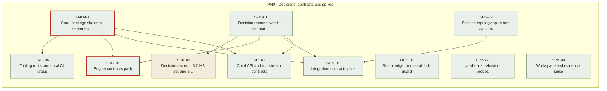

#### PH1 · Foundations (34 features)

```mermaid
flowchart LR
  classDef m1 fill:#E8F0E9,stroke:#4D7356,color:#1f2a22;
  classDef m2 fill:#F3ECDD,stroke:#C19A55,color:#2b2316;
  classDef m3 fill:#F2E6E0,stroke:#864A31,color:#2b1a12;
  classDef m4 fill:#ECEFEA,stroke:#9EAB92,color:#23271f;
  classDef pm fill:#F5F5F5,stroke:#999,color:#333,stroke-dasharray: 4 3;
  classDef crit stroke:#B3261E,stroke-width:3px;
  subgraph PH1["PH1 · Foundations"]
    BRD_01["BRD-01<br/>Coral brand skin"]:::m1
    FND_02["FND-02<br/>Server plugin seam, plugin regist…"]:::m1
    FND_03["FND-03<br/>Coral DB environment and migratio…"]:::m1
    GTE_05["GTE-05<br/>Seam pack C: elicitation observer…"]:::m2
    HRN_01["HRN-01<br/>Capability registry contract and…"]:::m1
    SES_02["SES-02<br/>Seam pack A: status-edge observer…"]:::m2
    TLS_01["TLS-01<br/>Seam pack B: engine tool transport"]:::m2
    WSP_05["WSP-05<br/>S71 reaper guard for host fs oper…"]:::m2
    OPS_02["OPS-02<br/>Upstream merges, fork CI hygiene…"]:::m1
    BRD_02["BRD-02<br/>Navigation shell, Coral gate and…"]:::m1
    DUR_01["DUR-01<br/>Persistence contract, core schema…"]:::m1
    ENG_02["ENG-02<br/>Loader, compiler, analysis and co…"]:::m1
    ENG_04["ENG-04<br/>Reducer core and run log"]:::m1
    EVD_01["EVD-01<br/>Evidence-requirement IR and evalu…"]:::m1
    FND_04["FND-04<br/>Coral test infrastructure"]:::m1
    HRN_02["HRN-02<br/>claude-sdk credential guard and r…"]:::m2
    RUL_01["RUL-01<br/>Coral policies, run guard and cos…"]:::m2
    SES_03["SES-03<br/>Session facade: anchor, request-f…"]:::m2
    SES_04["SES-04<br/>Engine dispatch: brief, steer, in…"]:::m2
    WEB_01["WEB-01<br/>Read-only diagram, run overlay an…"]:::m2
    DUR_02["DUR-02<br/>Workflow library: store, versions…"]:::m1
    DUR_03["DUR-03<br/>Run store with CAS transitions"]:::m2
    DUR_04["DUR-04<br/>Durable work queue, effect draine…"]:::m2
    ENG_03["ENG-03<br/>Static validator"]:::m1
    EVD_02["EVD-02<br/>claude-sdk evidence capture and d…"]:::m2
    OPS_03["OPS-03<br/>Distribution identity and coexist…"]:::m2
    PRF_01["PRF-01<br/>Step bundles, seeded agents and h…"]:::m2
    WEB_02["WEB-02<br/>Workflows desk and library"]:::m2
    WSP_01["WSP-01<br/>Repo bindings, run worktree and W…"]:::m2
    ENG_05["ENG-05<br/>Loops, joins and failure paths"]:::m1
    ENG_11["ENG-11<br/>Reconcile, turn-end and failed-tu…"]:::m2
    EVD_03["EVD-03<br/>Repository command detection and…"]:::m2
    ENG_06["ENG-06<br/>Run lifecycle, timers and livenes…"]:::m2
    ENG_07["ENG-07<br/>Simulate engine, saved cases and…"]:::m1
  end
  FND_01 --> FND_02
  SPK_01 --> FND_02
  FND_01 --> FND_03
  FND_01 --> FND_04
  FND_03 --> FND_04
  FND_05 --> FND_04
  OPS_01 --> OPS_02
  FND_01 --> OPS_03
  FND_03 --> DUR_01
  ENG_01 --> DUR_01
  FND_01 --> DUR_02
  DUR_01 --> DUR_02
  FND_02 --> DUR_02
  ENG_02 --> DUR_02
  API_01 --> DUR_02
  DUR_01 --> DUR_03
  FND_04 --> DUR_03
  DUR_01 --> DUR_04
  FND_02 --> DUR_04
  ENG_01 --> ENG_02
  ENG_02 --> ENG_03
  ENG_01 --> ENG_04
  ENG_02 --> ENG_05
  ENG_04 --> ENG_05
  ENG_04 --> ENG_06
  ENG_04 --> ENG_11
  ENG_04 --> ENG_07
  ENG_05 --> ENG_07
  ENG_01 --> EVD_01
  SPK_04 --> EVD_01
  FND_01 --> HRN_01
  FND_02 --> RUL_01
  FND_01 --> SES_02
  FND_01 --> TLS_01
  FND_01 --> GTE_05
  FND_01 --> WSP_05
  SPK_04 --> WSP_01
  WSP_05 --> WSP_01
  DUR_01 --> WSP_01
  SES_01 --> WSP_01
  DUR_01 --> EVD_03
  SES_01 --> EVD_03
  WSP_05 --> EVD_03
  WSP_01 --> EVD_03
  EVD_01 --> EVD_02
  SPK_04 --> EVD_02
  DUR_01 --> EVD_02
  WSP_05 --> EVD_02
  SPK_03 --> HRN_02
  SES_01 --> HRN_02
  HRN_01 --> HRN_02
  SES_01 --> PRF_01
  DUR_01 --> PRF_01
  SPK_02 --> SES_03
  SES_01 --> SES_03
  FND_02 --> SES_03
  SES_01 --> SES_04
  SES_02 --> SES_04
  FND_02 --> BRD_02
  ENG_01 --> WEB_01
  BRD_02 --> WEB_02
  API_01 --> WEB_02
  subgraph EXT_DEPS["Earlier-phase prerequisites"]
    API_01["API-01"]:::m1
    ENG_01["ENG-01"]:::m1
    FND_01["FND-01"]:::m1
    FND_05["FND-05"]:::m1
    OPS_01["OPS-01"]:::m1
    SES_01["SES-01"]:::m1
    SPK_01["SPK-01"]:::m1
    SPK_02["SPK-02"]:::m1
    SPK_03["SPK-03"]:::m1
    SPK_04["SPK-04"]:::m1
  end
  class ENG_11,ENG_04 crit;
```

#### PH2 · Stateful engine and first end-to-end run (24 features)

```mermaid
flowchart LR
  classDef m1 fill:#E8F0E9,stroke:#4D7356,color:#1f2a22;
  classDef m2 fill:#F3ECDD,stroke:#C19A55,color:#2b2316;
  classDef m3 fill:#F2E6E0,stroke:#864A31,color:#2b1a12;
  classDef m4 fill:#ECEFEA,stroke:#9EAB92,color:#23271f;
  classDef pm fill:#F5F5F5,stroke:#999,color:#333,stroke-dasharray: 4 3;
  classDef crit stroke:#B3261E,stroke-width:3px;
  subgraph PH2["PH2 · Stateful engine and first end-to-end run"]
    OPS_06["OPS-06<br/>Threat model and M2 security revi…"]:::m2
    GTE_02["GTE-02<br/>Workflow Inbox kind and run notif…"]:::m2
    RUL_04["RUL-04<br/>Native fail-closed hooks"]:::m3
    WEB_04["WEB-04<br/>Live run view"]:::m2
    TLS_03["TLS-03<br/>Orchestrator decisions and coral_…"]:::m2
    API_02["API-02<br/>Runs API, gate answers, outcome,…"]:::m2
    GTE_01["GTE-01<br/>Coral gate surfacing and authority"]:::m2
    HRN_08["HRN-08<br/>Capability bench and multi-mode r…"]:::m3
    TLS_02["TLS-02<br/>coral_submit_handoff"]:::m2
    WEB_03["WEB-03<br/>Templates, Use-template and start…"]:::m2
    WEB_11["WEB-11<br/>YAML editor"]:::m2
    WSP_06["WSP-06<br/>Session-shell workspace ops: comm…"]:::m2
    SES_06["SES-06<br/>Runner-loss restart ladder"]:::m2
    SES_09["SES-09<br/>Drift detection and user actions…"]:::m2
    RUL_02["RUL-02<br/>claude-sdk promise labels and the…"]:::m2
    SES_08["SES-08<br/>Turn-end facts and failed-turn ou…"]:::m2
    TLS_05["TLS-05<br/>coral_ask_user"]:::m2
    WEB_13["WEB-13<br/>Runs list, outcome, guarantees pa…"]:::m2
    DUR_05["DUR-05<br/>Reconciler and restart recovery"]:::m2
    ENG_08["ENG-08<br/>Repeat-for-each and parallel sema…"]:::m4
    GTE_06["GTE-06<br/>Alerts backend and inbox API"]:::m2
    SES_05["SES-05<br/>Walking skeleton"]:::m2
    WEB_05["WEB-05<br/>Run agent panes, run-session page…"]:::m2
    OPS_07["OPS-07<br/>M2 acceptance lane"]:::m2
  end
  DUR_03 --> DUR_05
  DUR_04 --> DUR_05
  FND_04 --> DUR_05
  ENG_11 --> DUR_05
  SES_02 --> SES_08
  ENG_11 --> SES_08
  SES_03 --> SES_06
  DUR_03 --> SES_06
  SES_03 --> SES_09
  FND_04 --> SES_05
  SES_02 --> SES_05
  TLS_01 --> SES_05
  GTE_05 --> SES_05
  DUR_03 --> SES_05
  DUR_04 --> SES_05
  ENG_04 --> SES_05
  TLS_01 --> TLS_02
  ENG_04 --> TLS_02
  DUR_03 --> TLS_02
  TLS_01 --> TLS_03
  ENG_04 --> TLS_03
  SES_01 --> TLS_03
  TLS_01 --> TLS_05
  GTE_01 --> TLS_05
  GTE_05 --> GTE_01
  ENG_04 --> GTE_01
  SES_01 --> GTE_01
  DUR_03 --> GTE_01
  DUR_01 --> GTE_06
  FND_02 --> GTE_06
  API_01 --> GTE_06
  BRD_02 --> GTE_02
  WSP_01 --> WSP_06
  SES_01 --> WSP_06
  DUR_01 --> API_02
  DUR_03 --> API_02
  API_01 --> API_02
  WEB_02 --> WEB_11
  WEB_02 --> WEB_03
  WEB_01 --> WEB_04
  API_01 --> WEB_04
  WEB_02 --> WEB_13
  API_01 --> WEB_13
  WEB_04 --> WEB_05
  ENG_03 --> RUL_02
  EVD_01 --> RUL_02
  HRN_01 --> RUL_02
  SPK_01 --> OPS_06
  SES_05 --> OPS_07
  FND_04 --> OPS_07
  SES_04 --> OPS_07
  SES_08 --> OPS_07
  SES_06 --> OPS_07
  SES_09 --> OPS_07
  TLS_02 --> OPS_07
  TLS_03 --> OPS_07
  GTE_01 --> OPS_07
  GTE_06 --> OPS_07
  GTE_02 --> OPS_07
  DUR_05 --> OPS_07
  EVD_02 --> OPS_07
  EVD_03 --> OPS_07
  WSP_06 --> OPS_07
  PRF_01 --> OPS_07
  HRN_02 --> OPS_07
  API_02 --> OPS_07
  RUL_01 --> OPS_07
  RUL_02 --> OPS_07
  WEB_03 --> OPS_07
  WEB_04 --> OPS_07
  WEB_13 --> OPS_07
  HRN_01 --> HRN_08
  HRN_01 --> RUL_04
  RUL_01 --> RUL_04
  ENG_05 --> ENG_08
  ENG_06 --> ENG_08
  subgraph EXT_DEPS["Earlier-phase prerequisites"]
    API_01["API-01"]:::m1
    BRD_02["BRD-02"]:::m1
    DUR_01["DUR-01"]:::m1
    DUR_03["DUR-03"]:::m2
    DUR_04["DUR-04"]:::m2
    ENG_03["ENG-03"]:::m1
    ENG_04["ENG-04"]:::m1
    ENG_05["ENG-05"]:::m1
    ENG_06["ENG-06"]:::m2
    ENG_11["ENG-11"]:::m2
    EVD_01["EVD-01"]:::m1
    EVD_02["EVD-02"]:::m2
    EVD_03["EVD-03"]:::m2
    FND_02["FND-02"]:::m1
    FND_04["FND-04"]:::m1
    GTE_05["GTE-05"]:::m2
    HRN_01["HRN-01"]:::m1
    HRN_02["HRN-02"]:::m2
    PRF_01["PRF-01"]:::m2
    RUL_01["RUL-01"]:::m2
    SES_01["SES-01"]:::m1
    SES_02["SES-02"]:::m2
    SES_03["SES-03"]:::m2
    SES_04["SES-04"]:::m2
    SPK_01["SPK-01"]:::m1
    TLS_01["TLS-01"]:::m2
    WEB_01["WEB-01"]:::m2
    WEB_02["WEB-02"]:::m2
    WSP_01["WSP-01"]:::m2
  end
  class SES_08 crit;
```

#### PH3 · Profiles, capabilities and enforcement (13 features)

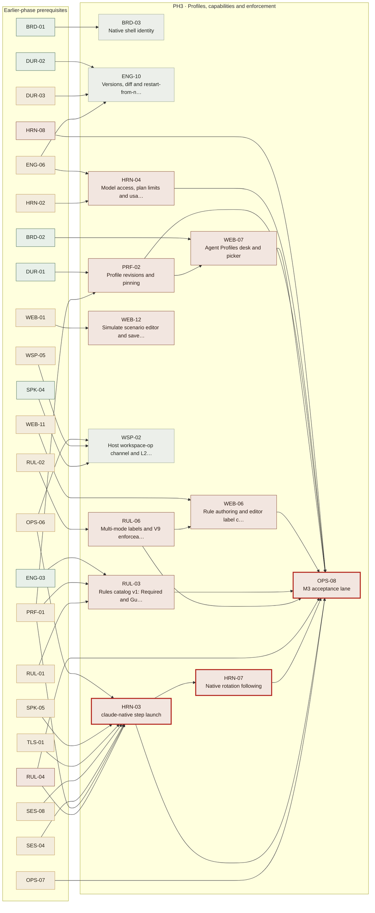

#### PH4 · Trust and structure (13 features)

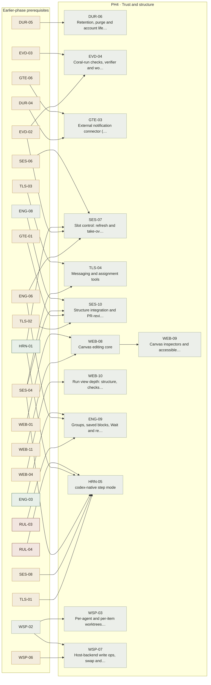

#### PH5 · Production readiness (6 features)

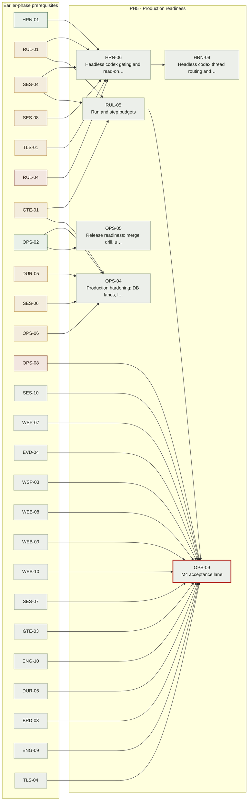

#### PH6 · Post-M4 extensions (7 features)

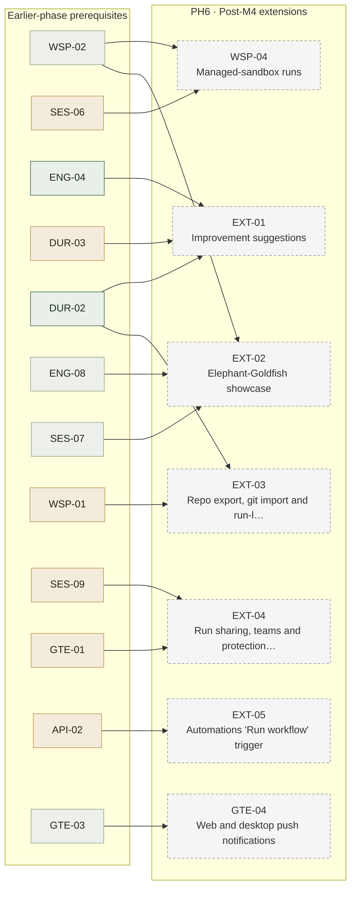

### G.4 Contract producers and consumers

| Contract | Producer | Consumers |
|---|---|---|
| K1 Workflow authoring schema and compiled IR | ENG-01 | API-01, DUR-02, ENG-02, ENG-03, ENG-04, ENG-05, ENG-07, ENG-08, ENG-09, ENG-10, EVD-01, EVD-04, EXT-01, EXT-02, RUL-02, RUL-03, RUL-05, RUL-06, WEB-01, WEB-02, WEB-03, WEB-08, WEB-09, WEB-11, WEB-12 |
| K2 Reducer contract | ENG-01 | DUR-01, DUR-03, DUR-04, DUR-05, ENG-04, ENG-05, ENG-06, ENG-07, ENG-08, ENG-09, ENG-10, ENG-11, EVD-04, GTE-01, HRN-04, OPS-07, RUL-01, SES-01, SES-04, SES-05, SES-06, SES-08, SES-09, SES-10, TLS-02, TLS-03, TLS-05, WSP-03, WSP-04 |
| K3 Run-log entry schema and fold | ENG-01 | API-02, DUR-01, DUR-03, ENG-04, ENG-05, ENG-06, ENG-07, ENG-08, ENG-09, ENG-10, EVD-04, EXT-01, EXT-03, HRN-07, PRF-02, RUL-05, SES-07, SES-09, WEB-04, WEB-10, WSP-07 |
| K4 coral.omni facade protocol and FakeOmni | SES-01 | API-02, DUR-01, DUR-02, DUR-04, DUR-05, EVD-02, EVD-03, FND-02, FND-04, GTE-01, HRN-02, HRN-03, HRN-07, OPS-02, OPS-07, RUL-05, SES-03, SES-04, SES-05, SES-06, SES-07, SES-08, SES-09, SES-10, TLS-03, TLS-04, WSP-01, WSP-06 |
| K5 Coral persistence contract | DUR-01 | DUR-02, DUR-03, DUR-04, DUR-05, DUR-06, ENG-09, ENG-10, EVD-02, EVD-03, EVD-04, EXT-01, EXT-04, GTE-03, GTE-04, GTE-06, PRF-01, PRF-02, RUL-01, RUL-05, SES-03, SES-04, SES-07, SES-08, TLS-02, TLS-05, WSP-01, WSP-03 |
| K6 Engine tool contracts | SES-01 | EVD-02, EXT-02, OPS-07, SES-05, SES-07, TLS-01, TLS-02, TLS-03, TLS-04, TLS-05, WSP-03 |
| K7 Coral REST API and OpenAPI | API-01 | API-02, BRD-02, DUR-02, DUR-06, ENG-09, ENG-10, EVD-03, EXT-01, EXT-03, EXT-04, EXT-05, FND-02, GTE-01, GTE-02, GTE-03, GTE-04, GTE-06, PRF-02, RUL-02, RUL-03, RUL-05, RUL-06, SES-07, WEB-01, WEB-02, WEB-03, WEB-04, WEB-05, WEB-06, WEB-07, WEB-08, WEB-09, WEB-10, WEB-11, WEB-12, WEB-13, WSP-01 |
| K8 Run stream protocol and RunView projection | API-01 | API-02, ENG-01, ENG-04, WEB-04, WEB-10, WEB-13 |
| K9 Capability registry | HRN-01 | ENG-11, HRN-02, HRN-03, HRN-04, HRN-05, HRN-06, HRN-08, HRN-09, OPS-08, RUL-02, RUL-03, RUL-04, RUL-05, RUL-06, SES-07, SES-08, WEB-06, WEB-07, WEB-09, WEB-13 |
| K10 Identity, labels and derived keys | SES-01 | EXT-04, GTE-01, GTE-02, HRN-07, PRF-01, RUL-01, SES-03, SES-04, SES-09, TLS-03, WEB-05, WSP-01 |
| K11 Evidence IR and observation records | EVD-01 | EVD-02, EVD-03, EVD-04, HRN-03, HRN-06, RUL-02, RUL-06, SES-07, TLS-02, WEB-03, WSP-02, WSP-03, WSP-07 |
| K12 Step bundle format and params.coral schema | SES-01 | EXT-03, HRN-02, HRN-03, HRN-05, HRN-06, OPS-08, PRF-01, PRF-02, RUL-01, RUL-03, SES-03, TLS-01, TLS-03, WEB-07 |
| K13 WorkspaceOps interface | WSP-01 | EVD-01, EVD-02, EVD-04, EXT-02, EXT-03, OPS-09, SES-06, WSP-02, WSP-03, WSP-04, WSP-06, WSP-07 |
| K14 Gate, question and budget elicitation payloads | SES-01 | API-01, EXT-04, GTE-01, GTE-02, GTE-05, OPS-07, RUL-05, SES-05, SES-10, TLS-05, WEB-10 |
| K15 Rule-template catalog IR | RUL-03 | ENG-09, RUL-06, WEB-06, WEB-09 |
| K16 Seam ledger format | OPS-01 | BRD-01, BRD-02, BRD-03, FND-01, FND-02, FND-03, FND-05, GTE-05, HRN-01, HRN-08, OPS-02, SES-02, TLS-01 |
| K17 Server plugin registration and process map | FND-02 | API-02, DUR-02, DUR-04, DUR-06, EVD-02, FND-04, HRN-02, PRF-01, RUL-01, SES-03, TLS-01, WSP-01 |
| K18 Status-edge observer API and turn facts | SES-01 | ENG-11, HRN-03, HRN-04, HRN-05, HRN-07, SES-02, SES-08 |
| K19 Alert and inbox feed model | SES-01 | API-01, DUR-05, ENG-06, ENG-09, EXT-04, GTE-02, GTE-03, GTE-04, GTE-06, TLS-05 |
| K20 Host workspace-op wire frames | WSP-02 | EVD-04, EXT-02, OPS-09, WSP-03, WSP-04, WSP-07 |
| K21 Effect executor registry | DUR-01 | DUR-04, DUR-05, EVD-04, GTE-01, GTE-03, GTE-06, PRF-01, SES-03, SES-04, SES-05, SES-06, SES-10, WSP-01, WSP-03, WSP-04, WSP-06, WSP-07 |

## H. Parallel Execution Plan

This section turns the levelled schedule into lanes that people work through. Weeks count from the start of PH0 and use the levelled `planned_start_week` and `planned_finish_week` from the master feature list: M1 9.5, M2 13.5, M3 21, M4 26.5. Dates promised to stakeholders use the planned values, which add a 15% buffer: 11, 16, 24.5 and 30.5 (I.1). "Float" here is levelled slack to the next milestone. It counts hard dependencies and the next feature on the same track ("track float"). Soft, slice and conditional dependencies are handled by the rules in F.0 conditional dependencies, not by float. Section I's zero-float register comes from scheduler re-runs, which let any free engineer in a workstream take the next feature, so the two differ for a few features (I.1).

### H.1 Staffing, workstreams and tracks

The plan assumes 20 engineers in 8 workstreams (H.1). A **track** is a lane that one engineer (a pair where stated) works through in order. Features on a track never overlap. A half-week scan of the planned weeks shows that peak concurrency equals headcount in every workstream: ENGINE 3, PLATFORM 3, INTEGRATION 4, HARNESS 2, WORKSPACE 2, WEB 3, BRAND 1, OPS 2. **No workstream has a spare engineer at its peak weeks**, so any feature that runs over its weeks pushes the next feature on its track.

| WS (eng.) | Track | Lane | Features in order (levelled weeks) | Uncommitted windows and standing duties |
|---|---|---|---|---|
| ENGINE (3) | ENG-T1 | Compiler, validator, decision functions and labels | ENG-01 1-3, ENG-02 3-5, ENG-03 5-7, ENG-11 7-9, RUL-02 9-11, RUL-06 13.5-15.5, ENG-09 18-22.5 | 11-13.5 M2 fixes; 15.5-18 ENG-09 design against K15 |
| | ENG-T2 | Reducer core and structure semantics | ENG-04 3-5.5 (pair with ENG-T3), ENG-05 5.5-7.5, ENG-06 7.5-9.5, ENG-08 9.5-14, EXT-02 26.5-28.5 | 0-3 K1-K3 fixtures and I1-I8 checks with ENG-01; 14-26.5 K2 reviews for SES-07, SES-10, ENG-09 |
| | ENG-T3 | Simulate, history and suggestions | ENG-07 7.5-9.5, ENG-10 13.5-15.5, EXT-01 26.5-31 | 1-3 K1-K3 fixtures with ENG-T2 (H.3); 3-5.5 second engineer on ENG-04; 9.5-13.5 K2 change desk for IM-2 and IM-3 (H.1) |
| PLATFORM (3) | PLT-T1 | Persistence spine and durable execution | FND-01 0-1, FND-03 1-3, DUR-01 3-5, DUR-04 5-9.5, DUR-05 9.5-11.5, DUR-06 13.5-15.5 | 15.5+ OPS-04 load scenario |
| | PLT-T2 | Plugin seam, library and alerts | FND-02 1-3, DUR-02 5-9.5, GTE-06 9.5-11.5, GTE-03 13.5-15.5 | 3-5 pairs on DUR-01 (K5, K21) |
| | PLT-T3 | API contracts, run store and runs API | API-01 1-2, DUR-03 5-7, API-02 7-11.5, EXT-05 26.5-28.5 | 2-5 pairs on DUR-01; 11.5+ M2 fixes, then free |
| INTEGRATION (4) | INT-T1 | Session facade and slot lifecycle | SPK-02 0-1 (pair with INT-T2), SES-01 1-3, SES-03 3-7.5, SES-06 7.5-9.5, SES-07 13.5-18, EXT-04 26.5-31 | K4 and FakeOmni owner; 9.5-13.5 facade fixes for IM-2 and IM-3 |
| | INT-T2 | Seam train, step dispatch and turn facts | SPK-02 0-1 (pair with INT-T1), SES-02 1-3, SES-04 3-5, TLS-02 7-9, SES-08 9-11, SES-10 14-16, then the IM-7 convergence tail to 22.5 | **Seam-train owner** (H.10): 5-7 lands the PH1 seams of EVD-02, WSP-01 and PRF-01; 11-14 prepares the PH3 seams |
| | INT-T3 | Engine tools, drift and walking skeleton | TLS-01 1-3, TLS-03 5.5-7.5, SES-09 7.5-9.5, SES-05 9.5-11.5, TLS-04 13.5-15.5 | 3-5.5 shared K6 handler scaffolding |
| | INT-T4 | Gates, policies and budgets | GTE-05 1-3, RUL-01 3-5, GTE-01 7-9, TLS-05 9-11, RUL-03 13.5-18, RUL-05 21-23 | 11-13.5 drafts K15 so RUL-03's first PR lands in week 13.5 |
| HARNESS (2) | HRN-T1 | Headless claude-sdk and profiles, then codex-native | SPK-03 0-1, HRN-02 3-5, PRF-01 5-9.5, PRF-02 13.5-15.5, HRN-04 15.5-17.5, HRN-05 18-22.5 | 9.5-13.5 IM-3 support (PRF-01, HRN-02) |
| | HRN-T2 | Registry and native hooks, claude-native, then headless codex | HRN-01 1-2, RUL-04 5-7, HRN-08 7-9, HRN-03 13.5-18, HRN-07 18-20, HRN-06 21-23, HRN-09 23-25 | 9-13.5 HRN-03 preparation (spikes 5 and 6 ran in RUL-04's first PR) |
| WORKSPACE (2) | WSP-T1 | Workspace ops and host channel | SPK-04 0-1, WSP-05 1-2, WSP-01 5-7, WSP-06 7-9, WSP-02 13.5-18, WSP-07 18-20, WSP-04 26.5-31 | 9-13.5 drafts K20 for the M2 freeze; absorbs the spike 8 contingency (+3 weeks on WSP-06) |
| | WSP-T2 | Evidence and merges | EVD-01 3-5, EVD-02 5-7, EVD-03 7-9, EVD-04 13.5-18, WSP-03 18-22.5, EXT-03 26.5-28.5 | 0-1 pairs on SPK-04; 9-13.5 IM-3 evidence support |
| WEB (3) | WEB-T1 | Diagram, live run view and canvas | WEB-01 3-5, WEB-04 5-9.5, WEB-05 9.5-11.5, WEB-08 15.5-20, WEB-09 20-24.5 | 11.5-15.5 secondary UI for ENG-10, GTE-03, DUR-06 (1.5 weeks), then canvas scaffolding; 24.5+ the 0.5-week UIs for EXT-03, EXT-04 and EXT-05 |
| | WEB-T2 | Library, templates, Simulate editor and profiles desk | WEB-02 5-7, WEB-03 7-11.5, WEB-12 13.5-15.5, WEB-07 15.5-17.5 | 17.5+ secondary UI for RUL-05 and EXT-01; can pair on WEB-09 |
| | WEB-T3 | Inbox, editor, runs list and run depth | GTE-02 5-7, WEB-11 7-9, WEB-13 9-11, WEB-06 15.5-17.5, WEB-10 17.5-22, GTE-04 26.5-31 | 11-15.5 IM-4 browser-lane fixes |
| BRAND (1) | BRD-T1 | Web skin and navigation shell | BRD-01 0-2, BRD-02 3-5 | Same engineer as BRD-T2. 5-13.5 folds into WEB: pairs on WEB-04, then WEB-03, plus PRF-01's 0.5-week UI |
| | BRD-T2 | Native shell identity | BRD-03 13.5-15.5 | 15.5+ HRN-04's 1-week UI, then WEB pairing |
| OPS (2) | OPS-T0 | Decision brokering (tech lead and PM, not counted) | SPK-01 0-1, SPK-05 1-2 (records due by weeks 2 and 4) | Tracks later deadlines: OQ-28 at PH2 end; OQ-29 and OQ-25 before PH4 opens |
| | OPS-T1 | Fork guard, merges and security | OPS-01 0-2, OPS-02 2-4 (proof to about week 6 through the merge rota), OPS-06 4-6, OPS-04 21-25.5 | Keeps the merge rota and the daily trial merge from week 2 |
| | OPS-T2 | Test infrastructure, acceptance lanes and release | FND-05 1-2, FND-04 3-5, OPS-03 5-6, OPS-07 11.5-13.5, OPS-08 20-21, OPS-05 21-23, OPS-09 24.5-26.5 | 6-11.5 builds the IM-3 and IM-4 lanes and the credentialed nightly that OPS-07 owns at 11.5 |

Staffing notes:

- **Pairs.** ENG-04 (L) is staffed by ENG-T2 and ENG-T3 for 2.5 calendar weeks. SPK-02 is staffed by INT-T1 and INT-T2 in week 0-1. With two engine engineers instead of three, M1 slips about 2.5 weeks and M2 about 2 weeks (H.1).
- **Rotating merge owner.** The 0.25-0.5 FTE merge owner rotates across workstreams. Its time comes out of the uncommitted windows above; it is not a track (OPS-02, TLD-17).
- **Platform after M2.** The staffing plan moves one platform engineer to GTE-03, DUR-06 and the OPS-04 load scenario. The planned weeks run GTE-03 and DUR-06 together in weeks 13.5-15.5, so they need two engineers. If only one stays, run DUR-06 in weeks 15.5-17.5 (track float 9.0).
- **Secondary WEB loads** (section F: PRF-01, ENG-10, GTE-03, DUR-06, HRN-04, RUL-05, EXT-01, EXT-03, EXT-04, EXT-05, 0.5-1 week each) are placed in the windows named above, not on their own tracks.
- **Ramp.** WEB-T2 and WEB-T3 have no feature before week 5. Those engineers can join at week 4, or set up the CI-only browser lane (`tests/browser_ui/workflows/`) that IM-4 needs.
- **Where the slack is.** After M2, ENGINE, PLATFORM and OPS have long uncommitted windows. The binding chains for M3 and M4 sit in HARNESS (HRN-03 > HRN-07) and WEB (WEB-08 > WEB-09). Lending engineers across workstreams is the main schedule lever after M2, and it needs a staffing decision.

### H.2 Schedule chart

Bars show levelled weeks; `crit` marks features with zero track float to their milestone. The chart uses `dateFormat x` with 1 week = 1000 ms, so half weeks stay integers and `axisFormat %s` prints week numbers. Plain `X` (seconds) would need fractional values such as 5.5, which Mermaid's strict date parsing does not reliably accept.

```mermaid
gantt
    title Coral levelled schedule by workstream (axis = week from PH0 start)
    dateFormat x
    axisFormat %s
    todayMarker off
    section Phases
    PH0 :0, 3000
    PH1 :0, 9500
    PH2 :4000, 13500
    PH3 :13500, 21000
    PH4 :13500, 26500
    PH5 :21000, 26500
    PH6 open :26500, 31000
    section Milestones
    IM-0 :milestone, 3000, 3000
    IM-1 :milestone, 7000, 7000
    M1 :milestone, 9500, 9500
    IM-2 3 4 :milestone, 11500, 11500
    M2 :milestone, 13500, 13500
    IM-5 6 :milestone, 20000, 20000
    M3 :milestone, 21000, 21000
    IM-7 :milestone, 22500, 22500
    IM-8 :milestone, 25500, 25500
    M4 :milestone, 26500, 26500
    section WS-ENGINE
    ENG-01 :crit, 1000, 3000
    ENG-02 :crit, 3000, 5000
    ENG-03 :5000, 7000
    ENG-11 :7000, 9000
    RUL-02 :9000, 11000
    RUL-06 :13500, 15500
    ENG-09 :18000, 22500
    ENG-04 :crit, 3000, 5500
    ENG-05 :crit, 5500, 7500
    ENG-06 :7500, 9500
    ENG-08 :9500, 14000
    EXT-02 :26500, 28500
    ENG-07 :crit, 7500, 9500
    ENG-10 :13500, 15500
    EXT-01 :26500, 31000
    section WS-PLATFORM
    FND-01 :crit, 0, 1000
    FND-03 :crit, 1000, 3000
    DUR-01 :crit, 3000, 5000
    DUR-04 :crit, 5000, 9500
    DUR-05 :crit, 9500, 11500
    DUR-06 :13500, 15500
    FND-02 :crit, 1000, 3000
    DUR-02 :crit, 5000, 9500
    GTE-06 :crit, 9500, 11500
    GTE-03 :13500, 15500
    API-01 :1000, 2000
    DUR-03 :crit, 5000, 7000
    API-02 :crit, 7000, 11500
    EXT-05 :26500, 28500
    section WS-INTEGRATION
    SPK-02 :crit, 0, 1000
    SES-01 :crit, 1000, 3000
    SES-03 :crit, 3000, 7500
    SES-06 :7500, 9500
    SES-07 :13500, 18000
    EXT-04 :26500, 31000
    SES-02 :1000, 3000
    SES-04 :3000, 5000
    TLS-02 :7000, 9000
    SES-08 :9000, 11000
    SES-10 :14000, 16000
    TLS-01 :1000, 3000
    TLS-03 :crit, 5500, 7500
    SES-09 :crit, 7500, 9500
    SES-05 :crit, 9500, 11500
    TLS-04 :13500, 15500
    GTE-05 :1000, 3000
    RUL-01 :3000, 5000
    GTE-01 :7000, 9000
    TLS-05 :9000, 11000
    RUL-03 :13500, 18000
    RUL-05 :21000, 23000
    section WS-HARNESS
    SPK-03 :0, 1000
    HRN-02 :3000, 5000
    PRF-01 :5000, 9500
    PRF-02 :13500, 15500
    HRN-04 :15500, 17500
    HRN-05 :18000, 22500
    HRN-01 :1000, 2000
    RUL-04 :5000, 7000
    HRN-08 :7000, 9000
    HRN-03 :crit, 13500, 18000
    HRN-07 :crit, 18000, 20000
    HRN-06 :21000, 23000
    HRN-09 :23000, 25000
    section WS-WORKSPACE
    SPK-04 :0, 1000
    WSP-05 :1000, 2000
    WSP-01 :5000, 7000
    WSP-06 :7000, 9000
    WSP-02 :13500, 18000
    WSP-07 :18000, 20000
    WSP-04 :26500, 31000
    EVD-01 :3000, 5000
    EVD-02 :5000, 7000
    EVD-03 :7000, 9000
    EVD-04 :13500, 18000
    WSP-03 :18000, 22500
    EXT-03 :26500, 28500
    section WS-WEB
    WEB-01 :3000, 5000
    WEB-04 :5000, 9500
    WEB-05 :9500, 11500
    WEB-08 :crit, 15500, 20000
    WEB-09 :crit, 20000, 24500
    WEB-02 :crit, 5000, 7000
    WEB-03 :crit, 7000, 11500
    WEB-12 :13500, 15500
    WEB-07 :15500, 17500
    GTE-02 :5000, 7000
    WEB-11 :7000, 9000
    WEB-13 :9000, 11000
    WEB-06 :15500, 17500
    WEB-10 :17500, 22000
    GTE-04 :26500, 31000
    section WS-BRAND
    BRD-01 :0, 2000
    BRD-02 :crit, 3000, 5000
    BRD-03 :13500, 15500
    section WS-OPS
    SPK-01 :crit, 0, 1000
    SPK-05 :1000, 2000
    OPS-01 :0, 2000
    OPS-02 :2000, 4000
    OPS-06 :4000, 6000
    OPS-04 :21000, 25500
    FND-05 :1000, 2000
    FND-04 :crit, 3000, 5000
    OPS-03 :5000, 6000
    OPS-07 :crit, 11500, 13500
    OPS-08 :crit, 20000, 21000
    OPS-05 :21000, 23000
    OPS-09 :crit, 24500, 26500
```

### H.3 PH0 Decisions, contracts and spikes

**Window.** Weeks 0-3, ending at IM-0. PH1 runs alongside from week 0.

**Prerequisites.**

- No code prerequisites. Inputs are the TLD-01..TLD-21 recommendations awaiting sign-off (J.2 decisions log items 33-41) and D§, DD§ and UI§.
- Confirm the 20-engineer staffing before week 0. Two engineers start SPK-02 on day 1.

**Parallel work.**

| WS | Track | Features (weeks) | Note |
|---|---|---|---|
| OPS | OPS-T0 | SPK-01 0-1, SPK-05 1-2 | Records for the M1 contracts by end of week 1; records for week-3 starters and OQ-9 by week 2; other M2-M3 records by week 4 |
| OPS | OPS-T1 | OPS-01 0-2 | First PR in week 1: seams.yaml seeded and the guard in warn-only mode |
| OPS | OPS-T2 | FND-05 1-2 | Tooling roots, coral CI group, CODEOWNERS (OQ-54) |
| PLATFORM | PLT-T1 | FND-01 0-1 | The skeleton lands on day 2, so ENG-T2 can start the K1-K3 fixtures; the contract packs (ENG-01, SES-01, API-01) start at the end of week 1 |
| PLATFORM | PLT-T3 | API-01 1-2 | K7, K8, MSW fixtures, generated TS types |
| ENGINE | ENG-T1 | ENG-01 1-3 | ENG-T2 and ENG-T3 write fixtures and I1-I8 checks |
| INTEGRATION | INT-T1 | SPK-02 0-1, SES-01 1-3 | ADR-05 v1 signed on day 4 (addendum in week 2); probes (e), (f), 14 and 15 by week 2 (a tail past SPK-02's planned weeks 0-1; no downstream start moves) |
| HARNESS | HRN-T1 | SPK-03 0-1 | Spike 4 on days 1-2 picks the Tier B harness |
| WORKSPACE | WSP-T1 | SPK-04 0-1 | Spike 8 verdict and draft K13 |

PH1 work that starts in this window: BRD-01, FND-02, FND-03, HRN-01, SES-02, TLS-01, GTE-05, WSP-05 and OPS-02.

**Contract-first work.**

- K1, K2 and K3 (ENG-01); K4, K6, K10, K12, K14, K18 and K19 (SES-01); K7 and K8 (API-01); K16 (OPS-01). All are at v1 and frozen at IM-0.
- ADR-05 v1 (day 4) settles the topology that K4's create, access and watch sections depend on. SES-01 writes those sections last, and they freeze with K4 v1 at IM-0.
- Stubs consumers build against:
  - golden and compiled-IR fixtures for the MVP template, the D§5.6 example and a deadlock;
  - FakeOmni with the K4 conformance suite;
  - JSON Schema goldens for K6, K12, K14, K18 and K19;
  - the OpenAPI artifact with MSW fixtures, stub routers and generated TS types;
  - seams.yaml with every S-id and its owner.
- SPK-01's threat-model findings (OQ-43, D25, spike 15) constrain K6, K12 and K14 before the freeze. SPK-04 hands over the draft K13 and the L1 fingerprint algorithm that K11 needs. Its draft `coral/workspace/ops.py` stays in the spike report until FND-01's skeleton lands.

**Integration milestones.** IM-0, contract freeze, week 3. Owners: the tech lead with the ENGINE and INTEGRATION leads. Proof: K1-K4, K6-K8, K10, K12, K14, K16, K18 and K19 are at v1; FakeOmni passes K4 conformance; the OpenAPI drift check runs; a consumer stub in each team compiles against them.

**Critical path.**

- **Main chain.** FND-01 and SPK-01 (weeks 0-1), then ENG-01 (1-3), then IM-0. That releases ENG-02, ENG-04 and DUR-01 at week 3, all at zero float.
- **Second chain.** SPK-02 > SES-01 > SES-03 on INT-T1. It has zero track float because SES-03 feeds the SES-09 > SES-05 lane into M2 (H.5).

**Hot files and landing order.** `pyproject.toml`: FND-01 (S29 and the coral entry point), then FND-05 (S39 roots). The fork guard becomes a required check as soon as the ledger is seeded.

**What can slip without moving M1.**

- SPK-03 (track float 4.0), except spike 4: FND-04 needs the Tier B choice at week 3.
- SPK-04 (4.5). A slip past week 3 uses up EVD-01's 2.5 weeks of float first.
- API-01 (3.0). WEB-01 starts on K1 fixtures; WEB-02 needs K7 by week 5.
- FND-05 (1.0).
- OPS-01's reporting and MODIFICATIONS.md generation. The seeded ledger itself cannot slip, because seam PRs start in week 1.
- Individual SPK-05 records, as long as each lands before its consumer starts.
- **Cannot slip:** SPK-01, FND-01, ENG-01, SPK-02, SES-01.

### H.4 PH1 Foundations

**Window.** Weeks 0-9.5, closing at M1 (planned 11). Nineteen of the 34 PH1 features target M2.

**Prerequisites.**

- FND-01 (week 1) for every feature. SPK-01 records for FND-02, API-01, ENG-01 and SES-01.
- SPK-05's week-2 records: OQ-15 for RUL-01, the OQ-28 default and OQ-35 for HRN-02, and OQ-9 before DUR-02.
- IM-0 (week 3) for DUR-01, ENG-02, ENG-04, EVD-01, WEB-01 and HRN-02.
- ADR-05 for SES-03 (topology fallback: +3-4 weeks and S35; F.0 conditional dependencies; M2 effect in H.5).
- The spike 4 verdict for FND-04. If spike 4 fails, a test-only openai-agents Tier B adds rows in ENG-11, HRN-01 and PRF-01.
- The spike 1 verdict for HRN-02's S21 and RUL-01's enforcement.
- The SPK-04 verdict for EVD-01, WSP-01 and EVD-02.
- WSP-01 (week 7) for EVD-03, because repo_bindings precedes command_patterns.
- The OQ-34 queue layout, decided inside K5. The OQ-51 bench budget by the end of PH1.

**Parallel work.**

| WS | Track | Features (weeks) |
|---|---|---|
| ENGINE | ENG-T1 | ENG-02 3-5, ENG-03 5-7, ENG-11 7-9 |
| ENGINE | ENG-T2 (+ENG-T3 3-5.5) | ENG-04 3-5.5, ENG-05 5.5-7.5, ENG-06 7.5-9.5 |
| ENGINE | ENG-T3 | ENG-07 7.5-9.5 |
| PLATFORM | PLT-T1 | FND-03 1-3, DUR-01 3-5, DUR-04 5-9.5 |
| PLATFORM | PLT-T2 | FND-02 1-3, DUR-02 5-9.5 |
| PLATFORM | PLT-T3 | DUR-03 5-7 |
| INTEGRATION | INT-T1 | SES-03 3-7.5 |
| INTEGRATION | INT-T2 | SES-02 1-3, SES-04 3-5 |
| INTEGRATION | INT-T3 | TLS-01 1-3 |
| INTEGRATION | INT-T4 | GTE-05 1-3, RUL-01 3-5 |
| HARNESS | HRN-T1 | HRN-02 3-5, PRF-01 5-9.5 |
| HARNESS | HRN-T2 | HRN-01 1-2 |
| WORKSPACE | WSP-T1 | WSP-05 1-2, WSP-01 5-7 |
| WORKSPACE | WSP-T2 | EVD-01 3-5, EVD-02 5-7, EVD-03 7-9 |
| WEB | WEB-T1 | WEB-01 3-5 |
| WEB | WEB-T2 | WEB-02 5-7 |
| BRAND | BRD-T1 | BRD-01 0-2, BRD-02 3-5 |
| OPS | OPS-T1 | OPS-02 2-4 |
| OPS | OPS-T2 | FND-04 3-5, OPS-03 5-6 |

**Contract-first work.**

- K17 (FND-02, weeks 1-3): PluginRegistration with policy modules, observers, verdict handlers and tool handlers.
- K9 (HRN-01, weeks 1-2): the claude-sdk row.
- K5 and K21 as DUR-01's first PR in week 3. The fake drainer and the K21 conformance test come with DUR-04.
- K11 (EVD-01, weeks 3-5), from SPK-04's L1 algorithm.
- K13 as WSP-01's first PR in week 5, built from SPK-04's draft, with a fake, conformance tests and a draft K20 appendix.
- How consumers build before producers land:
  - SES-03, SES-04 and GTE-01 build against FakeOmni and HTTP-created sessions (soft edges, J.2 decisions log item 22).
  - TLS-03 builds against ENG-04's rejecting dispatcher.
  - WEB-01 renders compiled-IR fixtures. WEB-02 runs on MSW.
  - The K4 suite starts running on the real facade (L3) when SES-03 lands (TLD-17).
  - SES-02 implements K18 while SES-01 freezes it. TLS-01's step 5 merges after FND-02's PluginRegistration PR.
  - HRN-02 calls a stub of ENG-03's V10 rule. Its sandbox and validity ports fail closed until ENG-03 and WSP-01 bind them from week 5.
  - ENG-02's done_when compile hook calls EVD-01's compile_done_when, stubbed until EVD-01 lands (both weeks 3-5).
  - SES-04 needs coral_0001 by week 4 (H.10). It closes its proof on Tier A at week 5; its Tier B queued-input variant is an IM-2 exit item.
  - EVD-02 closes its proof on Tier A at week 7. Its Tier B run, which needs TLS-02 and WSP-06, is at IM-3.

**Integration milestones.** IM-1, seam and store spine, week 7. Owner: the INTEGRATION lead. Dated by SES-02, TLS-01, GTE-05, DUR-03 and ENG-04. Proof: a scripted coral_ test tool on an HTTP-created session drives an ENG-04 skeleton transition committed by DUR-03 with CAS; an SES-02 observer sees the edge; a GTE-05 request-free elicitation resolves once.

**Critical path.**

- **M1, zero float on both chains:** FND-01 > FND-03 > DUR-01 > DUR-02 and FND-01 > ENG-01 > ENG-04 > ENG-05 > ENG-07, both ending at week 9.5. FND-02 > DUR-02 is also zero.
- **Zero-float feeders into M2:** FND-02 > BRD-02 > WEB-02; FND-03 > FND-04 > DUR-03; DUR-01 > DUR-04; SES-01 > SES-03.
- **Lever:** PLT-T2 and PLT-T3 are idle in weeks 2-5. Put both on DUR-01 so that K5 and K21 land in week 3 and coral_0001 lands by week 4.

**Hot files and landing order.** INT-T2 lands these serially and dark (paths under `omnigent/` unless stated):

| File | Order in PH1 |
|---|---|
| `server/app.py` | FND-02 S32, then SES-02 S41 |
| `server/routes/_sessions/helpers.py` | SES-02 S1 (two sites) and S43 at `_publish_status` (helpers.py:5047), then TLS-01 S49 |
| `server/routes/_sessions/orchestration.py` | SES-02 S1 bypasses, the archive-idle origin and S43, then TLS-01 S10, then GTE-05 S6b at `_resolve_elicitation` (orchestration.py:2400), then EVD-02 S69(a) (weeks 5-7) |
| `server/routes/sessions/routes_events.py` | SES-02 S42, then GTE-05 S6a |
| `runner/app.py`; `runner/tool_dispatch.py`; `runner/pr_observer.py` | SES-02 S43; TLS-01 S8; EVD-02 S68 (one fan-out line) |
| `host/connect.py`; `host/frames.py` | WSP-05 S71 (extends the reaper guard at connect.py:1417-1424); TLS-01 S50, then WSP-01 S72 |
| `inner/claude_sdk_executor.py` | HRN-02 S13, S63 (S21 only if spike 1 fails) |
| `runtime/policies/builder.py`; `runtime/prompt.py` | RUL-01 S52; TLS-01 S12 FrameworkInstructions |
| `server/routes/builtin_agents.py` | PRF-01 S54 |
| `web/src/App.tsx`, `web/src/shell/Sidebar.tsx`, `web/src/pages/InboxPage.tsx` | BRD-02 S34, S80, S84 |

- Seam packs A, B and C (SES-02, TLS-01, GTE-05) all edit the same four server files in weeks 1-3. Land them in that order, so that IM-1 at week 7 has all three.
- The Modify-class seams in this phase are S43, S6b and S72. Each opens its upstream PR first.

**What can slip without moving M1.**

These PH1 features can slip within their track float without moving M1 or M2. All target M2 except HRN-01 and EVD-01, which target M1:

| Track float | Features |
|---|---|
| 5.5 | WSP-05; OPS-03 (cut rank 4 if M2 stays internal) |
| 4.5 | GTE-05, RUL-01 |
| 4.0 | ENG-06 |
| 3.0 | HRN-01 |
| 2.5 | SES-02, SES-04, TLS-01, WSP-01, EVD-01, EVD-02, EVD-03 |
| 2.0 | HRN-02, PRF-01, WEB-01 (its preset Simulate button is cut 6) |

Also:

- **OPS-02**, as long as at least two real merges land by M1.
- **BRD-01** (1.0).
- **Cannot slip:** FND-02, FND-03, FND-04, DUR-01 to DUR-04, ENG-02, ENG-04, ENG-05, ENG-07, BRD-02, WEB-02 and SES-03. ENG-03 and ENG-11 have 0.5 weeks.

### H.5 PH2 Stateful engine and first end-to-end run

**Window.** Weeks 4-13.5, closing at M2 (planned 16).

**Prerequisites.**

- SPK-05 records by week 4: OQ-5, OQ-14, OQ-16, the product half of OQ-17, OQ-18, OQ-23, the OQ-24 visuals, the OQ-25 default, OQ-26, OQ-38, OQ-49 and the M2 audience. OQ-15, OQ-35 and the OQ-28 default are due by week 2 (H.4).
- ENG-04 (week 5.5) for TLS-03, and its skeleton transitions for TLS-02 and GTE-01.
- DUR-03 (week 7) for TLS-02, GTE-01, SES-06 and API-02. IM-1 (week 7).
- ENG-11 (week 9) for SES-08 and DUR-05. BRD-02 for GTE-02. FND-04 and DUR-04 for SES-05. RUL-01 for RUL-04. ENG-03, EVD-01 and HRN-01 for RUL-02.
- OQ-28 needs a written vendor answer by the end of PH2. Otherwise HRN-03 ships on an API key only, behind `claude_native_steps`.

**Parallel work.**

| WS | Track | Features (weeks) | Note |
|---|---|---|---|
| ENGINE | ENG-T1 | RUL-02 9-11 | |
| ENGINE | ENG-T2 | ENG-08 9.5-14 | First PR exercises item_path at depth 2 before M2 exit (TLD-21) |
| ENGINE | ENG-T3 | K2 change desk 9.5-13.5 | |
| PLATFORM | PLT-T1 | DUR-05 9.5-11.5 | |
| PLATFORM | PLT-T2 | GTE-06 9.5-11.5 | |
| PLATFORM | PLT-T3 | API-02 7-11.5 | |
| INTEGRATION | INT-T1 | SES-06 7.5-9.5 | Owns the S27 retest if spike 16 fails |
| INTEGRATION | INT-T2 | TLS-02 7-9, SES-08 9-11 | |
| INTEGRATION | INT-T3 | TLS-03 5.5-7.5, SES-09 7.5-9.5, SES-05 9.5-11.5 | |
| INTEGRATION | INT-T4 | GTE-01 7-9, TLS-05 9-11 | |
| HARNESS | HRN-T2 | RUL-04 5-7, HRN-08 7-9 | Both target M3 |
| WORKSPACE | WSP-T1 | WSP-06 7-9 | +3 weeks if spike 8 failed |
| WEB | WEB-T1 (+brand engineer) | WEB-04 5-9.5, WEB-05 9.5-11.5 | |
| WEB | WEB-T2 | WEB-03 7-11.5 | |
| WEB | WEB-T3 | GTE-02 5-7, WEB-11 7-9, WEB-13 9-11 | |
| OPS | OPS-T1 | OPS-06 4-6 | Review closes at M2 exit |
| OPS | OPS-T2 | OPS-07 11.5-13.5 | Lane build from week 6 |

PH1 work still running after week 5: ENG-04, ENG-03, ENG-05, ENG-11, ENG-06, ENG-07, DUR-02, DUR-03, DUR-04, SES-03, PRF-01, WSP-01, EVD-02, EVD-03, WEB-02 and OPS-03.

**Contract-first work.**

- No new contracts.
- K2 changes go through ENG-T3's change desk. They must be additive, with state_version N reading N-1.
- GTE-02 builds the Inbox card in weeks 5-7 on K19 fixtures and MSW, before GTE-06 implements K19 in weeks 9.5-11.5.
- WEB-04 consumes K8 MSW streams from week 5; API-02 implements K8 by week 11.5.
- OPS-07's engine-upgrade lane (build N, then N+1) fixes the M2 state shape. ENG-08's depth-2 scope-key PR must land before it runs.
- SES-05 keeps a test-only start hook and test agents until API-02's run start (week 11.5) and PRF-01's anchor agent and step bundle (week 9.5) land.
- SES-08 and TLS-05 start at week 9, half a week before ENG-06 lands the timer kinds and watchdog suspension they use.

**Integration milestones.** All three are dated by features that finish at week 11.5.

| IM | Owner | Proof | Exit item of |
|---|---|---|---|
| IM-2 Walking skeleton | INTEGRATION lead | E2E-1 on Tier B: one-step workflow, anchor and step child, submit, gate answered via /approve, end; K4 conformance green on FakeOmni and the real facade | SES-05 and the skeleton slices of SES-03, SES-04, TLS-02, GTE-01 |
| IM-3 MVP template headless | OPS lead | Tier B run of the TLD-01 template: loop to limit 3, evidence reject then accept, reviewer write denied, close fencing, SIGTERM recovery | OPS-07, TLS-03, EVD-02, WSP-06, DUR-05, SES-06 |
| IM-4 UI on a live backend | WEB lead | CI-only browser lane: start dialog, live run view over SSE, one Inbox card per gate, answer, outcome panel | OPS-07, WEB-03, WEB-04, WEB-13, GTE-02, API-02 |

**Critical path.**

- **Zero float into OPS-07 at week 11.5:**
  - DUR-04 > DUR-05
  - DUR-04 > SES-05
  - DUR-03 > API-02
  - WEB-02 > WEB-03
  - DUR-02 > GTE-06 on PLT-T2
  - TLS-03 > SES-09 > SES-05 on INT-T3
- **The INT-T3 chain is a resource chain.** SES-05 must start at 9.5 on an engineer who frees up at 9.5, and both candidates (SES-06 and SES-09) depend on SES-03. The ADR-05 fallback adds 3-4 weeks to SES-03. M2 effect, CPM: +1.5 to +2 weeks; levelled with current staffing: up to +3 to +4 weeks one-for-one; with cut rank 1 applied: about +1.5 to +2 (I.5, RES-197).
- **Near-critical (0.5 weeks):** ENG-11 > SES-08; RUL-02; TLS-02; GTE-02 > WEB-11 > WEB-13.
- Then OPS-07 (11.5-13.5) runs to M2. The planned M2 date (16) keeps a 2.5-week buffer.

**Hot files and landing order.**

- `web/src/pages/InboxPage.tsx`: GTE-02 S37 (about seven anchors plus one useSidebarData line) after BRD-02's S84.
- `omnigent/harnesses/claude_native/bridge.py`, `omnigent/runner/native/orchestration.py` and `omnigent/harnesses/codex_native/app_server.py`: RUL-04 S14 (Modify class, upstream-first, weeks 5-7), before HRN-03 and HRN-05 edit them.
- `omnigent/server/routes/_sessions/helpers.py` and `omnigent/policies/types.py`: RUL-04 S16 (weeks 5-7).
- `omnigent/runner/app.py`: SES-06 S27, only if spike 16 fails. Otherwise S27 waits for SES-07 in PH4.

**What can slip without moving M2.**

- **Later-milestone work:** ENG-08 (8.5, but its depth-2 PR cannot slip); RUL-04 and HRN-08 (M3 targets, 4.5).
- **OPS-06**, up to week 13.5. It must close at M2 exit, because it signs off HRN-03 and the K20 freeze.
- **Cut-list features:** TLS-05 (2.5, cut 1), WEB-05 (2.0, cut 3), WEB-11 (0.5, cut 2).
- **Others:** GTE-01, WSP-06 (2.5); SES-06, WEB-04 (2.0).
- **Lever:** cutting TLS-05 frees INT-T4 at week 9. INT-T4 can then take SES-05, which gives SES-03 > SES-09 two weeks of float back.
- **Cannot slip:** API-02, WEB-03, DUR-05, SES-05, GTE-06, SES-09, TLS-03, OPS-07.

### H.6 PH3 Profiles, capabilities and enforcement

**Window.** Weeks 13.5-21, closing at M3 (planned 24.5). PH4 shares the window from 13.5.

**Prerequisites.**

- M2 exit (OPS-07 green).
- OPS-06 sign-off on HRN-03 and the K20 freeze.
- The OQ-28 answer, or the applied fallback.
- SPK-05's record on whether runs with gates may use claude-native steps (D25).
- HRN-03 also needs RUL-04, PRF-01, SES-04, SES-08 and TLS-01. RUL-03 needs RUL-01, PRF-01 and ENG-03. WEB-06 needs RUL-06 and WEB-11. WEB-07 needs PRF-02.

**Parallel work.**

| WS | Track | Features (weeks) | Note |
|---|---|---|---|
| ENGINE | ENG-T1 | RUL-06 13.5-15.5 | |
| ENGINE | ENG-T3 | ENG-10 13.5-15.5 | Targets M4 |
| INTEGRATION | INT-T4 | RUL-03 13.5-18 | |
| HARNESS | HRN-T1 | PRF-02 13.5-15.5, HRN-04 15.5-17.5 | |
| HARNESS | HRN-T2 | HRN-03 13.5-18, HRN-07 18-20 | |
| WORKSPACE | WSP-T1 | WSP-02 13.5-18 | Targets M4 |
| WEB | WEB-T2 | WEB-12 13.5-15.5, WEB-07 15.5-17.5 | |
| WEB | WEB-T3 | WEB-06 15.5-17.5 | |
| BRAND | BRD-T2 | BRD-03 13.5-15.5 | Targets M4 |
| OPS | OPS-T2 | OPS-08 20-21 | |

**Contract-first work.**

- **K15** ships as RUL-03's first PR in week 13.5. RUL-06 consumes it on day one, so INT-T4 drafts it in weeks 11-13.5. Bundles have reserved the guardrails slot in K12 since PH0.
- **K20** ships as WSP-02's first PR at M2, with OPS-06 security sign-off. It builds on the K13 appendix drafted since PH1. EVD-04 consumes its slice (WSP-02#K20) from week 13.5, so WSP-T1 drafts K20 in weeks 9-13.5.
- **K9**'s non-claude-sdk rows come from HRN-08 (weeks 7-9). HRN-03, RUL-06 labels and WEB-06 chips consume them.

**Integration milestones.** IM-5, native step, week 20. Owner: the HARNESS lead. Dated by HRN-03, HRN-07, RUL-04 and RUL-06. Proof: E2E-3 and E2E-4 run inside the MVP template, with labels switching to Verified. It is an exit item of OPS-08, HRN-03 and RUL-04.

**Critical path.**

- **Zero float:** HRN-03 (13.5-18) > HRN-07 (18-20) > OPS-08 (20-21). HRN-03 could start at week 11 on dependencies alone, but the PH3 gate and the OPS-06 sign-off hold it to 13.5. The only lever is starting on time.
- **Near-critical:** RUL-03 (2.0), which also feeds ENG-09 for M4; PRF-02 > WEB-07, RUL-06 > WEB-06 and HRN-04 (2.5 each).

**Hot files and landing order.**

| File | Order in PH3 |
|---|---|
| `_sessions/helpers.py` | HRN-03 S3, then HRN-07 S45 |
| `sessions/routes_events.py` | HRN-03 S69(b), then HRN-07 S45 |
| `runner/tool_dispatch.py` | HRN-03 S9 (after TLS-01 S8) |
| `runner/native/orchestration.py` | HRN-03 S11, S12 native transport, S64 (after RUL-04's S14) |
| `inner/claude_sdk_executor.py` | HRN-04 S24 (after HRN-02) |
| `host/connect.py`, `host/frames.py` | WSP-02 S40: one-line registration each; the dispatcher lives in the new `omnigent/host/workspace_ops.py` (Modify class, upstream-first) |
| `server/routes/builtin_agents.py` | PRF-02 S66 (after PRF-01 S54) |

**What can slip without moving M3.**

- **M4-target features:** ENG-10 and BRD-03 (9.0); WSP-02 (2.0 to M4 through WSP-03). WSP-02's first PR (K20) cannot slip.
- **M3-target features:** RUL-03 (2.0); PRF-02, RUL-06, HRN-04, WEB-06, WEB-07 and WEB-12 (2.5).
- **Cannot slip:** HRN-03, HRN-07, OPS-08. WEB-12 sits on WEB-T2, not WEB-T1, so a WEB-12 slip does not delay the canvas chain.

### H.7 PH4 Trust and structure

**Window.** Weeks 13.5-26.5, closing at M4 (planned 30.5).

**Prerequisites.**

- M2.
- The K20 first PR, with OPS-06 sign-off.
- OQ-29 (Codex terms), SPK-05's record, by week 13.5. Without an answer, HRN-05 stays dark behind `codex_steps` and the M4 journey uses two claude-sdk reviewers.
- OQ-25 (retention), SPK-05's record: default by week 4, signed by week 13.5, for DUR-06.
- ENG-08 at week 14 for SES-10. RUL-03 at 18 for ENG-09. WSP-02 at 18 for WSP-07 and WSP-03. WEB-08 for WEB-09.

**Parallel work.**

| WS | Track | Features (weeks) |
|---|---|---|
| ENGINE | ENG-T1 | ENG-09 18-22.5 |
| PLATFORM | PLT-T1 | DUR-06 13.5-15.5 |
| PLATFORM | PLT-T2 | GTE-03 13.5-15.5 |
| INTEGRATION | INT-T1 | SES-07 13.5-18 |
| INTEGRATION | INT-T2 | SES-10 14-16 |
| INTEGRATION | INT-T3 | TLS-04 13.5-15.5 |
| HARNESS | HRN-T1 | HRN-05 18-22.5 |
| WORKSPACE | WSP-T1 | WSP-07 18-20 |
| WORKSPACE | WSP-T2 | EVD-04 13.5-18, WSP-03 18-22.5 |
| WEB | WEB-T1 | WEB-08 15.5-20, WEB-09 20-24.5 |
| WEB | WEB-T3 | WEB-10 17.5-22 |

**Contract-first work.**

- No new contracts.
- K20 consumers: EVD-04 (slice), WSP-07, WSP-03. K15 consumers: ENG-09, then WEB-09.
- ENG-09 publishes its K1 additions and the TS schema as its first PR, so that WEB-08 and WEB-09 render the new node kinds.
- SES-10 adds one coral_message_agent exchange to E2E-5 once TLS-04 lands (week 15.5).
- HRN-05's codex-native /clear Tier B reuses HRN-07's harness-neutral follower (week 20).

**Integration milestones.**

| IM | Week | Owner | Dated by | Proof |
|---|---|---|---|---|
| IM-6 Workspace backend swap | 20 | WORKSPACE lead | WSP-07 | The evaluator gives identical verdicts on the session-shell and host-channel K13 backends |
| IM-7 Structure showcase | 22.5 | INTEGRATION lead | SES-10, WSP-03, EVD-04 | PR-review loop: repeat (3 of N), parallel reviewers, two writers, serial merges, post-merge checks |

WSP-03 (finishing at 22.5) dates IM-7. SES-10 exits at week 16 on WSP-03 and WSP-07 fakes; INT-T2 then re-runs E2E-5 as RUL-03 (18), WSP-07 (20) and WSP-03 (22.5) land.

**Critical path.**

- **Zero float:** WEB-08 (15.5-20) > WEB-09 (20-24.5) > OPS-09. This chain comes from resources, not dependencies: WEB-08 could start at week 9 on dependencies alone.
- **Lever:** WEB-T1 is free in weeks 11.5-13.5 and carries only 1.5 weeks of secondary UI in 13.5-15.5. Moving that UI to WEB-T3 (free 11-15.5) and starting WEB-08 at 13.5 gives the chain two weeks of float. WEB-T2 can also pair on WEB-09 from 17.5.
- **2.0 weeks of float:** RUL-03 > ENG-09 (the CPM chain in I.1) and WSP-02 > WSP-03.

**Hot files and landing order.**

| File | Order in PH4 |
|---|---|
| `_sessions/helpers.py` | HRN-05 S62 after HRN-07's S45 (Modify class, upstream-first) |
| `sessions/routes_events.py` | HRN-05 S2 after HRN-07's S45 |
| `harnesses/codex_native/app_server.py` | HRN-05 S11 Codex site, S15 (after RUL-04's S14) |
| `inner/codex_executor.py` | HRN-05 S24 Codex branch (first in this file) |
| `host/frames.py` | EVD-04 S72 detached mode, after WSP-02's S40 |
| `server/schemas.py` | SES-07 S25 |
| `runner/app.py` | SES-07 S27, unless SES-06 already took it |

**What can slip without moving M4.**

| Track float | Features |
|---|---|
| 9.0 | TLS-04, GTE-03, DUR-06 |
| 8.5 | SES-10 |
| 6.5 | SES-07 |
| 4.5 | WSP-07 |
| 4.0 | HRN-05 (it can also stay dark) |
| 2.5 | WEB-10 |
| 2.0 | ENG-09, WSP-03, EVD-04 (its dependency float is 6.5, but WSP-03 follows it on WSP-T2) |

Cannot slip: WEB-08, WEB-09.

### H.8 PH5 Production readiness

**Window.** Weeks 21-26.5, closing at M4.

**Prerequisites.**

- M3 (OPS-08 green).
- OPS-02 and OPS-06 for OPS-04.
- RUL-01, GTE-01 and SES-04 for RUL-05.
- HRN-01, RUL-01, RUL-04 (S14 fail-closed output for gate_failure_mode=deny), SES-04, SES-08, TLS-01 and OQ-29 for HRN-06.
- The OQ-30 counsel answers for OPS-05. These are pulled to M2 if SPK-05 records an external M2 audience.

**Parallel work.**

| WS | Track | Features (weeks) |
|---|---|---|
| INTEGRATION | INT-T4 | RUL-05 21-23 (S52 provider only, no new `builder.py` edit) |
| HARNESS | HRN-T2 | HRN-06 21-23, HRN-09 23-25 |
| OPS | OPS-T1 | OPS-04 21-25.5 |
| OPS | OPS-T2 | OPS-05 21-23, OPS-09 24.5-26.5 |

**Contract-first work.** None new. OPS-05 drives every "Up: Yes" seam PR to merge and retires its CORAL(Sx) anchor. It also opens S1b as an upstream-only PR. OPS-04's security closure also reviews HRN-06's S20 runner policy relay, which lands by week 23.

**Integration milestones.** IM-8, release rehearsal and security closure, week 25.5. Owner: the OPS lead. Dated by OPS-04 and OPS-05. Proof: the release merge drill runs through the playbook with all lanes green, security findings are closed and licences are signed off.

**Critical path.**

- OPS-08 > OPS-09 (zero float).
- The WEB-08 > WEB-09 chain enters OPS-09 at 24.5.
- OPS-04 has 1.0 week of float. HRN-06 > HRN-09 and RUL-05 have 1.5.

**Hot files and landing order.**

- `inner/codex_executor.py`: HRN-06 S20, S61, S67, then HRN-09 S18, S19 (thread/compact/start). HRN-09's S60 lands in `runtime/workflow.py` and the spec parser instead.
- `runner/app.py`: HRN-09 S19, last.

**What can slip without moving M4.**

- HRN-09 (1.5): the first cut (J.2 decisions log item 2).
- HRN-06 (1.5), which stays dark if OQ-29 is open.
- RUL-05 (1.5): `budgets` stays off and the per-session backstop remains.
- OPS-05 (1.5) and OPS-04 (1.0).
- **Cannot slip:** OPS-09.

### H.9 PH6 Post-M4 extensions

**Window.** Week 26.5 onward. The 4.5-week L features end around week 31.

**Prerequisites.**

- M4 (OPS-09).
- WSP-02 and SES-06 for WSP-04. SES-09 and GTE-01 for EXT-04. GTE-03 for GTE-04. API-02 for EXT-05. ENG-08, WSP-02 and SES-07 for EXT-02. WSP-01 and DUR-02 for EXT-03. ENG-04, DUR-03 and DUR-02 for EXT-01.

**Parallel work.**

- ENG-T2: EXT-02 26.5-28.5
- ENG-T3: EXT-01 26.5-31
- PLT-T3: EXT-05 26.5-28.5
- INT-T1: EXT-04 26.5-31
- WSP-T1: WSP-04 26.5-31
- WSP-T2: EXT-03 26.5-28.5
- WEB-T3: GTE-04 26.5-31
- WEB-T2: EXT-01's 1-week UI
- WEB-T1 (free after WEB-09 at 24.5): the 0.5-week UIs of EXT-03, EXT-04 and EXT-05

**Contract-first work.** None new. WSP-04 adds a K13 backend and must pass the IM-6 parity test. EXT-02 and WSP-04 consume K20.

**Integration milestones.** None.

**Critical path.** No milestone. EXT-01, EXT-04, WSP-04 and GTE-04 set the end at about week 31.

**Hot files and landing order.**

- `_sessions/helpers.py`: EXT-04 S26.
- `server/routes/builtin_agents.py`: EXT-04 S53.
- `host/connect.py`: EXT-03 S74.
- `server/schemas.py`: WSP-04 S28.
- `web/src/pages/TasksPage.tsx`: EXT-05 S84b, after BRD-02's S84.
- `server/scheduled/fire.py`: EXT-05 S90, a new upstream-first hook.
- `web/electron/src/main.js`: GTE-04 S87b, after BRD-03's S87.

**What can slip.** Everything in PH6. The migrations land last on the train: suggestions, run_grants, push_subscriptions and WSP-04's sandbox_runs columns on coral_run_specs.

### H.10 Seam train, merge-dark, upstream merges and migration train

**Seam train rules** (J.2 decisions log items 18-20; F.0 DoD; D.8).

1. **Ledger first.** Every edit to an upstream file is a seams.yaml entry with an owner feature, a `CORAL(Sx)` anchor and a line budget. coral-fork-guard is warn-only in week 1 and required once the ledger is seeded.
2. **One owner.** INT-T2 is the seam-train owner. It lands every hot-file seam PR serially and dark, before the feature logic that calls it, in the orders listed in H.3-H.9. It rebases every open seam PR onto each real merge.
3. **Guideline, not gate.** The order is not a dependency edge. If an earlier seam in a file's order is late, a later one may land first, with the seam-train owner's approval, when its anchor sits at a distinct line. On a conflict, the later PR rebases; the earlier one is never reverted.
4. **Seam PRs are small and proven.** A seam PR is a one-line call into a registry module, separate from feature logic. Its first proof is a component test in the nearest existing scenario, plus a regression test that a non-Coral session is unchanged (F.0 DoD item 1).
5. **Upstream-first.** The Modify-class seams (S43, S6b, S72, S14, S40, S62) open the upstream PR first and carry a ledgered budget exception. Every "Up: Yes" seam opens its upstream PR when it lands and records it in `.coral/upstream.yaml`. OPS-01 reports gaps; OPS-05 drives the PRs to merge and retires anchors.
6. **Wire seams** are covered by the `coral_runner:n` host token. `tests/e2e/coral` skips hosts without it (F.0 DoD item 5).

**Merge-dark rules.**

- Contracts and skeletons land with no callers: DUR-01's K5/K21 PR, ENG-04's rejecting dispatcher and SES-03's create executor.
- The S1 filter and the S50 and S52 providers are O(1) no-ops without `params.coral` or `coral.run_id`.
- Acceptance lanes run with the keys of their milestone switched on.
- `GET /v1/coral/info` returns FND-02's sub-feature map: 13 keys, plus six that post-M4 owners add additively. Each key stays off until its feature exits (F.0 DoD item 6):

| Key | Flipped by | Week |
|---|---|---|
| `editor` | WEB-11 | 9 |
| `restart_from_node` | ENG-10 | 15.5 |
| `webhooks` | GTE-03 | 15.5 |
| `scenario_editor` | WEB-12 | 15.5 |
| `profiles_desk` | WEB-07 | 17.5 |
| `claude_native_steps` | HRN-03 | 18 |
| `takeover` | SES-07 | 18 |
| `slot_refresh` | SES-07 | 18 |
| `canvas_edit` | WEB-08 | 20 |
| `blocks` | ENG-09 | 22.5 |
| `codex_steps` | HRN-05, HRN-06 | 22.5-23, if OQ-29 allows |
| `budgets` | RUL-05 | 23 |
| `sandbox_runs` | WSP-04 | 31 (post-M4) |
| `suggestions` | EXT-01 | 31 (post-M4) |
| `egm` | EXT-02 | 28.5 (post-M4) |
| `repo_export` | EXT-03 | 28.5 (post-M4) |
| `run_sharing` | EXT-04 | 31 (post-M4) |
| `automations` | EXT-05 | 28.5 (post-M4) |
| `web_push` | GTE-04 | 31 (post-M4) |

**Upstream merge cadence** (TLD-17, OQ-50, OPS-02).

- **Base.** Real merges come from `nightly^1`, a green, stamp-free main commit (X-19). They are merges, never rebases, with rerere. A daily trial merge posts a per-seam conflict report from week 2.
- **Calendar (weeks):** 2, 4, 6 and 8 (M1 requires at least two by week 9.5), then 10, 11.5, 14, 16, 18, 20, 22, 24.5 and 26.5.
- **Acceptance windows.** No real merge lands inside an acceptance window (11.5-13.5, 20-21, 24.5-26.5). The merge moves to the window's start, so the lane and soak run on the merged base. The security cherry-pick lane is exempt.
- **Regenerated files.** After each merge, regenerate `uv.lock`, the pnpm lock, both OpenAPI files, the palette CSS, `web/src/workflows/api/generated/` and the K1 JSON Schema. Never hand-merge them.
- **Merge day.** Each team keeps a merge-day budget. The K4 conformance suite (L3 once SES-03 lands) and the four DB lanes plus the split-DB lane must be green before the merge PR lands.
- OPS-05 runs the release merge drill in weeks 21-23. IM-8 proves it at 25.5.

**Migration train rules** (D.6, F.0 DoD item 3, K5).

- Every table is its owner's standalone `coral_00NN_<feature>` PR through DUR-01's train. The number is assigned at merge, and the single-head check makes the later PR rebase and renumber.
- Each migration needs models-match and single-head checks on SQLite, Postgres, CockroachDB and MySQL, plus the split-DB lane.
- CoralBase binds to the operational DB only. Coral migrates after Omnigent head and never uses `create_all`. Coral tables have no foreign keys, joins or shared transactions with conversation tables.
- **Dated rule:** coral_0001 merges by week 4, so that SES-03 and SES-04 can land session_bindings and stable_ids, which both need it.
- Recommended: a migration that lands inside an acceptance window needs the lane owner's acknowledgement.

| Weeks | Migrations, in train order (owner) |
|---|---|
| 1-3 | coral_0000_base (FND-03), an empty base revision |
| 3-5 | coral_0001_core (DUR-01), merged by week 4 (dated rule above) |
| 3-9.5 | coral_0002_queue (DUR-04), session_bindings (SES-03, after ADR-05 and coral_0001), stable_ids (SES-04), step_agents (PRF-01), repo_bindings (WSP-01), observations (EVD-02), command_patterns (EVD-03, after repo_bindings) |
| 9-11.5 | alerts (GTE-06, first PR at 9.5); questions (TLS-05, from week 9; no foreign key to alerts, so it does not wait for alerts) |
| 13.5-18 | profile_revisions (PRF-02), lineage (ENG-10), notify (GTE-03, after alerts), retention (DUR-06), slot_control columns (SES-07), check_runs (EVD-04, after observations) |
| 18-23 | merge_state (WSP-03), saved_blocks (ENG-09), budgets (RUL-05) |
| 26.5+ | suggestions (EXT-01), run_grants (EXT-04), push_subscriptions (GTE-04), sandbox_runs columns on coral_run_specs (WSP-04) |

Seven tables queue in weeks 3-9.5, so renumber rebases are expected there. DUR-06's purge must cover every table added from week 13.5. Each owner registers its retention rule in its migration PR.

### H.11 Coordination points

Master v3 has 200 pairs of features that overlap in time and share a contract or path but have no hard or soft dependency path between them. The master v2 plan had 147 such pairs; v3's new edges remove 7 and its new contract consumers add 60, 12 of them because every `/v1/coral` route owner now consumes K7 and every feature that adds a run-log kind consumes K3. Every pair appears below, grouped by what they share. "A with B, C" means pairs A–B and A–C.

| Shared | Weeks | Pairs | Coordination mechanism |
|---|---|---|---|
| K16 ledger | 0-4 | BRD-01 with FND-01, FND-02, FND-03, FND-05, GTE-05, HRN-01, SES-02, TLS-01; FND-05 with FND-02, FND-03, GTE-05, HRN-01, SES-02, TLS-01; HRN-01 with FND-02, FND-03, GTE-05, SES-02, TLS-01; GTE-05–TLS-01; OPS-02 with BRD-02, GTE-05 | OPS-01 seeds every S-id with its owner in week 1, so each PR edits only its own row and anchors. INT-T2 lands hot-file PRs in order. Ledger conflicts are resolved by rebase. |
| K4 facade | 3-11.5 | OPS-02 with HRN-02, SES-04; HRN-02–SES-04; DUR-01–FND-04; API-02 with EVD-03, DUR-05, SES-06, SES-08, SES-09, TLS-03; DUR-02 with GTE-01, WSP-06, SES-06, SES-09, TLS-03; EVD-03 with GTE-01, WSP-06, SES-06, SES-09, TLS-03 | Each feature implements only its named K4 sub-protocol. Shared protocol edits are additive and go through INT-T1 with consumer-lead sign-off. FakeOmni changes ship in the same PR. The K4 suite over FakeOmni and the real facade gates merge, and every real merge reruns it. |
| K4 facade | 13.5-16 | HRN-03–TLS-04; HRN-03–SES-10; SES-07–SES-10 | Same rules. SES-07 owns the slot-control methods and HRN-03 the native launch methods. SES-10 and TLS-04 only consume. |
| K10 labels | 5.5-7 | GTE-02–TLS-03 | Both only read K10, frozen since IM-0; TLS-03 checks coral.role. A new key is an additive change through INT-T1, as for K4. |
| K2/K3 reducer and log | 3-13.5 | DUR-01–ENG-04; DUR-03–ENG-05; ENG-11 with DUR-04, GTE-01, TLS-02, TLS-03; ENG-07 with ENG-11, GTE-01, TLS-02, SES-06, SES-08, SES-09, TLS-05; TLS-02 with GTE-01, SES-09; TLS-05 with SES-06, SES-09; SES-06–SES-09; ENG-08 with API-02, DUR-05, SES-05, SES-08, OPS-07, TLS-05; SES-09–WEB-04 | Additive K2 changes only, approved by the ENG-T1 or ENG-T2 owner. ENG-T3 runs the change desk in weeks 9.5-13.5. I1-I8 property checks and golden traces run on every PR. ENG-08's depth-2 PR lands before OPS-07's upgrade lane. |
| K2/K3 reducer and log | 13.5-22 | ENG-08 with ENG-10, EVD-04, SES-07; ENG-10–SES-10; HRN-04 with EVD-04, SES-10; ENG-09 with HRN-07, WEB-10; HRN-07–WEB-10; ENG-08–PRF-02; WSP-07 with ENG-09, HRN-07 | ENG-10 rebases on ENG-08's last scope-key PR (week 14). ENG-T2 reviews K2 changes in weeks 14-26.5; they stay additive, and I1-I8 checks and golden traces run on every PR. ENG-09, HRN-07, SES-07, ENG-10, EVD-04, PRF-02, RUL-05, SES-09 and WSP-07 add dotted K3 log kinds as additive enum values that ENG-01 ledgers, with no fold change. SES-10, HRN-04 and WEB-10 only consume K2 and K3. |
| K5 migrations | 5-11 | DUR-02 with EVD-02, TLS-02, SES-08, TLS-05; EVD-03–TLS-02; TLS-05 with SES-08, DUR-05; GTE-06–SES-08 | Migration train (H.10). Store-protocol additions are additive in `persistence.md`, with the DUR-01 owner's approval. questions has no foreign key to alerts, so it does not wait for alerts. |
| K5 migrations | 13.5-15.5 | All pairs among DUR-06, ENG-10, GTE-03, PRF-02 and SES-07; EVD-04 with DUR-06, ENG-10, PRF-02 | Same train. Each new table registers its purge rule with DUR-06. |
| K5 migrations | 18-22.5 | All pairs among ENG-09, RUL-05 and WSP-03 | Same train, in the H.10 order: merge_state, saved_blocks, budgets. Each registers its purge rule with DUR-06. |
| K1 IR | 9-11.5 | RUL-02 with DUR-02, ENG-07, ENG-08; ENG-08–WEB-03 | Additive changes with an ir_version bump. The JSON Schema and compiled-IR fixtures are regenerated by script. The content-hash test guards the canonical document. |
| K1 IR | 13.5-20 | RUL-06 with ENG-08, ENG-10, WEB-12; WEB-12 with ENG-08, ENG-10; RUL-03 with ENG-08, ENG-10, EVD-04, WEB-12; EVD-04 with WEB-08, WEB-12; ENG-09–WEB-08 | Same rules. ENG-09's first PR publishes its K1 additions and TS schema before WEB-08 builds inspectors for them. RUL-03 and EVD-04 only read K1 (authoring and check keys). |
| K9 registry | 7-11 | ENG-11–HRN-08; RUL-02–SES-08; SES-08–WEB-13 | HRN-01 owns the rows. HRN-08 adds values as additive enums. At M2, RUL-02 and WEB-13 read only the claude-sdk row. The never-over-claim fixture runs on every registry PR. |
| K9 registry | 13.5-24.5 | SES-07 with RUL-06, HRN-03, RUL-03, HRN-04, WEB-06, WEB-07; WEB-06 with HRN-03, HRN-04, WEB-07; WEB-09 with OPS-08, HRN-05, HRN-06, HRN-09; RUL-05 with HRN-05, HRN-06 | HRN-T2 lands one mode per registry PR. RUL-06 recomputes labels per (mode, host sandbox backend) (TLD-11). WEB-06, WEB-07 and WEB-09 render registry values and never hard-code them. |
| K7 OpenAPI | 5-11.5 | WEB-02 with GTE-02, WEB-04; WEB-11 with API-02, WEB-03, WEB-04, EVD-03, GTE-01; GTE-06 with API-02, WEB-03, WEB-05, WEB-13; WEB-03 with WEB-05, WEB-13; WEB-05–WEB-13; EVD-03–WEB-04 | One owner per endpoint group, and every owner consumes K7: DUR-02 library, API-02 runs and stream, GTE-06 inbox, WSP-01 bindings and import, EVD-03 command-pattern routes under `/v1/coral/bindings/{binding_id}`. API-01 owns the error-code list. openapi.json and the TS client are regenerated by script and never hand-merged. The drift check runs, and every endpoint ships MSW fixtures. |
| K7 OpenAPI | 13.5-22 | GTE-03 with RUL-03, RUL-06, WEB-12; DUR-06 with RUL-03, RUL-06, WEB-12; PRF-02 with RUL-06, WEB-12; SES-07 with WEB-08, WEB-12; WEB-06–WEB-08; WEB-08–WEB-10; WEB-09–WEB-10 | Same rules. RUL-03 owns the rule routes, PRF-02 the profile routes and DUR-06 the retention settings. Each additive field has one owner: RUL-06's :validate labels, WEB-08's draft layout, WEB-10's log filters (reviewed by API-02's owner) and SES-07's take-over routes. New surfaces stay dark behind `webhooks`, `scenario_editor`, `takeover` and `canvas_edit`. |
| K11 evidence | 7-22.5 | TLS-02–WEB-03; EVD-04 with RUL-06, HRN-03, SES-07; WSP-02 with RUL-06, HRN-03; HRN-06–WSP-03 | WSP-T2 (EVD-01 owner) approves K11 changes. Observations are durable before the tool result returns (watermark). Check runs, native S69(b) evidence and L2 fingerprints extend the records additively. HRN-06 records headless codex observations through EVD-02's K4 adapter. |
| K12 bundles | 13.5-21 | HRN-03–PRF-02; PRF-02–RUL-03; HRN-03–WEB-07; RUL-03–WEB-07; HRN-05–OPS-08 | HRN-T1 (PRF-01 owner) owns K12. params.coral keys are additive. RUL-03 fills the reserved guardrails slot, and PRF-02 pins revisions. |
| K6/K14 tools and payloads | 9.5-15.5 | SES-05–TLS-05; SES-07–TLS-04 | Schemas have been frozen since IM-0, so only handlers differ. TLS-05 registers separately, so the skeleton never waits for it. TLS-04 tools reject with a K6 code while a slot is closing or taken over. |
| K21 executors | 13.5-15.5 | GTE-03 with EVD-04, SES-10 | Each registers its own effect kind and passes K21 conformance with the fake drainer. PLT-T1 (DUR-04 owner) approves new kinds and retry classes. |
| Path `coral/cli.py` | 5-6 | DUR-02–OPS-03 | Each adds a click subgroup in its own module, plus one `add_command` line. OPS-03 lands first. |
| Post-M4: K1, K3, K13/K20, `coral/sharing/` | 26.5-28.5 | EXT-01–EXT-02; EXT-01–EXT-03; EXT-02–EXT-03; EXT-02–WSP-04; EXT-03–WSP-04; EXT-03–EXT-04 | WSP-04's new K13 backend passes the IM-6 parity test. EXT-01 and EXT-03 read run logs only through K3's fold. EXT-04 owns `coral/sharing/`; EXT-03 adds its export module beside it. |
| Post-M4: K5, K7, K19 | 26.5-31 | EXT-01 with EXT-04, EXT-05, GTE-04; EXT-05 with EXT-03, EXT-04; EXT-04–GTE-04; GTE-04 with EXT-03, EXT-05 | K7 rules as above: one owner per endpoint group and a regenerated client. suggestions, run_grants and push_subscriptions land last on the migration train. EXT-04 and GTE-04 only read K19. |

Pair counts per row: 22, 20, 3, 1, 25, 12, 8, 13, 3, 4, 12, 3, 15, 15, 13, 7, 5, 2, 2, 1, 6, 8. The total is 200.

HRN-05 and HRN-07 no longer form a pair: HRN-05's soft edge to HRN-07 now carries the hot-file order (HRN-07's S45 before HRN-05's S62, H.7).

## I. Critical Path and Milestones

This section dates the four mandated milestones and names what holds each date. Sources: the master feature list (v3) for exit criteria and journeys, integration milestones, the M2 cut list, conditional dependencies (F.0), the critical path and the levelled schedule, which is unchanged from v2. Weeks count from PH0 start; no calendar start date is assumed. Figures marked "re-run" come from re-running the levelled scheduler with one input changed; they are analysis for tech-lead sign-off, not plan changes.

### I.1 How the dates are computed

| Date | Method (I.1) |
|---|---|
| CPM single-owner | Longest hard-dependency chain; S=1, M=2, L=4.5 weeks |
| CPM staffed | Same, with ENG-04 at 2.5 and SPK-02 at 1 calendar week (two engineers each) |
| Levelled | List schedule by milestone priority within 20 engineers (H.1); PH2 opens at week 4, PH3 and PH4 at M2, PH5 at M3, PH6 at M4 |
| Planned | Levelled × 1.15 integration buffer, rounded up to the half week |

- Milestones are cumulative: OPS-07 → OPS-08 → OPS-09 are hard edges.
- Feature spans such as "DUR-04 5-9.5" are levelled spans (`planned_start_week`, `planned_finish_week`); a re-run reproduces all 108 start weeks.
- The scheduler ignores slice dependencies (the SES-05 skeleton slices, WSP-02#K20) and does not backfill idle engineers. The first matters at IM-2, the second at M4.
- "Zero float" means a one-week slip moves the levelled milestone by a week or more in a re-run. Half-week effects are listed separately.
- The re-run lets any free engineer in a workstream take the next ready feature. Section H's track float instead holds the H.1 track assignments fixed. The two registers differ for a few features: SES-09 and TLS-03 have zero track float, but a re-run absorbs their slips; GTE-02 (0.5) and WEB-12 (2.5) have track float, but a re-run moves M2 or M4 by a week.
- The ADR-05 topology fallback is quoted in both models. "CPM" is the re-run figure, where SES-05 can move to another engineer. "Levelled with current staffing" keeps the H.1 tracks fixed (I.5, I.10).

### I.2 Milestone summary

| Milestone | Goal | Features | CPM single / staffed | Levelled week | Planned week | Buffer | Exit gate owner |
|---|---|---|---|---|---|---|---|
| M1 Foundational Coral | Plugin, DB, contracts, reducer and Simulate via API and CLI; Coral skin | 25 | 11.5 / 9.5 | 9.5 | 11 | 1.5 | Tech lead as IM-0 owner (master v3; checks IM-0 and IM-1 evidence and the M1 proving tests; no separate lane) |
| M2 Functional stateful workflow (MVP) | MVP template runs end to end, survives restarts, gates in the Inbox | 41 | 13.5 / 13.5 | 13.5 | 16 | 2.5 | WS-OPS lead through OPS-07 |
| M3 Functional agent profile system | Revisioned profiles, labels per mode and host, catalog rules, claude-native steps | 12 | 19 / 17 | 21 | 24.5 | 3.5 | WS-OPS lead through OPS-08 |
| M4 Integrated production-ready Coral | Trust, structure, canvas, run control, release operations | 23 | 21 / 20.5 | 26.5 | 30.5 | 4 | WS-OPS lead through OPS-09 |
| post-M4 | Extensions gated by open questions | 7 | 17 / 16 | 31 | 36 | 5 | None |

What holds each date:

- **M1:** two equal chains, engine (ENG-01 > ENG-04 > ENG-05 > ENG-07) and platform (FND-03 > DUR-01 > DUR-02).
- **M2:** the platform chain into DUR-04 > SES-05 > OPS-07, plus four more zero-float chains that finish at week 11.5 (I.5); 23 items are zero-float (I.10).
- **M3:** the phase gate. HRN-03 waits for M2 (13.5), although its last input lands at week 11.
- **M4:** WS-WEB capacity. The canvas pair WEB-08 > WEB-09 runs 15.5-24.5.

PH3 and PH4 open at M2, so every later milestone moves one for one with M2.

### I.3 Critical-path diagram

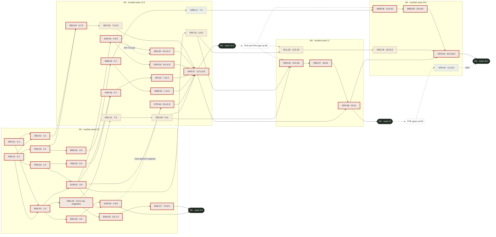

- Thick red: zero float in the levelled schedule. Dashed: on a CPM chain but with levelled float.
- SES-09 has float in a re-run but zero float on the H.1 tracks, where SES-05 follows it on INT-T3. That track edge is why the topology fallback can move M2 one-for-one (I.5).
- Grey: near-critical. OPS-04 has one week of float; WEB-11 feeds the M4 path if it is cut from M2.
- Hexagons are phase gates. Dotted edges are gates, resource hand-offs and the IM-8 soft finish. G.2 shows the single-owner chains alone.

### I.4 Milestone 1: Foundational Coral

**Definition and goal.** Coral is a dark plugin that one config key turns on. Its contracts are frozen, the reducer and Simulate work through the API and CLI, and the skin and Workflows desk show empty states (UI§6). No agent runs yet. This is D§18 phase 1 as narrowed by DD§19: a pure reducer, a separate Alembic environment, durable gate rows and no exhaustive Simulate (R-24, X-25).

**Features (25).**

| Workstream | Features |
|---|---|
| WS-PLATFORM | FND-01, FND-02, FND-03, API-01, DUR-01, DUR-02 |
| WS-ENGINE | ENG-01, ENG-02, ENG-03, ENG-04, ENG-05, ENG-07 |
| WS-OPS | SPK-01 (tech lead), OPS-01, OPS-02, FND-04, FND-05 |
| WS-INTEGRATION | SPK-02, SES-01 |
| WS-HARNESS | SPK-03, HRN-01 |
| WS-WORKSPACE | SPK-04, EVD-01 |
| WS-BRAND | BRD-01, BRD-02 |

**Proving journey** (section I).

1. One config key enables Coral; the skin and Workflows desk appear behind `GET /v1/coral/info`. Turning it off returns not found (FND-02, BRD-02).
2. Upload the MVP template via the API or `coral workflow upload` and get v1 with a content hash. A broken copy returns `yaml_path`-ranged problems (DUR-02, ENG-02, ENG-03).
3. Simulate approved, changes requested ×3 → at-limit gate, and gate reject. The traces re-run green as saved cases on v2 (ENG-05, ENG-07; G-66, G-69).

**Exit criteria** (condensed; numbered as the specs cite them, "M1 exit N").

1. Wheel, import lint and coral CI green (FND-01, FND-05).
2. Migrations after Omnigent head on all DB lanes plus split-DB (FND-03, FND-04, DUR-01).
3. One plugin key, fatal import errors, upstream Feature enum untouched (FND-02, BRD-02; R-21).
4. Fork guard required; two real nightly^1 merges; NOTICE and MODIFICATIONS.md generated (OPS-01, OPS-02; G-84).
5. Skin and navigation shell live (BRD-01, BRD-02; G-78, G-79).
6. V1-V7 and V10-V13 pass; I1-I8 hold under fuzz; Simulate saves cases via the API (ENG-01..05, ENG-07, DUR-02).
7. IM-0 contracts at v1; K5, K9, K11, K17, K21 published; K13 v1 frozen; ADR-05 and the threat model signed (SPK-01..04).

**Dates.**

| CPM single-owner | CPM staffed | Levelled | Planned |
|---|---|---|---|
| 11.5 | 9.5 | 9.5 | 11 |

The 9.5 needs two engineers on ENG-04. With one, levelled M1 is 11.5 (planned 13.5), and M2 does not move (re-run).

**Critical and near-critical chains.**

- Single-owner (11.5): FND-01 or SPK-01 > ENG-01 > ENG-04 > ENG-05 > ENG-07.
- Staffed and levelled (9.5), two co-critical chains:
  - engine: ENG-01 (1-3) > ENG-04 (3-5.5) > ENG-05 (5.5-7.5) > ENG-07 (7.5-9.5);
  - platform: FND-01 > FND-03 (1-3) > DUR-01 (3-5) > DUR-02 (5-9.5), also fed by ENG-01 > ENG-02. Master v3 names this one as the staffed critical path.
- Near-critical: ENG-01 > ENG-02 > ENG-05 > ENG-07 (9.0 staffed).
- Twelve M1 features also carry M2: FND-01, SPK-01, FND-02, FND-03, ENG-01, ENG-02, DUR-01, DUR-02, BRD-02, FND-04, SES-01 and SPK-02. A one-week slip in any of them moves M2. ENG-04, ENG-05 and ENG-07 move only M1.

**Integration milestones.** IM-0, contract freeze, week 3. Owner: the tech lead with the ENGINE and INTEGRATION leads; dated by ENG-01, SES-01 and API-01. Proof: the 13 PH0 contracts at v1, FakeOmni passing K4 conformance, a consumer stub per team. IM-1 (week 7) is listed under M2.

**Conditional scope and contingencies.**

- **Spike 4** (SPK-03, days 1-2) decides the Tier B harness. If it fails, FND-04, ENG-11, HRN-01 and PRF-01 add a test-only openai-agents path (F.0 conditional dependencies). Master leaves this uncosted. A re-run shows one extra FND-04 week moves M2 by two weeks: FND-04 feeds DUR-03 > API-02, and DUR-03's platform slot goes to GTE-06. Cost the path in the SPK-03 memo and keep it off FND-04's first PRs.
- **SPK-02 option B rejection** costs SES-03 3-4 weeks, which lands on M2 (I.5).
- **Spike 1 and spike 16 fallbacks** fit within float (re-run).

**Risks to the date.**

- **Engine staffing.** With two engine engineers, M1 is 12.0 and M2 15.5 (H.1; the re-run agrees).
- **Week-1 decisions.** ENG-01, API-01 and FND-02 hard-depend on SPK-01, which carries 19 OQs (OQ-1, OQ-3, OQ-4, OQ-12, OQ-13, OQ-19, OQ-37 and OQ-47 among them).
- **K13 timing.** K13 v1 text freezes at IM-0 (week 3) from SPK-04's draft, signed by the WORKSPACE lead; WSP-01's first PR (week 5) lands it as code unchanged. EVD-01 (weeks 3-5) builds on the frozen text and the fake, so a late freeze fails exit 7 (RES-135).
- **Upstream churn.** A two-week merge cadence (OQ-50) gives about four windows for the two required merges. Upstream landed 1,522 commits between 2026-10-09 and 2026-11-08 (`git log --since=2026-10-09 --until=2026-11-08`), 52 of them in `_sessions/helpers.py` (DD§17 has 1,498 for the same dates).

### I.5 Milestone 2: Functional stateful workflow (MVP)

**Definition and goal.** The MVP template, "Implement with review loop" (TLD-01), runs end to end on a local repo with claude-sdk on an Anthropic API key. It survives restarts without duplicate sessions, decides only through engine tools, shows evidence and spend, and asks for its gate once in the Inbox. Web and CLI only. This is D§18 phase 2 with DD§19's additions (topology decided; API key, S13) and the product MVP (`product.md` §0 item 8).

**Features (41).**

| Workstream | Features |
|---|---|
| WS-INTEGRATION (14) | SES-02, SES-03, SES-04, SES-05, SES-06, SES-08, SES-09, TLS-01, TLS-02, TLS-03, TLS-05, GTE-01, GTE-05, RUL-01 |
| WS-WEB (8) | WEB-01, WEB-02, WEB-03, WEB-04, WEB-05, WEB-11, WEB-13, GTE-02 |
| WS-PLATFORM (5) | DUR-03, DUR-04, DUR-05, API-02, GTE-06 |
| WS-WORKSPACE (5) | WSP-01, WSP-05, WSP-06, EVD-02, EVD-03 |
| WS-OPS (4) | SPK-05 (tech lead and PM), OPS-03, OPS-06, OPS-07 |
| WS-ENGINE (3) | ENG-06, ENG-11, RUL-02 |
| WS-HARNESS (2) | PRF-01, HRN-02 |

Three later-milestone features start in this window: RUL-04 and HRN-08 (M3), and ENG-08 (M4). ENG-08's first PR exercises item_path at depth 2 before M2 exit (TLD-21).

**Proving journey** (section I, condensed).

1. On macOS seatbelt or Linux with bwrap: configure the template, confirm the commands, simulate and start. Preflight shows the estimate and the cost cap.
2. The first `coral_submit_handoff` is rejected because the tests predate the last edit, then accepted. The slot commits, stops and closes.
3. A reviewer's write is denied by the sandbox, and read-only shows Enforced.
4. `coral_choose_arrow` moves the loop to pass 2 of 3, and spend updates.
5. A SIGTERM and restart create no duplicate sessions, and the gate is re-published.
6. The gate is approved once from the Inbox; the outcome panel follows.
7. A second run exercises pause, resume, cancel and retry with salvage, then paused(infra) and paused(plan_limit).

**Exit criteria** (16, numbered as the specs cite them, "M2 exit N"; grouped).

| Exit | Group | Criterion | Features |
|---|---|---|---|
| 1 | Durability | E2E-1, E2E-2 and the fault journey on Tier B | SES-05, OPS-07 |
| 2 | Soak | Credentialed nightly meets the SPK-05 threshold (needs OQ-51) | OPS-07 |
| 3 | Durability | fold(log) == state; commit-boundary crash recovery on all lanes; I7; engine-upgrade lane | DUR-03, DUR-05, ENG-11, OPS-07 |
| 4 | Decisions and control | Engine tools only; illegal labels rejected | TLS-02, TLS-03, ENG-06 |
| 5 | Decisions and control | Loop limit 3 → gate | ENG-05 |
| 6 | Decisions and control | Pause, resume, cancel, retry | ENG-06, API-02, SES-04, SES-06, WSP-06, WEB-04 |
| 7 | Decisions and control | Commit before stop; a turn after accept → paused(drift) | ENG-04, SES-04, WSP-06 |
| 8 | Live view and gates | Server patches with Last-Event-ID resume | API-02, WEB-04 |
| 9 | Live view and gates | One Inbox card per gate, owner-only, re-published after restart (G-34, G-35, G-36) | GTE-01, GTE-02, GTE-06 |
| 10 | Evidence | Exit codes and L1 fingerprints durable before the tool result; S71 landed (reaper guard today: `omnigent/host/connect.py:1417-1424`) | EVD-02, WSP-05 |
| 11 | Safety | No subscription OAuth for run sessions (`omnigent/inner/claude_sdk_executor.py:2096-2097` strips the API key today); sandboxed reviewers; paused(budget) | HRN-02, PRF-01, RUL-01 |
| 12 | Safety | Drift paused within one resync; typing never nudged; 529/429/401 mapped | SES-08, SES-09 |
| 13 | Safety | Honest labels: each traces to a mechanism | RUL-02, WEB-13, WEB-04 |
| 14 | Security and outcome | No open high findings in the M2 security review | OPS-06 |
| 15 | Security and outcome | Three users finish unaided; template to first simulate under five minutes | OPS-07 |
| 16 | Security and outcome | Five-run SQLite smoke; watchdog p95 recorded (OQ-14) | DUR-04, SES-08, OPS-07 |

*Conditional:* an external M2 audience (SPK-05) also needs OPS-03 uncut, the OQ-30 counsel answers and OPS-06 as a release gate (contingencies below).

**Dates.**

| CPM single-owner | CPM staffed | Levelled | Planned |
|---|---|---|---|
| 13.5 | 13.5 | 13.5 | 16 |

OPS-07 runs 11.5-13.5, with the one-week soak tail inside it.

**Critical and near-critical chains.**

- Critical (13.5): FND-01 > FND-03 > DUR-01 > DUR-04 (5-9.5) > SES-05 (9.5-11.5) > OPS-07.
- Four more zero-float chains reach OPS-07 at 11.5:
  - DUR-04 > DUR-05;
  - DUR-01 and FND-04 > DUR-03 (5-7) > API-02 (7-11.5);
  - FND-02 > BRD-02 > WEB-02 > WEB-03 (7-11.5), with GTE-02 on the same engineers;
  - GTE-06 (9.5-11.5), which waits for the platform engineer DUR-02 frees at 9.5.
- **Capacity-critical.** The chain SES-01 > SES-03 > SES-06 or SES-09 has two weeks of logical float, yet a re-run shows zero float: a late SES-03 pushes SES-06 and SES-09 into the integration slots SES-05 needs. On the H.1 tracks SES-09 is zero float too, because SES-05 follows it on INT-T3 (H.5).
- **Half-week float.** ENG-11, SES-08, WEB-13 and RUL-02 cost 0.5 weeks per week of slip. ENG-04 > ENG-11 > SES-08 is critical only single-owner.
- **Absorbed.** One-week slips in SES-04, TLS-02, TLS-03, GTE-01, EVD-02, WSP-06, PRF-01 and WEB-04 do not move M2.
- **Staffing.** WS-PLATFORM owns five zero-float M2 features. At two engineers, M2 is 17.5 (+4).

**Integration milestones.**

| IM | Week | Owner | Proof |
|---|---|---|---|
| IM-1 Seam and store spine | 7 | INTEGRATION lead | A test tool drives an ENG-04 transition committed by DUR-03; an SES-02 observer sees the edge; a GTE-05 elicitation resolves once |
| IM-2 Walking skeleton | 11.5 | INTEGRATION lead | E2E-1 on Tier B; K4 conformance on FakeOmni and the real facade |
| IM-3 MVP template headless | 11.5 | OPS lead | Loop to limit 3, evidence reject then accept, write denied, close fencing, SIGTERM recovery |
| IM-4 UI on a live backend | 11.5 | WEB lead (convergence) | OPS-07's CI-only browser lane from start dialog to outcome panel |

Three IMs share week 11.5, followed by only two weeks of acceptance.

**Conditional scope and contingencies** (F.0 conditional dependencies; effects from re-runs).

| Trigger | Decided | Consequence | M2 effect |
|---|---|---|---|
| Spike 4 fails | SPK-03, day 2 | Test-only openai-agents Tier B; the exit lists what that lane cannot prove | Uncosted; +2 per FND-04 week |
| SPK-02 rejects option B | SPK-02, day 4 | Top-level family fallback: SES-03 +3-4; S35 moves in | CPM: +1.5 to +2 weeks; levelled with current staffing: up to +3 to +4 weeks one-for-one; with cut rank 1 applied: about +1.5 to +2 |
| Spike 8 fails | SPK-04, week 1 | Host-channel commit, reset and salvage move into WSP-06 (+3) | +0.5 |
| Spike 1, probe (e) or spike 16 fails | Weeks 1-2 | RUL-01 on S21; anchor input DENY; SES-06 owns the whole S27 seam (reaper retest and coral.keep_alive exemption) | None |
| External M2 audience | SPK-05 | OPS-03 cannot be cut; OPS-06 becomes a release gate; OQ-30 counsel answers move to M2 | None; counsel time is external |

**Risks to the date.**

- **Wide front.** Five chains (the critical chain and the four above) and three IMs converge at 11.5, and 23 items are zero-float, FND-04 included (I.10).
- **Skeleton slices.** SES-05 needs four slices the scheduler cannot see (decision 4). Track them as week-9.5 dated items.
- **Soak.** The soak needs OQ-51 by the end of PH1. The 9-of-10 threshold needs ten runs in one week, so the nightly must be topped up with on-demand runs from IM-2. One rerun costs a week. A rerun plus a three-week topology fallback uses the whole buffer in the re-run (16.0). On the H.1 tracks it overruns the buffer (17.5) unless TLS-05 is cut (15.5).
- **Topology.** If SPK-02 rejects option B, SES-03 takes 3-4 more weeks. M2 effect, CPM: +1.5 to +2 weeks (re-run: SES-05 starts on time on the engineer SES-09 would have used); levelled with current staffing: up to +3 to +4 weeks one-for-one (the H.1 tracks hold SES-05 behind SES-09 on INT-T3); with cut rank 1 applied: about +1.5 to +2 (INT-T4 takes SES-05 at week 9.5; RES-197). Probe (f) must prove own-runner children can be relaunched. Upstream relaunches roots only (`omnigent/server/app.py:4273`) and skips children with a `host_id` (`omnigent/server/child_session_recovery.py:165`).
- **Security timing.** OPS-06 runs at weeks 4-6, but exit 14 covers surfaces that land later: GTE-01's S6b owner check (week 9), and the API-02 run endpoints and GTE-06 inbox API (11.5). OPS-06 adds a second pass at IM-3 and sign-offs near weeks 13.5 and 18, about 0.5 week of WS-OPS tail (RES-170).
- **Dogfood and contention.** Book three users for weeks 12-13.5. A failed five-run SQLite smoke (TLD-08; DD§18 R10) reopens DUR-04 on the critical chain.

### I.6 M2 cut list

Already out of M2 (I.6): S1b (OPS-05); the bench, S59 and other modes (HRN-08); S69(b) (HRN-03); CI and pre-commit parsers (EVD-04); the scenario editor and badges (WEB-12).

| Rank | Cut | Fallback | Single-owner weeks saved | Levelled span | Decide by | Knock-on |
|---|---|---|---|---|---|---|
| 1 | TLS-05 `coral_ask_user` | Steps report blocked; the orchestrator asks in chat | 2 | 9-11 | week 9 | No hard successor; journey (g) loses ask_user |
| 2 | WEB-11 YAML editor | Read-only YAML, upload, template parameters in WEB-03 | 2 | 7-9 | week 7 | Hard input of WEB-06 (M3) and WEB-08 (M4 path); must land by week 15.5 |
| 3 | WEB-05 steering composer | Read-only agent panes plus 'open session' | 1 | 9.5-11.5 | week 9.5 | Steering in journey (h) moves to M4 |
| 4 | OPS-03 distribution identity (internal M2 only) | Run as omnigent with Coral enabled | 1 | 5-6 | week 5 | Not allowed for an external audience (F.0 conditional dependencies) |
| 5 | EVD-03 justfile and Makefile parsers | package.json and pyproject.toml detection only | 0.5 | 7-9 | week 7 | EVD-03 stays; it is an input of OPS-07 and EVD-04 |
| 6 | WEB-01 preset Simulate button | Simulate via API and CLI | 1 | 3-5 | week 3 | Diagram and overlay stay; exit 15's five-minute target moves to the CLI |

What the cuts buy:

- **Not the baseline date.** No cut item is on a levelled critical chain. Deferring TLS-05, WEB-11 and WEB-05 together leaves 9.5 / 13.5 / 21 / 26.5 (re-run).
- **Capacity where the front is full.**
  - Deferring TLS-05 fully absorbs a one-week SES-01 or SES-03 slip (re-run). It also frees INT-T4 to take SES-05 at week 9.5, so the topology fallback no longer moves M2 one-for-one: CPM: +1.5 to +2 weeks; levelled with current staffing: up to +3 to +4 weeks one-for-one; with cut rank 1 applied: about +1.5 to +2 (I.10).
  - Deferring WEB-11 absorbs a one-week GTE-02 slip.
  - Neither helps a slip inside one L feature (WEB-03, API-02, DUR-04). There the freed engineer must pair, which the scheduler cannot model.
- **Timing.** A cut saves time only if made before the work starts. Recommend two reviews against the I.10 register: week 3 for ranks 4 and 6, week 7 for ranks 1, 2, 3 and 5.

### I.7 Milestone 3: Functional agent profile system

**Definition and goal.** Users manage revisioned agent profiles, and every promise label is computed per harness mode and host sandbox backend (TLD-11). Catalog rules compile into guardrails, and V9 rejects Required rules a mode cannot enforce. Subscription users run claude-native steps under fail-closed hooks, and plan limits pause and auto-resume. Sources: D§5.4, D§9, D§17 risk 1; DD§10; UI§8.3; X-13.

**Features (12).**

| Workstream | Features |
|---|---|
| WS-HARNESS (6) | HRN-03, HRN-04, HRN-07, HRN-08, PRF-02, RUL-04 |
| WS-WEB (3) | WEB-06, WEB-07, WEB-12 |
| WS-INTEGRATION (1) | RUL-03 |
| WS-ENGINE (1) | RUL-06 |
| WS-OPS (1) | OPS-08 |

RUL-04 and HRN-08 start in PH2 so hooks and bench exist before HRN-03 (decision 23).

**Proving journey** (section I).

1. Create a 'Strict reviewer' profile and pick it for Review.
2. Add a Required and a Guidance rule; per-mode label chips appear.
3. Switch a reviewer to claude-native on a subscription. Labels drop to Verified, V9 flags the rule and offers remedies, a blackholed policy endpoint blocks the call, and `/clear` is followed.
4. A plan limit pauses the run and it auto-resumes; a mid-run profile edit leaves the run on revision N.
5. A subscription-only user runs the single-agent template (TLD-07).

**Exit criteria** (condensed; numbered as the specs cite them, "M3 exit N").

1. Immutable revisions and pins (PRF-02; G-50).
2. Bench-tested labels per (mode, host); V9 rejects unenforceable rules (HRN-08, RUL-06; G-44, G-73).
3. Catalog rules with bypass analysis (RUL-03, WEB-06; G-48).
4. IM-5 green and the nightly bench on both claude modes.
5. Plan-limit auto-resume (HRN-04).
6. Desk and picker live with profiles_desk on (WEB-07; G-53).
7. Saved scenarios with badges (WEB-12).
8. SPK-05's OQ-28 and OQ-35 records exist, or the fallback is applied; OPS-08 checks this (RES-175).
9. OPS-06 native review before HRN-03 merges.
10. Dogfood passes (OPS-08).

**Dates.**

| CPM single-owner | CPM staffed | Levelled | Planned |
|---|---|---|---|
| 19 | 17 | 21 | 24.5 |

**Critical and near-critical chains.**

- Single-owner (19): ENG-01 > ENG-04 > ENG-11 > SES-08 > HRN-03 > HRN-07 > OPS-08.
- Staffed (17): three co-critical chains reach HRN-03, via DUR-01 > PRF-01 (from FND-03 or ENG-01) and via ENG-04 > ENG-11 > SES-08.
- Levelled (21): M2 exit (13.5) > HRN-03 (13.5-18) > HRN-07 (18-20) > OPS-08 (20-21).
  - The four weeks over staffed CPM are the phase gate. SES-08 lands at week 11.
  - WS-HARNESS has no feature work from 9.5 to 13.5.
- Zero float: the M2 register plus HRN-03, HRN-07 and OPS-08.
- Near-critical: RUL-03 has two weeks of float, and WEB-06, WEB-07 and HRN-04 about 2.5.

**Lever (recommendation; changes the decision-23 window, so it needs tech-lead sign-off before week 11; not adopted in master v3, RES-192).** Start HRN-03 when SES-08 lands at week 11.

- Effect: levelled M3 becomes 19.0 (planned 22), and M4 is unchanged (re-run).
- Cost: harness engineers miss the IM-3 fix-forward, and HRN-03 starts before the OQ-28 deadline. The OQ-28 fallback ships the same code on API key, so the early start is safe either way.

**Integration milestones.** IM-5, native step, week 20, HARNESS lead: E2E-3 and E2E-4 inside the MVP template, with labels switching to Verified.

**Conditional scope and contingencies.**

- **OQ-28** (subscription terms; DD§16.1; R-22). SPK-05 records a default by week 2 (for HRN-02) and the vendor answer by the end of PH2 (RES-005). Without it, HRN-03 ships on API key behind claude_native_steps and journey steps 3 and 5 are rewritten (F.0 conditional dependencies). No date effect; journey (k) loses its subscription path.
- **OQ-35** (v1 modes; X-13) sets what OPS-08 must prove. SPK-05 records it by week 2 (RES-005).
- **Gated runs.** SPK-05 decides whether gated runs may use native steps (D25). Native gate integrity never shows Enforced (TLD-09).

**Risks to the date.**

- **Carry-over.** Every M2 week moves M3.
- **HRN-03.** HRN-03 is L and alone on the path. +1 week moves M3 by 1; +2 moves M3 by 2 and M4 by 1 (re-run).
- **Native internals.** `omnigent/harnesses/claude_native/status_file.py:25-27` calls its source "an undocumented internal detail" (DD§18 R6). Run HRN-08's bench nightly from PH2.
- **Upstream review.** S14 is an upstream-first Modify seam (RUL-04; H.10); RUL-04's PH2 start buffers upstream review time.
- **Review gate.** Schedule OPS-06's native review by weeks 16-17.

### I.8 Milestone 4: Integrated production-ready Coral

**Definition and goal.** M4 covers five areas:

- **Trust:** host op channel, L2 fingerprints, Coral-run checks (G-38, G-43).
- **Structure:** repeat, parallel steps, multi-writer merges (G-08, G-09, G-60).
- **Canvas** with YAML round-trip (G-72).
- **Run control:** take-over, refresh, budgets, restart-from-node, webhooks (G-62, G-63, G-65).
- **Release operations** (G-84, G-86, G-87).

Sources: D§18 phases 3, 5-7; DD§12-14.

**Features (23).**

| Workstream | Features |
|---|---|
| WS-WORKSPACE (4) | WSP-02, WSP-03, WSP-07, EVD-04 |
| WS-INTEGRATION (4) | SES-07, SES-10, TLS-04, RUL-05 |
| WS-ENGINE (3) | ENG-08, ENG-09, ENG-10 |
| WS-HARNESS (3) | HRN-05, HRN-06, HRN-09 |
| WS-WEB (3) | WEB-08, WEB-09, WEB-10 |
| WS-OPS (3) | OPS-04, OPS-05, OPS-09 |
| WS-PLATFORM (2) | GTE-03, DUR-06 |
| WS-BRAND (1) | BRD-03 |

**Proving journey** (section I).

1. Build the PR-review loop on the canvas; the YAML keeps its comments.
2. Repeat over PRs ('3 of N', batched gates) with codex-native reviewers, or claude-sdk without OQ-29.
3. Two writers use per-item worktrees, serial merges, Coral-run checks and L2 fingerprints; push needs consent.
4. Exercise a budget pause, a refresh, take-over, a webhook gate and a restart from a node. Afterwards, purge an old run and open a `coral://` link.

**Exit criteria** (numbered as the specs cite them, "M4 exit N").

1. IM-6: identical verdicts across the backend swap (WSP-02, WSP-07, EVD-04).
2. IM-7: E2E-5 green, with post-merge checks always run (ENG-08, SES-10, ENG-09, WSP-03, TLS-04).
3. Canvas round-trip with keyboard and screen-reader parity (WEB-08, WEB-09).
4. RUL-05, SES-07, GTE-03, ENG-10, DUR-06, WEB-10 and HRN-05 proofs green; HRN-06 and HRN-09 green or dark.
5. IM-8: DB lanes, OQ-1 load, security closure, release drill, upstreamed seams, licensing and desktop feed (OPS-04, OPS-05, BRD-03).
6. Dogfood passes (OPS-09).

**Dates.**

| CPM single-owner | CPM staffed | Levelled | Planned |
|---|---|---|---|
| 21 | 20.5 | 26.5 | 30.5 |

**Critical and near-critical chains.**

- Single-owner (21): the M3 chain extended through OPS-09.
- Staffed (20.5): DUR-01 > PRF-01 > RUL-03 > ENG-09 > OPS-09. Next is the web chain BRD-02 > WEB-02 > WEB-11 > WEB-08 > WEB-09 > OPS-09 (20.0).
- Levelled (26.5): WEB-08 (15.5-20) > WEB-09 (20-24.5) > OPS-09 (24.5-26.5). WEB-08 is ready at 13.5. The scheduler places the M3 web work (WEB-12, WEB-06, WEB-07) first and does not backfill, so web engineers sit idle at weeks 13.5-15.5.
- Next behind it:
  - OPS-04 (21-25.5, after PH5 opens; IM-8) has one week of float;
  - HRN-09 ends at 25.0;
  - WEB-10, ENG-09 and WSP-03 have two or more weeks.
- Zero float: the M2 register plus WEB-12, WEB-08, WEB-09 and OPS-09.
- M3 carry-over: a one-week M3 slip is absorbed. A longer one moves M4, because PH5 opens at M3 and OPS-04 has one week of float. HRN-03, HRN-07 or OPS-08 at +2 gives M4 27.5 (re-run).

**Levers (recommendations; re-runs; not adopted in master v3, RES-192).**

| Change | M3 | M4 |
|---|---|---|
| Baseline | 21 | 26.5 |
| Start WEB-08 at M2 on idle web capacity, or fold WS-BRAND's engineer into WEB after BRD-03 (H.1) | 21 | 25.5 (OPS-04 bound) |
| The above plus HRN-03 at week 11 | 19 | 24.5 |

**Integration milestones.**

| IM | Week | Owner | Proof |
|---|---|---|---|
| IM-6 Workspace backend swap | 20 | WORKSPACE lead | Identical verdicts on both K13 backends (WSP-07) |
| IM-7 Structure showcase | 22.5 | INTEGRATION lead | PR-review loop: repeat, parallel reviewers, two writers, serial merges, post-merge checks |
| IM-8 Release rehearsal and security closure | 25.5 | OPS lead | Merge drill with all lanes green (OPS-05 re-runs it in week 25, RES-169); security closed; licences signed |

**Conditional scope and contingencies.**

- **OQ-29** (Codex terms; DD§16.2). SPK-05 records the external answer by PH4 start (week 13.5; RES-001). Without it, HRN-05, HRN-06 and HRN-09 stay dark behind codex_steps (RES-123), and HRN-09 is the first cut (decision 2). No date effect.
- **OQ-25** (retention). SPK-05 records a default by week 4 and signs it by week 13.5; DUR-06 implements it (RES-001).
- **K20.** K20 freezes at M2 as WSP-02's first PR, signed off by OPS-06. EVD-04 builds on that slice from 13.5, unseen by the scheduler. A late K20 delays IM-6 and IM-7.

**Risks to the date.**

- **WS-WEB capacity.** WEB-12, WEB-08 or WEB-09 +1 moves M4 by a week (re-run). On the H.1 tracks WEB-12 sits on WEB-T2 with 2.5 weeks of float, so only the canvas pair binds (H.6).
- **WEB-11 deferral.** If deferred from M2, WEB-11 must land by 15.5, or WEB-08 slips.
- **Upstream.** 'Up: Yes' seams and the Modify seams (S43, S6b, S14, S40, S72, S62) move at upstream's pace: 1,522 commits between 2026-10-09 and 2026-11-08 (`git log --since=2026-10-09 --until=2026-11-08`).
- **Security closure.** OPS-04 is L with one week of float, and it absorbs native findings (including HRN-06's S20 runner policy relay; RES-124) and K20 findings.
- **Carry-over.** Each M2 week moves M4, as does each M3 week beyond the first.
- **IM-7 tail.** SES-10 exits at week 16 on fakes; INT-T2 re-runs E2E-5 as RUL-03 (18), WSP-07 (20) and WSP-03 (22.5) land. A WSP-03 slip moves IM-7 (J.6, RES-064).

### I.9 Post-M4

- **Features (7):** EXT-01 and EXT-02 (WS-ENGINE); EXT-03 and WSP-04 (WS-WORKSPACE); EXT-04 (WS-INTEGRATION); EXT-05 (WS-PLATFORM); GTE-04 (WS-WEB).
- **Dates.** CPM 17 single-owner and 16 staffed (via SES-03 > SES-06 > SES-07 > EXT-02 and DUR-04 > GTE-03 > GTE-04). Levelled 31, planned 36. The PH6 gate keeps work that is ready by week 17 off M4 capacity.
- **No milestone exit.** Each feature is gated by its OQs:
  - WSP-04: OQ-5;
  - EXT-01: OQ-55;
  - EXT-02: OQ-30;
  - EXT-03: OQ-33;
  - EXT-04: OQ-4, OQ-17, OQ-46;
  - EXT-05: OQ-21;
  - GTE-04: OQ-6, OQ-23.
- **Scope.** Journeys (l), (m) and push for (g). Deferred gap parts are in E.W.
- **Pull-forward (recommendation).** After week 15.5, WS-PLATFORM carries only the OPS-04 load scenario. EXT-05 needs only API-02 and could run before M4 once OQ-21 is answered.

### I.10 Date sensitivity and watch list

Levelled re-runs; shift in weeks against the baseline (9.5 / 13.5 / 21 / 26.5).

| Event | M1 | M2 | M3 | M4 |
|---|---|---|---|---|
| One week on an M2 zero-float item: SPK-01, FND-01, FND-02, FND-03, ENG-01, ENG-02, DUR-01, DUR-02, BRD-02, SES-01, SPK-02, SES-03, WEB-02, GTE-02, DUR-03, DUR-04, API-02, WEB-03, SES-05, DUR-05, GTE-06, OPS-07 | 0 or +1 | +1 | +1 | +1 |
| One week on FND-04 | 0 | +2 | +2 | +2 |
| One week on ENG-11, SES-08, WEB-13 or RUL-02 | 0 | +0.5 | +0.5 | +0.5 |
| One week on ENG-04, ENG-05 or ENG-07 | +1 | 0 | 0 | 0 |
| One week on HRN-03, HRN-07 or OPS-08 | 0 | 0 | +1 | 0 |
| Two weeks on HRN-03, HRN-07 or OPS-08 | 0 | 0 | +2 | +1 |
| One week on WEB-12, WEB-08, WEB-09 or OPS-09 | 0 | 0 | 0 | +1 |
| Topology fallback, SES-03 +3 to +4 (CPM) | 0 | +1.5 to +2 | +1.5 to +2 | +1.5 to +2 |
| Topology fallback, SES-03 +3 to +4, levelled with current staffing (H.1 tracks fixed; not a re-run) | 0 | up to +3 to +4 | up to +3 to +4 | up to +3 to +4 |
| Topology fallback +3 to +4 with TLS-05 cut | 0 | +1 to +2 | +1 to +2 | +1 to +2 |
| Spike 8 fallback, WSP-06 +3 | 0 | +0.5 | +0.5 | +0.5 |
| Soak rerun, OPS-07 +1 | 0 | +1 | +1 | +1 |
| Soak rerun plus topology fallback +3 | 0 | +2.5 | +2.5 | +2.5 |
| Soak rerun plus topology fallback +3, TLS-05 cut | 0 | +2 | +2 | +2 |
| WS-ENGINE at 2 engineers | +2.5 | +2 | +2 | +2 |
| WS-PLATFORM at 2 | 0 | +4 | +4 | +4 |
| WS-WORKSPACE at 1 | 0 | +2.5 | +2.5 | +7 |
| WS-HARNESS at 1 | 0 | 0 | +4 | +6 |
| WS-OPS at 1 | 0 | 0 | 0 | +3 |
| WS-INTEGRATION at 3 | 0 | 0 | 0 | 0 |

Readings:

- Topology fallback (ADR-05), CPM: +1.5 to +2 weeks; levelled with current staffing: up to +3 to +4 weeks one-for-one; with cut rank 1 applied: about +1.5 to +2. The models give +1 to +2 with the cut, but they ignore the SES-03 skeleton slice that SES-05 needs, so plan on about +1.5 to +2.
- The 2.5-week M2 buffer covers one soak rerun plus a three-week topology fallback in the re-run, and nothing more. With the H.1 tracks held fixed, it covers them only if TLS-05 is cut.
- WS-PLATFORM and WS-WORKSPACE staffing protect M2; WS-HARNESS protects M3; WS-WEB protects M4.
- The fourth integration engineer is not date-critical in the model, so keep that seat on the seam train (H.1, H.10).

Watch list, reviewed weekly by the tech lead with the workstream leads:

- the zero-float register, with slips reported in half weeks;
- the skeleton slices, merged by week 9.5;
- decision deadlines:
  - spike 4, day 2;
  - SPK-02 probes, day 4;
  - SPK-01, week 1;
  - SPK-05, week 2 (OQ-9, OQ-15, OQ-35, the OQ-28 default) and week 4 (the rest, the OQ-25 default included);
  - OQ-51, week 9.5;
  - OQ-28, OQ-29 and OQ-25, week 13.5;
- the cut reviews at weeks 3 and 7;
- K20 at week 13.5.

## J. Risks, Open Questions and Decisions

This section keeps three kinds of statement apart:

- **J.1 Confirmed findings.** Facts verified in code at HEAD `2a9cbe2c2`, with line numbers re-checked on 2026-11-12. The roadmap is built around them. Their consequence columns show how the plan responds; the choices themselves are signed through J.2 and J.3.
- **J.2 Recommendations awaiting sign-off.** TLD-01..TLD-21 and the J.2 decisions log structural decisions, until their SPK-01 or SPK-05 records are signed.
- **J.3 Unresolved questions.** OQ-1..OQ-55 and spikes 1-20. Each has a default, an owner and a deadline.

J.4 is the risk register, J.5 the failure-mode owners, and J.6 the residual items left open by the final harmonization (master v3). Week numbers are levelled-schedule weeks: M1 9.5, M2 13.5, M3 21, M4 26.5. The planned dates, which add a 15% buffer, are 11, 16, 24.5 and 30.5 (I.1). IM-0, the contract freeze, is at week 3.

### J.1 Confirmed findings

### J.1.1 Draft 4 claims that are false or stale at HEAD (D1, D2 and related rows)

Paths are relative to the repo root. "Line" is the line in `coral-design.md`.

| ID | Draft 4 claim (line) | Fact at HEAD (evidence) | Roadmap consequence |
|---|---|---|---|
| D1.1 | A fail-closed sub-agent router enforces rosters (:82, :104, :415) | The router is advisory. Every transport failure, timeout or bad verdict lets the spawn through (`omnigent/runner/subagent_routing.py:1-8`). | Removed from the plan (R-3). Rosters come from separate sessions, `step_roster` DENY and bundle guardrails (RUL-01, PRF-01), plus S14/S16 for native modes (RUL-04). |
| D1.2, D5 | `PersistentTaskScheduler` runs timers and the signal queue (:87, :284), with at-least-once delivery (:286) | It runs only behind `automations_v2`, which is off by default (`omnigent/server/feature_flags.py:54, 97-103`) and was due for review at 0.20.0. Recovery "never sends the prompt again" (`omnigent/server/scheduled/README.md:147`), so delivery is at most once. | Coral owns an at-least-once leased queue (DUR-04, K5, K21). It reuses the scheduler's patterns, such as `StartupLease` (`omnigent/server/scheduled/dispatch_scheduler.py:156`), not the scheduler. |
| D1.3 | Approvals by web push and "on the phone" (:83, :182, :363) | There is no VAPID, APNs, FCM, web-push or SMTP code. An `rg` over `omnigent/`, `web/src/` and `web/electron/` finds nothing. | In-app Inbox plus an "app must be open" notice at M2 (GTE-02, GTE-06). Webhook at M4 (GTE-03). Push after M4 (GTE-04). |
| D1.4, D34 | Budgets "pause the run and ask" by reusing `cost_budget` (:346) | `cost_budget` reads the running session total (`omnigent/policies/builtins/cost.py:31`) and is per session (`:148`). On unpriced usage it returns ASK (`:507-508`), although its docstring says DENY (`:39`). | Per-session backstop mapped to `paused(budget)` at M2 (RUL-01). Engine-owned run and step budgets at M4 (RUL-05). Avoid the policy for unpriced models. |
| D1.5 | `sys_cancel_task` does nothing, and cancellation uses interrupt (:107) | The runner intercepts it (`omnigent/runner/tool_dispatch.py:401`; handler `:9106`). Interrupt does not close a session; the closed check runs only when a message is posted (`omnigent/server/routes/sessions/routes_events.py:1688-1698`). | Cancel is interrupt, then `stop_session`, then the `omnigent.closed` label (R-13, SES-04). |
| D1.6 | Sandboxes have network on or off only (:108) | `egress_rules` exist (`omnigent/inner/datamodel.py:764-765`). | Website limits compile to `egress_rules`, with the scope set per mode (RUL-03, K9). |
| D1.7 | Refresh at a fixed 70% (:276) | Executors report no context window by default (`omnigent/inner/executor.py:704-705`). | Store `refresh_threshold_bp=7000` per mode. Refresh is off when the window is unknown (SES-07, K9). |
| D1.8 | The completion hook says when a turn finished (:86) | `idle` is recorded as `succeeded` (`omnigent/server/routes/_sessions/helpers.py:5158-5159`). Stops and archives arrive as "succeeded" too. | Turn end comes from persisted edge facts and a per-mode rule (SES-08, ENG-11). |
| D1.9, D17 | `codex` "Gate tool calls: Yes" (:336) | Headless Codex starts threads with `approvalPolicy: "never"` (`omnigent/inner/codex_executor.py:3829`). Its built-in tools are only observed (`:2774-2786`). | Codex labels stay below Enforced until S20 (HRN-06, M4). The validator treats Codex as unenforceable until then (RUL-06). |
| D1.10 | Headless modes "Read context use: Yes" (:334) | Token counts are reported; the context window is not (`executor.py:704-705`). | Context window is `unknown` in K9 until probed (HRN-01, HRN-08, spike 13). |
| D1.11 | API keys are first-class "because Omnigent already supports them" (:402) | Only partly true. Uploaded bundles keep `${VAR}` literal, CLI installs bake secrets, and some claude-sdk paths strip `ANTHROPIC_API_KEY` to force subscription auth (`omnigent/runtime/workflow.py:1386`). | Credential guard S13/S63 moves to M2 (HRN-02). Bundles carry provider references, not secrets (K12). |
| D1.13 | The patch list (§16) covers the seams; phase 2 keeps the router (:415) | The seam ledger has 102 entries, 93 of them planned (seam ledger, D.8). | Seam ledger and fork guard (OPS-01, K16). |
| D7 | "Agents change code: off" keeps reviewers read-only (:133) | `read_only_os` deliberately leaves shell commands untouched (`omnigent/policies/builtins/orchestration.py:654-656`). | Read-only means claude-sdk sandbox `write_paths: []` at M2 (PRF-01, R-23). Other modes get Verified, not Enforced. |
| D8 | done-when is "evaluated on the merged result" (:168) | Nothing runs commands after a merge. | Coral-run checks after multi-writer merges (EVD-04, WSP-03, M4). |
| D10, D11 | The orchestrator assigns an agent to resolve conflicts (:169); agents work on branches of one worktree (:166) | A session's workspace is immutable after creation (`omnigent/entities/conversation.py:207-209`). Git needs one worktree per writer. | `coral_assign_task` (TLS-04) and per-writer worktrees (WSP-03), both at M4. |
| D12 | The engine fingerprints the workspace after each command (:226) | "the server has no filesystem" (`omnigent/server/schemas.py:1744`). | The runner or host computes fingerprints: L1 in EVD-02, L2 in WSP-02. |
| D24 | Per-run branch "locally or in a sandbox" (D§11) | Managed hosts reject `git` (`schemas.py:2011-2012`) and reject `host_id` on managed children (`:1807-1811`). | Local hosts only through M4. Managed-sandbox runs are post-M4 (WSP-04). |
| D25 | "Gates cannot be skipped: Enforced" | Native agents can read the bridge-dir bearer (`omnigent/runner/native/orchestration.py:9290, 9833`). Managed sandboxes stay warm only while busy (`omnigent/server/managed_host_keepalive.py:1-11`). | Gate integrity is labelled per mode and is never Enforced for native steps (RUL-02, TLD-09). |
| C-23 | Sub-agents allowed "where Coral can verify them" (:55) | claude-sdk exposes only `Skill`, `ToolSearch` and an optional `AskUserQuestion` (`omnigent/inner/claude_sdk_executor.py:2571-2585`). | No vendor sub-agents in v1; S17 is not planned. |
| D2 | Requirements live in `coral-requirements.md` (:5) | The file is absent (`ls`). | SPK-01 records the OQ-1 defaults. Acceptance criteria trace to D§, DD§ and `product.md`. |

D1.12 holds: Draft 4 did adopt DD's derived joins, merge rules, migration env, API keys and decision log. C-19: `web/src/canvas/` is taken, so the canvas goes in `web/src/workflows/`. UI-doc claims (D3, U-1..U-10) are in §B.3; two would break code as written:

- Repointing `--font-heading` would make every card and dialog title serif (`web/src/components/ui/card.tsx:41`; `web/src/components/ui/dialog.tsx:146`). TLD-16 adds `--font-display` instead (R-15).
- Remapping status colours in `:root` would recolour every palette. BRD-01 scopes the remap to the default palette (U-7).

### J.1.2 Deep-dive positions corrected at HEAD (D28; current_state §11.2)

| # | DD position | Correction at HEAD (evidence) | Roadmap consequence |
|---|---|---|---|
| X1 | Tool idempotency key `tool:{session}:{call_id}` (DD§6.3, §8.6) | The harness call id never reaches the server. The proxy mints `mcpop_<uuid4>` per call (`omnigent/runner/proxy_mcp_manager.py:340`). | Transport dedup on `(run, operation_id)`; semantic dedup on slot and decision state (K6, TLS-01, TLS-02). |
| X2 | Orchestrator schemas generated per decision (DD§5.4) | Tool schemas are cached per conversation (`omnigent/runner/app.py:5910-5935`). | A generic `label` argument, validated by the server (TLS-03, R-11). |
| X3 | Root session policies and spec guardrails reach every child (DD§9.3) | Only root session policies are inherited (`omnigent/runtime/policies/builder.py:756-766`). | No session policies on the anchor; leaf policies per step (SES-03, RUL-01). Orchestrator rules go in bundle guardrails (X-11). |
| X4 | The host cannot read files (DD§14.4) | `host.fs_request` reads files up to 10 MiB without a user request (`omnigent/server/routes/_host_filesystem.py:59-68`; `omnigent/workspace_fs.py:64`; `omnigent/host/connect.py:3793`). | Repo import and command detection read through the host (WSP-01, EVD-03). Writes still need S40 and S74. |
| X5 | No server-initiated command API (DD§9.2) | An owner-only session shell exists (`omnigent/server/routes/sessions/routes_resources.py:3264`). | The session-shell K13 backend serves M2 (WSP-06). Ops with no session need S40 (WSP-02). |
| X6 | S4: `_post_event_impl` accepts non-request contexts | It accepts only `_RunnerEventContext` and `StartupInputContext` (`routes_events.py:1019`). | S41/S42 in SES-02. |
| X7 | S32: Coral routers mount through `extra_routers` | The CLI never passes `extra_routers` (no match in `omnigent/cli.py`; the parameter is at `omnigent/server/app.py:1578`). `scripts/dump_openapi.py` omits them too. | A `server_plugins` key (FND-02, K17) and a separate Coral OpenAPI (API-01). |
| X8 | Idempotent create by `coral.effect_id` label lookup (DD§6.1) | The labels table has no index on values (`omnigent/db/db_models.py:1102-1117`). | Derive `uuid5(effect_key)` conversation ids and create through the store (K10, SES-03). |
| X9 | Fork-based refresh, with children as the default topology (DD§8.2, §8.9) | Fork refuses `sub_agent` sources (`omnigent/server/routes/sessions/routes_core.py:5013-5017`). | Refresh is a slot restart (TLD-13). S47 is not planned. |
| X10 | Merge upstream from tagged releases (DD§17) | Tags are stamp commits off `main`. `v0.22.0.dev20261108^1` is `ee7a319f7`, an ancestor of HEAD; the tag itself is not (`git merge-base`). | Merge from `nightly^1` (OPS-02, TLD-17). |
| X11 | The churn table lists only `helpers.py` and `AppShell.tsx` | Commits in the 30 days to 2026-11-12: `claude_native/bridge.py` 81, `_sessions/orchestration.py` 72, `openapi.json` 68, `server/app.py` 63, `host/connect.py` 58, `helpers.py` 51, `Sidebar.tsx` 49. | Hot-file landing order (H.10) under one seam-train owner. |
| X12 | `tests/coral/` holds engine fault-injection tests (DD§4.2) | The DB lanes run only `tests/stores tests/db` (`.github/workflows/ci.yml:264, 315, 363`). | DB contention tests go in `tests/stores/coral/` (FND-04, DUR-03). |
| X13 | Step sessions come "for free" as children | Parents are woken after 120 s (`omnigent/runtime/subagent_block_notifier.py:55`). Only roots relaunch (`omnigent/server/app.py:4273`). `/clear` detaches the child. | Anchor with own-runner children and S51; the engine relaunches children (SES-03, SES-06). |
| X14 | `run_write_transaction` retries version conflicts (DD§6.5) | It retries only CockroachDB 40001 and MySQL 1213 (`omnigent/db/utils.py:1058-1060`). | DUR-03 owns reduce-and-retry on CAS conflicts. |
| X15 | `CompressedText` caps payloads (DD§7.1) | It is uncapped unless `max_stored_bytes` is set (`omnigent/db/compression.py:127-145`). | K3 caps entry bodies at 16 KiB, and Coral columns set `max_stored_bytes` (DUR-01). |
| D29 | Reserve a `coral.` label prefix (DD S26) | Native `/clear` copies labels into a new top-level `POST /v1/sessions` body with no parent and no policies (`omnigent/native/_native_supersession.py:24-51`). | Prefix guards wait for teams, post-M4, with an explicit `/clear` policy (EXT-04, X-29). |
| D31 | Route `/workflows/runs/:runId/c/:conversationId` (DD§14.1) | A `:conversationId` parameter switches AppShell into chat mode (`web/src/shell/AppShell.tsx:321-325`). | Use `?agent=&node=` query parameters (R-17; BRD-02, WEB-05). |

### J.1.3 Hard constraints

These shape the plan regardless of any decision.

| Constraint | Evidence | Roadmap consequence |
|---|---|---|
| No push channel exists | `rg` for VAPID, APNs, FCM, web-push and smtplib is empty (D1.3) | Gates are unseen unless the app is open (J.4 RK-12; TLD-09). |
| A policy ASK times out to DENY | `omnigent/runtime/policies/approval.py:142-146`; "caller maps to DENY" (`:21`) | Gates are durable rows, never policy ASKs (R-7, GTE-01). An unattended step must never park on an ASK (SES-03 preflight). |
| The sub-agent router is advisory | `subagent_routing.py:1-8` | No roster enforcement through the router (D1.1). |
| `cost_budget` is per session | `cost.py:31, 148` | No run budget exists upstream (RUL-05). |
| `PersistentTaskScheduler` is unfit | Off by default, review date passed, at most once (D1.2) | Coral queue in DUR-04. |
| The server has no filesystem, but it can read host files through a frame | `schemas.py:1744`; `_host_filesystem.py:59-68`. The `fs_request` and `fs_write` frames are dispatched with no reaper guard (`connect.py:6031-6039`). | Reads go through the host (WSP-01, EVD-03). Writes need S40 (WSP-02, WSP-07). No exit code is trusted before the S71 guard (WSP-05). |
| Tool schemas are fixed per conversation | `runner/app.py:5910-5935` | Engine tools must exist when the session is created (`params.coral`, TLD-04). An existing session cannot join a run. |
| Native hooks fail to ASK | `omnigent/harnesses/claude_native/hook.py:1237-1241` (`fail_ask_hook_output`) | A policy outage stalls an unattended native step. RUL-04 adds fail-closed S14 before native labels exceed Requested (RK-08). |
| Headless Codex is not gated | `codex_executor.py:3829, 2774-2786`. Read-only becomes workspace-write when tools are present (`:5246-5247`). codex-native children default to `--dangerously-bypass-approvals-and-sandbox` (`helpers.py:10649-10659`). | Codex lands at M4 behind `codex_steps` (HRN-05, HRN-06), labelled Requested until S20. |
| claude-sdk has no native shell or file tools | `claude_sdk_executor.py:2571-2585`; OS work goes through `sys_os_*` | Only claude-sdk can be labelled Enforced at M2 (TLD-07, TLD-11). |
| Input sent mid-turn is buffered and replayed | `claude_sdk_executor.py:2323-2331`. The closed check runs only on post. | Step close is fenced: SES-04's closing state, and WEB-05 disables the composer. |
| Edit level is enough to answer a gate | `omnigent/server/routes/sessions/routes_elicitations.py:60` | Coral's S6b handler checks for the owner (GTE-01). |
| Edit-shared sessions cannot orchestrate | `omnigent/server/session_orchestration.py:64-69` | Run sharing needs engine-managed grants (EXT-04, post-M4). |
| The elicitation index is in memory | LRU cache and one observer slot (`omnigent/runtime/pending_elicitations.py:64-88`) | GTE-01 re-publishes stable ids after a restart; GTE-05 adds an observer registry (S5). |
| Session-read tools are given to every agent | `omnigent/tools/manager.py:402-415` | EGM input scoping uses a DENY policy (EXT-02). S65 is not planned. |
| `AgentConfigPatch` forbids extra fields | `schemas.py:200-203` | Profiles are edited by reinstall (PRF-02), with metadata in `params.coral` (OQ-37). |
| Deleting a session can delete its branch | `routes_events.py:4168-4190` | Run sessions bind with `workspace=` and no git options; WSP-01 tests this (TLD-12). |
| Managed sandboxes sleep when idle | `managed_host_keepalive.py:1-11`; commit `ee7a319f7` | Local hosts through M4. SES-04 calls `ensure_runner_connected` before every send (OQ-5). |
| Upstream feature flags form a closed enum and default to off | `feature_flags.py:23-54` | Coral gates itself through `/v1/coral/info` (TLD-03). |
| Upstream migrations are a rollback floor | 121 revisions; head `f1c7a9e2b406` "is the application rollback floor" (`omnigent/db/migrations/versions/f1c7a9e2b406_add_conversation_family_id.py:1-6`) | Separate Coral Alembic env (FND-03). Own data dir by default (OPS-03, OQ-53). |
| The MCP proxy waits about two hours | 7230 s and 7260 s (`tool_dispatch.py:228-229`) | The harness timeout is what binds (spike 7); `coral_submit_handoff` returns "evaluation in progress" (TLS-02). |
| Upstream moves fast | About 1,400-1,410 commits on `main` in the rolling 30 days to 2026-11-12 (`git rev-list --since=30.days`); 1,522 between 2026-10-09 and 2026-11-08 (`git log --since=2026-10-09 --until=2026-11-08`; B.1) | Real merges every two weeks from PH1 (OPS-02). |
| Coral starts greenfield | `coral-requirements.md`, `coral/`, `web/src/workflows/` and `web/src/components/concerto/` are absent (`ls`) | FND-01 creates the package. The UI doc's prototype files must be built (BRD-01, BRD-02). |

### J.2 Recommendations awaiting sign-off

**How sign-off works.** SPK-01 records all 21 TLDs by day 5 of week 1, using its record statuses. A TLD its owner accepts is `signed` with its condition. One still unanswered is `defaulted`, and its recommendation stands. A later answer adds a new record that supersedes the default, by the owner's deadline in J.2.1 ("Owner, deadline"). TLD-02 comes first: ADR-05 v1 is signed on day 4. Reversals add a `superseded` record. After IM-0 (week 3) a change needs the producer and consumer leads (contract change rule). No critique found a TLD unsound (J.2 decisions log item 41). "Item nn" refers to the v2 decisions log: items 1-32 are condensed in J.2.2, and items 33-40 (the TLD conditions) appear inline in J.2.1, item 41 records that no TLD was found unsound, and all of them are in full in `decomposition/master_v2_fix1.md` §5; "v1 log nn" refers to the v1 decisions log in the workpapers (`decomposition/master_v1.md` §5).

### J.2.1 Tech-lead working decisions TLD-01..TLD-21

Abbreviations: TL is the tech lead, PM the product manager.

| TLD | Recommendation | Rationale | Condition | Owner, deadline | Features |
|---|---|---|---|---|---|
| 01 | The MVP template is "Implement with review loop": implementer, two read-only reviewers, fix. Loop limit 3, attempts 3. The PR-review showcase comes at M4. | It needs no repeat-for-each and no parallelism (X-26, OQ-2). | Reviewers are read-only through claude-sdk `write_paths: []` at M2 (item 2, R-23). | PM and TL, week 1 | ENG-07, PRF-01, WEB-03, OPS-07, SES-10 |
| 02 | Topology option B, anchor variant: a turnless run session, with the orchestrator and the steps as own-runner children (`host_id`), plus S51. | One stable surface for gates; siblings survive an orchestrator restart (X-1, ADV-08). | Item 33: ADR-05 pins the variant, and SES-06 builds child relaunch (`app.py:4273`; `child_session_recovery.py:165`). The fallback costs +3-4 weeks on SES-03 (M2 effect: J.6, RES-197). | TL and INTEGRATION lead; ADR-05 v1 on day 4, addendum in week 2 | SPK-02, SES-01, SES-03, SES-06, SES-09, GTE-01, WEB-05, PRF-01 |
| 03 | A Coral-owned `GET /v1/coral/info` with a sub-feature map; no upstream `Feature` edit (S33 not planned). | The enum is closed, exact-dict tested and churning (17 commits in the 30 days to 2026-11-12); Coral's gate is permanent. | — | TL, week 1 (OQ-36) | FND-02, BRD-02, API-01, all merge-dark features |
| 04 | Engine tools and profiles opt in through `params.coral`; no AgentSpec or parser change. | `params` passes through untouched (`omnigent/spec/parser.py:290`). The repo CLAUDE.md forbids lifecycle metadata on AgentSpec. | v1 log 53: S65 stays unplanned, and EGM scoping uses a DENY policy. | TL, week 1; frozen in K6 and K12 at IM-0 | SES-01, TLS-01, PRF-01, EXT-02 |
| 05 | Steps run from generated, content-addressed agents pinned by digest and hidden from pickers (S54). The orchestrator has no `os_env`; its guard is in bundle guardrails plus a handler label check. | Edits cannot remove a Required rule; session policies leak to children (X3, J.1.2; B.5 X-10, X-11). | — | TL and HARNESS lead, week 1 | PRF-01, PRF-02, TLS-03, WEB-07 |
| 06 | Workflows are stored in the DB as drafts plus immutable versions. Repo import reads through the host; export comes after M4. | The host can read files but has no general write frame (X4, J.1.2). | — | PM and TL, week 1 (OQ-33) | DUR-02, WSP-01, WEB-02, EXT-03 |
| 07 | claude-sdk on an API key or provider at M2, behind the S13/S63 guard. claude-native steps at M3 behind a flag. Codex at M4. | It is the only mode that can be labelled Enforced at M2, and vendor terms are unsettled (DD§16). | Item 34: workflows with an orchestrator need an Anthropic API key through M4. Subscription users get HRN-03's single-agent template at M3. OQ-28 is due by week 13.5, with a fallback. | PM, Legal and TL; week 1, with the consequence signed in SPK-05 by week 2 | HRN-02, HRN-03, HRN-04, TLS-03, SPK-05, OPS-08 |
| 08 | One active worker replica. FND-02 refuses host sharding. | Sharding is undesigned, and only `host_sharded` can be detected (`app.py:1602`). | Item 35: the single replica comes from DUR-04's DB worker lease. SQLite contention is smoke-tested at M2. | TL and PLATFORM lead; week 1, proven by M2 exit | DUR-04, FND-02, OPS-07, OPS-04 |
| 09 | Gates are durable rows, published as stable-id elicitations on the anchor, with one Inbox card and owner-only answers. In-app notice at M2, webhook at M4, push after M4. | A policy ASK times out to DENY and its index lives in memory (R-7). | Item 36: GTE-02 claims the `coral_gate_` and `coral_question_` ids. Native steps are never Enforced for gate integrity (D25). | PM and TL; week 1, with probe (e) in week 2 | GTE-01, GTE-02, GTE-05, GTE-06, GTE-03, GTE-04, RUL-02 |
| 10 | claude-sdk observations are durable before the tool result returns. L1 fingerprints at M2 (Verified L1), L2 at M4. | The server has no FS; porcelain misses re-edits of already-dirty files. | Item 37: S71 guards host-path exit codes only, so EVD-02 tests runner-path codes. The observation watermark applies. | WORKSPACE lead and TL, week 1 (SPK-04) | WSP-05, EVD-01, EVD-02, TLS-02, WSP-06, WSP-02, WSP-07 |
| 11 | Promise labels are computed from the capability registry. claude-sdk labels and a read-only guarantees panel ship at M2. | The MVP promises guarantees (PC-08). | Item 38: labels are computed per (mode, host sandbox backend). A host with no FS sandbox never gets Enforced. | TL, with PM for copy; week 1 | HRN-01, RUL-02, RUL-06, HRN-08, WEB-13 |
| 12 | Drift detection, re-attach and pause protect run sessions in the MVP; reserved prefixes and guards come with teams. | Owners are the only actors in single-user mode; S26 breaks `/clear` (X-29). | v1 log 51: S73 stays unneeded only while run sessions carry `workspace=` and no git options; WSP-01 tests that invariant. | TL, week 1 | SES-06, SES-09, WSP-01, HRN-07, EXT-04 |
| 13 | Refresh is a slot restart with a refresh note. It is not in the MVP. | Fork refuses sub-agents (X9, J.1.2). | — | TL, week 1 | SES-07, ENG-11 |
| 14 | One xyflow adapter serves a read-only diagram, overlay and live run view at M2; editing at M4. | Otherwise runs stay invisible until the canvas ships (D19). | — | PM and WEB lead, week 1 | WEB-01, WEB-04, WEB-08, WEB-09, WEB-12 |
| 15 | The YAML editor uses the comment-preserving `yaml` CST, with markers from the server only. | It keeps comments, and 2.9.0 is already in `pnpm-lock.yaml`. | The direct dependency pins the already-locked version (mirror rule). | WEB lead, week 1 | WEB-11, WEB-08, OPS-02 |
| 16 | Clay Score replaces the data of the `omni` palette slot. Add `--font-display`; leave `--font-heading` alone. | Stored palette preferences keep working, and card and dialog titles stay sans (J.1.1). | — | BRAND lead and design, week 1 | BRD-01 |
| 17 | Merge from `nightly^1`: daily rehearsal, a real merge every two weeks from PH1, rotating owner. | Tags are not ancestors of `main` (X10, J.1.2); 1,522 upstream commits between 2026-10-09 and 2026-11-08, and about 1,400-1,410 in the rolling 30 days to 2026-11-12 (J.1.3). | Item 39: K4 conformance runs over FakeOmni and the real facade, as L3 once SES-03 lands. | OPS lead, week 1 (OQ-50) | OPS-01, OPS-02, OPS-05, SES-03 |
| 18 | Cancel-and-restart-from-node at M4. Full amendments are deferred. | Most of the value for little migration risk. | — | PM, before week 13.5 (OQ-20) | ENG-10, WEB-04 |
| 19 | No LLM translation in v1: a detected-command picker for done-when and a typed rule catalog. | Deterministic and testable (adv S-8, S-9). | — | PM and TL; SPK-05 (OQ-38) | EVD-03, EVD-04, RUL-03, WEB-03, WEB-06 |
| 20 | Six engine tools: `coral_submit_handoff`, `coral_choose_arrow`, `coral_assign_agents`, `coral_assign_task`, `coral_message_agent` and `coral_ask_user`, offered through the S50 provider and the S10 intercept. | Identity comes from runner routing, with no AgentSpec change. | — | TL and INTEGRATION lead; IM-0 (K6) | SES-01, TLS-01, TLS-02, TLS-03, TLS-04, TLS-05 |
| 21 | `ScopeKey(run, node, item_path, iteration_path)` and `session_generation` on every input, effect, timer and log entry, from `coral_0001`. | Avoids a retrofit migration. | Item 40: ENG-08's first PR exercises `item_path` at depth 2 before M2 exit. | ENGINE lead; IM-0 | ENG-01, DUR-01, ENG-04, ENG-08 |

### J.2.2 Structural decisions (J.2 decisions log items 1-32, condensed)

**Boundaries.**

- Three import tiers: a pure layer; `coral.omni` as the only importer of `omnigent.*`, with privates reached through `coral/omni/_upstream.py`; and `coral.db` with an allowlist (5). Named exceptions: the allowlisted `omnigent.db` helpers skip `_upstream.py`, `coral/cli.py` and `coral/server_plugin.py` are composition roots, and `coral.identity` (K10) is tier (a) (RES-020).
- One `server_plugins` key (K17). A policy-module import failure is fatal (6).
- Modify-class seams (S43, S6b, S14, S40, S72, S62) go upstream first, with budget exceptions (18).
- Every seam opens its upstream PR when it lands (19).
- The seam train is a landing-order guideline with one owner, not a set of dependency edges (20).
- Unfinished work merges dark behind `/v1/coral/info` sub-features and the `coral_runner:n` host token (24).

**Contracts.**

- Contract-first, with a fake per contract (1).
- K18 and K19 move to PH0; K9 moves to M1; K13's text freezes at IM-0 from SPK-04's draft and WSP-01's first PR lands it unchanged (RES-135); K20 freezes at M2; K21 ships with K5 (7).
- Each table lands as its owner's migration through DUR-01's train, and OQ-34 is decided in K5 (8).
- The content hash covers the authoring document only. The analysis moves to ENG-02, which shortens the M1 path to 11.5 weeks (9).

**Engine.** Pure `reconcile`, the turn-end rule and the failed-turn classifier live in ENG-11 (10). Step close is fenced (11), the restart ladder order is fixed (12), and observations are durable before the tool result returns (13).

**Topology.** The anchor variant is pinned, the anchor carries no session policies, and runs are filed in a "Coral runs" project (14).

**Shape and schedule.** The walking skeleton (SES-05) is separate from M2 acceptance (OPS-07) (3), with named skeleton slices (4). Seventeen splits keep each feature at L or below (15). S1b leaves M2 (16), dormant seams move to their first consumer (17), and hard edges become soft wherever a fake exists (22). Phases are start windows, with PH4 opening at M2 (23). Real merges start in PH1 (21).

**Security.** Staged in three steps: the SPK-01 threat checkpoint, the OPS-06 review at M2, and the OPS-04 closure at M4 (25).

**Milestone moves.**

- To M2: the credential guard, read-only reviewers, the cost backstop, visible spend, and claude-sdk labels with the guarantees panel (2, 26, 27).
- From M2 to M3: the bench and multi-mode registry (28) and the scenario editor (29).
- To M4: the CI and pre-commit parsers (30).
- ENG-08 starts in PH2 (31), and K20 starts at M2 (32).

### J.3 Unresolved questions

**How they are tracked.** Records live in `docs/coral/decisions/`: SPK-01 holds the week-1 set, including OQ-37, OQ-47 and the OQ-43 default. SPK-05 holds the M2-M3 set by week 4 (week-3 consumers and OQ-9 by week 2), plus the OQ-25 and OQ-29 records (RES-001, RES-005 to RES-007). An unanswered question stands as `defaulted` until superseded. An external answer that misses its deadline fires the conditional dependency in F.0 conditional dependencies. The deadline is the first consuming feature's start unless a record date is earlier.

### J.3.1 Product

| OQ | Question | Owner | Recommendation (default) | Deadline or blocking point | Blocks |
|---|---|---|---|---|---|
| 1 | Requirements baseline: personas, NFRs, limits, web accessibility | PM; design for accessibility | Draft 4 plus `product.md` §1, §7, §9; seatbelt or bwrap, Windows refused for sandboxed steps; 5 runs, 3 live agents per run. No source artifact sets an accessibility NFR, so propose one for every web feature: keyboard-reachable actions and visible focus; axe finds no serious or critical violations in the CI-only browser lane once WEB-04's axe PR lands; BRD-01 checks Clay palette contrast. | Week 1, accessibility included (BRD-01 ends week 2; WEB-01 starts week 3); NFRs re-checked at OPS-04 | SPK-01, OPS-04; all acceptance criteria; every web feature |
| 2 | MVP template | PM | TLD-01 | Week 1; WEB-03 starts week 7 | ENG-07, WEB-03, SES-10 |
| 3 | Gate outcomes and reject routing | PM | Every outcome is an authored label; Reject (decline) maps only to an authored reject label; cancel is refused; reject follows its arrow and carries the note | Day 3 of week 1 (K1, K2, K14) | ENG-01, SES-01, ENG-04, GTE-01 |
| 4 | Who may answer gates and ask_user, and who may amend | PM | The owner only, enforced in Coral's handler | Day 3 of week 1 | SES-01, GTE-01, API-02, ENG-10, EXT-04 |
| 5 | Reminders, expiry, sandboxes at gates | PM | Gates never auto-resolve; one reminder, then escalation (ENG-06, on by default); no expiry; sandbox keep-warm is WSP-04 (post-M4) | SPK-05; GTE-01 starts week 7 | ENG-06, GTE-01, WSP-04 |
| 6 | First external notification channel | PM | In-app at M2, webhook at M4 | Before GTE-03 (week 13.5) | GTE-02, GTE-03, GTE-04 |
| 7 | Role of the landing hero | PM, design | A plain session composer with Coral copy through M4; the workflow chip is deferred | Week 1 | BRD-01 |
| 8 | Workflow ids across machines; workflows outside a repo | PM | Server library id; workflows outside a repo allowed | Week 1 | DUR-02, ENG-02 |
| 9 | Saving invalid drafts; where saved tests run | PM | Saving is allowed and running is blocked; saved cases run in the app and in CI. Recorded by SPK-05 by week 2. | Week 2 (before DUR-02, week 5) | DUR-02, ENG-03, ENG-07, WEB-02, WEB-11, WEB-12 |
| 10 | Evidence per agent or per step | PM, TL | Per agent, plus Coral-run checks after merges | Week 1 (SPK-04) | EVD-01, EVD-02, TLS-02, EVD-04 |
| 11 | Take-over details | PM | None in the sources. Proposal, as SES-07's spec assumes: per slot; the user does not submit the handoff, because hand-back re-evaluates done-when; an in-flight turn finishes first (RES-198) | Before SES-07 (week 13.5) | SES-07 |
| 12 | Routing and display of the `blocked` exit | PM | To the failure path; ESCALATE goes to a gate | Day 3 of week 1 | ENG-01, ENG-04, ENG-05, TLS-02 |
| 13 | Step agents asking the user directly | PM | Show "Step waiting on you"; deny vendor ask tools | Day 3 of week 1 | ENG-06, SES-04, TLS-03, TLS-05, WEB-05 |
| 14 | Default watchdog time | PM | 30 minutes, configurable; measure p95 (30 minutes is unsourced; SPK-05 records it by week 4) | SPK-05 by week 4 (RES-030); TLS-03 starts week 5.5 | ENG-06, DUR-05, TLS-03 |
| 15 | Budget defaults and units | PM | A per-session USD backstop, labelled as an estimate; tokens for plan users | Week 2 (RUL-01 starts week 3) | RUL-01, RUL-05 |
| 16 | Cost estimate with no history | PM | Session count only | SPK-05 | API-02, WEB-03, RUL-05 |
| 17 | Sidebar presence; generic actions on run sessions | PM | One run-named row in "Coral runs"; detect the action and pause | SPK-05 (product half) | SPK-02, SES-03, SES-06, SES-09, WEB-04, WEB-05, EXT-04 |
| 18 | End-of-run output | PM | Keep the branch; no merge or PR at M2 | SPK-05; WSP-06 starts week 7 | WSP-06, WEB-03, SES-10 |
| 19 | Repeat-for-each, gate batching, the D6 join rule | PM, TL | DD§5.3: back-arrows are exempt from join arity, and blocks must be well structured; loop limits count passes (D§5.6), superseding DD§5.3.3(a)'s traversals (master v3) | Day 3 of week 1 | ENG-01, ENG-03, ENG-05, ENG-08, ENG-09 |
| 20 | Amendments in v1 | PM | TLD-18 | Before ENG-10 (week 13.5) | ENG-10 |
| 21 | Relationship to Automations | PM | Automations gains a "Run workflow" action | Before EXT-05 (week 26.5) | EXT-05 |
| 22 | Canvas accessibility | PM, design | An outline view plus YAML | Before WEB-08 (week 15.5) | WEB-08, WEB-09 |
| 23 | Mobile scope | PM | Runs, status, gates and timeline; no editing | SPK-05 | GTE-02, WEB-04, WEB-13, WEB-10, BRD-03, GTE-04 |
| 24 | Visuals for the four labels and the Inbox kind | PM, design | The Clay mapping from `product.md` | Before PH2 opens (week 4) | GTE-02, WEB-13, RUL-02, RUL-06, WEB-06 |
| 25 | Data retention, incl. Omnigent sessions and transcripts of runs; deleting a workflow that has runs | PM (record: SPK-05) | None yet. Proposal: keep runs until purged; deletion needs confirmation; legal hold is a non-goal through M4 (RES-045) | Default by week 4 (SPK-05, from this row's proposal); signed by week 13.5, before DUR-06 | DUR-06 |
| 26 | Telemetry and success metrics | PM | Product Q-36 metrics; events carry ids and enums only; an internal audience of three users at M2; run-end events stay client-side and carry the run id, so metrics count distinct runs (master v3) | SPK-05; OPS-07 starts week 11.5 | OPS-07 |
| 27 | Naming: "Workflows" and "Agent Profiles" | PM, Legal | `/workflows` and `/profiles`; the labels are provisional | Week 1 | BRD-02, WEB-02, WEB-07 |
| 55 | Improvement suggestions: what counts as a reversed decision (gate reject or restart-from-node at the decided node in at least two runs), and whether accepting a suggestion opens a PR (product analysis Q-26) | PM | Detect reversals at a threshold of two runs, with a per-workflow mute; accepting creates a new workflow version only, never a PR | EXT-01 start (post-M4, week 26.5) | EXT-01 |

### J.3.2 Legal

| OQ | Question | Owner | Recommendation (default) | Deadline or blocking point | Blocks |
|---|---|---|---|---|---|
| 28 | Auth for claude-sdk run sessions; whether subscriptions are allowed; how claude-native steps are labelled | Legal, PM (record: SPK-05) | API key or provider by default; claude-native at M3 for subscription users; copy says "Claude", never "Claude Code" | Default recorded by SPK-05 by week 2 (HRN-02 starts week 3; RES-005). A written vendor answer by week 13.5. Fallback: HRN-03 ships on API key only, behind `claude_native_steps`, and M3 journey steps 3 and 5 are rewritten. | HRN-02, HRN-03, HRN-04, OPS-08 |
| 29 | OpenAI terms for the Codex app server | Legal (record: SPK-05) | API-key providers only when hosted | PH4 start (week 13.5). Fallback: `codex_steps` stays dark, and the M4 journey uses two claude-sdk reviewers. | HRN-05, HRN-06, HRN-09, OPS-09 |
| 30 | Attribution and naming: "Powered by Omnigent", the Coral name, Apache §4(b), elkjs vs dagre, React Flow attribution, Newsreader OFL, EGM persona licence | Legal | Keep "Powered by" pending counsel; use dagre (MIT); record the transitive elkjs 0.11.1 (engineer critique SEN-19); append-only NOTICE addendum | Defaults in week 1; counsel by OPS-05 (week 21), or by M2 if SPK-05 records an external M2 audience | SPK-01, BRD-01, WEB-01, OPS-02, OPS-05, EXT-02 |
| 31 | App and bundle ids, `coral://`, update feed, store listings, DCO | Legal, Ops | None in the sources for the desktop app id and DCO (RES-198). Proposal: an app id outside `ai.omnigent.*` (upstream uses `ai.omnigent.desktop`, `web/electron/package.json:42`, and BRD-03's test refuses `ai.omnigent.*`); keep upstream's DCO sign-off check (`CONTRIBUTING.md:394-408`) until OPS-05 records the DCO decision. The update feed defaults to GitHub release assets (OPS-05); store listings, mobile bundle ids and signing are a non-goal through M4 (RES-161) | Before BRD-03 (week 13.5) | BRD-03, OPS-05 |

### J.3.3 Architecture

| OQ | Question | Owner | Recommendation (default) | Deadline or blocking point | Blocks |
|---|---|---|---|---|---|
| 32 | Session topology | TL | TLD-02 | Day 4 of week 1 (ADR-05) | SPK-02, SES-03 |
| 33 | Source of truth; comment-preserving YAML | TL, PM | TLD-06 and TLD-15 | Week 1 | DUR-02, WEB-02, EXT-03 |
| 34 | Queue layout | PLATFORM lead | Decided once, in K5 | DUR-01's first PR (week 3) | DUR-01 |
| 35 | v1 harness modes | TL, PM | claude-sdk at M2; claude-native at M3; Codex at M4 | SPK-05 by week 2 (HRN-02 starts week 3; RES-005) | HRN-03, OPS-08 |
| 36 | How Coral is enabled | TL | TLD-03 | Week 1 | FND-02 |
| 37 | Where profile metadata lives | TL | `params.coral`, plus a revisions table that keeps a byte copy | Week 1 (SPK-01 record; IM-0 consumes it) | SES-01, PRF-01, PRF-02, WEB-07 |
| 38 | Rules v1 shape | TL, PM | TLD-19 | SPK-05 | EVD-03, RUL-03, ENG-09 |
| 39 | Repo hooks on engine commits; pushes | TL | Skip hooks (`core.hooksPath=/dev/null`) and note it in a trailer; no pushes at M2 | Week 1 (SPK-04) | WSP-01, WSP-06, WSP-07 |
| 40 | Multiple writers in v1 | TL | None in the MVP; serial merges at M4 | Before ENG-08 (week 9.5) | ENG-08, WSP-03 |
| 41 | Do engine briefs pass through REQUEST policies? | TL | Yes, through S41/S42 | SES-02 start (end of week 1) | SES-02, SES-04, SES-08 |
| 42 | Multi-replica scope; committed DB backends | TL, Ops | One replica (TLD-08); test all four DB lanes; the release commitment is made at OPS-04 | Scope at week 1; commitment by M4 | FND-03, DUR-04, OPS-04 |
| 43 | Single-user tool provenance | TL | Accept and record `user` | Week 1 default (SPK-01); OPS-06's week-6 verdict may tighten it (RES-200). The single-user definition is open (RES-179) | SES-01, TLS-01, OPS-06, OPS-04 |
| 44 | Worktree location; sandboxed checks | TL | Upstream's sibling `<repo>-worktrees/`; checks run sandboxed; refuse without seatbelt or bwrap | Week 1 (SPK-04) | WSP-01, WSP-02, EVD-04 |
| 45 | API namespace | TL | `/v1/coral/*` | Week 1 | API-01 |
| 46 | Run-session protection and native `/clear` | TL; HRN-07 carries the decision and EXT-04's S46 applies it (RES-119) | Drift detection in the MVP; follow the rotation at M3 (HRN-07); block `/clear` only if spike 5 passes and product chooses blocking | RUL-04's first PR (week 5) | SES-09, RUL-04, HRN-07, SES-07, EXT-04 |
| 47 | Coupling style for `coral.omni` | TL | An in-process facade with contract tests (X-8) | Week 1 (SPK-01 record; IM-0 consumes it) | SES-01, SES-03 |
| 48 | Per-step bundles from day one | TL | Yes, plus S54 (X-10) | PRF-01 (week 5) | PRF-01 |

### J.3.4 Fork operations

| OQ | Question | Owner | Recommendation (default) | Deadline or blocking point | Blocks |
|---|---|---|---|---|---|
| 49 | When to rename the distribution; version scheme | Ops | Keep `omnigent` internally and add a `coral` entry point; Coral uses its own semver | SPK-05; OPS-03 starts week 5 | OPS-03 |
| 50 | Merge cadence and triage owner | Ops | `nightly^1` every two weeks; a rotating owner at 0.25-0.5 FTE | Week 1 | OPS-01, OPS-02, OPS-05 |
| 51 | Budget and credentials for the live bench | Ops | None in the sources (RES-198). Proposal: Coral-owned API keys held as CI secrets; claude-sdk only through M2 (TLD-07), other modes from HRN-08 at M3; enough budget for one nightly plus on-demand runs from IM-2, because the soak counts the last ten credentialed runs (RES-172). Ops sets the amount. | End of PH1 (week 9.5). Fallback: M2 exit 2 stays conditional, and an on-demand lane runs from IM-2. | OPS-07, HRN-08 |
| 52 | `hypothesis` or seeded stdlib fuzzing | Ops | Stdlib | FND-04 (week 3) | FND-04 |
| 53 | An isolated dev DB, as an exception to repo CLAUDE.md | Ops; **a human maintainer only** | Use the shared DB until a maintainer approves a nested `coral/CLAUDE.md`. No agent may approve this. | Week 1, or it stays defaulted | OPS-03 |
| 54 | CODEOWNERS for `coral/db/migrations/` | Ops | Coral owners for Coral migrations; upstream owners unchanged | Week 1 | FND-05, OPS-01, FND-03 |
| 55 | Suggestion data: detecting reversed decisions; does accepting a suggestion open a PR? (added by PRO-14) | PM | Accepting creates a version only; PRs go through EXT-03 | Before EXT-01 (week 26.5) | EXT-01 |

### J.3.5 Technical spikes

| # | Probe | Runs in (week) | Fallback if it fails |
|---|---|---|---|
| 1 | Does `can_use_tool` run under `auto` and `bypassPermissions`? | SPK-03 (0-1) | HRN-02 adds the S21 PreToolUse hook; RUL-01 becomes hard-dependent on it. |
| 2 | Are Agent and Task unreachable in claude-sdk? | SPK-03 (0-1) | Rosters drop to Requested (RUL-02); deny both tools in bundle guardrails. |
| 3 | Do own-runner children keep their own worktree cwd? Can a turnless anchor host children? | SPK-02, probes (a) and (b) (0-1) | Top-level session family with S35 and engine-managed grants: +3-4 weeks on SES-03. M2 effect, CPM: +1.5 to +2 weeks; levelled with current staffing: up to +3 to +4 weeks one-for-one; with cut rank 1 applied: about +1.5 to +2 (RES-197). |
| 4 | Does claude-sdk honour a mock `ANTHROPIC_BASE_URL`? | SPK-03, days 1-2 | Tier B uses a test-only openai-agents mode (FND-04, ENG-11, HRN-01, PRF-01); claude-sdk proof rests on the credentialed nightly (OQ-51). The fallback is uncosted (RES-195). |
| 5 | Does `UserPromptSubmit` fire on the built-in `/clear`? | RUL-04, first PR (5) | `/clear` follows the rotation (HRN-07); it is never blocked. |
| 6 | Do native policy ASKs re-publish after a server restart? | RUL-04 (5); applied in HRN-03 | The parked call is denied at its timeout, and the step restarts through SES-06's ladder. |
| 7 | What are the harness MCP tool-call timeouts? | SPK-03 (0-1) | TLS-02 returns "evaluation in progress" within the bound; checks run asynchronously. |
| 8 | Can a sandboxed session commit in a linked worktree? | SPK-04 (0-1) | Host-channel commit, reset and salvage move into WSP-06 in PH2: +3 weeks on WS-WORKSPACE. |
| 9 | Can a session bind to a managed host id with `host_type="external"`? | SPK-04 note; WSP-04 (26.5) | Runs stay on local hosts; S28 takes the other shape. |
| 10 | Does any dependency ship a top-level `coral` module? | FND-01 (0-1) | Rename the package in week 1. |
| 11 | Does FastAPI merge `APIRouter(lifespan=…)`? | FND-02 (1-3) | None needed: K17 runs hooks explicitly, and the design does not rely on the result. |
| 12 | Is the codex-native app server sandboxed? | HRN-05, first PR (18) | Read-only stays Verified for Codex. |
| 13 | Does Codex `tokenUsage` carry a context window? | HRN-05, first PR (18) | Window stays `unknown`; no automatic refresh for Codex. |
| 14 | Does posting to an archived session unarchive it? | SPK-02 (week 2); applied in SES-09 | SES-09's pre-send guard pauses the run instead of posting. |
| 15 | Can a step agent impersonate a sibling via runner-local endpoints? | SPK-02 (week 2); OPS-06 | Isolation work in SES-03 (uncosted), or native gates blocked (D25). |
| 16 | Does the runner idle watchdog spare a long active turn? | SPK-03, day 4 | The whole S27 seam (reaper retest and the `coral.keep_alive` label exemption) moves to SES-06 at M2 (RES-067). |
| 17 | Does React Router 7.18 accept `<Route>` fragments returned by a function? | BRD-02 (3) | Inline routes in `App.tsx`. |
| 18 | Are old agent bundle blobs kept after a reinstall? | PRF-01 (5); used in PRF-02 | Coral's own byte copy is always made, and the slot start re-puts the blob. |
| 19 | Does `CredentialStore` work locally without KMS or Vault? | SPK-03 (0-1) | References resolve on the host through `api_key_ref`. |
| 20 | Which knob pins a run session to the "plain" routing class? | SPK-03 (0-1) | Preflight refuses per-turn routing; the anchor must be plain. |

### J.4 Risk register

RK ids are distinct from the gap-analysis replace items R-1..R-24. L is likelihood and I is impact: H high, M medium, L low. Sources: DD§18 R1-R16, `adversarial.md`, the critiques and F.0.

| ID | Risk (source) | L | I | Mitigation | Owner | Trigger, then contingency |
|---|---|---|---|---|---|---|
| RK-01 | Vendor terms forbid subscription use in run sessions (DD R1; OQ-28, OQ-29) | M | H | API key first under the S13 guard; claude-native behind a flag; copy says "Claude" | HRN-02 (SPK-05) | No written answer by week 13.5 → API key only for M3 (HRN-03). No Codex answer by PH4 → `codex_steps` stays dark. |
| RK-02 | Upstream churn makes merges slow and fragile (DD R5; X11) | H | H | Seam ledger and fork guard; merges every two weeks from `nightly^1`; upstream-first seams; K4 as L3 | OPS-02 | A merge takes over 3 days or conformance fails twice → freeze new seams, add a second merge owner. |
| RK-03 | Topology option B fails the spike (X-1) | M | H | SPK-02 probes (a)-(d) by day 4 | SPK-02, SES-03 | Any of (a)-(d) fails → top-level family plus S35: +3-4 weeks on SES-03. M2 effect, CPM: +1.5 to +2 weeks; levelled with current staffing: up to +3 to +4 weeks one-for-one; with cut rank 1 applied: about +1.5 to +2. Apply M2 cut ranks 1-2. |
| RK-04 | Own-runner children are not relaunched after a restart (item 33) | H | H | Engine relaunch in SES-06; probe (f) | SES-06 | Child state is lost in probe (f) → recreate through the restart ladder with a new generation. |
| RK-05 | Orchestrator makes poor or illegal choices (DD R2) | M | M | Labels validated by the server; reasons on every choice; gates; loop limits; activation cap; no `os_env` | TLS-03, ENG-05 | Illegal-choice rate rises in the OPS-07 soak → tighter decision requests and more gates in the template. |
| RK-06 | Evidence is shallow or gamed; L1 misses edits within the same second (DD R3; adv §3.1) | M | H | L1 with per-path size and mtime; durable-before-result; S71; label Verified (L1); L2 and the integrity diff at M4 | EVD-02, WSP-02 | An L1 miss is reproduced → L2 at evaluation points earlier (WSP-02). |
| RK-07 | Labels over-claim: native gate integrity, `read_only_os`, Codex; catalog or docs drift (DD R4; D25; D34) | M | H | Labels per (mode, sandbox); never-over-claim fixture; V9; typed catalog with no LLM | RUL-02, RUL-06 | A label cannot be traced to a tested mechanism → downgrade it and block the release. |
| RK-08 | A policy outage or ASK stalls an unattended step (DD R7) | H | M | Unattended-permission preflight; vendor ask tools denied; RUL-04 fail-closed; watchdog alert | SES-03, RUL-04 | Wait exceeds the watchdog → alert and pause; restart via the SES-06 ladder. |
| RK-09 | Graph deadlocks or mis-scoped repeats (DD R8) | M | H | Derived joins; block-structure validator; scope keys from `coral_0001`; ENG-08 at depth 2 before M2 | ENG-05, ENG-08 | A deadlock found in Simulate or I7 → new validator rule; a scope change after M2 needs a K2 migration. |
| RK-10 | Signals are lost across restarts (DD R9) | M | H | SES-08 persists edge facts; DUR-05 reconciles; GTE-01 re-publishes; HRN-03 level-triggered fallback | DUR-05 | The commit-boundary suite fails → M2 exit is blocked. |
| RK-11 | SQLite single-writer contention (DD R10; ADV-20) | M | M | Short transactions; enqueue off the loop thread; M2 smoke: no unrecovered `SQLITE_BUSY`, p95 transition under 500 ms | DUR-04 | The smoke fails → batch signals, lower the OQ-1 limits, recommend Postgres. |
| RK-12 | Unattended gates go unseen (DD R11) | H | M | In-app Inbox plus notice; webhook at M4 | GTE-02, GTE-03 | M2 users miss gates → pull GTE-03 forward. |
| RK-13 | Native `/clear` detaches steps from their parent and policies (DD R12) | M | H | Drift detection (SES-09); follow the rotation (HRN-07); spike 5 | HRN-07 | Spike 5 fails → follow only. |
| RK-14 | A profile changes under a running run (DD R13) | L | M | Digest pinning; revisions; drift check at slot start | PRF-01, SES-09 | Digest mismatch at slot start → PRF-01 re-puts the blob, or SES-09 pauses; PRF-02 only records `profile.changed` (RES-060). |
| RK-15 | Cost amplification; per-session budgets misread as run budgets (DD R14) | M | M | V12; activation cap; `paused(budget)`; the estimate labelled as an estimate | RUL-01 | A run spends more than twice its estimate → lower the caps; pull RUL-05 forward. |
| RK-16 | Managed sandboxes sleep at gates (DD R15; D24) | H | L | Local hosts through M4; re-wake before every send | SES-04, WSP-04 | Demand for hosted runs before M4 → move spike 9 and S28 earlier. |
| RK-17 | Stale upstream flag or scheduler under Coral (DD R16; F10) | M | L | Coral-owned queue and gate | DUR-04, FND-02 | Upstream removes the flag → check at the merge; no Coral change. |
| RK-18 | A step keeps editing after its handoff is accepted (ADV-02) | H | H | Closing state, `post_close_activity`, composer disabled | SES-04, WEB-05 | Post-close activity detected → reject the evidence and re-run the reviewers. |
| RK-19 | Upstream private helpers change meaning (adv §8.1) | H | M | `_upstream.py` shim; signature snapshots; K4 L3 suite | SES-03, OPS-02 | A snapshot fails → fix the shim within the merge. A repeat failure → call REST instead. |
| RK-20 | Older runners and hosts lack Coral seams (ENG-03) | M | M | `coral_runner:n` token; preflight refusal; e2e skips | TLS-01, FND-04 | Coral rows fail the compat sweep → refuse those hosts. |
| RK-21 | Coral migrations break a DB lane, or stock Omnigent locks the user out (adv §7) | M | H | Separate Alembic env; migration train; four-lane and split-DB tests | FND-03, OPS-03 | A lane fails → block the merge; a lockout → own data dir by default (OQ-53). |
| RK-22 | An engine upgrade lands under paused runs (ADV-06) | M | M | Versioned K1-K3; `paused(engine_upgrade)`; restart from node at M4 | DUR-05 | Version mismatch → pause and explain; ENG-10 offers restart. |
| RK-23 | Security: gate authority, the native bearer, runner-local impersonation | M | H | Owner check in S6b; OPS-06 at M2; OPS-04 closure | OPS-06, GTE-01 | Spike 15 fails → isolation work in SES-03, or native gates blocked. |
| RK-24 | Licence or brand obligations surface late: §4(b), credit, name, elkjs (OQ-30) | M | M | Licence inventory CI; NOTICE addendum; dagre | OPS-02, OPS-05 | Counsel requires a change → BRD-01 token swap before external release. |
| RK-25 | Staffing falls below the 20 engineers assumed | M | H | Levelled schedule; 15% buffer; M2 cut list | TL (SPK-01) | Two engine engineers instead of three → M1 +2.5 weeks, M2 +2 weeks; cut ranks 1-3 (5 single-owner weeks). |
| RK-26 | M2 is too broad: four chains finish within two weeks of each other | H | H | Cut list; IM-2/3/4 at week 11.5; buffer to week 16 | OPS-07 | IM-2 later than week 12.5 → cut TLS-05 and WEB-11; a cut WEB-11 must still land by week 15.5 (RES-196). |
| RK-27 | Requirements arrive late or change (D2) | M | M | SPK-01 defaults; contract change rule | SPK-01 | Personas or NFRs change after IM-0 → producer and consumer leads re-sign. |
| RK-28 | Test lanes prove a different harness from the one shipped (ADV-10) | M | M | Mock `ANTHROPIC_BASE_URL`; credentialed nightly | FND-04 | Spike 4 fails → list the exits Tier B cannot prove; require 9 of the last 10 credentialed runs green, on-demand runs from IM-2 included (RES-172). |
| RK-29 | Agent CLI updates break capabilities silently (DD R6) | M | M | Bench probes per version; pinned ranges; list of experimental APIs | HRN-08 | A bench regression → pin the previous version and downgrade labels. |

### J.5 Failure-mode ownership

From J.5. Every row is proven by a named test.

| Failure mode | Owner and mechanism | Proving test |
|---|---|---|
| Server restart mid-effect; lost elicitation index | DUR-05 re-leases and reads before resending; GTE-01 re-publishes stable ids | OPS-07 E2E-2 |
| Lost or bypassed turn-end edge | SES-08 persists edge facts; DUR-05 resync calls ENG-11 `reconcile` | ENG-11 I7; DUR-05 commit-boundary suite |
| Duplicate queue delivery | K21 per-kind idempotency; DUR-04 re-validates at dispatch | K21 conformance |
| Duplicate or late handoff; zombie turn after a restart | TLS-02 receipts, evaluating lease, generation check; TLS-01 operation-id dedup; SES-06 never restarts inside the hold | TLS-02 and SES-06 proofs |
| Stale read, version conflict, `SQLITE_BUSY` | DUR-03 reduce-and-retry; DUR-04's perf-smoke harness (SES-08 adds the lag case; OPS-07 gates M2 on it) | DUR-03 contention test; OPS-07 perf smoke |
| Gate answer races a reminder or cancel | GTE-01 CAS and visit token; TLS-03 re-checks before reminding | GTE-01 proof |
| Timer storm after laptop sleep | ENG-06 coalescing | ENG-06 reducer test |
| Steering after an accepted handoff | ENG-04 closing state; SES-04 close sequence; WEB-05 composer | SES-04 Tier B queued-input test (IM-2) |
| Observation arrives after an immediate submit | EVD-02 writes synchronously; TLS-02 waits for the watermark | TLS-02 race test |
| Unclassified 529, 429 or 401 | ENG-11 classifier; SES-08 maps classes to backoff or pause; HRN-04 adds S24 at M3 | SES-08 Tier B case, re-run in OPS-07's fault journey |
| Engine upgraded under a paused run | K1-K3 versions; `paused(engine_upgrade)`; ENG-10 at M4 | OPS-07 engine-upgrade lane |
| Runner loss or host offline | SES-06 ladder: fence, new generation, reconnect, salvage and reset, brief | SES-06 proof |
| Anchor archived, deleted or typed into | SES-03 input stance; SES-09 outcomes; WEB-05 page | SES-09 proof |
| Drift (policy, archive, bundle); native `/clear` | SES-09 checks and the pause; PRF-01 digest; PRF-02 revision notice; HRN-07 via S45 | SES-09 and HRN-07 proofs |
| A restarted orchestrator loses context | TLS-03 re-brief with the pending request, run summary and prior decisions | TLS-03 proof |
| A turn outlasts the runner idle watchdog | Spike 16; if it fails, the whole S27 seam moves to SES-06 at M2 | SPK-03 verdict; S27 retest |
| Native `turn_completed` lost between edge and enqueue | HRN-03 level-triggered fallback | HRN-03 E2E-3 variant |
| Old host without S72 or Coral entry points | WSP-01 falls back to `rev-parse`; SES-03 and HRN-02 refuse the host | WSP-01 proof; FND-04 case |
| Runner reaped during a long gate | SES-04 calls `ensure_runner_connected` before every send | SES-04 dispatch test |
| Account revoked | DUR-05 writes `paused(authority_revoked)` as the system | DUR-05 test |
| A reaper steals exit codes | WSP-05 (host path); EVD-02 (runner path); WSP-07 contract | WSP-05 and EVD-02 proofs |
| Cost amplification | ENG-03 V12; ENG-05 cap; RUL-01 → `paused(budget)` | RUL-01 proof |
| An unattended prompt stalls a step | SES-03 preflight; PRF-01 denies vendor ask tools | PRF-01 golden bundle test |
| An edit-sharing teammate answers a gate | GTE-01 S6b owner check | GTE-01 proof |
| A native step approves its own gate (D25) | RUL-02 gate-integrity label; OPS-06 review before HRN-03 merges | RUL-02 never-Enforced fixture |
| Upstream churn | OPS-01 guard; OPS-02 merges every two weeks; K4 L3 | OPS-02 proof |

### J.6 Residual open items from final harmonization

The final harmonization pass settled the cross-feature issues in 202 decisions (the decisions log, folded into master v3). They cover all 219 inline notes the spec writers left and 207 verifier items, including all 90 tagged `[OPEN?]`. By outcome: 40 assign, 35 contract, 26 split, 25 edge, 25 citation, 14 non-goal, 17 already fixed and 20 residual. Two adversarial challenge passes changed 54 of them. 175 decisions need no further tracking: master v3 now carries the owner, split, edge, contract text, citation fix or non-goal, or the item was already fixed. The table lists the other 27: the 20 residual decisions and 7 decisions closed by another outcome (3 assign, 3 edge, 1 contract; outcome shown in the first column) that still track a date or a risk. A row stays only while something is open or a date is tracked.

| RES id | Item | Owner | Deadline | Impact | Features |
|---|---|---|---|---|---|
| RES-030 | The 30-minute watchdog default (OQ-14) and DUR-05's 3x-resync rule have no source. They stay labelled as proposals until SPK-05 records OQ-14. | SPK-05 (PM) | Week 4 (TLS-03 starts week 5.5) | ENG-06, DUR-05 and TLS-03 defaults; the watchdog p95 from OPS-07 re-checks it. | SPK-05, ENG-06, DUR-05, TLS-03 |
| RES-049 | DUR-03 step 3 needs DUR-04's first PR (`coral_0002_queue`) inside DUR-03's window. No edge can be added (DUR-04 already soft-depends on DUR-03, so the reverse edge forms a cycle). DUR-03 builds step 3 on K5's queue layout and the fake until `coral_0002` lands. | PLATFORM lead (DUR-04) | Week 6 (`coral_0002_queue` merged) | DUR-03's week-7 finish slips one-for-one if `coral_0002` lands after week 6. | DUR-03, DUR-04 |
| RES-053 (edge) | Soft edge SES-04 -> DUR-01 (K5, K21 and `coral_0001` for `stable_ids`) is in place (master v3), and the `session_bindings` migration prerequisite is "ADR-05; `coral_0001`". A hard edge would warn (DUR-01 ends week 5). Still tracked: `coral_0001` must merge by week 4 so SES-03 and SES-04 can land their migrations. | DUR-01 (PLATFORM lead) | Week 4 (`coral_0001_core` merged) | SES-03's `session_bindings` and SES-04's `stable_ids` migrations cannot merge on the single-head train before `coral_0001`; SES-04 (ends week 5) slips one-for-one. | SES-04, SES-03, DUR-01 |
| RES-058 (edge) | Soft edge SES-04 -> FND-04 is in place (master v3). SES-04 closes its feature proof on Tier A (K13 fake, injected SubmitHandoff) at week 5; until SES-08 lands, it detects post-close turns through a narrow observer in SES-02's registry. Still tracked: the Tier B queued-input variant runs as its IM-2 exit item. | SES-04 (INTEGRATION lead) | IM-2, week 11.5 | The Tier B queued-input proof (M2 exit 7) is shown only at IM-2. | SES-04, FND-04 |
| RES-063 | SES-06 and SES-09 finish at week 9.5 but their proving tests need DUR-05 and SES-08 (ending 11.5 and 11), so they close at IM-3 (week 11.5). No schedule change. | SES-06 and SES-09 (INTEGRATION lead) | IM-3, week 11.5 | Feature exits are recorded at IM-3; a slip in DUR-05 or SES-08 delays both exits. | SES-06, SES-09 |
| RES-064 (assign) | SES-10 exits at week 16 with E2E-5 on WSP-03 and WSP-07 fakes. INT-T2, its track, has no other work after week 16 (H.1), so the same engineer carries the IM-7 convergence tail to week 22.5: E2E-5 is re-run against RUL-03's templates (week 18), WSP-07's push (20) and WSP-03's merges (22.5). No split and no new staffing; the IM-7 date stays a tracked risk. | INTEGRATION lead (SES-10) | IM-7, week 22.5 | E2E-5 runs on real merges and push only at IM-7; a WSP-03 or WSP-07 slip delays IM-7 and the M4 journey. | SES-10, WSP-03, WSP-07 |
| RES-082 (assign) | GTE-04 owns desktop delivery through an inbox watcher loaded from `web/electron/src/main.js` under new seam row S87b, landed after BRD-03's S87. CI covers only the push-service HTTP boundary. Electron Web Push availability is unverified. | GTE-04 | Week 26.5 (GTE-04 start) | If Electron has no Web Push service, desktop delivery relies only on the main-process watcher, which needs credentials. | GTE-04, BRD-03 |
| RES-089 (edge) | Soft edge EVD-02 -> WSP-06 (session-shell fingerprint) is in place (master v3). TLS-02 cannot be an edge (TLS-02 soft-depends on EVD-02). Still tracked: EVD-02's proof needs TLS-02 and WSP-06, so it closes on Tier A at week 7 and its Tier B run is at IM-3 (week 11.5). | EVD-02 (WS-WORKSPACE lead) | IM-3, week 11.5 | The handoff evidence proof is green only at IM-3; a TLS-02 or WSP-06 slip delays it. | EVD-02, WSP-06, TLS-02 |
| RES-100 | An Enforced `protect_paths` on claude-sdk needs compiled sibling write grants (UNVERIFIED on seatbelt) or an unplanned sandbox seam, because `write_paths` is an allowlist and shell writes bypass a write-tool DENY. | RUL-03 (WS-HARNESS lead) | Week 15.5 (RUL-03 mid-window) | If sibling grants fail on seatbelt, `protect_paths` is labelled Verified, not Enforced, on claude-sdk, and RUL-03's proof uses the write-tool DENY only. | RUL-03 |
| RES-124 (assign) | OPS-04's security closure covers HRN-06's S20 runner policy relay as a new security surface, and soft edge OPS-04 -> HRN-06 is in place (master v3; HRN-06 ends week 23, inside OPS-04's weeks 21-25.5). Still tracked: HRN-06 may be larger than M (engineer critique SEN-29). | HRN-06 (HARNESS lead) | Week 21 (HRN-06 start) | If S20 is larger than M, HRN-06 and HRN-09 slip; HRN-09 is the first M4 cut. | OPS-04, HRN-06 |
| RES-135 (contract) | K13 v1 text freezes at IM-0 (week 3, M1 exit 7) from SPK-04's draft, signed by the WORKSPACE lead; WSP-01's first PR (week 5) lands it as code without changing it. EVD-01 (weeks 3-5) builds on the frozen text and the fake. | WORKSPACE lead (SPK-04, WSP-01) | IM-0, week 3 | If K13 text is not frozen at IM-0, EVD-01 (weeks 3-5) builds on an unstable interface and M1 exit 7 fails. | WSP-01, SPK-04, EVD-01 |
| RES-149 | If SPK-02 probe (e) fails, SES-03 uses RUL-01's DENY instead of `omnigent.closed`; the upstream anchor composer stays enabled and only the S86 banner explains. | SPK-02 (probe e) with SES-03 | Week 2 | If (e) fails, users can type into the anchor; RUL-01 denies the tools and WEB-05's banner is the only explanation. | WEB-05, SES-03, RUL-01, SPK-02 |
| RES-162 | `_default_runner_id_path` (`runner/identity.py:239-244`), `admin_list.py:73` and `codex_native/app_server.py:1863` ignore `OMNIGENT_DATA_DIR`. OPS-03's isolation test covers them; any fix is a generic upstream-only PR through OPS-05, not a fork seam. S75 enables no update channel, so `_CACHE_DIR` needs no fork change. | OPS-03 | Week 6 (OPS-03 finish) | If coral can reach a writer that ignores `OMNIGENT_DATA_DIR`, the isolation test fails until OPS-05's upstream PR merges; coral sets `OMNIGENT_RUNNER_ID` as a stopgap. | OPS-03, OPS-05 |
| RES-170 | OPS-06 (weeks 4-6) precedes GTE-01, PRF-01, API-02 and GTE-06; it adds a second pass at IM-3 (week 11.5) and sign-offs near weeks 13.5 and 18, about 0.5 week of WS-OPS tail. | OPS-06 (OPS lead) | IM-3 (week 11.5), then weeks 13.5 and 18 | About 0.5 week of unplanned WS-OPS load; M2 exit 14 depends on the IM-3 pass. | OPS-06 |
| RES-171 | OPS-02's "Dependabot off for upstream manifests" has no verified mechanism: editing `.github/dependabot.yml` is an unledgered upstream edit, and repository settings alone are unverified. | OPS-02 | Week 4 | Dependabot PRs against upstream manifests would add merge noise. | OPS-02 |
| RES-172 | A one-week soak gives seven nightlies against a 9-of-10 threshold. The soak counts the last ten credentialed runs, including on-demand runs from IM-2, which needs the OQ-51 bench budget. | OPS-07 with Ops (OQ-51) | Week 9.5 (OQ-51 deadline) | Without budget for on-demand runs, M2 exit 2 cannot reach ten runs in the soak week. | OPS-07, SPK-05 |
| RES-173 | IM-3 and IM-4 are dated week 11.5, OPS-07's own start, so its lane build-out runs from about week 9.5 in OPS-T2 free time; no feature represents that work. | OPS lead (OPS-T2) | Week 9.5 | IM-3 and IM-4 slip if the lanes are not ready by week 11.5. | OPS-07 |
| RES-176 | OPS-08 starts the day HRN-07 finishes (week 20), so there is no slack before M3; subscription auth cannot be shown in CI, so M3 exit 8 on subscription auth is proven in dogfood. | OPS-08 (OPS lead) | Week 20 | Any HRN-07 slip moves M3; M3 exit 8 rests on a dogfood run. | OPS-08, HRN-07 |
| RES-178 | OPS-09 starts the day WEB-09 finishes (week 24.5); the `coral://` step has no CI Electron lane and is proven in dogfood on a packaged build. | OPS-09 (OPS lead) | Week 24.5 | A WEB-09 slip moves M4; the deep-link step is dogfood-only. | OPS-09, WEB-09, BRD-03 |
| RES-179 | The CLI server always builds a permission store (`cli.py:4912`), so `multi_user` is always true and the single-user early return in `_require_cost_control_label_authority` never fires. The S49 predicate, the OQ-43 default and GTE-03's loopback-http rule need an explicit single-user definition from TLS-01. | TLS-01 with OPS-06 | Week 3 (TLS-01's S49 PR) | OQ-43's "accept on single-user servers" never applies; the M4 webhook test may need an https receiver. | TLS-01, OPS-06, GTE-03 |
| RES-192 | The early-start levers (HRN-03 at week 11, WEB-08 at M2) change decision 23's windows and need tech-lead sign-off; not adopted in v3. | Tech lead | Before week 11 | Without sign-off M3 stays at levelled week 21 and the WEB chain binds M4. | HRN-03, WEB-08 |
| RES-193 | At M2 one platform engineer cannot run GTE-03 and DUR-06 in the same weeks (13.5-15.5); DUR-06 can move to 15.5-17.5 on its float. No schedule change here. | PLATFORM lead | Week 13.5 | One of GTE-03 or DUR-06 slips two weeks if only one engineer stays. | GTE-03, DUR-06 |
| RES-194 | K15 (RUL-03) and K20 (WSP-02) ship the week their first consumers start; the plan drafts them early in free time (INT-T4 weeks 11-13.5; WSP-T1 weeks 9-13.5). | INTEGRATION and WORKSPACE leads | Week 13.5 | RUL-06 and EVD-04 start against drafts if the early drafting does not happen. | RUL-03, WSP-02, RUL-06, EVD-04 |
| RES-195 | The spike-4 fallback (test-only openai-agents Tier B) is not costed; one extra FND-04 week moves levelled M2 by two weeks. | SPK-03 (tech lead) | Week 1 (SPK-03 memo) | An uncosted fallback can move M2 by two weeks. | SPK-03, FND-04 |
| RES-196 | WEB-11 (cut rank 2) is a hard input of WEB-06 and WEB-08; if cut at M2 it must still land by week 15.5 or M4 slips one-for-one. | WEB lead | Week 15.5 | M4 slips one-for-one if a cut WEB-11 lands later. | WEB-11, WEB-06, WEB-08 |
| RES-197 | SES-03 > SES-09 > SES-05 has zero float on the H.1 tracks. The ADR-05 topology fallback adds 3-4 weeks to SES-03. M2 effect, CPM: +1.5 to +2 weeks; levelled with current staffing: up to +3 to +4 weeks one-for-one; with cut rank 1 applied: about +1.5 to +2. Cutting TLS-05 frees INT-T4 for SES-05. | INTEGRATION lead | Day 4 of week 1 (ADR-05) | A topology fallback moves M2 by up to 3-4 weeks with current staffing (CPM: +1.5 to +2 weeks), or about +1.5 to +2 with cut rank 1 applied. | SES-03, SES-09, SES-05, TLS-05 |
| RES-198 | OQ-11 (take-over details), OQ-31 (desktop app id and DCO; OPS-05's spec defaults the update feed to GitHub release assets, and store listings and mobile bundle ids are a non-goal through M4, RES-161) and OQ-51 (bench budget) have no default in the sources. J.3 proposes defaults for all three (OQ-11 from SES-07's spec); each still needs its owner's decision, and the OQ-51 amount stays open. | PM (OQ-11), Legal and Ops (OQ-31), Ops (OQ-51) | OQ-51 week 9.5; OQ-11 and OQ-31 week 13.5 | SES-07 take-over semantics, BRD-03's desktop app id and the credentialed soak. | SES-07, BRD-03, OPS-07, HRN-08 |

**Found in the package review (2026-11-12).** Four cold reads of the shared package, as the tech lead, the INT-T1 engineer, the BRD-T1 engineer and the PM, found no blocker. Two findings are open items and are listed here; the others were corrected in place.

| Id | Item | Owner | Deadline | Impact | Features |
|---|---|---|---|---|---|
| PKG-01 | K4's "watch" section is named (ADR-05 gates K4's create, access and watch sections) but never defined: SES-01's K4 method list has no watch method. | INTEGRATION lead (SES-01) | Day 4 of week 1, with ADR-05 v1 | SPK-02 cannot say what ADR-05 decides for watch, and SES-01 cannot say what it holds back until ADR-05. | SPK-02, SES-01, SES-03 |
| PKG-02 | No source is named for the final Coral mark, favicon and apple-touch artwork; none is in the repo or this package. | PM, with design | Before BRD-01 step 5 (end of week 2) | BRD-01 ships the placeholder mark, and BRD-03 inherits it. | BRD-01, BRD-03 |

## K. Final Feature Assignment Matrix

One row per feature, ordered by phase and planned start. **Primary ownership** is the owning workstream (secondary workstreams in parentheses). **Parallel workstream** is the named track from section H that carries the feature. **Dependencies** lists hard dependencies, then soft (and slice) dependencies.

| Feature ID | Feature | Primary Ownership | Dependencies | Parallel Workstream | Complexity | Phase · Milestone | Planned weeks |
|---|---|---|---|---|---|---|---|
| FND-01 | Coral package skeleton, import boundary and CLI entry | WS-PLATFORM | Hard: —; Soft: OPS-01 | PLT-T1 | S | PH0 · M1 | 0.0–1.0 |
| OPS-01 | Seam ledger and coral-fork-guard | WS-OPS | Hard: — | OPS-T1 | M | PH0 · M1 | 0.0–2.0 |
| SPK-01 | Decision records: week-1 set and threat-model checkpoint | WS-OPS | Hard: — | OPS-T0 | S | PH0 · M1 | 0.0–1.0 |
| SPK-02 | Session topology spike and ADR-05 | WS-INTEGRATION | Hard: — | INT-T1, INT-T2 | M | PH0 · M1 | 0.0–1.0 |
| SPK-03 | claude-sdk behaviour probes | WS-HARNESS | Hard: — | HRN-T1 | S | PH0 · M1 | 0.0–1.0 |
| SPK-04 | Workspace and evidence spike | WS-WORKSPACE | Hard: —; Soft: FND-01 | WSP-T1 | S | PH0 · M1 | 0.0–1.0 |
| API-01 | Coral API and run-stream contracts | WS-PLATFORM | Hard: FND-01, SPK-01; Soft: ENG-01, SES-01 | PLT-T3 | S | PH0 · M1 | 1.0–2.0 |
| ENG-01 | Engine contracts pack | WS-ENGINE | Hard: FND-01, SPK-01; Soft: SPK-04 | ENG-T1 | M | PH0 · M1 | 1.0–3.0 |
| FND-05 | Tooling roots and coral CI group | WS-OPS | Hard: FND-01; Soft: OPS-01 | OPS-T2 | S | PH0 · M1 | 1.0–2.0 |
| SES-01 | Integration contracts pack | WS-INTEGRATION | Hard: FND-01, SPK-01, SPK-02; Soft: ENG-01 | INT-T1 | M | PH0 · M1 | 1.0–3.0 |
| SPK-05 | Decision records: M2-M3 set and external answers | WS-OPS | Hard: SPK-01 | OPS-T0 | S | PH0 · M2 | 1.0–2.0 |
| BRD-01 | Coral brand skin | WS-BRAND | Hard: —; Soft: OPS-01 | BRD-T1 | M | PH1 · M1 | 0.0–2.0 |
| FND-02 | Server plugin seam, plugin registration and Coral gate | WS-PLATFORM | Hard: FND-01, SPK-01; Soft: OPS-01, API-01, FND-03 | PLT-T2 | M | PH1 · M1 | 1.0–3.0 |
| FND-03 | Coral DB environment and migration ordering | WS-PLATFORM | Hard: FND-01; Soft: OPS-01 | PLT-T1 | M | PH1 · M1 | 1.0–3.0 |
| GTE-05 | Seam pack C: elicitation observers, request-free publish and verdict handlers | WS-INTEGRATION | Hard: FND-01; Soft: SES-02, FND-02 | INT-T4 | M | PH1 · M2 | 1.0–3.0 |
| HRN-01 | Capability registry contract and claude-sdk row | WS-HARNESS | Hard: FND-01; Soft: SPK-03, OPS-01 | HRN-T2 | S | PH1 · M1 | 1.0–2.0 |
| SES-02 | Seam pack A: status-edge observers and engine dispatch | WS-INTEGRATION | Hard: FND-01; Soft: OPS-01, FND-02, SES-01 | INT-T2 | M | PH1 · M2 | 1.0–3.0 |
| TLS-01 | Seam pack B: engine tool transport | WS-INTEGRATION | Hard: FND-01; Soft: SES-01, SES-02, FND-02 | INT-T3 | M | PH1 · M2 | 1.0–3.0 |
| WSP-05 | S71 reaper guard for host fs operations | WS-WORKSPACE | Hard: FND-01; Soft: OPS-01 | WSP-T1 | S | PH1 · M2 | 1.0–2.0 |
| OPS-02 | Upstream merges, fork CI hygiene and licence basics | WS-OPS | Hard: OPS-01; Soft: FND-03, FND-04, SES-03 | OPS-T1 | M | PH1 · M1 | 2.0–4.0 |
| BRD-02 | Navigation shell, Coral gate and desk headers | WS-BRAND | Hard: FND-02; Soft: BRD-01, API-01, OPS-01 | BRD-T1 | M | PH1 · M1 | 3.0–5.0 |
| DUR-01 | Persistence contract, core schema and migration train | WS-PLATFORM | Hard: FND-03, ENG-01; Soft: SES-01 | PLT-T1 | M | PH1 · M1 | 3.0–5.0 |
| ENG-02 | Loader, compiler, analysis and content hash | WS-ENGINE | Hard: ENG-01 | ENG-T1 | M | PH1 · M1 | 3.0–5.0 |
| ENG-04 | Reducer core and run log | WS-ENGINE | Hard: ENG-01; Soft: ENG-02, ENG-03 | ENG-T2, ENG-T3 | L | PH1 · M1 | 3.0–5.5 |
| EVD-01 | Evidence-requirement IR and evaluator | WS-WORKSPACE | Hard: ENG-01, SPK-04; Soft: WSP-01, ENG-02 | WSP-T2 | M | PH1 · M1 | 3.0–5.0 |
| FND-04 | Coral test infrastructure | WS-OPS | Hard: FND-01, FND-03, FND-05; Soft: SES-01, SPK-03, FND-02, TLS-01 | OPS-T2 | M | PH1 · M1 | 3.0–5.0 |
| HRN-02 | claude-sdk credential guard and run preflight engine | WS-HARNESS | Hard: SPK-03, SES-01, HRN-01; Soft: PRF-01, SPK-05, WSP-01, ENG-03, FND-02 | HRN-T1 | M | PH1 · M2 | 3.0–5.0 |
| RUL-01 | Coral policies, run guard and cost backstop | WS-INTEGRATION | Hard: FND-02; Soft: SES-01, DUR-03, SPK-05 | INT-T4 | M | PH1 · M2 | 3.0–5.0 |
| SES-03 | Session facade: anchor, request-free create and topology | WS-INTEGRATION | Hard: SPK-02, SES-01, FND-02; Soft: DUR-01, PRF-01, DUR-04, RUL-01, TLS-01 | INT-T1 | L | PH1 · M2 | 3.0–7.5 |
| SES-04 | Engine dispatch: brief, steer, interrupt, stop and close | WS-INTEGRATION | Hard: SES-01, SES-02; Soft: SES-03, DUR-04, WSP-06, DUR-01, FND-04 | INT-T2 | M | PH1 · M2 | 3.0–5.0 |
| WEB-01 | Read-only diagram, run overlay and preset Simulate | WS-WEB | Hard: ENG-01; Soft: ENG-02, API-01, BRD-02, ENG-07, DUR-02 | WEB-T1 | M | PH1 · M2 | 3.0–5.0 |
| DUR-02 | Workflow library: store, versions, API and CLI | WS-PLATFORM | Hard: FND-01, DUR-01, FND-02, ENG-02, API-01; Soft: ENG-03, ENG-07 | PLT-T2 | L | PH1 · M1 | 5.0–9.5 |
| DUR-03 | Run store with CAS transitions | WS-PLATFORM | Hard: DUR-01, FND-04; Soft: ENG-04 | PLT-T3 | M | PH1 · M2 | 5.0–7.0 |
| DUR-04 | Durable work queue, effect drainer and workers | WS-PLATFORM | Hard: DUR-01, FND-02; Soft: DUR-03, ENG-06, SPK-05 | PLT-T1 | L | PH1 · M2 | 5.0–9.5 |
| ENG-03 | Static validator | WS-ENGINE | Hard: ENG-02 | ENG-T1 | M | PH1 · M1 | 5.0–7.0 |
| EVD-02 | claude-sdk evidence capture and done-when at handoff | WS-WORKSPACE | Hard: EVD-01, SPK-04, DUR-01, WSP-05; Soft: WSP-01, SPK-03, TLS-01, FND-02, WSP-06 | WSP-T2 | M | PH1 · M2 | 5.0–7.0 |
| OPS-03 | Distribution identity and coexistence | WS-OPS | Hard: FND-01; Soft: SPK-05 | OPS-T2 | S | PH1 · M2 | 5.0–6.0 |
| PRF-01 | Step bundles, seeded agents and hidden engine rows | WS-HARNESS (+ WS-WEB 0.5 wk) | Hard: SES-01, DUR-01; Soft: RUL-01, DUR-04, FND-02 | HRN-T1 | L | PH1 · M2 | 5.0–9.5 |
| WEB-02 | Workflows desk and library | WS-WEB | Hard: BRD-02, API-01; Soft: DUR-02, WEB-01 | WEB-T2 | M | PH1 · M2 | 5.0–7.0 |
| WSP-01 | Repo bindings, run worktree and WorkspaceOps contract | WS-WORKSPACE | Hard: SPK-04, WSP-05, DUR-01, SES-01; Soft: SES-03 | WSP-T1 | M | PH1 · M2 | 5.0–7.0 |
| ENG-05 | Loops, joins and failure paths | WS-ENGINE | Hard: ENG-02, ENG-04; Soft: ENG-03 | ENG-T2 | M | PH1 · M1 | 5.5–7.5 |
| ENG-11 | Reconcile, turn-end and failed-turn decision functions | WS-ENGINE | Hard: ENG-04; Soft: ENG-06, HRN-01 | ENG-T1 | M | PH1 · M2 | 7.0–9.0 |
| EVD-03 | Repository command detection and confirmation | WS-WORKSPACE | Hard: DUR-01, SES-01, WSP-05, WSP-01; Soft: EVD-01, DUR-02 | WSP-T2 | M | PH1 · M2 | 7.0–9.0 |
| ENG-06 | Run lifecycle, timers and liveness policies | WS-ENGINE | Hard: ENG-04; Soft: ENG-05 | ENG-T2 | M | PH1 · M2 | 7.5–9.5 |
| ENG-07 | Simulate engine, saved cases and MVP template | WS-ENGINE | Hard: ENG-04, ENG-05; Soft: ENG-06, EVD-01 | ENG-T3 | M | PH1 · M1 | 7.5–9.5 |
| OPS-06 | Threat model and M2 security review | WS-OPS | Hard: SPK-01; Soft: TLS-01, GTE-01, PRF-01, SES-03, HRN-02, SPK-05 | OPS-T1 | M | PH2 · M2 | 4.0–6.0 |
| GTE-02 | Workflow Inbox kind and run notifications | WS-WEB | Hard: BRD-02; Soft: GTE-06, GTE-01, API-02, WEB-04 | WEB-T3 | M | PH2 · M2 | 5.0–7.0 |
| RUL-04 | Native fail-closed hooks | WS-HARNESS | Hard: HRN-01, RUL-01; Soft: HRN-08 | HRN-T2 | M | PH2 · M3 | 5.0–7.0 |
| WEB-04 | Live run view | WS-WEB | Hard: WEB-01, API-01; Soft: API-02, GTE-01, EVD-02, RUL-02 | WEB-T1 | L | PH2 · M2 | 5.0–9.5 |
| TLS-03 | Orchestrator decisions and coral_choose_arrow | WS-INTEGRATION | Hard: TLS-01, ENG-04, SES-01; Soft: TLS-02, PRF-01, ENG-05, GTE-01, RUL-01, SES-04 | INT-T3 | M | PH2 · M2 | 5.5–7.5 |
| API-02 | Runs API, gate answers, outcome, spend and run stream | WS-PLATFORM | Hard: DUR-01, DUR-03, API-01; Soft: DUR-02, ENG-06, SES-03, HRN-02, GTE-01, WSP-06, FND-02 | PLT-T3 | L | PH2 · M2 | 7.0–11.5 |
| GTE-01 | Coral gate surfacing and authority | WS-INTEGRATION | Hard: GTE-05, ENG-04, SES-01, DUR-03; Soft: SES-03, SPK-02, RUL-02 | INT-T4 | M | PH2 · M2 | 7.0–9.0 |
| HRN-08 | Capability bench and multi-mode registry | WS-HARNESS | Hard: HRN-01; Soft: SPK-03, OPS-01, SPK-05 | HRN-T2 | M | PH2 · M3 | 7.0–9.0 |
| TLS-02 | coral_submit_handoff | WS-INTEGRATION | Hard: TLS-01, ENG-04, DUR-03; Soft: EVD-02, SES-04, SPK-03 | INT-T2 | M | PH2 · M2 | 7.0–9.0 |
| WEB-03 | Templates, Use-template and start-run dialogs | WS-WEB | Hard: WEB-02; Soft: DUR-02, EVD-03, API-02, WSP-01, PRF-01, ENG-07, HRN-02, RUL-02, WEB-04 | WEB-T2 | L | PH2 · M2 | 7.0–11.5 |
| WEB-11 | YAML editor | WS-WEB | Hard: WEB-02; Soft: DUR-02 | WEB-T3 | M | PH2 · M2 | 7.0–9.0 |
| WSP-06 | Session-shell workspace ops: commit, salvage, reset and retention | WS-WORKSPACE | Hard: WSP-01, SES-01; Soft: SES-03 | WSP-T1 | M | PH2 · M2 | 7.0–9.0 |
| SES-06 | Runner-loss restart ladder | WS-INTEGRATION | Hard: SES-03, DUR-03; Soft: DUR-05, SES-04, WSP-06, SES-08, TLS-03 | INT-T1 | M | PH2 · M2 | 7.5–9.5 |
| SES-09 | Drift detection and user actions on run sessions | WS-INTEGRATION | Hard: SES-03; Soft: DUR-05, PRF-01, RUL-01, SES-04 | INT-T3 | M | PH2 · M2 | 7.5–9.5 |
| RUL-02 | claude-sdk promise labels and the never-over-claim fixture | WS-ENGINE | Hard: ENG-03, EVD-01, HRN-01; Soft: EVD-02, WSP-01 | ENG-T1 | M | PH2 · M2 | 9.0–11.0 |
| SES-08 | Turn-end facts and failed-turn outcomes | WS-INTEGRATION | Hard: SES-02, ENG-11; Soft: SES-03, SES-04, HRN-01, DUR-04, SPK-05, ENG-06 | INT-T2 | M | PH2 · M2 | 9.0–11.0 |
| TLS-05 | coral_ask_user | WS-INTEGRATION | Hard: TLS-01, GTE-01; Soft: TLS-03, GTE-06, ENG-06 | INT-T4 | M | PH2 · M2 | 9.0–11.0 |
| WEB-13 | Runs list, outcome, guarantees panel and phone layout | WS-WEB | Hard: WEB-02, API-01; Soft: WEB-04, API-02, RUL-02 | WEB-T3 | M | PH2 · M2 | 9.0–11.0 |
| DUR-05 | Reconciler and restart recovery | WS-PLATFORM | Hard: DUR-03, DUR-04, FND-04, ENG-11; Soft: ENG-06, SES-08, GTE-01, SES-03, GTE-06 | PLT-T1 | M | PH2 · M2 | 9.5–11.5 |
| ENG-08 | Repeat-for-each and parallel semantics | WS-ENGINE | Hard: ENG-05, ENG-06; Soft: ENG-03, HRN-02, ENG-07 | ENG-T2 | L | PH2 · M4 | 9.5–14.0 |
| GTE-06 | Alerts backend and inbox API | WS-PLATFORM | Hard: DUR-01, FND-02, API-01; Soft: DUR-04, GTE-01, ENG-06 | PLT-T2 | M | PH2 · M2 | 9.5–11.5 |
| SES-05 | Walking skeleton | WS-INTEGRATION | Hard: FND-04, SES-02, TLS-01, GTE-05, DUR-03, DUR-04, ENG-04; Soft: SES-03, SES-04, TLS-02, GTE-01, DUR-05, SES-08, API-02, PRF-01, SES-03#skeleton, SES-04#skeleton, TLS-02#skeleton, GTE-01#skeleton | INT-T3 | M | PH2 · M2 | 9.5–11.5 |
| WEB-05 | Run agent panes, run-session page and steering | WS-WEB | Hard: WEB-04; Soft: SES-03, SES-04 | WEB-T1 | M | PH2 · M2 | 9.5–11.5 |
| OPS-07 | M2 acceptance lane | WS-OPS | Hard: SES-05, FND-04, SES-04, SES-08, SES-06, SES-09, TLS-02, TLS-03, GTE-01, GTE-06, GTE-02, DUR-05, EVD-02, EVD-03, WSP-06, PRF-01, HRN-02, API-02, RUL-01, RUL-02, WEB-03, WEB-04, WEB-13; Soft: WEB-05, TLS-05, WEB-11, OPS-06, OPS-03, SPK-05 | OPS-T2 | M | PH2 · M2 | 11.5–13.5 |
| BRD-03 | Native shell identity | WS-BRAND | Hard: BRD-01; Soft: OPS-02, OPS-03, BRD-02 | BRD-T2 | M | PH3 · M4 | 13.5–15.5 |
| ENG-10 | Versions, diff and restart-from-node | WS-ENGINE (+ WS-WEB 0.5 wk) | Hard: ENG-06, DUR-03, DUR-02; Soft: WSP-01, WEB-04, DUR-05 | ENG-T3 | M | PH3 · M4 | 13.5–15.5 |
| HRN-03 | claude-native step launch | WS-HARNESS | Hard: RUL-04, PRF-01, SES-04, SES-08, TLS-01, SPK-05, OPS-06; Soft: RUL-06, HRN-08, EVD-02 | HRN-T2 | L | PH3 · M3 | 13.5–18.0 |
| PRF-02 | Profile revisions and pinning | WS-HARNESS | Hard: PRF-01, DUR-01 | HRN-T1 | M | PH3 · M3 | 13.5–15.5 |
| RUL-03 | Rules catalog v1: Required and Guidance | WS-INTEGRATION | Hard: RUL-01, PRF-01, ENG-03; Soft: HRN-08, RUL-02 | INT-T4 | L | PH3 · M3 | 13.5–18.0 |
| RUL-06 | Multi-mode labels and V9 enforceability | WS-ENGINE | Hard: RUL-02; Soft: HRN-08, RUL-03, RUL-04 | ENG-T1 | M | PH3 · M3 | 13.5–15.5 |
| WEB-12 | Simulate scenario editor and saved-test badges | WS-WEB | Hard: WEB-01; Soft: DUR-02, WEB-11 | WEB-T2 | M | PH3 · M3 | 13.5–15.5 |
| WSP-02 | Host workspace-op channel and L2 fingerprints | WS-WORKSPACE | Hard: SPK-04, WSP-05, OPS-06; Soft: WSP-01, EVD-02 | WSP-T1 | L | PH3 · M4 | 13.5–18.0 |
| HRN-04 | Model access, plan limits and usage signal | WS-HARNESS (+ WS-WEB 1.0 wk) | Hard: HRN-02, ENG-06; Soft: HRN-03, PRF-02, WEB-07, SES-08 | HRN-T1 | M | PH3 · M3 | 15.5–17.5 |
| WEB-06 | Rule authoring and editor label chips | WS-WEB | Hard: RUL-06, WEB-11; Soft: RUL-03, WEB-13 | WEB-T3 | M | PH3 · M3 | 15.5–17.5 |
| WEB-07 | Agent Profiles desk and picker | WS-WEB | Hard: PRF-02, BRD-02; Soft: HRN-08, WEB-04 | WEB-T2 | M | PH3 · M3 | 15.5–17.5 |
| HRN-07 | Native rotation following | WS-HARNESS | Hard: HRN-03; Soft: SES-09 | HRN-T2 | M | PH3 · M3 | 18.0–20.0 |
| OPS-08 | M3 acceptance lane | WS-OPS | Hard: OPS-07, HRN-03, HRN-07, RUL-04, RUL-06, RUL-03, WEB-06, WEB-07, PRF-02, HRN-04, HRN-08; Soft: WEB-12 | OPS-T2 | S | PH3 · M3 | 20.0–21.0 |
| DUR-06 | Retention, purge and account lifecycle | WS-PLATFORM (+ WS-WEB 0.5 wk) | Hard: DUR-05; Soft: DUR-02 | PLT-T1 | M | PH4 · M4 | 13.5–15.5 |
| EVD-04 | Coral-run checks, verifier and worktree setup | WS-WORKSPACE | Hard: EVD-03, EVD-02; Soft: WSP-02, WSP-07, ENG-06, WSP-02#K20 | WSP-T2 | L | PH4 · M4 | 13.5–18.0 |
| GTE-03 | External notification connector (webhook first) | WS-PLATFORM (+ WS-WEB 0.5 wk) | Hard: GTE-06, DUR-04; Soft: GTE-01 | PLT-T2 | M | PH4 · M4 | 13.5–15.5 |
| SES-07 | Slot control: refresh and take-over | WS-INTEGRATION | Hard: SES-06, HRN-01, EVD-02, ENG-06; Soft: WSP-02, WSP-07, HRN-08 | INT-T1 | L | PH4 · M4 | 13.5–18.0 |
| TLS-04 | Messaging and assignment tools | WS-INTEGRATION | Hard: TLS-03, SES-04; Soft: ENG-08 | INT-T3 | M | PH4 · M4 | 13.5–15.5 |
| SES-10 | Structure integration and PR-review showcase | WS-INTEGRATION | Hard: ENG-08, SES-04, GTE-01, TLS-02; Soft: WSP-03, RUL-03, WSP-07, DUR-04, TLS-04 | INT-T2 | M | PH4 · M4 | 14.0–16.0 |
| WEB-08 | Canvas editing core | WS-WEB | Hard: WEB-01, WEB-11; Soft: WEB-07, RUL-03, DUR-02 | WEB-T1 | L | PH4 · M4 | 15.5–20.0 |
| WEB-10 | Run view depth: structure, checks, merges and spend | WS-WEB | Hard: WEB-04; Soft: ENG-08, SES-07, ENG-10, WEB-05, RUL-05, EVD-04, WSP-03, SES-10, GTE-02, API-02 | WEB-T3 | L | PH4 · M4 | 17.5–22.0 |
| ENG-09 | Groups, saved blocks, Wait and reactions | WS-ENGINE | Hard: ENG-03, ENG-06, RUL-03; Soft: ENG-08, GTE-06, ENG-07 | ENG-T1 | L | PH4 · M4 | 18.0–22.5 |
| HRN-05 | codex-native step mode | WS-HARNESS | Hard: RUL-04, HRN-01, SES-04, SES-08, TLS-01; Soft: RUL-06, HRN-04, HRN-08, HRN-07 | HRN-T1 | L | PH4 · M4 | 18.0–22.5 |
| WSP-03 | Per-agent and per-item worktrees and serial merges | WS-WORKSPACE | Hard: WSP-02; Soft: EVD-04, TLS-04, ENG-08, WSP-07 | WSP-T2 | L | PH4 · M4 | 18.0–22.5 |
| WSP-07 | Host-backend write ops, swap and parity | WS-WORKSPACE | Hard: WSP-02, WSP-06; Soft: EVD-02, WEB-03 | WSP-T1 | M | PH4 · M4 | 18.0–20.0 |
| WEB-09 | Canvas inspectors and accessible outline | WS-WEB | Hard: WEB-08; Soft: WEB-07, WEB-06, ENG-09, WEB-03, RUL-05 | WEB-T1 | L | PH4 · M4 | 20.0–24.5 |
| HRN-06 | Headless codex gating and read-only stance | WS-HARNESS | Hard: HRN-01, RUL-01, SES-04, SES-08, TLS-01, RUL-04; Soft: HRN-05, HRN-08 | HRN-T2 | M | PH5 · M4 | 21.0–23.0 |
| OPS-04 | Production hardening: DB lanes, load and security closure | WS-OPS | Hard: OPS-02, DUR-05, SES-06, GTE-01, OPS-06; Soft: WSP-02, HRN-05, GTE-03, HRN-06 | OPS-T1 | L | PH5 · M4 | 21.0–25.5 |
| OPS-05 | Release readiness: merge drill, upstreaming and licensing sign-off | WS-OPS | Hard: OPS-02; Soft: OPS-04 | OPS-T2 | M | PH5 · M4 | 21.0–23.0 |
| RUL-05 | Run and step budgets | WS-INTEGRATION (+ WS-WEB 1.0 wk) | Hard: RUL-01, GTE-01, SES-04; Soft: ENG-07, API-02, HRN-04 | INT-T4 | M | PH5 · M4 | 21.0–23.0 |
| HRN-09 | Headless codex thread routing and compaction | WS-HARNESS | Hard: HRN-06 | HRN-T2 | M | PH5 · M4 | 23.0–25.0 |
| OPS-09 | M4 acceptance lane | WS-OPS | Hard: OPS-08, SES-10, WSP-07, EVD-04, WSP-03, WEB-08, WEB-09, WEB-10, RUL-05, SES-07, GTE-03, ENG-10, DUR-06, BRD-03, ENG-09, TLS-04; Soft: HRN-05, HRN-06, HRN-09, OPS-04, OPS-05 | OPS-T2 | M | PH5 · M4 | 24.5–26.5 |
| EXT-01 | Improvement suggestions | WS-ENGINE (+ WS-WEB 1.0 wk) | Hard: ENG-04, DUR-03, DUR-02; Soft: ENG-10, WEB-08, API-02 | ENG-T3 | L | PH6 · post-M4 | 26.5–31.0 |
| EXT-02 | Elephant-Goldfish showcase | WS-ENGINE | Hard: ENG-08, WSP-02, SES-07; Soft: TLS-04, TLS-02, ENG-03 | ENG-T2 | M | PH6 · post-M4 | 26.5–28.5 |
| EXT-03 | Repo export, git import and run-log export | WS-WORKSPACE (+ WS-WEB 0.5 wk) | Hard: WSP-01, DUR-02; Soft: PRF-02, WSP-02 | WSP-T2 | M | PH6 · post-M4 | 26.5–28.5 |
| EXT-04 | Run sharing, teams and protection guards | WS-INTEGRATION (+ WS-WEB 0.5 wk) | Hard: SES-09, GTE-01; Soft: GTE-03, GTE-06, API-02 | INT-T1 | L | PH6 · post-M4 | 26.5–31.0 |
| EXT-05 | Automations 'Run workflow' trigger | WS-PLATFORM (+ WS-WEB 0.5 wk) | Hard: API-02; Soft: BRD-02 | PLT-T3 | M | PH6 · post-M4 | 26.5–28.5 |
| GTE-04 | Web and desktop push notifications | WS-WEB | Hard: GTE-03; Soft: BRD-03 | WEB-T3 | L | PH6 · post-M4 | 26.5–31.0 |
| WSP-04 | Managed-sandbox runs | WS-WORKSPACE | Hard: WSP-02, SES-06; Soft: WEB-03, WSP-07 | WSP-T1 | L | PH6 · post-M4 | 26.5–31.0 |

**Totals by workstream:** WS-BRAND 3; WS-ENGINE 15; WS-HARNESS 13; WS-INTEGRATION 22; WS-OPS 13; WS-PLATFORM 14; WS-WEB 15; WS-WORKSPACE 13. **All features:** 108.

## Appendix V. Specialist Validation Record

This appendix records how the roadmap was produced and checked, what each review perspective challenged, what changed as a result, and what the validation did not cover. Sources: the five critiques, the v2 change log, the master feature list (workpapers `decomposition/master_v2_fix1.md` §0 and §5), the approach sections (§1) of the three decompositions, the `gap_analysis.md` header, the group specs and their verifier reports, the final decisions log, the final review findings (FR-01..FR-50) and the canon decisions on them. Code facts cited here were re-opened at HEAD `2a9cbe2c2`.

### V.1 How the roadmap was produced

| Stage | What was done | Result |
|---|---|---|
| 1. Investigation (phases 1-3) | Ten specialists audited the source artifacts against the code: Staff Architect, Adversarial Reviewer, Staff Product, and Staff Engineers for sessions, tools, persistence, harness, workspace, web and testing | Ten specialist reports; every code claim cites `path:line` and is marked [V], [sp:x] or UNVERIFIED |
| 2. Consolidation | A consolidation lead merged the findings and re-opened the load-bearing references | `gap_analysis.md` (G-01..G-90, R-1..R-24, S1..S89, X-1..X-32, D1..D34, OQ-1..OQ-54, spikes 1-20); `current_state.md` §11 verified-claims ledger |
| 3. Decompositions | Three independent feature lists, one per lens | 85, 81 and 85 features |
| 4. Synthesis | One master list; each of 54 logged decisions names the lens it followed | master v1: 85 features, K1-K20 |
| 5. Mechanical DAG checks | A checker over the master list | v1: 0 issues |
| 6. Five critiques | Staff Architect, Adversarial Reviewer, Staff Engineer, Staff Product, Delivery | 135 issues: 7 blocker, 86 major, 42 minor |
| 7. Revision | Every issue decided; critic conflicts resolved for correctness, then parallelism, then simplicity | master v2: 108 features, K1-K21 |
| 8. Repair round | Checker re-run; FIX1-01 marks OPS-06 as an enabler | master v2 (repaired): 0 issues |
| 9. Spec writing | 20 group specs. An adversarial verifier per group re-opened the cited code at HEAD, corrected wrong references and logged scope disagreements as "Reviewer note" lines instead of changing scope | 108 specs, about 93,000 words, 219 reviewer notes; 1,573 code references checked, 296 corrected, 30 left UNVERIFIED |
| 10. Final harmonization | 202 RES decisions settle all 219 reviewer notes and 207 verifier items, including the 90 tagged `[OPEN?]`; two adversarial challenge passes (28 findings) changed 54 decisions | master v3: 108 features, 0 checker issues; 20 residual decisions; 27 items stay tracked in J.6 |
| 11. Final document review | Seven reviewers read the assembled roadmap: schedule and numbers, architecture, three cross-spec naming audits (core, trust and product clusters), requirements compliance, and decisions and open questions. Each fixed what it could in place and reported the rest | 122 fixes in place; the rest consolidated into 50 findings (FR-01..FR-50) |
| 12. Naming and contract canon | Each finding decided against master v3 ownership (the feature that owns a route, module or contract defines it; consumers follow) and the code at HEAD; an adversarial challenge pass (7 findings) re-checked the decisions | All 50 findings decided; one canonical form each for routes, module paths, error codes, K3 kinds and the commit count; 20 logged master changes; 200 coordination pairs (H.11); master v3: 0 checker issues |

**The three lenses.**

- **Contract-first (architect):** PH0 contract sprint (18 contracts, each with a fake or golden); a three-package import boundary; hot-file seams landed as a serial train; labels at M3.
- **Vertical slice (product):** every feature ends in visible behaviour; SES-05 walking skeleton built on "skeleton slices"; one owner per UI surface for all its states.
- **Risk-first (adversarial):** worked back from failure modes and retrofit-expensive items (scope keys, idempotency keys, generation fencing, migration head); four time-boxed spikes for the 20 unknowns; a failure-mode ownership table.

All three moved the S13/S63 credential guard and claude-sdk `write_paths: []` reviewers from M3 to M2; two also moved the per-session cost backstop from M4 to M2 (J.2 decisions log item 2).

**Mechanical checks.** The checker asserts unique ids, full G-row coverage, exactly one owner per seam or a "not planned" entry, consistent contract producers and consumers, no hard dependency on a later phase or milestone, and no cycle in the hard plus soft graph. v2 added two checks: slice dependencies name real features, and every feature covers a G-row or is an enabler. Master v3 passes the same checks after harmonization and the canon pass. Critical paths weight S=1, M=2, L=4.5 single-owner weeks.

### V.2 Critique summary

| Perspective (ids) | Blocker / major / minor | Accepted | Partially | Rejected |
|---|---|---|---|---|
| Staff Architect (ARC) | 1 / 15 / 8 | 22 | 2 | 0 |
| Adversarial Reviewer (ADV) | 2 / 23 / 5 | 28 | 2 | 0 |
| Staff Engineer (SEN-nn) | 2 / 14 / 14 | 29 | 1 | 0 |
| Staff Product (PRO) | 1 / 14 / 8 | 22 | 1 | 0 |
| Delivery (DEL) | 1 / 20 / 7 | 23 | 5 | 0 |
| **Total** | **7 / 86 / 42** | **124** | **11** | **0** |

- No issue was dropped. The rejected parts of proposals sit inside the 11 partial decisions.
- No critic found a TLD unsound. The revision added nine TLD conditions (J.2 decisions log items 33-41).
- Four critics found the same blocker independently (ARC-09, ADV-01, SEN-01, DEL-01). v1 decision 15 merged the walking skeleton with the M2 acceptance lane, so SES-05 had 12 hard dependencies and could not start before week 16.5 of an 18.5-week M2 path.

### V.3 Staff Architect

**Checked:** realization of architect.md §2, contract reachability, module boundaries against key paths, 30-day hot-file churn, table sequencing, and plugin and policy loading.

**Top challenges:**

- ARC-01 (blocker): only `coral.omni`, `coral.policies` and `coral.db` could import Omnigent, yet at least ten planned modules outside them need Omnigent internals.
- ARC-02: registration was split over five mechanisms, and `load_registry` skips a policy module that fails to import (`omnigent/policies/registry.py:112-121`), so the failure surfaces only at run start.
- ARC-05, ARC-06: no owner for pure reconcile (needed by invariant I7); no effect-executor contract for six executor features.
- ARC-07: K19, K7, K4 and K9 had consumers with no path to their producer; K18 and K9 were "M1 contracts" from M2 features.
- ARC-08: DUR-01 pre-landed about 25 tables designed by later features; the queue layout (OQ-34, X-3) had two owners.
- ARC-13, ARC-15: some "one-line" seams change behaviour (S1b is 18 `_publish_status` sites in four hot files, and optional); the run anchor had no owner.

**What changed (22 accepted, 2 partial):**

- A three-tier boundary is enforced per module. `coral.omni`, with a `_upstream.py` shim, is the only Omnigent importer (ARC-01).
- K17 is one PluginRegistration, fatal on a policy import failure (ARC-02). The `coral_runner:n` host token (ARC-03) and an operational-DB-only rule with a split-DB lane (ARC-04) were added.
- ENG-11 owns pure reconcile, and K21 ships in DUR-01's first PR (ARC-05, ARC-06). Each table lands with its owner (ARC-08). GTE-05 takes seam pack C in PH1 (ARC-10). The anchor is `coral.role=run` (ARC-15).
- Partial: ARC-07, because K11 stays with EVD-01 so it freezes after SPK-04 (ADV-27). ARC-09, because the acceptance lane went to WS-OPS (OPS-07), not the skeleton owner (DEL-10).

**Residual concerns:**

- Spec writing found that the tier rule needed named exceptions: FND-03's private `omnigent.db` helpers, and `coral/cli.py` as a composition root. D.3 and FND-01 now name them.
- Many spec reviewer notes concerned contracts used without a declared edge, mostly additive K7 routes; for example, SES-02 consumed K18 alongside SES-01 with no edge between them. Harmonization added the edges and consumers: SES-02 now soft-depends on SES-01, and every `/v1/coral` route owner consumes K7 (37 consumers).
- The upstream-first Modify seams (S43, S6b, S14, S40, S72, S62) depend on upstream maintainers.

### V.4 Adversarial Reviewer

**Checked:** the dependency graph, failure modes between features, L features hiding XL work, test-lane fidelity, and the conditions each TLD needs.

**Top challenges:**

- ADV-02 (blocker): nothing closed a step after its handoff was accepted. claude-sdk replays buffered input as a continuation turn (`omnigent/inner/claude_sdk_executor.py:2323-2332`), and the closed check runs only at post time (`omnigent/server/routes/sessions/routes_events.py:1688-1698`). As a result, reviewers could read an uncommitted tree.
- ADV-03: the restart ladder cannot use the session shell. The runner requires `os_env` (`omnigent/runner/app.py:8306`), which the orchestrator and anchor lack.
- ADV-04: an observation can land after the `submit_handoff` scan, giving a false "tests not run".
- ADV-05, ADV-06: failed turns had no classifier at M2 (DD§6.7, G-57), and there was no rule for upgrades under pinned in-flight runs.
- ADV-08, ADV-10: the anchor choice was open (X-1, TLD-02), and Tier B tested openai-agents while M2 ships claude-sdk.
- ADV-19, ADV-20, ADV-21: security, SQLite contention and OQ-28/29/51 were first met late or had no fallback.

**What changed (28 accepted, 2 partial):**

- K2 adds the `closing` and `post_close_activity` states. SES-04 runs close, turn end, commit, pending-input check and stop, in that order (ADV-02).
- The ladder is fixed (ADV-03), and K13 states the op-host rule. The steps are:
  1. fence;
  2. new generation without a brief;
  3. reconnect;
  4. salvage and reset through the new shell;
  5. brief.
- Evidence and failures:
  - The K11 watermark means TLS-02 answers "evaluation in progress" (ADV-04).
  - ENG-11 classifies failed turns (ADV-05).
  - Version fields and `paused(engine_upgrade)` handle upgrades (ADV-06).
- Lanes and risks: spike 4 runs first (ADV-10), OPS-06 stages security (ADV-19), a SQLite perf smoke is added (ADV-20), and dated conditional dependencies are added (ADV-21). The failure-mode table returns as J.5 with 26 modes (ADV-24).
- Partial: ADV-14, because SES-08 is M, not L, since the pure rules moved to ENG-11. ADV-23, because the ENG-02 compiler, not ENG-03, produces K1's Analysis section.

**Residual concerns:**

- If spike 4 fails, some M2 criteria are proven only by the credentialed soak, and the fallback is uncosted (J.6, RES-195).
- Native gate integrity (D25) is labelled, not fixed.
- The SQLite perf budgets (no unrecovered `SQLITE_BUSY`, p95 transition under 500 ms) are proposals with no source until SPK-05 records them.
- SES-04 closes its proof on Tier A fakes at week 5; its Tier B queued-input proof runs only at IM-2 (J.6, RES-058).

### V.5 Staff Engineer

**Checked:** code-level implementability, 35 references re-opened at HEAD (33 held), hot files shared by several features, independently mergeable first PRs, merge-dark strategy, migrations, test placement per `tests/README.md`, and recomputed paths.

**Top challenges:**

- SEN-01, SEN-02 (blockers): the skeleton contradiction. Also, K13's session shell has no session in which to salvage or reset after runner loss, and the engine commit races the agent's turn.
- SEN-03: the inherited e2e gate (`.github/actions/e2e-run/action.yml:225`) and the 12-hourly `server-compat.yml` sweep would run Coral E2E against old runners.
- SEN-04: six over-strict hard edges. Softening them gives M1 11.5 (from 13.5), M2 16.0 (from 18.5) and M4 18.5 (from 23).
- SEN-08: S68 can be one fan-out in `observe_tool_completion` (`omnigent/runner/pr_observer.py:540`), which all four tool-completion sites already call.
- SEN-10, SEN-11: native seams were planted two phases early, and there was no merge-dark strategy beyond CoralGate.
- SEN-15: edit-level users can answer gates (`omnigent/server/routes/sessions/routes_elicitations.py:60`, `LEVEL_EDIT`).

**What changed (29 accepted, 1 partial):**

- One versioned `coral_runner:n` token replaces one token per seam group (SEN-03). This is simpler and gives the same protection.
- `/v1/coral/info` gains a sub-feature map, and the S50 and S52 providers are O(1) no-ops for non-Coral sessions (SEN-11).
- A seam-train owner and the H.10 landing order (SEN-07). Seam proofs are component tests in the nearest upstream scenario (SEN-12).
- Splits: WEB-02/WEB-11, WSP-05/01/06, SES-06/SES-09, TLS-03/TLS-05 and HRN-06/HRN-09.
- Path fixes: `omnigent/server/scheduled/` and `omnigent/terminals/pane_reaper.py`. An "own-runner child" is now defined as one created with `host_id` (`omnigent/server/app.py:4594-4597`).
- Partial: SEN-05. HRN-02 does not wait on OQ-28, because API-key-only is safe whatever the answer; HRN-03 hard-depends on SPK-05 instead.

**Residual concerns:**

- `bridge.py` had 82-83 commits in the 30 days the critique counted (84 between 2026-10-09 and 2026-11-08, §C.10). Spec writing found more drift:
  - the Monaco worker is now at `web/src/shell/monacoSetup.ts:52-57`;
  - archive idle is published at `omnigent/server/routes/_sessions/orchestration.py:944`, not in `routes_events.py` (H.10).
- Spec writing found seams larger than ledgered: S52 touches four sites in `builder.py`, and S37 (the Inbox kind) needs about seven anchors. Master v3 amends both.
- Upstream files edited without a seam id (`web/package.json`, `web/electron/src/main.js`, `server-compat.yml`) needed ledger rows. Master v3 adds K16 manifest entries for dependency edits and seam row S87b for the `main.js` watcher, and a Coral-owned `coral-compat.yml` replaces the `server-compat.yml` edit.

### V.6 Staff Product

**Checked:** coverage of PC-01..PC-38 and journeys (a)-(m), milestone demos and exit criteria, UI states including phone width, labels per milestone, attachment of open questions, orphaned features, and naming.

**Top challenges:**

- PRO-01 (blocker): "read-only by sandbox" ignored the host. `windows_jobobject` has no filesystem isolation (`omnigent/inner/windows_jobobject_sandbox.py:6-7`). On Linux without `bwrap`, the session fails mid-run (`omnigent/inner/bwrap_sandbox.py:301-313`).
- PRO-02, PRO-03: gate context and the run outcome had no owner, and M2 had no guarantees panel although PC-08 is in the MVP.
- PRO-04, PRO-05: each gate showed two Inbox cards and fired two notifications, and nothing showed spend while an API key is billed.
- PRO-07, PRO-08: the anchor's sidebar row opens an empty chat, and subscription-only users cannot run orchestrated workflows through M4 (TLD-07).
- PRO-09: the "Claude, not Claude Code" rule (DD§16.1) is needed at M2.
- PRO-12, PRO-14: M4 backend features had no UI owner, and there were no metrics or user-outcome exit criteria.

**What changed (22 accepted, 1 partial):**

- Reversing v1 decision 40, claude-sdk labels (RUL-02) and a guarantees panel (WEB-13) ship at M2. K9 is keyed by (mode, host sandbox), with a never-over-claim fixture (PRO-01, PRO-03, PRO-11).
- Gates, spend and pauses:
  - a K14 gate-context block and an outcome panel (PRO-02);
  - one Inbox card per gate (PRO-04);
  - spend shown from M2, with `paused(budget)` (PRO-05);
  - a closed pause-reason list (PRO-06).
- The UI-surface ownership table returns as F.0 UI-surface ownership, with 14 surfaces (18 in master v3), including the phone-width gate card that D§13 promises (PRO-10). M2 exit 15 adds two user outcomes (PRO-14).
- Partial: PRO-12. The start-dialog budget field stays in RUL-05 and the retention setting in DUR-06, as secondary WS-WEB load.

**Residual concerns:**

- Through M4, orchestrated workflows need an API key (J.2 decisions log item 34).
- Product questions have recorded defaults, not sign-off; for example OQ-7, the hero (UI§1).
- `/approve` answers only two-outcome gates, because it passes `requestedSchema={{}}` (`web/src/pages/ApprovePage.tsx:240`).
- Harmonization gave the batched gate card to WEB-10 and the Suggestions tab to EXT-01; web import from git is a non-goal (EXT-03).

### V.7 Delivery

**Checked:** critical path, a levelled schedule, each edge change, load per workstream and phase, earlier contracts, integration milestones, and the TLD-17 merge cadence.

**Top challenges:**

- DEL-01 (blocker): split SES-05.
- DEL-02, DEL-03, DEL-05, DEL-07, DEL-18: nine edge changes and seven splits cut the M2 critical path from 18.5 to 14.0 weeks.
- DEL-04: five "PH2" features could start in weeks 3-5. Read as literal phase gates, the plan put M2 at week 29.
- DEL-08, DEL-09: the plan had no integration milestones, acceptance nodes, staffing or levelled dates.
- DEL-14: the first real upstream merge came in PH5, while upstream landed 1,522 commits between 2026-10-09 and 2026-11-08 (`git log --since=2026-10-09 --until=2026-11-08`).
- DEL-16, DEL-19: PH3 was harness-only, and the credentialed M2 nightly depended on an unowned OQ-51.

**What changed (23 accepted, 5 partial):**

- IM-0..IM-8 (sections H and I (integration milestones)), acceptance lanes OPS-07/08/09, 20 engineers (H.1), and levelled and planned dates (I.1-I.3).
- PH4 opens at M2. WSP-02, HRN-05, DUR-06 and BRD-03 start earlier, and K20 freezes at M2 (DEL-16, DEL-17). Real merges from `nightly^1` every two weeks start in PH1 (DEL-14).
- Partial:
  - DEL-06: TLS-03 stays soft on TLS-02 and PRF-01.
  - DEL-11: K19 goes in SES-01 at PH0.
  - DEL-12: K21 goes in DUR-01.
  - DEL-13: the seam train is a guideline, not hard edges.
  - DEL-28: BRD-03 is not split, because S88 spans desktop and mobile.

**Residual concerns:**

- M2 is planned for week 16 (levelled 13.5), matching this critique's "shortest credible M2". But four more zero-float chains reach OPS-07 at week 11.5, and 23 items are zero-float (I.5, I.10).
- With two engine engineers instead of three, M1 slips about 2.5 weeks and M2 about 2.
- HRN-07 finishes the day OPS-08 starts, and WEB-09 the day OPS-09 starts (J.6, RES-176 and RES-178).
- The contingencies are still open. The topology fallback adds 3-4 weeks to SES-03 (M2 effect: J.6, RES-197), and a spike 8 failure adds 3 weeks to WSP-06 (+0.5 to M2, I.5).

### V.8 Conflicts between critics

| Topic | Positions | Resolution |
|---|---|---|
| SES-05 acceptance half | ARC-09 same owner; DEL-10 WS-OPS | Skeleton SES-05; acceptance OPS-07 in WS-OPS |
| K19 producer | ARC-07 SES-01; DEL-11 DUR-01; ADV-26, SEN-06 GTE-02 | Schema in SES-01 at PH0; table and backend in GTE-06 |
| K21 producer | ARC-06 DUR-01; DEL-12 DUR-04 | DUR-01's first PR |
| K11 placement | ARC-07 in K1; ADV-27 after SPK-04 | Authoring block in K1; IR and records in K11 after SPK-04 |
| Seam train | DEL-13 hard edges; ADV-29 guideline | Guideline plus a seam-train owner |
| Dormant seams | DEL-13 pre-plant; ARC-17, SEN-10 move to consumer | M2 sites pre-planted with tests; PH3+ native sites move to consumers |
| Anchor input | ADV-08 DENY policy; ARC-15 no session policies | `coral.role`-keyed DENY from RUL-01's S52 provider, only if probe (e) needs it |
| EVD-02 on S71 | ARC-18 soft; SEN-04, DEL-07 hard | Hard: TLD-10 trusts no exit code before S71 |

### V.9 Splits, merges and reorders (v1 85 to v2 108)

No v1 id was removed or renumbered; split-off parts took the next free number in their area. There are 23 new ids: 19 from splits and 4 new (ENG-11, OPS-06, OPS-08, OPS-09).

| v1 | v2 |
|---|---|
| SES-05 | SES-05 skeleton; OPS-07 M2 acceptance |
| SES-04 | SES-04 dispatch and close; SES-08 turn-end facts and failed-turn outcomes; pure rules to ENG-11 |
| SES-06 | SES-06 restart ladder; SES-09 drift and user actions |
| WSP-01, WSP-02 | WSP-05 (S71); WSP-01 bindings and K13; WSP-06 commit, salvage and reset; WSP-02 host channel; WSP-07 write ops and swap |
| GTE-01, GTE-02 | GTE-05 seam pack C; GTE-06 alerts backend |
| HRN-01, HRN-03, HRN-06 | HRN-08 bench; HRN-07 `/clear` following; HRN-09 Codex routing and compaction |
| ENG-08 | ENG-08 pure semantics from PH2; SES-10 integration and PR-review template |
| WEB-01, WEB-02, WEB-04 | WEB-12 scenario editor; WEB-11 YAML editor; WEB-13 runs list, outcome, guarantees, phone |
| TLS-03, RUL-02, FND-01, SPK-01 | TLS-05 ask_user; RUL-06 multi-mode labels; FND-05 tooling roots; SPK-05 M2-M3 decisions |

**Reorders** (J.2 decisions log items 23, 27-32):

- To PH1: SES-03, SES-04, PRF-01, WSP-01, HRN-02, EVD-02, EVD-03.
- To PH2: RUL-02, RUL-04, ENG-08.
- To PH3: ENG-10, WSP-02, BRD-03.
- To PH4: HRN-05, DUR-06.
- Milestone moves: HRN-01 to M1, and RUL-02 to M2.
- GTE-03 moves to WS-PLATFORM.
- Eight features shrink from L to M, and WEB-10 grows from M to L.

**Merges.** The revision added none. It reversed four v1 synthesis merges: skeleton with acceptance (decision 15), ask_user in TLS-03 (17), the YAML editor in WEB-02 (41), and the runs list in WEB-04 (28).

| Measure | v1 | v2 |
|---|---|---|
| By phase, PH0-PH6 | 9/24/18/8/11/8/7 | 11/34/24/13/13/6/7 |
| By milestone, M1-M4/post-M4 | 23/28/8/19/7 | 25/41/12/23/7 |
| Sizes S/M/L | 9/44/32 | 11/72/25 |
| Hard / soft / slice / conditional deps | 168/134/0/0 | 259/243/5/15 |
| Single-owner path, M1/M2/M3/M4 (weeks) | 13.5/18.5/18/23 | 11.5/13.5/19/21 |
| Planned, M1/M2/M3/M4 (weeks) | none | 11/16/24.5/30.5 |

The v1 M3 path was shorter than M2's, which cannot be right for cumulative milestones (SEN-30, ARC-24). v2 reports paths cumulatively through the acceptance lanes.

### V.10 Known limits of this validation

- **Only v1 had the five-perspective critique.** v2 and v3 were not re-reviewed by the five perspectives. v2 was re-checked mechanically and stress-tested by spec writing; v3 went through two adversarial challenge passes (28 findings, 54 decisions changed; J.6). The assembled roadmap then had the seven-reviewer final review and the canon pass (V.1, stages 11-12). These checked consistency and requirements compliance; they did not re-review the plan's strategy.
- **Static reading only.** No server, runner, harness or browser was run; repo policy also bars browser checks. Live behaviour rests on spikes 1-20. These can change the plan:
  - spike 1 (`can_use_tool` under bypass modes; S21);
  - spike 3 with SPK-02 probes (e) and (f) (topology; +3-4 weeks on SES-03);
  - spike 4 (mock `ANTHROPIC_BASE_URL`; the Tier B harness);
  - spike 8 (sandboxed commit in a linked worktree; +3 weeks on WSP-06);
  - spike 16 (idle watchdog during long turns; S27 at M2).
- **No legal answers.** Nobody consulted counsel or vendors on OQ-28 (claude-sdk auth), OQ-29 (OpenAI terms), OQ-30 (attribution; elkjs is already transitive at `pnpm-lock.yaml:5721`) or OQ-31 (bundle ids, DCO). The plan uses conservative defaults and dated conditional dependencies (F.0, conditional dependencies).
- **No sign-off.** TLD-01..21 and their conditions are recommendations. Product questions carry defaults recorded in SPK-01 and SPK-05.
- **UNVERIFIED items remain.** About 125 lines in the investigation workpapers carry the UNVERIFIED marker. Spec verification left 30 code references UNVERIFIED, and about 26 lines in the specs still carry the marker. Examples: Agent and Task reachability in claude-sdk, the codex-native context window, PreToolUse coverage of `apply_patch`, the S16 hook payload keys, Web Push in the mobile WebViews, and a `coral` module-name collision (spike 10).
- **Snapshot.** References are to `2a9cbe2c2`, and upstream landed 1,522 commits between 2026-10-09 and 2026-11-08 (`git log --since=2026-10-09 --until=2026-11-08`). The engineer check (33 of 35 held), section C's spot checks (C.0) and spec verification (296 of 1,573 references corrected) show that drift is routine. Re-check each `path:line` before building.
- **Structural checks only.** The checker proves coverage, single ownership, phase order and acyclicity, not semantic completeness. All 219 spec reviewer notes and 207 verifier items are settled in master v3 (J.6); 20 residual decisions remain open, and J.6 tracks 29 items in all (27 from harmonization, plus PKG-01 and PKG-02 from the package review).
- **Uncalibrated estimates.** The S/M/L weights, the 20-engineer staffing and the 15% buffer are judgments without velocity data.
- **Shared blind spots.** All reviewers read the same corpus at the same commit. No human expert, upstream maintainer, security team or user research reviewed the plan, and upstream acceptance of the seam PRs is unknown.
- **Nothing measured.** SQLite contention (DUR-04, SES-08), the threat model (SPK-01, OPS-06) and credentialed model behaviour (OQ-51) are planned work, not results.
