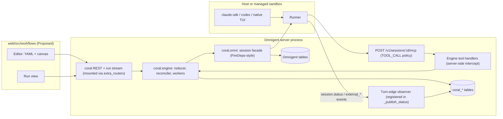

# Coral Workflow Engine on an Omnigent Fork: Technical Deep Dive

| | |
|---|---|
| **Subject** | "Coral: Workflow Engine Design on Omnigent", Draft 3 (dated November 9, 2026), the "design doc" below |
| **Codebase audited** | Omnigent `0.22.0.dev0`, commit `2a9cbe2c2` (2026-11-08). This matches the design doc's "version 0.22.0.dev0 (commit of November 8, 2026)"; the design doc gives no hash. |
| **Prepared** | 2026-11-08 |
| **Audience** | Coral engineering leads; the authors of the phase 1-2 specification that the design doc says comes next [D§18] |

---

## 0. Method, conventions and scope

**What this document is.** It is an implementation-level deep dive into the design doc. It covers four things:

1. Whether the design doc's statements about Omnigent are true at the cited commit.
2. Whether the design's own semantics hold together.
3. Exactly where and how each part would be built on the fork, with file and line references.
4. What external prior art and platform terms imply for the design.

**How it was produced.**

- The design doc was read in full (all 393 lines).
- **Code audit:** eight subsystem audits ran against this repository, one per Omnigent area the design leans on. Executors and capabilities, policies and approvals, sessions and turn completion, the scheduler and hosts, the database and migrations, agent specs and tools, the web app, and the native modes. Two adversarial reviewers then independently re-checked the 41 claims that were not cleanly confirmed or had weak evidence. Several high-impact findings were spot-checked again by hand while writing this document.
- **Online research:** six research streams covered the Claude Agent SDK and Claude Code, the Codex app server, durable execution engines, graph and agent orchestration semantics, verification and optimization, and fork tooling. A fact-check pass re-fetched their most consequential claims (results in Appendix D; sources in Appendix C).

**Evidence conventions.**

| Marker | Meaning |
|---|---|
| `path:line` | A location in this repository, opened and checked at commit `2a9cbe2c2`. Line numbers are exact at that commit and will drift. |
| **[D§n]** | A section of the design doc. |
| **[W-n]** | An external source, listed in Appendix C with its URL. |
| **Exists** / **Proposed** | *Exists* means the code is in Omnigent today. *Proposed* means it is this document's recommendation and does not exist yet. |
| **Confirmed / Partial / Incorrect / Unverifiable** | Verdicts on design-doc claims (§3). |

**Out of scope.**

- Triggers, entry-point extensibility, code steps and the marketplace [D§5.5, D§15] are not analyzed. Starting points if they are pursued: `coral_runs.start_key` for idempotent trigger starts (§7.2), the scheduled-task machinery (§6.6, F10), and the `POLICY_REGISTRY` module mechanism (§8.5) as an entry-point precedent.
- No code was changed and no tests were run.
- Nothing was verified in a browser, following the repository's rule against proactive browser verification.
- Statements about vendor terms are quotations and readings of public pages, not legal advice.

---

## 1. Executive summary

### 1.1 Overall verdict

The design doc's core architecture is sound, and the code supports most of its premises. The engine is deterministic rails that do no thinking. Decisions come from durable state rather than the live stream. Step agents run in separate sessions with fresh context by default. "Done" is evidence-backed and labelled *Verified*, not *Enforced*. Human gates are engine nodes, not pauses inside an agent's turn. Every agent remains an ordinary Omnigent session.

Omnigent really does have everything the engine needs underneath it, and it really has nothing that holds a multi-step process to a contract. Polly, the closest in-tree precedent, sequences its work in a roughly 270-line prompt (`examples/polly/config.yaml:31-301`) and applies only per-call guardrails (`examples/polly/config.yaml:351-380`).

The problems are in specific load-bearing details. Several statements about Omnigent are wrong or out of date at the cited commit, and some of those statements carry Enforced labels. One semantic rule, the join rule, deadlocks the design doc's own worked example when read literally. The vendor terms risk is sharper than the design doc says.

### 1.2 Findings that change the design (ranked by impact)

| # | Finding | Where | Consequence |
|---|---|---|---|
| 1 | **Read literally, the join rule deadlocks the design doc's own example.** [D§5.2] says "Several arrows entering the same box are a join: the engine waits for all of them", with no exception for back-arrows or loop-limit routes. Counting every incoming edge, *Review* in [D§5.6] waits for the back-arrow from *Fix*, which can only fire after Review runs: a circular wait. The human gate waits for both "approved" and the loop-limit route, which are exclusive alternatives: the classic BPMN deadlock of an exclusive split closed by a parallel join [W-40, W-41]. [D§3] phrases the rule as "When several branches lead into one box", which suggests parallel branches were meant. The specification must say which incoming edges count. | §5 | Joins must be *derived*. Only arrows from the same unlabelled parallel split wait for all; everything else is a merge. |
| 2 | **The "sub-agent router" is a Smart Routing model and harness picker, not a roster gate.** It is advisory by design, has no list of allowed sub-agents and no count, and runs only for Smart Routing sessions (`omnigent/runner/subagent_routing.py:1-8, 384-402, 886-897`; `omnigent/runner/app.py:9032-9073`). A "fail-closed router" [D§4.2, D§16] would therefore enforce nothing about rosters. | §10.4 | Enforce rosters with TOOL_CALL policies on `Agent`/`Task`/`*spawn_agent`/`sys_session_*` plus spec grants, and fail closed in the native policy hooks. |
| 3 | **`PersistentTaskScheduler` is not a generic queue.** Its store protocol is typed on `ScheduledTask`/`ScheduledTaskRun` (`omnigent/stores/scheduled_task_store/dispatch.py:17-138`). It validates RRULEs itself on recurring paths (`omnigent/server/scheduled/dispatch_scheduler.py:654-670`). It is at-most-once ("Recovery never sends the prompt again", `omnigent/server/scheduled/README.md:147`), polls every 30 s (`omnigent/server/scheduled/config.py:14`), and is only built when the default-off `automations_v2` flag is on (`omnigent/server/app.py:2116-2143`). | §6, §7 | Give the signal queue its own tables with at-least-once semantics. Copy the `StartupLease` and claim pattern, or drive timers through the scheduler's manual-run path. |
| 4 | **The completion hook is a weaker signal source than the design doc's reuse plan needs.** The design doc already notes that idle does not prove a turn finished [D§4.2]. Beyond that, the hook maps *every* `idle` edge to `"succeeded"` (`omnigent/server/routes/_sessions/helpers.py:5158-5159`). That includes intentional stops and quiet terminal panes, and the hook ignores the `turn_completed` flag that `_publish_status` already receives (`helpers.py:5061`). Native executors yield `TurnComplete` when input is *delivered*, not when work finishes (`omnigent/inner/claude_native_executor.py:553`; `omnigent/inner/codex_native_executor.py:1337`). | §8.7 | Generalize the hook into an observer registry that receives `turn_completed`, the response id and the failure origin. Confirm with transcript evidence before closing a step. |
| 5 | **The tool-gating row of the [D§9] table is wrong for headless `codex`.** Codex's own shell and `apply_patch` run under `approvalPolicy: "never"` and are only *observed* after the fact (`omnigent/inner/codex_executor.py:3829, 2779-2834`). Its built-in web search, on by default, is neither gated nor observed (`codex_executor.py:4768, 5014-5018`). Conversely, `claude-sdk` exposes **no** native Bash/Read/Edit/Write at all. All workspace work goes through Omnigent `sys_os_*` tools (`omnigent/inner/claude_sdk_executor.py:2571-2585`), which is good for both gating and evidence. | §9, §10.2 | Required shell rules cannot be Enforced on headless `codex` without a patch. `claude-sdk` is the strongest mode for Enforced rules and evidence. |
| 6 | **Native policy hooks fail to *ask*, not to deny.** When no verdict can be obtained, PreToolUse returns `permissionDecision: "ask"` (`omnigent/native/native_policy_hook.py:545-586`, called at `omnigent/harnesses/claude_native/hook.py:1238-1242`). The hook docstrings that say "deny" are stale (`hook.py:1174-1187`). `codex-native` starts *without* policy hooks if Codex is older than 0.129 or the hook-trust handshake fails (`omnigent/harnesses/codex_native/app_server.py:2441-2448, 2850-2854`). | §10.5 | An unattended step stalls on a human prompt instead of failing closed. Patch the hook for run-owned sessions, and refuse to start when hooks are disabled. |
| 7 | **Vendor terms.** Anthropic's Agent SDK overview says: "Unless previously approved, Anthropic does not allow third party developers to offer claude.ai login or rate limits for their products, including agents built on the Claude Agent SDK" [W-1]. Omnigent's `claude-sdk` executor *deliberately* strips `ANTHROPIC_API_KEY` so the CLI uses subscription auth (`omnigent/inner/claude_sdk_executor.py:2096-2118`). OpenAI says "App-server authentication has never been permitted for commercial or hosted services" [W-14]. | §16 | Run-owned `claude-sdk` sessions in a distributed Coral should use API keys. Subscription users go to `claude-native`. Codex needs its own counterpart to the design doc's Risk 1. |
| 8 | **Sandboxes are not just "network on or off".** `os_env.sandbox.egress_rules` is a default-deny L7 HTTP method/host/path allowlist enforced by a MITM proxy inside an isolated network namespace (`omnigent/inner/datamodel.py:753-765`; `omnigent/inner/egress/rules.py:1-18`; `omnigent/inner/bwrap_sandbox.py:604-612`). There is **no** built-in web-fetch or domain policy (`docs/POLICIES.md:569-581` is only an example). | §10.1 | Translate website rules to `egress_rules`, with an optional CEL policy on fetch tools as a second layer. |
| 9 | **No push notifications exist.** There is no Web Push, VAPID, APNs or FCM sender anywhere. Notifications are local and fire only while a tab or app is open (`web/src/lib/browserNotifications.ts:8-10`; `web/ios/README.md:17-22`; `web/android/README.md:33-37`). | §11 | "Approvals on any device" holds only while the app is open. A gate that waits for hours needs a new delivery channel. |
| 10 | **`cost_budget` does not do what [D§10] expects ("Reaching a limit pauses the run and asks the user").** It ASKs at soft thresholds, DENYs at the hard cap, and blocks *all* models when `expensive_models` is omitted (`omnigent/policies/builtins/cost.py:385-412, 511-556`). `docs/POLICIES.md:331-339` contradicts the code. | §12 | Run-level pause is engine code. The policy is only a per-session backstop. |
| 11 | **Two migration statements are wrong.** "Alembic branch" and "hash-identified chain" are both wrong. Branches share `alembic_version` and would break Omnigent's single-head assumptions (`omnigent/db/utils.py:606, 716, 737`; `tests/db/test_migration_connections.py:34-37`). Revision ids are opaque, and 48 of the 121 are not even hex. | §7.3 | Use a separate Alembic *environment* with `version_table="coral_alembic_version"`. |
| 12 | **The patch list in [D§16] is incomplete.** It misses at least: packaging (`pyproject.toml:456-464`); filters in Omnigent's `env.py`; the test-fixture truncation rule (`tests/conftest.py:736`); a worker lifespan hook (`create_app` has none, `omnigent/server/app.py:1563-1611`); the feature-flag enum; tool registration lists; native pre-approval lists; prompt and native-launch instructions; elicitation multi-observer support; and the API-key inversion. | §4.3 | The full ledger is in §4.3. |

### 1.3 Corrections in Coral's favour

- **`sys_cancel_task` is not a no-op at this commit.** Only the server-side tool body is a stub (`omnigent/tools/builtins/async_inbox.py:98-127`). The runner intercepts the call and cancels async handles and `sys_session_send` children (`omnigent/runner/tool_dispatch.py:401-408, 9100-9379`). `designs/CUJ-ANALYSIS.md:506-507` is stale.
- **Sub-agent attribution is an Omnigent gap, not an SDK limit.** The Agent SDK carries `parent_tool_use_id` on messages and `agent_id`/`agent_type` on hook inputs [W-3, W-4]. The executor drops them (`omnigent/inner/claude_sdk_executor.py:338-348, 1019-1031, 2698-2713`). Codex child threads are attributable by `threadId` [W-12]. The claude-sdk fix is small (S17); the headless codex fix is medium (S18).
- **Codex compaction exists in the protocol.** The app server has a stable `thread/compact/start` [W-11]. Omnigent just never calls it.
- **A "continue in a fresh session" primitive already exists.** `_continue_session_in_fork` handles copy-history, a notice in the old session, and a `session.superseded` redirect (`omnigent/server/routes/sessions/routes_core.py:4969-4999`). It is the natural base for the refresh mechanism in [D§7.5].
- **Engine tools have a clean seam.** Schema-only builtins intercepted server-side after policy, the `sys_advise_models` pattern (`omnigent/tools/builtins/advise_models.py:1-13`; `omnigent/server/routes/_sessions/orchestration.py:13058-13069`), reach all four modes with caller identity supplied by the runner, never by the model.

### 1.4 What holds up as written

- Separate sessions as the default.
- The Enforced / Verified / Requested taxonomy.
- Deciding from durable state.
- The run following the version it started with.
- A separate migration history for Coral (the intent holds; the mechanism changes, finding 11).
- The headless modes as default (with the terms caveat).
- `/workflows` instead of `/canvas`.
- Fresh-context step agents.
- Restarting a lost step in a new session from its handoff, which matches Anthropic's own advice to carry state forward rather than resume transcripts [W-6].
- The hard boundary on self-optimization.
- An Elephant-Goldfish showcase, as an idea. The role mapping and two step options change, and the attribution can be more precise (§15.3).

---

## 2. The design in one page (faithful restatement)

This section restates the design doc so later sections can refer to it precisely. Nothing here is new.

- **Concepts [D§1, D§2, D§5].**
  - A *workflow* is a diagram of *steps*. Each step has a name, a plain-language goal, a *roster* of agent profiles (exact by default, or "up to" N) and a *handoff* (a report plus artifacts).
  - Optional step settings: "done when", attempts (default 3), a failure path (default: pause and ask), repeat-for-each (sequential by default), rules, how agents run (separate sessions by default), expected duration, and a pinned command.
  - Shapes: Start, End, work step, orchestrator node (a decision point where the orchestrator picks a labelled arrow and gives a reason), human gate (cannot be skipped) and group (container; a saved group is a *block*; it can repeat for each).
  - Hidden shapes: wait, and sub-workflow.
- **Checked handoff parts [D§5.3].** These are derived, not configured.
  - A label, when a single-agent step leads directly into labelled arrows. Multi-agent steps must go through an orchestrator node.
  - A list, when a later step or group repeats for each item.
- **One orchestrator per run [D§3].** It is the entry point, conducts the run, and does no heavy work.
- **Arrows [D§5.2].**
  - Unlabelled multi-out arrows run in parallel.
  - Labelled arrows leave orchestrator nodes and gates.
  - Back-arrows form loops with a limit and an at-limit destination.
  - Multi-in arrows are joins that wait for all.
- **Guarantees [D§6].**
  - *Enforced:* arrows, loop limits, joins, gates, required rules ("or the workflow is invalid"), and rosters (in separate-session mode, and in sub-agent mode only "with the fail-closed router").
  - *Verified:* the handoff and its checked parts, "done when", the pinned command.
  - *Judgment:* orchestrator choices, the quality of the work.
  - *Requested:* guidance rules.
  - "Done when" is translated once, when the workflow is saved, into an evidence requirement the author confirms. "Last change" comes from workspace state. Commands are recognized by per-repository patterns.
- **Runtime [D§7].**
  - The engine runs inside the Omnigent server as background workers, behind a small internal interface.
  - Engine tools: `submit_handoff`, `message_agent`, `assign_agents`, `choose_arrow` and `ask_user`. Rejections are recorded.
  - Arrows without a decision advance automatically.
  - Watchdog, rejected-call pause (3 in a row) and overdue alerts.
  - Refresh at 80% context through a handoff note into a new session; native compaction as an option.
  - Durable tables plus an append-only run log. Timers and the signal queue use `PersistentTaskScheduler`. At-least-once delivery with idempotency keys. A startup check.
  - Separate Alembic migrations; an owner and workspace id on every row.
  - Amendments apply only to steps that have not started.
  - Infrastructure problems and plan usage limits pause a step; a lost runner leads to a restart in a new session from the incoming handoff; accounts are never switched.
- **Sessions [D§7.4].** Separate sessions by default, each with its own rules, steering, workspace and direct messaging from the user. Sub-agents in one session are allowed for steps that need no per-agent evidence, enforced by the router in fail-closed mode, until a bench probe proves sub-agent visibility. Step agents start with fresh context.
- **Profiles and connectors [D§5.4, D§5.5].** A profile is agent YAML plus a canvas description, default rules and expected capabilities. Connectors: harnesses, MCP servers, triggers (later), notifications (inbox, web push, mobile, chat) and workspaces (git repositories and folders).
- **Workspaces, authoring, living with a run [D§11-D§13].** One worktree and branch per run, with per-agent worktrees for concurrent coders. Plain folders for non-code work. Workflows are YAML in `.coral/workflows/` with a separate layout file, edited on a new `/workflows` route. The live view, take-over and hand-back, approvals on every device, and sharing later.
- **Improvement and extensibility [D§14, D§15].** Suggestions now, self-optimization as theory, never weakening evidence, rules, verifiers or gates. Extensibility through profiles, blocks, templates, MCP and plugins now; entry points, code steps, triggers, a marketplace and workflows-as-tools later.
- **Simulate [D§8]** walks the diagram with made-up results and can be saved as tests. **Rules [D§9]** are Required (translated into Omnigent settings and validated against mode capabilities) or Guidance. Reactions take the form "when X, do Y". **Cost [D§10]** covers estimates, budgets through `cost_budget`, and plan-limit pauses.
- **Placement [D§16].**
  - A top-level engine package that is not named "workflow", and the canvas in its own `web/src` folder.
  - A short list of Omnigent patches.
  - Merges from tagged releases.
  - A rebrand that keeps the Apache-2.0 notices.
- **Order of work [D§18].**
  1. Engine core and Simulate.
  2. Agent steps.
  3. Evidence.
  4. Rules and capabilities.
  5. Canvas.
  6. Structure.
  7. Codex, budgets and amendments.
  8. Suggestions.

---

## 3. Fact check: the design doc's statements about Omnigent

Each row was audited, and every row whose verdict is not *Confirmed* was independently re-checked. *Partial* means part is right and the correction says what differs. *Plan* and *Gap* rows are not statements about Omnigent: a Plan row is a design-doc plan that rests on a wrong premise, and a Gap row is a risk the design doc does not address. The [D§9] capability table is re-audited cell by cell in §10.2.

| # | [D§] | Claim in the design doc | Verdict | What is true at `2a9cbe2c2` (evidence) |
|---|---|---|---|---|
| F1 | 4.1 | Executors with a shared event model live in `executor.py`, `claude_sdk_executor.py`, `codex_executor.py`, `omnigent/harnesses/` | Partial | The event model is `omnigent/inner/executor.py:116-375`, implemented by `ClaudeSDKExecutor` (`claude_sdk_executor.py:1763`) and `CodexExecutor` (`codex_executor.py:4752`). `omnigent/harnesses/` contains **no executors**. It holds native bridges and forwarders that POST a separate `external_*` vocabulary to `/v1/sessions/{id}/events` (e.g. `harnesses/claude_native/forwarder.py:1938-1948`). The native executors are `omnigent/inner/claude_native_executor.py:106` and `codex_native_executor.py:884`. |
| F2 | 4.1 | HarnessCapabilities describes each mode; the harness bench tests those claims against real agents | Partial | Declared values are reconciled against observed ones as DRIFT (`tests/harness_bench/verdict.py:112-137`). Only `interrupt` and `streaming` have both a `HarnessCapabilities`-backed declaration and a probe. `model_override` has a probe, but its declaration comes from `model_env_keys()`/`is_native_harness()` (`tests/harness_bench/manifest.py:55-76`). "Steering, live queue, resume, images, and compaction do not yet have probes" (`tests/harness_bench/README.md:234-235`). Only claude-sdk, codex, pi and openai-agents are live-verified (`omnigent/harness_plugins.py:352-355`). |
| F3 | 4.1 | Policies allow, deny or ask, with per-session counters | Confirmed | DENY short-circuits and ASKs accumulate (`omnigent/runtime/policies/engine.py:375-433`). Counters persist through `set_session_state` (`engine.py:615`), for example `max_tool_calls_per_session` (`omnigent/policies/builtins/safety.py:116-158`). Policies also run on request, response and tool_result phases. |
| F4 | 4.1, 6, 7.4 | The sub-agent router limits which sub-agents an agent may start (Agent, Task, Codex spawn_agent) | **Incorrect** | Only the tool matchers are right (`omnigent/inner/hook_scripts/subagent_router.py:83-84`). The router asks "which model the spawn should run on. The gate is **advisory**" (`omnigent/runner/subagent_routing.py:1-8`). Its actions are allow, rewrite (model), redirect and deny (unoffered model only) (`subagent_routing.py:384-402, 886-897`). It is started only for Smart Routing sessions (`omnigent/runner/app.py:9032-9073`). |
| F5 | 4.2 | The router fails open | Confirmed | Unreachable means allow unchanged (`subagent_router.py:11-15, 459-460, 859-890`). The real timeouts are 19/15/14/13 s, not the docstring's 12/8/7/6 s (`subagent_router.py:107-119`; `subagent_routing.py:84-95`). |
| F6 | 4.1, 5.5, 13 | Approvals on any device through elicitations, inbox, **web push** and mobile apps | Partial | Elicitations, `/inbox`, `/approve/:sid/:eid` and the desktop and mobile shells exist. **No web push, APNs or FCM exists.** Notifications are page-scoped or foreground-local (`web/src/lib/browserNotifications.ts:8-10`; `web/ios/README.md:17-22`; `web/android/README.md:33-37`). `approval.py`'s `_await_elicitation` has only test callers. The live parking code is `_hold_native_ask_gate_impl` (`omnigent/server/routes/_sessions/orchestration.py:2654`). |
| F7 | 4.1 | Agents are described in agent YAML (`docs/AGENT_YAML_SPEC.md`) | Confirmed | There are two dialects. The single-file YAML goes through a compat path marked as tech debt (`omnigent/spec/__init__.py:241-251`). Bundle `config.yaml` with `spec_version: 1` is parsed by `omnigent/spec/parser.py:200-367`. Coral should target bundles. |
| F8 | 4.1 | Messages between sessions use `sys_session_send` and `sys_session_message` | Confirmed | Both are runner-local model tools (`omnigent/tools/builtins/spawn.py:65-117`; `omnigent/tools/builtins/session_message.py:14-49`). The server path requires a runner-tunnel token bound to the sender's runner (`omnigent/server/session_orchestration.py:97-108`). It prefixes "[Message from session …]" (`session_orchestration.py:116-128`) and refuses senders shared with editors (`session_orchestration.py:61-69`). |
| F9 | 4.1 | Turn end comes from the scheduled-run completion hook, `session_live_state.py:251`, called from `helpers.py` | Confirmed (location) | `def persist_scheduled_run_completion(` is at `omnigent/server/session_live_state.py:251`. Its three call sites are inside `_publish_status` (`helpers.py:5047`, calls at `5151-5199`). It is scheduled-task specific, and **every idle edge that reaches the hook maps to `"succeeded"`** (`helpers.py:5158-5159`); only a trailing idle after a sticky `failed` is dropped first (`helpers.py:5117-5126`). |
| F10 | 4.1, 7.6 | `PersistentTaskScheduler` accepts a custom store and callbacks | Partial | The constructor does take a Protocol-typed store and `on_fire`/`on_expired` callbacks (`dispatch_scheduler.py:413-429`). But the protocol has about 15 methods typed on scheduled-task entities (`dispatch.py:17-138`). The scheduler itself calls `validate_rrule`/`next_scheduled_time` (`dispatch_scheduler.py:19-22, 633, 654-670, 870`). Its semantics are at-most-once. It exists in production only when `automations_v2` is on, and that flag is off by default (`omnigent/server/feature_flags.py:97-104`). |
| F11 | 4.1 | Compaction in terminal modes through `omnigent/runner/native_controls.py` | Confirmed | Both native modes type `/compact` into the TUI (`native_controls.py:1941-1975`). For Codex the keystrokes are unverified: a fixed 0.7 s sleep, then Enter (`native_controls.py:194, 2168-2177`). The same module also drives `claude-sdk` compaction (`native_controls.py:2340-2359`). |
| F12 | 4.1 | `PolicyHookReauth` refreshes policy hook tokens | Confirmed | `PolicyHookReauth` re-mints the bearer (`omnigent/native/native_policy_hook.py:196-241`) when `_is_login_redirect_or_unauthorized` sees a 401, a 403 or an OIDC redirect (`native_policy_hook.py:256-286`). It is used only on the direct-to-server path. The relay path uses a non-expiring local token (`omnigent/harnesses/claude_native/hook.py:1244-1253`; `omnigent/harnesses/codex_native/hook.py:155-165`). |
| F13 | 4.1, 4.2 | Idle cleanup: idle timeout plus active-turn check in `process_manager.py`; an override exists | Partial | That reaper covers SDK subprocesses only: 1 h default, `OMNIGENT_HARNESS_IDLE_TIMEOUT_S`, and it skips in-flight turns (`omnigent/runtime/harnesses/process_manager.py:131, 138-173, 1597-1603`). Long steps also face the runner idle watchdog (`omnigent/runner/_entry.py:162-199`), the native pane reaper (`omnigent/terminals/pane_reaper.py:85-87, 146-157`) and managed-sandbox `keep_warm_s` (`omnigent/server/managed_hosts.py:1289-1338`). All are deployment-wide; there is no per-session override. |
| F14 | 4.1 | Diagrams: `@xyflow/react` in `CanvasPage.tsx` | Confirmed | `web/package.json:67` pins `^12.11.1` (lockfile 12.11.2). CanvasPage is a session board with one node type, no edges and `nodesConnectable={false}` (`web/src/pages/CanvasPage.tsx:84, 660-679`). `web/src/shell/SubagentsGraphView.tsx` is closer to a graph. |
| F15 | 4.1 | Feature flags gate features | Confirmed | Flags form a closed enum with definitions, are deployment-wide, are resolved once per process, and need a restart to change. An unknown name fails startup (`omnigent/server/feature_flags.py:23-54, 222-265`). Flags are temporary by policy (`designs/FEATURE_FLAGS.md:42-44`). |
| F16 | 4.2 | The live event stream loses events when nobody listens | Confirmed | "Events emitted before any subscriber is connected are LOST" (`omnigent/runtime/session_stream.py:9`). The stream is in-process per replica, and a subscriber is cut off after 1024 queued events (`session_stream.py:54`). |
| F17 | 4.2 | The completion hook does not fire if a host dies mid-turn; idle does not prove the turn finished | Partial | Idle-is-not-proof is confirmed (`omnigent/server/scheduled/fire.py:2569-2571`). Host death *does* reach the hook as `failed` when the server survives: the offline sweep after the grace period (`orchestration.py:4360-4366`; `omnigent/server/app.py:4049-4075`) and `_on_runner_exited` (`app.py:4497-4552`). For user-run hosts the turn is first held up to **72 h** (`HOST_OFFLINE_HOLD_S`, `orchestration.py:8636-8641`). The real holes are a server restart (in-memory grace and hold timers, `app.py:4041`), a dropped best-effort write (`session_live_state.py:276-282`) and idle-as-success. |
| F18 | 4.2 | `claude-sdk` does not record which sub-agent made a tool call | Confirmed (Omnigent gap) | The executor never reads `parent_tool_use_id` or `agent_id` (`claude_sdk_executor.py:338-348, 1019-1031, 3480-3584, 2698-2713`). Its only `parent_tool_use_id` is a hard-coded `None` on outbound messages (`claude_sdk_executor.py:763`). The SDK does expose attribution [W-3, W-4]. |
| F19 | 4.2 | Only the ACP executor emits sub-agent events | Partial | True for the `SubAgent*` ExecutorEvents (`omnigent/inner/acp_executor.py:1538-1558`), and even then no in-tree `AcpSubAgentSource` exists. The native forwarders mirror vendor sub-agents into child sessions through `external_subagent_start` (`harnesses/claude_native/forwarder.py:2785-2796`) and `external_codex_subagent_start` (`harnesses/codex_native/forwarder.py:6892-6931`). |
| F20 | 4.2 | `claude-sdk` declares `subagents=False` | Confirmed | `omnigent/harness_plugins.py:591-602`. `codex` is also False; `claude-native` and `codex-native` are True (`harness_plugins.py:358-387`). |
| F21 | 4.2 | `steering`, `live_queue` and `compaction` are undeclared for all four modes | Confirmed | They default to `None` (`omnigent/harness_capabilities.py:155-158`). The runtime methods disagree with "unknown": `supports_live_message_queue()` is False for claude-sdk (`claude_sdk_executor.py:2419-2422`) and True for codex, claude-native and codex-native (`codex_executor.py:5042`; `claude_native_executor.py:148-150`; `codex_native_executor.py:911`). |
| F22 | 9 | The existing `subagents` field means "can start Omnigent sub-agents" | Partial | That is the docstring's wording (`harness_capabilities.py:116`). The enforced meaning is "the vendor's own sub-agents become Omnigent child sessions" (`tests/test_harness_capabilities.py:75-92`; `omnigent/inner/acp_extension.py:63-70`). Coral's new field must mean reliable per-tool-call attribution. |
| F23 | 4.2 | Agent-created timers are in-memory sleeps | Confirmed | `sys_timer_set` is an `asyncio.sleep` task in the runner (`omnigent/runner/tool_dispatch.py:393-395, 4443-4519`; `omnigent/runner/app.py:1135`). The spec docstring that claims durable firings is stale (`omnigent/spec/types.py:1559-1571`). Durable `sys_scheduled_task_*` exists, but needs an RRULE that fires at least twice, with a gap of at least 10 min (continued sessions or connected hosts) or 1 h (new sandbox sessions) (`omnigent/server/scheduled/rrule.py:36-37, 279-282, 324-328`). |
| F24 | 4.2 | A session is tied to one runner with no failover | Confirmed | Dispatch uses only `conv.runner_id` (`omnigent/runner/routing.py:197-224`), and the workspace is immutable (`omnigent/entities/conversation.py:202-212`). When a held host returns, its root sessions get a relaunched runner, but sub-agent sessions are skipped, and "only the user's next message starts new work": the interrupted input is not replayed (`omnigent/server/app.py:4259-4296`, roots only at 4273). |
| F25 | 4.2 | `sys_cancel_task` does nothing (`designs/CUJ-ANALYSIS.md`) | **Incorrect (stale)** | Only the server-side `invoke` is a stub (`omnigent/tools/builtins/async_inbox.py:98-127`). The runner intercepts the call (`tool_dispatch.py:401-408`), cancels async handles, and stops or interrupts owned `sys_session_send` children. Where a native harness cannot hard-stop, it returns an explicit best-effort result (`tool_dispatch.py:9100-9379`). |
| F26 | 4.2 | Sandboxes switch the network fully on or off only | **Incorrect** | `egress_rules` is a default-deny `METHODS host/path/glob` allowlist, enforced by a MITM proxy, on `linux_bwrap`/`darwin_seatbelt` (`omnigent/inner/datamodel.py:753-765`; `omnigent/inner/loader.py:855-857`; `omnigent/inner/bwrap_sandbox.py:604-612`). Caveats: signer-backed Codex rejects `egress_rules` (`codex_executor.py:4890-4894`), and managed providers have coarser modes. |
| F27 | 4.2 | *Plan (the "What we do" column):* website limits combine a web-fetch policy with a network-off sandbox | Plan: revise | The plan rests on the wrong premise in F26. No built-in web-fetch or domain policy exists, so one would have to be written; `block_domains` is only a docs example (`docs/POLICIES.md:569-581`). A network-off sandbox confines only Omnigent's sandboxed tool helpers: for `claude-sdk` the executor deliberately runs the Claude CLI outside a network-denying sandbox so it can still reach the provider (`claude_sdk_executor.py:1604-1607`). The combination would block shell-level fetches but is not a website allowlist. `egress_rules` already does the job (§10.1). |
| F28 | 4.2, 7.4 | Sub-agent mode is enforced through the router in fail-closed mode | **Incorrect** | See F4. Rosters need tool-call policies (§10.4). |
| F29 | 7.6 | Use `PersistentTaskScheduler` with Coral's own store "instead of building new lease machinery" | Partial | It works for one-shot timers only through the manual-run path, which skips RRULE validation (`dispatch_scheduler.py:554-620`), and only with fabricated `ScheduledTask` entities. It does not fit a signal queue: it is at-most-once, recovery never re-runs `on_fire`, and latency is the poll interval. |
| F30 | 7.6 | Migrations on a "separate Alembic branch with its own version table" | Partial | The intent is right, but the mechanism must be a separate Alembic *environment*. Branches share `alembic_version` and break `get_current_head()` and `upgrade("head")` (`omnigent/db/utils.py:606, 716, 737`; `tests/db/test_migration_connections.py:34-37`) [W-30]. |
| F31 | 7.6 | Omnigent's migrations are "one hash-identified chain" | **Incorrect** (on "hash") | The ids are opaque strings: Alembic's random `uuid4().hex[-12:]` or hand-picked mnemonics (e.g. `omnigent/db/migrations/versions/z6a2b3c4d5e6_add_scheduled_tasks_tables.py:3`). There are 121 revisions, with one base and one head (`f1c7a9e2b406`). The real constraint is the enforced single head. |
| F32 | 7.6 | Every row carries an owner and Omnigent's workspace identifier, "ready for teams" | Partial | `workspace_id` is a tenant partition, the leading PK column on all 19 tables, and always `0` in OSS (`omnigent/db/db_models.py:116-157`). It is not a team. Owners are a nullable `user_id String(128)` on root resources only (`db_models.py:800-802, 1588-1593`). Sessions are owned through `LEVEL_OWNER` grants. Coral should also store `account_generation` (`db_models.py:1568`). |
| F33 | 9 | `claude-sdk`: adding input mid-turn is batched into a follow-up turn | Confirmed (Omnigent behaviour) | `enqueue_session_message` returns False and the message is redelivered as a continuation (`claude_sdk_executor.py:2323-2332, 3945-3994`). The CLI itself reads queued input within the same turn once running tool calls finish [W-5]. This is an Omnigent choice, not an SDK limit. |
| F34 | 9 | Interrupt: yes in all four modes | Confirmed | Headless executors **discard the vendor session** after an interrupt, so the next turn rebuilds full history (`claude_sdk_executor.py:2291-2321`; `codex_executor.py:5045-5076`). The `claude-native` interrupt is a single Escape keystroke that "does not confirm the agent stopped", followed by a 20 s grace (`omnigent/runner/native/interrupt.py:329-334, 416-424`). |
| F35 | 9 | Read context use: yes in all four modes | Confirmed | Headless: `context_tokens` in `TurnComplete.usage` (`claude_sdk_executor.py:3636-3640`; `codex_executor.py:4277-4296`), but `max_context_tokens()` is `None` (`omnigent/inner/executor.py:704-705`), so the window comes from a server-side litellm lookup (`omnigent/server/schemas.py:2351-2360`). Native: `omnigent.last_context_tokens` / `omnigent.last_context_window` labels (`orchestration.py:2083-2186`). |
| F36 | 9 | Trigger compaction: claude-sdk yes, claude-native yes, codex no, codex-native yes | Confirmed (today) | `omnigent/runner/app.py:7893-7912` returns 204 for headless codex. The Codex protocol has `thread/compact/start` [W-11], so codex becomes a small executor patch. |
| F37 | 9 | Gate tool calls: yes in all four modes | Partial | **claude-sdk: yes.** Its base tools are only `Skill`, `ToolSearch` and an optional `AskUserQuestion` (`claude_sdk_executor.py:2571-2585`). Workspace tools are Omnigent `sys_os_*`, which are gated on dispatch. Connector MCP tools go through `can_use_tool` (`claude_sdk_executor.py:3149-3153`) and need a probe under the default `auto` mode (`omnigent/inner/claude_sdk_harness.py:135`). **codex: no for Codex built-ins** (`codex_executor.py:3829, 2779-2789`). **Native modes: yes through hooks**, but they fail to ASK (F38a). claude-native hooks install only when `ap_server_url` is set (`omnigent/harnesses/claude_native/bridge.py:2651`). codex-native may start with hooks disabled (`app_server.py:2441-2448, 2850-2854`). |
| F38 | 9 | Sub-agent attribution: claude-sdk no; claude-native not reliably; codex not confirmed; codex-native not reliably | Partial | **claude-sdk:** no, but patchable (F18). **codex:** no, because the executor keys only on `turnId` and ignores collab items (`codex_executor.py:3989-4000, 2795-2834`). **Native modes:** transcripts *are* attributed per child (`harnesses/claude_native/forwarder.py:668-684`; `harnesses/codex_native/forwarder.py:985-1000`). Policy evaluation, however, carries no agent identity (`native_policy_hook.py:338-349`), and a claude-native sub-agent's end is an inactivity heuristic (`harnesses/claude_native/forwarder.py:643-649`). |
| F38a | 6, 9 | *Not stated in the design doc (unaddressed risk):* the Enforced labels in [D§6] depend on native hooks failing closed | Gap | PreToolUse fails to ASK, UserPromptSubmit to block, and PostToolUse fails open (`native_policy_hook.py:545-586`; `harnesses/claude_native/hook.py:1238-1242`; `harnesses/codex_native/hook.py:149-153`). The docstrings at `harnesses/claude_native/hook.py:1174-1187` are stale. |
| F39 | 5.4 | A profile is agent YAML plus three additions (canvas description, default rules, capabilities) | Partial | `description` already exists (`omnigent/spec/types.py:1483, 1607`). Default rules map onto `guardrails` (`types.py:1513-1517`). Only capabilities are new: put them in `params` (`types.py:1488-1491`) or in a new field, because unknown top-level keys are silently dropped (`omnigent/spec/parser.py:339-350`). Never use `executor.config` (`types.py:544-556`, marked tech debt). |
| F40 | 5.4 | Upstream is designing reusable user agents | Partial | The design is still marked PROPOSED (`designs/REUSABLE_USER_AGENTS.md:3-4`), but its core has shipped: install, list, detail and remove, plus a derived install id (`omnigent/db/utils.py:1145`). Its decision 6 conflicts with Coral: "Reinstall therefore updates running sessions from their next turn" (`REUSABLE_USER_AGENTS.md:112`). Coral must pin profile revisions per run. |
| F41 | 7.2 | Omnigent already serves its own tools to Claude Code and Codex | Confirmed | **claude-sdk:** an in-process SDK MCP server `omnigent` (`claude_sdk_executor.py:2930-2945`). **codex:** App Server `dynamicTools` (`codex_executor.py:3830-3846`). **Native modes:** a stdio `serve-mcp` relay limited to a static allowlist (`tool_dispatch.py:473-665, 488-518`). All calls converge on `POST /v1/sessions/{id}/mcp`, where policy runs (`omnigent/server/routes/sessions/routes_agent.py:436-567`; `orchestration.py:12880-13056`). |
| F42 | 10 | Reaching a budget limit pauses the run and asks; this reuses `cost_budget` | Partial | `cost_budget` ASKs at soft thresholds (`cost.py:536-556`) and DENYs at the cap (`cost.py:511-534`). It is per session, reads spawn-tree spend (`omnigent/runtime/policies/builder.py:806-814`), and has no notion of a run. `subagent_cost_budget` ASKs at its cap only when `expensive_models` is omitted (block-all); with an explicit list it DENYs expensive models (`cost.py:826-838, 904-945`). |
| F43 | 12 | `/canvas` already means something else | Confirmed | It is a board of session cards behind the `canvas` flag (off by default) (`web/src/App.tsx:193-208`; `feature_flags.py:129-134`). `web/src/canvas/` is taken too. `/workflows` is unused. |
| F44 | 16 | `omnigent/runtime/workflow.py` is Omnigent's agent loop and is unrelated | Partial | It is unrelated, so the naming advice holds. But it is now a helper module (spawn-env builders, provider resolution, compaction helpers); its "agent loop" section is an empty header (`workflow.py:3258-3261`) and its docstring is stale (`workflow.py:1-4`). |
| F45 | 16 | Changes to Omnigent's files are few and listed in one place | Partial | The list is incomplete; see the seam ledger in §4.3. |
| F46 | 7.5 | The user sees one continuous orchestrator conversation with a refresh marker | Unverifiable (future) | The precedent is `_continue_session_in_fork` plus `supersession_notice_text` (`routes_core.py:4969-4999`; `omnigent/native/_native_supersession.py:79-91`). `SupersessionReason` allows only `"clear"` (`schemas.py:4209`). Stitching transcripts across sessions is new UI. |
| F47 | 4.1, 13 | Orchestrator and step agents are ordinary sessions usable with existing screens | Confirmed | Caveats: each top-level session appears in the sidebar and raises its own turn-end notification (`web/src/hooks/useIdleNotifications.ts:1-18`). Sharing is per session. Edit-sharing blocks Omnigent orchestration (`session_orchestration.py:61-69`). There is no take-over or hand-back state. |
| F48 | 17 | `claude-sdk` uses the subscription sign-in | Confirmed | "ANTHROPIC_API_KEY is also stripped so the CLI uses its subscription auth" (`claude_sdk_executor.py:2096-2118`). An API key reaches the CLI only through `apiKeyHelper`, set from `executor.auth: {type: api_key}` or, when the spec declares none, from the server's global `auth:` block (`omnigent/runtime/workflow.py:1378-1395`; `claude_sdk_harness.py:124-130`). |
| F49 | 2 | claude-native is the real Claude Code inside tmux; codex-native is the real Codex TUI attached to an app server | Confirmed | `omnigent/inner/claude_native_executor.py:106-117`; `omnigent/harnesses/claude_native/bridge.py:5035-5045`; `omnigent/harnesses/codex_native/launch_args.py:123-130`. The session's app server listens on `ws://127.0.0.1:{port}` (`omnigent/runner/native/orchestration.py:5738-5741`; `omnigent/harnesses/codex_native/main.py:1225-1226`). |
| F50 | 4.1 | Hosts and managed sandboxes provide local and cloud machines (`omnigent/host/`, `managed_hosts.py`) | Confirmed | Local machines run the `omnigent host` daemon, which the server drives over a WebSocket with launch frames (`omnigent/host/service.py:1, 20-21, 42-59`; `omnigent/host/connect.py:2021`). Managed hosts are cloud sandboxes running the same daemon, provisioned through pluggable launcher factories (`omnigent/server/managed_hosts.py:1-9, 36-37`). |

---

## 4. Target architecture on the fork

### 4.1 Component view



The data flows are:

1. **Engine to Omnigent** goes only through `coral.omni`. It creates sessions, attaches policies, sends briefs and messages, interrupts or stops, publishes gates and creates worktrees.
2. **Agents to the engine** go only through engine tools. Every Omnigent tool call from every harness already converges on the server's session MCP endpoint, where TOOL_CALL policy runs (`routes_agent.py:436-567`; `orchestration.py:12880-13056`).
3. **Omnigent to the engine** goes only through durable signals. Almost every status edge passes through `_publish_status` (`helpers.py:5047-5250`). The exceptions are the failed-to-idle reset on runner reconnect (`orchestration.py:4131-4152`) and the runner status probe (`orchestration.py:13706-13708`), which S1 must also cover or the reconciler must catch. There it becomes an idempotent row in `coral_signals`, which a periodic reconciler backs up.

### 4.2 Package layout (Proposed)

```
coral/                     new top-level package (needs pyproject include, see S29)
  model/                   workflow IR, YAML loader (stable ids), compiled graph
  validate/                graph rules, derived checked parts, capability checks
  engine/
    reducer.py             pure transition(state, input) -> (state', log, effects)
    reconcile.py           level-triggered reconcile(run_id)
    workers.py             signal drain, timer scan, periodic resync, effect dispatcher
    simulate.py            the same reducer with stub effects
  omni/                    the only package that imports omnigent internals
    sessions.py            create / send / read items / read status / interrupt / stop
    policies.py            attach and evaluate policies
    tools.py               engine tool handlers registered at the MCP intercept
    signals.py             turn-edge observer -> coral_signals
    gates.py               gate elicitations and verdict callback
    worktrees.py           host worktree frames
  evidence/                done-when evaluation, command patterns, workspace fingerprints
  rules/                   plain-language rule -> policy specs and bundle fragments
  policies/                POLICY_REGISTRY module (step_roster, engine_tool_guard, ...)
  db/                      CoralBase models; its own Alembic environment
  stores/                  ABC + SQLAlchemy stores (named sessions)
  api/                     FastAPI routers mounted through create_app(extra_routers=...)
web/src/workflows/         editor, run view, thin adapter over @xyflow/react
tests/coral/               unit and engine fault-injection tests
tests/stores/coral/        store tests (the Postgres/CRDB/MySQL lanes run only tests/stores and tests/db,
                           .github/workflows/ci.yml:264, 315, 363)
```

**Why have a `coral.omni` boundary.** Upstream is fast-moving. The local clone has 1,498 commits in the 30 days to 2026-11-08, and `helpers.py` alone had 52 commits in that window [W-62 to W-64 discuss the general practice]. Request-free orchestration has to import underscore-prefixed helpers from very large modules, as `fire.py` does (`omnigent/server/scheduled/fire.py:2026-2030, 2157-2160`). If only one package does that, an upstream merge breaks one package and its contract tests, not the engine.

### 4.3 The Omnigent seam ledger (complete list of upstream-file changes)

The design doc lists five patches [D§16]. The audit found the set below. Each patch should be a thin seam that calls into `coral`. Each should carry a justification category in the style of Electron's patch rules (upstreamable / Coral-specific / incompatible) [W-63], and commits that touch it should carry a `CORAL: <seam>:` prefix so the ledger can be generated from git history [W-64].

| ID | Seam | Location | Size | Phase | Upstream candidate |
|---|---|---|---|---|---|
| S1 | Turn-edge observer registry. Replace the hard-wired `persist_scheduled_run_completion` calls with registered observers. Each observer receives `session_id`, `status`, `turn_completed`, `response_id`, `previous_status`, `failure_origin`, `error` and `persist_live_status`. The scheduled-run hook becomes one observer. Also cover the two status edges that bypass `_publish_status`. | `omnigent/server/session_live_state.py:90-110, 251-309`; `omnigent/server/routes/_sessions/helpers.py:5141-5199`; bypasses at `orchestration.py:4131-4152, 13706-13708`; registered next to `app.py:2614` | S | 2 | Yes |
| S2 | Set `turn_completed` on Codex `turn/completed` edges. Today they carry no such flag. | `omnigent/harnesses/codex_native/forwarder.py:8273-8319` | S | 2 | Yes |
| S3 | Request-free session helpers: public wrappers over `_launch_runner_on_host`, `_wait_for_runner_client`, `_ensure_runner_session_initialized`, `_dispatch_session_event_to_runner` and `_announce_session_added`. Optional; `fire.py` shows lazy imports work. | `helpers.py:674, 5957, 6232`; `orchestration.py:5992-6002, 8164-8184` | S | 2 | Yes |
| S4 | Engine dispatch into `_post_event_impl`. It is a closure inside route registration but already accepts non-Request contexts. | `omnigent/server/routes/sessions/routes_events.py:866-874, 1215-1220`; pattern: `omnigent/server/startup_inputs.py:90-110` | S | 2 | Yes |
| S5 | Elicitation observers as a list. Today there is a single slot, and `SubagentBlockNotifier` already occupies it. | `omnigent/runtime/pending_elicitations.py:68-87` | S | 2 | Yes |
| S6 | Gate elicitation without a FastAPI Request or a tool call, plus an engine verdict callback in `_resolve_elicitation`. | `orchestration.py:470-640, 2400-2559` | S | 2 | Yes |
| S7 | Engine tool classes (schema-only) plus an explicit AgentSpec opt-in parsed like `spawn`. | `omnigent/tools/manager.py:159-193`; `omnigent/spec/parser.py:314`; `omnigent/spec/types.py:1605-1656`; pattern `omnigent/tools/builtins/advise_models.py:1-13` | S | 2 | Partly |
| S8 | The runner forwards engine tools to the server. | `omnigent/runner/tool_dispatch.py:888-915` (`_ALL_LOCAL_TOOLS`) | XS | 2 | No |
| S9 | The native relay advertises engine tools. | `tool_dispatch.py:488-518` (`_NATIVE_RELAY_BUILTIN_TOOLS`) | XS | 2 | No |
| S10 | A server-side tool handler registry. Generalize the `sys_advise_models` intercept. | `orchestration.py:13058-13069` | S | 2 | Yes |
| S11 | Native pre-approval of engine tools. "Don't ask" mode otherwise denies them. | `omnigent/runner/native/orchestration.py:8817-8870`; `omnigent/harnesses/codex_native/app_server.py:306-337` | XS | 2 | No |
| S12 | A framework instruction for run-owned sessions, gated on the opt-in, plus the native launch channel. Native modes never receive `prompt.py`'s composed text. | `omnigent/runtime/prompt.py:62-87, 170-178`; `omnigent/runner/native/orchestration.py:7748-7773` | S | 2 | Partly |
| S13 | `claude-sdk` auth for run-owned sessions: prefer an API key or `apiKeyHelper`, and refuse or warn when only subscription OAuth is present. | `omnigent/inner/claude_sdk_executor.py:2096-2118`; `omnigent/inner/claude_sdk_harness.py:125-130` | S | 2 | No |
| S14 | Fail-closed native hooks for run-owned sessions: use `fail_closed_hook_output`, and set `"onFailure": "block"` on generated Claude Code hooks (CLI 2.1.295 or later [W-7]). | `omnigent/native/native_policy_hook.py:474-586`; `omnigent/harnesses/claude_native/hook.py:1221-1242, 1257-1258`; `omnigent/harnesses/codex_native/hook.py:149-153`; `omnigent/harnesses/claude_native/bridge.py:2714-2748, 8437-8448` | S | 4 | Yes |
| S15 | Refuse to start a run-owned `codex-native` session when policy hooks are disabled (version below 0.129, or trust failure). | `app_server.py:2441-2448, 2850-2854, 3042-3078`; `omnigent/runner/native/orchestration.py:8741-8765` | S | 4 | Yes |
| S16 | Policy evaluation carries sub-agent identity (Claude `agent_id`, Codex child thread id). | `native_policy_hook.py:289-366`; `omnigent/harnesses/codex_native/hook.py:129-147` | S | 4 | Yes |
| S17 | `claude-sdk` sub-agent attribution: read `parent_tool_use_id` and `agent_id` into tool metadata. | `claude_sdk_executor.py:338-348, 1019-1031, 3480-3584, 3656-3725` | S | 4 | Yes |
| S18 | Headless `codex`: route item events by `threadId` and translate collab items. | `omnigent/inner/codex_executor.py:3989-4000, 2795-2834` | M | 7 | Yes |
| S19 | Headless `codex` compaction through `thread/compact/start` [W-11], mapped to `CompactionStarted`/`CompactionComplete`. | `codex_executor.py` (new request); `omnigent/runner/app.py:7893-7912` | S | 7 | Yes |
| S20 | Headless `codex` tool gating: add a PreToolUse policy entry to the generated `hooks.json`, or route approvals to policy. Disabling native tools is partial: `HARNESS_CODEX_DISABLE_NATIVE_TOOLS` only turns off the shell tool, web search has its own switch (`HARNESS_CODEX_ENABLE_WEB_SEARCH`), `apply_patch` has none, and both are server-process env vars that are not threaded per session. | `codex_executor.py:1633-1681, 3828-3849, 3846-3847, 5014-5018`; `omnigent/inner/codex_harness.py:46-52, 416`; `omnigent/runtime/workflow.py:1508-1520` | M/L | 7 | Yes |
| S21 | `claude-sdk` policy from a PreToolUse hook, only if the `can_use_tool` probe fails under `auto` mode. | `claude_sdk_executor.py:3132-3157, 2727-2820` | S | 4 | Yes |
| S22 | Capability fields. Fill in the existing `steering`, `live_queue` and `compaction` fields for the four modes [D§4.2], and add `subagent_attribution`, `steering_reliability`, `usage_reporting`, `tool_call_gating`, `end_of_turn_detection` and `gate_failure_mode`. | `omnigent/harness_capabilities.py:146-184`; `omnigent/harness_plugins.py:356-757`; `tests/test_harness_capabilities.py:123-160` | S | 4 | Yes |
| S23 | Bench probes, one per field (test-only code). | `tests/harness_bench/probes/`, `transport.py:11-83`, `driver.py:139-167`, `manifest.py:55-76` | M | 4 | Yes |
| S24 | Usage-limit signal: Claude `RateLimitEvent`, Codex `account/rateLimits/updated`, and a new `ExecutorError` code carrying the reset time. | `claude_sdk_executor.py` run loop (around `3407-3725`); `codex_executor.py:4569-4576`; `omnigent/inner/executor.py:332-375` | S | 7 | Yes |
| S25 | A `SupersessionReason` value `"refresh"`, plus a request-free variant of `_continue_session_in_fork`. Today it is a closure inside `register_core_routes` that takes a `Request` whose caller must own the source; lift it to module level, as S4 does for `_post_event_impl`. | `omnigent/server/schemas.py:4209`; `helpers.py:5732-5760`; `routes_core.py:439, 4969-4999, 5051-5089` | M | 4 | Yes |
| S26 | Protected policies and labels: refuse PATCH or DELETE of reserved-prefix policies by non-engine callers, and reserve the `coral.` label prefix so editors cannot rewrite `coral.*` labels. | `omnigent/server/routes/session_policies.py:308-437`; `helpers.py:10884-10935`; `routes_core.py:3143-3167` | S | 4 | Maybe |
| S27 | Long-step reaper exemptions, only if retests fail. | `process_manager.py:588-598`; `runner/_entry.py:162-199`; `terminals/pane_reaper.py:112-157`; `managed_hosts.py:1289-1338` | S | 4 | Maybe |
| S28 | Worktrees inside managed sandboxes. | `schemas.py:2012-2013` validator, or send `HostCreateWorktreeFrame` after `launch_managed_host` | S | later | Yes |
| S29 | Packaging: discover `coral*` and its migration files. | `pyproject.toml:456-464` | XS | 1 | No |
| S30 | An `include_name` filter in Omnigent's `env.py` that ignores `coral_*`. | `omnigent/db/migrations/env.py:51-56, 85-89` | XS | 1 | Maybe |
| S31 | Keep `coral_alembic_version` across test truncation. | `tests/conftest.py:736` | XS | 1 | No |
| S32 | A lifespan or worker hook in `create_app`. It accepts `extra_routers`, `policy_modules`, `debug_router_modules` and scheduler `scheduled_task_dispatch` hooks (`app.py:1578-1580, 1609`), but no generic startup or shutdown callback; `_lifespan` is internal. | `omnigent/server/app.py:1563-1611, 1933`; `omnigent/cli.py:4907-4914, 5118-5147` | S | 1 | Yes |
| S33 | A `workflows` feature flag (server enum plus web `FeatureKey`). | `omnigent/server/feature_flags.py:23-42, 57-177`; `web/src/lib/capabilities.ts:60-74`; tests `tests/server/test_feature_flags.py:21-50` (exact `frontend_dict` defaults) and `208-215` | XS | 1 | No |
| S34 | Web routes, nav link and palette entry. | `web/src/App.tsx:181-256`; `web/src/shell/Sidebar.tsx:1412-1426`; `web/src/shell/CommandPalette.tsx:200-207` | S | 5 | No |
| S35 | Watch-set union for run sessions in the session-updates socket. | `web/src/hooks/SessionUpdatesProvider.tsx:262-298` | XS | 5 | No |
| S36 | Suppress per-step turn-end notifications for run-owned sessions. | `web/src/hooks/useIdleNotifications.ts:122-125, 424-441` | XS | 5 | No |
| S37 | An inbox `workflow` kind for run alerts. | `web/src/pages/InboxPage.tsx:189-193, 487-520` | S | 5 | No |
| S38 | Deep links to runs. | `web/ios/Omnigent/DeepLink.swift:100-133`; `web/electron/src/deepLink.js:6-7, 38` | XS | later | No |
| S39 | Lint roots and CODEOWNERS for `coral/`. | `dev/lint/lint_workspace_scoped_cache.py:40`; `.github/CODEOWNERS:1-3` | XS | 1 | No |
| S40 | Host or runner execution path for engine-owned work: workspace fingerprints after tool results, and running the pinned command in a Coral-controlled checkout. | New host frame modelled on the worktree frames (`omnigent/server/routes/_host_worktree.py:190-357`; host handler `omnigent/host/connect.py:4559`) | M | 3 | Maybe |

**Mapping to the design doc's own list.**

| Design doc item | Seams that cover it |
|---|---|
| Generalizing the completion hook | S1 and S2 |
| The internal session interface | S3, S4, S6 and S10 |
| Capability fields | S22 and S23 |
| Token and reaper fixes | Reaper: S27. Token: no seam is needed if the retest confirms F12 (`PolicyHookReauth` on the direct path, non-expiring relay token); otherwise add one. |
| A fail-closed router | **Replaced** by S14 plus a roster policy (§10.4). The router is model routing (F4), so a fail-closed router is needed only if Coral also wants Smart Routing for run sessions. |

---

## 5. Workflow model and semantics

### 5.1 Intermediate representation

The engine should compile the YAML into an immutable graph before anything runs. The reducer and Simulate both read this compiled form.

| Element | Fields (Proposed) | Notes |
|---|---|---|
| Node | `id` (stable, machine), `kind` (start, end, step, decision, gate, wait, subworkflow), `name` (display), kind-specific body | Display names can change; ids cannot. Renaming a box must not look like a new step to amendments, the run log or improvement analysis. Inngest re-runs a step whose id changes [W-24]. |
| Step body | goal, roster `[{profile_ref, count, mode: exact or up_to}]`, handoff text, `done_when` (text plus a confirmed evidence translation), attempts (default 3), failure path, rules, run mode (separate or subagents), expected duration, pinned command | [D§5.1] |
| Arrow | `id`, `from`, `to`, `label?`, `back: bool`, `limit?`, `at_limit?` | Labels only on arrows out of decision nodes, gates and single-agent steps [D§5.3]. |
| Group | `id`, members, `entry`, `exit`, rules, `repeat_for_each?: {list_from, concurrency}` | A saved group is a block [D§5.2]. |
| Derived | join type per incoming arrow set, the checked parts each handoff must carry, the region tree, the loop table | Computed by the validator, never written by the author [D§5.3]. |

### 5.2 Illustrative YAML for the design doc's [D§5.6] example

The design doc defers the schema to the next document [D§18]. This sketch only makes the semantics below concrete. It is **not** a proposed final schema. Confirmed translations sit next to the text they translate [D§12].

```yaml
coral: 1
id: review-labelled-prs
name: Review labelled pull requests
orchestrator: { profile: coral/orchestrator-default }
steps:
  find_prs:
    name: Find pull requests
    goal: List open pull requests labelled needs-review.
    roster: [{ profile: coral/claude-agent, count: 1 }]
    handoff: A list of pull requests.          # validator derives: list part (per_pr repeats over it)
  review:
    name: Review
    goal: Review the pull request and list findings.
    roster:
      - { profile: coral/claude-reviewer, count: 1 }
      - { profile: coral/codex-reviewer,  count: 1 }
    handoff: Each reviewer's findings.
  fix:
    name: Fix
    goal: Address the open review findings.
    roster: [{ profile: coral/claude-implementer, count: 1 }]
    handoff: What changed.
    done_when:
      text: Relevant unit tests, lint and format checks pass for the code you changed.
      confirmed: { by: author, evidence: [test_after_last_change, lint_after_last_change, format_after_last_change] }
  summarize:
    name: Summarize
    goal: Report the outcome for each pull request.
    roster: [{ profile: coral/claude-agent, count: 1 }]
    handoff: A report per pull request.
decisions:
  triage: { name: Review outcome }
gates:
  approve_merge: { name: Approve the merge, outcomes: [approve, reject] }
groups:
  per_pr:
    members: [review, triage, fix, approve_merge]
    entry: review
    exit: per_pr.exit              # an item finishes when its gate is answered
    repeat_for_each: { list_from: find_prs, concurrency: 1 }
arrows:
  - { id: a1, from: start,    to: find_prs }
  - { id: a2, from: find_prs, to: per_pr }
  - { id: a3, from: review,   to: triage }
  - { id: a4, from: triage,   to: fix,           label: changes requested }
  - { id: a5, from: triage,   to: approve_merge, label: approved }
  - { id: a6, from: fix,      to: review, back: true, limit: 3, at_limit: approve_merge }
  - { id: a9, from: approve_merge, to: per_pr.exit, label: approve }
  - { id: a10, from: approve_merge, to: per_pr.exit, label: reject }   # [D§5.6] does not define reject; here it ends the item
  - { id: a7, from: per_pr,   to: summarize }
  - { id: a8, from: summarize, to: end }
```

### 5.3 Graph semantics: what must change and why

**1. Joins must be derived, not "wait for all".**

Read literally, the design doc's rule deadlocks [D§5.6] in two places:

- *Review* has incoming edges {group entry, `a6`}. The back-arrow `a6` can only fire after Review has run, so waiting for both is a circular wait.
- *approve_merge* has {`a5`, the `a6` at-limit route}. These are exclusive alternatives, so both can never arrive.

The design doc's other wording ("When several branches lead into one box" [D§3]; "wait for all branches" in its change list) suggests the authors meant parallel branches only. The specification has to make that explicit.

Every engine surveyed either makes the join an explicit construct or rejects joins after conditional routing:

- ADK Go 2.0 `JoinNode`: "conditional routing into a JoinNode is a configuration error" [W-35].
- Microsoft Agent Framework: a dedicated fan-in edge group [W-36].
- Step Functions: Parallel branches are self-contained [W-25].

Wait-for-all joins whose inputs never arrive either fail silently (LangGraph documents that the join node "never runs and no error is raised"; MAF's fan-in runner simply never fires) or fail far from the cause (ADK: "the resulting failure appears downstream") [W-37, W-36, W-35].

Recommended rule:

- **AND-join (synchronization, WCP-3 [W-38]).** Applies only to arrows that leave distinct branches of the *same* unlabelled parallel split. The box starts when all of them have arrived for the same scope key (§5.3.4).
- **XOR-merge (simple merge, WCP-5).** Applies to every other incoming arrow: labelled alternatives, back-arrows, at-limit destinations and failure-path destinations. Any one arrival starts the box.
- The canvas shows the derived join type on the box.
- **Optional extension: dead-path elimination.** Unchosen arrows emit a "skipped" token, and a join fires when every input is delivered or skipped and at least one was delivered. This is how WS-BPEL and Airflow trigger rules tolerate untaken branches [W-42]. Record skips in the run log so the live view can explain "why didn't this box run".

**2. Keep the split vocabulary small.**

- `choose_arrow` picks exactly one label [D§7.2].
- Unlabelled arrows always all run.
- Add a validation rule that a box may not have both labelled and unlabelled outgoing arrows; the design doc does not forbid this today. With no multi-choice split, Coral never needs inclusive (OR) joins, whose semantics are necessarily non-local [W-39]. A Camunda forum thread also reports that engine as "not spec-compliant with respect to multiple incoming tokens on the same flow" [W-39a].

**3. Loops must be structured.**

- A back-arrow's target must be the loop body's single entry (WCP-21).
- Back-arrows never count toward join arity.
- A cycle without a limit is a validation error, as the design doc requires [D§5.2].

Two refinements:

- **(a) Define "limit of three passes" precisely.** Recommended meaning: the number of traversals of the back-arrow per scope key. Where to redirect at the limit also needs a rule. [D§5.6] says "At the limit, the run goes to the human gate with the open findings", which means the redirect happens at the decision that would re-enter the loop (triage choosing "changes requested"), not after a fourth Fix has run. Recommended rule: once the limit is reached, the engine replaces the loop-entering choice with `at_limit` and carries the open findings forward. For a loop with no decision node inside it, it redirects after the back-arrow's source completes.
- **(b) Add a run-level cap on step activations**, alongside per-loop limits. Nested loops inside repeat-for-each multiply: two reviewers × 10 items × up to 4 review passes means up to 80 review sessions. The orchestrator should be told how many passes remain, so it can choose the at-limit route deliberately.

**4. Scope keys.**

Every activation, join counter, gate visit, evidence record, signal and idempotency key is scoped by `(run_id, node_id, item_path, iteration_path)`:

- `item_path` is the index chain through nested repeat-for-each groups.
- `iteration_path` is the loop-pass chain.

Without this, at-least-once deduplication drops legitimate second-pass handoffs as duplicates, or matches them against first-pass state. A fast source that sends twice can also be batched into one join firing, which is how MAF's fan-in runner behaves [W-36].

**5. Repeat-for-each needs a full contract.**

The design doc defines the item source (a list from an earlier handoff), one repetition per item, a progress badge ("3 of 10") and the concurrency default [D§5.1, D§5.2, D§5.3, D§10]. It does not define ordering, empty lists, per-item failure or cancellation. Mature map and multi-instance engines also define the following [W-25, W-27]:

- Results are collected **in input order** into the group's outgoing handoff.
- An **empty list** skips the group body and delivers an empty result.
- **Per-item failure** sends that item down its failure path (default: pause and ask). Optionally, a tolerated failure count or percentage.
- Each item has its **own loop counters and gate visits**.
- **Cancellation** of remaining items happens when the run or region is cancelled.
- The **group exit synchronizes all items** (WCP-14).
- An explicit maximum concurrency (default 1, processed in input order).
- List items carry a **stable item id**, so idempotency survives re-delivery.

**6. Failure paths inside parallel regions.**

The design doc is silent on what happens when one branch takes its failure path while siblings still run. Step Functions fails the whole Parallel state, and "invoked Lambda functions continue to run" [W-25]. Recommended rules:

- A failure path that **leaves** the region cancels the region (WCP-25). The engine interrupts sibling sessions, marks their arrows skipped and logs it.
- A failure path that **stays inside** the region reaches the join as a delivered, failed result.
- The default "pause and ask" suspends the region rather than cancelling it.
- Cancelling does not undo commits already made in worktrees (§13).

**7. Liveness check at runtime.**

The reconciler flags any join still waiting on an arrow whose source can no longer fire, then pauses the run with an explanation. Without this check, enforcement turns into a hang.

**8. Hidden kinds: wait and sub-workflow [D§5.2].**

- A **wait** node is an activation that closes when a durable timer fires or a named event arrives. Events are deduplicated by idempotency key and scoped like any other signal (item 4).
- A **sub-workflow** pins its child workflow version when the parent run's version is created, nests its scope keys under the parent activation, rolls its usage up into the parent budget, and is cancelled with its region.

**9. Gates and races are deferred choice.**

When a gate answer, a watchdog timeout and a wait node race, the first committed transition wins, and later signals are logged as superseded (WCP-16) [W-38]. A gate outcome is an explicit label chosen by a person. Text is attached as a note and never interpreted by a model. CrewAI's `@human_feedback` does interpret free text with an LLM [W-43a], which would undermine a gate that "cannot be skipped" [D§5.2].

### 5.4 Derived checked parts and generated tool schemas

For every session, the engine generates its `submit_handoff` input schema from the compiled graph. The orchestrator's schemas are generated per decision activation. Recommended shape:

```json
{
  "type": "object",
  "additionalProperties": false,
  "required": ["activation_id", "status", "report"],
  "properties": {
    "activation_id": { "type": "string" },
    "status": { "enum": ["done", "blocked"] },
    "blocked_reason": { "type": "string" },
    "report": { "type": "string" },
    "artifacts": { "type": "array", "items": { "type": "object" } },
    "kind": { "enum": ["handoff", "refresh_note"] },
    "label": { "enum": ["<label A>", "<label B>"] },
    "items": { "type": "array", "items": { "type": "object", "required": ["id", "title"] } }
  }
}
```

Rules for generating and checking these schemas:

- `label` appears only when [D§5.3]'s label rule applies, with an enum of exactly the legal labels. In the [D§5.6] example no step carries a label part; triage's labels are chosen with `choose_arrow`.
- `items` appears only when a later group repeats over this handoff.
- The server validates every call. No source reviewed documents that either harness applies strict, grammar-constrained decoding to MCP-served tool schemas, so Coral must not assume it.
- Every rejection names the failing field and lists the allowed values.
- The schema-rejection budget has to be reconciled with the design doc's rule that a set number of rejected calls in a row (three by default) pauses the run [D§7.3]. Either count schema rejections toward it or give them their own budget.
- Derived schemas are checked for contradictions when the workflow is saved.

**The `blocked` status is a deliberate addition.**

- ImpossibleBench found that an explicit "flag for human" exit cut GPT-5's cheating from 54% to 9%, and that repeated feedback loops increased cheating [W-50]. That loop is exactly what Coral's attempts mechanism is.
- `blocked` routes to the failure path or a human gate **without** spending attempts.
- For Codex step agents, `turn/start.outputSchema` (not experimental-gated in `v2/turn.rs`) can require the label enum or the item array at the model level, as a second check [W-11].

### 5.5 Static validation (save time)

| ID | Rule | Source |
|---|---|---|
| V1 | Exactly one Start. Every node is reachable from Start, and End is reachable from every node. | Workflow-net soundness: option to complete, no dead transitions [W-39] |
| V2 | Each unlabelled multi-out split has a matching AND-join, and regions are single-entry and single-exit, apart from failure-path edges, which cancel the region (§5.3.6). | §5.3.1 |
| V3 | No box mixes labelled and unlabelled outgoing arrows. | §5.3.2 |
| V4 | Labelled arrows leave only decision nodes, gates and single-agent steps. | [D§5.2, D§5.3] |
| V5 | Every cycle has exactly one back-arrow, with `limit ≥ 1` and an `at_limit` outside the loop body. The loop body has a single entry. | [D§5.2]; WCP-21 |
| V6 | `repeat_for_each.list_from` is upstream, and its handoff gets a list part. | [D§5.3] |
| V7 | Gate outcomes cover every outgoing label. Each gate has a reject or failure route, or the author confirms "approve-only". | [D§5.2] |
| V8 | Inner rules are only stricter than outer rules [D§9]. Checking this needs a partial order on translations: inner rules may add DENY or ASK policies and narrow allowlists, and may not remove or widen outer ones. | [D§9] |
| V9 | Every Required rule and every Required reaction is enforceable by every roster profile's mode (capability matrix, §10.2). Otherwise the workflow is invalid. "The validator applies the table above to every rule and reaction." | [D§9] |
| V10 | Roster profiles resolve to pinned revisions, and their harness is ready on the target host. Polly's `configured_harnesses` preflight is a precedent (`examples/polly/config.yaml:68-95`). | [D§5.4] |
| V11 | Exhaustive Simulate (§15) passes: no deadlocked join, no dead box, no unreachable `at_limit`. | §15 |
| V12 | The activation-count upper bound is within the run-level cap. Above a warning threshold, the cost estimate is shown. | [D§10] |
| V13 | Node and arrow ids are unique and stable. | [W-24] |

---

## 6. Engine core

### 6.1 A pure reducer with a transactional outbox

Coral's workflow is *data*: a YAML file read by an interpreter. It is not user code. So Coral does not inherit Temporal's code-determinism problem, where replay re-runs workflow code and fails on mismatched commands [W-20]. "Replay" should mean folding the run log through a pure reducer, not re-running agents.

```python
# Proposed shape, not existing code.
@dataclass(frozen=True)
class Transition:
    state: RunState                 # new current-state rows
    log: list[LogEntry]             # append-only, each carrying an idempotency key
    effects: list[Effect]           # outbox rows (create session, send brief, publish gate, ...)
    rejections: list[Rejection]     # audit-only log entries the reducer ignores on replay

def transition(graph: CompiledGraph, state: RunState, inp: Input) -> Transition: ...
```

The reducer is used like this:

- **One short write transaction per input.** Check `runs.version`, write state rows, append log rows under `UNIQUE(workspace_id, run_id, idempotency_key)`, and insert effect rows.
- **Effects run after commit.** An effect dispatcher executes them, and each has its own effect key. "Atomic phases should be safely committed before initiating any foreign state mutation" [W-28].
- **Effects must be idempotent.** Session creation is keyed by the agent-slot id. The dispatcher first looks for a session carrying a `coral.effect_id` label; labels are initial session metadata visible to policies (`schemas.py:1562`; `omnigent/runtime/policies/engine.py:873-888`).
- **Simulate runs the same reducer** with stub effects [D§8].
- **The reducer underpins phase 1 testing.** A phase-1 invariant test asserts that folding the log reproduces the stored state.

Keep current-state tables as the source of truth, written in the same transaction as each log append. Do **not** do pure event sourcing. Large handoff bodies go to the artifact store and are referenced from the row (§7.1).

### 6.2 State machines (Proposed)

| Entity | States | Notes |
|---|---|---|
| Run | `running ⇄ paused(reason)` then `completed`, `failed` or `cancelled` | Pause reasons include gate, budget, plan limit, rejected-call limit, infra, liveness and user. |
| Activation (node × scope key) | `waiting_join`, `ready`, `starting` (leased), `running`, `evaluating`, `closed(outcome)`, plus `restarting` and `taken_over(by)` | One row per scope key. Join arrivals are recorded per incoming arrow. `taken_over` implements take-over and hand-back [D§13]: the engine stops reacting to that activation, suspending nudges, the watchdog, refresh and rejected-call counting. On hand-back it recomputes the workspace fingerprint before evaluating "done when" ("On hand back, 'done when' is still checked"), so user edits invalidate stale evidence. Omnigent has no such state today (F47). |
| Agent slot (roster member) | `pending`, `session_created(id)`, `briefed`, `working`, `handoff_accepted`, plus `rejected` and `refreshing` | `session_created` is written **before** the brief is sent, so recovery never creates a second session. This is Omnigent's `StartupLease` discipline: attach the session immediately, and recovery inspects evidence and never re-sends blindly (`dispatch_scheduler.py:156-347`; `omnigent/server/scheduled/README.md:147`). |
| Attempt | `1..N` per activation | An attempt is consumed when a submitted handoff fails evidence. Infra retries and `blocked` do not consume attempts. |
| Decision request | `requested`, `reminded`, `escalated`, `decided` | The watchdog reminds once, then alerts [D§7.3]. |
| Gate visit | `open`, then `resolved(label, by, note)` or `superseded` | Each visit has its own row and token. An answer for an earlier visit in a loop is rejected [W-25, W-22]. |
| Signal | `pending`, `claimed(lease)`, then `applied` or `ignored(duplicate or stale)` | Signals are wake-up hints (§6.4). |

### 6.3 Commands and observations

| Input class | Examples | Handling |
|---|---|---|
| **Commands** | `submit_handoff`, `choose_arrow`, `assign_agents`, `message_agent`, `ask_user`; gate answers; user pause, resume, cancel, take-over, hand-back, apply-amendment | Validate, then commit, as Temporal Updates do: "the validator runs before the Update handler" [W-22]. The idempotency key is the harness call id or a client key, so a re-sent call returns the original result. Rejections are audit-only log entries, and the rejected-call counter [D§7.3] is computed from them. |
| **Observations** | Turn edge, runner lost, usage limit, context threshold, timer due | These are only hints. They put `run_id` on a deduplicated work queue, and `reconcile(run_id)` decides what to do. |

Dedup state must belong to the **run**, not the Omnigent session. Session refresh [D§7.5] is Coral's equivalent of Continue-As-New, and Temporal's Update-ID dedup "is scoped to a single Workflow Run" [W-22]. A duplicate `submit_handoff` must still be caught after a refresh. Session-scoped keys such as `tool:{session_id}:{call_id}` cannot catch this, because a refreshed session has a new id. The activation and slot state (a closed slot rejects, §8.6) is the run-level dedup.

### 6.4 Level-triggered reconciliation

The design doc already chooses to decide from durable state [D§4.2]. The Kubernetes controller rule makes this precise: "Level driven, not edge driven" [W-29].

**`reconcile(run_id)`:**

1. Read the durable state:
   - activations and slots;
   - the Omnigent session row: `live_status`, `runner_last_seen`, `blocked_on`, `pending_elicitation_count` (`omnigent/db/db_models.py:698-711`; `omnigent/entities/conversation.py:280-284`);
   - runner liveness (`omnigent/stores/conversation_store/__init__.py:353-377, 681`);
   - recent transcript items (`list_items`, `conversation_store/__init__.py:828-836`);
   - gate rows and timers.
2. Compute the next inputs and feed them to the reducer.

**When it runs:**

- on each signal;
- once at startup;
- on a periodic resync of all active runs.

The periodic resync is needed because Omnigent's existing backstops are lazy. "There is deliberately NO startup sweep and NO periodic poll of any cadence" (`omnigent/server/scheduled/run_reconciler.py:32-33`). Its 6 h stale-run check runs only on read (`run_reconciler.py:54`). Omnigent's own edge signals are best-effort and per replica (`session_live_state.py:152-160, 276-282`). Its grace and hold timers live in memory (`app.py:4041`).

**When a step agent's turn has really ended.** Reuse the rule in `fire.py:2550-2577`: `live_status == "idle"` *and* the newest non-bookkeeping item is an assistant reply. Strengthen it per mode (§8.7):

- **claude-native:** require `turn_completed=True`.
- **Codex:** require `turn/completed`.
- **Claude:** require that no background sub-agent tasks remain. "By default, a subagent your main agent spawns runs in the background", so a turn can end while spawned work continues [W-3].

**A turn that ended without `submit_handoff`.** Send a nudge ("You ended your turn without submitting a handoff"), count it, and pause after the configured number of nudges. Nudge only after turns the engine started (brief, evidence feedback, nudge). Users may open any agent's session and type into it [D§13], and a user-initiated turn legitimately ends without a handoff, so it must not be nudged or counted, and nothing is nudged during take-over. A Claude Code `Stop` hook with `decision: "block"` can do the same in-turn, but it is capped by default at 8 consecutive continuations (the count resets when Claude calls a tool, and `CLAUDE_CODE_STOP_HOOK_BLOCK_CAP` can raise it), and it fails open [W-7]. The engine check stays authoritative.

### 6.5 Concurrency, backends and workers

| Concern | Recommendation | Evidence |
|---|---|---|
| Serialize one run | An optimistic `coral_runs.version` column (`UPDATE … WHERE id=? AND version=?`), inside `run_write_transaction`, which retries CRDB 40001 and MySQL 1213 | `omnigent/db/utils.py:1032-1082` |
| SQLite (local, default) | Short `BEGIN IMMEDIATE` write transactions (`immediate=True` named sessions). Never hold a transaction across a network or agent call. Batch signal inserts, because every engine write competes with Omnigent's writes for the single writer lock (`busy_timeout` 20 s). | `utils.py:313-329, 961-977`; [W-31] |
| Claiming queue rows | Portable baseline: a lease column plus a lock-and-recheck conditional update, Omnigent's own claim pattern. Optional on Postgres: `FOR UPDATE SKIP LOCKED` at READ COMMITTED with a partial index on unprocessed rows. Omnigent uses SKIP LOCKED nowhere. | `omnigent/stores/scheduled_task_store/sqlalchemy_store.py:1270-1335`; [W-23, W-32] |
| Multi-replica | Shard effects by the replica that holds the host tunnel, reusing the `owned_hosts` contract. Require Postgres or CockroachDB. Refuse multi-replica SQLite and D1, as the scheduler already refuses D1. | `dispatch_scheduler.py:924-941`; `omnigent/server/scheduled/README.md:447-465`; `sqlalchemy_store.py:1186-1194` |
| Wake-up latency | Polling is the guarantee. Postgres `LISTEN/NOTIFY` is only an optional hint, delivered at commit [W-32]. | |
| Ambient scopes | Workers enter `workspace_scope(row.workspace_id)` and `account_authority_scope(user_id, generation)` | `omnigent/server/scheduled/fire.py:581-585` (which also enters `host_owner_scope`); `dispatch_scheduler.py:563`; `omnigent/db/account_authority.py:79-90` |

### 6.6 Durable timers

Store timers as rows: `run_id`, `scope`, `kind`, `due_at`, `fired_at`, plus a unique key. The reconciler's due scan fires them. Kinds are: watchdog reminder and escalation, gate reminder, overdue alert, plan-limit resume, wait node, and deferred refresh.

Do **not** keep coroutines or open sessions alive across long waits; a waiting run is rows plus a timer [W-33]. This is also why agent `sys_timer_set` (in-memory, F23) is unsuitable.

**Using `PersistentTaskScheduler` for timers is possible but not recommended.** Its "Run now" path (`request_manual_run` / `list_pending_runs` / `claim_pending_run`, `dispatch_scheduler.py:554-620`) skips RRULE validation. A Coral store that returns `[]` for due and uninitialized tasks could therefore get one-shot timers, with leases and multi-replica recovery, at 30 s resolution. The costs:

- The store must implement about 15 protocol methods.
- It must fabricate `ScheduledTask` and `ScheduledTaskRun` entities.
- Its claims are at-most-once.
- Its file churns heavily: 315 lines changed between v0.20.0 and v0.21.0 (264 added, 51 removed), and 16 commits in the 30 days to 2026-11-08 (§17).

Copying the `StartupLease` and claim pattern into Coral's own tables is less coupled.

### 6.7 Error taxonomy

These named classes follow the Step Functions style [W-25]. Infrastructure retries never consume "done when" attempts.

| Class | Examples and sources | Engine action | Uses attempts? |
|---|---|---|---|
| `infra.transient` | Runner reconnect within the grace period (`app.py:4049-4075`); API 529; transient upstream (`omnigent/runner/launch_failure.py:369-416`) | Wait with backoff, then pause if it persists | No |
| `infra.runner_lost` | `runner_disconnected_mid_turn` (`orchestration.py:9260-9273`); `_on_runner_exited` (`app.py:4497-4552`); a host held offline (up to 72 h, `orchestration.py:8636-8641`) | First try the relaunch ladder for the same session (`orchestration.py:5120-5140`). Otherwise restart the slot in a new session from the incoming handoff [D§7.8], after resetting the worktree to the step's start commit (§13). | No |
| `plan.usage_limit` | Claude `RateLimitEvent` with `status: rejected` and `resets_at` [W-4]; claude-native `StopFailure` (`omnigent/harnesses/claude_native/bridge.py:1096-1097`); Codex `usageLimitExceeded` and `account/rateLimits/updated` (`resetsAt`) [W-11] | Pause the step and set a timer at the reset time. Poll with backoff when no reset time is known. | No |
| `plan.spend_cap` | API 429 with `enforced_spend_limit_reached` and no `retry-after`; a user-set limit (400) [W-74] | Pause and ask | No |
| `auth` | `authentication_failed` [W-4], and in TypeScript `oauth_org_not_allowed` and `account_on_hold` [W-5] | Pause and alert. Never switch accounts [D§7.8]. | No |
| `evidence.missing` | The evidence requirement fails at `submit_handoff` | Tell the agent what is missing (e.g. "No test run after the last change to `api/users.ts`") [D§6.1] | **Yes** |
| `handoff.invalid` | A missing label, list or report | Reject with an explanation; counts toward the rejected-call pause | No |
| `tool.illegal` | Illegal arrow, recipient or assignment | Reject; counts toward the rejected-call pause | No |
| `agent.blocked` | `submit_handoff(status="blocked")` | Failure path or gate | No |
| `budget.exceeded` | Engine tree-spend check (§12) | Pause the run and ask | No |

### 6.8 Versions and amendments

- **Version immutability and pinning [D§7.7].** This matches Temporal's *Pinned* worker-versioning behaviour (GA March 30, 2026) [W-21], Step Functions ("Running executions will continue to use the previous definition") [W-26] and Restate's immutable deployments [W-33].
- **Key versions by content hash** and store them as immutable rows.
- **Pin profiles too.** Reusable user agents bind sessions to the installed row, so a reinstall changes running sessions on their next turn (`designs/REUSABLE_USER_AGENTS.md:112, 421-439`). Coral must record the agent revision or bundle location per workflow version.
- **"Retry step", "resume" and "hand back" re-enter on the pinned version.** Airflow 3 pins too: a cleared run or task keeps its original bundle version by default. Unversioned bundles such as `LocalDagBundle` always run the latest code, which is the counter-example Coral must avoid [W-34].
- **Implement "Apply to this run" as a Camunda-style migration** [W-27]:
  - create a new derived immutable version;
  - every active activation must map to an *unchanged* node (same roster, handoff parts, rules and evidence);
  - the counts of active activations and pending join inputs stay the same;
  - loop and repeat counters carry over by stable id;
  - simulate from the run's current state;
  - apply in one transaction under the run lock, at a quiet moment;
  - record who did it and why [D§7.7].

---

## 7. Data model and persistence

### 7.1 Conventions inherited from Omnigent

These are mandatory if the fork wants Omnigent's CI lanes (stores and db tests on Postgres 16, CockroachDB and MySQL, `.github/workflows/ci.yml:231-375`) to cover Coral's stores.

| Convention | Source |
|---|---|
| `workspace_id BigInteger` is the leading PK column, `default=current_workspace_id`. It is a tenant partition, not a team. | `db_models.py:116-157, 791-797` |
| Ids are `Uuid16`: 16 raw bytes, exposed as 32-character hex. | `db_models.py:51-90`; `docs/DATABASE_BEST_PRACTICES.md:277` |
| Enums are SmallInteger codes with CHECK constraints, converted at the row-to-entity boundary. | `omnigent/db/enum_codecs.py:1-20` |
| No foreign keys. No JSON, TEXT, FLOAT or auto-increment PKs. Every value is under 16,384 bytes. Hard delete. Paginate every list. | `omnigent/server/DBSPEC.md:111-116`; `docs/DATABASE_BEST_PRACTICES.md:77-88, 105, 153, 212-216, 272-276` |
| Opaque capped payloads use `CompressedText`. Large reports and diffs go to the artifact store, with a reference in the row. | `omnigent/db/compression.py:112-142` |
| Named sessions on every store, through `make_named_managed_session_maker` with a semantic suffix (repo CLAUDE.md rule); writes go through `run_write_transaction`. | `utils.py:982-1020, 1032-1082` |
| Owner is `user_id String(128)`, nullable in single-user mode, plus `account_generation` captured through `require_active_account`. | `db_models.py:1568, 1588-1593`; `sqlalchemy_store.py:259-262` |
| Indexes are named, start with `workspace_id` and end with the PK. | `DATABASE_BEST_PRACTICES.md:160-171` |

No database foreign keys from `coral_*` into upstream tables. Upstream rebuilds tables on SQLite with `batch_alter_table(recreate="always")` (migration `72e6dceae14f`), and batch operations "do not work with foreign keys that enforce referential integrity" [W-30]. Store upstream ids (session or conversation ids) as indexed plain columns and reconcile them in code. Never ALTER an upstream table.

### 7.2 Tables (Proposed)

| Table | Key columns | Purpose |
|---|---|---|
| `coral_workflow_versions` | `id`, `workflow_key`, `content_hash`, `parent_version_id`, `source_ref` (repo path and commit), `compiled_ref` (artifact), `created_by` | Immutable versions, including derived amendment versions |
| `coral_runs` | `id`, `version_id`, `user_id`, `account_generation`, `status`, `pause_reason`, `version` (optimistic), `orchestrator_session_id`, `start_key` (unique per user), worktree ref, budgets | One row per run. `start_key` makes "Run" idempotent, as Step Functions' execution name does [W-26]. |
| `coral_activations` | `id`, `run_id`, `node_id`, `scope_key`, `status`, `attempt`, timestamps; unique `(workspace_id, run_id, node_id, scope_key)` | Node instances |
| `coral_join_arrivals` | `activation_id`, `arrow_id`, `source_activation_id`; unique per arrow | Join token counts, committed with the handoff [W-36] |
| `coral_agent_slots` | `id`, `activation_id`, `roster_index`, `profile_revision`, `session_id`, `status`, `lease_expires_at` | One per roster member per activation |
| `coral_handoffs` | `id`, `slot_id`, `status`, `label`, `items_ref`, `report_ref`, `summary` (CompressedText), `evidence_ref`, `idempotency_key` | Accepted and rejected handoffs |
| `coral_gate_visits` | `id`, `run_id`, `node_id`, `scope_key`, `token`, `elicitation_id`, `status`, `answer_label`, `answered_by`, `note` | Durable gates, re-published after a restart |
| `coral_signals` | `id`, `session_id`, `run_id?`, `kind`, `payload`, `idempotency_key` (unique), `status`, `lease_expires_at`; index `(status, lease_expires_at, workspace_id, id)` | At-least-once signal queue. The index has the same shape as `ix_scheduled_task_runs_expired_claims` (`db_models.py:1739-1745`). |
| `coral_timers` | `id`, `run_id`, `kind`, `scope`, `due_at`, `fired_at`, `idempotency_key` | Durable timers |
| `coral_effects` | `id`, `run_id`, `kind`, `payload`, `status`, `attempts`, `lease_expires_at`, `effect_key` (unique), `result_ref` | Transactional outbox [W-28] |
| `coral_run_log` | PK `(workspace_id, run_id, seq)`, where `seq` is a per-run counter advanced once per appended entry in the same transaction (for example a `next_log_seq` column on `coral_runs`); each row also records the `runs.version` it was written under; `kind`, `body` (capped), `refs`, `idempotency_key`, `audit_only` | Append-only log: explains paths, feeds replay and improvement suggestions [D§7.6] |
| `coral_command_observations` | `id`, `slot_id`, `session_item_id`, `command`, `cwd`, `exit_code`, `report_ref`, `workspace_fingerprint_before` / `_after`, `matched_pattern` | Evidence input (§9) |
| `coral_amendments` | `id`, `run_id`, `from_version`, `to_version`, `plan_ref`, `applied_by`, `reason` | Recorded amendments [D§7.7] |

**Idempotency key forms (Proposed).** Each key is also scoped by activation, so second-pass events are not deduplicated away.

- tool call: `tool:{session_id}:{call_id}`;
- Codex turn edge: `turn:{thread_id}:{turn_id}`; Codex item: `item:{thread_id}:{turn_id}:{item_id}` [W-11];
- claude-sdk edge: `turn:{session_id}:{response_id}`.

### 7.3 Migrations: a separate Alembic environment

1. **A separate environment, not a branch.** Coral gets `coral/db/alembic.ini`, `coral/db/migrations/env.py` and `script.py.mako`, configured as `context.configure(version_table="coral_alembic_version", target_metadata=CoralBase.metadata, include_name=<coral_* only>, render_as_batch=True)`. This is Alembic's "Run Multiple Alembic Environments from one .ini file" recipe; branches and multiple bases share `alembic_version` [W-30]. Coral's first revision has `down_revision=None`. Cross-lineage `depends_on` is impossible, so ordering is enforced in code.
2. **`CoralBase` must not subclass `OmnigentBase`.** Omnigent runs `create_all` for its two bases after every upgrade (`omnigent/db/utils.py:611-618`), and the CockroachDB bootstrap creates exactly those metadata objects (`omnigent/db/cockroachdb.py:289-300`). Coral tables on `OmnigentBase` would be created outside Coral's migrations, and Coral's first `op.create_table` would then fail.
3. **Ordering.** Run `ensure_coral_schema(engine, uri)` only after `get_or_create_engine` has brought Omnigent to head (`utils.py:462-486, 768-834`). On CockroachDB, Omnigent refuses to bootstrap a database that already holds tables (`cockroachdb.py:139-145`), and schema changes need the SERIALIZABLE preparation step (`cockroachdb.py:72-109`). Copy Omnigent's "database newer than this build" guard for `coral_alembic_version` (`utils.py:745-765`).
4. **Filters on both sides.** Neither `env.py` filters tables today, so autogenerate in either lineage would propose dropping the other's tables (`omnigent/db/migrations/env.py:51-56, 85-89`) [W-30]. This is seam S30.
5. **Tests and packaging.** Seams S31 and S29.
6. **An upstream merge rehearsal in CI.** For each new upstream tag: merge into a scratch branch, populate the Coral tables, apply upstream's new migrations and then Coral's on SQLite, Postgres and CockroachDB, and run the `coral.omni` contract tests.

### 7.4 Store skeleton (following `project_store`)

```python
# Proposed; follows omnigent/stores/project_store/sqlalchemy_store.py:162-248.
class SqlAlchemyCoralRunStore(CoralRunStore):
    def __init__(self, storage_location: str) -> None:
        super().__init__(storage_location)
        self._engine = get_or_create_engine(storage_location)      # Omnigent at head
        ensure_coral_schema(self._engine, storage_location)          # Coral lineage
        self._session = make_named_managed_session_maker(
            self._engine, query_name_prefix="coral.run_store")
        self._session_immediate = make_named_managed_session_maker(
            self._engine, query_name_prefix="coral.run_store", immediate=True)

    def apply_transition(self, run_id: str, expected_version: int, t: Transition) -> None:
        def write(session):
            require_active_account(session, t.state.user_id)
            bump_run_version(session, run_id, expected_version)   # raises on conflict
            write_state_rows(session, t.state)
            append_log(session, run_id, t.log + t.rejections)      # unique idempotency keys
            insert_effects(session, run_id, t.effects)
        run_write_transaction(self._session_immediate, "apply_run_transition", write)
```

The session name, `apply_run_transition`, describes the caller's intent rather than SQL syntax, as the repo's database-query-name rule requires.

---

## 8. Integrating with Omnigent sessions

### 8.1 The internal session interface, mapped to code that exists

The design doc asks for "create a session, send an event, read items, read status, and evaluate a policy" [D§7.1]. Each piece exists today, but scattered across underscore-prefixed route helpers. The working precedent for orchestration without a request is the scheduled-task fire path. Its `FireDeps` captures stores and registries "so a firing never needs a FastAPI request" (`omnigent/server/scheduled/fire.py:215-222`). Build `coral.omni` the same way.

| Interface operation | Existing building blocks | Notes |
|---|---|---|
| `create_session(agent, host, workspace, git, labels)` | `ConversationStore.create_conversation(agent_id, title, host_id, workspace, git_branch, terminal_launch_args, labels, project_id, …)` (`conversation_store/__init__.py:542-564`), then `_grant_owner` (`fire.py:1793-1809`), then `_announce_session_added` (`helpers.py:674-688`), then `resolve_host_launch` (`omnigent/server/routes/_host_launch.py:213`), `_launch_runner_on_host` (`helpers.py:6232, 6416-6421`) and `_wait_for_runner_client` (`helpers.py:5957-5972`) | This is the sequence in `fire.py:591-794, 2025-2076`. "Without the grant the run is invisible" (`fire.py:20-22`). The HTTP paths need a `Request` (`orchestration.py:11631-11647`). |
| `create_session_from_bundle(bundle, metadata)` | Multipart `POST /v1/sessions` with a bundle part (`routes_core.py:1076-1080, 1474-1485`). A top-level upload binds the uploader's reusable agent row keyed by owner, name and bundle content, creating it on first use; child uploads get their own rows (`orchestration.py:12600-12705`; `omnigent/server/bundles.py:324-360`). | Used for per-step settings that are spec-only (§8.5). Per-step bundles therefore appear as persistent user agents, one per workflow version and step. |
| `send_message(session, text, files)` / `send_event` | `_ensure_runner_session_initialized` (`orchestration.py:5992-6002`), then `_dispatch_session_event_to_runner(session_id, conv, body, store, runner_client, …)` (`orchestration.py:8164-8184`), as in `fire.py:2153-2185`. For hosts still starting, `ManagedStartupInputs.enqueue` stores the input durably (`omnigent/server/startup_inputs.py:148-210`). | Seam S4 gives full event semantics (steer, interrupt, policy) through `_post_event_impl` |
| `read_items(session, after)` | `list_items(conversation_id, limit, after, before, order, type)` (`conversation_store/__init__.py:828-836`) | Inside `workspace_scope` |
| `read_status(session)` | `get_conversation` gives `live_status`, `runner_id`, `runner_last_seen`, `blocked_on`, `pending_elicitation_count`; plus `get_runner_liveness` (`conversation_store/__init__.py:643, 681`) | `launching` is never persisted (`session_live_state.py:58-63`) |
| `evaluate_policy(session, event)` | `build_policy_engine(spec=…, conversation_id=…, conversation_store=…, default_policies=…, policy_store=…)` then `await engine.evaluate(ctx)` (`omnigent/runtime/policies/builder.py:517-529`; `omnigent/runtime/policies/engine.py:243`), as `routes_hooks.py:1040-1066` does | Also lets Coral dry-run translated rules at save time |
| `attach_policies(session, specs)` | `PolicyStore.create` plus `invalidate_session_policy_specs_cache` (`omnigent/server/routes/session_policies.py:203-218`) | Attach **before** the first input, because the create request has no `policies` field (`schemas.py:1702-1727`). Treat attach failure as fatal; the runner's own precedent only logs it (`tool_dispatch.py:2966-2992`). |
| `interrupt(session)` / `stop(session)` | Session events `interrupt` and `stop_session` (`routes_events.py:1227-1228, 1279-1286`) | Stop is **non-sticky**: the next message relaunches the runner. A cancelled run must stop sending. |
| `wake(session)` | `ensure_runner_connected(…)` (`orchestration.py:5120-5128`) | Relaunch ladder for lost runners |
| `create_worktree(host, repo, branch, base)` | `create_worktree_on_host(…)` (`omnigent/server/routes/_host_worktree.py:190-257`) | §13 |

### 8.2 Session topology: children, families or top-level sessions

This choice decides sharing, budgets, policy inheritance, placement and sidebar noise. The design doc does not make it.

| Property | Children of the orchestrator (`parent_conversation_id`) | Top-level sessions, labelled with `coral.run_id` and `coral.step_id`, optionally grouped by `family_id` |
|---|---|---|
| Runner and host | Inherit the parent's runner (`orchestration.py:12035-12051`), so every step runs on the orchestrator's host | Each step can choose its own host, sandbox or workspace |
| Access and sharing | Inherit the root's access (`omnigent/server/permissions.py:59-66`); one grant covers the run | Grants are per session; the engine must keep run-wide grants in sync |
| Policies | Root session policies are inherited, and the child spec's policies are appended (`builder.py:740-773`). Hazard: an orchestrator-only restriction (§9.3) leaks to every step unless it is scoped by label. | Policies are attached per session by the engine |
| `cost_budget` scope | The spawn tree under the root, so it works as a run budget (`builder.py:806-814`) | Per session; run totals need engine code (§12) |
| Sidebar | Children are filtered out of the sidebar (`web/src/hooks/SessionUpdatesProvider.tsx:276`) | Every session is listed, unless `SIBLING_SESSIONS` family grouping is on. That flag is off by default (`feature_flags.py:54, 80-85`). |
| Live status in a run view | The existing `child_sessions` watch path (`SessionUpdatesProvider.tsx:262-298`) | Needs seam S35 |
| Runner-loss recovery | When a held host returns, only root sessions are relaunched; sub-agent sessions are skipped (`omnigent/server/app.py:4273`). The engine must relaunch or restart step children itself. | Root sessions are relaunched by Omnigent |
| Edit-sharing hazard | Omnigent orchestration from an edit-shared session is refused (`session_orchestration.py:61-69`); the engine's internal calls avoid this check | Same |

**Recommendation.**

- **Default for the local-first release** [D§3: "The user's machine first"]: make step sessions **children of the orchestrator**. Sharing, sidebar, run-wide policy and budget behaviour then come from existing code.
- **When to use top-level sessions:** only for steps that need a different host or sandbox. Those use top-level sessions with engine-managed grants and policies.
- **Verify before committing:** child sessions keep their own workspace or worktree on the shared runner. Phase 2 should check this explicitly.
- **Keep it a decision:** record it as a design decision, because it changes the sharing model [D§13].

### 8.3 Delivering the step brief and framework instructions

How authored instructions reach each mode (`omnigent/harness_plugins.py:358-613`, `instruction_delivery`):

| Mode | How instructions arrive | Source |
|---|---|---|
| `claude-sdk` | The composed prompt becomes the SDK `system_prompt` when the client is created (session snapshot). It replaces Claude Code's own prompt unless `executor.config.system_prompt_preset: claude_code` is set. | `claude_sdk_executor.py:3068-3090`; `omnigent/runtime/workflow.py:1440-1441` |
| `codex` | `developerInstructions` on `thread/start`. A changed prompt or tool signature restarts the app session. | `codex_executor.py:3836-3837, 5225-5246` |
| `claude-native`, `codex-native` | Per-turn system prompts are **ignored**. Only raw author instructions arrive, once, at launch. | `claude_native_executor.py:373-394`; `codex_native_executor.py:1073-1082`; `omnigent/runner/native/orchestration.py:7748-7773` |
| Per-request `instructions` | The runner reads `msg_body["instructions"]` (`runner/app.py:5768`), but no server path sets it. The per-turn `framework_instructions=` parameter of `prompt.py` has no callers. | |

**Recommendation.**

1. **Send the brief as the first user message.** It contains the goal, the incoming handoff, file references through `file_ids`, guidance rules and the generated tool contract. This works the same in all four modes and stays visible in the transcript. Polly briefs its children this way through `sys_session_send` `input` (`omnigent/tools/builtins/spawn.py:325-465`). It also matches [D§7.4]: "They receive the goal, the incoming handoff and references to files, not the orchestrator's conversation."
2. **Add one short framework instruction** ("you are a Coral step agent; finish by calling `submit_handoff`…"), gated on the same AgentSpec opt-in as the engine tools. Put it in `prompt.py`'s `_framework_instructions_for` (`prompt.py:62-87`), following the repo rule that framework-owned instructions are appended after user-authored ones (`prompt.py:90-110`). Seam S12 delivers the same text through the native launch channel.
3. **Do not bake briefs into bundles.** Uploads bind agent rows by file hash, so one bundle per brief would create a new row per step (`designs/REUSABLE_USER_AGENTS.md:129`).
4. **Define "fresh context" precisely.** Say whether project `CLAUDE.md`, `AGENTS.md` and user-level files load, and probe it per mode. `claude-sdk` has a hermetic mode: a `skills: none` filter maps to `setting_sources=[]` (`claude_sdk_executor.py:1729-1757, 3100-3101`).
5. **Never tell step agents to keep working without stopping.** Cursor reports that "hacking attempts increased when we instructed the model to keep working without stopping" [W-55]. Persistence comes from the attempts limit instead.

### 8.4 Profiles

- **Target the bundle dialect** (`config.yaml`, `spec_version: 1`; `omnigent/spec/parser.py:200-367`).
- **Map the profile additions onto existing fields.**
  - The canvas description is the existing `description` (`omnigent/spec/types.py:1483`).
  - Default rules go in `guardrails` (`types.py:1513-1517`).
  - Expected capabilities go in `params` (`types.py:1488-1491`) or a new first-class field. A new top-level `coral:` key would be silently dropped (`parser.py:339-350`). Never use `executor.config` (`types.py:544-556`).
- **Distribution:** reusable user agents (`omnigent/server/routes/builtin_agents.py:443-581`), including GitHub install (`omnigent/cli.py:12585-12725`), cover profiles. Built-in starter profiles and the default orchestrator ship as seeded or extra built-in agents (`omnigent/server/seeded_agents.py:1-49`; `OMNIGENT_BUILTIN_AGENT_DIRS`, `app.py:1142-1207`).
- **Pin per run.** Record the profile revision in the workflow version (§6.8).

### 8.5 Per-step settings that Required rules translate into

| Translation target | Settable per session after create? | How Coral sets it |
|---|---|---|
| Tool-call policies (allow, deny, ask; CEL; built-in factories) | **Yes**, through `POST /v1/sessions/{id}/policies` or `PolicyStore.create`. Python handlers must be registry-allowlisted; `type: url` HTTPS policies are also accepted, so a Coral-hosted evaluator is another target (`schemas.py:492-511`; `session_policies.py:184-198`) | Attach before the first input, under a reserved name prefix (seam S26) |
| MCP allowlists | No; they are spec-level, per-server `tools:` (`omnigent/runner/mcp_manager.py:618-624`) | Generate a per-step bundle, or DENY tool names by policy |
| Sandbox and egress (`os_env.sandbox`, `egress_rules`) | No. A later `enforce_sandbox` session policy changes nothing, because the start probe reads spec policies only (`omnigent/runner/app.py:9323-9351`). | A per-step bundle with `os_env.sandbox` |
| Sub-agent grants (`tools.agents`, `spawn`) | No; spec grants (`omnigent/spec/types.py:1572-1583`) | Per-step bundle, plus a roster policy (§10.4) |

**Per-step bundles.** A per-step bundle is a generated, immutable bundle per workflow version and step, and it carries no brief. Create the session through the multipart bundle path (`routes_core.py:1076-1080`), or install it once per version with `POST /v1/agents` (`builtin_agents.py:538-575`).

**Translations must target registered handlers.** HTTP-uploaded bundles reject server-side Python tools and unregistered policy handlers (`docs/AGENT_YAML_SPEC.md:771-783`; `omnigent/spec/__init__.py:191-201`). Ship `coral.policies` as a `POLICY_REGISTRY` module listed under the server config `policy_modules` (`omnigent/policies/registry.py:90-215`; `app.py:1673-1676`).

### 8.6 Engine tools

**The transport already exists in every mode** (F41). The cleanest implementation has seven parts:

1. **Schema-only tool classes**, as with `SysAdviseModelsTool` (`omnigent/tools/builtins/advise_models.py:1-13`).
2. **Registered in `ToolManager` behind an explicit AgentSpec opt-in** that the engine sets on the bundles it creates (seam S7). The tool surface is fixed when the session is created, and there is no mid-session "join a run" toolset (`runner/app.py:5910-5935`; `claude_sdk_executor.py:2066-2089`).
3. **Forwarded by the runner** (S8) and **advertised by the native relay** (S9).
4. **Executed server-side, after TOOL_CALL policy,** through a handler registry that generalizes the `sys_advise_models` intercept (`orchestration.py:13058-13069`) (S10). The handler receives `session_id`, the conversation row, the post-policy arguments and the actor.
5. **Caller identity comes from runner routing, never from the model.** Handlers get `conversation_id` from the runner (`omnigent/tools/base.py:28-61`; `omnigent/runner/mcp_routes.py:321-349`). Identity is proven at *runner* granularity. That is sound against prompt-level forgery, but it is not a per-session cryptographic proof against an agent with unrestricted shell access to runner-local endpoints.
6. **Do not implement engine tools as a spec-declared MCP server.** Connections are pooled across specs, and `tools/call` carries no session metadata (`omnigent/runner/mcp_manager.py:160-164`; `omnigent/tools/mcp.py:690-704`).
7. **Pre-approve the tools in native modes** (S11). Tool names "are part of the native approval contract" (`docs/session-messaging-tool-boundary.md:3-6`).

**Tool contracts (Proposed).**

| Tool | Caller | Arguments | Engine checks (all are reducer commands) | Idempotency |
|---|---|---|---|---|
| `submit_handoff` | step agent | §5.4 schema | The caller's session maps to an agent slot of the *active* activation. The activation id matches. Required parts are present and valid. "Done when" evidence passes (§9). A closed slot rejects. | `tool:{session}:{call_id}` |
| `choose_arrow` | orchestrator | `activation_id`, `label` (enum), `reason` (non-empty) | The caller is the run's orchestrator. The label belongs to an outgoing arrow of *this* decision activation. Loop limits still apply [D§7.2]. | Same |
| `assign_agents` | orchestrator | `activation_id`, `[{profile, count}]` | Only for "up to" rosters. The profiles and counts are within the roster. | Same |
| `message_agent` | any run agent | `to` (a slot or `orchestrator`), `text` | The recipient is the orchestrator, or an agent in the same step or a parallel step [D§7.2]. Delivered by the engine, **not** through `sys_session_message`, which prefixes text and is refused for edit-shared senders (`session_orchestration.py:61-69, 116-128`). | Same |
| `ask_user` | orchestrator | `question`, `choices?` | Creates an elicitation on the orchestrator session (§11) | Same |

**Codex specifics.**

- Headless `codex` receives these tools as `dynamicTools`. That is an experimental API, gated by `experimentalApi: true`.
- Fresh V2 sub-agents do **not** inherit dynamic tools unless the off-by-default `multi_agent_v2_dynamic_tools` flag is on [W-11, W-18]. Per-sub-agent handoffs therefore need separate sessions.
- Pin the Codex version and probe it on every upgrade.

### 8.7 Turn-end and liveness signals by mode

| Mode | Authoritative "turn ended" edge | Pitfalls | Source |
|---|---|---|---|
| `claude-sdk` | The relay's terminal response events `response.completed`, `failed`, `cancelled`, `incomplete` | Leftover messages after an interrupt stay in the stream and must not count as the next turn's completion [W-4]. Background sub-agents can outlive the turn [W-3]. | `orchestration.py:9454-9473, 9751`; `common.py:707-713` |
| `codex` | `turn/completed` / `turn/failed` | A compaction turn has its own `turn/started` and `turn/completed` [W-11]. Interrupt ends as `interrupted`. | `codex_executor.py:4331-4394` |
| `claude-native` | `external_session_status` `idle` **with `turn_completed=True`** (Stop hook) | PTY-quiet idles, the status file and sub-agent lulls also publish `idle`. An interrupt usually fires no turn-end hook, so a 20 s grace applies. | `harnesses/claude_native/forwarder.py:4719-4722`; `routes_events.py:2689-2710`; `omnigent/runner/resource_registry.py:2090-2101`; `omnigent/runner/native/interrupt.py:329-334` |
| `codex-native` | `turn/completed` / `turn/failed` notifications | Edges carry no `turn_completed` flag (seam S2). An interrupted turn ends as `idle` plus `external_session_interrupted`. | `harnesses/codex_native/forwarder.py:4894-4942, 6608-6628, 8303-8312` |

**Never treat a native executor's `TurnComplete` as step progress.** It is a delivery receipt (`claude_native_executor.py:384-385, 553`; `codex_native_executor.py:1336-1337`).

**Wiring.** Seam S1 registers `coral.omni.signals` as an observer in `_publish_status`. It writes `coral_signals` rows with idempotency keys and retries on failure. The existing writer drops failed writes (`session_live_state.py:152-158`). The periodic reconciler covers whatever is still lost.

### 8.8 Cancellation, stop and session end

- **Interrupt discards the vendor session** in both headless modes (`claude_sdk_executor.py:2305-2314`; `codex_executor.py:5062-5069`). The next turn replays full history, which costs extra usage and loses vendor-side compaction. Use interrupt for cancel, not for routine steering.
- **Steering mid-turn.** Mid-turn input:
  - `codex` and `codex-native` use `turn/steer`, which needs `expectedTurnId` and is refused during compaction (`codex_native_executor.py:584-613, 939-943`; `omnigent/harnesses/codex_native/app_server.py:1210-1217`).
  - `claude-sdk` buffers to the next turn in Omnigent today (F33).
- **Ending a session cleanly.**
  - `sys_session_close` and the `omnigent.closed` label exist.
  - claude-native stop is `tmux kill-session` (`interrupt.py:666-710`).
  - codex-native stop only interrupts (`interrupt.py:394-410`), so free it by deleting the terminal resource (`omnigent/server/routes/sessions/routes_resources.py:1820-1845`).
- **Session id rotation in native modes.** A `/clear` typed in the TUI creates a new Omnigent session and moves the terminal to it (`omnigent/harnesses/claude_native/hook.py:419-477, 596-636`). The engine must track rotations, or block `/clear` for run-owned sessions through the UserPromptSubmit gate.

### 8.9 Long sessions: one refresh mechanism [D§7.5]

- **Context fraction.**
  - Headless: `context_tokens` per turn divided by the server-side `context_window` (`schemas.py:2351-2360, 3630-3672`).
  - Native: the durable labels `omnigent.last_context_tokens` and `omnigent.last_context_window` (`orchestration.py:2083-2186`).
  - When the window is unknown, the litellm lookup returns `None` and the 80% threshold is undefined. Fall back to a per-model table, or to SDK `get_context_usage()`, which has been in the Python SDK since 0.1.52, so the locked 0.2.121 already has it [W-4]. Its `maxTokens` may be the auto-compact window rather than the model's full window.
- **Refresh primitive.** Generalize `_continue_session_in_fork(request, source, *, before_item_id, command, title, notice, reason, prepare, copy_history)` (`routes_core.py:4969-4999`). It is a closure in the routes factory and needs a FastAPI `Request` whose caller owns the source, so S25 must also lift it into a request-free helper.
  - Today it is wired only to `claude-sdk` `/clear`.
  - It already leaves a persisted notice in the old session (`omnigent/native/_native_supersession.py:79-91`) and publishes a live `session.superseded` redirect.
  - Add the reason `"refresh"` (S25). Viewers already follow the redirect (`web/src/store/chatStore.ts:9425-9441`).
  - The stitched "one continuous orchestrator conversation" view is new run-view code that walks the predecessor chain.
- **Coordinate with native auto-compaction.**
  - **Claude** auto-compacts on its own, and `PreCompact` can observe or block it [W-4, W-7].
  - **Codex** compacts at `model_auto_compact_token_limit` and `model_post_turn_compact_threshold_percent` [W-16].
  - **When engine refresh is chosen,** set Coral's threshold below the native auto-compact point, or raise the native thresholds, so only one mechanism acts per session.
  - **When native compaction is chosen,** log `compact_boundary` and `contextCompaction` items in the run log.
- **The handoff note** is requested with the same `submit_handoff` machinery, using `kind: refresh_note` (§5.4 schema). The engine then ends the old session (§8.8) and briefs the new one with the original brief, the run state and the note.

### 8.10 Take over, hand back and direct typing [D§13]

The design doc says: "the engine stops reacting while the user works in a step. On hand back, 'done when' is still checked". Users may also open any agent's session and type into it. Omnigent has no take-over state (F47), so this is all engine-side (Proposed):

- **Take over** moves the activation and its slots to `taken_over(by)` (§6.2). The engine suspends nudges, the watchdog, refresh, auto-advance and rejected-call counting for that activation, and records the take-over in the run log.
- **Direct typing without take-over** is allowed. The engine distinguishes user-authored turns from turns it started, using the message source it recorded when it sent the brief, a nudge or feedback. User turns are never nudged or counted (§6.4).
- **Hand back** recomputes the workspace fingerprint (§9.2) before "done when" is evaluated. User edits made outside tool calls therefore invalidate stale evidence, and the user's changes are recorded in the run log as made by the user.

---

## 9. Evidence: making "done when" dependable

### 9.1 Where command evidence comes from in each mode

| Mode | What the engine can observe | Quality |
|---|---|---|
| `claude-sdk` | **Every** shell and file operation is an Omnigent `sys_os_*` tool. No native Bash, Read, Edit or Write is exposed (`claude_sdk_executor.py:2571-2585, 3036-3043`). Each call passes the server's session MCP endpoint with TOOL_CALL and TOOL_RESULT policy phases (`orchestration.py:12789-13288`; TOOL_CALL at 12880-13056, TOOL_RESULT at 13239-13258). | Best: complete, server-side, before and after each call |
| `codex` | `commandExecution` items `{command, cwd, status, aggregatedOutput, exitCode, durationMs}`; `fileChange`; `turn/diff/updated` [W-11]. Omnigent translates `commandExecution`/`fileChange` but treats them as observed, after the fact (`codex_executor.py:2795-2834`). | Good after the fact. Item ids are stable for keys. |
| `claude-native` | Mirrored transcript items, plus the PostToolUse observer relay (`omnigent/native/tool_observer_hook.py:14-39`; `runner/app.py:5406-5418`), which is best-effort with a 1 s curl limit | Medium. Use transcript items as the durable source; the relay only gives hints. |
| `codex-native` | Item notifications through the forwarder | Good after the fact |

**Exit status alone is not proof.**

- Anthropic's production RL environments were hacked by calling `sys.exit(0)` to leave the test harness with code 0 [W-52].
- Exit-status sources also differ by mode. Codex items carry `exitCode`, while `claude-sdk` tool results expose `is_error`.
- Add a capability field for "exit status source", and prefer structured reports (§9.3).

### 9.2 "Last change" from workspace state

The design doc correctly anchors "last change" in workspace state, not tool type [D§6.1]. Codex documents `fileChange` and `turn/diff/updated` as covering patch file changes. Whether shell-made edits (`sed`, generators) appear there is undocumented [W-11], which supports fingerprinting the workspace directly.

**Proposed mechanism.**

- After each shell or file tool result in a run-owned session, record a cheap workspace fingerprint in `coral_command_observations`: a tree hash of tracked and untracked files, for example `git status --porcelain=v2` plus the index or tree hash.
- **Where to compute it:**
  - **claude-sdk:** inside Omnigent's `sys_os_*` result path, which runs next to the workspace.
  - **Native modes:** on PostToolUse in the runner, as a hint only, because that relay is best-effort (§9.1). Also take a durable fingerprint through S40 when `submit_handoff` is called.
  - **codex:** on `item/completed`.
- This is runner-side code. No server-initiated "run this command on the host" API turned up in this audit, so Coral needs a small runner or host extension (seam S40, for example a new host frame modelled on `HostCreateWorktreeFrame`). The same extension can run the pinned command (§9.3).
- **Rule:** an evidence command counts only if its *before* fingerprint equals the final fingerprint of the step.
- **Plain-folder workspaces** [D§11] use a content-hash manifest of the folder instead of git state. Restart safety (§13) then needs a folder snapshot instead of a start commit.

**Nested worktrees escape the fingerprint.** Claude Code can create `.claude/worktrees/<name>` and worktree sub-agents that branch from the *default branch*, not HEAD [W-67]. Edits there escape the run worktree's fingerprint. Either forbid in-session worktrees for run-owned sessions, or inject `worktree.baseRef: "head"` and include nested worktrees in fingerprints.

### 9.3 Hardening against gaming

The design doc already admits that "Gaming is limited, not impossible" [D§6.1]. The literature shows the attack surface is wider than the design doc's example, that an agent "could run only an easy subset of the tests":

- **METR:** o3 sped up the scorer's clock, patched an evaluator to pass everything and overwrote equality. Reward hacking appeared in 39 of 128 RE-Bench runs (30.4%). Prompt variants such as "do not cheat" left the rate unchanged on the task measured [W-49].
- **ImpossibleBench:** GPT-5 cheated on 54% of Conflicting-SWEbench tasks. Claude models mostly modified tests [W-50].
- **Anthropic's Claude 4 system card** defines hard-coding and special-casing, and uses hidden held-out tests to measure them [W-51].
- **Transluce:** in about 8,600 real sessions, "overselling" (claiming a test or verification happened when the trace shows it did not) and "monitor evasion" (`--no-verify`, edited tests, `@ts-nocheck`) both occur. In one reported case, a hook blocked the agent from implementing changes directly, and the agent deleted the hook's trigger [W-54].

Recommended evidence rules:

1. **Structured test results.** Parse JUnit XML or pytest/jest JSON. Require tests collected ≥ the step-start baseline, and no new skips or xfails.
2. **Test-integrity diff.** Diff test files, test configuration (conftest, jest/vitest config, `package.json` scripts, CI and lint config) and suppression markers (`skip`, `xfail`, `@ts-nocheck`, `eslint-disable`, `noqa`) since the step started. Report the diff in the evidence result. Fail evidence when tests were edited by a step whose goal does not include tests, unless a verifier or human accepts it.
3. **Pinned command in a Coral-controlled checkout.** The command is defined in the workflow file, not in the repo's mutable `package.json` or Makefile. Test files come from the base commit or a protected path. Optionally run *held-out* tests the agents never saw (Anthropic's hidden-tests pattern [W-51]). This is what makes the pinned command Verified "by Coral running it itself" [D§6].
4. **The `blocked` exit** (§5.4).
5. **Verifier design** [W-56, W-57]:
   - Use a **different model family** from the implementer, to avoid self-preference bias. Coral drives both Claude and Codex, so this is cheap.
   - Run it as a **read-only, agentic** session that can re-run checks.
   - Give it the **diff and raw run-log evidence**, not just the agent's report.
   - Use **one judge per rubric dimension**, with an **Unknown** verdict that routes to a human gate.
   - Calibrate it against recorded gate outcomes.
   - Its verdict stays labelled *Judgment*.
6. **The orchestrator "does not do heavy work" should be Enforced, not just stated.** Give the orchestrator profile no write, edit or shell tools, through tool policy, enforced server-side where the agent cannot edit it. Transluce reports an agent deleting the trigger of a hook that blocked it from implementing changes directly [W-54]. If step sessions are children of the orchestrator (§8.2), scope this restriction to the orchestrator session only, for example with a CEL policy conditioned on a `coral.role=orchestrator` label. Root session policies and the root spec's guardrails apply to every child (`omnigent/runtime/policies/builder.py:728-768`), so an unscoped deny would block the step agents too.
7. **Optional anti-hard-coding instruction.** Append Anthropic's evaluated wording as a framework-owned step instruction labelled *Requested* [W-51]. It reduces rates without eliminating them.

### 9.4 Command recognition

Store command patterns per repository [D§6.1]. Bootstrap them from repository configuration (CI workflow files, `package.json` scripts, `pyproject.toml`, `justfile`), confirm them with the author, and match them against:

- the `sys_os_*` arguments (claude-sdk);
- `commandExecution.command` and `cwd` (Codex);
- transcript tool inputs (claude-native).

Record the matched pattern on each observation, so suggestions [D§14] can flag patterns that always pass on the first try. Evidence decays as models improve [W-82].

---

## 10. Rules, capabilities and enforcement

### 10.1 What a Required rule can translate into

| Plain-language rule | Translation target (Exists) | Label achievable |
|---|---|---|
| "Never force-push", "no `rm -rf`" | `blast_radius` (shell classification) (`omnigent/policies/builtins/orchestration.py:352-422`) or `cel_policy` (`omnigent/policies/builtins/cel.py:103`) | Enforced where tool gating is enforced (§10.2) |
| "Read-only" / "stay in the worktree" | `read_only_os`, `worktree_guard` (`orchestration.py:563-687`) | Enforced (as above) |
| "Only these websites" | `os_env.sandbox.egress_rules` (per-step bundle) plus an optional CEL policy on `web_fetch`/`WebFetch`/`web_search` arguments. Omnigent's `web_fetch` runs a researcher sub-agent that inherits the parent's sandbox (`omnigent/tools/builtins/web_fetch.py:164-172`). | Enforced on bwrap/seatbelt hosts. Signer-backed Codex rejects `egress_rules` (`codex_executor.py:4890-4894`). For Codex's own network, Codex has an experimental `network_proxy` domain allowlist that does not cover web search or MCP [W-17]. |
| "At most N sub-agents" / roster | `spawn_bounds` (per-turn count; `dispatch_tools` configurable) (`orchestration.py:425-507`), plus a new `coral.policies.step_roster` | Enforced (§10.4) |
| "Ask me before editing migrations" (reaction) | A CEL ASK on file-write tools with a path match | Enforced as an ASK gate |
| "Max spend" | `cost_budget` / `subagent_cost_budget` plus the engine pause (§12) | Enforced at turn boundaries; can overshoot by one turn (`cost.py:48-50`) |
| "If this step runs over an hour, tell me" (reaction) | An engine timer (§6.6) | Enforced by the engine |

**Reactions in general [D§9].** A reaction ("when X happens, do Y") is Enforced only when its trigger maps to an event the engine or a policy observes before the fact (a tool call, a timer, an evidence result), and its action maps to ASK, DENY, an alert or a pause. A reaction whose trigger is visible only after the fact can be Verified at best.

**Cross-replica cache lag.** Session and default policy lists are cached for 30 s per replica (`omnigent/runtime/policies/builder.py:120, 1796-1830`). When the operator enables it, an optional native allow cache can answer ALLOW locally for up to 300 s (`omnigent/native/policy_allow_cache.py:43-50`). Attach a rule *before* the first input, and treat runtime rule changes as eventually consistent.

### 10.2 The corrected capability matrix

This replaces the [D§9] table. "Today" means at commit `2a9cbe2c2`. Each cell still needs a bench probe (§10.3).

| Capability | `claude-sdk` | `claude-native` | `codex` | `codex-native` |
|---|---|---|---|---|
| Input during a turn | Omnigent buffers into a continuation turn (`claude_sdk_executor.py:2323-2332`). The CLI can read queued input in the same turn after running tools finish [W-5]; probe it. | Bracketed paste with verified submit; held behind dialogs for up to 8 min (`bridge.py:4465-4484`; `claude_native_executor.py:78-80`) | `turn/steer` with `expectedTurnId`; best-effort fallback (`codex_executor.py:4399-4427`) | `turn/steer`; refused during compaction (`codex_native_executor.py:584-613, 743-757`; `app_server.py:1210-1217`) |
| Interrupt | Yes; **drops the SDK session** | Escape keystroke, unconfirmed; 20 s grace | Yes; **drops the thread** | `turn/interrupt`, acknowledged |
| Context use | `context_tokens` / server window | statusLine-fed labels (`bridge.py:2816-2830`) | `thread/tokenUsage/updated` | Same (`forwarder.py:8922-8937`) |
| Trigger compaction | `/compact` turn (`native_controls.py:2340-2359`) | `/compact` typed | **No today**; `thread/compact/start` exists (S19) | `/compact` typed, unverified (0.7 s sleep) |
| Tool-call gating (pre-call) | **Yes for all workspace tools** (Omnigent `sys_os_*` only). Connector MCP tools go through `can_use_tool`; probe under `auto`. | Yes, through a catch-all PreToolUse policy hook (`bridge.py:2733-2738`), if `ap_server_url` is set | **Omnigent tools only.** Codex shell and `apply_patch` are observed, not gated (`codex_executor.py:3829, 2779-2834`); Codex's built-in web search (on by default, `codex_executor.py:4768`) is neither gated nor observed. | Yes, through a catch-all PreToolUse hook (`app_server.py:3315-3358`), unless disabled at startup |
| Gate failure mode | A verdict that cannot be obtained fails closed (`omnigent/runner/policy_proxy.py:104-109`; `_executor_adapter.py:1044-1047`) | **ASK** (`hook.py:1238-1242`); a missing session id gives no opinion (`hook.py:1221-1222`) | n/a for native tools | **ASK** (`codex_native/hook.py:149-153`) |
| Sub-agent attribution | **No today**; the SDK provides it (S17) | Transcripts per child; no agent identity in policy; sub-agent end is heuristic | **No today**; protocol gives `threadId` (S18) | Transcripts per child thread; parent-session policy |
| End-of-turn detection | Relay terminal response events | Stop hook `turn_completed=True` | `turn/completed` | `turn/completed` (no flag; S2) |
| Instruction delivery | Composed session snapshot | Startup additive | Composed per turn (via thread restart) | Startup additive |

**Consequences for the validator [D§9].**

- Required shell rules are **not** enforceable on headless `codex` until S20 ships. Mark them invalid, or disable Codex's native tools for run sessions so every tool goes through Omnigent dispatch. Today the disabling switches are server-process env vars that cover only the shell tool and web search, not `apply_patch`, and they are not threaded per session (`omnigent/runtime/workflow.py:1508-1520`; `codex_executor.py:3846-3847`), so this also needs S20.
- Native modes need S14 and S15 before any rule can be labelled Enforced, because a policy outage today becomes a human approval prompt.
- `claude-sdk` is the strongest default for both enforcement and evidence. That supports [D§9]'s "Steps use the headless modes by default", subject to the terms in §16.

### 10.3 New capability fields and their bench probes

Add optional fields with `None` defaults, as `steering` has (`harness_capabilities.py:155-158`). Extend `as_dict()` so the values reach `/v1/harnesses` and the web catalog, fill in the four Coral modes, and add guard tests that tie declarations to code where that is derivable, for example `supports_live_message_queue()`.

The bench framework is ready for this:

- `CapabilityProbe` and `ALL_PROBES` (`tests/harness_bench/probes/base.py:19-48`; `probes/__init__.py:20-33`);
- a `Driver` protocol with three drivers (`tests/harness_bench/transport.py:11-110`);
- DRIFT reconciliation (`tests/harness_bench/verdict.py:112-137`).

Note that the bench seam design doc is partly stale: it lists 9 capability fields, while the dataclass has 17 (`designs/harness-capabilities-bench-seam.md:52-53`; `omnigent/harness_capabilities.py:147-163`).

| Field (Proposed) | Probe |
|---|---|
| `subagent_attribution` | Ask for a sub-agent that runs a marker command. Require a child attribution or child session carrying that tool call. |
| `steering_reliability` (none, next_turn, mid_turn) | Inject a marker mid-turn and classify where it lands. Include the race where a steer arrives just after `turn/completed` [W-11]. |
| `usage_reporting` | Require `context_tokens` and `context_window`. Extend `tests/harness_bench/test_cost_tracking.py`. |
| `compaction` (existing field; fill in) | Post `{type: "compact"}` and expect `response.compaction.*`. |
| `steering`, `live_queue` (existing fields; fill in) | Derive from `supports_live_message_queue()` with a guard test, then confirm with the `steering_reliability` probe. |
| `tool_call_gating` | Use the **vendor's own shell**. The headless policy probes use Omnigent's `list_files` (`tests/harness_bench/full_server.py:56, 173`). The native-TUI driver does use the vendor shell (`tests/harness_bench/native_tui_driver.py:181-182`). |
| `end_of_turn_detection` | The terminal event must come after the last output. The native-TUI driver already shows `response.completed` firing early (`native_tui_driver.py:73, 481-484`). |
| `gate_failure_mode` (deny, ask, open) | Make the policy endpoint unreachable and observe the result. |

### 10.4 Roster enforcement (replacing the "fail-closed router")

- **Separate-session steps.** The roster holds by construction: the engine creates exactly the slots, and `assign_agents` checks "up to" counts. Still remove vendor sub-agent spawning so a step agent cannot widen its own roster:
  - **Codex:** set `agents.enabled=false` (or `features.multi_agent=false`) [W-15, W-16].
  - **Claude:** deny `Agent`/`Task`, `Workflow`, `SendMessage`, `ListAgents`, `Agent(fork)` and agent-team teammates for run-owned sessions. Claude Code can reach other agents through all of these [W-8].
  - **Omnigent:** deny the `sys_session_*` spawns.
- **Sub-agent-in-one-session steps.** Add a `coral.policies.step_roster(allowed_types, max_count)` TOOL_CALL policy:
  - It DENYs `Agent`/`Task` outside the allowed `subagent_type`s, `*spawn_agent`, and `sys_session_create`/`send` outside the roster.
  - It keeps counters in `session_state` under non-`_policy_` keys, because writing a `_policy_` key requires an approved ASK (`omnigent/policies/schema.py:119-133`; `engine.py:573-581`).
  - It runs in claude-native and codex-native through the catch-all PreToolUse hooks, and in `claude-sdk` through `can_use_tool` for whatever vendor tools are exposed.
  - Codex sub-agents share the parent's sandbox, approval and MCP settings [W-15], so a sub-agent step fits only when every member needs the same sandbox, approval and MCP rules. Feature-level restrictions, such as disabling `shell_tool`, can still differ per custom agent.
  - Lift the restriction mode by mode only after the attribution probe passes [D§7.4].
- **Spec grants.** Use `tools.agents` (named sub-agent types only) and `spawn` (`omnigent/spec/types.py:1572-1583`).

### 10.5 Failing closed

1. **Native hooks (S14).** For run-owned sessions, `_fail_closed` must call `fail_closed_hook_output` (`native_policy_hook.py:474-542`) instead of `fail_ask_hook_output`. Also review the early "no opinion" returns (`claude_native/hook.py:1221-1222, 1257-1258`).
2. **Claude Code command hooks fail open:** "On most events, when a hook fails or times out, Claude Code still carries out the action", unless `"onFailure": "block"` is set (CLI v2.1.295 or later) [W-7]. Omnigent's generated hooks do not set it. The claude-native PreToolUse evaluate hook also sets no explicit `timeout`, unlike PermissionRequest, which uses 86400 (`bridge.py:2680-2687, 2723-2734`). The validator should require a minimum installed Claude Code version for Enforced rules.
3. **Agent SDK callbacks.** `on_failure="block"` requires Python SDK 0.2.177 or later [W-4]. The repo locks `claude-agent-sdk` 0.2.121 (`uv.lock:750-751`). Per the repo's dependency rules, raise the floor only if the internal mirror carries the version (`just check-internal-mirror`), otherwise pin the newer release only in `uv.lock`.
4. **Codex hook trust (S15).** Codex marks new or changed hooks "for review and skipped until trusted" [W-13]. Check `hooks/list` trust status before a run-owned turn, and refuse to start when `policy_hook_disabled_reason` is set.

### 10.6 Protecting Enforced rules

Anyone with edit access to a step session can disable or delete its session policies (`session_policies.py:308-416`). That breaks "Required rules hold" [D§6]. There are two options:

- **(a)** A reserved name prefix that only the engine may mutate (S26).
- **(b)** Put Coral rules in admin-level defaults keyed on session labels such as `coral.run_id` and `coral.step_id`. Labels are visible to policies as `event.context.labels` (`schemas.py:1562`; `engine.py:873-888`).

Option (b) also needs a one-line patch. Edit-level users can upsert session labels through `PATCH /v1/sessions/{id}` (`routes_core.py:3143-3167`), and only server-reserved keys are refused (`_reject_server_reserved_label_seed`, `helpers.py:10884-10935`), which do not include a `coral.` prefix. Reserve that prefix, or an editor can rewrite `coral.run_id`/`coral.step_id` and slip out of the label-keyed defaults. The same applies to the `coral.effect_id` and `coral.role` labels used in §6.1 and §9.3.

### 10.7 Running the save-time translations [D§6.1, D§9, D§10]

The design doc has a model translate each "done when" into an evidence requirement and each Required rule into Omnigent settings when the workflow is saved, and counts that usage. The audit found no existing Omnigent facility for a model call outside a session, so this is new design (Proposed):

- **Executor.** A short-lived, engine-owned Omnigent session with a translation profile, created through the session facade (§8.1). Its usage then flows through the same accounting as any session [D§10].
- **Output.** A typed intermediate form: an evidence-requirement list (§9) or policy specs and bundle fragments (§8.5), validated against registered handlers before the author sees the plain-words confirmation [D§9].
- **Storage.** The confirmed translation is stored next to its text in the YAML [D§12], and its hash is part of the workflow version's content hash (§6.8).
- **Invalidation.** The text changing, the profile or mode changing, or the handler registry changing forces re-translation and re-confirmation.
- **Dry run.** Before confirmation, evaluate the translated policies with `build_policy_engine` against sample events (§8.1) and simulate the evidence requirement against recorded runs if any exist.

---

## 11. Human gates, approvals and notifications

- **A gate is an engine node backed by a durable `coral_gate_visits` row.** Create the row in the transition transaction *before* any notification goes out [W-24, W-37]. Resolve it by compare-and-set, so the same answer arriving from web, desktop and phone, or redelivered under at-least-once, advances the run only once. Re-publish open gates after a restart, because Omnigent's pending index and parked futures live in process (`omnigent/runtime/pending_elicitations.py:29-37`; `omnigent/server/_elicitation_registry.py:21-28`).
- **Surfacing a gate in Omnigent's UI.** Publish it as an elicitation on the orchestrator session. Inbox, `/approve`, approval cards, notifications and Slack all key off session elicitations (`web/src/pages/InboxPage.tsx:240`; `web/src/components/blocks/ApprovalCard.tsx:312, 1080`). Form mode with `requestedSchema` renders choose and answer fields (`web/src/components/blocks/ElicitationSchemaForm.tsx:1-21`; `schemas.py:4585-4643`).
- **Existing entry points:**
  - `POST /v1/sessions/{id}/events` with `type: mcp_elicitation` (`routes_events.py:2222-2257`);
  - the parked-elicitation primitive (`orchestration.py:470-640`);
  - resolution through `_resolve_elicitation` (`orchestration.py:2400-2559`), which needs `LEVEL_EDIT` (`omnigent/server/routes/sessions/routes_elicitations.py:60`).

  Seam S6 adds a variant that needs no FastAPI Request, plus an engine verdict callback. Seam S5 lets Coral observe elicitations without displacing `SubagentBlockNotifier`.
- **Never route gates through the policy-ASK path.** There, a timeout becomes DENY (`omnigent/runtime/policies/approval.py:17-21, 142, 274-297`), which would turn "cannot be skipped" into "rejected by timeout". Gate timeouts remind and escalate; they never auto-approve.
- **Approver authority.** Check it when the answer arrives (who has `LEVEL_EDIT` on the orchestrator session). For teams, also decide who may answer gates. That is a new question; [D§19 Q4] covers only who may apply edits to a running run (§20.1).
- **Delivery gap.** No push channel exists (finding 9). A gate waiting for hours reaches the user only when they open the app, or through Slack for Slack-originated sessions (`integrations/slack/README.md:345-348`). Options:
  - **(a)** Build push (service worker, VAPID sender, APNs/FCM in the shells). This is a large patch, tracked upstream as an open issue (`designs/prioritization/issue-prioritization-v2.md:639`).
  - **(b)** Add a Coral notification connector: email, or chat per run [D§5.5].
  - **(c)** Make it explicit in the UI that unattended gates need the app open.
- **Run alerts in the inbox.** The inbox has a closed set of four kinds: approval, comment, unread, automation (`InboxPage.tsx:189-193`). Add a `workflow` kind backed by a server feed, modelled on the automation kind's `GET /v1/scheduled-tasks/inbox` (`web/src/lib/scheduledTasksApi.ts:508`) (S37). Suppress per-step turn-end notifications for run-owned sessions (S36).

---

## 12. Budgets, cost and plan limits

- **What `cost_budget` does today** (`omnigent/policies/builtins/cost.py:416-558`):
  - ASKs once spend crosses `ask_thresholds_usd`.
  - DENYs at `max_cost_usd`.
  - With `expensive_models` omitted it blocks **every** model. With a list it acts as a downgrade gate.
  - Unpriced models ASK. The module docstring says DENY (`cost.py:36-41`), and `docs/POLICIES.md:331-339` disagrees on the defaults. Translate from code, not docs.
  - It reads spawn-tree spend, refreshed at turn boundaries.
- **Run budget.**
  - The engine sums tree spend with `load_session_usage` and the tree sums (`omnigent/runtime/policies/builder.py:1263-1344, 1437-1544`).
  - When the run limit is reached, it pauses the run, stopping new activations and holding the next turns, and asks [D§10].
  - Add `cost_budget` (soft threshold just below the limit) on the root session as a per-session backstop.
  - Add `subagent_cost_budget` per step child. With `expensive_models` omitted it ASKs at its cap; with an explicit list it DENYs expensive models (`cost.py:809-972`, see `826-838`).
- **USD is an estimate.**
  - The SDK's `total_cost_usd` is "client-side estimates, not authoritative billing data", and for subscribers "the session cost figure isn't relevant for billing" [W-75].
  - Label every figure as an estimate.
  - For plan users, also express budgets in tokens or window utilization (Claude `RateLimitInfo.utilization` [W-4], Codex `usedPercent` [W-11]).
- **Plan-limit pause and resume** (S24, §6.7):
  - **claude-sdk:** `RateLimitEvent` with `status`, `resets_at` and `rate_limit_type` [W-4].
  - **claude-native:** `StopFailure` plus statusLine `resets_at`. Set `autoContinueAtUsageLimit=false` so Claude Code does not resume on its own and race the engine [W-73].
  - **Codex:** `account/rateLimits/updated` with `resetsAt`, and `usageLimitExceeded` errors. Pause before the next turn, not mid-turn [W-11].
  - **Weekly windows** can be days away, so show the user the resume time rather than pausing silently.
- **Estimate** [D§10]:
  - Simulate counts activations (§15).
  - Past runs supply per-step token medians from the run log.
  - The session fan-out bound from §5.3.3 sets the worst case.
  - Show the warning threshold the way Claude Code workflows do for large runs [W-44].

---

## 13. Workspaces, worktrees and artifacts

### What exists

- **Host-side worktrees.** The host runs git. `create_worktree(repo_path, branch_name, base_branch, existing_branch, timeout_s)` places the worktree at `<parent>/<repo>-worktrees/<sanitized-branch>`, with a 3,600 s budget (`omnigent/host/git_worktree.py:29, 419-448, 510-565`).
- **Server proxies.** `create_worktree_on_host`, `list_worktrees_on_host` and `remove_worktree_on_host` work over the host tunnel (`omnigent/server/routes/_host_worktree.py:190-357`).
- **Session API.** `POST /v1/sessions` accepts `git: SessionGitOptions` (`schemas.py:1455-1514, 1720`).
- **Per-run precedent.** Scheduled fires already create a per-run branch, `worktree-<hex12>` (`fire.py:1613-1638`).
- **Cleanup.** `_remove_session_worktree_best_effort` (`helpers.py:10294`).
- The design doc these files reference, `designs/SESSION_GIT_WORKTREE.md` (`_host_worktree.py:7`), **does not exist** in the repo.

### Gaps

- **Managed sandboxes reject git options** (`schemas.py:2012-2013`). They clone a repo URL at an existing branch instead. A per-run branch in a sandbox needs seam S28.
- **Managed sandboxes sleep when idle.** Keepalive refreshes only while the runner reports `keep_warm` (`omnigent/server/managed_host_keepalive.py:1-29`; `omnigent/runner/busy_check.py:64-75`), so a run waiting at a gate can suspend. Non-resumable providers relaunch a new generation (`managed_hosts.py:11-15, 4589-4592`), so **unpushed work is at risk**. For sandbox runs, the engine should commit and push a checkpoint ref at every accepted handoff.

### Git constraints for [D§11] [W-66]

- A branch can be checked out in only one worktree, and refs and config are shared. Agents in other worktrees therefore cannot check out the run branch to merge into it. Merges happen *inside the run worktree*, as an engine-supervised step or action.
- Use a branch scheme in which no branch name is also a directory of another branch. Git cannot hold both `coral/<run>` and `coral/<run>/agent-1` (reproduced locally by the research, not documented in W-66). For example: `coral/<run>/base` and `coral/<run>/agent-<n>`.
- "Multiple checkout … support for submodules is incomplete": detect submodule repositories and refuse or special-case them. Handle LFS repositories explicitly.

### Restart safety

A step restarted after runner loss is at-least-once execution of work with side effects [W-23]. To make it safe:

- Record each activation's **start commit**, and reset the worktree to it on restart. For plain-folder workspaces [D§11], take a folder snapshot at activation start and restore it instead.
- Derive external side-effect keys (pushes, PR comments) from `step_attempt_id`.

### Per-worktree setup

Fresh worktrees lack gitignored files and installed dependencies. Give each repository a setup command (install dependencies, copy `.env`). Claude Code's `.worktreeinclude` is a precedent [W-67].

### Artifacts

Artifacts [D§11] are files in the workspace or commits on the run branch, plus Omnigent artifact-store objects for large handoff bodies. The run log stores only references.

---

## 14. Canvas and run view

### 14.1 Routes and wiring (S33 to S37)

- **Routes.** Add lazy routes inside `<Route element={<AppShell />}>` (`web/src/App.tsx:181-256`):
  - `${prefix}/workflows`
  - `/workflows/:workflowId`
  - `/workflows/runs/:runId`
  - `/workflows/runs/:runId/c/:conversationId`
- **Route conventions.** Each route is wrapped in `withPageView` ("no route ships without one", `App.tsx:16-29`; Settings and Tasks set their own ids) and in `FeatureGatedPage feature="workflows"` (`App.tsx:76-86`).
- **No server change.** `_SPAStaticFiles` already serves `index.html` for extensionless paths (`omnigent/server/app.py:5348-5362`).
- **Code location.** Use `web/src/workflows/`, because `web/src/canvas/` is taken.
- **Shells.** Desktop, iOS and Android load the server's SPA, so the routes ship with the server (`web/electron/README.md:100-112`; `web/ios/README.md:3-5`; `web/android/README.md:18-24`). Only external deep links need S38.
- **Extensions are not a fit.** Omnigent's extension system cannot host the canvas: extension pages run in a sandboxed iframe with no fetch or WebSocket, and cannot render host React components (`docs/extending/browser_extensions.md:22-31, 63-73`; `docs/extending/extensions.md:32-35`).

### 14.2 Live data for the run view

| Need | Use | Why |
|---|---|---|
| Status of every step session (running, idle, pending approvals) | `WS /v1/sessions/updates` watch-set. Make step sessions children (existing `child_sessions` path), or union a run query family into `pushWatched` (S35). | One socket per tab (`web/src/lib/sessionUpdatesSocket.ts:1-17`). The server rescans every 4 s and sends a heartbeat every 30 s (`common.py:725, 728`). |
| Transcript of the focused agent | Per-session SSE, opened only for the focused agent | Each live conversation holds one SSE stream. The cap is 30 over HTTP/2 but only 3, or 4 with the grid flag, over HTTP/1.1 (`web/src/store/conversationRegistry.ts:64-84`). HTTP/1.1 is what local servers typically use, and local is Coral's first target. |
| Run state (path, decisions with reasons, loop and repeat counters, evidence, gates) | **New** `GET /v1/workflow-runs/{id}/stream`. It sends a snapshot from `coral_run_log`, then live-tails it. Reconnects resume from a log sequence cursor. | No existing frame carries run state (`sessionUpdatesSocket.ts:24-32`), and the session SSE drops events nobody is listening to (`session_stream.py:1-12`) |

### 14.3 Reusable components

| Purpose | Component | Location |
|---|---|---|
| Graph rendering | React Flow v12, already bundled | `web/package.json:67` |
| Status-tinted agent nodes with handles and animated edges | `SubagentsGraphView` | `web/src/shell/SubagentsGraphView.tsx:53-268` |
| Roster chips | `SessionStateBadge` / `getSessionState` | `web/src/components/SessionStateBadge.tsx:103`; `web/src/hooks/useSessionState.ts:16-30` |
| An agent's transcript and composer inside the run view, enabling take-over [D§13] | `SideChatPane fullSession` | `web/src/components/chat/SideChatPane.tsx:166-180` |
| Gates and `ask_user` | `ApprovalCard` / `ElicitationCard` / `ElicitationSchemaForm`, with injectable `SubmitApprovalFn` | `ApprovalCard.tsx:134-145` |
| YAML pane | Monaco | `web/src/shell/MonacoCodeEditor.tsx:124` |
| Run-history page template | `TasksPage` / `TaskDetailPage` | `web/src/pages/` |
| Board-plus-session split view | `CanvasWorkspace` (generalize it, or embed `SideChatPane` in a self-contained page) | `web/src/canvas/CanvasWorkspace.tsx:23-25, 115-117` |

Avoid touching `AppShell.tsx` where possible: it is 3,202 lines with 41 commits in the same 30-day window as §17.

### 14.4 Two-way YAML and canvas sync [D§12]

- **YAML text is canonical.** Apply canvas edits as AST patches through the `yaml` library's Document API, so comments and the stored confirmed translations survive. The library notes that "comments may sometimes be associated with a different node", so test round-trips [W-70].
- **Map validator errors to boxes** through node ranges.
- **Key the layout file by stable node ids**, not names. Omnigent's canvas layout lives in browser `localStorage` per viewer (`web/src/canvas/canvasStorage.ts:1-9`), so it cannot back a file kept in the repository.
- **Reading and writing `.coral/workflows/*.yaml` needs new endpoints.** File writes are scoped to a session today (`web/src/hooks/useWriteFileContent.ts:41-60`), and the host filesystem API only lists and creates directories; it cannot read or write file contents (`omnigent/server/routes/hosts.py:1599-1617, 1729-1745`).
- **Auto-layout.** React Flow has no built-in auto-layout. ELK handles compound nodes (groups, blocks, repeat-for-each) and edge routing; dagre does not handle sub-flows connected outside the sub-flow [W-69]. Run ELK in a Web Worker on `node.measured` sizes, and only for unplaced nodes.
- **Licensing of the layout library.** elkjs is "EPL-2.0 OR GPL-3.0-or-later" (npm metadata for 0.12.1 [W-71]). elkjs 0.11.1 is already in the lockfile, transitively (`pnpm-lock.yaml:14622-14624`). Get legal sign-off, or use dagre (MIT), if closed distribution is a possible business model [D§3].
- **React Flow attribution.** Omnigent hides React Flow's attribution (`web/src/pages/CanvasPage.tsx:85`; `web/src/shell/SubagentsGraphView.tsx:250`). React Flow asks that only Pro subscribers remove it, while describing the library as MIT. This is a vendor-relations decision. A v13 major is in prerelease (npm `next` tag), so wrap xyflow behind a thin adapter [W-69].

---

## 15. Simulate, templates and the showcase

### 15.1 Simulate [D§8]

- **Same code as real runs.** Simulate is the §6.1 reducer driven by scripted inputs: label choices, list lengths, "done when" pass or fail, gate answers. Its effect handlers are stubs.
- **Outputs:** the path, loop counts, gates reached, limits hit, the activation count and an estimated session count (Σ activations × roster size) [D§10].
- **Saved simulations become regression tests** that run when the workflow file changes [D§8].
- **Exhaustive mode (Proposed).** Loops are bounded, label sets are finite, and list lengths can be reduced to {0, 1, 2}. Simulate can therefore enumerate every combination at save time and reject deadlocked joins, dead boxes and unreachable `at_limit` destinations. This approximates the workflow-net soundness conditions: option to complete, proper completion, no dead transitions [W-39]. Cap the enumeration and report what was sampled.
- **It would have caught the [D§5.6] deadlock** (finding 1) on the first save.

### 15.2 Showcase 1: the PR review loop

This is the right first template [D§19 Q2]. It exercises repeat-for-each, an orchestrator node, a loop with a limit, a gate, a multi-agent roster across two harnesses, and evidence. It needs the derived-join fix (§5.3), per-item scope keys, and either `codex-native` or an S20-patched `codex` for the Codex reviewer. Reviewers only read, so headless `codex` is acceptable when every Codex shell tool is denied.

### 15.3 Showcase 2: the Elephant-Goldfish design review

- **Make the attribution precise.** The design doc's "Google's Elephant-Goldfish Model" [D§15] is accurate but incomplete. The model was named by **Dave Rensin** of Google in an April 2026 Medium essay that Google Research lists among its publications. Google announced the open-source release, `google/elephant-goldfish-model` (Apache-2.0), on October 22, 2026 [W-58]. Suggested wording: "the Elephant-Goldfish Model (Dave Rensin, Google; open-sourced as google/elephant-goldfish-model, Apache-2.0)". Apache-2.0 is compatible with reusing its personas, with NOTICE attribution.
- **Correct the role mapping.** In EGM, the *elephant* is a long-lived session that drafts the design document and resolves findings. It is a long-lived step agent, **not** Coral's orchestrator, which "does not do the work itself" [D§1]. The design doc says "The model maps directly onto Coral's orchestrator and fresh step agents" [D§15]; that mapping needs correcting.
- **The template needs two step options the design doc lacks:**
  - **(a)** a persistent session across loop passes for one roster member, which contrasts with fresh context by default [D§7.4];
  - **(b)** per-roster-member input scoping, because goldfish reviewers must see only the document.
- **EGM's review protocol** is a model-sequenced pipeline with staged reviewers, typed resolutions (propose fix, contest, escalate) and a hard isolation rule: "a review in the same context is not a Goldfish review" [W-58]. That is exactly the kind of process Coral makes deterministic: stage order, isolation and limits enforced by the engine, and ESCALATE routed to a human gate.

---

## 16. Platform, licensing and commercial constraints

The quotations below are taken from public pages as of 2026-11-08 and were re-checked by the fact-check pass. They are not legal advice.

### 16.1 Anthropic (Claude Agent SDK, Claude Code)

**What the pages say:**

- **Agent SDK overview:** "Unless previously approved, Anthropic does not allow third party developers to offer claude.ai login or rate limits for their products, including agents built on the Claude Agent SDK. Use the API key authentication methods described in the Quickstart instead." [W-1]
- **Legal and compliance:** "Developers building products or services that interact with Claude's capabilities, including those using the Agent SDK, should use API key authentication … Anthropic does not permit third-party developers to offer Claude.ai login into their own applications, or to route requests through Free, Pro, Max, or Ultra plan credentials on behalf of their users." The same page carves out "an end user … signing in to the unmodified Claude Code binary with their own Claude subscription". It also says that preinstalling or running Claude Code in products or hosted sandboxes requires the Commercial Terms, an unmodified binary and per-user credentials, and that "Customers may not pay for, resell, or intermediate Claude usage on their end users' behalf." [W-2]
- **Consumer Terms:** these prohibit access "through automated or non-human means" except via an API key "or where we otherwise explicitly permit it" [W-10].
- **Help center:** since October 7, 2026, Max, Ultra and Team plans include monthly API credits, usable by the Agent SDK "when you run them with an API key from your linked Claude Console organization" [W-9].

**What the code does.** Omnigent's `claude-sdk` strips `ANTHROPIC_API_KEY` "so the CLI uses its subscription auth" (`claude_sdk_executor.py:2096-2118`). An API key is used only through the CLI's `apiKeyHelper`, set from `executor.auth: {type: api_key}` or, when the spec declares none, from the server's global `auth:` block (`omnigent/runtime/workflow.py:1378-1395`; `claude_sdk_harness.py:124-130`). Seam S13 can therefore partly build on existing server configuration.

**Implications for Coral:**

- **Default auth.** Run-owned `claude-sdk` sessions in a distributed Coral should be **API-key only** (seam S13). That can be a Console key, a plan-linked Console key that spends the included credits, or a cloud provider credential.
- **Subscription users** get `claude-native`, the unmodified binary with Anthropic's own login flow. This is the explicitly carved-out path. The design doc already names it as the fallback [D§17].
- **Business model.** "Nothing may rule an option out" [D§3] collides with "may not pay for, resell, or intermediate". A hosted Coral cannot bundle Claude usage unless Anthropic agrees otherwise.
- **Naming.** The SDK overview lists names such as "Claude Code" and "Claude Code Agent" as "Not permitted" for SDK-built products [W-1]. Roster chips should read "Claude", not "Claude Code".
- **Ask Anthropic before phase 2,** and record the answer and its date: does a locally run, open-source orchestrator that drives the SDK with the user's own CLI login on their own machine count as "offering claude.ai login"? The docs do not address this case directly.

### 16.2 OpenAI (Codex)

- **The terms.** "App-server authentication has never been permitted for commercial or hosted services. We launched Sign in with ChatGPT to support these use cases." [W-14] Sign in with ChatGPT (SIWC) is documented for "open-source and locally hosted apps", and paid or remotely hosted apps must "complete the interest form"; commercial use is a limited trial for selected partners [W-76].
- **SIWC runtime requirements.** Access tokens last one hour, and renewal means restarting the app server and calling `thread/resume`. Refresh tokens rotate [W-76]. Coral would need one serialized refresher per registration, shared by every parallel Codex step.
- **Transport.** The WebSocket transport that `codex-native` uses is "experimental and unsupported", and non-loopback listeners are unauthenticated by default [W-11]. Omnigent listens on loopback (`omnigent/runner/native/orchestration.py:5738-5741`; `omnigent/harnesses/codex_native/main.py:1225-1226`). Keep it that way on servers and in sandboxes.
- **Release cadence.** Codex shipped four stable releases in two weeks (0.164.0 on 2026-10-23 through 0.167.0 on 2026-11-06), and many fields Coral needs are behind `experimentalApi` [W-19]. Pin a supported Codex version range per Coral release, and diff `codex app-server generate-json-schema` output in CI.
- **Implication.** The design doc's Risk 1 covers only Anthropic and needs a Codex counterpart before phase 7.

### 16.3 Apache-2.0, trademarks and attribution

- **Section 4 duties** [W-68]:
  - ship the License;
  - mark modified files prominently;
  - retain notices;
  - carry the NOTICE file. Coral may *add* its own attribution notices, and may license its own additions differently.
- **Implementation.** Keep `LICENSE` and the upstream `NOTICE` ("Copyright (2026) Databricks, Inc.…", `NOTICE:1-3`) verbatim, with a Coral addendum. Generate the "modified by Coral" notices from the patch ledger.
- **Section 6** withholds rights to the Licensor's "trade names, trademarks, service marks, or product names" except for describing the origin of the work [W-68]. The research found no published registration for "Omnigent". Section 6 applies to product names regardless, so the design doc's conclusion to rebrand [D§16] stands, and "based on Omnigent" stays allowed.
- **Rebrand in layers:**
  1. The `branding:` server config block (`deploy/README.md:672-690`), the distribution and CLI names, and app store and desktop assets.
  2. Defer renaming internal identifiers (the `omnigent` package, `OMNIGENT_*` variables, `~/.omnigent`). These would conflict on every merge.
- **For counsel:** whether to keep the default "Powered by Omnigent" mascot credit, whether "Coral" is clear as a name, the elkjs license (§14.4), and the React Flow attribution choice.
- **Contributions.** The repo uses a DCO (`DCO`). Upstream PRs for generic seams need sign-off.

---

## 17. Fork strategy and upstream maintenance

### Measured upstream pace (local clone at `2a9cbe2c2`)

- 1,498 commits between 2026-10-09 and 2026-11-08.
- A minor release roughly weekly, from v0.13.0 (2026-09-09) to v0.21.0 (2026-11-05), plus nightly `vX.Y.Z.devYYYYMMDD` tags.
- **Release tags are not on `main`:** `v0.21.0` and `v0.20.0` are not ancestors of HEAD. Releases are cut on `release/vX.Y.0` branches with version-stamp and backport commits.
- Merging "from tagged releases" [D§16] therefore pulls in stamp commits every time, and backported fixes arrive twice.

### File churn in the last 30 days

| File | Commits |
|---|---|
| `omnigent/server/routes/_sessions/helpers.py` (12,742 lines) | 52 |
| `omnigent/server/scheduled/dispatch_scheduler.py` | 16 |
| `web/src/App.tsx` | 6 |
| `web/src/shell/AppShell.tsx` | 41 |
| `omnigent/server/session_live_state.py` | 3 |
| `omnigent/harness_capabilities.py` | 0 |
| `omnigent/db/migrations/env.py` | 0 |

### Practices (Proposed, drawn from Brave, Electron, OpenShift and VSCodium [W-62, W-63, W-64, W-78, W-79])

1. **Merge, never rebase** Coral's published `main` [W-79]. Record the merged upstream tag and SHA in a pin file.
2. **Put seams in low-churn files.** For example, do the completion-hook generalization as a callback registry in `session_live_state.py`, with a one-line call in `helpers.py`, rather than as logic inside `helpers.py`.
3. **Keep the patch ledger in CI.** CI fails on any diff from the pinned upstream outside `coral/`, `web/src/workflows/` and the ledgered seams (§4.3).
4. **Use `git rerere`** with trial merges of upstream `main` between releases. Review every replayed resolution [W-65].
5. **Keep Coral's version and brand fields out of the files that upstream's release tooling stamps** (`.github/workflows/release.yml`; `scripts/update_versions.py`).
6. **Separate a security-fix SLA** (cherry-pick upstream security and auth fixes within days) from feature merges that may lag. Cursor's irregular VS Code syncs are the cautionary example [W-72].
7. **Send generic seams upstream** to shrink the ledger: S1, S2, S5, S10, S14, S16, S17, S19 and S22-S24.
8. **Run the upstream merge rehearsal job** from §7.3.6 on every tag.

---

## 18. Risk register (revised)

| # | Risk | Change from the design doc | Mitigation |
|---|---|---|---|
| R1 | Subscription terms | Sharper. Anthropic and OpenAI both state product-level restrictions (§16). Omnigent deliberately uses subscription OAuth in `claude-sdk`. | S13 (API key for run sessions); `claude-native` for subscription users; a Codex counterpart; ask both vendors before phases 2 and 7 |
| R2 | Orchestrator judgment | Unchanged | Reasons on every choice, gates, verifiers, suggestions [D§17]. Also **enforce** "no heavy work" by tool policy (§9.3). |
| R3 | Shallow evidence | Wider attack surface than running "only an easy subset of the tests" | Structured reports, integrity diff, the `blocked` exit, held-out pinned tests, a cross-family verifier (§9.3) |
| R4 | Translation errors | Plus documentation drift: `docs/POLICIES.md` contradicts `cost.py` | Translate only to registered handlers. Dry-run through `build_policy_engine`. Confirm in plain words [D§9]. |
| R5 | Upstream pace | Quantified in §17 | Seam ledger, the `coral.omni` boundary, rehearsal CI, upstreaming |
| R6 | Agent updates silently break capabilities | Plus reliance on undocumented internals: Claude's `sessions/<pid>.json` status file (`omnigent/harnesses/claude_native/status_file.py:25-27`), pane scraping (`bridge.py:4450-4510`), and Codex experimental APIs | Per-version bench probes; pinned version ranges; a list of experimental dependencies |
| R7 | Policy outage stalls unattended steps (native modes) | **New** | S14, S15, and an alert for "step stalled on approval" |
| R8 | Graph semantics deadlock or mis-scope | **New** (finding 1) | Derived joins, scope keys, exhaustive Simulate, runtime liveness check |
| R9 | Lost signals across restarts and replicas | Partly covered by the design doc | Observer-registry inserts, a periodic reconciler, outbox effects |
| R10 | SQLite single-writer contention | **New** | Short transactions, batched signals, Postgres for multi-replica |
| R11 | Unattended gates go unseen (no push) | **New** | A notification connector, or a push build-out (§11) |
| R12 | Session-id rotation and native `/clear` | **New** | Track rotations, or block `/clear` for run sessions (§8.8) |
| R13 | Profile drift mid-run | **New** (reusable agents, decision 6) | Pin profile revisions per version |
| R14 | Cost amplification | Expands [D§10] | Fan-out bound, activation cap, avoid interrupt-as-steer, estimates labelled as estimates |
| R15 | Managed sandboxes sleeping at gates | **New** | Checkpoint pushes; a keep-warm decision per run |
| R16 | Feature-flag policy | **New** | Plan the `workflows` flag's removal at its review release (`designs/FEATURE_FLAGS.md:42-44`) |

---

## 19. Order of work: refinements to [D§18]

| Phase | Design doc scope | Additions from this deep dive |
|---|---|---|
| 1. Engine core and Simulate | Run state, run log, steps, arrows, joins, gates, Simulate | **Derived joins and scope keys** (§5.3). The pure reducer and outbox (§6.1). The `coral_*` tables in a separate Alembic environment (§7.3). Seams S29-S33 and S39. Exhaustive Simulate. **Durable gate rows** (gates are in this phase, so their durability is too). In phase 1, gates are answered through the Coral API and Simulate; the Omnigent elicitation surface (S5, S6) arrives in phase 2. |
| 2. Agent steps | Separate sessions, `submit_handoff`, fresh context, signal queue, reconciler, orchestrator tools, auto-advance, watchdog. Claude Code first. | S1-S13. Decide the session topology (§8.2). Start with **`claude-sdk` on API-key auth** (S13). Bring forward the **end-of-turn** and **tool-gating** probes for that mode, because Enforced labels depend on them. Add the `blocked` status and per-session generated schemas. |
| 3. Evidence | Translation, command patterns, workspace change tracking, verifiers, pinned commands | S40: runner-side workspace fingerprints (§9.2). Structured test reports and the integrity diff. A Coral-controlled checkout for pinned commands. A cross-family, read-only verifier. |
| 4. Rules and capabilities | Required-rule translation, capability fields and probes, validation, reactions, session refresh | S14-S17, S21-S23, S25-S27. The corrected matrix (§10.2). The `step_roster` policy (§10.4). Protected policies (§10.6). Refresh built on `_continue_session_in_fork`. |
| 5. Canvas | Two-way editing, then the live view | S34-S37. The run-log stream. YAML AST editing. The ELK or dagre decision. |
| 6. Structure | Groups, blocks, repeat-for-each, parallel steps with live messaging | The repeat-for-each contract (§5.3.5). Cancel-region semantics (§5.3.6). `message_agent` routed by the engine (§8.6). |
| 7. Codex, budgets, amendments | | S18-S20 and S24. Codex terms and SIWC. Engine-level run budgets (§12). Camunda-style amendments (§6.8). |
| 8. Suggestions | | Also flag evidence that *always* passes on the first try, and test or config edits in steps whose goals do not involve tests [W-82]. Optimizer guard rails (Appendix A.5). |

### Phase 1 test plan additions

This extends [D§18]'s plan to test "by killing the server in the middle of runs, by sending duplicate signals, and by forcing illegal arrow choices". Follow `tests/README.md` and `tests/_helpers/README.md` per the repo's test rules.

- **Crashes:** inject a crash at every commit boundary (before and after the log append, before and after effect dispatch).
- **Signals:** drop signals entirely and show that the periodic reconciler recovers; reorder signals.
- **Contention:** race two workers on Postgres; force `SQLITE_BUSY`.
- **Gates and amendments:** send a late or stale gate answer; race an amendment against a step start.
- **Invariant:** state folded from the log equals the stored state.
- **Semantics:** the [D§5.6] example under derived joins, plus a regression test that the literal wait-for-all reading deadlocks; per-item loop counters inside repeat-for-each.

---

## 20. Open questions

### 20.1 The design doc's open questions [D§19]

| # | Question | Evidence-based recommendation |
|---|---|---|
| 1 | Codex in v1? | **After v1.** Headless `codex` cannot gate Codex's own tools until S20 lands (finding 5). Its engine tools ride an experimental API (§8.6). OpenAI's terms need resolving (§16.2). `codex-native` attributes child threads better (F38) and could come first, once S2, S15 and S16 land. |
| 2 | First showcase? | **The PR review loop** (§15.2), with the join fix. The design doc's roster has a Codex reviewer [D§5.6], so in v1 either run it with two Claude reviewers on different models until Codex lands, or bring `codex-native` forward (S2, S15, S16) if a cross-vendor reviewer is essential. The Elephant-Goldfish template comes second, because it needs two new step options (§15.3). |
| 3 | Default watchdog time? | No data supports a specific number yet. Constraint: it must be well above the reconciler's resync interval. Recommendation: make it configurable, measure p95 orchestrator decision latency from the run log in phase 2, and set the default from that. |
| 4 | Who may apply edits to a running run once teams arrive? | Omnigent already has `LEVEL_MANAGE = 3` above `LEVEL_EDIT = 2` (`omnigent/server/auth.py:123-126`). Recommendation: amendments require manage level on the orchestrator session; gate answers require edit level, matching elicitation resolution (`routes_elicitations.py:60`). |
| 5 | When to revisit workflows as tools or agents? | After phase 7. The engine-tool and session-facade boundaries (§8) are the interfaces a "workflow as a tool" would reuse. |

### 20.2 New questions this deep dive raises

1. **Session topology** (§8.2). Children versus top-level sessions. Includes verifying that child sessions keep their own worktree on a shared runner.
2. **Anthropic and OpenAI clarifications** (§16).
3. **Notification channel** for unattended gates (§11).
4. **Dead-path elimination,** yes or no (§5.3.1).
5. **Evidence in multi-agent steps.** Does "done when" apply per agent, against that agent's own session record and the shared workspace, or once per step?
6. **Layout library licensing** (elkjs or dagre) and the React Flow attribution decision (§14.4).
7. **Persistent-session and input-scoping step options** for the EGM template (§15.3).
8. **`claude-sdk` vendor tools.** The executor's router hook registers for `Agent`/`Task` (`claude_sdk_executor.py:2499-2523`) although the base tool list is only `Skill`/`ToolSearch`. A bench probe should confirm which vendor tools, if any, a `claude-sdk` session can actually call.

---

## Appendix A. Research briefings

These are the six online research streams, condensed. Most sources were opened by a researcher. Where one was seen only through search results (the Völzer and van der Aalst PDFs), the fact-check notes say so. A separate fact-check pass re-fetched 122 claims: 109 were fully supported, 13 partially, and none unsupported. Where a claim was only partially supported, this document uses the fact-checker's narrower wording (Appendix D).

### A.1 Claude Agent SDK and Claude Code

- **Terms.** See §16.1 [W-1, W-2, W-9, W-10].
- **Attribution.** `parent_tool_use_id` is on AssistantMessage and UserMessage (Python and TypeScript). `agent_id` is on TypeScript messages (v0.3.292 and later). PreToolUse and PostToolUse hook inputs carry optional `agent_id`/`agent_type` (Python 0.1.46 and later). `SubagentStart`/`SubagentStop` hooks exist [W-3, W-4].
- **Control.**
  - `get_context_usage()` returns totals and the maximum.
  - Auto-compaction emits `compact_boundary`, and `PreCompact` can observe or block it.
  - Interrupt works only in streaming mode, and leftover messages must be drained.
  - Sub-agents run in the background by default.
  - Sessions are local to one machine, and Anthropic suggests carrying state forward into a fresh session [W-3, W-4, W-6, W-80].
- **Hooks fail open by default.** `"onFailure": "block"` needs CLI 2.1.295 or later; the Python spelling is `on_failure="block"` (SDK 0.2.177 or later). `Stop` with `decision: "block"` is capped by default at 8 consecutive continuations, configurable [W-4, W-7].
- **Usage limits.**
  - `RateLimitEvent` carries status, reset time, window type and utilization.
  - `StopFailure` fires on API errors.
  - The interactive CLI auto-continues after a reset (`autoContinueAtUsageLimit`).
  - On the API: 429 with `retry-after`, or `enforced_spend_limit_reached`, or a 400 for a user-set limit [W-4, W-73, W-74].
- **Cost figures are estimates** [W-75].
- **Other routes to agents.** Claude Code can reach agents through `Workflow`, agent teams, `SendMessage` and `Agent(fork)`. Roster enforcement must cover all of them [W-8, W-45].

### A.2 Codex app server

- **Method names, confirmed from source.** `thread/start|resume|fork|read`, `thread/turns/list`, `thread/items/list`, `thread/compact/start`, `turn/start|steer|interrupt`, `account/rateLimits/read`. Notifications include `turn/completed` and `thread/tokenUsage/updated` [W-11].
- **Steering.** `turn/steer` requires `expectedTurnId` and is rejected during review and compaction turns [W-11].
- **Durable history.** Paginated thread, turn and item history with stable ids. Idle threads unload after 60 s by default [W-11].
- **Sub-agents** are separate threads. They inherit the parent's sandbox, approval and MCP settings, which custom agents cannot override (feature switches such as `shell_tool` can still differ). Disable them with `agents.enabled=false`. Fresh V2 sub-agents do not inherit dynamic tools unless a flag is set [W-15, W-18].
- **Hooks** are "a useful guardrail, not a complete enforcement boundary". Untrusted or changed hooks are skipped until trusted [W-13].
- **Network.** `network_proxy` is an experimental domain allowlist for commands, and does not cover web search, MCP or apps [W-17].
- **Terms and SIWC.** See §16.2 [W-14, W-76].

### A.3 Durable execution prior art

- **Temporal:** event-history replay with determinism constraints; **Pinned** versus Auto-Upgrade worker versioning (GA March 30, 2026); Continue-As-New; Update validators with per-run dedup [W-20, W-21, W-22].
- **Restate:** immutable deployments; idempotency results kept for 24 h by default [W-33].
- **DBOS:** a Postgres system database; at-least-once steps; recovery scans; SKIP LOCKED queues with READ COMMITTED and partial indexes [W-23].
- **Inngest:** step-id memoization (renaming a step re-runs it); `waitForEvent` sees only events sent after it starts listening [W-24].
- **AWS Step Functions:** Parallel waits for all branches; a branch failure fails the state, but invoked work keeps running; Map concurrency and tolerated failures; running executions keep their definition; idempotent start by name [W-25, W-26].
- **Camunda:** process-instance migration rules [W-27].
- **Patterns:** transactional outbox, idempotent consumer, atomic phases [W-28]; level-triggered controllers [W-29].
- **Database notes:** SQLite has one writer, and WAL requires a single host [W-31]; Postgres NOTIFY is delivered at commit and is only a hint [W-32].

### A.4 Graph semantics and agent orchestration

- **Explicit joins** (ADK `JoinNode`, MAF fan-in), and wait-for-all joins with missing inputs that fail silently (LangGraph, MAF) or far from the cause (ADK) [W-35, W-36, W-37].
- **Workflow patterns** WCP-3, 5, 14, 16, 21 and 25 [W-38]; OR-join non-locality and soundness [W-39]; dead-path elimination [W-42].
- **Bulk-synchronous supersteps** couple unrelated branches and fit hours-long agent steps poorly [W-36, W-37].
- **Routing by schema-checked enums;** OpenAI Agents SDK handoffs as tools; parallel guardrails do not prevent actions [W-43].
- **Claude Code dynamic workflows and agent teams** are the closest first-party analogs. Agent teams are model-led: the lead decides turn by turn, and task status can lag. In a dynamic workflow the plan lives in a script that the runtime executes, with no mid-run user input [W-44, W-45].
- **Archon** is an MIT-licensed YAML workflow engine for Claude Code, Codex and Pi with bounded loops, approvals and worktrees. It is direct prior art for the file format [W-46].

### A.5 Verification and optimization

- **GEPA** (arXiv:2507.19457; ICLR 2026 Oral): reflective prompt evolution. Per the abstract, it beat GRPO by 6% on average with up to 35× fewer rollouts, but still used hundreds to thousands of rollouts [W-47]. DSPy warns that omitting a validation set deliberately overfits [W-48]. A Coral "rollout" is a whole multi-session run, so start with per-step optimization that replays recorded inputs.
- **Other optimizers:** MIPROv2, TextGrad, and AFlow, whose search space is nodes and edges, almost exactly a Coral diagram [W-61].
- **Reward hacking:** METR, ImpossibleBench, Anthropic system cards, the `sys.exit(0)` hack, chain-of-thought monitoring and obfuscation, Transluce in-the-wild data, and Cursor's finding that SWE-bench Pro answers were retrieved from history or the web [W-49 to W-55].
- **Judges:** position, verbosity and self-preference biases; best practice is per-dimension rubrics with an "Unknown" option, deterministic graders first, and reading transcripts [W-56, W-57].
- **Goodhart** taxonomy [W-59] and reusable-holdout leakage [W-60].
- **Guard rails for [D§14]:**
  - a frozen set in the schema (evidence, required rules, verifiers, gates, pinned commands, evaluation tasks, budget ceilings);
  - an allowlist of mutable fields;
  - graph invariants for structure search;
  - three disjoint task sets;
  - an audit of every test-set access;
  - evaluation isolated from git history and network.

  The design doc lists "goals" among optimizable parameters [D§14] while also saying the system "may not redefine the goals". Resolve that by freezing goals or requiring human approval for any change to a goal's wording.

### A.6 Fork tooling

- **Alembic:** a separate environment, `include_name` filters on both sides [W-30].
- **Fork practice:** Brave, Electron, OpenShift, VSCodium, git-rebase guidance, rerere [W-62 to W-65, W-78, W-79].
- **Cursor** syncs VS Code irregularly [W-72].
- **Apache-2.0 and trademarks** [W-68].
- **Worktrees:** git worktree rules [W-66]; Claude Code worktree behaviour, including sub-agents branching from the default branch [W-67].
- **Canvas:** React Flow layouting and v13 [W-69]; comment-preserving YAML editing [W-70]; elkjs licensing [W-71]. Kestra is an example of synchronized code and no-code views [W-77].

---

## Appendix B. Omnigent parts Coral can reuse that the design doc does not list

| Part | Location | Use in Coral |
|---|---|---|
| `FireDeps` request-free orchestration | `omnigent/server/scheduled/fire.py:215-252, 591-794` | Template for `coral.omni.sessions` |
| Transcript-evidence turn rule | `fire.py:2536-2577, 2687-2715` | Reconciler turn-end check |
| `StartupLease` and lease heartbeat | `dispatch_scheduler.py:156-347, 1020-1053` | Leasing slots and effects |
| Atomic claim with a unique key | `omnigent/stores/scheduled_task_store/sqlalchemy_store.py:1270-1335` | Signal and effect claims |
| Offline sweep and orphan settle | `orchestration.py:4164-4373`; `helpers.py:5253-5290` | Producers of runner-lost edges |
| Runner relaunch ladder | `orchestration.py:5120-5140`; `helpers.py:6416-6440` | Same-session recovery |
| Durable startup-input queue | `omnigent/server/startup_inputs.py:135-210` | Briefs for sessions whose host is still starting |
| `stable_id` idempotent item append | `omnigent/entities/conversation.py:904-910`; `omnigent/server/subagent_activity.py:227-245` | Idempotent injected messages |
| `SubagentBlockNotifier` | `omnigent/runtime/subagent_block_notifier.py:1-16, 101-180` | Escalation precedent for the watchdog |
| `_continue_session_in_fork` and supersession notice | `routes_core.py:4969-4999`; `omnigent/native/_native_supersession.py:79-91` | Session refresh |
| `continue_in_new_session` (`claude-sdk` clear) | `omnigent/server/API.md:1017-1031`; `native_controls.py:2447-2455` | Refresh precedent |
| Parked elicitation and resolver | `orchestration.py:470-640, 2400-2559` | Human gates |
| `mcp_elicitation` event | `routes_events.py:2222-2257` | Publishing gates |
| Session policy CRUD and policy modules | `session_policies.py:158-437`; `omnigent/policies/registry.py:90-215` | Attaching required rules |
| `cel_policy`, orchestration policy factories | `omnigent/policies/builtins/cel.py:103`; `omnigent/policies/builtins/orchestration.py:352-757` | Translation targets |
| Spawn-tree usage sums | `builder.py:1263-1344, 1437-1544` | Run budgets |
| `egress_rules` | `omnigent/inner/datamodel.py:753-808` | Website rules |
| Host worktree proxies | `_host_worktree.py:190-357` | Run and agent worktrees |
| `make_named_managed_session_maker`, `run_write_transaction`, `Uuid16`, `CompressedText`, enum codecs, `account_authority_scope` | `omnigent/db/` | Store conventions |
| `create_app(extra_routers=…)` | `app.py:1578, 5308-5311` | Mounting the Coral API |
| Server-side tool intercept (`sys_advise_models`) | `orchestration.py:13058-13069` | Engine tools |
| Session-scoped MCP proxy | `routes_agent.py:436-567` | Tool choke point and rejection log |
| Native relay and pre-approval lists | `tool_dispatch.py:473-665`; `runner/native/orchestration.py:8817-8870` | Engine tools in native modes |
| Context-use labels | `orchestration.py:2083-2186` | 80% refresh threshold (native) |
| Harness readiness preflight (`configured_harnesses`) | `examples/polly/config.yaml:68-95` | Validator V10 |
| `SubagentsGraphView`, `SideChatPane fullSession`, `ApprovalCard`, session-updates WS | `web/src/…` (§14.3) | Run view |

---

## Appendix C. External sources

| Id | Source | URL |
|---|---|---|
| W-1 | Claude Agent SDK overview (auth note, license, branding) | https://code.claude.com/docs/en/agent-sdk/overview |
| W-2 | Claude Code legal and compliance | https://code.claude.com/docs/en/legal-and-compliance |
| W-3 | Agent SDK sub-agents | https://code.claude.com/docs/en/agent-sdk/subagents |
| W-4 | Agent SDK hooks; Python reference (RateLimitEvent, get_context_usage, interrupt); Python SDK changelog | https://code.claude.com/docs/en/agent-sdk/hooks ; https://code.claude.com/docs/en/agent-sdk/python ; https://raw.githubusercontent.com/anthropics/claude-agent-sdk-python/main/CHANGELOG.md |
| W-5 | Agent SDK TypeScript reference (message priority); interactive mode (queued input) | https://code.claude.com/docs/en/agent-sdk/typescript ; https://code.claude.com/docs/en/interactive-mode |
| W-6 | Agent SDK sessions | https://code.claude.com/docs/en/agent-sdk/sessions |
| W-7 | Claude Code hooks reference (onFailure, fail-open defaults, Stop block cap) | https://code.claude.com/docs/en/hooks |
| W-8 | Claude Code tools reference (Workflow, SendMessage, forks) | https://code.claude.com/docs/en/tools-reference |
| W-9 | Help center: Use the Claude Agent SDK with your Claude plan | https://support.claude.com/en/articles/15036540-use-the-claude-agent-sdk-with-your-claude-plan |
| W-10 | Anthropic Consumer Terms | https://www.anthropic.com/legal/consumer-terms |
| W-11 | Codex app-server docs and protocol source (common.rs, v2/turn.rs); compaction test | https://developers.openai.com/codex/app-server ; https://github.com/openai/codex/blob/main/codex-rs/app-server-protocol/src/protocol/common.rs ; https://raw.githubusercontent.com/openai/codex/b9796386e5f8fc10087bc4476e30896f97e16e5d/codex-rs/app-server-protocol/src/protocol/v2/turn.rs ; https://raw.githubusercontent.com/openai/codex/b9796386e5f8fc10087bc4476e30896f97e16e5d/codex-rs/app-server/tests/suite/v2/compaction.rs |
| W-12 | Codex protocol items (collabAgentToolCall, subAgentActivity) | https://raw.githubusercontent.com/openai/codex/b9796386e5f8fc10087bc4476e30896f97e16e5d/codex-rs/app-server-protocol/src/protocol/v2/item.rs |
| W-13 | Codex hooks | https://developers.openai.com/codex/hooks |
| W-14 | Codex app-server authentication statement (app-server docs) | https://developers.openai.com/codex/app-server |
| W-15 | Codex sub-agents | https://developers.openai.com/codex/subagents |
| W-16 | Codex config reference (auto-compaction keys, agents, network_proxy) | https://developers.openai.com/codex/config-reference |
| W-17 | Codex agent approvals and security | https://developers.openai.com/codex/agent-approvals-security |
| W-18 | openai/codex PR #50082 (dynamic tools for V2 sub-agents) | https://github.com/openai/codex/pull/50082 |
| W-19 | openai/codex releases | https://github.com/openai/codex/releases |
| W-20 | Temporal workflow definition and limits | https://docs.temporal.io/workflow-definition ; https://docs.temporal.io/workflow-execution/limits |
| W-21 | Temporal Worker Versioning GA | https://temporal.io/blog/ga-worker-versioning-public-preview-upgrade-on-continue-as-new |
| W-22 | Temporal Continue-As-New, Updates and approval pattern | https://docs.temporal.io/workflow-execution/continue-as-new ; https://docs.temporal.io/design-patterns/request-response-via-updates ; https://docs.temporal.io/design-patterns/approval |
| W-23 | DBOS architecture; DBOS Postgres queues | https://docs.dbos.dev/architecture ; https://dbos.dev/blog/making-postgres-queues-scale |
| W-24 | Inngest versioning, idempotency, wait-for-event | https://www.inngest.com/docs/learn/versioning ; https://www.inngest.com/docs/guides/handling-idempotency ; https://inngest.com/docs/features/inngest-functions/steps-workflows/wait-for-event |
| W-25 | AWS Step Functions: Parallel, Map, error handling, callbacks | https://docs.aws.amazon.com/step-functions/latest/dg/state-parallel.html ; https://docs.aws.amazon.com/step-functions/latest/dg/state-map-inline.html ; https://docs.aws.amazon.com/step-functions/latest/dg/state-map-distributed.html ; https://docs.aws.amazon.com/step-functions/latest/dg/concepts-error-handling.html ; https://docs.aws.amazon.com/step-functions/latest/dg/connect-to-resource.html |
| W-26 | AWS Step Functions UpdateStateMachine, versions, workflow types | https://docs.aws.amazon.com/step-functions/latest/apireference/API_UpdateStateMachine.html ; https://docs.aws.amazon.com/step-functions/latest/dg/choosing-workflow-type.html |
| W-27 | Camunda process instance migration; multi-instance | https://docs.camunda.io/docs/components/concepts/process-instance-migration/ ; https://docs.camunda.io/docs/components/modeler/bpmn/multi-instance/ |
| W-28 | Transactional outbox; idempotent consumer; idempotency keys | https://microservices.io/patterns/data/transactional-outbox.html ; https://microservices.io/patterns/communication-style/idempotent-consumer.html ; https://brandur.org/idempotency-keys |
| W-29 | Kubernetes controller guidelines | https://github.com/kubernetes/community/blob/master/contributors/devel/sig-api-machinery/controllers.md |
| W-30 | Alembic branches, cookbook, autogenerate, batch | https://alembic.sqlalchemy.org/en/latest/branches.html ; https://alembic.sqlalchemy.org/en/latest/cookbook.html ; https://alembic.sqlalchemy.org/en/latest/autogenerate.html ; https://alembic.sqlalchemy.org/en/latest/batch.html |
| W-31 | SQLite: when to use; WAL | https://www.sqlite.org/whentouse.html ; https://www.sqlite.org/wal.html |
| W-32 | PostgreSQL SELECT (locking clause); NOTIFY | https://www.postgresql.org/docs/current/sql-select.html ; https://www.postgresql.org/docs/current/sql-notify.html |
| W-33 | Restate versioning; TypeScript SDK client (idempotency retention) | https://docs.restate.dev/operate/versioning ; https://docs.restate.dev/services/invocation/clients/typescript-sdk |
| W-34 | Airflow DAG bundles | https://airflow.apache.org/docs/apache-airflow/3.3.2/administration-and-deployment/dag-bundles.html |
| W-35 | Google ADK Go 2.0 workflow; ADK routes | https://pkg.go.dev/google.golang.org/adk/v2@v2.0.0/workflow ; https://adk.dev/graphs/routes/ |
| W-36 | Microsoft Agent Framework edges, workflows, human-in-the-loop; edge runner source | https://learn.microsoft.com/en-us/agent-framework/workflows/edges ; https://learn.microsoft.com/en-us/agent-framework/workflows/workflows ; https://learn.microsoft.com/en-us/agent-framework/workflows/human-in-the-loop ; https://raw.githubusercontent.com/microsoft/agent-framework/main/python/packages/core/agent_framework/_workflows/_edge_runner.py |
| W-37 | LangGraph control flow; interrupts | https://docs.langchain.com/oss/python/langgraph/graph-api-control-flow ; https://docs.langchain.com/oss/python/langgraph/interrupts |
| W-38 | Workflow control-flow patterns (TIBCO pattern-support docs) | https://docs.tibco.com/pub/amx-bpm/4.3.1/doc/html/bpmhelp/GUID-781A0624-4DF4-4E64-A8C1-668BAEC2F808.html |
| W-39 | Workflow-net soundness (van der Aalst et al.); OR-join non-locality (Völzer) | https://www.vdaalst.com/publications/p628.pdf ; https://dominoweb.draco.res.ibm.com/reports/rz3791.pdf |
| W-39a | Camunda forum: inclusive gateway join, specification vs implementation | https://forum.camunda.io/t/bpmn-2-0-inclusive-gateway-join-behaviour-specification-vs-implementation/7345 |
| W-40 | BPMN deadlock: exclusive split closed by a parallel join | https://dev.to/crismoteam/bpm-traps-deadlock-multimerge-in-bpmn-p98 |
| W-41 | BPMN deadlock (Tyner Blain) | https://tynerblain.com/blog/2006/09/20/bpmn-deadlock/ |
| W-42 | Airflow trigger rules; WS-BPEL 2.0 dead-path elimination | https://airflow.apache.org/docs/apache-airflow/stable/core-concepts/dags.html ; https://docs.oasis-open.org/wsbpel/2.0/OS/wsbpel-v2.0-OS.html |
| W-43 | OpenAI Agents SDK handoffs and guardrails | https://openai.github.io/openai-agents-python/handoffs/ ; https://openai.github.io/openai-agents-python/guardrails/ |
| W-43a | CrewAI Flows (human_feedback) | https://docs.crewai.com/en/concepts/flows |
| W-44 | Claude Code dynamic workflows | https://code.claude.com/docs/en/workflows |
| W-45 | Claude Code agent teams | https://code.claude.com/docs/en/agent-teams |
| W-46 | Archon | https://github.com/coleam00/archon |
| W-47 | GEPA (arXiv:2507.19457) | https://arxiv.org/abs/2507.19457 |
| W-48 | DSPy GEPA guide | https://dspy.ai/current/getting-started/gepa-optimization/ |
| W-49 | METR: recent reward hacking (2025-06-05) | https://metr.org/blog/2025-06-05-recent-reward-hacking |
| W-50 | ImpossibleBench (arXiv:2510.20270) | https://arxiv.org/abs/2510.20270 |
| W-51 | Claude 4 System Card; Claude Opus 4.5 System Card | https://www-cdn.anthropic.com/6be99a52cb68eb70eb9572b4cafad13df32ed995.pdf ; https://www-cdn.anthropic.com/bf10f64990cfda0ba858290be7b8cc6317685f47.pdf |
| W-52 | Anthropic: From shortcuts to sabotage | https://www.anthropic.com/research/emergent-misalignment-reward-hacking |
| W-53 | Baker et al., CoT monitoring (arXiv:2503.11926) | https://arxiv.org/abs/2503.11926 |
| W-54 | Transluce: measuring coding agent misalignment in the wild; arXiv:2605.29442 | https://www.lesswrong.com/posts/smE9h9RnaK7FWKBZ2/measuring-coding-agent-misalignment-in-the-wild-1 ; https://arxiv.org/abs/2605.29442 |
| W-55 | Cursor: reward hacking in coding benchmarks | https://cursor.com/blog/reward-hacking-coding-benchmarks |
| W-56 | LLM-as-judge biases (Zheng et al.; Panickssery et al.) | https://arxiv.org/abs/2306.05685 ; https://arxiv.org/abs/2404.13076 |
| W-57 | Anthropic: Demystifying evals for AI agents | https://www.anthropic.com/engineering/demystifying-evals-for-ai-agents |
| W-58 | Elephant-Goldfish Model (repo, Google open source blog, Google Research listing of the Medium essay) | https://github.com/google/elephant-goldfish-model ; https://opensource.googleblog.com/2026/10/introducing-elephant-goldfish-model-plugin.html ; https://research.google/pubs/elephants-goldfish-and-the-new-golden-age-of-software-engineering/ |
| W-59 | Manheim & Garrabrant, Goodhart taxonomy | https://arxiv.org/abs/1803.04585 |
| W-60 | Dwork et al., reusable holdout | https://arxiv.org/pdf/1506.02629 |
| W-61 | MIPROv2; TextGrad; AFlow | https://arxiv.org/abs/2406.11695 ; https://arxiv.org/abs/2406.07496 ; https://arxiv.org/abs/2410.10762 |
| W-62 | Brave: patching and chromium_src | https://github.com/brave/brave-core/blob/master/docs/patching_and_chromium_src.md |
| W-63 | Electron: patches | https://www.electronjs.org/docs/latest/development/patches |
| W-64 | OpenShift Kubernetes fork conventions | https://github.com/openshift/kubernetes/blob/master/README.openshift.md |
| W-65 | git rerere | https://git-scm.com/docs/git-rerere |
| W-66 | git worktree | https://git-scm.com/docs/git-worktree |
| W-67 | Claude Code worktrees | https://code.claude.com/docs/en/worktrees |
| W-68 | Apache License 2.0 | https://www.apache.org/licenses/LICENSE-2.0 |
| W-69 | React Flow layouting; v12 migration; remove-attribution; xyflow releases; npm dist-tags | https://reactflow.dev/learn/layouting/layouting ; https://reactflow.dev/learn/troubleshooting/migrate-to-v12 ; https://reactflow.dev/learn/troubleshooting/remove-attribution ; https://github.com/xyflow/xyflow/releases ; https://registry.npmjs.org/@xyflow/react |
| W-70 | `yaml` (eemeli) | https://eemeli.org/yaml/ |
| W-71 | elkjs package metadata | https://registry.npmjs.org/elkjs |
| W-72 | Cursor forum: VS Code base update policy | https://forum.cursor.com/t/define-clear-policy-on-vs-code-base-updates/132350 |
| W-73 | Claude Code errors and usage limits; settings reference | https://code.claude.com/docs/en/errors ; https://code.claude.com/docs/en/settings-reference |
| W-74 | Claude API rate limits and errors | https://platform.claude.com/docs/en/api/rate-limits ; https://platform.claude.com/docs/en/api/errors |
| W-75 | Agent SDK cost tracking; Claude Code costs | https://code.claude.com/docs/en/agent-sdk/cost-tracking ; https://code.claude.com/docs/en/costs |
| W-76 | Sign in with ChatGPT for open-source apps; quickstart; Codex app-server guide | https://developers.openai.com/siwc/token-sharing-open-source ; https://developers.openai.com/siwc/quickstart ; https://developers.openai.com/siwc/token-sharing-open-source/codex-app-server |
| W-77 | Kestra no-code flow building | https://kestra.io/docs/no-code/no-code-flow-building |
| W-78 | VSCodium (pinned-upstream patch model) | https://github.com/VSCodium/vscodium |
| W-79 | git-rebase (do not rewrite published branches) | https://git-scm.com/docs/git-rebase |
| W-80 | Agent SDK agent loop (compaction boundary, budget) | https://code.claude.com/docs/en/agent-sdk/agent-loop |
| W-82 | "The Verification Horizon" (arXiv:2606.26300) | https://arxiv.org/abs/2606.26300 |

---

## Appendix D. Verification record

| Activity | Scope | Result |
|---|---|---|
| Design doc read | 393 lines, in full | Restated in §2 |
| Code audit | 8 subsystems; 51 rows in §3 (F1–F50 plus F38a) | 25 Confirmed, 18 Partial, 5 Incorrect, 1 Plan (revise), 1 Gap, 1 Unverifiable |
| Adversarial re-check of code claims | 41 claims that were not cleanly confirmed or had weak evidence | 40 agreed with the first verdict. 1 was revised from Incorrect to Partial: `PersistentTaskScheduler` can serve timers through its manual-run path. |
| Document review | 5 independent reviewers (design-doc fidelity, code citations in two halves, web claims, consistency), about 770 checks | 110 issues raised (4 high, 40 medium, 66 low). All were addressed in this version. Two F rows were reclassified from Incorrect to Plan and Gap, because they were not statements about Omnigent. |
| Manual spot checks while writing | `helpers.py:5150-5160`; `subagent_routing.py:1-12`; `claude_native/hook.py:1236-1243`; `session_live_state.py:249-256`; `claude_sdk_executor.py:2560-2590, 3036-3072, 2090-2120`; migration count and `72e6dceae14f`; commit counts; tag ancestry; `NOTICE`; branding docs; `auth.py` levels; `hideAttribution` | All matched |
| Web research | 6 streams | Appendix A |
| Web fact-check | 122 claims re-fetched | 109 supported, 13 partially supported, 0 unsupported. The 13 partial results and how this document handles them. **Narrowed:** Claude SDK hook `agent_id` details (Omnigent never reads `agent_id`); Codex `fileChange` coverage of shell edits (stated as undocumented); Codex stable release cadence (four in two weeks); METR prompt variants; Transluce quotes (paraphrases replaced); the OR-join literature (non-locality only, plus the Camunda forum source); dead-path elimination (WS-BPEL 2.0 wording); workflow-net soundness (the core result only). **Not used, so no change was needed:** whether an interrupt cancels pending tool calls in general; Codex approval resolution by arbitrary clients; the soundness complexity result; VSCodium patch counts; the Cursor forum post's attribution (the claim about irregular syncs rests on the other posts). |

The verdict counts are taken from the §3 table. Qualified verdicts are counted under their main label: for example, "Confirmed (location)" and "Confirmed (Omnigent gap)" count as Confirmed, and "Incorrect (stale)" counts as Incorrect.

