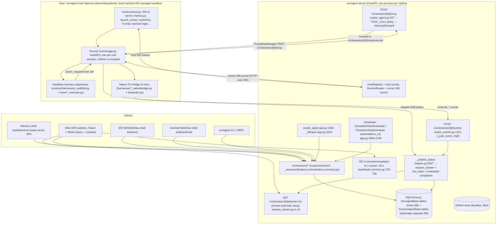
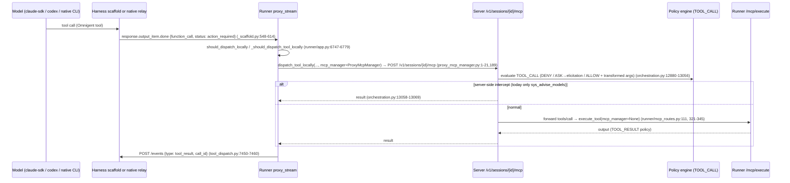
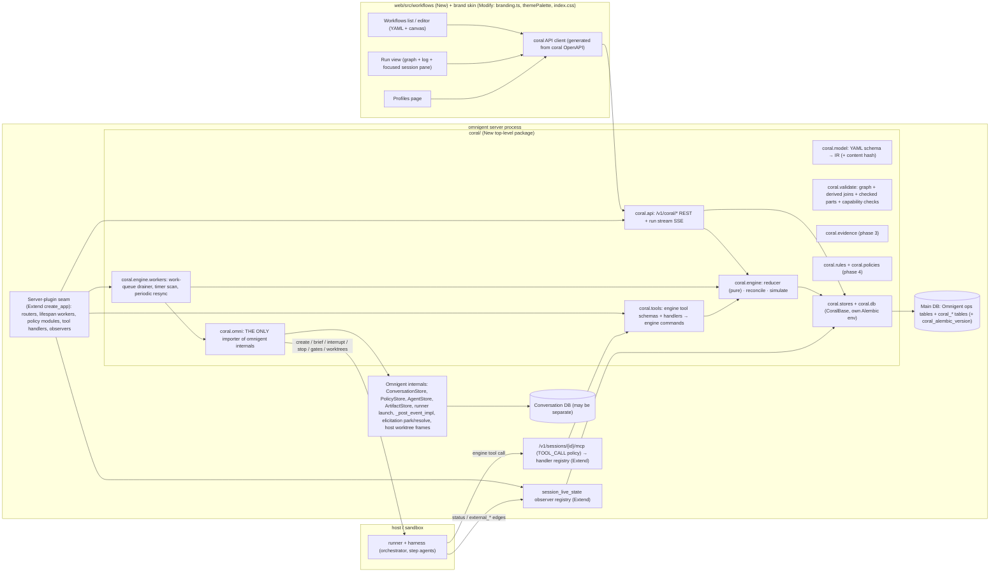
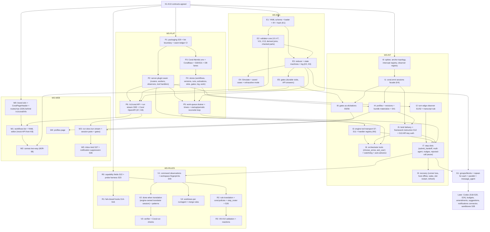

# Coral on Omnigent: Staff Architect findings (Agent 1)

Scope: system architecture and technical feasibility for Coral, a stateful workflow engine on an Omnigent fork.
Codebase: `omnigent-ai/omnigent`, HEAD `2a9cbe2c2` (0.22.0.dev0, committed 2026-11-08).
Inputs: `coral-design.md` (Draft 4, read in full), `CORAL_WORKFLOW_ENGINE_DEEP_DIVE.md` (§1, §3, §4, §5, §6, §7, §8, §10.2-10.5, §11-§14, §17-§20 and App. B), `coral_UI_DESIGN_LANGUAGE.md` (§5, §8-§10).

Conventions:

- `path:line` means I opened that location at HEAD.
- **[DD§n]** cites the deep dive. **[D4§n]** cites `coral-design.md` Draft 4. **[UI§n]** cites the UI design doc.
- **UNVERIFIED** marks a claim I did not confirm in code.
- I made no changes to the repository and ran no app, server, browser or tests.

---

## 0. Executive summary for roadmap decomposers

1. **The deep dive's code facts hold at HEAD.** I re-checked about 45 of its references and found no wrong line numbers on load-bearing claims. Its §3 verdicts (F4, F10, F16, F17, F25, F26, F42, finding 9) still contradict Draft 4, so discrepancy D1 is confirmed (§9.1).
2. **I found seven new facts that change the plan.** Each is in §9.2.
   - **N1. Refresh conflicts with the child-session topology.** `_continue_session_in_fork` refuses `sub_agent` sessions (`omnigent/server/routes/sessions/routes_core.py:5013-5017`). Forking a parent also leaves its children on the old session.
   - **N2. Interrupted children are restored, but their work is not.** `omnigent/server/child_session_recovery.py:111-200` rebinds interrupted children to the parent's recovered runner. Interrupted input is not replayed, and children bound to their own host are skipped (`:165`).
   - **N3. The shipped CLI cannot mount Coral's API.** `omnigent server` never passes `extra_routers` to `create_app` (`omnigent/cli.py:5118-5147`). Only `policy_modules` and `debug_router_modules` come from config.
   - **N4. Conversation tables can live on a separate database.** `conversation_database_uri` (`cli.py:4888`; `omnigent/db/db_models.py:104-114`) allows it.
   - **N5. Uploaded bundles bind content-addressed user-agent rows, and those rows show in the picker.** See `omnigent/server/bundles.py:324-372` and `omnigent/db/utils.py:1149-1166`. Per-step bundles would fill the user's agent list.
   - **N6. Upstream already ships "independent workers" and sibling families.** These are top-level sessions created on another host and grouped in the sidebar (`omnigent/server/session_families.py`; `feature-map/session-orchestration.md:1-45`). They sit behind the `sibling_sessions` flag, which is off by default.
   - **N7. The host can already read a session workspace file, but cannot write one.** `HostFsRequestFrame` (`omnigent/host/frames.py:1148-1174`) handles reads. Write frames cover GitHub operations only (`:1178-1207`).
3. **Recommended v1 architecture.**
   - One new top-level import package, `coral/`, ships in the same wheel. A lint rule enforces that only `coral.omni` imports Omnigent internals.
   - Coral has its own Alembic environment, and its tables live on the main (non-conversation) database.
   - A generic **server-plugin seam** in `create_app` loads routers, workers, policy modules, tool handlers and observers.
   - The engine is a pure reducer over current-state tables plus an append-only run log. A single durable work queue holds signals, timers and effects.
   - The run is anchored by a Coral-created root session, gated on a spike (ADR-05). Step sessions are restarted, never forked, for both refresh and recovery.
   - Workflow source is DB-canonical YAML text, with repository import and export added later.
   - Profiles are Coral rows that pin an Omnigent agent's bundle digest.
4. **Contracts to agree before parallel work.** Ten foundational contracts (K1-K10, §4.2) need sign-off first. Three of them gate almost everything:
   - **K1:** the workflow YAML schema and compiled IR.
   - **K2:** the reducer's input, effect and state types.
   - **K4:** the `coral.omni` facade protocol.

---

## 1. Current-state architecture (Omnigent at `2a9cbe2c2`)

### 1.1 Process topology



Evidence:

- **Server.** `create_app` signature is at `omnigent/server/app.py:1563-1611`. `_lifespan` is at `app.py:1933-2260`. Routers mount from `app.py:3781` onward. `extra_routers` and debug routers are included at `app.py:5308-5311`. The SPA mounts last at `/` (`app.py:5313-5323`).
- **CLI composition.** `omnigent/cli.py:4888-4920` builds the stores. `cli.py:5118-5147` calls `create_app` without `extra_routers`.
- **Host daemon.** `omnigent/host/service.py:1,20-21` sets up launchd/systemd. `omnigent/host/frames.py` lists frames such as `HostLaunchRunnerFrame`, `HostCreateWorktreeFrame`, `HostFsRequestFrame` and `HostFsWriteFrame`.
- **Managed sandboxes.** They run the same host daemon in a provisioned sandbox (`omnigent/server/managed_hosts.py:1-30`). Keep-warm applies only while the runner reports busy (`omnigent/server/managed_host_keepalive.py:1-29`). The `retry_session` event wakes a sleeping sandbox (`omnigent/server/routes/sessions/routes_events.py:1287`; commit `f726587bb`).
- **Runner.** `omnigent/runner/app.py:1-7` says the runner "spawns harness subprocesses and dispatches to them". `omnigent/runner/routing.py:1-8` dispatches over the WS tunnel, with the tunnel registry as the source of truth. `helpers.py:6416-6445` mints a binding token, writes `runner_id` and sends `host.launch_runner`.
- **Executors.** Headless executors live in `omnigent/inner/*_executor.py`. The scaffold `dispatch_tool` emits `action_required` (`omnigent/runtime/harnesses/_scaffold.py:548-614`).
- **Native modes.** These are `omnigent/harnesses/<name>_native/` bridges and forwarders. The server handles `external_*` events in `routes_events.py`, including `external_session_status` with a `turn_completed` flag at `routes_events.py:2689-2710`.
- **Shells.** Electron loads the server's SPA (`web/electron/README.md:98-112`). So do iOS (`web/ios/README.md:1-5`) and Android (`web/android/README.md:16-24`). Notifications are page-scoped (`web/src/lib/browserNotifications.ts:1-14`). The repository has no Web Push, APNs or FCM sender; a grep of `omnigent`, `web/src` and the shells finds only an iOS README line saying it does not implement APNs (`web/ios/README.md:22`).

### 1.2 Subsystem table

Churn is `git log --since=2026-10-09 --oneline -- <file> | wc -l`, measured at HEAD. The repository had 1,510 commits in that window.

| Subsystem | Responsibility | Key files (lines) | Extension points that exist today | Churn (30 d) |
|---|---|---|---|---|
| App composition and lifespan | Builds stores, routers, scheduler, reapers, observers | `server/app.py` (5,525); `cli.py` (14,959) | `create_app(extra_routers, policy_modules, debug_router_modules, scheduled_task_dispatch)` `app.py:1578-1610`; `_load_debug_routers` `app.py:841-871`. **No generic lifespan or worker hook.** | app.py **64**; cli.py **36** |
| Session routes and orchestration | Create, fork, events, elicitations, runner launch and relaunch, MCP proxy | `_sessions/orchestration.py` (14,185); `_sessions/helpers.py` (12,742); `sessions/routes_core.py` (5,296); `routes_events.py` (4,293); `routes_agent.py` (571) | `sys_advise_models` intercept `orchestration.py:13058-13069` (one hard-coded name) | orch **77**; helpers **52**; core **42**; events **41**; agent 4 |
| Live status and turn edges | Status cache, DB mirror, scheduled-run completion | `_publish_status` `helpers.py:5047-5250`; `server/session_live_state.py` (500) | `session_live_state.configure(store, scheduled_task_store)` `:90-110` (one hard-wired hook) | helpers 52; live_state **3** |
| Session live stream | In-process SSE fan-out; lossy | `runtime/session_stream.py` (618) | `publish` and `subscribe` only | 6 |
| Runner | Harness subprocesses, tool dispatch, native relay, timers | `runner/app.py` (9,387); `runner/tool_dispatch.py` (9,478); `runner/native/orchestration.py` (11,493) | `_ALL_LOCAL_TOOLS` `tool_dispatch.py:888-915`; `_NATIVE_RELAY_BUILTIN_TOOLS` `:488-518` | 62; 24; 56 |
| Native harness bridges | claude-native and codex-native TUIs, hooks, transcript forwarders | `harnesses/claude_native/bridge.py` (11,463); `.../forwarder.py` (8,254); `harnesses/codex_native/forwarder.py` (10,109); `native/native_policy_hook.py` (824) | Hook output builders `native_policy_hook.py:474-586` | **83**; 23; 28; 1 |
| Headless executors | claude-sdk and codex event models | `inner/executor.py`; `inner/claude_sdk_executor.py` (4,027); `inner/codex_executor.py` (5,263) | `HarnessCapabilities` `harness_capabilities.py` (184) | 20; 11; caps **0** |
| Tool surface | ToolManager registration of builtins | `tools/manager.py:159-193`; `tools/builtins/*` | Schema-only tool class pattern `tools/builtins/advise_models.py:1-156` | 4 |
| Policies | Policy engine, builder, CRUD, registry | `runtime/policies/engine.py`, `builder.py` (1,919); `server/routes/session_policies.py`; `policies/registry.py` | `POLICY_REGISTRY` modules via `policy_modules` (`registry.py:90-215`; `app.py:2046`) | engine 2; builder 6; CRUD **0** |
| Elicitations and approvals | Parking, resolving, inbox | `orchestration.py:2400` (`_resolve_elicitation`), `:2654`; `runtime/pending_elicitations.py` (420, in-memory) | **One** observer slot `pending_elicitations.py:68-87` | 1 |
| Scheduler | Recurring tasks; FireDeps request-free orchestration | `server/scheduled/fire.py` (2,801); `dispatch_scheduler.py` (1,053); `run_reconciler.py` | `ScheduledTaskDispatchHooks`; `FireDeps` `fire.py:216-252` | 24; 16 |
| Persistence | SQLAlchemy stores, Alembic, multiple backends | `db/db_models.py` (1,772); `db/utils.py` (1,562); `db/migrations/env.py` (97); `stores/*` | `make_named_managed_session_maker`, `run_write_transaction` `utils.py:982-1082` | 12; 1; env **0** |
| Agents, bundles, profiles | Spec parsing, bundles, reusable user agents, seeding | `spec/parser.py` (4,149); `spec/types.py` (1,667); `server/bundles.py` (377); `routes/builtin_agents.py` (626); `server/seeded_agents.py` | `POST/PATCH/DELETE /v1/agents` `builtin_agents.py:386,538,581`; `OMNIGENT_BUILTIN_AGENT_DIRS` `app.py:1142` | 3; 4; 5; 7 |
| Hosts and worktrees | Host WS, launch frames, git worktrees | `host/connect.py` (6,387); `host/git_worktree.py`; `routes/_host_worktree.py` (357); `managed_hosts.py` (4,870) | `create_worktree_on_host` `_host_worktree.py:190` | **62**; 2; 17 |
| Feature flags | Closed enum, process snapshot | `server/feature_flags.py` (265) | `Feature` enum `:23-42` (needs an edit to add a flag) | 18 |
| Web shell | Routes, sidebar, chat store | `web/src/App.tsx` (272); `shell/AppShell.tsx` (3,202); `shell/Sidebar.tsx` (7,772); `store/chatStore.ts` (9,924) | Lazy routes inside `<Route element={<AppShell/>}>` `App.tsx:180-256`; `FeatureGatedPage` | 6; **41**; **51**; **43** |
| Web live data | Session-updates socket watch set | `hooks/SessionUpdatesProvider.tsx:262-298` | Child-session watch path | 5 |
| Inbox and approvals UI | Inbox kinds; approval cards | `pages/InboxPage.tsx:189-193` (closed union of 4 kinds); `components/blocks/ApprovalCard.tsx` | `SubmitApprovalFn` injection | 13; 14 |

**Placement rule that follows from churn.** Put seams in low-churn files (`session_live_state.py`, `pending_elicitations.py`, `harness_capabilities.py`, `env.py`, `tools/manager.py`). Keep each touch of `orchestration.py`, `helpers.py`, `app.py`, `AppShell.tsx`, `Sidebar.tsx` and `chatStore.ts` to a few lines. This agrees with [DD§17] practice 2.

### 1.3 Session and conversation model and lifecycle

**Entity.** `Conversation` (`omnigent/entities/conversation.py:240-290`) has these fields:

- identity and tree: `id`, `root_conversation_id`, `kind` (`default` or `sub_agent`, from `db/enum_codecs.py:28-31`), `parent_conversation_id`, `family_id`, `side_chat_parent_id`;
- binding and placement: `agent_id`, `runner_id`, `host_id`, `workspace`, `git_branch`;
- metadata and state: `labels`, `session_state`, `session_usage`;
- denormalized live fields: `live_status`, `pending_elicitation_count`, `runner_last_seen`, `background_work_running`, `blocked_on`.

**Items.** `NewConversationItem.stable_id` gives idempotent appends for at-least-once producers (`conversation.py:886-925`).

**Store.** `ConversationStore`:

- `create_conversation(kind, title, parent_conversation_id, agent_id, runner_id, host_id, workspace, git_branch, labels, …)` (`stores/conversation_store/__init__.py:542-564`);
- `get_conversation` (`:643`) and `get_runner_liveness` (`:681`);
- `list_child_conversation_ids_by_parent` (`:754`), `list_items` (`:828`) and `set_labels` (`:1284`).

**Two physical databases are possible.** `ConversationBase` tables (`conversations`, `conversation_items`, `conversation_labels`) can sit on a separate database from `OmnigentBase` tables (`db_models.py:93-114`; `cli.py:4888`). **Consequence for Coral:** Coral can never put session creation and its own state write in one transaction. Coral rows that reference a session id must be reconciled in code.

**Children.**

- A session created with `parent_session_id` gets `kind="sub_agent"` (`orchestration.py:12331`).
- It inherits the parent's runner (`orchestration.py:12036-12052`) and must run on the parent's host (`server/schemas.py:1594-1600`).
- It inherits the parent's sandbox profile (`schemas.py:1540-1541`).
- Access checks recurse to the parent (`server/permissions.py:59-66`).
- Root session policies are inherited, and child spec policies are appended (`runtime/policies/builder.py:735-773`).
- Cost gating seeds from the whole spawn tree (`builder.py:800-816`).

**Runner binding and recovery.**

- **One runner per session, no failover.** Dispatch reads `conv.runner_id` [DD F24].
- **Host returns after going offline.** The held-host path relaunches only root sessions (`app.py:4259-4296`, filter at `:4273`).
- **Children are restored, but their turn is not.** **New at HEAD (refines F24):** `schedule_child_restoration` (`orchestration.py:6115-6121`) runs `restore_active_children` (`child_session_recovery.py:111-200`). It rebinds and initializes interrupted descendants on the parent's recovered runner. It skips children with their own `host_id` (`:165`) and does not replay the interrupted turn.
- **Hold window.** A user-run host that drops mid-turn is held for up to 72 h (`orchestration.py:8639`).
- **Grace timers live in memory** (`app.py:4036-4041`), so a server restart forgets them.

**Labels and permissions.**

- Labels are free-form, with server-reserved keys refused at seed [DD§10.6].
- There is a precedent for a server-owned label prefix: `reject_profile_labels` rejects edits under `sandbox_profile:` (`stores/sandbox_profile_store.py:16-26`).
- Permission levels go up to `LEVEL_MANAGE` [DD§20.1]. Elicitation resolve needs `LEVEL_EDIT` (`routes/sessions/routes_elicitations.py:60`).

**Independent workers and families (upstream, in flight).**

- `sys_session_create` with `placement="same_host"` or `"managed"` creates **top-level** sessions that record `created_by_session_id`.
- With `sibling_sessions` on, they share a sidebar family (`feature-map/session-orchestration.md:3-6, 17-23, 34-45`; `server/session_families.py:30-60`).
- The flag is off by default with review at 0.24.0 (`feature_flags.py:81-85`).
- There is an admin policy for nested-agent destinations (commit `b4c292240`).

### 1.4 Event flow and observability

- **`_publish_status` is the status chokepoint** (`helpers.py:5047-5250`).
  - It applies sticky-failed suppression, unless `turn_completed` is set (`:5117-5126`).
  - It updates the status cache and persists `live_status`, best-effort and deduplicated (`:5140`; `session_live_state.py:1-37`).
  - It runs the hard-wired scheduled-run completion. Every `idle` edge becomes `"succeeded"` (`:5152-5159`), and `failed` becomes failed (`:5194`).
  - It then publishes `session.status` to the live stream (`:5250`).
- **Bypasses.** Two status edges skip it [DD§4.1 item 3] (`orchestration.py:4131-4152, 13706-13708`, not re-opened by me).
- **Completion hook body.** `persist_scheduled_run_completion` (`session_live_state.py:251-309`) is conditional on the run's `status=running`. It is best-effort; a failed write is dropped.
- **Live stream.** "Events emitted before any subscriber is connected are LOST" (`session_stream.py:9`). Each subscriber queue is capped at 1024 events (`:54`).
- **Session-updates socket.** `WS /v1/sessions/updates` (`routes_core.py:2464`) rescans every 4 s and sends a heartbeat every 30 s (`common.py:725-728`). The web watch set unions sidebar ids, the open id and `child_sessions` caches (`SessionUpdatesProvider.tsx:262-298`).
- **Turn-end per mode.**
  - `claude-native` sends idle with `turn_completed=True` from its Stop hook (`routes_events.py:2689-2710`).
  - The other modes are covered in [DD§8.7]; I did not re-open those references.
  - Native executors' `TurnComplete` is a delivery receipt, not proof that work finished [DD F1, finding 4].
- **Durable truth today.** Only `conversations.live_status` and the items are durable. The scheduler uses a transcript-evidence rule: idle **and** the newest non-bookkeeping item is an assistant reply (`server/scheduled/fire.py:2540-2577`).
- **No periodic reconciliation.** "There is deliberately NO startup sweep and NO periodic poll" (`run_reconciler.py:30-33`).

### 1.5 Tool execution path (verified end to end)



- **Schema-only builtins.** `SysAdviseModelsTool` provides only a schema; `invoke` raises (`tools/builtins/advise_models.py:1-14, 137-155`).
- **Registration.** ToolManager registers builtins in its constructor (`tools/manager.py:159-193`). The surface is fixed when the session is created.
- **Caller identity** is the session id the runner routes on, never a value from the model.
- **Two other policy paths exist.**
  - Harness-side pre-evaluation through `POST /sessions/{id}/policies/evaluate` (`routes_hooks.py:759-762`). On the TOOL_CALL phase it fails closed (`runner/policy_proxy.py:72-109`).
  - Native PreToolUse hooks. These fail to **ask** (`native/native_policy_hook.py:545-586`).
- **Consequence for Coral.** Engine tools that ride the `/mcp` path inherit the strongest gate: central TOOL_CALL policy plus an intercept that runs after policy.

### 1.6 Policies, elicitations and approvals

- **Policies.** The policy engine does DENY short-circuit with ASK accumulation [DD F3]. Session policy CRUD lives in `routes/session_policies.py`, and anyone with edit access can delete a policy [DD§10.6]. Python handlers must be in the registry (`policies/registry.py`). `cost_budget` ASKs at its thresholds and DENYs at the cap; it never pauses (`policies/builtins/cost.py:505-560`).
- **Elicitations.**
  - The parked-elicitation primitive is at `orchestration.py:470-640` [DD]. The resolver is `_resolve_elicitation` (`orchestration.py:2400`). Native ask gates use `_hold_native_ask_gate_impl` (`:2654`).
  - The pending index is **in-memory** (`pending_elicitations.py:29-37`), with one observer slot already used by `SubagentBlockNotifier` (`:68-87`; `app.py:1986-1999`).
  - MCP elicitations enter through `/events` with `_MCP_ELICITATION_TYPE` (`routes_events.py:2222-2257`).
- **The policy ASK path times out to DENY** [DD§11]. A human gate must never be built on it.

### 1.7 Scheduler

- **Which scheduler runs.** `ScheduledTaskScheduler` (legacy) runs unless `automations_v2` is on, in which case `PersistentTaskScheduler` runs (`app.py:2116-2143`). The flag is off by default (`feature_flags.py:98-104`).
- **PersistentTaskScheduler.**
  - It takes a `ScheduledTaskDispatchStore` protocol, `on_fire`/`on_expired` callbacks, `owned_hosts` and lease settings (`dispatch_scheduler.py:413-440`).
  - Its lease primitive is `StartupLease` (`:156-176`).
  - It refuses Cloudflare D1 (`stores/scheduled_task_store/sqlalchemy_store.py:1186-1194`).
  - Recovery "never sends the prompt again" (`server/scheduled/README.md:147`).
- **FireDeps** (`fire.py:216-252`) is the in-tree precedent for request-free session orchestration. It reaches into private helpers through lazy imports (`fire.py:95-101, 2026-2027, 2157`).

### 1.8 Persistence

- **Backends.**
  - SQLite is the local default and runs WAL with `busy_timeout` [DD].
  - PostgreSQL is handled by `utils.py:203-224`.
  - CockroachDB has a separate DDL path (`utils.py:520-528, 595-618`; `db/cockroachdb.py`).
  - MySQL retries deadlock victims (`utils.py:1058-1059`; `Uuid16` uses BINARY(16) on MySQL, `db_models.py:55`).
  - Cloudflare D1 is a SQLite-family dialect (`utils.py:1224-1251`; `db_models.py:643`).
- **Migrations.** There is one Alembic chain with a single head. Startup runs `upgrade("head")`, then `create_all` for both bases (`utils.py:561-618`). `env.py` has **no** `include_name` filter and no `version_table` override (`db/migrations/env.py:85-89`). The versions directory has 121 entries.
- **Conventions.**
  - `workspace_id` is the leading PK column (`db_models.py:116-157`).
  - Named sessions (`make_named_managed_session_maker`, `utils.py:982-1020`) and `run_write_transaction` (`:1032-1082`).
  - Every DB lane in CI runs only `tests/stores` and `tests/db` (`.github/workflows/ci.yml:264, 315, 363`).
  - Test truncation keeps only `alembic_version` (`tests/conftest.py:736`).
- **No durable-execution library is present.** `scripts/dump_openapi.py:48-51` mentions DBOS, but `pyproject.toml` and `uv.lock` contain no DBOS dependency.

### 1.9 Context management and conversation history

- **Context-use signals.** Headless modes read `context_tokens` from `TurnComplete.usage` and resolve `context_window` server-side (`server/schemas.py:2351, 2517, 3644-3670`). Native modes store the labels `omnigent.last_context_tokens` and `omnigent.last_context_window` (`routes/_sessions/common.py:306-309`; `stores/conversation_store/__init__.py:219-220`).
- **Compaction.** claude-sdk `/compact` and native typed `/compact` are driven by `runner/native_controls.py` [DD F11]. Headless codex has no compaction [DD F36].
- **Supersession.**
  - `_continue_session_in_fork` is a closure inside `register_core_routes` (`routes_core.py:439, 4969-4999`). It requires a FastAPI `Request` from the owner (`:5009-5012`).
  - It **refuses sub-agent sessions** (`:5013-5017`) and side chats (`:5022`), and it refuses during a running turn (`:5035`).
  - `SupersessionReason = Literal["clear"]` (`schemas.py:4209`).

### 1.10 Agent configuration and profile management

- **Spec dialects.** The bundle dialect (`config.yaml`, `spec_version: 1`) is parsed in `spec/parser.py:200-367`.
- **AgentSpec fields** (`spec/types.py:1473`) include `description` (`:1607`), `params` (`:1614`), `guardrails` (`:1645`) and `spawn` (`:1653`).
- **Unknown top-level keys are not validated.** Only `tool_groups` gets an unknown-key check (`parser.py:533-547`). The constructor picks known keys (`parser.py:339-356`).
- **Agent rows** (`db_models.py:196-245`) carry `kind` (server=1, user=2), `bundle_location`, `version` and `created_by`.
- **Install path.** `POST /v1/agents` installs a user agent with id `sha256("installed:"+owner+name)`. Reinstalling updates the row in place, and sessions bound to it pick up the change on their next turn (`designs/REUSABLE_USER_AGENTS.md:108-113`).
- **Edit path.** `GET /v1/agents/{id}/config` and `PATCH /v1/agents/{id}` give editable configuration with an ETag (`routes/builtin_agents.py:369-400`). An edit moves `bundle_location` to the new content's digest (`:361-366`).
- **Upload path (multipart session create).** `uploaded_agent_for` binds a row whose id is derived from (owner, name, content digest), `attempt` (`bundles.py:324-372`; `db/utils.py:1149-1166`). **These rows are `kind=user, created_by=owner`, so they appear in `GET /v1/agents?scope=user`** (`agent_store/sqlalchemy_store.py:523-545`; `builtin_agents.py:443-470`).
- **Seeded agents.** Built-ins are filtered by `OMNIGENT_SEEDED_AGENTS`. Extra built-ins come from `OMNIGENT_BUILTIN_AGENT_DIRS` (`server/seeded_agents.py:1-49`; `app.py:1142`).

### 1.11 Frontend and backend boundaries

- **REST surface.** `openapi.json` has 119 paths: 65 under `/v1/sessions`, 22 under `/v1/hosts` and 3 under `/v1/agents`, among others.
  - It is generated by `scripts/dump_openapi.py` from `create_app` with stub stores, and CI checks it with `--check`.
  - Routers mounted through `extra_routers` therefore do **not** appear in it, and scheduled tasks are absent too.
- **Web data layer.** `authenticatedFetch` in `lib/identity`, with per-domain `*Api.ts` modules such as `lib/agentsApi.ts:1-30`. Server state uses React Query (`web/package.json:51`), local and global state uses zustand (`:108`), and the chat store is `store/chatStore.ts`. Graph rendering uses `@xyflow/react` ^12.11.1 (`:67`). Monaco is present (`:76`).
- **No YAML library** is a direct web dependency. Python has only `pyyaml` (`pyproject.toml:32`), so neither side can round-trip YAML with comments preserved.
- **Feature flags reach the web** through `GET /v1/info`, `FeatureKey` (`web/src/lib/capabilities.ts:60`) and `FeatureGatedPage`.
- **Routes.** `App.tsx:180-256` has `/`, `/c/:id`, `/grid`, `/inbox`, `/canvas` (flagged), `/tasks*`, `/usage`, `/settings/*` and `/extensions/*`. There is **no** `/workflows`, `/schemas` or `/profiles`.

---

## 2. Target-state Coral architecture

### 2.1 Component view



### 2.2 Packages and responsibilities

| Package | Responsibility | Imports allowed |
|---|---|---|
| `coral/model` | Pydantic models for the authoring YAML (K1); loader (pyyaml safe-load); compiler to a frozen IR; content hash; JSON Schema export for the web | stdlib, pydantic, pyyaml |
| `coral/validate` | V1-V13 [DD§5.5]; derived join types; checked-part derivation; generated tool schemas; capability checks against a `CapabilityMatrix` value passed in | `coral.model` |
| `coral/engine` | `transition(graph, state, input) -> Transition` (pure, K2); `reconcile(run_id)`; `simulate(...)`; state machines [DD§6.2]; error taxonomy [DD§6.7] | `coral.model`, `coral.validate` (no I/O) |
| `coral/engine/workers` | Asyncio tasks started by the plugin lifespan: claim work, call reconcile, dispatch effects through `coral.omni`, scan timers, resync periodically | `coral.engine`, `coral.stores`, `coral.omni` protocol |
| `coral/tools` | Engine tool definitions (names, generated schemas) and handlers that turn calls into reducer **commands** | `coral.engine`, `coral.stores` |
| `coral/omni` | Facade protocol (K4) and its Omnigent implementation: sessions, policies, gates, signals observer, worktrees, profiles and bundles, capabilities. Contract-tested on every upstream merge. | `omnigent.*` (only here) |
| `coral/stores`, `coral/db` | CoralBase models, store ABCs and SQLAlchemy stores, separate Alembic env, `ensure_coral_schema` | `omnigent.db.utils` helpers (allowed list) |
| `coral/api` | FastAPI routers `/v1/coral/*`, run-stream SSE, Coral OpenAPI dump | `coral.*` |
| `coral/policies` | `POLICY_REGISTRY` module (`step_roster`, `engine_tool_guard`, …), loaded through `policy_modules` | Omnigent policy base classes |
| `coral/evidence`, `coral/rules` | Phase 3 and 4 | `coral.omni`, `coral.engine` |
| `coral/server_plugin.py` | Single entry: `register(ctx) -> PluginRegistration(routers, startup, shutdown, policy_modules, tool_handlers, turn_observers, elicitation_observers)` | All of the above |
| `web/src/workflows/` | Editor, canvas (xyflow behind an adapter), run view, profiles page, API client | Existing `@/lib`, `@/components` |
| `web/src/coral-brand/` (or in-place edits) | Clay Score tokens, `CoralPageHeader`, `CoralLogo` [UI§2-§6, §10] | Theme infrastructure |

**Import-boundary enforcement.** Add `dev/lint/lint_coral_import_boundary.py` on the existing framework (`dev/lint/_framework.py`):

- `coral.model`, `coral.validate` and `coral.engine` import nothing from `omnigent`;
- only `coral.omni`, `coral.policies` and `coral.db` (an allow-list of `omnigent.db.*` helpers) may.

### 2.3 Integration boundaries and data flows

1. **Engine to Omnigent goes only through `coral.omni`.** Effects carry an `effect_key`. `create_session` is idempotent: it first looks up a session labelled `coral.effect_id=<key>`, because labels are written at creation [DD§6.1].
2. **Agents to the engine go only through engine tools.** The path is model → runner → `POST /v1/sessions/{id}/mcp` → TOOL_CALL policy → Coral handler (registered through the new handler registry that generalizes `orchestration.py:13058-13069`) → reducer command → one transaction. The tool result returns accept or reject with reasons.
3. **Omnigent to the engine goes only through durable facts.**
   - A turn-edge observer, registered in `session_live_state`, writes a `coral_work` row of kind `signal`, but only for sessions that carry a `coral.run_id` label.
   - It records `session_id`, `status`, `turn_completed`, `response_id`, `failure_origin` and an idempotency key.
   - Workers wake `reconcile(run_id)`, which reads durable state: Coral rows plus the conversation row and newest items.
   - A periodic resync covers lost signals and the two edges that bypass `_publish_status` (`orchestration.py:4131-4152, 13706-13708` per [DD§4.1]).
4. **User to the engine goes through the Coral REST API**: gate answers, pause, resume, cancel, take-over and amendments. Gates also surface as elicitations on the run's root session, and answers come back through an elicitation observer (seam S5/S6).

**One step, end to end:**

```mermaid
sequenceDiagram
  participant API as coral.api
  participant E as reducer
  participant DB as coral tables
  participant W as worker
  participant O as coral.omni
  participant S as step session (runner)
  API->>E: StartRun(cmd)
  E->>DB: txn: run row, activation(start→step), slot(pending), log, work(effect:create_session key=slot)
  W->>DB: claim effect (lease)
  W->>O: create_session(bundle=profile@rev, parent=run-anchor, labels{coral.run_id, coral.slot_id, coral.effect_id})
  O-->>W: session_id
  W->>E: EffectCompleted(slot, session_id) → slot=session_created; work(effect:send_brief)
  W->>O: send_input(brief, source_key=brief:{slot}:{attempt})
  S->>O: tool submit_handoff (via /mcp intercept)
  O->>E: SubmitHandoff(cmd, idempotency=tool:{session}:{call_id})
  E->>DB: txn: validate parts + evidence → handoff accepted, activation closed, next activation(s), log
  S-->>O: status idle (observer) → work(signal)
  W->>E: reconcile(run) → nothing to do (already advanced) / nudge if no handoff
```

### 2.4 Where I agree or disagree with the deep dive

| # | Deep dive position | My position | Rationale and evidence |
|---|---|---|---|
| C1 | A separate top-level `coral/` package [DD§4.2] | **Agree, as an import package inside the same wheel**, not a separate distribution. Add `"coral*"` to `pyproject.toml:460`. | The fork is the product, so a second wheel adds release coupling with no consumer. A precedent for sibling distributions exists (`integrations/slack/pyproject.toml`; `pyproject.toml:445-452`), but Slack is an out-of-process API client, unlike Coral. Isolation comes from the lint boundary, not packaging. |
| C2 | A separate Alembic environment [DD§7.3] | **Agree, and treat it as mandatory, not optional.** | Upstream enforces a single head (`utils.py:606`; [DD F30]). Any Coral revision inside upstream's chain becomes a second head after the next upstream migration. Cost: three files plus `ensure_coral_schema` plus S30/S31. Coral tables must be created on the **main** engine, never the conversation engine (N4). |
| C3 | Reducer plus transactional outbox, with separate `coral_signals`, `coral_timers` and `coral_effects` [DD§6.1, §7.2] | **Agree on the pure reducer, current-state tables and the run log. Simplify the three queues into one `coral_work` table** (`kind ∈ {signal, timer, effect}`, `due_at`, `lease_owner`, `lease_expires_at`, `attempts`, unique `idempotency_key`) with **one** claim implementation and **one** drainer. | Three lease-claimed queues triple the claim and index code, the tests and the backend-specific risk on SQLite, CRDB and MySQL. Timers are work with a future `due_at`, and signals are work due now. Semantics are unchanged: at-least-once, idempotent handlers, and dedup through `idempotency_key`. Keep the reducer's typed `effects` list as the contract (Simulate stubs it). |
| C4 | Step sessions as **children of the orchestrator** by default [DD§8.2] | **Disagree as stated.** Recommend a **run-anchor root session**, gated on a phase-2 spike (ADR-05): the orchestrator and every step session are children of a Coral-created anchor. Fallback 1: children of the orchestrator, with the orchestrator **never** refreshed by fork. Fallback 2: top-level sessions in a family. | (a) `_continue_session_in_fork` refuses `sub_agent` sources (`routes_core.py:5013-5017`), so children cannot refresh through it. (b) Forking the orchestrator gives a **new** top-level id (`stores/conversation_store/__init__.py:2239-2240`) and leaves step children under the superseded session, which then holds access, root policies and the cost tree (`permissions.py:59-66`; `builder.py:756-772`). (c) Root policies leak to every child, so orchestrator-only restrictions like "no heavy work" would bind steps; with an anchor, run-wide Required rules go on the anchor (inherited) and orchestrator-only ones on the orchestrator child (not inherited by siblings). (d) An anchor gives one sidebar entry per run, one grant and a cost tree equal to the run budget. **UNVERIFIED and to be spiked:** whether an anchor that never takes a turn can host children (children inherit `runner_id`, `orchestration.py:12036-12052`), and whether child sessions keep their own `workspace` on a shared runner. |
| C5 | Refresh built on `_continue_session_in_fork` with S25 [DD§8.9] | **Replace it with a slot restart**: end the session (stop, or delete the terminal for native) and create a new slot session with brief, run state and refresh note. S25 is **not** on the critical path. | This is the same machinery as runner-loss restart [D4§7.8] and works for children. The design already says "ends the session, and continues in a new session" [D4§7.5]. Continuity in the run view comes from Coral's own slot chain, not Omnigent's supersession redirect. |
| C6 | S1 observer registry in `_publish_status` | **Agree; put the registry in `session_live_state.py`** (3 commits in 30 days) with a single call from `helpers.py`. Filter by `coral.run_id` label membership through a Coral-side in-memory set refreshed from the DB, so non-Coral sessions pay one set lookup. | Matches [DD§17] practice 2. `turn_completed` and `response_id` exist only on the edge; they are not persisted on the row (`helpers.py:5061, 5250`), so the observer **must** persist them. A purely level-triggered reconcile would lose them. |
| C7 | S32 adds only a lifespan hook; Coral routers mount through `extra_routers` [DD§4.3] | **Widen it: one generic server-plugin seam.** A `server_plugins` config key, list of dotted modules, is loaded the way `policy_modules` and `debug_router_modules` are (`app.py:841-871, 2046`). Each plugin returns routers, startup and shutdown callables, extra policy modules, MCP tool handlers, turn observers and elicitation observers. | **N3:** `omnigent server` never passes `extra_routers` (`cli.py:5118-5147`), so S32 as written does not mount anything in the shipped server. One upstreamable seam replaces the registration plumbing of S1, S5, S10 and S32. Do **not** mount through `debug_router_modules`, which is documented as being for diagnostics. **UNVERIFIED:** whether FastAPI 0.136.3 (`uv.lock:1313-1314`) merges `APIRouter(lifespan=…)` into the app lifespan. Do not rely on it. |
| C8 | Add a `workflows` value to Omnigent's `Feature` enum (S33) | **Do not edit upstream's Feature enum.** Coral serves `GET /v1/coral/info` with its own enablement, and the web gates `/workflows` on that. | `feature_flags.py` changed 18 times in 30 days. Tests pin exact `frontend_dict` defaults [DD S33]. Flags are temporary by upstream policy [DD R16], while Coral is the permanent product. |
| C9 | Per-step generated bundles [DD§8.5] | **Use per-profile-revision bundles in v1, plus session-level policies.** Generate per-step bundles only when a Required rule needs spec-only settings (MCP allow-lists, `os_env.sandbox`/`egress_rules`, spec grants), which is phase 4. Add a picker-hiding seam (S41). | **N5:** uploaded rows land in the user's agent picker (`agent_store/sqlalchemy_store.py:523-545`). Per-step bundles would add (steps × versions) rows. Session policies are settable after create (`session_policies.py`), so phase 2 needs no per-step bundles. |
| C10 | Workflow YAML in `.coral/workflows/` with the canvas editing it [D4§12; DD§14.4] | **DB-canonical, versioned YAML text in v1**, with an explicit "Import from repo" and "Export to repo" through a new host-file frame later. | **N7:** the server can read a session workspace file through the host (`frames.py:1148-1174`), but no frame writes arbitrary files. Write frames are GitHub-only (`:1178-1207`). Writing repository files from the server would be a new, security-relevant capability. A DB-canonical store also suits teams and sharing. |
| C11 | Two-way sync with YAML text as canonical and comment-preserving AST patches [DD§14.4] | **Keep the K1 schema as the contract.** Choose between a structured model with regenerated YAML (comments lost, no new dependency) and comment-preserving editing (needs the `yaml` npm package, which is not present). This is ADR-08. | No YAML library is a direct web dependency (`web/package.json`), and Python has only `pyyaml`. Adding a dependency triggers the repo's mirror rules (CLAUDE.md "Dependency changes"). |
| C12 | Run alerts and gates on the orchestrator session [DD§11] | **Publish gates on the run-anchor session** (or the orchestrator under fallback 1). | A single stable session per run for the inbox and `/approve` links. The orchestrator may be replaced on refresh or restart, and its id is not stable. |

---

## 3. Architectural gaps, current versus target

Classification: **Reuse** as is, **Extend** (additive seam in an upstream file), **Modify** (behaviour change in an upstream file), **New** (Coral code), **Replace** (supersede an upstream mechanism for Coral sessions), **Remove**.

| # | Capability | Current state (evidence) | Target | Class | Seam or phase |
|---|---|---|---|---|---|
| G1 | Mount Coral API and workers in the shipped server | No generic hook; CLI omits `extra_routers` (`cli.py:5118-5147`; `app.py:1578-1611`) | `server_plugins` config key loads `coral.server_plugin` | **Extend** `app.py`, `cli.py` (or config read in `create_app`) | S32+ (P1) |
| G2 | Packaging | `include=["omnigent*"]` (`pyproject.toml:460`) | Add `coral*` plus package data for migrations | **Modify** | S29 (P1) |
| G3 | Coral schema lifecycle | One Alembic chain; `create_all` on two bases (`utils.py:606-618`); no env filter (`env.py:85-89`) | Coral env with `version_table=coral_alembic_version`; `include_name` filters on both sides; truncation keeps both version tables | **New** + **Extend** `env.py`, `tests/conftest.py:736` | S30, S31 (P1) |
| G4 | Workflow model, validation, reducer, Simulate | None (Polly sequences by prompt, [DD§1.1]) | `coral.model`, `coral.validate`, `coral.engine` | **New** | P1 |
| G5 | Durable queue and timers | `PersistentTaskScheduler` is at-most-once, typed on `ScheduledTask`, behind a flag (`dispatch_scheduler.py:413-440`; README:147; `feature_flags.py:98-104`) | `coral_work` plus a drainer modelled on `StartupLease` and the claim pattern (`dispatch_scheduler.py:156-347`; `scheduled_task_store/sqlalchemy_store.py:1270-1335`) | **New**, patterns **Reused** | P1 |
| G6 | Turn-end facts | One hard-wired hook; idle always means "succeeded" (`helpers.py:5152-5159`) | Observer registry; Coral observer persists facts; transcript-evidence rule (`fire.py:2540-2577`) applied per mode | **Extend** `session_live_state.py` + 1-line `helpers.py`; **Modify** codex-native forwarder (S2) | S1, S2 (P2) |
| G7 | Request-free session operations | Underscore helpers in large route modules; `fire.py` lazy-imports them | `coral.omni.sessions` built like FireDeps; public wrappers where cheap | **New** + optional **Extend** (S3, S4) | P2 |
| G8 | Engine tools | One hard-coded intercept (`orchestration.py:13058-13069`) | Handler registry; schema-only tool classes behind a spec opt-in; runner forwarding; native relay advertising and pre-approval | **Extend** `orchestration.py`, `tools/manager.py`, `spec/parser.py`/`types.py`, `tool_dispatch.py`, native pre-approval lists | S7-S11 (P2) |
| G9 | Framework instruction for run sessions | `_framework_instructions_for` (`prompt.py:62-87`); native modes take launch-time text only | Gated "Coral step agent" instruction plus native launch channel | **Extend** `prompt.py`, native orchestration | S12 (P2) |
| G10 | Human gates | Elicitations are in-memory, with one observer slot (`pending_elicitations.py:29-87`); the policy ASK path times out to DENY | `coral_gate_visits` plus elicitation published on the anchor; observer list; request-free park and resolve callback | **New** + **Extend** | S5, S6 (P1 API-only; P2 surfaced) |
| G11 | Profiles and revision pinning | Installed rows update in place (REUSABLE decision 6); PATCH edits move content; uploads are content-addressed (`bundles.py:324-372`) | `coral_profiles` and `coral_profile_revisions` pinning `(agent_id, bundle_location, digest)`; per-revision bundle with Coral opt-in | **New**; **Reuse** the upload binding | P2 |
| G12 | Picker pollution by Coral-generated agents | `scope=user` lists all user rows (`agent_store/sqlalchemy_store.py:523-545`) | Exclude rows labelled or named as Coral-generated from the picker | **Extend** (S41, new) | P2 |
| G13 | Session topology | Children, independent workers and families exist; no run grouping | Run-anchor root (spike) | **New** usage of existing APIs; possible **Extend** if the anchor needs a "no-turn" agent | P2 spike |
| G14 | Refresh and restart | `_continue_session_in_fork` (top-level only); `SupersessionReason="clear"` | Slot restart: stop, then new session, then brief plus note | **New** (Coral); **Replace** fork-based refresh for Coral sessions | P2 (restart), P4 (refresh threshold) |
| G15 | Runner loss, host offline | Relaunch ladder; root relaunch; child restore without replay; 72 h hold in memory | Engine classification [DD§6.7], wake via `retry_session`, restart from incoming handoff with worktree reset | **New**, **Reuse** primitives | P2 |
| G16 | Roster enforcement | "Sub-agent router" is model routing (`runner/subagent_routing.py:1-8`) | Separate sessions by construction, plus a `step_roster` TOOL_CALL policy and spec grants | **New** (`coral.policies`); **Replace** the D4 "fail-closed router" plan | P2 (deny spawns) / P4 |
| G17 | Fail-closed native hooks | PreToolUse fails to ASK (`native_policy_hook.py:545-586`) | Fail closed for run-owned sessions; refuse codex-native without hooks | **Modify** | S14, S15 (P4) |
| G18 | Capability fields and probes | `steering`, `live_queue` and `compaction` are `None`; no Coral fields | Add fields plus bench probes | **Extend** `harness_capabilities.py` (0 commits in 30 d), `harness_plugins.py` | S22, S23 (P4) |
| G19 | Protected policies and labels | Editors can delete session policies and upsert labels | Reserved `coral.` label prefix (precedent `sandbox_profile_store.py:24-26`) and protected policy names | **Modify** | S26 (P4) |
| G20 | Run stream | Session SSE is lossy; no run frames | `GET /v1/coral/runs/{id}/stream` from `coral_run_log` with a sequence cursor | **New** | P1 (API), P5 (UI) |
| G21 | Web routes, nav, brand | No `/workflows`; prototype `concerto`/`CoralPageHeader` absent (D3) | `web/src/workflows/*`; nav entry; Clay skin; `CoralPageHeader` | **New** + **Modify** `App.tsx`, `Sidebar.tsx` (a few lines), `branding.ts`, `themePalette`, `index.css` | S34 (P5), brand (P5) |
| G22 | Run-session notifications and inbox | Per-session idle notifications; closed set of 4 inbox kinds | Suppress for run-owned sessions; add a `workflow` inbox kind | **Modify** web | S36, S37 (P5) |
| G23 | Push for unattended gates | None exists | Decision: connector (email or Slack) versus push build-out versus app-open requirement | **New** (ADR-12) | P5+ |
| G24 | Evidence and workspace fingerprints | None; host frames have no "fingerprint" or "run command" | Runner or host frame for fingerprints and Coral-run checks | **New** + **Extend** host frames | S40 (P3) |
| G25 | Worktrees per run or agent | Host worktree proxies exist (`_host_worktree.py:190-357`); managed sandboxes reject `git` (`schemas.py:2012-2013`) | Local host worktrees in v1; sandbox later | **Reuse**; **Extend** later | P3; S28 later |
| G26 | `claude-sdk` API-key auth for run sessions | The executor strips `ANTHROPIC_API_KEY` [DD F48] | Prefer `apiKeyHelper` for run-owned sessions | **Modify** | S13 (P2) |
| G27 | Coral OpenAPI and TS types | `dump_openapi.py` covers only `create_app` routes | `coral/api/dump_openapi.py` plus a generated `web/src/workflows/api/types.ts` with a CI drift check | **New** | P1 |
| G28 | Engine-owned translation sessions (rules, done-when) | No model calls outside a session [DD§10.7] | Short-lived engine-owned session through the facade | **New** | P3/P4 |
| G29 | "Sub-agent router fail-closed" patch in [D4§16] | n/a | Drop it from the patch list | **Remove** (from plan) | n/a |
| G30 | `PersistentTaskScheduler` reuse for timers and signals [D4§7.6] | See G5 | Not used | **Remove** (from plan) | n/a |

---

## 4. Subsystem boundaries, ownership and foundational contracts

### 4.1 Proposed workstreams and owners

| Workstream | Owns (packages and seams) | Primary consumers | Phase-1 deliverable |
|---|---|---|---|
| **WS-ENG** (engine core) | `coral.model`, `coral.validate`, `coral.engine` (reducer, reconcile, simulate), K1, K2, K3 | Everyone | IR, validator V1-V7/V11/V13, reducer for start, step, decision, gate, end, loops and joins; Simulate with saved cases |
| **WS-PLAT** (platform and persistence) | `coral.db`, `coral.stores`, `coral.engine.workers`, `coral.api` skeleton, `coral/server_plugin.py`; seams S29-S32+, S39, the lint boundary, seam-ledger CI; K5, K8, K10 | WS-ENG (store), WS-INT, WS-WEB | Alembic env on SQLite, Postgres, CRDB and MySQL lanes; `coral_work` drainer; plugin seam; `/v1/coral/info`, workflows and runs CRUD, run stream |
| **WS-INT** (Omnigent integration) | `coral.omni`, `coral.tools` transport, gates surfacing, signals observer, profiles and bundles; seams S1-S13, S41; K4, K6 | WS-ENG (effects), WS-WEB (run view sessions) | Phase-1 spikes: anchor topology, tool intercept registry, observer registry; phase 2 build |
| **WS-RULES** (evidence, rules, capabilities) | `coral.evidence`, `coral.rules`, `coral.policies`; S14-S23, S26, S40; K9 | WS-ENG (validator V8-V10), WS-INT | Phase 1: capability field definitions plus probe harness design (can start early) |
| **WS-WEB** (canvas, run view, brand) | `web/src/workflows`, brand skin, S34-S37; consumes K1 JSON Schema, K7, K8 | Users | Phase 1: brand skin, routes, workflows list and YAML editor against a mocked API; phase 5 canvas and run view |
| **WS-HAR** (harness modes; later) | Codex S18-S20, S24 usage-limit signals, native mode hardening | WS-RULES | Phase 7 |

### 4.2 Foundational contracts (agree before parallel work)

Each contract lists its owner, consumers and minimal shape. Names are proposals.

**K1. Workflow authoring schema and compiled IR.** Owner: WS-ENG. Consumers: WS-WEB (editor, canvas), WS-PLAT (storage), WS-INT (tool schemas), WS-RULES.

- **Authoring (YAML).**
  - Top level: `coral: 1`, `id`, `name`, `purpose`, `orchestrator: {profile}`, `rules[]`.
  - `nodes`: a map from a stable id to a node with `kind ∈ {start, end, step, decision, gate, group, wait*, subworkflow*}` and `name`. Asterisked kinds are hidden or reserved.
  - Step body: `goal`, `roster[{profile, count, mode: exact|up_to}]`, `handoff`, `done_when{text, confirmed?}`, `attempts=3`, `on_failure`, `repeat_for_each{list_from, concurrency=1}`, `run_mode: separate|subagents`, `expected_duration`, `agents_change_code=false`, `checks{repo_checks: bool, commands[]}`, `rules[]`.
  - Step options reserved for D4: `session: fresh|persistent_across_loop` and `input_scope{include: [handoff_fields|files]}`. Reserve these keys now so the Elephant-Goldfish template is not a breaking change.
  - `arrows[{id, from, to, label?, back?, limit?, at_limit?}]` and `groups{members, entry, exit, repeat_for_each?}`.
  - Layout lives in a separate document keyed by node id.
- **Compiled IR.** Frozen dataclasses (`CompiledGraph{nodes, arrows, groups, regions, join_type_by_node, loop_table, checked_parts_by_node, content_hash}`). The JSON Schema is exported for TS.
- **Stability rule.** Ids are immutable. A rename changes `name` only [DD V13].

**K2. Engine state machine and reducer types.** Owner: WS-ENG. Consumers: WS-PLAT (persistence of `Transition`), WS-INT (effects and commands), WS-WEB (state names).

```python
@dataclass(frozen=True)
class ScopeKey: run_id: str; node_id: str; item_path: tuple[int, ...]; iteration_path: tuple[int, ...]

Input = Command | Observation
Command   = StartRun | SubmitHandoff | ChooseArrow | AssignAgents | MessageAgent | AskUser
          | AnswerGate | PauseRun | ResumeRun | CancelRun | TakeOver | HandBack | ApplyAmendment
Observation = TurnEnded | SessionFailed | RunnerLost | UsageLimited | ContextThreshold
          | TimerDue | EffectCompleted | EffectFailed

Effect = CreateSession | SendInput | Interrupt | StopSession | AttachPolicies | PublishGate
       | ResolveGateElicitation | CreateWorktree | Notify | ScheduleTimer
@dataclass(frozen=True)
class Transition: state: RunStateDelta; log: list[LogEntry]; effects: list[Effect]; rejections: list[Rejection]
def transition(graph: CompiledGraph, state: RunState, inp: Input, now: int) -> Transition  # pure
```

- States follow [DD§6.2]: Run, Activation, Slot, Attempt, Decision request, Gate visit, Work item.
- Every `Input` carries an `idempotency_key`. Every `Effect` carries an `effect_key` derived from `(scope, slot, attempt, kind)`.

**K3. Run-log entry schema.** Owner: WS-ENG with WS-PLAT. Consumers: run stream, run view, suggestions, replay.

- Fields: `{run_id, seq, at, run_version, kind, scope_key, node_id, activation_id?, slot_id?, actor{type: engine|agent|user|system, id}, body (≤16 KiB, CompressedText), refs[{type: artifact|session_item|handoff, id}], idempotency_key, audit_only}`.
- `kind` is a closed enum: `run.started`, `activation.started`, `slot.session_created`, `slot.briefed`, `handoff.accepted`, `handoff.rejected`, `evidence.result`, `decision.made`, `gate.opened`, `gate.answered`, `gate.superseded`, `loop.limit_reached`, `join.arrived`, `join.fired`, `arrow.skipped`, `run.paused`, `run.resumed`, `slot.restarted`, `slot.refreshed`, `amendment.applied`, `tool.rejected`, `nudge.sent`, `run.completed`, `run.failed`, `run.cancelled`.
- Invariant: folding the log reproduces state [DD§6.1].

**K4. `coral.omni` facade protocol.** Owner: WS-INT. Consumers: WS-ENG (workers via effects), WS-RULES, WS-PLAT (plugin wiring).

```python
class OmniSessions(Protocol):
    async def create_session(self, req: CreateSession) -> SessionRef        # idempotent on req.effect_key (label coral.effect_id)
    async def send_input(self, session_id: str, text: str, *, source_key: str, file_ids: Sequence[str] = ()) -> Delivery
    async def interrupt(self, session_id: str) -> None
    async def stop(self, session_id: str, *, release_terminal: bool) -> None
    async def wake(self, session_id: str) -> WakeResult                      # ensure_runner_connected / retry_session
    def status(self, session_id: str) -> SessionStatus                       # live_status, runner_last_seen, blocked_on, pending_elicitations
    def items(self, session_id: str, *, after: str | None, limit: int) -> list[ItemView]
    def turn_finished(self, session_id: str, edge: TurnFact | None) -> TurnVerdict   # per-mode rule
class OmniPolicies(Protocol):
    async def attach(self, session_id: str, specs: Sequence[PolicySpec], *, reserved_prefix: str = "coral.") -> None
    async def dry_run(self, specs, sample_events) -> list[Verdict]
class OmniGates(Protocol):
    async def publish(self, session_id: str, visit: GateVisitView) -> str     # elicitation_id
    async def withdraw(self, session_id: str, elicitation_id: str) -> None
class OmniProfiles(Protocol):
    def resolve(self, ref: AgentRef) -> AgentRevision                        # agent_id, bundle_location, digest, harness, spec summary
    async def materialize_bundle(self, rev: AgentRevision, overlay: BundleOverlay) -> BundleRef
class OmniWorkspaces(Protocol):
    async def create_worktree(self, host_id, repo, branch, base) -> Worktree
    async def remove_worktree(self, host_id, path) -> None
class OmniCapabilities(Protocol):
    def matrix(self) -> CapabilityMatrix                                     # K9
```

- `CreateSession` fields: `role ∈ {anchor, orchestrator, step, translator}`, `parent_session_id?`, `bundle|agent_id`, `host{type, id?}`, `workspace?`, `git?`, `labels`, `title`, `harness_override?`, `model_override?`, `effect_key`.

**K5. Coral DB schema.** Owner: WS-PLAT. Consumers: WS-ENG, WS-INT.

- Tables for v1:
  - `coral_workflows` (identity and owner);
  - `coral_workflow_versions` (immutable; `content_hash`, `source_text_ref`, `compiled_ref`, `parent_version_id`);
  - `coral_profiles` and `coral_profile_revisions`;
  - `coral_runs` (with `version` for optimistic locking, `next_log_seq`, `start_key` unique per owner, `anchor_session_id`, `orchestrator_slot_id`, `pause_reason`, budgets);
  - `coral_activations`, `coral_join_arrivals`, `coral_slots`, `coral_handoffs`, `coral_gate_visits`;
  - `coral_work` (unified queue, C3);
  - `coral_run_log`.
- Phase 3 adds `coral_command_observations`. Phase 7 adds `coral_amendments`.
- Conventions follow [DD§7.1]: `workspace_id` leading PK, `Uuid16`, SmallInteger enums with CHECK constraints, no foreign keys, no JSON or TEXT columns, values capped at 16 KiB, large bodies in the artifact store, and `user_id` plus `account_generation` on root rows.
- Coral rows **reference Omnigent ids as plain indexed columns**, because conversations may sit on another DB (N4).

**K6. Engine-tool contracts and generated schemas.** Owner: WS-INT (transport) with WS-ENG (semantics).

- Tool names, namespaced to avoid upstream collisions: `coral_submit_handoff`, `coral_choose_arrow`, `coral_assign_agents`, `coral_message_agent`, `coral_ask_user`.
- Argument schemas follow [DD§5.4]. They are generated per activation from K1/K2 and include `activation_id`, `status: done|blocked` and `kind: handoff|refresh_note`.
- Results use a standard envelope: `{accepted: bool, reason?, field_errors?[], allowed_values?, next?: {expect: "…"}}`.
- Handler signature: `async def handle(ctx: ToolCallContext(session_id, conversation, call_id, actor, harness), args: dict) -> ToolResult`.
- Spec opt-in: a new spec field (for example `coral_engine_tools: true`) parsed like `spawn` (`spec/types.py:1653`).

**K7. REST API and run stream.** Owner: WS-PLAT. Consumers: WS-WEB.

- Namespace: `/v1/coral/*` (ADR-14). Endpoints:
  - `GET /v1/coral/info`;
  - `GET|POST /v1/coral/workflows`, `GET|PUT /v1/coral/workflows/{id}` (draft text plus layout; ETag);
  - `POST /v1/coral/workflows/{id}/versions` (validate, compile, freeze), `POST /v1/coral/workflows/{id}:validate`;
  - `POST /v1/coral/simulate`;
  - `GET|POST /v1/coral/runs` (start with `start_key`), `GET /v1/coral/runs/{id}` (snapshot);
  - `POST /v1/coral/runs/{id}:pause|resume|cancel|take-over|hand-back`;
  - `POST /v1/coral/runs/{id}/gates/{visit_id}:answer` (`{label, note, visit_token}`);
  - `GET /v1/coral/runs/{id}/stream?after_seq=` (SSE: `snapshot`, then `log` and `state` events; `Last-Event-ID`=seq; heartbeat);
  - `GET|POST /v1/coral/profiles`, `GET /v1/coral/profiles/{id}/revisions`.
- Auth reuses the Omnigent auth provider. Access to a run requires access to its anchor session (level mapping per [DD§20.1 Q4]).

**K8. Coral OpenAPI and generated TS client.** Owner: WS-PLAT. Consumer: WS-WEB. Produced by `coral/api/dump_openapi.py --check` in CI.

**K9. Capability field names.** Owner: WS-RULES. Consumers: WS-ENG validator, WS-WEB badges.

- Existing fields to fill in: `steering`, `live_queue`, `compaction`.
- New fields: `subagent_attribution: bool|None`, `steering_reliability: none|next_turn|mid_turn|None`, `usage_reporting: bool|None`, `tool_call_gating: all|omnigent_only|none|None`, `end_of_turn_detection: authoritative|heuristic|None`, `gate_failure_mode: deny|ask|open|None` [DD S22].

**K10. Labels and reserved names.** Owner: WS-INT. Consumers: all.

- Label keys: `coral.run_id`, `coral.role` (anchor, orchestrator, step, translator), `coral.slot_id`, `coral.activation_id`, `coral.effect_id`, `coral.workflow_version`.
- Policy name prefix: `coral.`.
- Both are server-reserved (S26).

---

## 5. Stateful, long-running, resumable workflows

**Principle.** A waiting run is rows plus a timer, never a coroutine [DD§6.6]. Decisions come from durable state, meaning Coral rows plus the conversation row and items read through the facade. Edges are hints.

| Event | What Omnigent does today (evidence) | Coral mechanism |
|---|---|---|
| **Server restart** | In-memory grace and hold timers, status cache, live stream and pending elicitations are lost (`app.py:4036-4041`; `session_stream.py:9`; `pending_elicitations.py:29-37`) | On plugin startup: reclaim expired `coral_work` leases; enqueue `reconcile` for every active run; **re-publish open gate elicitations** from `coral_gate_visits`; recompute timers from rows. Periodic resync every N s (configurable). The watchdog default must be well above it [DD§20.1 Q3]. |
| **Runner lost mid-turn** | `_publish_status(failed, failure_origin=runner_disconnected_mid_turn)`; relaunch ladder (`orchestration.py:5120`); children rebound after the parent re-initializes, without replay (`child_session_recovery.py:111-200`) | Classify `infra.runner_lost`. Ladder: (1) `wake` the same session; (2) if the slot has no accepted handoff and the transcript shows no completed turn, **re-brief in the same session** if it recovered, otherwise **restart the slot** in a new session from the incoming handoff after resetting the worktree to the activation's start commit [DD§13]. Attempts are not consumed. |
| **Host offline (user host)** | Turn held up to 72 h (`orchestration.py:8639`); the hold timer is in memory | Pause the run with reason `infra.host_offline`; set a durable timer at `held_at + 72h`; alert. On host return, Omnigent relaunches roots and restores children, then Coral reconciles. |
| **Plan limit reached** | No usage-limit signal [DD S24] | `plan.usage_limit` pauses the step; durable timer at `resets_at`, or backoff polling if unknown. Phase 7 needs S24; v1 falls back to the error text on `failed` edges, which is fragile. |
| **Managed sandbox sleeps at a gate** | Keep-warm only while the runner reports busy (`managed_host_keepalive.py:1-29`); `retry_session` wakes it (`routes_events.py:1287`) | Before any effect that needs the runner, call `wake`. For sandbox runs, push a checkpoint ref at every accepted handoff [DD§13]. Sandbox runs are post-v1 (S28). |
| **Days-long waits (gates, weekly plan windows)** | Not applicable | Gate rows plus timers for reminders and escalation; no live sessions needed. Sessions may idle-stop and are woken on demand. |
| **Duplicate or reordered signals** | Best-effort status writes, deduplicated per value | `coral_work.idempotency_key` is unique. Handlers are idempotent because they compare against activation and slot state ("a closed slot rejects"). Reconcile is level-triggered, so order does not matter. |
| **Effect crash between the external call and its record** | Not applicable | Effects carry `effect_key`. `create_session` first looks for `coral.effect_id`. `send_input` uses `source_key`, and the brief is checked against transcript items (`stable_id`, `conversation.py:904-910`) before re-sending. The slot `session_created` state is written before the brief [DD§6.2]. |

**Idempotency and scope keys.**

- **Command keys.** `tool:{session_id}:{call_id}` for tool calls, `api:{client_key}` for REST, `gate:{visit_id}:{token}` for gate answers.
- **Observation keys.** `turn:{session_id}:{response_id}`, plus `turn:{thread}:{turn}` for codex [DD§7.2].
- **Run-level dedup** is the activation and slot state, not the key alone. It survives refresh and restart, where session ids change [DD§6.3].
- **Scope key** is `(run_id, node_id, item_path, iteration_path)` [DD§5.3.4]. It keys activations, join arrivals, gate visits, evidence, timers and effect keys.
- **D4 persistent-session option.** A persistent slot is keyed by `(run_id, node_id, roster_index, item_path)` **without** `iteration_path`, so loop passes reuse it. Its attempt and brief keys still include `iteration_path`.

**Concurrency.**

- One run is serialized by `coral_runs.version` CAS inside `run_write_transaction` (`utils.py:1032-1082`).
- Write transactions are short (`immediate=True` on SQLite) and never span network calls.
- v1 is single-replica (ADR-15). Multi-replica requires Postgres or CRDB plus sharding of effects by host owner [DD§6.5].

---

## 6. Configurable agent profiles

**Where they live.** I recommend a Coral-owned DB record over localStorage (the UI prototype) or a bare Omnigent agent row.

- **`coral_profiles`.** Fields: `id`, `owner`, `name`, `description` (canvas), `default_rules[]` (plain text plus confirmed translations), `expected_capabilities` (K9 subset), `agent_ref` (`{kind: server|user, agent_id}`, or `{bundle_source: upload|github}`), `default_harness`, `default_model?`, `auth_mode: api_key|subscription`, `updated_at`.
- **`coral_profile_revisions`.** Immutable. Fields: `profile_id`, `rev`, `agent_id`, `bundle_location`, `bundle_digest` (`bundles.py:242` `bundle_content_digest`), `coral_fields_hash`, `created_at`.
- **Mapping to existing fields** [DD§8.4]:
  - canvas description = `description` (`types.py:1607`);
  - default rules = `guardrails` (`:1645`) or Coral-side rows;
  - expected capabilities stay **Coral-side** (do not invent a top-level spec key; unknown keys are dropped).
- **Repository files** under `.coral/profiles/*.yaml` can be imported later, alongside workflows (C10).

**Pinning per run.**

- A workflow version records `{profile_id → rev}` at freeze time. A run uses only those revisions.
- "Apply to this run" amendments create a new version with new pins [DD§6.8].
- Re-pinning to the latest revision is an explicit user action.

**From profile to session.**

1. `OmniProfiles.materialize_bundle(rev, overlay)` builds the tarball: the pinned bundle bytes from the artifact store at `bundle_location`, plus an overlay. The overlay holds the engine-tools opt-in (K6), Coral-reserved policies that must be spec-level, and from phase 4 any per-step spec-only settings.
2. Create the session through multipart `POST /v1/sessions` with the bundle. `uploaded_agent_for` binds a content-addressed row, so identical bundles reuse one row (`bundles.py:324-372`).
3. Set `labels` (K10) and the parent (anchor).
4. Attach session policies before the first input. The create request has no `policies` field [DD§8.1].
5. Send the brief as the first user message [DD§8.3].

**Caveats.**

- **Edits can drift a pinned row.** An owner's PATCH edit moves the row's content (`builtin_agents.py:361-366`), so a running session could drift. Coral must compare `conversation.agent_id → bundle_location` with the pinned digest at each slot start, and re-materialize if they differ.
- **Picker pollution.** Generated rows appear in the user's picker (N5). This needs a hide seam (S41), for example filtering on a reserved name prefix `coral-` or a server-owned marker.

**Relation to the Omnigent agent catalog.**

- Profiles **reference** catalog agents (server built-ins, installed user agents, GitHub installs). They do not replace them.
- Coral ships a default orchestrator and starter profiles as extra built-in agents through `OMNIGENT_BUILTIN_AGENT_DIRS` (`app.py:1142`) or Coral seed data, never by editing upstream's packaged built-ins.

---

## 7. Technical risks and decisions needing approval

### 7.1 ADR candidates

| ADR | Decision | Options | Recommendation |
|---|---|---|---|
| ADR-01 | Code placement | (a) `coral/` import package in the same wheel; (b) separate distribution like `integrations/slack`; (c) inside `omnigent/` | **(a)** with a lint import boundary (C1) |
| ADR-02 | Persistence | (a) separate Alembic env on the main DB; (b) inside upstream's chain; (c) a separate database | **(a)**. (b) breaks the single head; (c) prevents shared backups and transactions with owners and agents, for no gain |
| ADR-03 | Server integration seam | (a) generic `server_plugins` registration; (b) ad-hoc seams S1, S5, S10, S32 plus a `cli.py` edit | **(a)**, upstreamable (C7) |
| ADR-04 | Execution model | (a) pure reducer, state tables, run log, one `coral_work` queue; (b) the same with three queues [DD]; (c) `PersistentTaskScheduler`; (d) an external engine (Temporal, DBOS) | **(a)**. (c) is at-most-once and flag-gated; (d) is rejected by [D4§19] |
| ADR-05 | Session topology | (a) run-anchor root with orchestrator and steps as children; (b) children of the orchestrator [DD]; (c) top-level sessions in a family (`sibling_sessions`) | **(a) if a 2-3 day spike passes** (anchor hosts children, child workspaces are independent, sidebar and run view behave). Else **(b)** with the orchestrator refreshed only by compaction. **(c)** for steps that need another host or sandbox (post-v1) |
| ADR-06 | Refresh | (a) slot restart (new session plus note); (b) `_continue_session_in_fork` plus S25; (c) native compaction only | **(a)** for steps and orchestrator; (c) as an author option where the mode supports it (C5) |
| ADR-07 | Workflow source of truth | (a) DB-canonical versioned text plus import and export; (b) repository files canonical | **(a)** for v1 (N7); add a repository sync connector later |
| ADR-08 | Editor sync | (a) structured model canonical, YAML regenerated (comments lost); (b) comment-preserving CST editing (new `yaml` npm dependency) | Decide with product. My lean is **(b)** only if comments in YAML are a requirement; the dependency must pass the mirror check |
| ADR-09 | Profiles | (a) Coral rows pinning agent revisions, per-revision bundles in v1; (b) per-step bundles from day one; (c) raw agent ids | **(a)** plus S41 picker hiding (C9) |
| ADR-10 | Engine-tool transport | (a) schema-only builtins plus server intercept registry plus spec opt-in; (b) spec-declared MCP server; (c) per-request tools | **(a)**. (b) lacks session identity [DD§8.6]; (c) has no server path for native modes |
| ADR-11 | Turn-end truth | (a) observer facts plus transcript rule per mode; (b) `live_status` only | **(a)** (C6) |
| ADR-12 | Gate notifications | (a) connector (email or Slack); (b) build Web Push, APNs and FCM; (c) document "app must be open" | **(c) for v1 plus (a) next**. (b) is large and upstream-tracked |
| ADR-13 | Default mode and auth | (a) claude-sdk plus API key; (b) claude-native plus subscription; (c) claude-sdk plus subscription | **(a)** default; (b) available once S14/S15 land; (c) blocked pending vendor answer [DD§16] |
| ADR-14 | API namespace | `/v1/coral/*` versus `/v1/workflows*` | **`/v1/coral/*`** (no upstream collision, ledger-friendly) |
| ADR-15 | Deployment scope | Single replica versus multi-replica | **Single replica for v1** (SQLite local or Postgres). Refuse to start workers when replica sharding is configured (`create_app(host_sharded=…)`, `app.py:1602`) until sharding is designed |
| ADR-16 | UI naming and taxonomy | UI doc (`/schemas`, `/profiles`; Phase, Gate, Note, Orchestrator) versus design (`/workflows`; Start, End, Step, Orchestrator, Gate, Group) | **Design taxonomy and `/workflows`, `/workflows/profiles`.** Keep the UI doc's visual system (Clay palette, Newsreader, `CoralPageHeader`) as firm and its words as provisional [UI§5.3, §8.2] |
| ADR-17 | Workspaces v1 | Local worktree per run versus sandboxes too | **Local worktree per run** (branch scheme `coral/<run>/base`, `coral/<run>/agent-<n>` [DD§13]); sandboxes after S28 |
| ADR-18 | Coral enablement flag | Upstream `Feature` enum versus Coral-owned `/v1/coral/info` | **Coral-owned** (C8) |

### 7.2 Risk register (architecture)

| # | Risk | Likelihood and impact | Mitigation |
|---|---|---|---|
| A1 | Upstream churn breaks seams. Integration touches files with 52-83 commits in 30 days. | High / High | `coral.omni` contract tests; keep seams in low-churn files; one plugin seam; merge rehearsal CI [DD§7.3.6] |
| A2 | Topology spike fails (anchor cannot host children) | Medium / High | Fallback ADR-05(b) with no orchestrator fork; decide by the end of phase-2 week 1 |
| A3 | SQLite single-writer contention between engine and Omnigent writes | Medium / Medium | Short immediate transactions; batched signal inserts; bounded worker concurrency; Postgres recommended for heavy use |
| A4 | Lost turn-end edges (bypasses, dropped writes) | Medium / Medium | Periodic resync plus transcript rule; S1 also covers the bypass edges |
| A5 | Native hooks fail to ASK, so unattended steps stall | High (native) / High | v1 defaults to claude-sdk; native modes are Enforced only after S14/S15 |
| A6 | Profile drift through agent edits or reinstalls | Medium / Medium | Revision pins plus digest check at slot start (§6) |
| A7 | Picker and sidebar pollution from Coral sessions and agents | High / Low-Medium | Anchor topology (children hidden in sidebar, `SessionUpdatesProvider.tsx:276`); S41 |
| A8 | In-memory elicitation index lost on restart | High / Medium | Re-publish from `coral_gate_visits` on startup |
| A9 | Event-loop blocking from synchronous stores in workers | Medium / Medium | All store calls through `asyncio.to_thread`, as the server already does (`orchestration.py:12880-12890`) |
| A10 | Vendor terms (claude-sdk subscription) | n/a here | [DD§16]; ADR-13 |
| A11 | Missing product requirements (`coral-requirements.md` absent, D2) | Certain / Medium | Product owner must supply it or confirm Draft 4 as the requirements source |
| A12 | Reducer and log drift (fold ≠ state) | Low / High | Invariant test in CI from phase 1 |
| A13 | Interrupt as cancel discards the vendor session, adding cost on resume | Medium / Low | Interrupt only to cancel; never as routine steering [DD§8.8] |

---

## 8. Feature dependency relationships (first-cut DAG of engineering capabilities)



**What can start in parallel the day K1-K10 are signed off.** Five tracks have no mutual dependencies at first:

- **ENG:** E1 → E2 → E3 → E4.
- **PLAT:** P1 → P3 → P4, plus P2.
- **INT:** spikes I0.
- **WEB:** W0 → W1 against a mocked API generated from K8.
- **RULES:** R0, the capability fields and probe harness.

**The phase-1 exit** is a run that walks start → step (simulated) → gate (answered through the API) → end. It survives a server kill, with log fold equal to state.

**The phase-2 exit** is the PR-review example with two claude-sdk reviewers, on real sessions.

---

## 9. Discrepancy register

### 9.1 The tech lead's D1-D4: confirmed and refined

- **D1 (Draft 4 newer than Draft 3; claims still false at HEAD).** Confirmed. Each claim below was re-checked at HEAD:
  - Router as roster enforcement [D4§4.1 row "Limit which sub-agents…", §4.2, §6, §7.4, §16]: **false**. It is a model-routing advisor (`runner/subagent_routing.py:1-8`; `inner/hook_scripts/subagent_router.py:1-20`).
  - `PersistentTaskScheduler` for timers and the signal queue [D4§4.1, §7.6]: **unfit**. It is at-most-once (`server/scheduled/README.md:147`), store-typed (`dispatch_scheduler.py:413-440`), flag-gated (`app.py:2116-2143`; `feature_flags.py:98-104`) and refuses D1 (`sqlalchemy_store.py:1186-1194`).
  - Web push [D4§4.1, §5.5, §13]: **absent**. See `browserNotifications.ts:1-14` and `web/ios/README.md:22`.
  - `cost_budget` "pauses the run and asks" [D4§10]: **false**. It asks at thresholds and denies at the cap (`cost.py:505-560`).
  - `sys_cancel_task` "does nothing" [D4§4.2]: **stale**. The runner intercepts it (`tool_dispatch.py:401-408`, the `_TASK_LIFECYCLE_TOOLS` entry).
  - Sandboxes "network on or off only" [D4§4.2]: **false** [DD F26], not re-opened by me.
  - Draft 4's patch list [D4§16] still contains "a fail-closed mode for the sub-agent router" and omits packaging, the env filter, plugin mounting, the tool registry and native lists.
  - **Refinement on the threshold.** The 70% versus 80% difference is not a live conflict. The deep dive's 80% restated Draft 3, and its recommendation (keep the threshold below native auto-compaction, [DD§8.9]) is what Draft 4 adopted. However, a fixed 70% is not mode-aware. The denominator differs between the litellm full window (`schemas.py:2351`) and the SDK's `maxTokens`, which may be the auto-compact window [DD§8.9]. Specify the threshold as a per-mode computed value. Claude Code's actual auto-compact trigger point is **UNVERIFIED** here.
  - Draft 4 items that **did** adopt deep-dive fixes: derived joins (§5.2), a separate migration environment and version table (§7.6), API keys as first-class (§17), and the decision log (§19).
- **D2.** Confirmed. `ls coral-requirements.md` fails, and `git ls-files | grep -i coral` is empty. All three Coral documents are untracked (git status). Requirements must come from the product owner, or Draft 4 must be declared the requirements baseline.
- **D3.** Confirmed.
  - `App.tsx:180-256` has no `/workflows`, `/schemas` or `/profiles`.
  - `web/src/components/concerto/` does not exist, and no file references `CoralPageHeader`, `CoralLogo` or `--concerto-*`.
  - The `Feature` enum has no workflows flag (`feature_flags.py:23-42`).
  - Resolution in ADR-16:
    - Adopt the design's taxonomy and routes.
    - Treat the UI doc's palette, typography and header chrome as firm.
    - Map "State Schema" to the Workflows desk and "Agent Profiles" to a Profiles desk, nested at `/workflows/profiles` or top-level `/profiles` (product to decide).
    - The UI doc itself says profile fields and localStorage are "disposable scaffolding" [UI§8.3]; profiles are server rows (§6).
- **D4.** Confirmed. The Elephant-Goldfish template needs `session: persistent_across_loop` and per-member `input_scope`. Reserve both in K1 now (§4.2) and implement them in phase 6. Scope-key implication is in §5.

### 9.2 New discrepancies and corrections found in this pass

| ID | Finding | Evidence | Affects |
|---|---|---|---|
| N1 | Refresh by fork is impossible for child sessions, and forking a parent orphans its children | `routes_core.py:5013-5017`; the fork calls `conversation_store.fork_conversation` (`routes_core.py:4758`), which "Creates a new top-level conversation (`kind="default"`, `parent_conversation_id=None`)" (`stores/conversation_store/__init__.py:2239-2240`) | [DD§8.2] together with [DD§8.9] are mutually incompatible; ADR-05, ADR-06 |
| N2 | Interrupted children **are** restored on the parent's recovered runner (no replay); children with their own host are skipped | `child_session_recovery.py:111-200, 165`; called from `orchestration.py:6115-6121` | Refines [DD F24, §8.2 "Runner-loss recovery"] |
| N3 | `omnigent server` does not pass `extra_routers` | `cli.py:5118-5147` | S32 must also cover mounting (C7) |
| N4 | Conversation tables may sit on a separate DB | `db_models.py:104-114`; `cli.py:4888, 4907-4909` | K5; no cross-DB transactions or joins |
| N5 | Uploaded bundles create content-addressed user-agent rows that appear in the user's picker; PATCH edits move content | `bundles.py:324-372`; `db/utils.py:1149-1166`; `agent_store/sqlalchemy_store.py:523-545`; `builtin_agents.py:361-400` | §6; S41 (new seam) |
| N6 | Upstream "independent workers" and sibling families (top-level, other host, grouped) | `session_families.py:30-60`; `feature-map/session-orchestration.md:3-45`; `feature_flags.py:81-85` | Topology fallback (c) |
| N7 | The host can read session workspace files but cannot write arbitrary files | `host/frames.py:1148-1174, 1178-1207` | Refines [DD§14.4] ("cannot read or write"); ADR-07 |
| N8 | A server-owned label prefix precedent exists | `stores/sandbox_profile_store.py:16-26` | Pattern for S26 |
| N9 | `retry_session` wakes an idle-stopped sandbox | `routes_events.py:1287`; commit `f726587bb` | Facade `wake` |
| N10 | `openapi.json` covers only `create_app`'s built-in routers | `scripts/dump_openapi.py:1-35` | K8 |
| N11 | Line drift in the deep dive is minor. AgentSpec fields: the deep dive cites `types.py:1483/1488-1491/1513-1517`, while HEAD has `class AgentSpec` at `:1473` and fields `description:1607`, `params:1614`, `guardrails:1645`, `spawn:1653`. `_dispatch_session_event_to_runner` is a wrapper at `orchestration.py:8062`, with the implementation at `:8164`. | Opened at HEAD | Spec writers should cite these lines |

---

## 10. Verification log (what I opened at HEAD)

- **App and CLI:** `app.py:841-871, 1563-1611, 1933-2260, 2270-2352, 4036-4048, 4255-4300, 5308-5325`; `cli.py:4888-4920, 5118-5147`; `feature_flags.py:1-200`.
- **Status and stream:** `helpers.py:5047-5250`; `session_live_state.py:1-130, 251-312`; `session_stream.py:1-60`.
- **Tool path:** `orchestration.py:12025-12060, 12870-12890, 13030-13080`; `tools/builtins/advise_models.py` (full); `tools/manager.py:140-200`; `tool_dispatch.py:380-530, 880-1000, 6960-7120, 7360-7470`; `runner/app.py:6740-6860`; `runner/mcp_routes.py:100-200, 300-360`; `runner/proxy_mcp_manager.py:1-40`; `runner/policy_proxy.py:40-110`; `runtime/harnesses/_scaffold.py:540-620`; `claude_sdk_executor.py:2925-2950`.
- **Sessions and policies:** `entities/conversation.py:240-295, 880-930`; `permissions.py:50-75`; `builder.py:735-816`; `child_session_recovery.py:1-200`; `routes_core.py:4960-5100`; `schemas.py:1536-1545, 1594-1606, 2000-2020, 4209`.
- **Scheduler:** `scheduled/fire.py:216-252, 2540-2580`; `run_reconciler.py:25-60`; `dispatch_scheduler.py:156-176, 400-440, 915-945`; `scheduled/README.md:140-150`.
- **Persistence:** `db_models.py:93-160, 196-245`; `db/utils.py:595-625, 980-1085, 1149-1166`; `db/migrations/env.py:40-97`; `scheduled_task_store/sqlalchemy_store.py:1186-1194`.
- **Agents and profiles:** `bundles.py:270-372`; `builtin_agents.py:360-400, 443-475, 538-600`; `agent_store/sqlalchemy_store.py:520-560`; `spec/parser.py:330-356`; `seeded_agents.py:1-49`; `sandbox_profile_store.py:1-60`; `session_families.py:1-60`.
- **Elicitations and native hooks:** `pending_elicitations.py:25-95`; `native_policy_hook.py:540-590`; `routes_events.py` (grep 2215-2260, 2689-2710).
- **Hosts:** `host/frames.py:1148-1208`; `managed_host_keepalive.py:1-40`; `managed_hosts.py:1-30`; `_host_worktree.py:185-200`.
- **Web:** `App.tsx:150-272`; `SessionUpdatesProvider.tsx:255-300`; `InboxPage.tsx:185-195`; `browserNotifications.ts:1-14`; `lib/agentsApi.ts:1-40`; `web/package.json` (grep).
- **Shells:** `web/electron/README.md:98-114`; `web/ios/README.md:1-8, 22`; `web/android/README.md:16-26`.
- **Repo:** `pyproject.toml:438-465`; `integrations/slack/pyproject.toml`; `.github/workflows/ci.yml` (grep); `tests/conftest.py` (grep); `scripts/dump_openapi.py:1-60`; `designs/REUSABLE_USER_AGENTS.md:1-6, 108-114`; `feature-map/session-orchestration.md:1-45`; `subagent_routing.py:1-12`; `hook_scripts/subagent_router.py:1-20`; `cost.py:505-560`.
- **Churn:** `git log --since=2026-10-09` for 58 files (§1.2).
- **UNVERIFIED** (taken from the deep dive, not opened by me): `orchestration.py:4131-4152, 13706-13708` (status bypasses); `routes_core.py:3143-3167`; `helpers.py:10884-10935` (label reservation); Codex and claude-native mode-specific line references in [DD§8.7, §10.2]; vendor terms [DD§16]; FastAPI router lifespan merging; Claude Code auto-compact threshold; whether a session that has never taken a turn can host children; whether children keep distinct workspaces on a shared runner.
