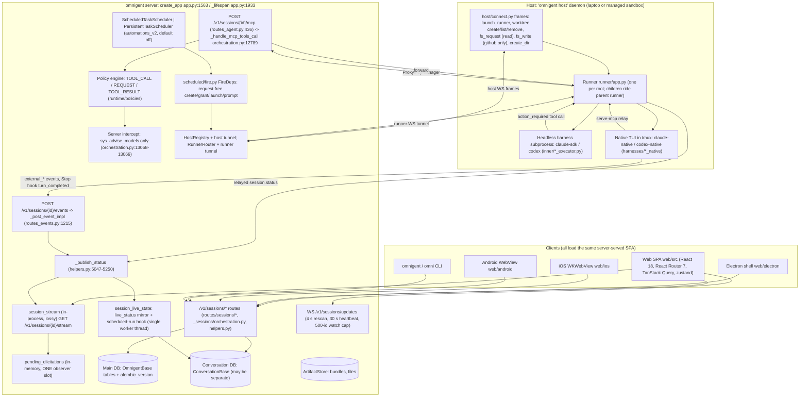
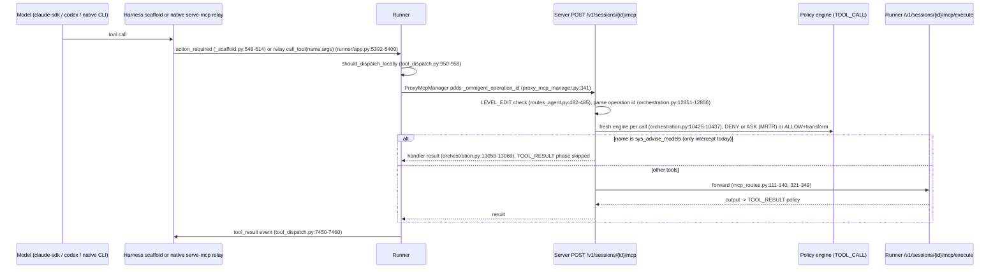

# Coral on Omnigent: Current-State Architecture (consolidated)

Consolidation lead, phases 2-3. Repository `omnigent-ai/omnigent`, HEAD `2a9cbe2c2` (0.22.0.dev0, committed 2026-11-08). Date 2026-11-11.

**Inputs.** The ten specialist findings files in this directory (`product.md`, `architect.md`, `adversarial.md`, `eng_sessions.md`, `eng_tools.md`, `eng_persistence.md`, `eng_harness.md`, `eng_workspace.md`, `eng_web.md`, `eng_testing.md`), read in full. Also read: `coral-design.md` (Draft 4, in full), `CORAL_WORKFLOW_ENGINE_DEEP_DIVE.md` §3 (F1-F50), §4 (S1-S40), §5.5 (V1-V13), §19-§20, and the heading map of `coral_UI_DESIGN_LANGUAGE.md`.

**Companion file.** `gap_analysis.md` in this directory holds the capability gap table, the unified seam ledger, disagreements, discrepancies and open questions.

## Evidence conventions

| Marker | Meaning |
|---|---|
| **[V]** | I re-opened this `path:line` at HEAD during consolidation. |
| **[sp:x]** | Verified at HEAD by specialist *x*, not re-opened by me. Specialists: arch, adv, prod, sess, tools, pers, harn, ws, web, test. |
| **UNVERIFIED** | No specialist and not me could confirm it from code. |
| **D§n / DD§n / UI§n** | Sections of the design doc (Draft 4), the deep dive and the UI design language doc. |

Where specialists cite slightly different line ranges for the same symbol (drift of 1-6 lines), I give the union.

---

## 0. Executive summary

1. **The deep dive's code facts hold at HEAD.**
   - Three specialists independently spot-checked about 120 references: arch re-checked ~45, adv 30, harn all F-rows in its area. None found a wrong load-bearing claim.
   - Several are **refined**, and seven **deep-dive positions are wrong or incomplete** (§13.2). The main ones:
     - Tool-call idempotency cannot use the harness `call_id`.
     - Per-decision tool schemas cannot work.
     - Root spec guardrails do not leak to children with their own agent rows.
     - The server **can** read host files through a host frame.
     - `create_app(extra_routers)` is never wired by the shipped CLI.
     - Release tags are not ancestors of `main`.
2. **Draft 4 still asserts six things that are false at this commit** (D1).
   - They are:
     - the "fail-closed sub-agent router";
     - `PersistentTaskScheduler` for timers and signals;
     - web push;
     - `cost_budget` pausing a run;
     - `sys_cancel_task` doing nothing;
     - sandbox network on/off only.
   - It adds new false or misleading claims: headless `codex` "gates tool calls", read-only reviewers via `read_only_os`, evidence "on the merged result", and per-agent "branches of the run's worktree".
3. **Omnigent already provides most runtime primitives Coral needs.**
   - These include:
     - sessions with labels and idempotent creation;
     - request-free orchestration (the `fire.py` precedent);
     - a single MCP chokepoint with TOOL_CALL policy;
     - elicitations and approval UI;
     - host worktree frames;
     - a host file-read frame;
     - per-session usage;
     - a capability model and harness bench;
     - an SPA with React Flow, Monaco, approval cards and an embeddable full-session transcript.
   - What is missing is everything that holds a multi-step process to a contract:
     - durable run state;
     - a signal and timer queue;
     - turn-end facts per mode;
     - engine tools;
     - durable gates;
     - workspace fingerprints;
     - roster and rule enforcement per mode;
     - workflow storage and editor;
     - the run view;
     - brand.
4. **Every integration point Coral needs lands in Omnigent's hottest files.**
   - 30-day commit counts:

     | File | Commits |
     |---|---|
     | `orchestration.py` | 77 |
     | `claude_native/bridge.py` | 83 |
     | `app.py` | 64 |
     | `host/connect.py` | 62 |
     | `runner/native/orchestration.py` | 56 |
     | `helpers.py` | 52 |
     | `NewChatDialog.tsx` | 52 |
     | `Sidebar.tsx` | 51 |

   - Low-churn homes exist for registries: `session_live_state.py` (3), `pending_elicitations.py` (1), `harness_capabilities.py` (0), `db/migrations/env.py` (0) and `web/src/lib/branding.ts` (0).
5. **Turn-end truth is weak today.**
   - `_publish_status` maps **every** idle edge to scheduled-run "succeeded" [V `helpers.py:5158-5159`]. That includes stops, archives, policy denies, forward failures and transcript lulls.
   - Only claude-native sends a confirmed `turn_completed`.
   - Two edges bypass `_publish_status` entirely.
   - Coral must build its own turn-end rule from durable transcript evidence plus per-mode confirmations.
6. **`claude-sdk` is the only mode where Coral can label tool rules Enforced today.**
   - Its base tools are only `Skill`, `ToolSearch` and an optional `AskUserQuestion` [V `claude_sdk_executor.py:2571-2586`].
   - Workspace tools are `sys_os_*` and are gated server-side.
   - Native modes fail to ASK [V `claude_native/hook.py:1238-1242`].
   - Headless codex runs its own shell under `approvalPolicy: "never"`.
7. **No push channel exists anywhere** (web, Electron, iOS, Android). Unattended gates are seen only while an app is open.

---

## 1. Process topology

Evidence for this diagram:

- `create_app` and `_lifespan`: `app.py:1563-1611, 1933-2260` [sp:arch]. `extra_routers` are mounted at `app.py:5308-5311` [V].
- MCP endpoint and handler: `routes_agent.py:436-567`; `orchestration.py:12789-13069` [sp:tools]. The intercept and its operation id are at `orchestration.py:12851-12856` [V].
- `_publish_status`: `helpers.py:5047-5250` [sp:sess].
- Single elicitation observer: `pending_elicitations.py:66-87` [V].
- Host fs frames: `connect.py:3793-3891, 6017-6040` [V]; `frames.py:1148-1214` [V].
- Clients load the server SPA: `web/electron/README.md:98-112`; `web/ios/README.md:1-5` [sp:web].

---

## 2. Subsystem map

Churn is commits in the 30 days to 2026-11-08/09 (≈1,510 commits on HEAD's lineage). Measured independently by arch, adv, test and web, and they agree within ±2.

| # | Subsystem | Responsibility | Key files (lines) | Extension points today | Churn (30 d) | Coral relevance |
|---|---|---|---|---|---|---|
| 1 | App composition and lifespan | Build stores, routers, scheduler, reapers, observers | `server/app.py` (5,525); `cli.py` (14,959) | `create_app(extra_routers, policy_modules, debug_router_modules, scheduled_task_dispatch, feature_flags)` `app.py:1563-1611`. **No generic lifespan or worker hook.** CLI passes only `policy_modules` and `debug_router_modules` [V `cli.py:5118-5150`]. `debug_router_modules` silently skips import failures (`app.py:1679-1685`) [sp:adv]. | app 64; cli 36 | Mount Coral API and workers (S32 refined) |
| 2 | Session routes and orchestration | Create, fork, events, elicitations, runner launch and relaunch, MCP proxy | `_sessions/orchestration.py` (14,185); `_sessions/helpers.py` (12,742); `sessions/routes_core.py` (5,296); `routes_events.py` (4,293); `routes_agent.py` (571) | One hard-coded intercept `orchestration.py:13058-13069`. Facade re-exports in `routes/sessions/__init__.py:370-689` [sp:adv]. `_post_event_impl` handle via `register_startup_dispatch`, dropped when no managed sandboxes [V `app.py:3815-3819`]. | 77 / 52 / 42 / 41 / 4 | Request-free session ops, engine tools, dispatch |
| 3 | Live status and turn edges | Status cache, DB mirror, scheduled-run completion | `_publish_status` `helpers.py:5047-5250`; `server/session_live_state.py` (500) | `session_live_state.configure(store, scheduled_task_store)` `:90-110` (one hard-wired hook). Child fan-out `_publish_child_status_to_parent` `helpers.py:4931-4961` [sp:sess]. | helpers 52; live_state 3 | S1 observer registry |
| 4 | Session live stream | In-process SSE fan-out; lossy | `runtime/session_stream.py` (618) | `publish`/`subscribe` only; 1024-event queue cap `:54` [sp:adv] | 6 | Never a source of truth |
| 5 | Runner | Harness subprocesses, tool dispatch, native relay, timers | `runner/app.py` (9,387); `runner/tool_dispatch.py` (9,478); `runner/native/orchestration.py` (11,493) | `_ALL_LOCAL_TOOLS` `tool_dispatch.py:888-915`; `_NATIVE_RELAY_BUILTIN_TOOLS` `:488-518`; per-conversation tool cache [V `runner/app.py:5910-5935`] | 62 / 24 / 56 | Engine-tool forwarding, observation hooks |
| 6 | Native harness bridges | claude-native and codex-native TUIs, hooks, forwarders | `harnesses/claude_native/{bridge.py 11,463, forwarder.py 8,254, hook.py}`; `harnesses/codex_native/{forwarder.py 10,109, app_server.py 5,753, hook.py}`; `native/native_policy_hook.py` (824) | Hook output builders `native_policy_hook.py:474-586`; fail-ask at `claude_native/hook.py:1238-1242` [V] | 83 / 23 / 28 / 34 / 1 | S14-S16; turn-end; `/clear` rotation |
| 7 | Headless executors | claude-sdk and codex event models | `inner/executor.py` (event model `:116-375`); `inner/claude_sdk_executor.py` (4,027); `inner/codex_executor.py` (5,263) | `HarnessCapabilities` (`harness_capabilities.py`, 184) | 20 / 11 / caps 0 | Default mode claude-sdk; S13, S17-S20, S24 |
| 8 | Tool surface | ToolManager registration of builtins | `tools/manager.py:159-193`; `tools/builtins/*`; `tools/base.py:64-134` | Schema-only precedent `advise_models.py:1-155`; `_SchemaOnlyTool` `manager.py:59-93` [sp:tools] | 4 | Engine tool classes |
| 9 | Policies | Engine, builder, registry, CRUD, builtins | `runtime/policies/engine.py`, `builder.py` (1,919); `server/routes/session_policies.py`; `policies/registry.py`; `policies/builtins/*` | `POLICY_REGISTRY` modules via config `policy_modules` (`registry.py:90-215`; `app.py:2046`); `_REQUIRED_APPROVAL_SPECS` `builder.py:76-104` | engine 2; builder 6; CRUD 0 | `coral.policies`; required-policy provider |
| 10 | Elicitations and approvals | Parking, resolving, pending index, approve page | `orchestration.py:470-640` (park), `:2400-2559` (`_resolve_elicitation`), `:2654` (native ask gate); `runtime/pending_elicitations.py` (420); `routes_elicitations.py` | Single observer slot used by `SubagentBlockNotifier` (`orchestration.py:10800-10861`; `app.py:1986-1999`) [sp:tools] | 1 | Durable gates (S5/S6) |
| 11 | Scheduler and fire | Recurring tasks; request-free orchestration | `server/scheduled/fire.py` (2,801); `dispatch_scheduler.py` (1,053); `run_reconciler.py` | `ScheduledTaskDispatchHooks`; `FireDeps` `fire.py:215-252`; `StartupLease` `dispatch_scheduler.py:152-347` | 24 / 16 | Template for `coral.omni` and the work queue; **not** reusable as the queue |
| 12 | Persistence | SQLAlchemy stores, Alembic, multi-backend | `db/db_models.py` (1,772); `db/utils.py` (1,562); `db/migrations/env.py` (97); `stores/*` | `make_named_managed_session_maker`, `run_write_transaction` `utils.py:982-1082`; `get_or_create_engine` `:462-486` | 12 / 1 / 0 | Separate Coral Alembic env |
| 13 | Agents, bundles, profiles | Spec parsing, bundles, reusable user agents, seeding | `spec/parser.py` (4,149); `spec/types.py` (1,667); `server/bundles.py` (377); `routes/builtin_agents.py` (626); `server/agent_config.py`; `server/seeded_agents.py` | `/v1/agents` install, list, detail, config, PATCH (ETag), delete; `OMNIGENT_BUILTIN_AGENT_DIRS` `app.py:1135-1205`; `uploaded_agent_for` `bundles.py:324-377` | 3 / 4 / 5 / 7 | Profiles = agent rows + pins |
| 14 | Hosts, worktrees, host fs | Host WS, launch frames, git worktrees, fs read | `host/connect.py` (6,387); `host/frames.py`; `host/git_worktree.py` (795); `routes/_host_worktree.py` (357); `routes/_host_filesystem.py`; `managed_hosts.py` (4,870) | `create_worktree_on_host` `_host_worktree.py:190-257`; `read_workspace_from_host` [V `_host_filesystem.py:59-139`]; capability tokens `frames.py:90-109` | 62 / 25 / 2 / – / – / 17 | Run worktrees, workflow file reads, S40 |
| 15 | Feature flags | Closed enum, process snapshot | `server/feature_flags.py` (265) | `Feature` enum `:23-42`; unknown names fail startup `:222-265` | 18 | Enablement (S33 or Coral-owned) |
| 16 | Capabilities and bench | Mode declarations, probes | `harness_capabilities.py`; `harness_plugins.py:356-757`; `tests/harness_bench/*` | Optional fields default None `harness_capabilities.py:155-158`; `ALL_PROBES` (12) | 0 / 4 | S22/S23 |
| 17 | Web shell | Routes, sidebar, chat store | `web/src/App.tsx` (272); `shell/AppShell.tsx` (3,202); `shell/Sidebar.tsx` (7,772); `shell/NewChatDialog.tsx` (8,052); `store/chatStore.ts` (9,924) | Lazy routes inside `<Route element={<AppShell/>}>` (`App.tsx:181-257`) [V]; `FeatureGatedPage` `App.tsx:73-86`; `ExtensionPrimaryNavigation` slot | 6 / 41 / 51 / 52 / 43 | Routes, nav, brand |
| 18 | Web live data | Session-updates socket, SSE, stream slots | `hooks/SessionUpdatesProvider.tsx:258-298`; `lib/sse.ts`; `store/streamSlots.ts`; `store/conversationRegistry.ts:64-84` | Child-session watch path (automatic for mounted `useChildSessions`) | 5 | Run view live data |
| 19 | Inbox, notifications, approvals UI | Inbox kinds; approval cards; OS notifications | `pages/InboxPage.tsx` (1,240, closed union of 4 kinds `:189-193`); `components/blocks/ApprovalCard.tsx` (`ElicitationCard` at `:1080`); `hooks/useIdleNotifications.ts`; `lib/browserNotifications.ts` | `SubmitApprovalFn` injection; automation inbox precedent | 13 / 14 / 1 | Gate UI; workflow inbox kind |
| 20 | Theme and brand | Palettes, tokens, branding config | `lib/themePalette.ts` (`omni` slot `:216-295`) [V `:217-218`]; `index.css` (2,983); `lib/branding.ts` [V `:4-5`]; `components/BrandLogo.tsx` | Operator `branding:` block (`deploy/README.md:669-690`); palette generator with pre-commit check | 4 / 27 / 0 / 0 | Brand skin |
| 21 | Native shells | Desktop and mobile wrappers | `web/electron/{package.json, src/main.js 6,234, setup/index.html}`; `web/ios/*`; `web/android/*` | none | main.js 36 | Rebrand, updater, deep links |
| 22 | Test and CI infrastructure | Lanes, fixtures, mock LLM, bench | `tests/conftest.py`; `tests/server/conftest.py`; `tests/e2e/*`; `.github/workflows/ci.yml`; `.github/scripts/ci/python-matrix.json` | `misc` catch-all group; DB lanes run `tests/stores tests/db` | conftest 9 | Coral test tiers |

**Placement rule.** A seam in a hot file is a one-line call. The logic lives in a low-churn registry module or in `coral/`. Five specialists (arch, adv, sess, test, web) and DD§17 agree on this rule.

---

## 3. Core execution paths

### 3.1 Session creation

**HTTP path (not reusable without a FastAPI `Request`).**

1. `_create_session_from_existing_agent(..., request: Request, ...)` (`orchestration.py:11631-11647`) reads `request.app.state` and headers, e.g. `prepare_create_inference(request, …)` at `:12025-12032` [sp:sess].
2. Child sessions:
   - inherit `parent.runner_id` with an owner check (`orchestration.py:12034-12052`);
   - get `kind="sub_agent"` (`:12331`);
   - must use the parent's host (`schemas.py:1594-1600`);
   - inherit its sandbox profile (`schemas.py:1540-1541`) [sp:arch].
3. A child create without `host_id` stores `workspace` unvalidated (`orchestration.py:12072-12082`) [sp:ws].
4. Child bundle uploads mint a fresh agent row per session (`orchestration.py:12617-12735`) [sp:harn, sp:adv].
5. The route then:
   - sends the runner session-init envelope;
   - grants owner;
   - launches only if `runner_id is None`;
   - announces (`routes_core.py:1257-1440`) [sp:sess].

**Request-free precedent (`scheduled/fire.py`, Reuse pattern).**

| Step | Code | Notes |
|---|---|---|
| Dependencies | `FireDeps` `fire.py:215-252`, built in `_lifespan` `app.py:2093-2115` | |
| Validate | `validate_session_agent`, `validate_existing_host_workspace`, `validate_session_model_metadata` (`_session_create_validation.py:97, 153, 337`); `validate_create_harness_readiness` (`_session_harness_readiness.py:23`) | All request-free |
| Worktree | `create_worktree_on_host(...)` inside `_create_session_resources` (`fire.py:1597-1641`); rollback `_remove_session_worktree_best_effort` (`fire.py:1673-1691`) | |
| Row | `conversation_store.create_conversation(...)` | Accepts a caller-chosen `conversation_id` and raises `ConversationAlreadyExistsError` on reuse [V `conversation_store/__init__.py:542-566`; `sqlalchemy_store.py:1145-1156`] |
| Grant | `_grant_owner` (`fire.py:1793-1809`) | |
| Policies before input | `_attach_cost_budget` pattern with deterministic `policy_id` (`fire.py:1695-1790`) | |
| Launch | `resolve_host_launch` → `_launch_runner_on_host` → `_wait_for_runner_client` (`fire.py:2025-2076`; `helpers.py:6416-6486, 5964-6000`) | |
| Send | Direct `_dispatch_session_event_to_runner` (`orchestration.py:8164-8184`) | Skips three things that only `_post_event_impl` does: REQUEST-phase input policy (`routes_events.py:1706, 1777`), the `omnigent.closed` refusal (`:1688-1698`) and the sub-agent runner heal [sp:sess] |
| Recovery without resend | `_transcript_evidence`/`_delivered_run_outcome` (`fire.py:2541-2577`); `_inspect_startup` (`fire.py:2687-2715`) | |
| Unattended preflight | `session_unattended_disallowed_mode`, `_unattended_permission_problem` (`fire.py:958-997`) | [sp:adv] |

**Ambient scopes every background worker must enter.** Copy this order exactly (`fire.py:567-586`) [sp:sess, sp:adv]:

1. `workspace_scope(ws)` (`db_models.py:146-157`)
2. `account_authority_scope(user, gen)` (`db/account_authority.py:79-90`)
3. `host_owner_scope(user, gen)` (`server/host_registry.py:66-73`)

Missing one is a silent no-op at workspace 0, not an error (`session_live_state.py:123-145`).

**Idempotent message send.**

- Headless: `_forward_event_to_runner` persists under the client `stable_id` (`orchestration.py:7287-7308`). An exact retry is **still forwarded** to the runner ("A persisted retry may still need forwarding", `:7299-7303`).
- Native: maps `stable_id` to a pending input (`orchestration.py:8317-8390`).
- Recovery must read before resending (precedent `orchestration.py:3131-3137`) [sp:adv, sp:sess].
- `created_by` cannot tell engine from user: it is the owner, or `None` in single-user mode (`entities/conversation.py:894-903`).

### 3.2 Tool call: model → runner → MCP endpoint → policy → handler

**Facts that shape Coral's engine tools.** All are [sp:tools] unless marked.

- **Caller identity.** The session id comes from the URL. Any credential with `LEVEL_EDIT` can call `/mcp`, and the intercept does not prove the call came from the session's runner.
  - The runner-proof precedents are `require_orchestration_source` (`session_orchestration.py:80-109`) and `_require_cost_control_label_authority` (`helpers.py:11002-11045`).
  - The latter skips the check on single-user servers (`:11017-11019`).
- **Idempotency.** The server receives `_omnigent_operation_id`, a uuid4 per proxy call, not the harness `call_id` [V `proxy_mcp_manager.py:341`; `orchestration.py:12851-12856`].
  - A model retry after a timeout is a **new** call (adv C22).
- **Tool surface is fixed per conversation.**
  - The runner caches tool schemas per conversation [V `runner/app.py:5910-5935`].
  - Headless Codex restarts its app session when the tool signature changes (`codex_executor.py:5225-5246`).
  - The native relay surface is built at launch (`runner/app.py:5364-5400`).
- **Per-mode exposure.**
  - claude-sdk: in-process SDK MCP server `omnigent`, with tools named `mcp__omnigent__<name>`. Pre-approved in `auto` (`claude_sdk_executor.py:2929-2945`), but possibly deferred behind `ToolSearch` (`:2570-2585`).
  - Headless codex: `dynamicTools` + `experimentalApi` (`codex_executor.py:3289, 3826-3847`).
  - claude-native and codex-native: stdio relay through the static allowlist, with pre-approval lists at `native/orchestration.py:8807-8871, 9819-9846` and `codex_native/app_server.py:306-379`.
- **Timeouts.** `MCP_PROXY_CALL_TIMEOUT_S` is 7260 s, and the forward is ≤ 7230 s (`tool_dispatch.py:208, 228-229`).
- **Other policy paths.**
  - Harness pre-evaluation `POST /sessions/{id}/policies/evaluate` fails closed on TOOL_CALL (`runner/policy_proxy.py:72-111`) [sp:arch, sp:harn].
  - Native PreToolUse hooks fail to ASK [V `claude_native/hook.py:1238-1242`].
  - Early "no opinion" returns are fail-open: malformed JSON, or a missing session id (`hook.py:1208-1222, 1255-1258`) [sp:adv].
  - Hooks are skipped for `mcp__omnigent__*` (`native_policy_hook.py:331-336`).

### 3.3 Status edge → `_publish_status` → observers

**Order inside `_publish_status`** (`helpers.py:5047-5250`) [sp:sess]:

1. A sticky `failed` drops a trailing idle unless `turn_completed` (`:5117-5126`).
2. `previous_status` is read from the per-replica in-memory cache (`:5127`).
3. Cache write, then `_publish_child_status_to_parent` on change (`:5128-5131`).
4. PR `notify_turn_end` (`:5132-5135`).
5. `persist_live_status`, best-effort (`:5139-5140`).
6. Hard-wired scheduled-run completion: any `idle` → "succeeded" [V `:5150-5160`].
7. Response-id cache, then the SSE publish (`:5203-5250`).

**Facts about the edges.**

- The function is synchronous, runs on the event loop, and runs inside the caller's `workspace_scope`.
- `turn_completed` and `response_id` exist **only on the edge**. They are not persisted on the row (`helpers.py:5061, 5250`) [sp:arch].
- **Call sites:** 18 server sites in 4 files, inventoried with their real meaning (`eng_sessions.md` §4.2). Many idle edges are not turn ends:
  - stop or idle shutdown (`orchestration.py:944, 4319, 9212`);
  - policy deny before dispatch (`routes_events.py:1768, 1802`);
  - forward failure (`orchestration.py:7896`; `helpers.py:8252`);
  - transcript lull (`routes_events.py:2596`).
- **Archive** publishes `idle` with `persist_live_status=False` (`helpers.py:5133-5135`; `routes_core.py:4098-4108`), and the scheduled hook still records "succeeded" [sp:adv C1].
- **Bypasses:**
  - **B1** `_publish_runner_recovered_status_impl` (`orchestration.py:4087, 4131-4152`). It is also reached by the relay when a turn the server had written off completes (`:9560-9582`), which is a **real turn end the hook never sees**.
  - **B2** runner status probe (`orchestration.py:13700-13708`), a sample rather than an edge [sp:sess, sp:adv].
- **Live-state writes** all run on one `ThreadPoolExecutor(max_workers=1)` (`session_live_state.py:148-158`) and are dropped on failure. A Coral observer must enqueue cheaply and do its own I/O elsewhere [sp:adv C2].

**Turn end per mode** [sp:sess, sp:harn]:

| Mode | Edge reaching the server | Completed vs interrupted? | `turn_completed` |
|---|---|---|---|
| claude-sdk | Runner `_publish_turn_status` → relay row 13 | **No.** Interrupted and completed both give `idle` (`runner/app.py:4277-4323`). Relay sees `response.completed/cancelled` but does not tie them to the edge (`orchestration.py:9454-9473`). | never |
| codex | Same runner path | No | never |
| claude-native | `external_session_status` from the Stop hook (`forwarder.py:4712-4722`) → `routes_events.py:2689-2710` | Interrupt fires no Stop hook | Stop idle only |
| codex-native | `external_session_status` from `turn/completed` (`codex_native/forwarder.py:8273-8395`) | Partly (separate `external_session_interrupted`) | **never** (S2) |
| cursor-native (reference) | sends `turn_outcome` | yes | n/a |

Native executors' `TurnComplete` is a **delivery receipt**, not a completion (`claude_native_executor.py:553`; `codex_native_executor.py:1336-1337`) [sp:adv, sp:harn].

The runner already has a turn-outcome classifier for native sub-agents (`runner/app.py:7535-7610`; `server/subagent_activity.py:37-53`) [sp:sess].

**Durable truth today.** Only `conversations.live_status` and the transcript items are durable.

- The scheduler's rule is: idle **and** the newest non-bookkeeping item is an assistant reply (`fire.py:2540-2577`).
- "There is deliberately NO startup sweep and NO periodic poll" (`run_reconciler.py:30-33`) [sp:arch].

### 3.4 Elicitation and approval flow

| Element | Behaviour at HEAD | Coral verdict |
|---|---|---|
| Pending index | `record_publish` runs on every `session_stream.publish` (`session_stream.py:354-398`). In-memory, per process (`pending_elicitations.py:1-59`). Counts persisted for other replicas (`app.py:2618`; `session_live_state.py:312-338`) [sp:tools] | Gates need their own durable rows; re-publish at startup |
| Observers | **One** `_observer` slot, `set_elicitation_observer` replaces [V `pending_elicitations.py:66-87`]. Occupied by `SubagentBlockNotifier`. No exception isolation (`:183-198`) [sp:tools] | S5: list plus isolation |
| Parent wake | `SubagentBlockNotifier` wakes the **parent agent** after a child's approval is unanswered for 120 s [V `subagent_block_notifier.py:50-55, 290-300`] | With child step sessions this starts orchestrator turns. Needs a seam (S51) |
| Parked harness elicitations | `_publish_and_wait_for_harness_elicitation(request, …)` needs a FastAPI `Request`; parks an in-process Future; returns `None` on timeout (`orchestration.py:470-640`; futures `_elicitation_registry.py:21-28`) | Not for gates |
| Publish without park | `mcp_elicitation` event branch: creates `elicit_<hex>`, publishes, mirrors to ancestors, returns id; the verdict comes later (`routes_events.py:2222-2257`) | Lift into a request-free helper (S6a) |
| Resolution | `_resolve_elicitation(session_id, data, …)` (`orchestration.py:2400-2559`). Callers: `POST /events approval` (`routes_events.py:2208-2221`) and `POST …/elicitations/{eid}/resolve` (`routes_elicitations.py:75-131`, `ELICITATION_RESOLVE_LEVEL = LEVEL_EDIT` at `:55-61`). **Neither passes the resolving user** | S6b: verdict handler plus resolver identity |
| Schemas | `ElicitationRequestParams` with `extra="allow"` (`schemas.py:4585-4643`); `ElicitationResult.action ∈ accept/decline/cancel` (`schemas.py:1332-1376`) | Gate metadata in `extra` |
| Policy ASK timeout | Timeout → `False` → DENY (`approval.py:142-146`); default `ask_timeout` 86400 s (`spec/types.py:40`); native ASK gate the same (`orchestration.py:2654-2690`) | Never build gates on policy ASK |
| UI | `/approve/:sessionId/:elicitationId` [V `App.tsx:180`] reads the in-memory index (`routes_elicitations.py:133-207`); `ApprovalCard` and `ElicitationSchemaForm` (enum → select, boolean, number, text) | Reuse; stable elicitation ids keep links valid after restart |

### 3.5 Scheduler and fire: request-free precedent, not a queue

- **Which scheduler runs.** `PersistentTaskScheduler` is built only when `automations_v2` is on (`app.py:2116-2143`). That flag defaults off [V `feature_flags.py:54, 97-104`; `review_by_release="0.20.0"`, overdue at 0.22].
- **Store protocol.** About 16 methods, typed on `ScheduledTask`/`ScheduledTaskRun` (`stores/scheduled_task_store/dispatch.py:8-138`).
- **Semantics.**
  - At-most-once: "Recovery never sends the prompt again" (`scheduled/README.md:147`).
  - Polls every 30 s (`scheduled/config.py:14`).
  - Refuses D1 (`sqlalchemy_store.py:1186-1194`).
- **Reusable patterns** [sp:pers]:
  - `StartupLease` (`dispatch_scheduler.py:152-347`);
  - lock-and-recheck claims (`scheduled_task_store/sqlalchemy_store.py:1304-1335, 1393-1457, 1518-1544`);
  - cross-workspace keyset discovery (`:1245-1268`; `_cursor_after` at `:1040-1063`);
  - host-ownership sharding (`dispatch_scheduler.py:374-375, 924-941`).

### 3.6 Runner loss, host offline, relaunch, reapers

| Event | Behaviour (all [sp:sess] unless marked) |
|---|---|
| Tunnel drop | 90 s grace (`RUNNER_DISCONNECT_GRACE_S`, `orchestration.py:8620`) via `_mark_disconnected_runner_failed` (`app.py:4049-4235`). Grace timers are in memory (`app.py:4036-4041`) and lost on server restart. |
| User host offline mid-turn | Held up to 72 h (`HOST_OFFLINE_HOLD_S`, `orchestration.py:8636-8641`), with **no edge while held**. The old turn may resume when the laptop wakes. |
| Host returns | Roots only are relaunched [V `app.py:4273`]. "Only the user's next message starts new work". The interrupted input is not replayed (`app.py:4259-4264`). |
| Children | `restore_active_children` rebinds interrupted descendants to the parent's recovered runner without replay, and skips children with their own `host_id` (`child_session_recovery.py:111-200, 165`) [sp:arch]. A child with `host_id` counts as independent on reconnect [V `app.py:4596-4597`] and is relaunched onto its own runner (`orchestration.py:5212-5288`; `tests/server/integration/test_session_host_launch.py:4880-4919`). |
| Stop | `stop_session` stops the host runner only if the session owns it (`_owns_host_runner` [V `helpers.py:6260`]). Non-sticky: the next message relaunches (`routes_events.py:1279-1286`). Sticky refusal needs the `omnigent.closed` label (`util/session_lifecycle.py:7-8`; `routes_events.py:1688-1698`). |
| Interrupt | Headless interrupt **discards the vendor session** (`claude_sdk_executor.py:2291-2321`; `codex_executor.py:5045-5076`). claude-native interrupt is an unconfirmed Escape with a 20 s grace (`runner/native/interrupt.py:329-334, 416-424`). |
| Reapers | SDK process manager 1 h, skips in-flight (`process_manager.py:131, 1591-1603`). Runner watchdog 1 h, `has_active_work` covers turns and pending approvals (`runner/_entry.py:162-199`; `runner/app.py:1616-1669`). Native pane reaper, with sub-agent panes capped (`pane_reaper.py:85-87, 140-157`). Managed `keep_warm_s` keyed by runner pongs only (`managed_host_keepalive.py:137-276`). All deployment-wide [sp:ws]. |
| Managed sandbox wake | `retry_session` wakes a sleeping sandbox (`routes_events.py:1287`; commit `f726587bb`) [sp:arch]. Non-resumable providers (modal, e2b) relaunch a new generation that re-clones create-time refs (`managed_hosts.py:353-366, 4062-4078`) [sp:ws]. |

### 3.7 Native `/clear`, fork and supersession

- **claude-native `/clear`.** `_rotate_session_on_clear` → `_create_clear_replacement_session` (`claude_native/hook.py:419-635`) creates a **top-level** session.
  - It copies **all labels** and carries **no session policies** [V `native/_native_supersession.py:24-51`: body has only `agent_id`, `labels`, title and project].
  - It then rebinds the runner and transfers the terminal [sp:adv, sp:sess].
- **codex-native.** Rotation on `thread/started` (`codex_native/forwarder.py:2901-3030`).
- **Fork.** `_fork_session` copies labels minus a drop set (`routes_core.py:4527-4544`).
  - `_continue_session_in_fork` is a closure that requires a `Request` and `LEVEL_OWNER`.
  - It refuses `kind == "sub_agent"` [V `routes_core.py:5013-5017`] and side chats.
  - It creates a new top-level session (`conversation_store/__init__.py:2239-2240`) [sp:arch].
- `SupersessionReason = Literal["clear"]` [V `schemas.py:4209`].

---

## 4. Policies and capabilities

**Policy engine** [sp:tools]:

- **Build order:** session (CRUD) → agent spec guardrails → admin defaults → `_REQUIRED_APPROVAL_SPECS` (`builder.py:613-654, 76-104`).
- **Evaluation:** DENY short-circuits, ASK accumulates, and exceptions fail closed (`engine.py:243-433, 1111-1116`).
- **Caching:** the engine is rebuilt for every MCP evaluation (`orchestration.py:10425-10437`), and the session-policy cache has a 30 s TTL per replica.
- **Inheritance:**
  - Root **session** policies are prepended for every child [V `builder.py:756-768`].
  - Child spec guardrails are appended only for `sub_agent_name` children of the root bundle (`builder.py:482-516, 728-751`).
  - The policy engine loads the spec from `conv.agent_id` (`helpers.py:9352-9374`).
  - So **an engine-created child with its own agent row does not inherit the orchestrator's spec guardrails** [sp:adv C21, sp:tools D8].
- **Labels:**
  - Policy `set_labels` go through `apply_label_writes` with no reserved-prefix check (`engine.py:521-547`).
  - Reserved label seeds are refused at create and PATCH by `_reject_server_reserved_label_seed` (`helpers.py:10884-10940`; `routes_core.py:3166-3167`). There is no `coral.` prefix.
  - Precedent for a server-owned prefix: `sandbox_profile:` (`sandbox_profile_store.py:16-26`) [sp:arch].
- **Session-policy CRUD:** `LEVEL_EDIT`, registry allowlist for python handlers, no name protection (`session_policies.py:158-437`).
- **Useful builtins:**
  - `cel_policy`;
  - `blast_radius`;
  - `spawn_bounds`;
  - `worktree_guard`;
  - `read_only_os` (denies write and edit only; "shell commands are left untouched" [V `policies/builtins/orchestration.py:645-660`]);
  - `cost_budget` (ASKs at soft thresholds, DENYs at the cap, and **ASKs on unpriced usage** although its docstring says DENY [V `cost.py:500-512`]);
  - `subagent_cost_budget`.
- **Run-level spend.** Tree spend helpers `load_session_usage*` (`builder.py:1263-1375, 1437-1494`) prefer `policy_cost_usd` and fall back to `total_cost_usd`.

**Capabilities declared** (`harness_plugins.py:358-386, 591-614`) [sp:harn]:

| Field | claude-sdk | codex | claude-native | codex-native |
|---|---|---|---|---|
| integration_mode | sdk-in-process | cli-subprocess | native-tui | native-tui |
| subagents | False | False | True | True |
| steering / live_queue / compaction | None | None | None | None |
| instruction_delivery | composed-session-snapshot | composed-per-turn | agent-startup-additive | agent-startup-additive |

- `GET /v1/harnesses` drops the native Claude and Codex rows from `harness_catalog()` (`harness_plugins.py:941-953, 1275-1283`) [sp:harn].
- The bench has 12 probes, with no probes for steering, live_queue, resume, images or compaction (`tests/harness_bench/README.md:234-235`).

**Coral-relevant behaviour per mode (verified by harn and adv).**

| | claude-sdk | codex | claude-native | codex-native |
|---|---|---|---|---|
| Pre-call gating of workspace tools | All (only `sys_os_*`) | Omnigent tools only; shell/`apply_patch` observed after the fact; web search ungated (`codex_executor.py:2774-2834, 3829, 4768`) | Hook catch-all, if hooks are installed (`ap_server_url`, `bridge.py:2651`) | Hook catch-all unless hooks are disabled (`app_server.py:2441-2448`) |
| Gate failure mode | DENY (`policy_proxy.py:99-111`) | DENY for Omnigent tools | ASK; early returns fail open | ASK |
| Vendor sub-agents reachable | No (Agent/Task not in base tools; runtime UNVERIFIED) | Yes | Yes | Yes |
| Sandbox / egress scope | Helpers only; the CLI runs outside the network sandbox (`claude_sdk_executor.py:1601-1607`) | Codex sandbox, **read-only silently upgraded to workspace-write when tools exist** [V `codex_executor.py:5245-5247`] | Whole TUI inherits `os_env.sandbox` and `egress_rules` (`runner/native/orchestration.py:9880-9890`) | TUI inherits; app-server wrap UNVERIFIED |
| Unattended stance | `permission_mode` default `auto` (`claude_sdk_harness.py:135`) | `approvalPolicy: "never"` | `--permission-mode` from config | **Default `--dangerously-bypass-approvals-and-sandbox` for child creates** [V `helpers.py:10645-10660`] |
| Usage-limit signal | none | explicitly ignored (`codex_executor.py:4569-4576`) | StopFailure category (telemetry) | `codexErrorInfo` (surface only) |
| Context window | tokens; window via server lookup | tokens; window UNVERIFIED | statusLine labels | tokens; window UNVERIFIED |

- **Router.** "The gate is **advisory**" [V `runner/subagent_routing.py:1-8`]. It is started only for Smart Routing sessions (`runner/app.py:9032-9073`).
- **Egress.** `egress_rules` is a default-deny L7 allowlist (`inner/datamodel.py:753-765`) [sp:adv, sp:ws].
- **Native bridge credential.** claude-native writes a user bearer into the bridge-dir hook config (`runner/native/orchestration.py:9290, 9832`). A same-user native agent's shell could read it and post approvals. claude-sdk scrubs runner secrets from children (`runner/identity.py:88-99`) [sp:tools].

---

## 5. Agents, bundles and profiles

- **Spec dialects** [sp:harn]:
  - single-file compat, marked tech debt (`spec/__init__.py:241-251`);
  - bundle `config.yaml` with `spec_version` (`spec/parser.py:200-367`).
- **Known keys only.** The bundle parser builds `AgentSpec` from known keys only, so unknown top-level keys are silently dropped (`parser.py:339-367`). `params` is passed through verbatim [V `parser.py:290`; `types.py:1612-1614`].
- **Harness selection.** The harness is selectable only through `executor.config.harness`, marked "TECH DEBT ... do NOT extend" (`types.py:544-556, 619`).
- **AgentSpec fields:** `description` `:1607`, `params` `:1614`, `guardrails` `:1645`, `spawn` `:1653` (DD cites older lines) [sp:arch].
- **`os_env` gates the OS tools.** Omitting it registers no `sys_os_*` tools (`tools/manager.py:632-634`) [V]. Session-read tools `sys_session_list/get_history/get_info` are registered for every agent (`manager.py:402-470`) [V `:406-415`].
- **Agent rows** (`db_models.py:196-245`): `kind` server=1/user=2, `bundle_location`, `version`, `created_by`.
- **Install, edit and upload** [sp:harn, sp:arch]:
  - `POST /v1/agents` installs with id `installed_agent_id(owner,name)`; a reinstall updates the row in place.
  - `PATCH /v1/agents/{id}` takes an ETag and moves `bundle_location`. `AgentConfigPatch` has `extra="forbid"` [V `schemas.py:200-208`], so it cannot edit `params`.
  - Uploads bind a content-addressed row via `uploaded_agent_for` (`bundles.py:324-377`; `db/utils.py:1149-1166`). These rows are `kind=user` and **appear in `GET /v1/agents?scope=user`** (`agent_store/sqlalchemy_store.py:523-545`).
- **Revision drift.** Each turn carries `agent_revision`, and the runner rebuilds when it changes (`runner/app.py:8410-8449`). Running sessions follow edits and reinstalls (decision 6, `designs/REUSABLE_USER_AGENTS.md:112`).
  - Drift vectors: PATCH, reinstall, `PUT /v1/sessions/{id}/agent` (`routes_agent.py:289-347`), session MCP edits (`session_mcp_servers.py:169-222`), and `DELETE ?force`.
- **Uploaded bundles** are not `${VAR}`-expanded (`bundles.py:110-117`). CLI installs bake resolved secrets into the blob (`cli.py:6614-6644`) [sp:harn].
- **Auth precedence for claude-sdk** (`runtime/workflow.py:1123-1260`). With no provider and no API key, the CLI uses its own subscription login. The executor strips `ANTHROPIC_API_KEY` (`claude_sdk_executor.py:2091-2118`). `apiKeyHelper` is `printf %s '<key>'` in the spawn env (`workflow.py:1393-1395`) [sp:harn].
- **Seeded agents:**
  - `OMNIGENT_SEEDED_AGENTS` filter (`seeded_agents.py:18-49`);
  - `OMNIGENT_BUILTIN_AGENT_DIRS` (never filtered; `${VAR}` expands server-side) (`app.py:1135-1205`).
- **Web:** `lib/agentsApi.ts`, `hooks/useCustomAgents.ts`, `pages/settings/SettingsCustomAgentsSection.tsx`, `CustomAgentConfigForm.tsx`, behind the default-on `custom_agents_settings_ui` flag [sp:web, sp:harn].

---

## 6. Hosts, worktrees and workspace access

| Capability | Today | Evidence |
|---|---|---|
| Worktree create, list, remove | Host runs git with argv lists, validated refs, a 3,600 s budget, rollback, and `<parent>/<repo>-worktrees/<dir>`. **No merge, commit, reset, fetch or push op.** Result has no HEAD commit. | `git_worktree.py:69-101, 419-448, 493-708, 738-795` [sp:ws] |
| Server proxies | `create_worktree_on_host` and friends; capability token `CAP_WORKTREE_CREATE_BUDGET` | `_host_worktree.py:31-37, 190-357`; `frames.py:90-109` [sp:ws] |
| Session git options | Create and bind modes; managed sessions reject `git` | `schemas.py:1455-1514, 2011-2013` [sp:ws] |
| Host file **read** without a session | `read_workspace_from_host(host_registry, host_conn, op, workspace, session_id, params)` sends `host.fs_request`. Op `list_or_read` reads a file ≤ 10 MiB confined to the workspace root. An absolute file path is read by name. 20 s timeout. Only caller today: `routes_resources.py:1032-1043`. | [V `_host_filesystem.py:25-139`; `connect.py:3793-3840`; `frames.py:1148-1175`] |
| Host file **write** | `host.fs_write_request` serves `github_*` ops only; an unknown op → 400 | `connect.py:4392-4557` [sp:ws] |
| HTTP host FS | `GET /v1/hosts/{id}/filesystem` lists directories only; `POST …/directories` creates | `routes/hosts.py:1561-1745` [sp:ws, sp:prod] |
| Session shell (server-initiated) | `POST /v1/sessions/{sid}/resources/environments/{env}/shell`: owner-only, no policy gate, runner + `os_env` required, 120 s default | `routes_resources.py:3257-3297` → `runner/app.py:8296-8347` → `os_env.py:1056-1074` [sp:ws] |
| Changed files | `GET …/environments/{env}/changes` (git status; "can take seconds") | [V `runner/resource_routes.py:1230-1245`] |
| Orphan reaper | Host sweeps unowned children every 2 s. Worktree handlers pause it. **`fs_request` and `fs_write` run under a plain `asyncio.to_thread`**, so an exit status can be stolen | [V `connect.py:393, 1599-1611, 4580, 6027-6034`] |
| Per-command observation points | `pr_observer` is already called from `sys_os_shell` (`tool_dispatch.py:7297-7307`), headless completions (`_executor_adapter.py:1106-1185`), native PostToolUse relay (`bridge.py:8233-8250`; 1 s curl), managed MCP (`tools/mcp.py:717-726`). Durable outbox precedent `pr_reports.py:52-150`. | [sp:ws] |
| Per-worktree setup | None (grep) | [sp:ws] |
| Session delete with `delete_branch` | Deletes the worktree **and** branch for any session with `git_branch`+`workspace`+`host_id` | `routes_events.py:4166-4189` [sp:ws] |
| Sandboxed commits in linked worktrees | **UNVERIFIED** (git common dir outside write roots) | [sp:ws] |

---

## 7. Persistence

All [sp:pers] unless marked.

- **Two declarative bases.**
  - `OmnigentBase` holds the operational tables (19 tables in total).
  - `ConversationBase` holds `conversations`, `conversation_items` and `conversation_labels`, and may live on a separate DB (`db_models.py:93-114`; `cli.py:4888`).
  - Coral rows must reference session ids as plain columns, with no joins and no cross-DB transactions [sp:arch N4].
- **`create_all` safety net.** After every upgrade, Omnigent runs `create_all` for both bases (`utils.py:611-618`), and the CockroachDB bootstrap does the same (`cockroachdb.py:289-300`). `CoralBase` must be a third base.
- **Migrations.**
  - One Alembic chain: 121 revisions, head `f1c7a9e2b406` (adds `family_id`), one merge revision.
  - Single-head enforced (`utils.py:695-742`; `tests/db/test_migration_connections.py:34-37`).
  - `env.py` has no `include_name` filter (`:51-56, 85-89`).
- **CockroachDB ordering.** It refuses to bootstrap a database that holds tables, or to resume with unexpected tables (`cockroachdb.py:139-145, 168-178`). Coral's schema step must run **after** Omnigent reaches head [sp:adv C19].
- **Conventions:**
  - `workspace_id` is the leading PK. Existing tables also set `server_default="0"`, which the best-practices guide forbids for new tables.
  - `Uuid16`.
  - SmallInteger enums with CHECKs.
  - No FKs; hard deletes.
  - Values ≤ 16,383 bytes. `CompressedText` is **uncapped unless `max_stored_bytes` is set** (`compression.py:127-145`).
  - Derived ids (`utils.py:1117-1166`).
  - 32-byte digests (`db_models.py:45-48`).
  - Case-sensitive MySQL ident columns (`db_models.py:1691-1697`).
  - Schema changes ship in standalone PRs (`docs/DATABASE_BEST_PRACTICES.md`).
- **Transactions.**
  - `make_managed_session_maker(immediate=True)` issues `BEGIN IMMEDIATE` on SQLite (`utils.py:901-979`).
  - SQLite uses WAL with `busy_timeout=20000`.
  - CockroachDB is forced to READ COMMITTED.
  - `run_write_transaction` retries only CockroachDB 40001 and MySQL 1213, not Postgres and not version conflicts (`utils.py:1023-1082`).
- **Labels table.** PK `(workspace_id, conversation_id, key)`, with **no value index** [V `db_models.py:1102-1117`]. A label-based reverse lookup is an unbounded scan.
- **Artifact store.** The ABC has `put/get/delete/exists` and **no list** (`stores/artifact_store/__init__.py:6-79`). Local, S3 and Databricks Volumes implementations exist. Bundles are content-addressed at `{agent_id}/{sha256}`.
- **Backends.**
  - SQLite (default local).
  - Postgres (incl. Lakebase).
  - CockroachDB ≥ 23.2.28.
  - MySQL 8 (CI).
  - Cloudflare D1 (partial; the scheduler refuses it).
- **No durable-execution library** (DBOS mentioned only in `scripts/dump_openapi.py:48-51`) [sp:arch].
- **Account lifecycle.** `_revoke_durable_authority` and `_carry_registration_work` enumerate Omnigent tables explicitly (`accounts_store.py:75-185`), so Coral rows are not covered.

---

## 8. Frontend structure

All [sp:web] unless marked.

- **Stack.**
  - React 18, React Router 7.18.4 (primitives only via `@/lib/routing`), TanStack Query 5, zustand 5, zod 4, Tailwind 4 with shadcn/radix.
  - `@xyflow/react ^12.11.1` (lock 12.11.2).
  - Monaco ^0.55 with Shiki: base worker only, **no YAML language service** (`shell/monacoSetup.ts:12-17`).
  - **No direct `yaml` dependency** (2.9.0 transitive). **No layout library** (`elkjs` transitive via `@lobehub/ui`; dagre absent).
  - pnpm `minimumReleaseAge` 7 days.
  - The SPA builds into `omnigent/server/static/web-ui`.
- **Routes.**
  - `/`, `/c/:conversationId`, `/grid/:gridId`, `/inbox`, `/canvas` (flag), `/tasks*`, `/usage`, `/settings/*`, `/extensions/:extensionId/*`, `/members`, `/policies`, and `/approve/:sessionId/:elicitationId` (outside the shell) [V `App.tsx:165-256`].
  - There is no `/workflows`, `/schemas` or `/profiles`.
  - Every route needs `withPageView`.
  - The SPA fallback 404s paths with a file extension (`app.py:5348-5362`).
- **AppShell.**
  - It reads `useParams().conversationId` [V `AppShell.tsx:321-325`], so any child route with `:conversationId` switches the shell into chat mode.
  - It mounts `useIdleNotifications` (`:668`).
  - It overlays `ChatHeader` on routed pages, which clear it via `--omnigent-header-height`.
- **Sidebar.**
  - Brand row (`Sidebar.tsx:1252-1278`): `app_name` text or `omnigent-wordmark.svg`, with no mark.
  - Primary nav (`:1299-1449`).
  - `useActiveNavItem` treats any unknown non-conversation route as "New session" [V `:593-606`].
  - `PrimaryNavLink` and `ExtensionPrimaryNavigation` are reusable patterns.
- **Branding.**
  - `DEFAULT_APP_NAME = "Omnigent"`, `DEFAULT_HEADING = "What should we build?"` [V `branding.ts:4-5`].
  - `BrandLogo` falls back to the Otto mascot.
  - `usePoweredBy()` is true whenever operator branding is set.
  - Operator logos cannot be SVG.
- **Theme.**
  - The `omni` palette is labelled "Omnigent" [V `themePalette.ts:217-218`]. The generator special-cases id `omni`, and pre-commit checks the generated CSS.
  - Status, chart, tag and CTA tokens live in `index.css :root/.dark` and apply to all palettes.
  - `--font-heading: var(--font-sans)` [V `index.css:45`] is **already used** by `CardTitle` [V `card.tsx:41`] and `DialogTitle` [V `dialog.tsx:146`].
- **Live data.**
  - WS `/v1/sessions/updates` watch-set: sidebar ids + open id + mounted child-session queries, capped at 500 ids (`SessionUpdatesProvider.tsx:258-298`; `common.py:725-731`).
  - Per-session SSE `/v1/sessions/{id}/stream` (`lib/sse.ts`; ignores `id:` lines).
  - Origin-wide stream slots: 3 on HTTP/1.1, 30 on HTTP/2 (`conversationRegistry.ts:64-84`; `streamSlots.ts`).
  - `GET /v1/sessions` defaults to top-level rows only (`routes_core.py:2096`; `sqlalchemy_store.py:3707-3711`).
- **Inbox and notifications.**
  - Closed union `approval | comment | unread | automation` (`InboxPage.tsx:189-193`). Approvals come from `pending_elicitations_count`.
  - Automation read state is in localStorage (`useSeenAutomationFailures.ts:58-70`).
  - `useIdleNotifications` diffs top-level rows only.
  - No push code anywhere [V `browserNotifications.ts:8-10` per tools, web, adv].
- **Reusable components.**
  - `SideChatPane fullSession` / `SubagentTabPane` (`shell/SubagentTab.tsx:40-77`);
  - `ApprovalCard`, `ElicitationSchemaForm`;
  - `SubagentsGraphView` node patterns;
  - `useChildSessions`, `childStatus`, `SessionStateBadge`;
  - `TasksPage` / `TaskDetailPage` run-history patterns;
  - `CreateScheduledTaskDialog` host, repo and worktree pickers;
  - `CanvasWorkspace` split divider;
  - `PageScroll`.
- **API client.** Hand-written `lib/*Api.ts` modules with `authenticatedFetch` (lint-enforced). There are no generated OpenAPI types in web.
- **Shells.**
  - Electron: `productName "Omnigent"`, `appId ai.omnigent.desktop`, scheme `omnigent`, **updater feed `https://omnigent.ai/_desktop/updates/`** (`web/electron/package.json:40-60`), about 37 literals in `main.js`. Icons include `Assets.car` for macOS 26.
  - Deep links accept only `/c/<id>` (`deepLink.js:20-45`; `DeepLink.swift:100-133`).
  - iOS and Android notifications are foreground-local only.
- **Frontend testing constraints.**
  - `@xyflow/react` OOMs in jsdom; tests mock it, and graph logic must live in xyflow-free modules.
  - `index.css.test.ts` (1,585 lines) pins token and surface rules.
  - Visual snapshot and branding E2E tests pin the current brand (`tests/e2e_ui/branding/test_branding.py:116-124`).

---

## 9. Testing infrastructure

All [sp:test] unless marked.

- **Lanes.**
  - Unit matrix: 18 groups. `tests/coral/` lands in the `misc` catch-all automatically (`python-matrix.json:73-77`).
  - DB lanes: Postgres 16, CockroachDB 23.2.28 and MySQL 8 run only `tests/stores tests/db` (`ci.yml:231-375`).
  - E2E lane: `tests/e2e` with the mock LLM, installing the `claude`, `codex` and `pi` CLIs (`.github/actions/e2e-run/action.yml:101-128`).
  - `web-tests.yml` (vitest).
  - `lint.yml` (pre-commit).
- **Fixtures.**
  - `db_uri`: SQLite file per test from a template. External backends use one DB per worker and **truncate every table except `alembic_version`** (`tests/conftest.py:706-746`, filter `:736`).
- **Deterministic agent paths, by tier:**

  | Tier | What it is | Evidence |
  |---|---|---|
  | A | In-process `ControllableMockClient` + `CapturingRunnerClient` | `tests/server/conftest.py:183-303`; `tests/server/helpers.py:1031-1076` |
  | B | Process mock LLM (OpenAI Responses, Anthropic Messages, Chat Completions; keyed queues, gates, captured requests) with `openai-agents` bundles | `mock_llm_server.py` |
  | C | Resilience lab: real Claude Code or Codex TUIs against the mock, with server restart mid-turn | `tests/e2e/resilience/lab/*` |
  | D | Narrow fakes: runner test harness, ACP fake, Codex app-server fakes | — |

- **Gaps.**
  - **No deterministic `claude-sdk` fake.** Whether claude-sdk honours a mock `ANTHROPIC_BASE_URL` is UNVERIFIED.
  - pyrefly, isort first-party and coverage cover `omnigent` only (`pyrefly.toml:1-5`; `.pre-commit-config.yaml:27-32`; `pyproject.toml:539, 625`).
- **OpenAPI.** `scripts/dump_openapi.py` builds `create_app(...)` without `extra_routers` [V: no `extra_routers` in the script; `create_app` at `:338-356`]. Coral routes never appear in `openapi.json`, which has 69 commits in 30 days.
- **Feature-map test.** `tests/dev/test_verify_omnigent_feature_map.py` fails CI for unmapped bench probes, UI test areas or CLI commands (`:110-174`).
- **Fakes for time.** `FakeClock`, `FakeScheduleSeam`, `FakeTimer` (`tests/server/scheduled/test_scheduler.py:44-90`).

---

## 10. Fork-operations facts

- **Tag topology** [V via `git merge-base --is-ancestor`]:
  - Release tags `v0.20.0` and `v0.21.0`, and nightly tag `v0.22.0.dev20261108`, are **not** ancestors of HEAD.
  - The nightly's first parent `ee7a319f7` **is** an ancestor. Each nightly is one stamp commit over the newest green `main` commit.
  - Upstream squash-merges, so history is linear [sp:test].
- **Pace.** About 1,510 commits in 30 days. Minors are weekly. There are four "Bump version" commits on `pyproject.toml:8` [sp:test].
- **Inherited workflows.** About 118 workflow files.
  - 36 are repo-gated and inert in the fork.
  - About 14 non-gated ones use secrets.
  - 40 `uses:` lines pin upstream composite actions by SHA [sp:test].
- **Coexistence hazards** [sp:test, sp:adv]:
  - `update_check.py:66, 1622, 1843` would offer a Coral install upstream Omnigent.
  - Shared `~/.omnigent` (24 files hardcode it).
  - The "database newer than this build" lockout (`utils.py:745-765`).
  - Electron CLI detection requires the binary to be named `omnigent` or `omni` (`omnigent_cli.js:277, 614`).
- **Missing source documents.**
  - `coral-requirements.md` is absent [V `ls`].
  - The upstream design docs `designs/SESSION_GIT_WORKTREE.md` and `designs/SESSION_WORKSPACE_SELECTION.md`, cited by code, are absent [sp:ws].
- **Prototype directories absent.** `coral/`, `web/src/workflows/` and `web/src/components/concerto/` do not exist [V `ls`].

---

## 11. Verified-claims ledger

### 11.1 Deep dive fact checks (F-rows) at HEAD

| F | Deep-dive verdict | Consolidated status at HEAD | Notes / refinement |
|---|---|---|---|
| F1 | Partial | Holds | Native executors' `TurnComplete` is a delivery receipt [sp:adv, sp:harn] |
| F2 | Partial | Holds | 12 probes; no steering, live_queue or compaction probes [sp:harn] |
| F3 | Confirmed | Holds | — |
| F4 | Incorrect (router = model routing) | **Holds** | [V `subagent_routing.py:1-8`]. Refinement: in claude-sdk the router hook is registered on Agent/Task, which are not in the base tools [sp:harn] |
| F5 | Confirmed | Holds | — |
| F6 | Partial (no push) | **Holds** | Grep across `omnigent`, `web/src` and the shells finds no VAPID, APNs, FCM or SMTP [sp:tools, sp:adv, sp:web]. Upstream issue #1751 [sp:tools] |
| F7 | Confirmed | Holds+ | Harness only via `executor.config.harness` (tech debt) [sp:harn] |
| F8 | Confirmed | Holds | Edit-shared senders refused (`session_orchestration.py:61-69`) |
| F9 | Confirmed (idle→succeeded) | **Holds+** | [V `helpers.py:5158-5159`]. Stops and archives also reach the hook as "succeeded" [sp:adv C1] |
| F10 | Partial | **Holds; STALE-RISK** | [V flag default off, `review_by_release` 0.20.0 overdue]. Do not build on either branch of the flag [sp:adv C6] |
| F11 | Confirmed | Holds | — |
| F12 | Confirmed | Holds | — |
| F13 | Partial | Holds+ | All reapers skip in-flight work. The real risk is managed-sandbox sleep and relaunch, plus host-op work that keep-warm cannot see [sp:ws] |
| F14 | Confirmed | Holds | — |
| F15 | Confirmed | Holds | Unknown flag names fail startup |
| F16 | Confirmed | Holds | — |
| F17 | Partial | Holds+ | Child restore on recovered runner without replay (`child_session_recovery.py:111-200`) [sp:arch N2] |
| F18 | Confirmed | Holds | Moot in v1: claude-sdk exposes no vendor sub-agents [sp:harn] |
| F19-F23 | — | Hold | — |
| F24 | Confirmed | Holds+ | [V `app.py:4273`]. Children with own `host_id` are independent [V `app.py:4596-4597`] |
| F25 | Incorrect (stale) | **Holds** | `sys_cancel_task` is runner-intercepted (`tool_dispatch.py:398-408`) [sp:adv, sp:prod] |
| F26 | Incorrect (egress allowlist exists) | **Holds** | Scope differs by mode [sp:harn] |
| F27 | Plan: revise | Holds | — |
| F28 | Incorrect | **Holds** | — |
| F29 | Partial | Holds | — |
| F30 | Partial (needs separate env) | Holds | — |
| F31 | Incorrect on "hash" | Holds+ | 121 revisions, head `f1c7a9e2b406`, **one merge revision** exists [sp:pers] |
| F32 | Partial | Holds | Owners on root aggregates only [sp:pers] |
| F33, F34 | Confirmed | Hold | — |
| F35 | Confirmed | Partial | The window is not reported by executors (`executor.py:704-705`) [sp:harn] |
| F36 | Confirmed | Holds | — |
| F37 | Partial | Holds+ | Whether `can_use_tool` runs under `auto`/`bypassPermissions` is UNVERIFIED; needs a probe [sp:harn] |
| F38 | Partial | Holds | — |
| F38a | Gap | **Holds+** | [V `hook.py:1238-1242`]. Early returns are fail-open [sp:adv C3] |
| F39 | Partial | Holds; line drift | Fields at `types.py:1607/1614/1645` [sp:arch N11] |
| F40 | Partial | Holds+ | Owner-only config read and PATCH also shipped (`builtin_agents.py:369-441`) [sp:harn] |
| F41 | Confirmed | Holds | — |
| F42 | Partial | **Holds+** | Unpriced usage ASKs [V `cost.py:505-508`] [sp:tools] |
| F43 | Confirmed | Holds | [V `App.tsx`; `ls`] |
| F44, F45 | Partial | Hold | — |
| F46 | Unverifiable | Holds | [V `schemas.py:4209`] |
| F47 | Confirmed | Holds | — |
| F48 | Confirmed | Holds+ | Full auth precedence and literal-secret baking [sp:harn] |
| F49, F50 | Confirmed | Hold | — |

### 11.2 Deep-dive positions that are wrong or incomplete at HEAD

| # | Deep-dive position | Correction | Evidence |
|---|---|---|---|
| X1 | Tool idempotency key `tool:{session}:{call_id}` (DD§6.3, §7.2, §8.6) | The harness call id never reaches the server. `_omnigent_operation_id` (uuid4 per proxy call) does. Semantic dedup must come from slot and decision state. | [V `proxy_mcp_manager.py:341`; `orchestration.py:12851-12856`] [sp:tools D6, sp:adv C22] |
| X2 | Orchestrator schemas generated per decision activation (DD§5.4) | Tool schemas are fixed per conversation. Use a generic `label` validated server-side. | [V `runner/app.py:5910-5935`] [sp:tools D5] |
| X3 | Root session policies **and root spec guardrails** apply to every child (DD§9.3 item 6) | Only root session policies. Children with their own agent row do not inherit spec guardrails. | [V `builder.py:756-768`]; `helpers.py:9352-9374` [sp:adv C21, sp:tools D8] |
| X4 | The host cannot read file contents (DD§14.4) | `host.fs_request list_or_read` reads files ≤ 10 MiB, request-free, given a host connection. Writing is the real gap. | [V `_host_filesystem.py:59-139`; `connect.py:3793-3840`] [sp:ws] |
| X5 | No server-initiated run-this-command API (DD§9.2) | A per-session shell endpoint exists (owner-only, runner + `os_env` required). Sessionless execution still needs S40. | `routes_resources.py:3257-3297` [sp:ws] |
| X6 | S4: `_post_event_impl` "already accepts non-Request contexts" | It accepts only `_RunnerEventContext` and `StartupInputContext`; the latter needs a pending-input row. The handle is dropped without managed sandboxes. | [V `routes_events.py:1019, 1652`; `app.py:3815-3819`] [sp:sess] |
| X7 | S32: Coral routers mount through `extra_routers` | The shipped CLI never passes `extra_routers`, and `dump_openapi.py` omits them. | [V `cli.py:5118-5150`; `scripts/dump_openapi.py`] [sp:arch N3, sp:adv C8] |
| X8 | Idempotent session effects by `coral.effect_id` label lookup (DD§6.1) | No label value index exists. Use a derived caller-supplied `conversation_id`. | [V `db_models.py:1102-1117`; `sqlalchemy_store.py:1145-1156`] [sp:pers C5, sp:sess] |
| X9 | Refresh via `_continue_session_in_fork` with children as default topology (DD§8.2 + §8.9) | Mutually incompatible: the fork refuses sub-agents and creates a top-level session. | [V `routes_core.py:5013-5017`] [sp:arch N1, sp:sess D5] |
| X10 | Merge from tagged releases (D§16, DD§17) | Tags are not ancestors of `main`; `nightly^1` is. | [V git] [sp:test] |
| X11 | DD§17 churn table lists only `helpers.py` and `AppShell.tsx` | Omits the hotter files: `orchestration.py` 77, `bridge.py` 83, `app.py` 64, `connect.py` 62, `Sidebar.tsx` 51, `NewChatDialog.tsx` 52, `openapi.json` 69 | [sp:adv, sp:test, sp:web] |
| X12 | `tests/coral/` holds engine fault-injection tests (DD§4.2) | DB-contention tests must live under `tests/stores/coral/` to run on the Postgres, CockroachDB and MySQL lanes | `ci.yml:264, 315, 363` [sp:pers C20, sp:test D9] |
| X13 | Hosting the run's step sessions as children "for free" | Children trigger `SubagentBlockNotifier` parent wakes after 120 s, are not relaunched on host return, share the parent's runner, and native `/clear` detaches them | [V `subagent_block_notifier.py:55, 297-300`; `app.py:4273`; `_native_supersession.py:24-51`] [sp:adv §6.1] |
| X14 | `run_write_transaction` "retries" optimistic version conflicts (DD§6.5) | It retries only CockroachDB 40001 and MySQL 1213 | `utils.py:1058-1060` [sp:pers C14] |
| X15 | `CompressedText` caps payloads (DD§7.1) | It is uncapped unless `max_stored_bytes` is set | `compression.py:127-145` [sp:pers C4] |

### 11.3 Draft 4 (coral-design.md) claims at HEAD

| # | Draft 4 claim (line) | Status | Evidence |
|---|---|---|---|
| C-1 | Sub-agent router limits spawns; "fail-closed router" enforces rosters (`:82, 104, 205, 270, 392, 415`) | **False** | [V `subagent_routing.py:1-8`] |
| C-2 | `PersistentTaskScheduler` for timers **and** the signal queue (`:87, 284`) | **False premise** (at-most-once, typed on `ScheduledTask`, flag off) | [V `feature_flags.py`]; `scheduled/README.md:147` |
| C-3 | Signal delivery at least once (`:286`) relying on C-2 | **Internal contradiction** | [sp:adv D5] |
| C-4 | Approvals via **web push** (`:83, 182`); "Approvals work … on the phone" (`:363`) | **False for delivery** (rendering works while foregrounded) | [sp:web, sp:tools] |
| C-5 | Budgets: "pauses the run and asks… reuses `cost_budget`" (`:346`) | **False** | [V `cost.py:500-512`] |
| C-6 | `sys_cancel_task` does nothing; cancellation uses interrupt (`:107`) | **Stale**, and interrupt is the wrong cancel primitive | `tool_dispatch.py:398-408`; `routes_events.py:1688-1698` [sp:sess D1c] |
| C-7 | Sandboxes network on/off only (`:108`) | **False** (`egress_rules`) | `datamodel.py:753-765` |
| C-8 | Completion hook tells when a turn finished (`:86`) | **Misleading** | [V `helpers.py:5158-5159`] |
| C-9 | Capability table: `codex` "Gate tool calls: Yes" (`:336`) | **False** | `codex_executor.py:3829, 2774-2834` [sp:harn D5, sp:adv] |
| C-10 | Capability table: "Read context use: Yes" for headless modes (`:334`) | **Partial** (tokens yes; window not reported) | `executor.py:704-705` [sp:harn D6] |
| C-11 | API keys are first-class "because Omnigent already supports them" (`:402`) | **Partial** (uploaded bundles keep `${VAR}` literal; CLI install bakes secrets; operator bindings reject conflicting spec auth) | [sp:harn] |
| C-12 | "Agents change code: off … keeps reviewers read-only" (`:133`) | **Not enforceable with `read_only_os`** (shell untouched) | [V `orchestration.py:645-660`] |
| C-13 | Done-when "evaluated on the merged result" (`:168`) | **No evidence source** after a merge | [sp:adv D8, sp:ws] |
| C-14 | "Each agent works on its own branch of the run's worktree" (`:166`) | **Imprecise**: each writer needs its own worktree | git semantics [sp:ws] |
| C-15 | Orchestrator "assigns one of the step's agents to resolve the conflict" (`:169`) | **Gap**: the session workspace is immutable, and there is no tool for it (`assign_agents` is "up to" only) | `entities/conversation.py:202-212` [sp:ws, sp:tools D9] |
| C-16 | Engine records a workspace fingerprint after each command (`:226`) | **The server has no FS**; it must be host or runner computed | `schemas.py:1743-1745` [sp:ws] |
| C-17 | Orchestrator "writes the combined list" and "reads the collection" (`:164`) | **No tool contract** for writing lists or reading handoffs | Tool table `:252-258` [sp:adv D9] |
| C-18 | EGM "maps directly onto Coral's orchestrator" (`:382`) | **Wrong role**: the elephant is a long-lived step agent | DD§15.3 [sp:prod, sp:adv] |
| C-19 | Canvas "in its own folder under `web/src/`" (`:389`) | `web/src/canvas/` is taken; use `web/src/workflows/` | F43 |
| C-20 | Mixed join/loop box shown as an error (`:151`) vs DD "back-arrows never count toward join arity" | **Conflict** | [sp:adv D6] |
| C-21 | 70% refresh threshold (`:276`) | Supersedes DD's 80%. **Not mode-aware**; undefined when the window is unknown | [sp:arch, sp:harn] |
| C-22 | Draft 4 adopted derived joins, merge rules, a separate migration env, first-class API keys and a decision log (`:11-18`) | **Confirmed** as adopted. The decision log is a document section, not a feature | [sp:pers C11] |
| C-23 | "Separate sessions by default; sub-agents where Coral can verify them" (`:55`) | In claude-sdk no vendor sub-agent tool is exposed. Sub-agent mode is native-only and post-v1. | [V `claude_sdk_executor.py:2571-2586`] [sp:harn D8] |
| C-24 | `coral-requirements.md` holds requirements (`:5`) | **Absent** | [V `ls`] |

### 11.4 UI design doc claims at HEAD

| # | UI-doc claim | Status | Evidence |
|---|---|---|---|
| U-1 | Prototype files `web/src/components/concerto/CoralPageHeader.tsx`, `CoralLogo.tsx`, `--concerto-*` tokens | **Absent** | [V `ls`]; grep empty [sp:web, sp:prod] |
| U-2 | Routes `/schemas` ("State Schema") and `/profiles` ("Agent Profiles") | **Absent**; the design uses `/workflows` | [V `App.tsx`] |
| U-3 | Repoint `--font-heading` to Newsreader | **Would make every card and dialog title serif** | [V `card.tsx:41`; `dialog.tsx:146`] [sp:web N1] |
| U-4 | Baseline hero "often 'What should we do?'" | Code is "What should we build?" | [V `branding.ts:5`] |
| U-5 | Inbox and Automations headers are `text-2xl font-semibold` | Inbox is `font-normal` (`InboxPage.tsx:874`); Tasks is `font-semibold` | [sp:prod] |
| U-6 | Dock icon = `icon.png`/`.icns` | macOS 26 uses `Assets.car` (needs Xcode 26) | `web/electron/icons/README.md` [sp:web N3] |
| U-7 | Status remap in `:root` | Recolours every palette; must be scoped to the default palette | `index.css:185, 259-343` [sp:web N2] |
| U-8 | Profiles possibly localStorage scaffolding | Incompatible with pinning and engine session creation; must be server-side | [sp:pers C17, sp:harn, sp:web] |
| U-9 | Node taxonomy Phase/Gate/Note/Orchestrator | Prototype guesses; the design taxonomy wins. Note = layout-only annotation | UI§8.2 [sp:prod, sp:web, sp:adv] |
| U-10 | Operator `branding:` can deliver the look | It cannot: no SVG, no mark beside `app_name`, and "Powered by Omnigent" turns on | [sp:web N4] |

### 11.5 Specialist claims I re-verified (consolidation pass)

| Claim | Verified at |
|---|---|
| Host fs read is request-free and takes an arbitrary absolute workspace | `_host_filesystem.py:59-139`; `frames.py:1148-1175`; `connect.py:3793-3840` |
| `fs_request`/`fs_write` are not reaper-guarded | `connect.py:6027-6034` versus `4580/4640/4680` |
| Fork refuses sub-agents | `routes_core.py:5013-5017` |
| Roots-only relaunch; independent child with `host_id` | `app.py:4273, 4596-4597` |
| Parent wake after 120 s | `subagent_block_notifier.py:50-55, 290-300` |
| CLI omits `extra_routers`; startup dispatch handle dropped | `cli.py:5118-5150`; `app.py:3815-3819` |
| Per-conversation tool cache | `runner/app.py:5910-5935` |
| MCP operation id | `proxy_mcp_manager.py:341`; `orchestration.py:12851-12856` |
| Caller-supplied conversation id | `conversation_store/__init__.py:542-566`; `sqlalchemy_store.py:1145-1156` |
| Labels PK without a value index | `db_models.py:1102-1117` |
| `font-heading` users | `card.tsx:41`; `dialog.tsx:146`; `index.css:45` |
| `read_only_os` leaves shell untouched | `policies/builtins/orchestration.py:645-660` |
| Root session policy inheritance | `builder.py:756-768` |
| claude-sdk base tools | `claude_sdk_executor.py:2571-2586` |
| Unpriced usage → ASK | `cost.py:500-512` |
| Single elicitation observer | `pending_elicitations.py:66-87` |
| `AgentConfigPatch extra="forbid"` | `schemas.py:200-208` |
| idle → succeeded | `helpers.py:5150-5160` |
| Codex read-only → workspace-write | `codex_executor.py:5243-5247` |
| codex-native child default bypass | `helpers.py:10645-10660` |
| `sibling_sessions` and `automations_v2` default off | `feature_flags.py:54, 80-104` |
| `params` passthrough | `parser.py:290`; `types.py:1612-1614` |
| `/changes` endpoint | `resource_routes.py:1230-1245` |
| `_post_event_impl` context types | `routes_events.py:1019, 1652` |
| Native `/clear` body | `_native_supersession.py:24-51` |
| Advisory router | `subagent_routing.py:1-8` |
| Native fail-ask | `claude_native/hook.py:1236-1242` |
| Tag ancestry | `git merge-base` |
| Absent files and dirs | `ls coral-requirements.md coral web/src/workflows web/src/components/concerto` |
