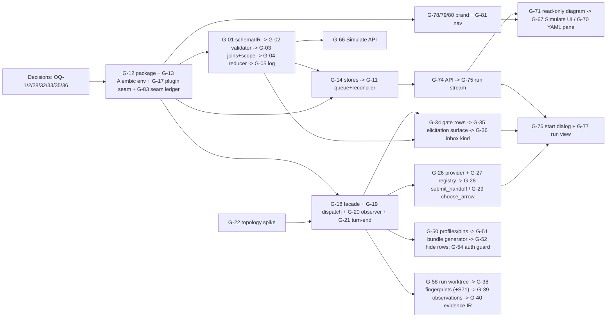

# Coral on Omnigent: Gap Analysis (consolidated)

Prepared by the consolidation lead for phases 2-3. Repository `omnigent-ai/omnigent` at HEAD `2a9cbe2c2` (0.22.0.dev0). Date 2026-11-11.

**Inputs.** This consolidates the ten specialist findings files in this directory and the three source artifacts. Code facts carry `path:line`. Detailed evidence and the verified-claims ledger are in `current_state.md` (same directory). Markers:

- **[V]**: I re-opened the reference at HEAD.
- **[sp:x]**: the named specialist verified it.
- **UNVERIFIED**: nobody could confirm it from code.

## How to read this file

- **Classification** describes what happens to Omnigent:
  - **Reuse**: use as is.
  - **Extend**: add a seam to an upstream file without changing behaviour.
  - **Modify**: change upstream behaviour.
  - **New**: Coral-owned code.
  - **Replace**: supersede an Omnigent mechanism or a design-doc plan.
  - **Remove**: drop from the plan or the product.

  A row can combine classes ("New + Extend").
- **Size**: S ≤ 1 engineer-week, M 1-3, L 3-6, XL > 6. Upstream-seam sizes in the ledger use LOC: XS < 20, S < 100-200, M < 400-600.
- **MVP? (provisional).** "yes" means the capability is in the "smallest lovable Coral" defined in `product.md` §9.1:
  - one implement → review → fix loop template;
  - `claude-sdk` on API-key/provider auth;
  - local host and a single code-writing agent;
  - read-only diagram plus run view;
  - gates in-app.

  Scope is not signed off (OQ-1, OQ-2). Where the architect or adversarial reviewer would cut or add, the row says so. "later" gives the milestone where known (M3-M7 per `product.md` §9.2).
- **Seams** use the unified ledger ids in §(b). S41 and above are new seams from specialists.
- **Design source** cites:
  - **D§**: Draft 4 sections;
  - **DD§**: the deep dive;
  - **UI§**: the UI design language doc.

---

## Consolidated capability gap table

### A. Engine core and semantics

| ID | Capability | Design source | Current Omnigent implementation | Class | Engineering work required | Seams | Size | MVP? |
|---|---|---|---|---|---|---|---|---|
| G-01 | Workflow authoring schema (YAML), loader with source marks, stable node and arrow ids, compiled frozen IR, content hash, JSON Schema export (contract K1) | D§5.1-5.3, D§12; DD§5.1-5.2 | None. Multi-step work is prompt-sequenced, e.g. Polly. PyYAML is available (`pyproject.toml:32`). | New | `coral.model`: pydantic authoring models, safe-load with marks, compiler to frozen IR, hash, JSON Schema export for the web. Reserve EGM keys (`session: persistent_across_loop`, `input_scope`) now (D4). | S29 | L | yes |
| G-02 | Static validator V1-V7, V10-V13 with box-anchored explanations; activation upper bound V12; reserved ids (`runs`, `templates`, `new`) | DD§5.5; D§12 | None | New | `coral.validate`: graph rules, block-structure regions, checked-part derivation, loop table, `yaml_path` → range mapping. V8/V9 land with G-48. | — | M | yes (V1-V7, V10-V13) |
| G-03 | Derived join semantics (AND-join after a split vs merge of alternatives); back-arrow exemption from join arity; scope keys `(run, node, item_path, iteration_path)` threaded through every table, key and effect | D§5.2; DD§5.3.1-5.3.4 | None | New | Join derivation in the validator and arrival rows in the reducer. Decide the D6 back-arrow rule and dead-path elimination (OQ-19). Scope keys go in from day one, because retrofitting is a migration and a rewrite [sp:adv Q1]. | — | M | yes |
| G-04 | Pure reducer `transition(graph, state, input, now) → {state Δ, log, effects, rejections}` (K2). State machines for Run, Activation, Slot, Attempt, Decision request and Gate visit. Loop limits and `at_limit` routing. Error taxonomy. | D§7; DD§6.1-6.3, §6.7 | None | New | `coral.engine`: typed inputs (commands and observations), typed effects with `effect_key`, rejection semantics (never throw), illegal-transition tables. | — | XL | yes |
| G-05 | Append-only run log (K3) with closed `kind` enum, `fold(log) == state` invariant and idempotency receipts | D§7.6; DD§6.1 | None | New | Log schema, fold function, CI invariant tests (I1-I8, `eng_testing.md` §3.2) | — | M | yes |
| G-06 | Auto-advance, decision watchdog (remind once, then alert), rejected-call pause (3 in a row, per slot), overdue alerts | D§7.2-7.3 | None. Agent timers are in-memory sleeps (`tool_dispatch.py:393-395`) [sp:DD F23]. | New | Timer kinds and policies in the reducer. Make the watchdog default configurable and well above the resync interval (OQ-14). | — | M | yes (overdue: M3) |
| G-07 | Run lifecycle: start (idempotent `start_key` → derived run id), pause reasons, resume on the pinned version, cancel (interrupt + stop + `omnigent.closed`), retry step | D§7.7-7.8; DD§6.2 | Stop is non-sticky (`routes_events.py:1279-1286`). The sticky refusal is the `omnigent.closed` label (`routes_events.py:1688-1698`) [sp:sess] | New + Reuse | Lifecycle commands, pause-reason enum, cancel effect chain. Reject late submits after cancel. | — | M | yes |
| G-08 | Repeat-for-each: order, empty list, per-item failure, concurrency, per-item gates and gate batching, "3 of 10" progress | D§5.1-5.2; DD§5.3.5 | None | New | Reducer support (the adversarial reviewer says phase 1). UI badges. Product contract (OQ-19). | — | M | later (M5); reducer could land early |
| G-09 | Parallel split and join, region cancel on a failure path, failure paths inside parallel regions | D§5.2; DD§5.3.6 | None | New | Region semantics; cancel effects that interrupt siblings | — | M | later (M5) |
| G-10 | Groups and saved blocks with inherited rules (V8 inner-stricter); hidden Wait and Sub-workflow kinds | D§5.2, §9; DD§5.5 V8 | None | New | Group IR, rule inheritance, wait timers, sub-workflow invocation | — | L | later (M5) |

### B. Durable execution and persistence

| ID | Capability | Design source | Current Omnigent implementation | Class | Engineering work required | Seams | Size | MVP? |
|---|---|---|---|---|---|---|---|---|
| G-11 | Durable work queue for signals, timers and effects (outbox), with leases, claim, drainer and backoff. Startup reconcile, periodic resync, liveness checks. Single replica in v1; refuse multi-replica and D1. | D§7.6; DD§6.4-6.6 | `PersistentTaskScheduler` is unfit: at-most-once, typed on `ScheduledTask`, built only with `automations_v2`, which defaults off [V `feature_flags.py:54, 97-104`]; `scheduled/README.md:147`. Reusable patterns: `StartupLease` (`dispatch_scheduler.py:152-347`) and lock-and-recheck claims (`scheduled_task_store/sqlalchemy_store.py:1304-1544`) [sp:pers]. | New (Replaces the Draft 4 scheduler plan) | Queue tables (unified `coral_work` or typed tables; see disagreement X-3), workers started by the plugin lifespan, reduce-and-retry loop on version conflicts (`run_write_transaction` retries only 40001/1213, `utils.py:1058-1060`). | S32 | L | yes |
| G-12 | Top-level `coral/` package in the same wheel, with tooling roots: package data, pyrefly, pre-commit regex, isort, coverage, lint roots, CODEOWNERS, a `coral` CI group, and an import-boundary test (only `coral.omni` and `coral.db` import Omnigent internals) | D§16; DD§4.2 | `include=["omnigent*"]` (`pyproject.toml:460`). pyrefly, isort and coverage are scoped to `omnigent` only [sp:test]. | Modify (config) + New | One standalone PR, plus `tests/coral/test_import_boundary.py`. Check whether `coral` collides with a dependency's import name (UNVERIFIED). | S29, S39, S39b-e | S | yes |
| G-13 | Separate Alembic environment (`coral_alembic_version`), `CoralBase` on a third `DeclarativeBase`, and `ensure_coral_schema`. Ordering: strictly after Omnigent reaches head. Guards: newer-build, D1 refusal, CockroachDB SERIALIZABLE prepare. Never `create_all`. | D§7.6; DD§7.3 | One chain with a single head enforced (`utils.py:695-742`). `create_all` on both bases (`utils.py:611-618`). CockroachDB refuses unexpected tables (`cockroachdb.py:139-178`). `env.py` has no filter [sp:pers, sp:adv]. | New + Extend | `coral/db/{base,types,ids,enum_codecs,migrate}.py`, `alembic.ini`, `env.py`. Tests: single head, round trip, SQLite-safe, models match migrations, conventions. | S30, S31, S57, S58 | M | yes |
| G-14 | Coral schema and stores, phased as standalone migration PRs. Workflows and versions, runs (CAS `apply_transition`), run specs, activations, join arrivals, slots, handoffs and items, gate visits, timers, effects, signals, run log, session bindings, simulation cases, blob ledger. Later: profiles and pins, alerts, repositories and patterns, command observations, amendments. | DD§7.2; `eng_persistence.md` §6 | None | New | 26 tables as proposed (pers), 13 (DD) or about 9 (adv); see X-24. Conventions: `workspace_id` leading PK with no `server_default`, `Uuid16`, CHECKed enums, derived-id PKs, 32-byte digests, `CompressedText(max_stored_bytes=16_383)`, no FKs, standalone schema PRs. | — | L | yes (phase-1/2 tables) |
| G-15 | Artifact storage for large bodies (YAML, compiled graphs, reports, test reports): workspace-prefixed keys, put-then-commit, ledger table for GC (the store has no list op), size caps | DD§7.1; pers §7 | `ArtifactStore` offers `put/get/delete/exists` only, with no list (`stores/artifact_store/__init__.py:6-79`) [sp:pers] | Reuse + New | Key scheme `coral/v1/{ws}/…`, `coral_blob_refs`, caps enforced at the API and tool boundary | — | S | yes |
| G-16 | Account lifecycle, retention and purge. Hard-delete runs in batches. On account revocation, pause with `authority_revoked`. Carry rows on identity migration. | DD§7.1; pers §6.4, §9 | `_revoke_durable_authority` / `_carry_registration_work` enumerate Omnigent tables only (`accounts_store.py:75-185`) [sp:pers] | New + Extend | Lazy authority checks in v1. `purge_run`. Retention policy needs a product owner (OQ-25). | S56 | M | later (lazy checks in MVP) |

### C. Session integration and signals

| ID | Capability | Design source | Current Omnigent implementation | Class | Engineering work required | Seams | Size | MVP? |
|---|---|---|---|---|---|---|---|---|
| G-17 | Server plugin seam: a `server_plugins:` config key loads modules exporting routers and lifespan hooks, with a `ServerServices` bundle. Routers mount before the SPA. Hooks run after the scheduler starts and exit before the runner router closes. Import failure is fatal. Wired from the CLI. | DD S32; arch C7; sess E-S49; pers P-S4 | `create_app(extra_routers…)` exists, but the CLI never passes it [V `cli.py:5118-5150`]. There is no lifespan hook (`app.py:1933-2260`). `app.state` lacks `conversation_store`, `policy_store` and others [sp:sess]. `debug_router_modules` silently skips import failures [sp:adv]. | Extend | About 40 LOC in `app.py` and 1 in `cli.py`. Upstreamable. Tests in `tests/server/test_app.py`. | S32 | S | yes |
| G-18 | `coral.omni` session facade (K4). Request-free create: validators, optional worktree, `create_conversation(conversation_id=uuid5(effect_key))`, unique child titles, presentation labels, grants for top-level sessions, policies before input, launch and init. Plus `read_status`, `read_items` and `turn_evidence`. Facade contract tests: signature snapshots of imported privates, and a row diff between facade and HTTP creates. | DD§8.1; sess §3, §13; harn §9.3 | `fire.py` precedent (`fire.py:591-794, 1597-1809, 2018-2196`). The store supports a caller-chosen id [V `sqlalchemy_store.py:1145-1156`]. The HTTP create needs a `Request` (`orchestration.py:11631-12345`). | New | Copy the `fire.py` subset, plus child runner inheritance and session-init. Import privates only through the `omnigent.server.routes.sessions` facade (`__init__.py:370-689`) [sp:adv]. | S3 (refined) | L | yes |
| G-19 | Engine message dispatch (brief, nudge, feedback, notice, interrupt, stop) through `_post_event_impl` with an `EngineEventContext`. This keeps input policy, the closed check and the child heal. Fall back to `ManagedStartupInputs` for provisioning sandboxes. Read before any resend. | DD S4; sess §3.3-3.4 | The handle is dropped when there are no managed sandboxes [V `app.py:3815-3819`]. Only two context types are accepted [V `routes_events.py:1019, 1652`]. An exact `stable_id` retry is still forwarded (`orchestration.py:7299-7303`). | Extend | Two XS seams plus facade methods. Contract test with message, interrupt and stop (`tests/server/integration/test_engine_event_dispatch.py`). | S4, S41, S42 | S | yes |
| G-20 | Status-edge observer registry in `session_live_state.py`; the scheduled hook becomes one observer. `origin` slug on every edge. `turn_outcome` on headless and native edges. Bypasses B1/B2 notify. The Coral observer filters in O(1) and enqueues off the hot path. | DD S1, S2; sess §4-5 | Hard-wired hook: any idle → "succeeded" [V `helpers.py:5150-5160`]. Two bypasses (`orchestration.py:4131-4152, 13700-13708`). Single best-effort worker thread (`session_live_state.py:148-158`). `turn_completed` only from claude-native. | Extend + Modify | About 60 LOC registry, about 20 in `helpers.py`, about 15 for bypasses. 18 origin slugs (S1b). Runner `_publish_turn_status` outcome. | S1 (+S1b), S2, S43, S44 (opt.) | M | yes (S1, S43); S2 with codex-native |
| G-21 | Per-mode turn-end rule. A turn has ended when: idle; the engine input (its `stable_id`) is present or the pending input was consumed; an assistant reply follows; there is mode confirmation; and no elicitation is pending. Nudge only engine-started turns; never nudge cancelled ones. | DD§6.4, §8.7, §8.10; sess §5.4 | Transcript rule precedent (`fire.py:2540-2577`). `created_by` cannot tell engine from user input (`entities/conversation.py:894-903`). | New | Coral table mapping `stable_id` → effect; reconciler predicate | — | M | yes |
| G-22 | Session topology: (a) children of the orchestrator; (b) a run-anchor root with all sessions as children; (c) hybrid children with their own `host_id`, `workspace` and runner; (d) top-level sessions in a project or family. Includes the spike and the decision record. | DD§8.2; arch ADR-05; sess §9; adv §6.1; ws R-W3; web N9-N10 | Child semantics: runner inheritance (`orchestration.py:12034-12052`); access recursion (`permissions.py:59-66`); root session policies leak [V `builder.py:756-768`]; roots-only relaunch [V `app.py:4273`]; a child with `host_id` is independent [V `app.py:4596-4597`]; parent wake at 120 s [V `subagent_block_notifier.py:55, 297-300`]. Sibling families sit behind `sibling_sessions` (default off) [V]. | New (usage of existing APIs) | 2-3 day spike. Probes: child with its own worktree on a shared runner; an anchor that never takes a turn hosting children; sidebar and run-view behaviour. Then the decision record (X-1). | S51 (if children), S35 (if top-level) | M | yes (blocking decision) |
| G-23 | Runner loss and host offline. Classification per the error taxonomy. Wake via `ensure_runner_connected` / `retry_session`. Never restart during the 72 h hold. Fence the old session with `session_generation`. Salvage, then reset the worktree. The engine relaunches children itself. | D§7.8; DD§6.7; adv §5.2; ws §4.4 | 72 h hold with no edge (`orchestration.py:8636-8641`). Grace timers are in-memory (`app.py:4036-4041`). Children are restored without replay (`child_session_recovery.py:111-200`) [sp:arch]. | New | Liveness poll on `runner_last_seen`. Restart ladder. Effects: salvage and reset (G-59). | S48 (optional) | M | yes |
| G-24 | Run-owned session protection and generic actions. Defined outcomes for archive, delete, stop, fork, rename, `/clear`, `PUT` agent, MCP-server edits and policy edits. MVP: drift detection, re-attach and pause. Later: reserved prefixes and guards. | DD§10.6; adv §5.4-5.6; tools §3.5; sess §10 | Editors can delete policies (`session_policies.py:308-437`). Archive emits an idle edge (`routes_core.py:4098-4108`). Native `/clear` creates a top-level session with copied labels and no policies [V `_native_supersession.py:24-51`]. Session delete removes the worktree and branch (`routes_events.py:4166-4189`). | New + Modify | Reconcile-time policy, label and bundle drift checks. Engine-owned worktrees (no `git` options on run sessions). Later S26, S46, S53. | S26, S45, S46, S53, S73 | M | yes (detect and pause); guards later |
| G-25 | Effect safety. Workers enter `workspace_scope`, `account_authority_scope` and `host_owner_scope`. Idempotency keys: derived conversation ids, `stable_id` on every engine message, deterministic policy ids, deterministic worktree paths, stable gate elicitation ids. Unattended-permission preflight at brief and nudge time. | DD§6.1; adv §2.4, §4.3, §5.4; pers C5 | Precedents: `fire.py:567-586` (scopes), `fire.py:1695-1700` (policy ids), `fire.py:958-997` (unattended preflight) [sp:adv, sp:sess]. Labels have no value index [V `db_models.py:1102-1117`]. | New + Reuse | Scope helper plus a lint or test. Key derivation library. Preflight reuse. | S55 (only if the HTTP create path is used) | S | yes |

### D. Engine tools and orchestrator

| ID | Capability | Design source | Current Omnigent implementation | Class | Engineering work required | Seams | Size | MVP? |
|---|---|---|---|---|---|---|---|---|
| G-26 | Extension tool provider. One declaration feeds ToolManager registration, `should_dispatch_locally`, the native relay allowlist, claude-native and codex-native pre-approval, and the framework instructions (step or orchestrator text owned by `coral`; native launch channels). Opt-in through `params.coral` in generated bundles. | DD S7-S9, S11-S12; tools T-S42; harn H-S51 | Names are hand-listed in five places: `manager.py:159-193`; `tool_dispatch.py:488-518, 888-915`; `native/orchestration.py:9819-9846`; `app_server.py:306-337`. `params` passes through the parser [V `parser.py:290`]. Natives get only raw author instructions (`prompt.py:213-225`). | Extend | New `omnigent/tools/extensions.py` (entry-point loaded) plus 1-5 line call sites. Name tools with the `coral_` prefix and raise on collision. | S7, S8, S9, S11, S12, S50 | S | yes (native channels later) |
| G-27 | Server tool handler registry, generalizing the `sys_advise_models` intercept. `ServerToolCall` carries operation id, actor and provenance. Runner-provenance check in multi-user mode. Slot-mapping authorization. Transport dedup on `(run, operation_id)`. Optional policy-denied callback. | DD S10; tools §2.3 | Inline intercept (`orchestration.py:13058-13069`). The endpoint needs only `LEVEL_EDIT` (`routes_agent.py:482-485`). Operation id present [V `orchestration.py:12851-12856`]. No server test of the intercept exists [sp:tools]. | Modify + Extend | New `omnigent/server/server_tools.py`; 3-line lookup at the site; `runner_proof` predicate | S10, S49 | S | yes |
| G-28 | `coral_submit_handoff`. Fields: `activation_id`, `status: done\|blocked`, report, artifacts, derived label or items enum, `kind: handoff\|refresh_note`. A bounded synchronous evidence ledger scan; Coral-run checks asynchronous. Rejection codes, per-slot rejected counter, `session_generation` check, slot-state dedup. | D§5.3, §7.2; DD§5.4; tools contract 1; adv §4.1-4.2 | None. Long synchronous calls tie evaluation to one HTTP request (proxy timeout 7260 s, `tool_dispatch.py:208, 228`) [sp:adv C22]. | New | Handler, then reducer command, then one short transaction. Per-step schema frozen per bundle. | — | M | yes |
| G-29 | `coral_choose_arrow` with a generic `label` validated server-side, a reason, and optional `items` (to write the combined list, D9). Decision requests list the legal labels and carry the per-agent handoff collection. | D§5.3, §7.2; tools contract 2; adv D9 | Tool schemas are fixed per conversation [V `runner/app.py:5910-5935`], so per-decision enums are impossible | New (Replaces DD per-decision schemas) | Handler; decision-request message builder; loop redirection | — | S | yes |
| G-30 | `coral_ask_user`, non-blocking. Durable question row and a form elicitation; the answer is delivered as a `[Coral answer]` message; suspends the watchdog. Deny vendor `AskUserQuestion` and Codex `requestUserInput` in run sessions. | D§7.2; tools contract 5 | claude-sdk `AskUserQuestion` bridge exists (`claude_sdk_executor.py:2570-2586`) | New | Handler, a table, and elicitation via S6a | S6 | S | yes (prod). The adversarial reviewer would cut it. |
| G-31 | `coral_message_agent` (engine-routed, isolation flags, rate limit). `coral_assign_agents` for "up to" rosters. `coral_assign_task` to re-task a member for conflict resolution or for EGM. | D§3, §5.3, §7.2; tools contracts 3, 4, 6 | `sys_session_message` is unsuitable: it refuses edit-shared senders and adds a prefix (`session_orchestration.py:61-69, 111-128`) | New | Handlers. Delivery through G-19 with `[Coral message from …]`. Handle the steering-vs-closing race. | — | M | later (M5). MVP relays only orchestrator → step. |
| G-32 | Default orchestrator profile. `claude-sdk`; no `os_env`, so no `sys_os_*` tools by construction; `orchestrator_guard` allowlist in **bundle guardrails** with a label check; tool-group hygiene. | D§3; DD§9.3 item 6; harn finding 2; tools §3.4 | Omitting `os_env` registers no OS tools [V `manager.py:630-636`]. Root session policies leak to children [V `builder.py:756-768`]; spec guardrails do not leak to children with their own agent row [sp:adv C21]. | New | Seeded agent plus guard policy | — | S | yes |
| G-33 | Orchestrator conversation semantics. Run starts from a dialog, not from chat. User chat is interleaved with decision requests (claude-sdk buffers mid-turn input, F33). User-induced illegal calls are not counted. The orchestrator is created lazily when a workflow has no decisions. | adv §3.11; prod Q-07 | claude-sdk `enqueue_session_message` returns False (`claude_sdk_executor.py:2323-2332`) [sp:harn] | New | Message protocol and decision-request state | — | M | yes |

### E. Gates and notifications

| ID | Capability | Design source | Current Omnigent implementation | Class | Engineering work required | Seams | Size | MVP? |
|---|---|---|---|---|---|---|---|---|
| G-34 | Durable gate visits. The row is written before publish. Visit token; CAS resolution; stale-visit rejection. Outcomes are authored labels (reject semantics, OQ-3). Answerable through the Coral API. Reminder and escalation timers that **never auto-resolve**. | D§5.2, §5.6; DD§11, §6.2 | Policy ASK times out to DENY (`approval.py:142-146`; default 86400 s, `spec/types.py:40`). The pending index is in-memory [sp:tools]. | New (Replace "gate via policy ASK") | `coral_gate_visits`, answer API, timers | — | M | yes |
| G-35 | Gates, `ask_user` and budget prompts surfaced as elicitations on a stable run session. S5: observer list with isolation. S6a: request-free publish helper with stable ids `coral_gate_<visit>`. S6b: verdict-handler registry plus resolver identity. Startup and orchestrator-replacement re-publish. Parent-wake exemption. Authority: `LEVEL_EDIT` (owner-only in MVP). Label the native-bridge bearer risk. | DD S5, S6, §11; tools §4.3, G1 | One observer slot [V `pending_elicitations.py:66-87`]. Publish-without-park exists (`routes_events.py:2222-2257`). `_resolve_elicitation` lacks resolver identity (`orchestration.py:2400-2559`). `ELICITATION_RESOLVE_LEVEL = LEVEL_EDIT` (`routes_elicitations.py:55-61`). The claude-native bridge-dir bearer is readable by the agent (`runner/native/orchestration.py:9290, 9832`) [sp:tools]. | Extend + Modify | Three small seams, Coral handler, re-publish job. The web reuses `ApprovalCard` and `/approve` unchanged. | S5, S6, S51 | M | yes |
| G-36 | Workflow inbox kind. `coral_alerts` feed with server-side ack and run actions (extend, cancel, resume, open). Sidebar count. Suppress per-step turn-end OS notifications for `coral.run_id` sessions while keeping elicitation notifications. Run-level OS notifications with deep links. An "app must be open" notice. | D§5.5, §7.3; DD S36-S37; tools §5.2; web §3.8 | Closed 4-kind union (`InboxPage.tsx:189-193`). Automation kind uses localStorage read state (`useSeenAutomationFailures.ts:58-70`). `useIdleNotifications` diffs top-level rows only [sp:web N9]. | New + Modify | `GET /v1/coral/inbox`, `POST …/ack`, `useWorkflowInbox`, `WorkflowInboxCard`, about 80 lines in InboxPage, a 3-line guard in `useIdleNotifications` | S36, S37, S85 | M | yes (in-app) |
| G-37 | External notification channel for unattended gates and pauses: webhook first, then email or Slack DM, through the outbox and idempotent per channel. Later: Web Push (VAPID), APNs and FCM. | D§5.5, §13; DD§11; tools §5.3 | None anywhere (grep), upstream issue #1751 [sp:tools]. Slack covers only Slack-originated sessions (`integrations/slack/README.md:345-348`). | New (Replaces the "web push" claim) | Connector, per-user channel config, deep-link payloads without secrets | — | M (connector) / XL (push) | later (M3 connector; push later) |

### F. Evidence

| ID | Capability | Design source | Current Omnigent implementation | Class | Engineering work required | Seams | Size | MVP? |
|---|---|---|---|---|---|---|---|---|
| G-38 | Workspace fingerprints. L1 (porcelain plus stats) per command; L2 (`write-tree` on a temporary index: tracked plus untracked-not-ignored) at evaluation points. Computed on the host through a **host workspace-op channel** (capability token, reaper-guarded, job journal). v1 fallback: runner `/changes` plus session shell for claude-sdk. Fix the orphan-reaper hazard first. | D§6.1; DD S40, §9.2; ws §5; adv §3.1 | The server has no FS. The `/changes` endpoint exists [V `resource_routes.py:1230-1245`], but its porcelain is not an exact tree. `fs_request`/`fs_write` are not reaper-guarded [V `connect.py:6027-6034`]. | New + Extend | Frames, host dispatcher, server proxy, pending map, Coral host ops (`coral/host_ops`). Contract test that exit status is preserved under the reaper. | S40, S71 | L | yes (fingerprint slice) |
| G-39 | Command observations per mode, with snapshotted exit codes in `coral_command_observations`. claude-sdk: runner around `_execute_os_env_tool`. codex: adapter plus a structured `exit_code`. Native: PostToolUse hints. Transport: an MCP-execute response field, or an outbox event. | DD§9.1; ws §2.6, §5.5 | `pr_observer` is called at all four points (`tool_dispatch.py:7297-7307`; `_executor_adapter.py:1106-1185`; `bridge.py:8233-8250`; `tools/mcp.py:717-726`). Durable outbox precedent `pr_reports.py:52-150` [sp:ws]. | Extend + New | Observer registry, transport, store | S68, S69 | M | yes (claude-sdk only) |
| G-40 | Evidence-requirement IR (K5) and evaluator. "Final pass" semantics, so formatter-then-test ordering does not livelock. May-modify flags. Exit-code source rules. Per-agent vs per-step scope (OQ-10). Missing-item messages. | D§6.1; adv §3.1, M6; DD§9.2 | None | New | IR, evaluator, messages; tests with temp git repos | — | M | yes |
| G-41 | Repository command detection from `package.json`, `pyproject.toml`, `justfile`, `Makefile`, CI files and pre-commit. Author confirmation. Patterns stored per repo and snapshotted into the workflow version. | D§6.1-6.2; ws §5.6; prod D5 | `read_workspace_from_host(op="list_or_read")` reads repo files request-free [V `_host_filesystem.py:59-139`] | New + Reuse | Parsers in `coral/evidence/detect.py`, patterns table, confirm API | — | M | yes |
| G-42 | Done-when translation service. Option one: an engine-owned short-lived model session translating plain text to an evidence requirement, with dry-run, invalidation and usage accounting. Option two for v1: a picker over detected commands (adv S-9). | D§6.1, §10; DD§10.7 | No model calls outside sessions [DD§10.7] | New | Translator role in the facade, or the picker; confirmation API | — | M | yes (picker or basic) |
| G-43 | Coral-run checks: sandboxed exec jobs; a Coral-controlled detached checkout for pinned commands; JUnit reports; integrity diff on test and config edits. Mandatory after multi-writer merges. Verifier as a read-only template step pattern. | D§6.2, §10; DD§9.3; ws §5.3; adv S-16 | Session shell endpoint only (owner-only, runner required, 120 s) (`routes_resources.py:3257-3297`) [sp:ws] | New | Exec ops on the host channel; `worktree.add_detached`; report capture; check-to-attempt loop | S40, S72 | L | later (M3) |

### G. Rules, capabilities and enforcement

| ID | Capability | Design source | Current Omnigent implementation | Class | Engineering work required | Seams | Size | MVP? |
|---|---|---|---|---|---|---|---|---|
| G-44 | Capability model and bench. Fill `steering`, `live_queue` and `compaction`. Add `steering_reliability`, `turn_complete_semantics`, `end_of_turn_detection`, `usage_reporting`, `tool_call_gating`, `gate_failure_mode`, `subagent_attribution`, `usage_limit_signal`, `egress_scope` and `exit_status_source`. Guard tests. `capabilities_by_spelling` on `GET /v1/harnesses`. Probes, feature-map rows, and a nightly live job. | D§9; DD S22-S23, §10.2-10.3; harn §4-5; test §3.10 | Fields default None (`harness_capabilities.py:155-158`). Native rows are absent from the catalog (`harness_plugins.py:1275-1283`). 12 probes. The feature-map test fails on unmapped probes [sp:test]. | Extend | Fields and values for four modes. Probe modules plus offline verdict tests. `coral-bench.yml` with credentials. Coral-side effective-enforceability computation. | S22, S23, S59, S78 | M | yes (claude-sdk fields; end-of-turn, tool-gating and fresh-context probes) |
| G-45 | `coral.policies` registry module loaded through `policy_modules`: `step_roster` (stateless deny-list for separate sessions), `orchestrator_guard`, input-scope deny, `engine_tool_guard`. Spec grants `spawn: false`, `tools.agents: []`. | DD§10.4; tools §3.4 | Registry and config loading exist (`policies/registry.py:90-215`; `app.py:2046`) [sp:tools] | New (Replaces the "fail-closed router") | Factories, POLICY_REGISTRY entries (`internal_only`), tests | — | S | yes |
| G-46 | Run guard injected through a required-policy provider keyed on the `coral.run_id` label. It DENYs non-`coral_*` tools when paused or cancelled, and `any_policies_apply` keeps the native allow cache shut. | tools T-S44; D§10 | `_REQUIRED_APPROVAL_SPECS` pattern (`builder.py:76-104, 415-480`) [sp:tools] | Extend | Provider registry in `builder.py`; cached run-state reader | S52 | S | yes (pause, cancel) |
| G-47 | Read-only reviewer enforcement. On claude-sdk: `os_env.sandbox.write_paths: []` plus `read_only_os` gives Enforced. Elsewhere: Verified by fingerprint. The validator labels each case. | D§5.1 ("agents change code"); adv D7; harn §4.3 | `read_only_os` leaves shell untouched [V `policies/builtins/orchestration.py:645-660`]. Headless codex silently upgrades read-only [V `codex_executor.py:5245-5247`]. | New (generator and validator) | Bundle generator rule plus label logic | — | S | yes |
| G-48 | Required rules and reactions. v1: a typed rule-template catalog over builtins (worktree_guard, blast_radius, egress allowlist, CEL ask-before-path, timer reactions). Later: free LLM translation with confirmation. V8 (inner stricter), V9 (per-mode enforceability), per-mode labels. Egress rules aware of mode scope. | D§9; DD§10.1-10.7; adv §3.6; harn H-S49 | Builtins exist (`policies/builtins/orchestration.py:352-757`; `cel.py:103`; `cost.py`). `egress_rules` exists (`inner/datamodel.py:753-765`). | New | Template IR, translators, validator rules, reactions engine | S64 | L | later (M3). MVP: orchestrator guard, roster and read-only only. |
| G-49 | Native fail-closed enforcement. S14: `fail_closed_hook_output` for run-owned sessions, early returns deny, `onFailure: block`, explicit timeout. S15: refuse codex-native without hooks. S16: sub-agent identity in the policy context. Check that hooks are installed (`ap_server_url`). | DD S14-S16, §10.5; tools §3.6; adv C3 | Fail-ask [V `claude_native/hook.py:1236-1242`]. Early returns fail open (`hook.py:1208-1222`). Hooks install only with `ap_server_url` (`bridge.py:2651`). | Modify | Three hook sites plus a bridge-config flag. CLI-version gating (UNVERIFIED versions). | S14, S15, S16 | M | later (a prerequisite for any native Enforced label) |

### H. Profiles

| ID | Capability | Design source | Current Omnigent implementation | Class | Engineering work required | Seams | Size | MVP? |
|---|---|---|---|---|---|---|---|---|
| G-50 | Profile model and pinning. A profile is an Omnigent agent row plus Coral metadata (`params.coral` or a sidecar; X-12). Immutable `coral_profile_revisions` holds a byte copy plus a digest. Version-to-revision pins. Drift check at slot start. Seeded Coral built-ins (orchestrator, implementer, reviewer, researcher, verifier). | D§5.4; DD§8.4; harn §8; pers T19-T21; arch §6 | Rows update in place, and running sessions follow on the next turn (`REUSABLE_USER_AGENTS.md:112`; `runner/app.py:8410-8449`). PATCH cannot edit `params` [V `schemas.py:200-208`]. Old blob retention is UNVERIFIED. Extra built-ins come from `OMNIGENT_BUILTIN_AGENT_DIRS` (`app.py:1135-1205`). | New + Reuse | Pin service, revision store, seed hook | — | M | yes (minimal) |
| G-51 | Per-step bundle generation. Deterministic tar; `uploaded_agent_for` content-addressed rows. Per-mode approval stance. Hygiene: tool groups off, `spawn: false`, `skills: none` for hermetic steps, `agent_session_sharing: none`. Auth by provider reference only. Required policies in bundle guardrails. Egress auto-add. | DD§8.5; harn §9; tools §3.3; arch C9 | Request-free `uploaded_agent_for` (`bundles.py:324-377`). Child uploads mint one row per session (`orchestration.py:12617-12735`). | New | `coral/omni/bundles.py`, `coral_step_agents`, golden tests | — | M | yes |
| G-52 | Engine-owned agent rows: hidden from pickers and the `scope=user` list, and protected from PATCH, reinstall, `PUT /sessions/{id}/agent`, MCP edits and non-forced delete by non-engine callers. | arch S41/N5; harn H-S43; tools T-S46 | Uploaded rows show in `GET /v1/agents?scope=user` (`agent_store/sqlalchemy_store.py:523-545`) [sp:arch] | Modify | Reserved name prefix (`coral__`) checks in the store, routes and web hooks | S53, S54 | S | yes |
| G-53 | Agent Profiles desk at `/profiles` (a lens over custom agents) and a profile picker (cmdk) with capability chips, "used by" and source badge. Edits by reinstall. Chips read "Claude", not "Claude Code". | D§5.4; UI§5.1, §8.3; web §3.7; prod PC-07 | Custom agents UI and API exist (`SettingsCustomAgentsSection.tsx`; `CustomAgentConfigForm.tsx`; `lib/agentsApi.ts`) [sp:web] | New + Reuse | Pages, picker, `/v1/coral/profiles`, capability display | S59 | M | yes (picker and seeded profiles); desk at M3 |

### I. Harness modes and auth

| ID | Capability | Design source | Current Omnigent implementation | Class | Engineering work required | Seams | Size | MVP? |
|---|---|---|---|---|---|---|---|---|
| G-54 | claude-sdk run-owned credential guard. Refuse subscription OAuth unless explicitly chosen. Provider references only; never literal keys. Defer to operator bindings. Pin the account per run (never switch). Contract guard that no vendor workspace tools are exposed. | D§17; DD S13, §16.1; harn §10 (R-AUTH-1..9), H-S48 | Executor strips `ANTHROPIC_API_KEY` (`claude_sdk_executor.py:2091-2118`). Auth precedence falls through to subscription (`workflow.py:1123-1400`). Base tools [V `:2571-2586`]. Vestigial `enable_native_tools` [sp:adv C5]. | Modify + New | Spawn-env flag, executor refusal, preflight from `harness_accounts`, `_base_tools` contract test | S13, S63 | S | yes |
| G-55 | claude-native as a step mode for subscription users. S14; hooks-installed check; launch-time framework text; turn end via the Stop hook; provider hosts in egress; usage-limit category. Separate sessions only. Not for the orchestrator. | D§17; harn §13 | Runs today with fail-ask hooks and whole-agent egress scope [sp:harn] | Modify | Bundle and enablement work above | S12, S14, S24, S64 | M | later (product and legal decision OQ-28/OQ-35) |
| G-56 | Codex modes. codex-native first: S2, S15, S16, native S12, an explicit `yolo` stance with policy-resolved approvals. Then headless codex: S18-S20, per-session native-tool switches, read-only stance fix, hook-trust fail-closed. Resolve OpenAI terms. | D§3, §20 Q1; DD S18-S20, §16.2; harn §13 | codex-native child default `--dangerously-bypass-approvals-and-sandbox` [V `helpers.py:10645-10660`]. Headless: `approvalPolicy: "never"`; read-only upgraded [V]. | Modify | Per-seam work; probes | S2, S15, S16, S18-S20, S60-S62, S67 | L | later (M6) |
| G-57 | Usage and plan-limit signal: claude-sdk `RateLimitEvent`, Codex rate limits, `ExecutorError` reset time. Plan-limit pause showing the resume time. Mock-provider probe. | D§7.8, §10; DD S24, §12 | None. Codex explicitly drops rate-limit events (`codex_executor.py:4569-4576`) [sp:harn] | Extend | Executor branches plus an engine pause class | S24 | S | later. MVP falls back to error text, which is fragile. |

### J. Workspaces and worktrees

| ID | Capability | Design source | Current Omnigent implementation | Class | Engineering work required | Seams | Size | MVP? |
|---|---|---|---|---|---|---|---|---|
| G-58 | Repo bindings `(host, repo root, traits)` plus run worktree lifecycle. Request-free create of `coral/r-<run>/base`; start commit recorded; sessions bound with `workspace=` and **no `git` options**; removal, retention and a disk cap. Per-worktree setup (`.coral/repo.yaml`, `.worktreeinclude` fallback) later. | D§11; DD§13; ws §4.1-4.7 | `create_worktree_on_host` (`_host_worktree.py:190-257`) with the `fire.py` pattern. The result has no HEAD commit (`git_worktree.py:493-507`). No setup facility. | Reuse + Extend + New | `coral.omni.worktrees`; S72 head commit; picker reuse (`WorkspacePickerDialog`, `useHostWorktrees`) | S72 | M | yes (setup later) |
| G-59 | Engine-owned commits at accepted handoffs (with trailers; hook policy OQ-41). Salvage refs `refs/coral/salvage/*`. Reset-on-restart (`reset --hard`, `clean -fd` without `-x`). Take-over guard. | ws §4.3-4.4; DD§13 | No commit or reset host op. Sandboxed commit in linked worktrees is UNVERIFIED [sp:ws]. | New | Ops on the S40 channel | S40 | M | yes (single writer) |
| G-60 | Per-agent worktrees; serial merges into the run worktree; conflict protocol inside the agent's own worktree; post-merge Coral-run checks; submodule and LFS probe. | D§5.3, §11; ws §4.5; adv §3.2 | None. A session workspace is immutable (`entities/conversation.py:202-212`) | New | Merge ops, conflict sub-state, `assign_task` | S40 | L | later (M5) |
| G-61 | Managed-sandbox runs: worktrees in a sandbox (bind mode), host-keyed keep-warm lease, checkpoint pushes, relaunch from a checkpoint. Plain-folder workspaces through a shadow repo. | D§11; DD§13; ws §4.8, §7 | Managed sessions reject `git` (`schemas.py:2011-2013`). Keep-warm is runner-keyed only (`managed_host_keepalive.py:137-276`). Non-resumable providers re-clone. | Extend + New | S28, S70, plus a checkpoint protocol | S28, S70 | L | later |

### K. Budgets, cost and limits

| ID | Capability | Design source | Current Omnigent implementation | Class | Engineering work required | Seams | Size | MVP? |
|---|---|---|---|---|---|---|---|---|
| G-62 | Run budget. Spend aggregator over all run sessions (`policy_cost_usd ?? total_cost_usd`). `paused(budget)`. Budget elicitation (raise or stop). Run guard DENY. Overshoot disclosure. Tokens for plan users. Estimate from Simulate sessions × past medians. Step budgets later. `cost_budget` only as a per-session backstop (no soft ASK; unpriced usage ASKs). | D§10; DD§12; tools §6 | `cost_budget` is per session: ASK, DENY, and ASK on unpriced [V `cost.py:500-512`]. Tree helpers `load_session_usage*` (`builder.py:1263-1494`). | New (Replaces "reuse `cost_budget`") | Aggregator, reducer pause, elicitation kind, estimate service | S52 | M | yes (run budget and estimate); step budgets M6 |

### L. Refresh and long sessions

| ID | Capability | Design source | Current Omnigent implementation | Class | Engineering work required | Seams | Size | MVP? |
|---|---|---|---|---|---|---|---|---|
| G-63 | Context-threshold refresh for steps and the orchestrator. Per-mode threshold (default 70%, derived below native auto-compaction). Wait for turn end; request a refresh note; **slot restart** (create, brief, close the old session, publish a notice). Stitched orchestrator view as segments with dividers. Reaper retests (S27). | D§7.5; DD§8.9, S25, S27; arch C5; sess §8 | `_continue_session_in_fork` refuses sub-agents and needs a `Request` [V `routes_core.py:5005-5040`]. `SupersessionReason` is `"clear"` only [V `schemas.py:4209`]. Window is unknown for some models. | New (Replaces fork-based refresh) | Reuses the facade; S25-lite reason literal; S45 supersession observer | S25 (lite), S27, S45 | M | later (M3) |

### M. Take-over

| ID | Capability | Design source | Current Omnigent implementation | Class | Engineering work required | Seams | Size | MVP? |
|---|---|---|---|---|---|---|---|---|
| G-64 | Take-over and hand-back. `taken_over(by)` activation state. The engine stops reminders, refresh and auto-advance. User-authored input detected by `stable_id`. Hand-back recomputes the fingerprint and re-evaluates done-when. Salvage guard. | D§13; DD§8.10; adv §3.9 | No such state (F47). `stable_id` exact-retry detection exists (`helpers.py:7915-7942`) [sp:adv] | New | Reducer state, API, UI controls | — | M | later (M4) |

### N. Versions and amendments

| ID | Capability | Design source | Current Omnigent implementation | Class | Engineering work required | Seams | Size | MVP? |
|---|---|---|---|---|---|---|---|---|
| G-65 | Version list and diff. Amendments ("Apply to this run": mapping validation, counter carry-over, simulate from current state, run lock, reason). Or, in v1, "cancel and restart from node X with carried handoffs". | D§7.7; DD§6.8; adv §3.8 | None | New | Derived versions; `coral_amendments`; restart-from-node option | — | L | later (M6). Versions list at M3. |

### O. Simulate

| ID | Capability | Design source | Current Omnigent implementation | Class | Engineering work required | Seams | Size | MVP? |
|---|---|---|---|---|---|---|---|---|
| G-66 | Simulate engine and API. The same reducer with stub effects. Scripted scenarios (labels, list lengths, pass/fail, gate answers). Saved test cases re-run on change. Session-count estimate. Exhaustive mode (V11) or block-structure soundness instead (X-25). | D§8; DD§15.1, V11 | None | New | `coral.engine.simulate`, `POST /v1/coral/simulate`, tests store | — | M | yes |
| G-67 | Simulate UI: scenario editor generated from derived info, overlay (visit counts, taken edges, limits), summary with estimate, saved-test badges. | D§8; web §3.4; prod PC-12 | None | New | `web/src/workflows/simulate/*`, sharing the run-view overlay | — | M | yes |

### P. Authoring

| ID | Capability | Design source | Current Omnigent implementation | Class | Engineering work required | Seams | Size | MVP? |
|---|---|---|---|---|---|---|---|---|
| G-68 | Workflow storage. DB-canonical immutable versions plus drafts and a library index. Repo **import** through `host.fs_request`. Repo **export** through a new `.coral/`-confined write op with an expected-hash precondition. CLI and API upload. Stable workflow ids across machines. Runs pin a version snapshot. | D§12; arch C10; ws §6; adv M1; prod Q-10 | Read exists [V `_host_filesystem.py:59-139`]. Write frames are `github_*` only (`connect.py:4392-4557`). The HTTP host FS lists only (`hosts.py:1561-1745`). | New + Reuse + Extend | Store, endpoints, write op | S74 (or an S40 op) | M | yes (DB plus import or upload); export later |
| G-69 | Templates: server-bundled YAML with pre-confirmed translations and saved simulations. Gallery tab and "Use template" dialog (parameters, profile substitutions, detected commands). MVP template "Implement → review → fix loop". | D§12; prod PC-09, §9.1 | Automations gallery pattern (`automationTemplates.ts`; `TasksPage.tsx:307-312`) [sp:prod] | New | Template package data, gallery, dialog | — | M | yes (1-2 templates) |
| G-70 | YAML editor pane. Reuse the `monacoSetup` helpers (not `MonacoCodeEditor`). Markers from the server validator. `yaml` npm dependency (2.9.0, already locked). Comment-preserving document and CST patches (ADR-08). Conflict dialog on 412. | D§12; DD§14.4; web §3.3b | Monaco present, with no YAML worker (`monacoSetup.ts:12-17`). `MonacoCodeEditor` is bound to session files [sp:web N15]. | New | Editor store, YAML layer, golden round-trip fixtures | — | M | yes |
| G-71 | Read-only diagram renderer, shared by the editor, Simulate and the run view. Graph model from the compiled graph. **One xyflow adapter folder.** Node and edge kinds per the design taxonomy (Note = layout-only). dagre layout in a worker; ELK behind legal. | D§5.2, §12; web §3.3a,d; prod PC-10 | `@xyflow/react` 12 present. `CanvasPage` is a session board. xyflow OOMs in jsdom [sp:web] | New | `web/src/workflows/{model,layout,canvas}`; `@dagrejs/dagre` dependency | — | M | yes |
| G-72 | Two-way canvas editing: palette, connect, inspectors (step, arrow, gate, decision, group), AST patches preserving comments and confirmed translations, layout file keyed by stable ids, single undo stack, accessible outline view. | D§12; DD§14.4; web §3.3c | None | New | Canvas intents → patches; inspector suite | — | XL | later (M4) |
| G-73 | Validation and translation UX: problem list, on-box markers, translation status chips, confirmation sheet. A "What Coral guarantees" panel with **four** promise labels (Enforced, Verified, Requested, Judgment) that never over-claim. | D§6, §9, §12; prod §1.4, PC-08 | None | New | Components, plus label computation from the compiled graph × capability matrix | — | M | yes |

### Q. Run view and monitoring

| ID | Capability | Design source | Current Omnigent implementation | Class | Engineering work required | Seams | Size | MVP? |
|---|---|---|---|---|---|---|---|---|
| G-74 | Coral REST API under `/v1/coral/*`: info, workflows, versions, validate, simulate, runs, actions, gates, profiles, inbox, bindings. A Coral OpenAPI artifact with a drift test, and TypeScript types. | DD§14.2; arch K7-K8; test §3.5 | `dump_openapi.py` omits `extra_routers` [V]. No generated TS in web. | New | Routers; `coral/api/dump_openapi.py --check`; typed client | — | M | yes |
| G-75 | Run stream SSE: snapshot, then `entry` events with row patches and `seq` ids, `Last-Event-ID` resume, heartbeat, `[DONE]`. Web client with a generic SSE parser, stream-slot acquisition and a polling fallback. | DD§14.2; web §3.6, N11 | Session SSE is lossy and its parser ignores `id:`. HTTP/1.1 budget is 3 streams (`conversationRegistry.ts:64-84`; `streamSlots.ts`) [sp:web] | New | Server tail from `coral_run_log`; `web/src/workflows/stream/*` | — | M | yes |
| G-76 | Start-run dialog and preflight: request text, workspace (host, repo, base), version, budget, estimate. Preflight covers V10 (`configured_harnesses`, `harness_accounts`), auth, host online and budget vs estimate. Idempotent start. | D§10; prod PC-13; harn §9.3 | Automation dialog pickers (`CreateScheduledTaskDialog.tsx:55-66, 1102-1430`). Host reports `configured_harnesses` and `harness_accounts` (`frames.py:87, 324`) [sp:harn] | New + Reuse | Dialog, preflight API | — | M | yes |
| G-77 | Runs list and run view. Graph overlay (states, loops, repeats, joins, open gates). Inspector tabs (step, agent, decision, gate, log). Evidence list. Why-taken arrows. Timeline. Embedded agent pane via `SubagentTabPane`, focused by **query param, never `:conversationId`**. Pause banners with resume conditions. Steering composer. "Part of run" chip. | D§13; web §3.5, N6; prod PC-15-18, PC-22 | Reusable: `SubagentTabPane` (`shell/SubagentTab.tsx:40-77`), `ApprovalCard`, `useChildSessions`, `SessionStateBadge`, `TaskDetailPage` patterns. AppShell chat-mode param collision [V `AppShell.tsx:321-325`]. | New + Reuse | `web/src/workflows/runs/*`; run-log queries | S86 (optional chip) | L | yes (basic); full at M4 |

### R. Brand skin

| ID | Capability | Design source | Current Omnigent implementation | Class | Engineering work required | Seams | Size | MVP? |
|---|---|---|---|---|---|---|---|---|
| G-78 | Default palette. Change the `omni` slot's **data** to Coral (label "Coral", Clay Score light and dark tokens). Status, chart, CTA and tag remap **scoped to the default palette**. Shell and sidebar washes as token values. Regenerate the CSS and update the CSS contract tests. | UI§2, §8.1, §11; web §3.1, N2 | `omni` = "Omnigent" pink [V `themePalette.ts:217-218`]. Status tokens in `:root` apply to every palette. `index.css.test.ts` pins rules [sp:web]. | Modify | Data edit plus scoped block in a new `web/src/brand/coral.css` | S82, S83 | S | yes |
| G-79 | Typography and marks. Add `--font-display` (Newsreader, bundled offline) and **do not** repoint `--font-heading`. `CoralMark`, `CoralWordmark`, `CoralHero`. `BrandLogo` fallback. Defaults "Coral" and "Direct the run…". Favicon and `index.html`. Replace the onboarding starfish/Otto. "Powered by" decision. Re-baseline the brand tests in CI. | UI§1, §3-§4, §7; web §3.1, N1, N4-N5 | `DEFAULT_APP_NAME="Omnigent"` [V `branding.ts:4-5`]; Otto fallback; starfish imports in `AnimatedOmnigentPanel.tsx:13` and `AuthCardShell.tsx:8`. `font-heading` is used by card and dialog titles [V]. | Modify + New + Replace | Components; 1-line swaps in Sidebar and NewChatDialog; designer assets | S79, S80, S81, S83, S89 | S | yes |
| G-80 | `CoralPageHeader` in two variants (list inside `PageScroll`; full-bleed with `.canvas-page-heading` clearance) plus `AccentRail`. Applied to Inbox, Automations, Workflows and Profiles. | UI§5.2, §6; web N19 | Inbox `font-normal` (`InboxPage.tsx:874`); Tasks `font-semibold` (`TasksPage.tsx:240`) [sp:prod] | New + Modify | Component plus header swaps | S84 | S | yes |

### S. Navigation

| ID | Capability | Design source | Current Omnigent implementation | Class | Engineering work required | Seams | Size | MVP? |
|---|---|---|---|---|---|---|---|---|
| G-81 | Routes `/workflows`, `/workflows/runs/:runId`, `/workflows/:workflowKey` and `/profiles` through a `coralRoutes(prefix)` fragment with `withPageView`. Enablement gate: a Coral-owned `/v1/coral/info` or an upstream `workflows` flag (X-7). Sidebar `CoralPrimaryNavigation`. `useActiveNavItem` exclusion. Command palette actions. Intro walkthrough and empty states. Labels "Workflows" and "Agent Profiles" (provisional). | D§12; UI§5.1, §5.3; DD S33-S34; web §3.2; prod §4 | None of these routes exist [V `App.tsx:165-256`]. Unknown routes light "New session" [V `Sidebar.tsx:593-606`]. Extension nav slot pattern exists. | Extend + Modify | 1-line inserts in `App.tsx` and `Sidebar.tsx`; Coral nav components; route tests | S33 (or Coral gate), S34 | S | yes |

### T. Native shells (Electron, mobile)

| ID | Capability | Design source | Current Omnigent implementation | Class | Engineering work required | Seams | Size | MVP? |
|---|---|---|---|---|---|---|---|---|
| G-82 | Native shell identity. Electron: `productName`, `appId`, URL scheme, **updater feed**, `brand.js` constants for about 37 literals, setup and connect pages, icons including `Assets.car`, CLI detection accepting `coral`. iOS and Android display names and icons. Deep links to runs (S38). Bundle-id and store decisions. | UI§4.4, §7; web §1.11, N3, N13; test S42 | Updater feed is `https://omnigent.ai/_desktop/updates/`, so Coral builds would update into Omnigent (`web/electron/package.json:40-60`). Deep links accept `/c/<id>` only. Notifications are foreground-only. [sp:web] | Modify + Replace | Strings, assets, packaging; Xcode 26 for `Assets.car` | S38, S87, S88 | M | yes if desktop ships in MVP (the updater fix is mandatory before any desktop build); mobile later |

### U. Fork operations, CI and licensing

| ID | Capability | Design source | Current Omnigent implementation | Class | Engineering work required | Seams | Size | MVP? |
|---|---|---|---|---|---|---|---|---|
| G-83 | Seam ledger (`.coral/seams.yaml`, upstream pin `.coral/upstream.yaml`) and `coral-fork-guard`. Checks: allowed roots, `CORAL(Sx)` anchors, budgets, commit prefix, stale entries. Generates `MODIFICATIONS.md`. | DD§4.3, §17; test §8.2 | None | New | `coral/fork/check_seams.py` plus temp-git tests | — | M | yes |
| G-84 | Upstream merge rehearsal: daily from `nightly^1`, with rerere. Scripted regeneration of `uv.lock`, `pnpm-lock`, `openapi.json` and palette CSS. Gated contract suite on SQLite, Postgres and CockroachDB, including the migration-ordering test. Security cherry-pick lane, playbook, inherited-workflow hygiene and branch protection. | D§16; DD§7.3.6, §17; test §8.3-8.4 | Tags are not ancestors; `nightly^1` (`ee7a319f7`) is [V git]. 36 repo-gated workflows; about 14 secret-using ones [sp:test]. | New + Config | Workflows `coral-upstream-rehearsal.yml`; settings changes; `docs/coral/UPSTREAM_MERGES.md` | — | M | yes (before the first upstream merge) |
| G-85 | Distribution identity and coexistence. A `coral` console script sets `OMNIGENT_DATA_DIR`/`OMNIGENT_CONFIG_HOME` to `~/.coral` and disables the update check. `update_check` distribution name. Coral version in `coral/version.py`. Internal `omnigent` identifiers kept. Dev-DB exception in `coral/CLAUDE.md`. | D§16; DD§16.3; test §9, D8; adv §7 | `update_check.py:66, 1622, 1843` offers upstream. Shared `~/.omnigent` (24 files). "Newer DB" lockout (`utils.py:745-765`) [sp:test] | New + Modify | Wrapper script, isolation test, decisions OQ-49/53 | S75 | S | yes |
| G-86 | Licensing: append-only `NOTICE` addendum; `MODIFICATIONS.md`; third-party licence inventory (`yaml` ISC, dagre MIT vs elkjs EPL/GPL, Newsreader OFL, EGM Apache); React Flow attribution; DCO decision; counsel questions. | D§16; DD§16.3; test §9.3 | `NOTICE` holds the Databricks lines (0 commits in 30 days). No licence tooling in CI [sp:test] | New | Addendum, generator, CI job | S77 | S | yes |
| G-87 | Coral test infrastructure. Directory and lane map. Coral-aware SQLite template. L1 invariants and seeded fuzzing. L2 commit-boundary fault injection on the DB lanes (`tests/stores/coral`). L3 `coral.omni` contract suite. Tier B E2E (mock LLM plus openai-agents) and Tier C claude-native. A credentialed claude-sdk live bench, since no fake exists. | D§18; DD§19; test §2-3 | Tiers A-D exist. No claude-sdk fake. Truncation keeps only `alembic_version` (`tests/conftest.py:736`) [sp:test] | New + Extend | Fixtures, harnesses, E2E-1..E2E-5 | S31, S76 | M | yes |

### V. Suggestions and extensions

| ID | Capability | Design source | Current Omnigent implementation | Class | Engineering work required | Seams | Size | MVP? |
|---|---|---|---|---|---|---|---|---|
| G-88 | Improvement suggestions from run logs: first-try evidence failures, loops at limit, cost growth, always-approved gates, reversed decisions, always-pass evidence, test edits in non-test steps. Never weaken evidence or gates. | D§14, Appendix; DD§19 phase 8 | None | New | Analysis workflow, proposal UX, YAML diffs | — | L | later (M7) |
| G-89 | Elephant-Goldfish showcase: persistent session across loop passes (slot rebinding), per-member input scoping (session-read tools removed plus a scoped input workspace), typed resolutions, ESCALATE → gate. | D§15; DD§15.3; D4 | Session-read tools are registered for every agent [V `manager.py:402-415`] | New + Extend | Step options (keys reserved in G-01), H-S50 or a DENY policy, `files.materialize` op | S65, S40 | M | later (M7) |
| G-90 | Sharing and extensions: git import of workflows, templates and profiles; run sharing with engine-managed grants; team approvers; triggers as an Automations "Run workflow" action (no second scheduler); workflows as tools or APIs. | D§3, §5.5, §13, §15 | Per-session sharing; edit-sharing blocks orchestration (`session_orchestration.py:61-69`). Automations exist. | New + Extend | Per feature | — | L | later |

---

## (a) Replace and Remove items (explicit)

| # | Item | Class | Replacement or action | Evidence |
|---|---|---|---|---|
| R-1 | Omnigent starfish, Otto mascot, pink `omni` palette label, wordmark, `DEFAULT_APP_NAME="Omnigent"`, "What should we build?" hero, onboarding starfish panels, favicon and apple-touch icon, Electron icons and `Assets.car` | **Replace** | Coral mark, wordmark and hero; Clay Score palette in the `omni` slot; Coral icons (G-78/79/82) | [V `branding.ts:4-5`; `themePalette.ts:217-218`]; `BrandLogo.tsx:89-95`; `AnimatedOmnigentPanel.tsx:13`; `AuthCardShell.tsx:8` [sp:web] |
| R-2 | "Powered by Omnigent" credit when operator branding is set | **Decision** (counsel) | Keep, hide or move to About (OQ-30) | `branding.ts:36-41` [sp:web] |
| R-3 | Draft 4 "fail-closed mode for the sub-agent router" as roster enforcement (D§4.2, §6, §7.4, §16, §18 phase 2) | **Remove from plan** | Separate sessions by construction, `step_roster` deny policy, spec grants, S14/S15/S16 for native modes (G-45, G-49) | [V `subagent_routing.py:1-8`] |
| R-4 | `PersistentTaskScheduler` for engine timers and the signal queue (D§4.1, §7.6) | **Remove from plan** | Coral-owned queue reusing its *patterns* (G-11) | [V flag default off]; `scheduled/README.md:147` |
| R-5 | "Budgets reuse `cost_budget`" (D§10) | **Replace** | Engine run budget plus run guard; `cost_budget` only as an optional per-session backstop (G-62) | [V `cost.py:500-512`] |
| R-6 | Web push for approvals (D§4.1, §5.5, §13) | **Replace** (promise) | In-app inbox plus "app must be open" notice now; connector at M3; push later (G-36/37) | grep across `omnigent`, `web` and the shells [sp:tools, sp:web] |
| R-7 | Gates built on policy ASK | **Replace** | Durable gate rows plus elicitation surface (G-34/35) | `approval.py:142-146` |
| R-8 | Refresh through `_continue_session_in_fork` plus full S25 lift | **Replace** | Slot restart; S25 reduced to the `"refresh"` reason literal (G-63) | [V `routes_core.py:5013-5017`] |
| R-9 | Idempotent session creation by `coral.effect_id` label lookup | **Replace** | Derived caller-supplied `conversation_id` | [V `db_models.py:1102-1117`; `sqlalchemy_store.py:1145-1156`] |
| R-10 | Tool idempotency key `tool:{session}:{call_id}` | **Replace** | `(run, operation_id)` transport dedup plus slot and decision state | [V `proxy_mcp_manager.py:341`] |
| R-11 | Per-decision generated orchestrator tool schemas | **Replace** | Generic `label` validated server-side; allowed labels in the decision message | [V `runner/app.py:5910-5935`] |
| R-12 | Website limits as "web-fetch policy + network-off sandbox" (D§4.2) | **Replace** | `egress_rules`, mode-scope aware (G-48) | `inner/datamodel.py:753-765` |
| R-13 | "Cancellation uses interrupt" (D§4.2) | **Replace** | Interrupt, then `stop_session`, then the `omnigent.closed` label | `routes_events.py:1688-1698` [sp:sess] |
| R-14 | "Merge upstream from tagged releases" (D§16) | **Replace** | Daily rehearsal from `nightly^1` (G-84) | [V git] |
| R-15 | `--font-heading` → Newsreader (UI§3.2, §10) | **Replace** | `--font-display` token | [V `card.tsx:41`; `dialog.tsx:146`] |
| R-16 | UI doc taxonomy Phase/Gate/Note/Orchestrator, `/schemas` route, "State Schema" label, `web/src/components/concerto/*`, `--concerto-*` tokens, localStorage profiles | **Replace** | Design taxonomy (Note = layout-only annotation); `/workflows`, `/profiles`; `web/src/workflows/`, `web/src/brand/`; `--coral-*` tokens; server-side profiles | UI§8.2-8.4 [sp:web, sp:prod] |
| R-17 | Deep-dive route `/workflows/runs/:runId/c/:conversationId` | **Replace** | `?agent=<sessionId>&node=…` query params | [V `AppShell.tsx:321-325`] [sp:web N6] |
| R-18 | Electron updater feed, `appId`, `omnigent://` scheme for Coral builds | **Replace** | Coral feed, id and scheme (G-82) | `web/electron/package.json:40-60` [sp:web] |
| R-19 | Inherited secret-using upstream workflows (ui-preview, issue-triage, bump-version, sync-openapi-to-site, …) | **Remove (disable in settings, keep the files)** | Avoids modify/delete conflicts on merges (G-84) | [sp:test] |
| R-20 | Draft 4 text claims: "sys_cancel_task does nothing", "network on/off only", `codex` "Gate tool calls: Yes", headless "Read context use: Yes", "completion hook tells when a turn finished" | **Remove/correct in Draft 5** | See D1 | §(d) |
| R-21 | Upstream `Feature` enum edit for Coral enablement (S33) | **Replace (recommended)** | Coral-owned `/v1/coral/info` gate (X-7, unresolved) | `feature_flags.py:222-265`; churn 18 [sp:sess, sp:arch] |
| R-22 | Draft 4 single mixed "subscription or API keys, both supported" for `claude-sdk` | **Replace** | API key or provider for `claude-sdk`; subscription routed to `claude-native` (pending legal, OQ-28) | `claude_sdk_executor.py:2091-2118` [sp:harn] |
| R-23 | Treating `read_only_os` as read-only enforcement | **Replace** | Sandbox `write_paths: []` (claude-sdk) plus fingerprint verification | [V `orchestration.py:645-660`] |
| R-24 | Exhaustive Simulate as a phase-1 must-have (DD) | **Decision** | Block-structure validation plus scripted Simulate first (X-25) | [sp:adv S-12] |

---

## (b) Unified seam ledger

Merge rule:

- Deep-dive ids S1-S40 keep their numbers. Specialist refinements are folded in and their source is noted.
- Genuinely new seams are numbered **S41-S89**. The crosswalk after the table maps every specialist-local id to a unified id.
- "Up" means "upstreamable".
- Churn is commits in the last 30 days.

### b.1 Deep-dive seams S1-S40, refined

| ID | Seam (refined) | Location | Size | Phase | Up | Refinement source |
|---|---|---|---|---|---|---|
| S1 | Status-edge observer registry in `session_live_state.py`; scheduled hook as one observer; `notify_status_edge` after the sticky-failed return; bypasses B1 (incl. relay turn-end path) and B2 notify. **S1b:** `origin` slug at the 18 `_publish_status` sites. | `session_live_state.py:90-110, 251-309`; `helpers.py:5047-5199`; `orchestration.py:4087-4158, 9560-9582, 13700-13710`; S1b sites per `eng_sessions.md` §4.2 | S (+S1b S) | 2 | Yes | sess §4.4; arch C6; adv C2 (enqueue off-thread) |
| S2 | codex-native `turn_outcome` + `turn_completed` on terminal edges; server passes them through | `codex_native/forwarder.py:1624-1640, 8273-8395`; `routes_events.py:2689-2710` | S | 2 / with codex-native | Yes | sess §5.2 |
| S3 | Request-free session helpers. **Mostly not needed** (lazy imports through the sessions facade work). Needed only for `terminal_launch_args` derivation (`create_conversation_for_agent`, harn H-S44). | `helpers.py:10631-10760`; `routes/sessions/__init__.py:370-689` | XS-S | 2 | Yes | sess §14; harn H-S44 |
| S4 | Engine dispatch through `_post_event_impl` (realized by S41 + S42) | `routes_events.py:1019, 1652`; `app.py:3815-3819` | XS | 2 | Yes | sess D8 |
| S5 | Elicitation observers as a list with per-observer exception isolation | `pending_elicitations.py:66-87, 183-198` | XS | 2 | Yes | tools §4.3 |
| S6 | **S6a:** request-free `publish_form_elicitation` extracted from the `mcp_elicitation` branch (stable ids). **S6b:** verdict-handler registry plus resolver identity in `_resolve_elicitation` (tools T-S47). | `routes_events.py:2208-2257`; `orchestration.py:2400-2559`; `routes_elicitations.py:75-131` | S | 2 | Yes | tools §4.3 |
| S7 | Engine tool classes (schema-only) with opt-in through **`params.coral`** (no parser change), delivered via S50 | `tools/manager.py:159-193` | XS | 2 | Partly | tools §2.3 (vs harn H-S42; see X-4) |
| S8 | Runner forwards engine tools (via S50 `static_server_dispatched_names`) | `tool_dispatch.py:950-958` | XS | 2 | No | tools |
| S9 | Native relay advertises engine tools (via S50) | `tool_dispatch.py:609-615` | XS | 2 | No | tools |
| S10 | Server tool handler registry (`ServerToolCall` with operation id, actor, provenance) replacing the hard-coded intercept | `orchestration.py:13058-13069`; new `server/server_tools.py` | S | 2 | Yes | tools §2.3 |
| S11 | Native pre-approval of engine tools: claude-native and codex-native sites (via S50) | `runner/native/orchestration.py:9819-9846`; `codex_native/app_server.py:327-337` | XS | 2 | No | tools |
| S12 | Framework instructions for run sessions: headless `prompt.py` plus native launch channels carrying extension text only (harn H-S51) | `prompt.py:62-87`; `runner/native/orchestration.py:5785-5799, 7748-7773, 9840-9844` | S | 2 (native 4) | Partly | tools §2.5; harn H-S51 |
| S13 | claude-sdk credential guard for run-owned sessions (spawn-env flag, executor refusal, preflight) | `runtime/workflow.py:1365-1400`; `claude_sdk_harness.py:110-135`; `claude_sdk_executor.py:2066-2118` | S | 2 | No | harn §10 |
| S14 | Native fail-closed: three hook sites, early returns deny, bridge-config `policy_failure_mode`, `onFailure: block`, PreToolUse timeout | `native_policy_hook.py:474-586`; `claude_native/hook.py:1208-1258`; `codex_native/hook.py:149-153`; `bridge.py:2690-2748, 8447` | S-M | 4 | Yes | tools §3.6; adv C3 |
| S15 | Refuse run-owned codex-native when policy hooks are disabled | `app_server.py:2441-2448, 2850-2854, 3042-3078` | S | 4 / 7a | Yes | — |
| S16 | Sub-agent identity in the policy context | `native_policy_hook.py:289-366`; `codex_native/hook.py:129-147`; `function.py:221-257` | S | 4 | Yes | tools |
| S17 | claude-sdk sub-agent attribution | `claude_sdk_executor.py:1019-1031, 3480-3584` | S | **later** (no vendor sub-agents exposed) | Yes | harn D8 |
| S18 | Headless codex `threadId` routing and collab items | `codex_executor.py:3989-4000, 2774-2834` | M | 7b | Yes | — |
| S19 | Headless codex compaction | `codex_executor.py`; `runner/app.py:7893-7912` | S | 7b | Yes | — |
| S20 | Headless codex tool gating via `hooks.json` PreToolUse | `codex_executor.py:1633-1800, 3304-3318` | M | 7b | Yes | harn |
| S21 | claude-sdk PreToolUse policy hook, only if the `can_use_tool` probe fails | `claude_sdk_executor.py:3132-3157` | S | 4 | Yes | — |
| S22 | Capability fields (12 listed in G-44) plus guard tests | `harness_capabilities.py:24-184`; `harness_plugins.py:358-386, 591-614`; `tests/test_harness_capabilities.py:123-163` | S | 2 (fields) / 4 | Yes | harn §5.1 |
| S23 | Bench probes and driver methods (test-only) | `tests/harness_bench/probes/`, `transport.py`, `driver.py`, `manifest.py` | M | 2-4 | Yes | harn §5.3 |
| S24 | Usage-limit signal with reset time | `claude_sdk_executor.py:3407-3727`; `codex_executor.py:4569-4576`; `inner/executor.py:331-375`; native forwarders | S+S | 4 / 7 | Yes | harn |
| S25 | **Lite:** `"refresh"` in `SupersessionReason` (plus web handler). The full request-free fork lift is not planned. | `schemas.py:4209` | XS | 4 | Yes | sess §8; arch C5 |
| S26 | Protected `coral.` session-policy names (CRUD refusal for non-engine callers) and `coral.` label prefix in `_reject_server_reserved_label_seed` (create and PATCH) | `session_policies.py:158-437`; `helpers.py:10884-10940`; `routes_core.py:3143-3167` | XS-S | 4 (MVP: drift detection instead) | Maybe | tools §3.5; adv §5.4 |
| S27 | Long-step reaper exemptions: **retest only**; a label-based exemption only if the retest fails | `pane_reaper.py:160-275`; `process_manager.py:1591-1603`; `runner/app.py:1616-1652` | S | 4 | Maybe | ws §7 (W-S51) |
| S28 | Managed-sandbox worktrees (bind mode) and relaunch from a checkpoint branch | `schemas.py:2011-2013`; `managed_hosts.py:353-366, 4062-4078` | S/M | later | Yes | ws W-S49 |
| S29 | Packaging: `coral*`, package data for the Coral Alembic files and templates | `pyproject.toml:456-472` | XS | 1 | No | pers; test C1-C2 |
| S30 | `include_name` filter in Omnigent's `env.py` ignoring `coral_*` and `coral_alembic_version` | `db/migrations/env.py:37, 51-56, 85-89` | XS | 1 | Maybe | — |
| S31 | Preserve every `*alembic_version` table across truncation (generic) and exclude `coral_*` from root truncation (pers P-S8) | `tests/conftest.py:734-746` | XS | 1 | Yes (generic) | test S31'; pers P-S8 |
| S32 | **Server plugin seam:** `server_plugins:` config → modules exporting `ROUTERS` and `LIFESPAN_HOOKS`; `ServerServices` bundle; fatal import failure; CLI wiring | `app.py:1563-1611, 1933-2260, 5308-5311`; `cli.py:5118-5150` | S | 1 | Yes | sess E-S49; arch C7, N3; pers P-S4; adv C8 |
| S33 | Upstream `workflows` feature flag (enum, definition, web `FeatureKey`, exact-dict test). **Alternative recommended:** Coral-owned gate, no upstream diff (X-7). | `feature_flags.py:23-42, 57-177`; `capabilities.ts:59-74`; `tests/server/test_feature_flags.py:20-50` | XS | 1 | No | sess §12; arch C8 |
| S34 | Web routes via a `coralRoutes(prefix)` fragment, `CoralPrimaryNavigation` insert, `useActiveNavItem` exclusion (web W6), command palette spread | `App.tsx:181-256`; `Sidebar.tsx:593-606, ~1411`; `CommandPalette.tsx:185-234` | S | 1-5 | No | web §3.2 |
| S35 | Watch-set union for **top-level** run sessions only (not needed for the child topology); put run ids first (500-id cap) | `SessionUpdatesProvider.tsx:262-298` | XS | 5 | No | web N10 |
| S36 | Suppress per-session **turn-end** notifications for `coral.run_id` sessions; keep elicitation notifications | `useIdleNotifications.ts:122-125, 329, 424-441` | XS | 5 | No | web N9 |
| S37 | Inbox `workflow` kind with server feed, server ack and actions; sidebar count (web W9) | `InboxPage.tsx:189-193, 335-353, 487-526, 938-1004`; `useSidebarData.tsx:239-241` | S | 5 (MVP) | No | tools §5.2; web §3.8 |
| S38 | Deep links to runs, plus scheme rename | `web/electron/src/deepLink.js:6-45`; `web/ios/Omnigent/DeepLink.swift:100-133` | XS | later | No | web |
| S39 | Lint roots and CODEOWNERS for `coral/`. **S39b:** isort first-party. **S39c:** coverage source. **S39d:** `coral` CI group in `python-matrix.json`. **S39e:** pyrefly includes and pre-commit regex (pers P-S1). | `lint_workspace_scoped_cache.py:40`; `.github/CODEOWNERS`; `pyproject.toml:539, 625`; `ci.yml:198`; `python-matrix.json`; `pyrefly.toml:1-5`; `.pre-commit-config.yaml:27-32` | XS | 1 | No | test §4; pers P-S1 |
| S40 | **Host workspace-op channel** (ws W-S41): frames, capability token `workspace_ops:1`, reaper-guarded dispatcher, server proxy, pending map, job events, job journal. **S40b:** op-handler registry via entry point (ws W-S42). v1 fallback: runner `/changes` plus session shell. | `host/frames.py:94-109, 213-279`; `host/connect.py:1611-1630, 6017-6034`; new `server/routes/_host_workspace_ops.py`; `host_registry.py:506-561`; `host_tunnel.py:999-1000` | M | 3 (fingerprint slice in 2) | Maybe | ws §5; adv §3.1 |

### b.2 New seams S41-S89

| ID | Seam | Location | Size | Phase | Up | Source (specialist id) |
|---|---|---|---|---|---|---|
| S41 | Keep the `_post_event_impl` handle on `app.state.session_event_dispatch` even without managed sandboxes | `app.py:3815-3819` | XS | 2 | Yes | sess E-S41 |
| S42 | `EngineEventContext` accepted by `_post_event_impl` | `startup_inputs.py:90-118`; `routes_events.py:1019, 1652` | XS | 2 | Yes | sess E-S42 |
| S43 | `turn_outcome` on headless runner status edges and relay pass-through; `origin` and `turn_outcome` parameters on `_publish_status` | `runner/app.py:3886-3960, 4270-4323`; `orchestration.py:9583-9613`; `helpers.py:5047-5062` | S | 2-3 | Yes | sess E-S43 |
| S44 | Shared pure turn-outcome classifier (optional) | `runner/app.py:7535-7610`; `server/subagent_activity.py:37-53` | S | 3 | Yes | sess E-S44 |
| S45 | Supersession observer (native `/clear` rotation and refresh) | `helpers.py:5732-5765`; `routes_events.py:2469-2478` | XS | 4 | Yes | sess E-S46 |
| S46 | Reserved `coral.` labels on non-route write paths: policy `apply_label_writes`, fork drop set, native-rotation label copy. Needs an explicit `/clear` decision. | `runtime/policies/engine.py:521-547`; `routes_core.py:4527-4544`; `native/_native_supersession.py:24-51` | S | 4 | Maybe | sess E-S47; tools T-S45 |
| S47 | Child-capable continue-in-fork. **Not planned** (refresh = slot restart). | `routes_core.py:5013-5017` + `_fork_session` | M | — | Maybe | sess E-S48 |
| S48 | `hold_started` callback for host-offline holds (optional; polling suffices) | `app.py:4161-4167, 4304-4345` | XS | later | Maybe | sess E-S51 |
| S49 | Runner-provenance predicate for server-dispatched tools | `helpers.py:11002-11045`; used at `orchestration.py:13058` | XS | 2 | Yes | tools T-S41 |
| S50 | Extension tool provider: one declaration feeding S7-S9, S11, S12 | new `omnigent/tools/extensions.py`; call sites `manager.py:192`; `tool_dispatch.py:609-615, 950-958`; `native/orchestration.py:5785-5799, 9819-9846`; `app_server.py:327-337`; `prompt.py:62-87` | S | 2 | Yes | tools T-S42 (supersedes harn H-S42) |
| S51 | `SubagentBlockNotifier` parent-wake exemption for engine-managed children (generic label `omnigent.parent_wake: off`) | `runtime/subagent_block_notifier.py:297-300` | XS | 2 (if children) | Yes | tools T-S43 |
| S52 | Required-policy provider (generalizes `_REQUIRED_APPROVAL_SPECS`) plus the `any_policies_apply` fast path | `runtime/policies/builder.py:76-104, 415-480, 654, 744-772` | S | 2 | Yes | tools T-S44 |
| S53 | Run-owned session and engine-owned agent mutation guard: `PUT /sessions/{id}/agent`, session MCP edits, PATCH, reinstall, non-forced DELETE | `routes_agent.py:289-347`; `session_mcp_servers.py:169-222`; `builtin_agents.py:240-299, 332-340, 538-626` | S | 2-4 | Maybe | tools T-S46; harn H-S43 (ii) |
| S54 | Picker and `scope=user` exclusion for engine-generated agent rows (reserved `coral__` prefix) | `agent_store/sqlalchemy_store.py:523-545`; `builtin_agents.py:443-470`; `bundles.py:324-377`; web `useAvailableAgents.ts`, `useCustomAgents.ts` | S | 2 | Maybe | arch S41; harn H-S43 (i, iii) |
| S55 | Caller-supplied conversation id through the **server** create path. Conditional: only if the facade uses the HTTP path. | `orchestration.py:12326-12344`; `helpers.py:11181-11193` | S | 2 | Yes | pers P-S5 |
| S56 | Account-lifecycle callbacks so Coral can carry or purge owned rows | `server/accounts_store.py:75-149, 155-185`; `identity_migration.py:19-52` | S | later | Yes | pers P-S6 |
| S57 | Deploy entrypoints run Coral migrations after Omnigent's | `deploy/databricks/src/app.py:222-228` | XS | 1 | No | pers P-S7 |
| S58 | Lift `_cursor_after` and the enum `_encode`/`_decode` helpers to shared public helpers (or copy them) | `scheduled_task_store/sqlalchemy_store.py:1040-1063`; `db/enum_codecs.py:164-205` | XS | 1 | Yes | pers P-S9 |
| S59 | `capabilities_by_spelling` on `GET /v1/harnesses`, including native modes | `server/routes/harnesses.py:27-30`; `harness_plugins.py:1255-1328` | XS | 4-5 | Yes | harn H-S41 |
| S60 | Codex per-session native-tool switches threaded from the spec (not server-process env) | `runtime/workflow.py:1508-1566`; `codex_harness.py:46-52, 410-416`; `codex_executor.py:3846-3847, 5014-5018` | S | 7b | Yes | harn H-S45 |
| S61 | Headless codex read-only stance (no silent upgrade to workspace-write) | `codex_executor.py:5245-5247, 2729-2739` | XS | 7b | Yes | harn H-S46 |
| S62 | codex-native unattended stance: explicit `yolo` for run sessions plus policy-resolved approvals | `helpers.py:10631-10760`; native approval path (exact handler UNVERIFIED) | M | 7a | Maybe | harn H-S47 |
| S63 | claude-sdk "no vendor workspace tools" contract guard; vestigial `enable_native_tools` | `claude_sdk_executor.py:985-1000, 1560-1636, 1898, 1954, 2571-2586` | XS | 2 | Yes | harn H-S48; adv C5 |
| S64 | Egress scope awareness: auto-add provider hosts for whole-agent scope (claude-native) | `runner/native/orchestration.py:9880-9890`; `inner/egress/rules.py` | XS | 4 | Maybe | harn H-S49 |
| S65 | `tool_groups.session_reads: false` to unregister the session-read tools (alternative: DENY policy) | `spec/types.py:877-900`; `tools/manager.py:402-470`; `parser.py:317` | XS | 6 | Yes | harn H-S50 |
| S66 | `params.coral` exposed (redacted) in agent summaries (optional) | `builtin_agents.py:70-153` | XS | 5 | No | harn H-S52 |
| S67 | Headless codex hook-trust failure fails closed for run sessions | `codex_executor.py:3304-3318` | XS | 7b | Yes | harn H-S57 |
| S68 | Tool-completion observer registry (before and after hooks, `exit_code` metadata) at the four `pr_observer` sites | `tool_dispatch.py:7297-7307`; `_executor_adapter.py:1106-1185`; `bridge.py:8233-8250`; `runner/app.py:5406-5440`; `tools/mcp.py:717-726`; `codex_executor.py:2836-2883` | S | 3 (claude-sdk slice in MVP) | Yes | ws W-S43 |
| S69 | Observation transport: (a) runner `/mcp/execute` response field plus server TOOL_RESULT hook; (b) `external_workspace_observations` event with an outbox reporter | `runner/mcp_routes.py:375`; `orchestration.py:13239-13258`; `_sessions/common.py:165`; `routes_events.py:2931` | S | 3 | Partly | ws W-S44 |
| S70 | Host-keyed keep-warm lease for managed sandboxes | `managed_host_keepalive.py:176-276` | S | later | Yes | ws W-S45 |
| S71 | Guard `fs_request`/`fs_write` handlers against the orphan reaper (bug fix) | `host/connect.py:6027-6034` | XS | 1-2 | Yes | ws W-S46 |
| S72 | `create_worktree` extensions: return `head_commit`; `detached`+`commit` mode; optional `worktree_parent` | `git_worktree.py:419-448, 493-508, 655-708`; `frames.py:692-743`; `_host_worktree.py:112-257` | S | 2-3 | Yes | ws W-S47 |
| S73 | Skip session-delete/archive worktree cleanup for `coral.*` sessions (only if run sessions carry `git_branch`) | `routes_events.py:4166-4189`; `helpers.py:10294` | XS | 2 (conditional) | No | ws W-S48 |
| S74 | `coral_file.write` op confined to `.coral/**` with an expected-hash precondition (or an S40 op) | `host/connect.py:4449-4557`; `_host_filesystem.py:142-226` | XS | 5 | No | ws W-S50 |
| S75 | Update-check distribution identity (dist name, nightly URL, install URL) | `omnigent/update_check.py:66, 1622, 1843` | XS | 1 (if distributing) | No | test S41 |
| S76 | `justfile` `mod coral 'coral/coral.just'` | `justfile` | XS | 1 | No | test S43 |
| S77 | `NOTICE` append-only Coral addendum | `NOTICE` | XS | 1 | No | test S44 |
| S78 | Feature-map rows for new probes, UI test areas and CLI commands | `feature-map/README.md`; `feature-map/harness-acceptance.md` | XS | with S23 | Partly | test S23b |
| S79 | Brand defaults (`DEFAULT_APP_NAME`, `DEFAULT_HEADING`) and `BrandLogo` fallback → Coral mark | `web/src/lib/branding.ts:4-5`; `components/BrandLogo.tsx:89-95` | XS | 0 | No | web W1 |
| S80 | Sidebar brand row → `CoralWordmark` | `shell/Sidebar.tsx:1266-1277` | XS | 0 | No | web W2 |
| S81 | Landing hero → `CoralHero` | `shell/NewChatDialog.tsx:7037-7046` | XS | 0 | No | web W3 |
| S82 | Default palette tokens (data edit to the `omni` slot) plus regenerated CSS | `lib/themePalette.ts:216-295`; `src/themePalettes.generated.css` | S | 0 | No | web W4 |
| S83 | Font token and Coral stylesheet import | `web/src/index.css:5, 44-52` | XS | 0 | No | web W5 |
| S84 | Desk headers on Inbox and Automations | `pages/InboxPage.tsx:872-874`; `pages/TasksPage.tsx:238-258` | XS | 0 | No | web W7 |
| S85 | `CoralRuntimeProvider` mount (workflow inbox and run notifications) | `web/src/main.tsx:166-172` | XS | 5 | No | web W8 |
| S86 | Optional "Part of run" chip in ChatHeader | `shell/ChatHeader.tsx:635-636` | XS | 5 | No | web W10 |
| S87 | Electron identity: `brand.js` constants, `productName`/`appId`/scheme/`publish.url`, CLI detection accepting `coral` | `web/electron/package.json:2-60`; `src/main.js` (~37 literals, `:6031-6033`); `src/omnigent_cli.js:277, 614` | S | 0 | No | web W11; test S42 |
| S88 | Shell display names and icons (iOS pbxproj, Android `strings.xml`, `electron/icons/*` incl. `Assets.car`, `platform-assets/*`) | as listed | S (+assets) | 0/later | No | web W12 |
| S89 | Onboarding and static brand assets (`AnimatedOmnigentPanel.tsx:13`, `AuthCardShell.tsx:8`, `BlobGraphic.css`, `web/index.html`, favicon, apple-touch icon, Electron setup and connect pages) | as listed | S | 0 | No | web §3.1 |

### b.3 Crosswalk from specialist-local ids

| Specialist id | Unified id |
|---|---|
| arch S41 (picker hiding) | S54 |
| sess S1b | S1b |
| sess E-S41 | S41 |
| sess E-S42 | S42 |
| sess E-S43 | S43 |
| sess E-S44 | S44 |
| sess E-S45 | S3 note / G-18 |
| sess E-S46 | S45 |
| sess E-S47 | S46 |
| sess E-S48 | S47 |
| sess E-S49 | S32 |
| sess E-S50 | finding, G-19 |
| sess E-S51 | S48 |
| sess E-S52 | finding, G-25 |
| tools T-S41 | S49 |
| tools T-S42 | S50 |
| tools T-S43 | S51 |
| tools T-S44 | S52 |
| tools T-S45 | S46 |
| tools T-S46 | S53 |
| tools T-S47 | S6b |
| pers P-S1 | S39e |
| pers P-S4 | S32 |
| pers P-S5 | S55 |
| pers P-S6 | S56 |
| pers P-S7 | S57 |
| pers P-S8 | S31 |
| pers P-S9 | S58 |
| harn H-S41 | S59 |
| harn H-S42 | superseded by S50/S7 (X-4) |
| harn H-S43 | S53 + S54 |
| harn H-S44 | S3 |
| harn H-S45 | S60 |
| harn H-S46 | S61 |
| harn H-S47 | S62 |
| harn H-S48 | S63 |
| harn H-S49 | S64 |
| harn H-S50 | S65 |
| harn H-S51 | S12 |
| harn H-S52 | S66 |
| harn H-S57 | S67 |
| ws W-S41 | S40 |
| ws W-S42 | S40b |
| ws W-S43 | S68 |
| ws W-S44 | S69 |
| ws W-S45 | S70 |
| ws W-S46 | S71 |
| ws W-S47 | S72 |
| ws W-S48 | S73 |
| ws W-S49 | S28 |
| ws W-S50 | S74 |
| ws W-S51 | S27 |
| web W1 | S79 |
| web W2 | S80 |
| web W3 | S81 |
| web W4 | S82 |
| web W5 | S83 |
| web W6 | S34 |
| web W7 | S84 |
| web W8 | S85 |
| web W9 | S37 |
| web W10 | S86 |
| web W11 | S87 |
| web W12 | S88 |
| test S31' | S31 |
| test S39b | S39b |
| test S39c | S39c |
| test S39d | S39d |
| test S23b | S78 |
| test S41 | S75 |
| test S42 | S87 |
| test S43 | S76 |
| test S44 | S77 |
| test S45 | S39 |

**Hot-file exposure.** Seams that land in files with 40+ commits in 30 days: S1, S3, S4, S6, S10, S14, S32, S34, S40, S41, S43, S46, S49, S52 (builder, 6), S53, S62, S68, S71, S72, S80, S81, S87. Each must be a one-line call into a registry module (adv §8; test §6.3). The generic registries are good candidates for upstreaming first: S1, S5, S6, S10, S32, S50, S52.

---

## (c) Cross-specialist disagreements and resolutions

| # | Topic | Positions | What I checked | Resolution |
|---|---|---|---|---|
| X-1 | **Session topology** | Five positions: **(1)** DD: children of the orchestrator. **(2)** arch: a run-anchor root session hosting all sessions as children (spike), falling back to children of the orchestrator. **(3)** sess: hybrid, i.e. children with their own `host_id`, `workspace` and runner (option B). **(4)** adv: top-level sessions in a project or family. **(5)** ws: root/sibling sessions until the child-workspace contract test passes. web prefers children, because S35 is then not needed. | Fork refuses sub-agents [V]; roots-only relaunch [V]; child with `host_id` independent [V `app.py:4596-4597`]; parent wake at 120 s [V]; root session policies leak [V `builder.py:756-768`]; native `/clear` creates top-level sessions [V] | **Unresolved; blocking (OQ-32).** Two facts narrow it. First, everyone now agrees refresh is a slot restart, which removes the fork objection to children. Second, every option needs engine-driven relaunch and drift handling. **Recommended spike (2-3 days, before phase-2 build):** (a) a child with a distinct worktree `workspace` on a shared runner runs tools in its own cwd, in claude-sdk; (b) an anchor that never takes a turn can host children; (c) S51 suppresses parent wakes; (d) sidebar and inbox behaviour. **Default if the spike passes:** option B children under a stable run session (anchor or orchestrator) with `own_runner=True`, so an orchestrator stop cannot kill steps. Orchestrator-only restrictions go in bundle guardrails. **If it fails:** top-level sessions in a project or family, with engine-managed grants plus S35. |
| X-2 | **Workflow source of truth; can the server read repo files?** | arch: DB-canonical, import and export later. adv: DB versions; claims "the server cannot read file contents on a host". ws: repo canonical plus DB versions and drafts; `host.fs_request` **can** read. prod: server library with the repo file as truth when present. pers: `coral_workflows.source_kind`. | `read_workspace_from_host` is request-free and takes any absolute path [V `_host_filesystem.py:59-139`; `connect.py:3793-3840`] | **Fact resolved:** the server can read host repo files today (adv §10.3 is wrong at the frame level; the HTTP host API is list-only). Writing needs S74. **Design partly unresolved (OQ-33):** recommend immutable versions plus drafts in the DB (runs pin snapshots), repo **import** in MVP and **export** at M3. Whether the repo or the DB is canonical for editing is a product decision. |
| X-3 | **Queue design** | DD: three tables (signals, timers, effects). arch: one `coral_work` table. adv: no signals table (in-memory poke plus resync). sess: `coral_signals` written by the S1 observer via a Coral-owned executor with retries. pers: T18 signals deleted on apply, T11 timers, T12 effects. | `turn_completed`/`response_id` exist only on the edge (`helpers.py:5061, 5250`) [sp:arch C6]; live-state executor is best-effort [sp:adv C2] | **Resolved in principle:** edge facts must be persisted durably, because a level-triggered reconcile cannot recover `turn_completed` after a restart. So adv's in-memory-only poke is rejected. The physical layout (one table or typed tables) is a WS-PLAT implementation choice. Semantics are fixed: at-least-once, idempotency key, lease, delete on apply. Enqueue off the event-loop thread. |
| X-4 | **Engine-tool opt-in** | DD S7 and arch K6: a typed AgentSpec field like `spawn`. harn H-S42: top-level `engine_tools`. tools T-S42: `params.coral`, with no parser change. | `params` passes through verbatim [V `parser.py:290`; `types.py:1612-1614`]. Repo CLAUDE.md "Framework-owned instructions": do not add lifecycle metadata to `AgentSpec`; keep the gate in the owning framework module. | **Resolved: `params.coral`** read by the S50 provider (and also profile metadata). No `parser.py`/`types.py` diff; the canonical instruction text stays in `coral`. The only cost is that unknown sub-keys are not validated upstream, so Coral validates them. |
| X-5 | **Tool-call idempotency key** | DD and test: `tool:{session}:{call_id}`. tools: the harness call id never reaches the server. adv: model retries use a new call. pers: idempotency checksum of `tool:{session}:{call}`. | [V `proxy_mcp_manager.py:341`; `orchestration.py:12851-12856`] | **Resolved:** transport dedup on `(run, operation_id)`; semantic dedup on slot and decision state (a closed slot rejects or returns the receipt; an evaluating slot says "in progress"). pers's checksum column keys on operation id. |
| X-6 | **Idempotent session creation** | DD: label lookup. pers: derived id through the store; the server create path needs P-S5. sess: the facade calls the store directly, so no seam. | [V `sqlalchemy_store.py:1145-1156`; labels PK, no value index `db_models.py:1102-1117`] | **Resolved:** derived `conversation_id` via direct store create in the facade. S55 only if a later design routes through HTTP create. |
| X-7 | **Enablement flag** | DD S33, prod, web, test: add `Feature.WORKFLOWS`. arch C8/ADR-18, sess §12: a Coral-owned `/v1/coral/info`. | The enum is closed; unknown names fail startup; an exact-dict test exists (18/17/31 commits in 30 days) [V `feature_flags.py:54`; sp:sess] | **Partly resolved, needs sign-off (OQ-36).** Recommend the Coral-owned gate, because it is permanent product gating with zero upstream diff. The web needs a small Coral gate component instead of `FeatureGatedPage`. Use S33 only if nav must hide through the same `/v1/info` call. |
| X-8 | **Engine dispatch path** | DD: direct `fire.py` dispatch. sess: `_post_event_impl` via S41/S42. adv: REST over loopback (needs a service identity). | [V `routes_events.py:1019, 1652`; `app.py:3815-3819`] | **Resolved: in-process `_post_event_impl`** (S41/S42). It has the REST semantics (input policy, closed check, child heal) without a service identity. Direct dispatch only as a temporary fallback. |
| X-9 | **Refresh mechanism** | DD: fork plus S25. arch and sess: slot restart. adv: cut from v1. | [V fork refuses sub-agents; `SupersessionReason` "clear" only] | **Resolved:** slot restart; S25 reduced to the reason literal. Not in MVP (step agents are short-lived; vendor auto-compaction is the backstop). |
| X-10 | **Per-step bundles vs per-profile-revision bundles in v1** | arch C9: per-profile-revision bundles plus session policies; per-step bundles only at phase 4 (row pollution). harn and tools: per-step generated content-addressed rows; Required rules in bundle guardrails (pinned, not CRUD-removable). | Uploaded rows appear in `scope=user` [sp:arch N5]; root session policies leak [V]; session policies are editable [sp:tools] | **Resolved with a recommendation:** per-step generated rows from day one (content-addressed, so stable across runs of a version), plus S54 picker exclusion. This puts the orchestrator guard and step policies where editors cannot remove them, and avoids session-policy leakage. Revisit if row growth becomes a problem. |
| X-11 | **Where orchestrator-only restrictions live** | DD§9.3: session policies plus CEL label conditions. sess: CEL `coral.role` condition. adv and tools: orchestrator bundle guardrails. | [V `builder.py:756-768`]; spec per `conv.agent_id` [sp:adv, sp:tools] | **Resolved:** orchestrator bundle guardrails plus a label check inside the handler; never orchestrator session policies. |
| X-12 | **Profile metadata storage** | harn: `params.coral` inside the agent bundle plus revisions. arch and pers: `coral_profiles` and `coral_profile_revisions` tables. web: sidecar table or repo files. prod: a lens over custom agents. | `AgentConfigPatch extra="forbid"` [V `schemas.py:200-208`]: PATCH cannot edit `params` | **Partly resolved:** an immutable revisions table with a byte copy is required in every option. Metadata location is open (OQ-37). Recommend `params.coral` (single source, travels with the bundle) plus reinstall-based edits. Add a `coral_profiles` index table only if the desk needs Coral-only fields. |
| X-13 | **v1 harness modes** | adv: claude-sdk with API key only. harn and prod: claude-sdk plus claude-native steps for subscription users (after S14). | Native fail-ask [V]; S13 terms risk | **Unresolved; product and legal (OQ-28, OQ-35).** Engineering default: claude-sdk only in MVP. claude-native at M3 once S14 lands, with honest labels. |
| X-14 | **Gate publish target** | DD and tools: the orchestrator session. arch: the run-anchor session. | Depends on X-1 | **Follows X-1.** Requirement either way: one stable session per run, stable elicitation ids, re-publish when the session is replaced. |
| X-15 | **`submit_handoff` sync vs async** | adv: asynchronous. tools: synchronous bounded evidence scan (≤ 30 s), Coral-run checks async. | Proxy timeout 7260 s; request-bound lifetime [sp:adv C22] | **Resolved: hybrid** (tools). Schema validation and the ledger scan are synchronous; Coral-run checks and merges are asynchronous with feedback messages. A per-slot evaluating lease prevents double evaluation. |
| X-16 | **Orchestrator tool schemas** | DD: per-decision generated. tools: generic. | [V tool cache per conversation] | **Resolved: generic** `label`, validated server-side. |
| X-17 | **Evidence fingerprint channel in v1** | adv: runner `/changes` + `/mcp/execute`, no new frame. ws: S40/W-S41 needed for sessionless ops; session shell as fallback. | `/changes` is porcelain [V]; the session shell needs a runner and `os_env` [sp:ws] | **Resolved by phase:** the MVP (claude-sdk, single writer) may use `/changes` plus the session shell for L1 and checks. The authoritative L2, merges, resets, salvage and native fingerprints need S40. The S71 reaper fix is needed before any exit code is trusted. |
| X-18 | **Can the server read host files?** | adv §10.3: no. ws: yes, via frame. arch N7: reads session workspace files. | [V] | **Resolved:** yes, request-free, any absolute workspace confined to its root (≤ 10 MiB). |
| X-19 | **Upstream merge base** | D4: tagged releases. adv: `main` at a recorded SHA weekly. test: `nightly^1` daily. | [V tags not ancestors; `nightly^1` = `ee7a319f7` is an ancestor] | **Resolved:** `nightly^1` (a green, stamp-free `main` commit). Cadence and owner are open (OQ-50). |
| X-20 | **Heading font token** | UI doc and prod: repoint `--font-heading`. web: add `--font-display`. | [V `card.tsx:41`; `dialog.tsx:146`] | **Resolved:** `--font-display`. |
| X-21 | **Palette approach** | web, prod, UI doc: change the `omni` slot's data. test: add a new palette entry and switch `DEFAULT_PALETTE`. | Generator special-cases id `omni`; users' stored preference uses it [sp:web] | **Resolved (minor):** change the `omni` data (preserves stored preferences). It is a data-only edit in a 4-commit file. |
| X-22 | **API namespace** | arch, tools, ws: `/v1/coral/*`. DD, web, pers: `/v1/workflows`, `/v1/workflow-runs`. | No upstream collision either way today | **Recommended `/v1/coral/*`** (ledger-friendly, no future upstream collision). The web client should be generated from the Coral OpenAPI. Needs a one-line sign-off. |
| X-23 | **Profiles route** | prod, web, UI doc: `/profiles`. arch: `/workflows/profiles` or top-level. | — | **Resolved:** `/profiles` (label provisional). |
| X-24 | **Schema size** | pers: 26 tables. DD: 13. adv: about 9. arch: about 14. | — | **Unresolved (implementation).** Recommend phased migration PRs (pers P4/P9/P12/P13), with phase-1 tables only as needed by the MVP. The `docs/DATABASE_BEST_PRACTICES.md` rules (child tables for lists, hot/cold split) justify most of pers's extra tables. |
| X-25 | **Exhaustive Simulate vs block-structure validation** | DD: exhaustive Simulate in phase 1 (V11). adv: block-structure validation makes it redundant. | — | **Unresolved (low-stakes).** Recommend block-structure rules in the validator (MVP) plus scripted Simulate (MVP); exhaustive enumeration later as a sampling check. |
| X-26 | **MVP showcase** | DD: PR-review loop. prod: implement → review → fix (no repeat-for-each). adv: PR review reachable after re-ordering. | — | **Unresolved (OQ-2).** prod's template avoids repeat-for-each and parallelism, so it is cheaper. |
| X-27 | **`ask_user` in v1** | prod and tools: keep, non-blocking. adv: cut. | — | **Recommend keep** (small; reuses the S6 path). |
| X-28 | **Read-only reviewers** | Draft 4 implies Enforced. adv: `read_only_os` leaves shell. harn: claude-sdk `write_paths: []`. | [V `read_only_os` docstring] | **Resolved:** Enforced only on claude-sdk with sandbox `write_paths: []` (helpers confined; the claude-sdk CLI has no native tools). Verified elsewhere. |
| X-29 | **Run-owned session protection** | DD, tools: reserved prefixes and guards (S26, S46, S53). adv: drift detection in v1. sess: S26 breaks native `/clear` unless handled. | [V native rotation copies labels into `POST /v1/sessions`] | **Resolved by phase:** MVP uses drift detection plus re-attach plus pause (owners are the only actors in single-user mode). Prefixes and guards come with teams, together with an explicit `/clear` policy. |
| X-30 | **Inbox read state** | web: localStorage (like automations) or server ack. tools: server ack. | — | **Resolved:** server-side ack (alerts must clear on every device). |
| X-31 | **Dev database** | Repo CLAUDE.md: always the shared `~/.omnigent/chat.db`. test D8 and adv: isolated DB for Coral schema iteration and coexistence. | — | **Unresolved; needs human approval (OQ-53).** Propose a nested `coral/CLAUDE.md` exception. |
| X-32 | **Coral-run checks command source** | Draft 4: detect from repo config. DD: pin in the workflow file and run in a Coral checkout (agents can edit `package.json`). | — | **Resolved:** snapshot the confirmed commands into the workflow version at confirmation, and run them from a Coral-controlled checkout. An integrity diff flags edits to scripts and config (prod D5). |

---

## (d) Consolidated discrepancies between artifacts (D1..D34)

**D1. Draft 4 is newer than the Draft 3 the deep dive audited, and still states things that are false at HEAD.** Confirmed by all ten specialists. Sub-items:

- **D1.1** "Fail-closed sub-agent router" enforces rosters (`coral-design.md:82, 104, 205, 270, 392, 415`). False [V `subagent_routing.py:1-8`]. → R-3.
- **D1.2** `PersistentTaskScheduler` for timers and the signal queue (`:87, 284`). Unfit [V flag default off]. → R-4.
- **D1.3** Web push for approvals (`:83, 182`); "Approvals work on the phone" (`:363`). No push exists, so phone approvals work only while the app is foregrounded. → R-6.
- **D1.4** `cost_budget` "pauses the run and asks" (`:346`). False [V]. → R-5.
- **D1.5** `sys_cancel_task` does nothing (`:107`). Stale (it is runner-intercepted), and interrupt is the wrong cancel primitive. → R-13.
- **D1.6** Sandboxes network on/off only (`:108`). False (`egress_rules`). → R-12.
- **D1.7** Refresh threshold: Draft 4 says 70% (`:276`); DD says 80%.
  - Not a live conflict: DD restated Draft 3, and Draft 4 adopted DD's "below auto-compaction" rule.
  - A fixed 70% is not mode-aware, and it is undefined when the context window is unknown [sp:arch, sp:harn].
  - `CompactionConfig`'s 80% belongs to Omnigent's own loop.
  - Store the default as `refresh_threshold_bp=7000` [sp:pers].
- **D1.8** Completion hook as the turn-end source (`:86`). Misleading [V `helpers.py:5158-5159`].
- **D1.9** Capability table: `codex` "Gate tool calls: Yes" (`:336`). False [sp:harn D5, sp:adv].
- **D1.10** Capability table: headless "Read context use: Yes" (`:334`). Partial; the window is not reported [sp:harn D6].
- **D1.11** "API keys are first-class because Omnigent already supports them" (`:402`). Partial: uploaded bundles keep `${VAR}` literal, CLI installs bake secrets, and bindings reject conflicting auth [sp:harn].
- **D1.12** Adopted from DD and confirmed: derived joins, merge rules, a separate migration env and version table, first-class API keys, and a decision log. The decision log is a document section only [sp:pers C11].
- **D1.13** Draft 4's patch list (§16) still omits most of the 40-seam ledger. Order of work phase 2 still includes the fail-closed router (`:415`).

**D2. `coral-requirements.md` is referenced at `coral-design.md:5` and absent** [V `ls`].

- None of the following is written down: personas, success metrics, non-goals, MVP scope, non-functional requirements (supported OSes, maximum concurrent runs or agents, latency, retention, team model, data residency), or the support matrix.
- Acceptance criteria currently trace to D§ and DD§ only. `product.md` §1, §7 and §9 propose content for sign-off.

**D3. UI design doc vs design and code.**

- **D3.1** Routes: `/schemas` ("State Schema") and `/profiles` vs design `/workflows` (`coral-design.md:356`). None exist [V].
- **D3.2** Node taxonomy: Phase, Gate, Note, Orchestrator (UI§8.2, §8.4, self-described as "prototype guesses") vs design Start, End, Work step, Orchestrator node, Human gate, Group, plus hidden Wait and Sub-workflow (D§5.2).
  - Mapping: Phase → Work step (forest); Gate → Human gate (mustard); Orchestrator → Orchestrator node (clay); **Note** → layout-only annotation stored in the layout file (sage); Start/End/Group are added. Not stored in DB columns [sp:pers].
- **D3.3** Profiles as possible localStorage scaffolding (UI§8.3) vs design "agent YAML + description + default rules + expected capabilities" (D§5.4). Must be server-side.
- **D3.4** Prototype files absent: `web/src/components/concerto/CoralPageHeader.tsx`, `CoralLogo.tsx`, `--concerto-*` [V].
- **D3.5** UI doc's `--font-heading` repoint vs existing heading users [V] (X-20).
- **D3.6** UI-doc facts vs code: baseline hero "What should we do?" vs "What should we build?" [V]; Inbox header weight; dock icon omits `Assets.car`; status remap scope; operator branding cannot produce the Coral look [sp:web N1-N5, sp:prod].
- **D3.7** The UI doc's Agent Profiles desk duplicates Settings → Custom agents, which the UI doc does not mention [sp:prod].
- **D3.8** The UI doc gives no visual spec for the new inbox `workflow` kind or for promise labels [sp:tools D3, sp:prod Q-31].

**D4. Elephant-Goldfish.**

- **D4.1** It needs a persistent-session step option and per-member input scoping, both absent from Draft 4 (DD§15.3).
- **D4.2** Draft 4 still says EGM "maps directly onto Coral's orchestrator" (`:382`). The elephant is a long-lived **step** agent, which conflicts with "the orchestrator does not do the work" (D§1).
- **D4.3** Input scoping is breakable today, because the session-read tools are registered for every agent [V `manager.py:402-415`] (needs S65 or a DENY policy). Typed resolutions and attribution (Apache-2.0 personas) are also missing.
- **D4.4** It conflicts with fresh context, refresh, restart-from-handoff and per-iteration keys. Persistent slots key without `iteration_path` [sp:arch §5].

**D5-D34. Further discrepancies, by source.**

| ID | Discrepancy | Sources | Recommended resolution |
|---|---|---|---|
| D5 | "At-least-once signals" relying on an at-most-once scheduler | Draft 4 `:286` vs `:284` | Own queue (G-11) |
| D6 | A mixed join-and-loop box is an error (`:151`) vs "back-arrows never count toward join arity" (DD§5.3.3) | Draft 4 vs DD | Adopt DD's rule (OQ-19) |
| D7 | "Agents change code: off keeps reviewers read-only" (`:133`) vs `read_only_os` leaving shell | Draft 4 vs code [V] | X-28 |
| D8 | Done-when "evaluated on the merged result" (`:168`) has no evidence source | Draft 4 | Coral-run checks mandatory after multi-writer merges, or a post-merge verification slot (G-43/G-60) |
| D9 | The orchestrator "writes the combined list" and "reads the collection" (`:164`), but the tool table (`:252-258`) has no such contract | Draft 4 internal | `items` on `choose_arrow`; handoff collections injected into decision requests (G-29) |
| D10 | Orchestrator "assigns one of the step's agents to resolve the conflict" (`:169`): no tool (`assign_agents` is "up to" only), and the session workspace is immutable | Draft 4 vs code | `coral_assign_task`; resolve inside the agent's own worktree (G-31, G-60) |
| D11 | "Each agent works on its own branch of the run's worktree" (`:166`) | Draft 4 vs git | One worktree per writer (G-60) |
| D12 | "The engine records a fingerprint after each command" (`:226`), but the server has no FS | Draft 4 vs `schemas.py:1743-1745` | Host or runner fingerprints (G-38) |
| D13 | Coral-run checks detected from repo config (D§6.2) vs pinned in the workflow file plus a Coral checkout (DD§9.3) | Draft 4 vs DD | X-32 |
| D14 | Three promise labels plus unlabelled "not promised" (D§6) vs a fourth **Judgment** label (DD§2, §9.3) | Draft 4 vs DD | Show four labels (G-73) |
| D15 | Labelled arrows only from decisions and gates (D§5.2) vs also from single-agent steps (D§5.3) | Draft 4 internal | V4 (DD§5.5) |
| D16 | "Subscription or API keys: both supported" (D§3) and headless by default vs vendor terms | Draft 4 vs DD§16 | OQ-28; R-22 |
| D17 | Required rules "Enforced, or the workflow is invalid" vs native fail-ask and codex observed-only | Draft 4 vs code | Validator treats native as unenforceable until S14/S15, and headless codex until S20 |
| D18 | Run sharing "built on Omnigent's session sharing" (D§13) vs per-session sharing where edit-sharing blocks orchestration | Draft 4 vs `session_orchestration.py:61-69` | Engine-managed grants, later |
| D19 | Canvas in phase 5 (D§18) vs UI doc's graph as a primary desk surface; users cannot see runs in phases 2-4 | Draft 4 vs UI doc | Read-only diagram and run view from M1/M2 (G-71, G-77) |
| D20 | `ask_user` only for the orchestrator (D§7.2), yet step-level prompts exist anyway (policy ASK, `AskUserQuestion`, native permission prompts) | Draft 4 vs code | Show "Step waiting on you"; deny vendor ask tools in run sessions (OQ-13) |
| D21 | Cost "estimate" in money vs USD being a client estimate that is irrelevant for plan billing | Draft 4 vs DD§12 | Tokens and utilization for plan users (G-62) |
| D22 | Workflow is a repo file (D§12) vs individuals-first library, templates and non-code folders, with no host write | Draft 4 vs code | X-2 |
| D23 | Profiles "follow" reusable user agents (D§5.4) vs decision 6 (edits propagate to running sessions) | Draft 4 vs `REUSABLE_USER_AGENTS.md:112` | Pin revisions (G-50) |
| D24 | Per-run branch "locally or in a sandbox" (D§11) vs managed sandboxes rejecting `git` | Draft 4 vs `schemas.py:2011-2013` | Local only in MVP; S28 later |
| D25 | "Gates cannot be skipped: Enforced" vs (a) native agents able to read the bridge-dir bearer and post approvals, and (b) sandboxes sleeping at gates | Draft 4 vs `runner/native/orchestration.py:9290, 9832`; `managed_host_keepalive.py` | Label gate integrity per mode; prefer claude-sdk for runs with gates; S70 |
| D26 | "Restart in a new session from its incoming handoff" (D§7.8) has no workspace rule and no fencing of the 72 h-held old turn | Draft 4 vs DD§13 and code | Do not restart during the hold; stop the old session; generation fencing; salvage then reset (G-23, G-59) |
| D27 | DD§8.2 children by default plus DD§8.9 fork refresh are mutually incompatible | DD internal [V] | X-1, X-9 |
| D28 | Deep-dive positions wrong or incomplete at HEAD: idempotency `call_id`; per-decision schemas; label-lookup idempotency; root spec guardrail leakage; host cannot read files; S4 contexts; S32 mounting; merge from tags; churn table; `run_write_transaction` retries; `CompressedText` cap; `tests/coral` on DB lanes | DD vs code | `current_state.md` §11.2 (X1-X15) |
| D29 | DD S26 reserved `coral.` prefix would break native `/clear` rotation (labels copied into `POST /v1/sessions`) and any REST-based facade | DD internal vs code [V] | X-29; S46 with an explicit `/clear` policy |
| D30 | Repo `CLAUDE.md` mandates the shared `~/.omnigent/chat.db`, which conflicts with Coral schema iteration and with Coral/Omnigent coexistence ("newer DB" lockout) | CLAUDE.md vs test D8, adv §7 | OQ-53; G-85 |
| D31 | DD/UI route `/workflows/runs/:runId/c/:conversationId` switches AppShell into chat mode | DD§14.1 vs [V `AppShell.tsx:321-325`] | R-17 |
| D32 | Phase-1 gates (Coral API only, per DD§19) would not appear in Inbox, yet prod's MVP expects gates in Inbox | DD vs prod | Bring S5/S6 into the MVP (G-35), or add a workflow-kind entry for phase-1 gates |
| D33 | Upstream design docs cited by code are absent: `designs/SESSION_GIT_WORKTREE.md`, `designs/SESSION_WORKSPACE_SELECTION.md` | code vs repo [sp:ws] | Treat code as the spec; contract tests |
| D34 | `cost_budget` docstring says unpriced usage DENYs; the code ASKs | `cost.py:36-41` vs [V `:505-508`] | Translate from code; avoid the policy for unpriced models |

---

## (e) Consolidated open questions needing human decision

Owner tags: **[Prod]** product, **[Legal]**, **[Arch]** architecture or tech lead, **[Ops]** fork operations. "Blocks" names the earliest milestone or rows it gates.

### Product

| ID | Question | Recommendation (from specialists) | Blocks |
|---|---|---|---|
| OQ-1 [Prod] | Supply `coral-requirements.md`, or declare Draft 4 the requirements baseline. Include personas, success metrics, non-goals and NFRs (OS support, maximum runs and agents, latency, retention, team model). | Use `product.md` §1, §7 and §9 as the draft | All acceptance criteria; M2 |
| OQ-2 [Prod] | MVP scope and first template: implement → review → fix (prod) or the PR-review loop (DD), which needs repeat-for-each | prod §9.1 | G-08, G-69 |
| OQ-3 [Prod] | Gate outcomes and reject semantics. Choose/answer gates. Meaning of the generic Decline/Cancel buttons. Reject routing back into the loop with the note. V7 "approve-only". | Every outcome is an authored label; hide decline and cancel | G-34/35 |
| OQ-4 [Prod] | Who may answer gates and `ask_user` (owner-only MVP? edit level?); who may amend runs (manage level, DD) | Owner-only in MVP | G-35, G-65 |
| OQ-5 [Prod] | Gate reminders, escalation targets, run expiry; whether sandboxes stay awake at gates | Never auto-resolve | G-34, G-61 |
| OQ-6 [Prod] | First external notification channel (webhook, email or Slack DM) and where per-user config lives | In-app plus notice for MVP; connector at M3 | G-37 |
| OQ-7 [Prod] | Landing hero role ("Direct the run…"): plain session, run composer with a workflow chip, or both | prod: workflow chip at M2 | G-79 |
| OQ-8 [Prod] | Workflow ids across machines; personal or non-repo workflows; offline viewing | Server library id | G-68 |
| OQ-9 [Prod] | Can invalid workflows be saved as drafts? Where do saved tests run (app or CI)? | Draft save allowed; run blocked | G-02, G-66 |
| OQ-10 [Prod/Arch] | Evidence in multi-agent steps: per agent or per step | Per agent, plus Coral-run checks after merges | G-40 |
| OQ-11 [Prod] | Take-over details: can the user submit the handoff; per step or per slot; what happens to an in-flight turn | — | G-64 |
| OQ-12 [Prod] | `blocked` exit routing (failure path or gate) and its display | Route to the failure path; ESCALATE → gate | G-28 |
| OQ-13 [Prod] | Step agents asking the user directly (policy ASK, `AskUserQuestion`, native prompts): pause, count toward the watchdog, show as gates? | "Step waiting on you"; deny vendor ask tools | G-21, G-30 |
| OQ-14 [Prod] | Default watchdog time | Configurable; measure p95 in phase 2 | G-06 |
| OQ-15 [Prod] | Budget defaults and units (USD vs tokens vs plan utilization); is a budget mandatory? | Tokens for plan users | G-62 |
| OQ-16 [Prod] | Cost-estimate presentation with no history | Session count only | G-62, G-76 |
| OQ-17 [Prod] | Sidebar presence of run sessions; outcomes for generic actions on run-owned sessions (archive, delete, fork, `/clear`, share, policy edits) | Orchestrator row only, with a "Coral run" badge; detect and pause | G-22, G-24 |
| OQ-18 [Prod] | End-of-run output: branch, PR, merge? Who merges after the gate? Worktree cleanup policy. | Branch kept; merge is an explicit step | G-58 |
| OQ-19 [Prod/Arch] | Repeat-for-each contract and gate batching; the D6 back-arrow join rule; dead-path elimination | DD§5.3 rules | G-03, G-08 |
| OQ-20 [Prod] | Amendments in v1, or "cancel and restart from node X" | adv: restart-from-node | G-65 |
| OQ-21 [Prod] | Relationship to Automations: one concept or two | Automations gains "Run workflow" | G-90 |
| OQ-22 [Prod] | Canvas accessibility (keyboard and screen-reader equivalent) | Outline view plus YAML | G-72 |
| OQ-23 [Prod] | Mobile scope | Runs list, status, gates, timeline; no editing | G-77, G-82 |
| OQ-24 [Prod/Design] | Visual system for the four promise labels and for the inbox `workflow` kind | prod's proposed Clay mapping | G-36, G-73 |
| OQ-25 [Prod] | Data retention: run logs, artifacts, transcripts; deleting a workflow that has runs | — | G-16 |
| OQ-26 [Prod] | Telemetry events (no workflow content) and success metrics | prod Q-35/Q-36 | — |
| OQ-27 [Prod] | Naming sign-off: "Workflows" and "Agent Profiles" (vs "State Schema"); which pages get the Coral desk header | `/workflows`, `/profiles` | G-80/81 |

### Legal and commercial

| ID | Question | Recommendation (from specialists) | Blocks |
|---|---|---|---|
| OQ-28 [Legal] | Default auth for run-owned `claude-sdk` sessions (API key or provider), whether subscription use is allowed at all, how `claude-native` steps are labelled; get written vendor clarifications before phase 2 | API key default | G-54, G-55, M2 |
| OQ-29 [Legal] | OpenAI terms for Codex app-server modes in hosted or commercial use | API-key providers only when hosted | G-56 |
| OQ-30 [Legal] | Several attribution and naming questions: the "Powered by Omnigent" default; the "Coral" name; whether anchor comments plus `MODIFICATIONS.md` satisfy Apache §4(b); elkjs (EPL/GPL) vs dagre; React Flow attribution (Omnigent hides it); Newsreader OFL; EGM persona licence | — | G-79, G-86, G-71 |
| OQ-31 [Legal/Ops] | Bundle and app ids, URL scheme (`coral://`), update-feed host, store listings; DCO for Coral contributions | — | G-82, G-86 |

### Architecture

| ID | Question | Recommendation (from specialists) | Blocks |
|---|---|---|---|
| OQ-32 [Arch] | Session topology: decide after the spike | X-1 | Phase 2 start |
| OQ-33 [Arch/Prod] | Workflow source of truth for editing (DB vs repo) and comment-preserving YAML editing (ADR-08: new `yaml` dependency) | X-2 | G-68, G-70 |
| OQ-34 [Arch] | Queue physical layout (unified vs typed tables) | X-3 | G-11 |
| OQ-35 [Arch/Prod] | v1 harness modes | X-13 | G-55 |
| OQ-36 [Arch] | Enablement: Coral-owned gate vs upstream flag | X-7 | G-81 |
| OQ-37 [Arch] | Profile metadata location (`params.coral` vs `coral_profiles` table vs repo files) | X-12 | G-50 |
| OQ-38 [Arch] | Rules v1: typed template catalog vs free LLM translation; done-when as picker vs LLM | adv S-8/S-9 | G-42, G-48 |
| OQ-39 [Arch] | Engine commits: run repo hooks or not (`core.hooksPath=/dev/null`); checkpoint pushes need user consent? | Skip hooks, record the choice | G-59 |
| OQ-40 [Arch] | Multi-writer steps and parallel code changes in v1 | No (single writer per region) | G-60 |
| OQ-41 [Arch] | Engine briefs through REQUEST-phase input policies (so a user policy can block a run) or bypass them like scheduled prompts | Through policies (S41/S42) | G-19 |
| OQ-42 [Arch] | Multi-replica scope; committed backends (SQLite and Postgres only, or CockroachDB and MySQL too) | Single replica; all lanes tested; release commitment open | G-11, G-13 |
| OQ-43 [Arch] | Single-user provenance: refuse engine tools without runner proof? | Accept, and record provenance "user" | G-27 |
| OQ-44 [Arch] | Worktree default location (sibling `<repo>-worktrees/` or `~/.coral/worktrees`); Coral-run checks always sandboxed, and the fallback when bwrap or seatbelt is unavailable | — | G-43, G-58 |
| OQ-45 [Arch] | Coral API namespace sign-off (`/v1/coral/*`) | X-22 | G-74 |
| OQ-46 [Arch] | Run-owned session protection and native `/clear`: block `/clear` via the UserPromptSubmit gate (UNVERIFIED that it fires for built-ins), or follow the rotation (S45 plus re-labelling) | X-29: drift detection in MVP | G-24, G-55 |
| OQ-47 [Arch] | `coral.omni` coupling style: in-process privates imported only through the `omnigent.server.routes.sessions` facade (with contract tests), or REST over loopback (needs a service identity for multi-user) | In-process facade plus S41/S42 (X-8) | G-18, G-19 |
| OQ-48 [Arch] | Per-step generated bundles from day one, or per-profile-revision bundles plus session policies until phase 4 | X-10: per-step plus S54 | G-51, G-52 |

### Fork operations

| ID | Question | Recommendation (from specialists) | Blocks |
|---|---|---|---|
| OQ-49 [Ops] | Distribution rename timing and Coral version scheme; meaning of `review_by_release` in the fork | Keep `omnigent` internally; `coral` wrapper script | G-85 |
| OQ-50 [Ops] | Merge cadence and the owner of rehearsal triage (adv estimates 0.25-0.5 FTE, UNVERIFIED) | Daily `nightly^1` | G-84 |
| OQ-51 [Ops] | Budget and credentials for the live bench (which modes, whose keys) | — | G-44 |
| OQ-52 [Ops] | Adopt `hypothesis`, or keep seeded stdlib fuzzing | Stdlib | G-87 |
| OQ-53 [Ops] | Approve an isolated dev DB and data dir for Coral, as an exception to repo CLAUDE.md | Nested `coral/CLAUDE.md` | G-85 |
| OQ-54 [Ops] | CODEOWNERS for `coral/db/migrations/`; do upstream owners stay on `omnigent/db/migrations/`? | — | G-12 |

### Technical spikes (UNVERIFIED items to probe before dependent work)

1. Does `can_use_tool` run under the `auto`/`bypassPermissions` permission modes in claude-sdk? This decides S21.
2. Are Agent and Task truly unreachable in claude-sdk?
3. Does a child session with a distinct worktree run tools in its own cwd? Can an anchor that never takes a turn host children? (Topology spike.)
4. Does claude-sdk honour a mock `ANTHROPIC_BASE_URL`? This would enable a Tier C claude-sdk test lane.
5. Does `UserPromptSubmit` fire on the built-in `/clear`?
6. Do native policy ASKs re-publish after a server restart?
7. What are the harness MCP tool-call timeouts for long `submit_handoff` calls?
8. Can a sandboxed session commit in a linked worktree?
9. Can a session bind to a managed host id with `host_type="external"`?
10. Does any dependency ship a top-level `coral` import name?
11. Does FastAPI merge `APIRouter(lifespan=…)` into the app lifespan?
12. Is the codex-native app-server process sandboxed?
13. Does Codex `thread/tokenUsage/updated` carry a context window?
14. Does posting to an archived session unarchive it?
15. Can a step agent reach runner-local endpoints to impersonate a sibling session?
16. Does the runner idle watchdog spare a long active turn?
17. Does React Router 7.18 accept function-returned `<Route>` fragments?
18. Are old installed-agent bundle blobs retained after a reinstall?
19. Does `CredentialStore` work in local mode without KMS or Vault?
20. Which knob pins a run session to the "plain" Smart Routing class?

---

## MVP critical path (dependency summary)

**Can start immediately, in parallel:**

- brand and navigation (G-78 to G-81);
- packaging, Alembic env and fork guard (G-12, G-13, G-83);
- schema and IR (G-01);
- capability fields (G-44);
- the topology spike (G-22);
- the reaper fix (S71).
